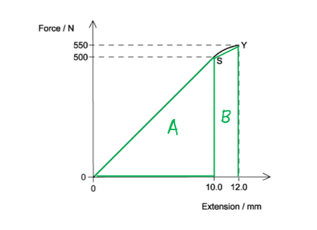
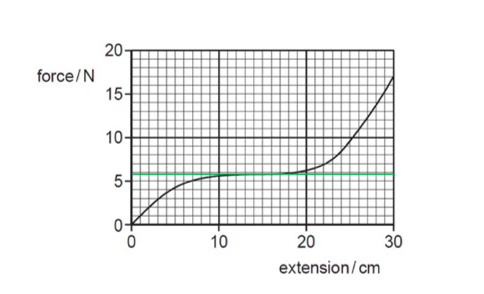
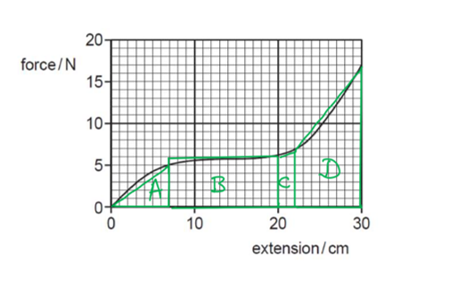
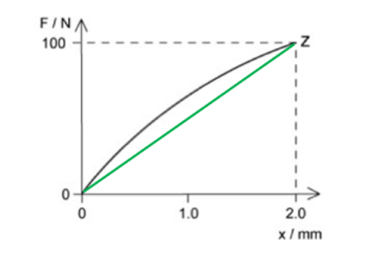
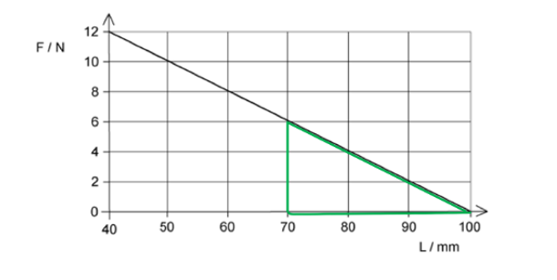
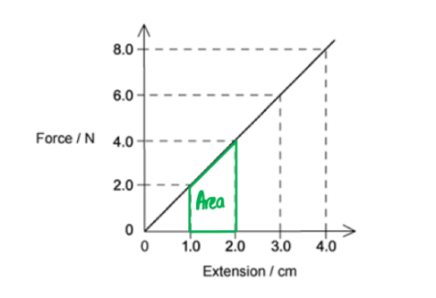
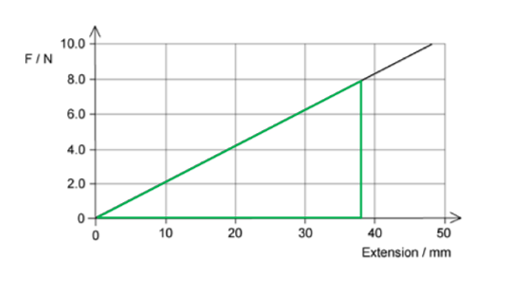
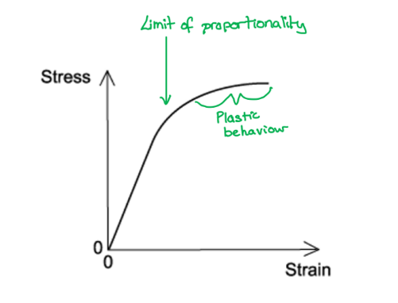

# Mark Schemes — Elastic & Plastic Behaviour
**6. Deformation of Solids** · Cambridge (CIE) A-LEVEL physics (9702)

## Multiple Choice Questions (25 questions)

### Q1
**Final answer:** **The correct answer is ****C**** because:**

- Work done = force × distance = area under the graph
- Divide the total shape into a triangle and a trapezium

- Area of shape A = $\frac{1}{2}\times500\times0.010=2.50J$
- Area of shape B = $1 \frac{1}{2} \times ( 500 + 550 ) \times 0.002 = 1.05 \mathrm{J}$

  - Therefore, total area $=2.50+1.05=3.55J$

### Q2
**Final answer:** **The correct answer is ****C**** because:**

- Elastic energy $=\frac{1}{2}Fx$
- Elastic energy per unit volume $=\frac{Fx}{2V}$
- Volume $=AL$, so, substituting this into the elastic energy per unit volume equation:

  - Elastic energy per unit volume $= \frac{F x}{2 A L} = \frac{x}{2 L} ( \frac{F}{A} )$
  - Tensile stress *S* is equal to $=\frac{F}{A}$
  - So, the elastic energy per unit volume $=\frac{xS}{2L}$
- Strain is equal to $=\frac{x}{L}$

  - So, elastic energy per unit volume $= \frac{S}{2} ( \frac{x}{L} )$
- Young modulus $E=\frac{stress}{strain}$

  - Therefore, strain $=\frac{x}{L}=\frac{S}{E}$
- Combining the volume and strain equations

  - Elastic energy per unit volume $= \frac{s}{2} ( \frac{S}{E} ) = \frac{S^{2}}{2 E}$

### Q3
**Final answer:** **The correct answer is ****D**** because:**

- The area under the force-extension graph gives the energy stored in the rubber cord
- Method 1: Draw a straight line on the graph to give the approximate mean force

  - Giving 6 N × 0.3 m = 1.8 J

- Method 2: Split the area into a series of triangles and rectangles to work out the total area 

  - Area A = ½ × 0.07 × 5 = 0.175J
  - Area B = (0.20 – 0.07) × 5.5 = 0.715 J
  - Area C = ½ × (5.5 + 6) × 0.02 = 0.115 J
  - Area D = ½ × (6 + 17) × (0.30 - 0.22) = 0.92 J
  - Total area = 0.175 + 0.715 + 0.115 + 0.92 = 1.925 J
  - The best estimate is option **D**

### Q4
**Final answer:** **The correct answer is ****B ****because:**

- The area under a force-extension curve gives strain energy
- Draw a straight line drawn from (0, 0) to point Z

- Calculate the area of the triangle

  - Strain energy $= 1 \frac{1}{2} F x = 1 \frac{1}{2} \times 100 \times ( 2 \times 10^{- 3} ) = 0.1 \mathrm{J}$
- This is less than the area under curve shown in the graph
- The answer should be about 10% greater to account for the curve = 0.11 J

**A **is incorrect because this is twice the calculated value so too big

**C **& **D **are incorrect because the actual area under the curve should be greater than the figure calculated

### Q5
**Final answer:** **The correct answer is ****C ****because:**

- Elastic potential energy $\frac{1}{2}Fx$
- From the graph

  - When the extension is *x* = 0.03 m
  - Force is equal to *F* = 6.3 N
  - Strain energy $=\frac{1}{2}\times6.3\times0.03=0.0945J$
- Therefore, the energy stored in the spring is 0.095 J

### Q6
**Final answer:** **The correct answer is ****A**** because:**

- Using Hooke’s law $F=kx$

  - Where *k* is the spring constant, 3.0 N cm−1, or 300 N m−1
- Strain energy = $\frac{1}{2}Fx$
- Consider option **A**:

  - Force = 24 N, extension = 0.08 m
  - Strain energy $=\frac{1}{2}\times24\times0.08=0.96J=960\mathrm{mJ}$

**B **is incorrect because force = 12 N, extension = 0.03 m

strain energy = 0.5 × 12 × 0.03 = 0.18 J = 180 mJ

**C **is incorrect because force = 6 N, extension = 0.02 m

strain energy = 0.5 × 6 × 0.02 = 0.06 J = 60 mJ

**D **is incorrect because force = 3.0 N, extension = 0.01 m

strain energy = 0.5 × 3 × 0.01 = 0.015 J = 15 mJ

### Q7
**Final answer:** **The correct answer is ****C**** because:**

- Elastic potential energy is equal to $\frac{1}{2}Fx$
- It is represented by the area under the force-extension graph
- The graph that shows the largest area under the line or curve is **C**

### Q8
**Final answer:** **The correct answer is ****B ****because:**

- Elastic strain energy $=\frac{1}{2}Fx$

  - Therefore, the area under the force-extension graph equals the work done

- The applied load needs to be converted from kg to N by multiplying by *g* = 9.81 m s–2
- The work done is equal to the difference in the elastic strain energy between extensions 10 mm and 20 mm

  - At extension 10 mm (0.01 m), load = 2.0 × *g*
  - At extension 20 mm (0.02 m), load = 3.9 × *g*

- Work done = $\frac{1}{2}$× [(3.9 × 9.81 × 0.02) – (2.0 × 9.81 × 0.01)] = 0.284 J

  - Therefore, the work is done on the wire is 0.28 J, which is option **B**

### Q9
**Final answer:** **The correct answer is ****D**** because:**

- Brittle materials break easily under tension
- Ductile materials are solids that can deform under tensile stress
- Aluminium can sustain a larger plastic deformation than steel, so the correct answer is **D**

**A **is incorrect because steel is ductile, but aluminium can sustain a larger plastic deformation

**B **&** C **are incorrect because glass and carbon are examples of brittle materials and will break easily with a small tension

### Q10
**Final answer:** **The correct answer is ****C**** because:**

- The area under the curve OXZ is the work done in stretching the rubber band

  - Area S represents the amount of thermal energy dissipated to the surroundings
  - Area T represents the energy that is stored at maximum extension
- Therefore, the minimum energy required to stretch the band to *e *is equal to = (area S + area T)

**A, B & D **are incorrect because the area S represents the amount of thermal energy dissipated to the surroundings by the rubber band

### Q11
**Final answer:** **The correct answer is ****D ****because:**

- The force-extension graph shows the strain energy (work done)

  - Strain energy is equal to $\frac{1}{2}Fx$
- Rubber is a polymer and when fully stretched the long-chain molecules are fully lined up so the rubber will not stretch any more

  - Rubber deforms elastically up to a certain point as the polymers chains, which were previously curled up, uncurl
- Graph **D** shows that once the band is stretched fully, it takes lots of force to increase the extension

**A **is incorrect because the graph suggests that once stretched no extra force is needed to extend the rubber

**B **is incorrect because the graph shows a material that obeys Hooke’s law

**C **is incorrect because the graph suggests that less force is needed to extend the rubber band even for a small extension

### Q12
**Final answer:** **The correct answer is ****A**** because:**

- The question states that Hooke’s law is obeyed so that graph would be a straight line passing through the origin
- The triangular area under the graph represents the elastic strain energy
- Therefore, the equation for elastic strain energy is $=\frac{1}{2}Fx$

### Q13
**Final answer:** **The correct answer is ****B**** because:**

- Strain is the measurement of how much an object is stretched
- Strain energy is equal to $\frac{1}{2}kx^{2}==\frac{1}{2}Fx$
- The question states that the area under the graph shows the total strain energy stored
- For this to be true, the axis must be:

  - X = extension *x*
  - Y = force *F*

### Q14
**Final answer:** **The correct answer is ****C**** because:**

- Energy stored in a spring is equal to $=\frac{1}{2}Fx$
- The area under the tension-length graph gives the energy stored in the spring

  - Therefore, strain energy =$1 \frac{1}{2} \times ( 2.0 - 0 ) \times ( 0.9 - 0.5 ) = 0.40 \mathrm{J}$

**Exam Tip: **Strain is equal to $\frac{extension}{originallength}$   this is not the same as the energy stored in the spring

### Q15
**Final answer:** **The correct answer is ****B**** because:**

- Force-extension graphs tell us about the strain on a material
- Elasticity is the ability of the material to resist a permanent change, that is it will return to its original shape and size after the stress is removed
- Plasticity is a non-reversible change of shape in response to a force

  - Point S on the graph is the limit of proportionality
  - Point T is the elastic limit
- After the elastic limit, the material would exhibit plastic behaviour, meaning it would have a permanently changed shape
- Therefore, as the sample has not gone past point T, the material would be exhibiting elastic behaviour, but not plastic behaviour

### Q16
**Final answer:** **The correct answer is ****C**** because:**

- Strain energy$=\frac{1}{2}Fx$

  - So, the area under the curve in a force-extension graph equals the work done
- *Q*, *S* and *T* show sections of the area under the line
- The materials behaviour is shown as the force is applied and then removed

  - Therefore, to calculate the work done the total area enclosed by the curve is needed so *Q* + *S*

### Q17
**Final answer:** **The correct answer is ****D**** because:**

- The original length of the spring is 100 mm this is shown on the graph where the force is zero
- The energy stored when the spring is compressed to 70 mm is equal to the area under the graph

  - Therefore, compression = 100 – 70 = 30 mm = 0.03 m

- Elastic potential energy = $\frac{1}{2}Fx$

  - From the graph:
  - When compression = 100 – 70 = 30 mm = 0.03 m
  - Force = 6 – 0 = 6.0 N
- Therefore, strain energy $=\frac{1}{2}\times6.0\times0.03=0.090J$

### Q18
**Final answer:** **The correct answer is ****C**** because:**

- The elastic limit is just beyond the limit of proportionality

  - If you increase the load beyond this point, the material will deform plastically
- The limit of proportionality is shown by point Y

  - This is the point after which Hooke’s Law is no longer obeyed
- Therefore, the elastic limit is just beyond point Y

**A **is incorrect because point Z is beyond the elastic limit since plastic deformation occurs when the force is removed

**B **is incorrect because Y shows the limit of proportionality

**D **is incorrect because between point X and Y the force is proportional to the extension

### Q19
**Final answer:** **The correct answer is ****C ****because:**

- The strain energy is the energy stored in an elastic body under loading
- The spring is elastic and obeying Hooke’s law as the graph is proportional and goes through the origin

  - The spring has an original length of 1.0 cm
  - The strain energy is equal to the area under the force-extension graph.
- The question asks for the increase in length, not extension
- Original length = 1.0 cm

  - When length = 2.0 cm, extension$=2.0-1.0=1.0\mathrm{cm}$ extension
  - When length = 3.0 cm,  extension = $3.0-1.0=2.0\mathrm{cm}$
- The strain energy can be calculated from the area under the graph between 1.0 cm and 2.0 cm, 1.0 cm = 0.01 m

- Area of a trapezium $\frac{1}{2}\times\sumparallelsides\timesheight$
- Therefore, the strain energy stored is $= 1 \frac{1}{2} \times ( 2.0 + 4.0 ) \times 0.01 = 0.030 \mathrm{J}$

### Q20
**Final answer:** **The correct answer is ****A**** because:**

- Elasticity is the ability of the material to resist a permanent change, that is it will return to its original shape and size after the stress is removed

  - Hence, an elastic material will return to its original shape and size
- Plasticity is a non-reversible change of shape in response to a force

  - Hence, a plastic material will suffer a permanent deformation

**B **is incorrect because materials with plastic behaviour will not extend continuously

**C **is incorrect because not all elastic materials will show a linear force-extension curve, consider rubber

**D **is incorrect because the definition of a material obeying Hooke’s law is that extends only within the limit of proportionality

### Q21
**Final answer:** **The correct answer is ****B**** because:**

- The elastic limit is shown by point P

  - This is the point at which if you increase the load any further, the material will deform plastically
- Therefore the plastic deformation is beyond point P
- The work done will be the area under the line in a load-extension graph

  - In this case, the extension *e* is on the y-axis and the load *L* is on the x-axis, so we require the area between the curve and the y-axis

**A **is incorrect because plastic deformation is the area under a force-extension graph not extension-force

**C **is incorrect because the graph shows the work done for the whole extension not just plastic deformation

**D **is incorrect because work done is the area under a force-extension graph not extension-force

**Exam Tip:** always check the axes of the graph, many exam questions will change the axes to a form you are not used to in order to catch you out, so look out!

### Q22
**Final answer:** **The correct answer is ****A**** because:**

- The elastic potential energy is the area under the force-extension graph.
- The question asks for the elastic potential energy when a force of 8.0 N is applied

- Elastic potential energy$=\frac{1}{2}Fx$
- Elastic potential energy  $=\frac{1}{2}\times8.0\times0.038=0.152Jor152\mathrm{mJ}$

### Q23
**Final answer:** **The correct answer is ****D**** because:**

- Brittle materials break easily under tension
- Ductile materials are solids that can deform under tensile stress
- A ductile material will withstand large plastic strain, whereas a brittle material will not
- A metal wire tends to be described as ductile as it will experience a large amount of extension when subjected to stress, especially beyond the elastic limit

- A ductile metal will obey Hooke’s law initially, which is represented as a straight line on the graph
- The metal would then exhibit plastic behaviour after the limit of proportionality, which is represented on the graph as a curve

**A **is incorrect because the graph shows an unusual shape stress-strain graph associated with a polymer, such as rubber

**B **is incorrect because the graph doesn’t show proportionality

**C **is incorrect because the graph shows a brittle material that shows no plastic strain

### Q24
**Final answer:** **The correct answer is ****C**** because:**

- Elastic potential energy is the energy stored as a result of deformation of an elastic object

  - Elastic potential energy $=\frac{1}{2}Fx$
- The spring constant *k* of each of the springs is different as well as the extension *x* due to the load applied
- For spring S1:

  - $E=\frac{1}{2}Fx$
  - $F=\frac{2E}{x}$
- For spring S2:

  - $E_{2} = 1 \frac{1}{2} F ( \frac{x}{3} ) = \frac{1}{6} F x$
- Since the load *F *applied to both springs is the same

  - $F=\frac{6E_{2}}{x}$
  - $F=\frac{2E}{x}=\frac{6E_{2}}{x}$
  - $E_{2}=\frac{2E}{6}=\frac{E}{3}$

Therefore, if spring S1 extends by *x*, then the energy stored in S2 will be $\frac{E}{3}$

### Q25
**Final answer:** **The correct answer is ****D**** because:**

- The area under the force-extension graph shows the strain energy (work done)

  - Strain energy is equal to$=\frac{1}{2}Fx$
- The area under the stretching graph is the energy used in stretching the rubber
- The area under the contraction graph is less than the area of the stretching graph
- The difference is shown in the shaded area between the two

  - This is the thermal energy which is dissipated to the surroundings

**A **is incorrect because the amount of elastic energy stored in the rubber is the total area under both curves

**B **is incorrect because the work done by the rubber cord during contraction is represented by the area under the lower curve

**C **is incorrect because the work done on the rubber cord during stretching is represented by the area under the upper curve
