# Mark Schemes — Elastic & Plastic Behaviour
**6. Deformation of Solids** · Cambridge (CIE) A-LEVEL physics (9702)

## Multiple Choice Questions (25 questions)

### Q1
**Final answer:** **The correct answer is ****C**** because:**

- Work done = force × distance = area under the graph
- Divide the total shape into a triangle and a trapezium

- Area of shape A = $\frac{1}{2}\times500\times0.010=2.50J$
- Area of shape B = $1 \frac{1}{2} \times ( 500 + 550 ) \times 0.002 = 1.05 \mathrm{J}$

  - Therefore, total area $=2.50+1.05=3.55J$

### Q2
**Final answer:** **The correct answer is ****C**** because:**

- Elastic energy $=\frac{1}{2}Fx$
- Elastic energy per unit volume $=\frac{Fx}{2V}$
- Volume $=AL$, so, substituting this into the elastic energy per unit volume equation:

  - Elastic energy per unit volume $= \frac{F x}{2 A L} = \frac{x}{2 L} ( \frac{F}{A} )$
  - Tensile stress *S* is equal to $=\frac{F}{A}$
  - So, the elastic energy per unit volume $=\frac{xS}{2L}$
- Strain is equal to $=\frac{x}{L}$

  - So, elastic energy per unit volume $= \frac{S}{2} ( \frac{x}{L} )$
- Young modulus $E=\frac{stress}{strain}$

  - Therefore, strain $=\frac{x}{L}=\frac{S}{E}$
- Combining the volume and strain equations

  - Elastic energy per unit volume $= \frac{s}{2} ( \frac{S}{E} ) = \frac{S^{2}}{2 E}$

### Q3
**Final answer:** **The correct answer is ****D**** because:**

- The area under the force-extension graph gives the energy stored in the rubber cord
- Method 1: Draw a straight line on the graph to give the approximate mean force

  - Giving 6 N × 0.3 m = 1.8 J

- Method 2: Split the area into a series of triangles and rectangles to work out the total area 

  - Area A = ½ × 0.07 × 5 = 0.175J
  - Area B = (0.20 – 0.07) × 5.5 = 0.715 J
  - Area C = ½ × (5.5 + 6) × 0.02 = 0.115 J
  - Area D = ½ × (6 + 17) × (0.30 - 0.22) = 0.92 J
  - Total area = 0.175 + 0.715 + 0.115 + 0.92 = 1.925 J
  - The best estimate is option **D**

### Q4
**Final answer:** **The correct answer is ****B ****because:**

- The area under a force-extension curve gives strain energy
- Draw a straight line drawn from (0, 0) to point Z

- Calculate the area of the triangle

  - Strain energy $= 1 \frac{1}{2} F x = 1 \frac{1}{2} \times 100 \times ( 2 \times 10^{- 3} ) = 0.1 \mathrm{J}$
- This is less than the area under curve shown in the graph
- The answer should be about 10% greater to account for the curve = 0.11 J

**A **is incorrect because this is twice the calculated value so too big

**C **& **D **are incorrect because the actual area under the curve should be greater than the figure calculated

### Q5
**Final answer:** **The correct answer is ****C ****because:**

- Elastic potential energy $\frac{1}{2}Fx$
- From the graph

  - When the extension is *x* = 0.03 m
  - Force is equal to *F* = 6.3 N
  - Strain energy $=\frac{1}{2}\times6.3\times0.03=0.0945J$
- Therefore, the energy stored in the spring is 0.095 J

### Q6
**Final answer:** **The correct answer is ****A**** because:**

- Using Hooke’s law $F=kx$

  - Where *k* is the spring constant, 3.0 N cm−1, or 300 N m−1
- Strain energy = $\frac{1}{2}Fx$
- Consider option **A**:

  - Force = 24 N, extension = 0.08 m
  - Strain energy $=\frac{1}{2}\times24\times0.08=0.96J=960\mathrm{mJ}$

**B **is incorrect because force = 12 N, extension = 0.03 m

strain energy = 0.5 × 12 × 0.03 = 0.18 J = 180 mJ

**C **is incorrect because force = 6 N, extension = 0.02 m

strain energy = 0.5 × 6 × 0.02 = 0.06 J = 60 mJ

**D **is incorrect because force = 3.0 N, extension = 0.01 m

strain energy = 0.5 × 3 × 0.01 = 0.015 J = 15 mJ

### Q7
**Final answer:** **The correct answer is ****C**** because:**

- Elastic potential energy is equal to $\frac{1}{2}Fx$
- It is represented by the area under the force-extension graph
- The graph that shows the largest area under the line or curve is **C**

### Q8
**Final answer:** **The correct answer is ****B ****because:**

- Elastic strain energy $=\frac{1}{2}Fx$

  - Therefore, the area under the force-extension graph equals the work done

- The applied load needs to be converted from kg to N by multiplying by *g* = 9.81 m s–2
- The work done is equal to the difference in the elastic strain energy between extensions 10 mm and 20 mm

  - At extension 10 mm (0.01 m), load = 2.0 × *g*
  - At extension 20 mm (0.02 m), load = 3.9 × *g*

- Work done = $\frac{1}{2}$× [(3.9 × 9.81 × 0.02) – (2.0 × 9.81 × 0.01)] = 0.284 J

  - Therefore, the work is done on the wire is 0.28 J, which is option **B**

### Q9
**Final answer:** **The correct answer is ****D**** because:**

- Brittle materials break easily under tension
- Ductile materials are solids that can deform under tensile stress
- Aluminium can sustain a larger plastic deformation than steel, so the correct answer is **D**

**A **is incorrect because steel is ductile, but aluminium can sustain a larger plastic deformation

**B **&** C **are incorrect because glass and carbon are examples of brittle materials and will break easily with a small tension

### Q10
**Final answer:** **The correct answer is ****C**** because:**

- The area under the curve OXZ is the work done in stretching the rubber band

  - Area S represents the amount of thermal energy dissipated to the surroundings
  - Area T represents the energy that is stored at maximum extension
- Therefore, the minimum energy required to stretch the band to *e *is equal to = (area S + area T)

**A, B & D **are incorrect because the area S represents the amount of thermal energy dissipated to the surroundings by the rubber band

### Q11
**Final answer:** **The correct answer is ****D ****because:**

- The force-extension graph shows the strain energy (work done)

  - Strain energy is equal to $\frac{1}{2}Fx$
- Rubber is a polymer and when fully stretched the long-chain molecules are fully lined up so the rubber will not stretch any more

  - Rubber deforms elastically up to a certain point as the polymers chains, which were previously curled up, uncurl
- Graph **D** shows that once the band is stretched fully, it takes lots of force to increase the extension

**A **is incorrect because the graph suggests that once stretched no extra force is needed to extend the rubber

**B **is incorrect because the graph shows a material that obeys Hooke’s law

**C **is incorrect because the graph suggests that less force is needed to extend the rubber band even for a small extension

### Q12
**Final answer:** **The correct answer is ****A**** because:**

- The question states that Hooke’s law is obeyed so that graph would be a straight line passing through the origin
- The triangular area under the graph represents the elastic strain energy
- Therefore, the equation for elastic strain energy is $=\frac{1}{2}Fx$

### Q13
**Final answer:** **The correct answer is ****B**** because:**

- Strain is the measurement of how much an object is stretched
- Strain energy is equal to $\frac{1}{2}kx^{2}==\frac{1}{2}Fx$
- The question states that the area under the graph shows the total strain energy stored
- For this to be true, the axis must be:

  - X = extension *x*
  - Y = force *F*

### Q14
**Final answer:** **The correct answer is ****C**** because:**

- Energy stored in a spring is equal to $=\frac{1}{2}Fx$
- The area under the tension-length graph gives the energy stored in the spring

  - Therefore, strain energy =$1 \frac{1}{2} \times ( 2.0 - 0 ) \times ( 0.9 - 0.5 ) = 0.40 \mathrm{J}$

**Exam Tip: **Strain is equal to $\frac{extension}{originallength}$   this is not the same as the energy stored in the spring

### Q15
**Final answer:** **The correct answer is ****B**** because:**

- Force-extension graphs tell us about the strain on a material
- Elasticity is the ability of the material to resist a permanent change, that is it will return to its original shape and size after the stress is removed
- Plasticity is a non-reversible change of shape in response to a force

  - Point S on the graph is the limit of proportionality
  - Point T is the elastic limit
- After the elastic limit, the material would exhibit plastic behaviour, meaning it would have a permanently changed shape
- Therefore, as the sample has not gone past point T, the material would be exhibiting elastic behaviour, but not plastic behaviour

### Q16
**Final answer:** **The correct answer is ****C**** because:**

- Strain energy$=\frac{1}{2}Fx$

  - So, the area under the curve in a force-extension graph equals the work done
- *Q*, *S* and *T* show sections of the area under the line
- The materials behaviour is shown as the force is applied and then removed

  - Therefore, to calculate the work done the total area enclosed by the curve is needed so *Q* + *S*

### Q17
**Final answer:** **The correct answer is ****D**** because:**

- The original length of the spring is 100 mm this is shown on the graph where the force is zero
- The energy stored when the spring is compressed to 70 mm is equal to the area under the graph

  - Therefore, compression = 100 – 70 = 30 mm = 0.03 m

- Elastic potential energy = $\frac{1}{2}Fx$

  - From the graph:
  - When compression = 100 – 70 = 30 mm = 0.03 m
  - Force = 6 – 0 = 6.0 N
- Therefore, strain energy $=\frac{1}{2}\times6.0\times0.03=0.090J$

### Q18
**Final answer:** **The correct answer is ****C**** because:**

- The elastic limit is just beyond the limit of proportionality

  - If you increase the load beyond this point, the material will deform plastically
- The limit of proportionality is shown by point Y

  - This is the point after which Hooke’s Law is no longer obeyed
- Therefore, the elastic limit is just beyond point Y

**A **is incorrect because point Z is beyond the elastic limit since plastic deformation occurs when the force is removed

**B **is incorrect because Y shows the limit of proportionality

**D **is incorrect because between point X and Y the force is proportional to the extension

### Q19
**Final answer:** **The correct answer is ****C ****because:**

- The strain energy is the energy stored in an elastic body under loading
- The spring is elastic and obeying Hooke’s law as the graph is proportional and goes through the origin

  - The spring has an original length of 1.0 cm
  - The strain energy is equal to the area under the force-extension graph.
- The question asks for the increase in length, not extension
- Original length = 1.0 cm

  - When length = 2.0 cm, extension$=2.0-1.0=1.0\mathrm{cm}$ extension
  - When length = 3.0 cm,  extension = $3.0-1.0=2.0\mathrm{cm}$
- The strain energy can be calculated from the area under the graph between 1.0 cm and 2.0 cm, 1.0 cm = 0.01 m

- Area of a trapezium $\frac{1}{2}\times\sumparallelsides\timesheight$
- Therefore, the strain energy stored is $= 1 \frac{1}{2} \times ( 2.0 + 4.0 ) \times 0.01 = 0.030 \mathrm{J}$

### Q20
**Final answer:** **The correct answer is ****A**** because:**

- Elasticity is the ability of the material to resist a permanent change, that is it will return to its original shape and size after the stress is removed

  - Hence, an elastic material will return to its original shape and size
- Plasticity is a non-reversible change of shape in response to a force

  - Hence, a plastic material will suffer a permanent deformation

**B **is incorrect because materials with plastic behaviour will not extend continuously

**C **is incorrect because not all elastic materials will show a linear force-extension curve, consider rubber

**D **is incorrect because the definition of a material obeying Hooke’s law is that extends only within the limit of proportionality

### Q21
**Final answer:** **The correct answer is ****B**** because:**

- The elastic limit is shown by point P

  - This is the point at which if you increase the load any further, the material will deform plastically
- Therefore the plastic deformation is beyond point P
- The work done will be the area under the line in a load-extension graph

  - In this case, the extension *e* is on the y-axis and the load *L* is on the x-axis, so we require the area between the curve and the y-axis

**A **is incorrect because plastic deformation is the area under a force-extension graph not extension-force

**C **is incorrect because the graph shows the work done for the whole extension not just plastic deformation

**D **is incorrect because work done is the area under a force-extension graph not extension-force

**Exam Tip:** always check the axes of the graph, many exam questions will change the axes to a form you are not used to in order to catch you out, so look out!

### Q22
**Final answer:** **The correct answer is ****A**** because:**

- The elastic potential energy is the area under the force-extension graph.
- The question asks for the elastic potential energy when a force of 8.0 N is applied

- Elastic potential energy$=\frac{1}{2}Fx$
- Elastic potential energy  $=\frac{1}{2}\times8.0\times0.038=0.152Jor152\mathrm{mJ}$

### Q23
**Final answer:** **The correct answer is ****D**** because:**

- Brittle materials break easily under tension
- Ductile materials are solids that can deform under tensile stress
- A ductile material will withstand large plastic strain, whereas a brittle material will not
- A metal wire tends to be described as ductile as it will experience a large amount of extension when subjected to stress, especially beyond the elastic limit

- A ductile metal will obey Hooke’s law initially, which is represented as a straight line on the graph
- The metal would then exhibit plastic behaviour after the limit of proportionality, which is represented on the graph as a curve

**A **is incorrect because the graph shows an unusual shape stress-strain graph associated with a polymer, such as rubber

**B **is incorrect because the graph doesn’t show proportionality

**C **is incorrect because the graph shows a brittle material that shows no plastic strain

### Q24
**Final answer:** **The correct answer is ****C**** because:**

- Elastic potential energy is the energy stored as a result of deformation of an elastic object

  - Elastic potential energy $=\frac{1}{2}Fx$
- The spring constant *k* of each of the springs is different as well as the extension *x* due to the load applied
- For spring S1:

  - $E=\frac{1}{2}Fx$
  - $F=\frac{2E}{x}$
- For spring S2:

  - $E_{2} = 1 \frac{1}{2} F ( \frac{x}{3} ) = \frac{1}{6} F x$
- Since the load *F *applied to both springs is the same

  - $F=\frac{6E_{2}}{x}$
  - $F=\frac{2E}{x}=\frac{6E_{2}}{x}$
  - $E_{2}=\frac{2E}{6}=\frac{E}{3}$

Therefore, if spring S1 extends by *x*, then the energy stored in S2 will be $\frac{E}{3}$

### Q25
**Final answer:** **The correct answer is ****D**** because:**

- The area under the force-extension graph shows the strain energy (work done)

  - Strain energy is equal to$=\frac{1}{2}Fx$
- The area under the stretching graph is the energy used in stretching the rubber
- The area under the contraction graph is less than the area of the stretching graph
- The difference is shown in the shaded area between the two

  - This is the thermal energy which is dissipated to the surroundings

**A **is incorrect because the amount of elastic energy stored in the rubber is the total area under both curves

**B **is incorrect because the work done by the rubber cord during contraction is represented by the area under the lower curve

**C **is incorrect because the work done on the rubber cord during stretching is represented by the area under the upper curve

## Structured Questions (10 questions)

### Q1
> **[mark-scheme]**
> (i) Stress is defined as:
> 
> - Force / load applied per unit cross-sectional area **[1 mark]**
> 
> (ii) Strain is defined as:
> 
> - The ratio of extension to original length **[1 mark]**
> **[mark-scheme]**
> Measurements required to determine the Young modulus of the metal:
> 
> - Measurement: Original length (of wire) **AND ** Instrument: Metre rule **OR**  tape measure **[1 mark]**
> 
> - Measurement: Diameter (of wire) **AND ** Instrument: Micrometer (screw gauge) **OR** (digital) callipers **[1 mark]**
> 
> Answers must link the dimension to the correct instrument, e.g. measuring length with a micrometer would not be reasonable.
(i) To calculate the elastic potential energy stored in the wire when $F$ = 60 N:

- Recall how to determine elastic potential energy from the force-extension graph:

$E$ = area under the graph

**OR**

$E=\frac{1}{2}Fx$ **[1 mark]**

- Calculate the elastic potential energy:

From the graph: when $F=60N$, $x=5.0\mathrm{mm}=0.005m$

$E=\frac{1}{2}\times60\times0.005$

$E=$ $0.15J$ **[1 mark]**

> **[mark-scheme]**
> (ii) To check that the elastic limit of the wire has not been exceeded:
> 
> - Remove the force / $F$, and the wire should return to its original length **[1 mark]**

### Q2
Plastic deformation is:

- When the load is removed; **[1 mark]**
- The object will not return to its original shape or length; **[1 mark]**

**[Total: 2 marks]**
A graph that would score 2 marks should look like:

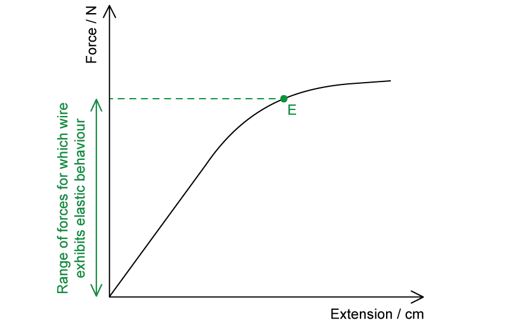

(i) Mark the elastic limit on Fig. 1.1:

- Point labelled E** **<u>just after</u> the <u>straight</u> line section of the graph; **[1 mark] **

(ii) Show clearly on the *y*–axis of  Fig. 1.1 the range of forces which cause the wire to exhibit elastic behaviour:

- Forces from 0 N up to point in line with E marked on y* *axis; **[1 mark]**** **

**[Total: 2 marks]**** **

> *Remember that the elastic limit lies on the **curved** part of the graph and is always **above** the limit of proportionality. The limit of proportionality is the last point on the straight line section of the graph.*
A graph that would score 3 marks should look like:

- Straight line; **[1 mark]**
- From end of graph to a positive value on the x–axis; **[1 mark]**
- With the same gradient as the straight part of given graph; **[1 mark]**

**[Total: 3 marks]**

> *When a force of 15.0 N is applied, we can see that the curve is a good distance beyond the straight section of the graph, therefore the wire will have undergone **plastic deformation**.*
Calculate the spring constant of the spring:

List the known quantities:

- Extension, $x$ = 8.0 cm = 0.08 m
- Elastic potential energy, $E_{P}$ = 24 J

Recall the equation for elastic potential energy:

- $E_{P}=\frac{1}{2}kx^{2}$ **[1 mark]**

Rearrange for *k* :

- $k=\frac{2E_{P}}{x^{2}}=\frac{2\times24}{0.08^{2}}$ **[1 mark]**
- $k=7500Nm^{-1}$ **[1 mark]**

**[Total: 3 marks]**

### Q3
A property which the materials scientists are likely to test for:

**Final answer:** **Any one ****pair ****from:**

- Breaking stress; **[1 mark]**

  - *Reason*: to know how much force the material can withstand before breaking;** [1 mark]**
- Young Modulus; **[1 mark]**

  - *Reason*: to know the stiffness / how much material can deform before breaking;** [1 mark]**

**[Total: 2 marks]**
For the aluminium alloy:

(i) State the name of point **Q** and suggest why the scientists have drawn attention to it:

- Elastic limit: **[1 mark]**
- When more force is applied / beyond this point the material will no longer return to its original length / shape when the <u>force is removed</u>; **[1 mark]**
- Wings should deform / bend in use **AND** <u>after</u> must return to original shape; **[1 mark]**

(ii) Use the graph to determine the Young modulus of the aluminium alloy. Show your working:

- Clear attempt to find gradient of straight part of line marked on graph; **[1 mark]**

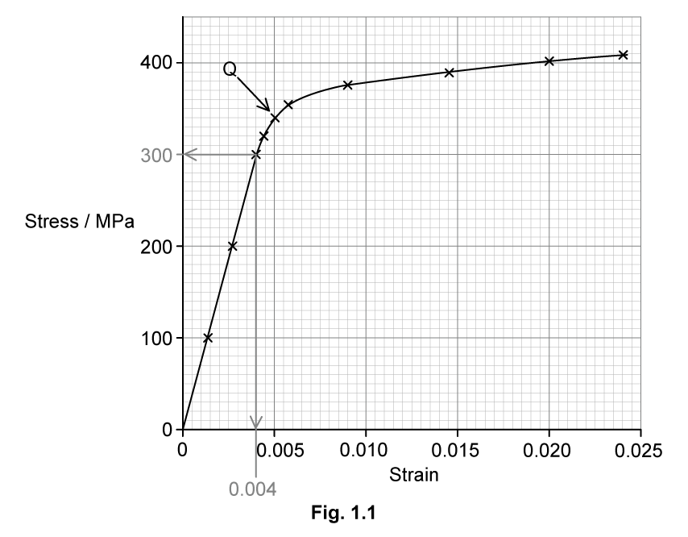

Calculate the gradient:

- $gradient=\frac{Δy}{Δx}=\frac{300\times10^{6}}{0.004}=7.5\times10^{10}$ **[1 mark]**

State the Young Modulus including units:

- $E=7.5\times10^{10}\mathrm{Pa}$ **[1 mark]**

**[Total: 6 marks]**

> *In graphical questions the examiner is usually looking for evidence that you know how to use a graph to analyse data. *

> *Notice that the first mark here is for taking the gradient of the **straight** part of the graph, using **as much of the line as possible**, and **marking it clearly** on the graph.*

> *If you mark out a large section of line but get the gradient wrong, you **will still get this mark**.*

> *If you use a small triangle, even if you are lucky enough to get the gradient correct, you will **not **get this mark.*
Calculate the elastic potential energy stored in the wire:

List the known quantities:

- Stress, σ = 190 MPa = 190 × 106 Pa
- Extension, *x* = 7.5 cm = 0.075 m
- Diameter of the wire, *d* = 1.2 mm = 1.2 × 10−3 m

Calculate the cross-sectional area of the wire, *A*:

- $A=πr^{2}$
- $A = \pi ( \frac{1.2 \times 10^{- 3} }{2} )^{2}$
- $A=1.13\times10^{-6}m^{2}$ **[1 mark]**

Calculate the force, *F *applied to the wire:

- Stress, $σ=\frac{F}{A}$ $\rightarrow$ $F=σA$
- $F = ( 190 \times 10^{6 ) \times ( 1.13 \times 10^{-6} } )$
- $F=214.7N$ **[1 mark]**

Calculate the elastic potential energy, *E**p* stored in the wire:

- $E_{p}=\frac{1}{2}Fx$
- $E_{p}=\frac{1}{2}\times214.7\times0.075$
- $E_{p}=8.05J$ **[1 mark]**

**[Total: 3 marks]**

### Q4
Calculate the compressive force exerted on the bar:

List the known quantities:

- Cross-sectional area of bar, $A$ = 4.5 × 10−4 m2
- Length of bar, $x$ = 40 mm
- Compression of bar, $\Deltax$ = 0.20 mm
- Young-Modulus, $E$ = 2.1 × 1011 Pa

Use the full equation for the Young Modulus:

- $E=\frac{F}{A}\times\frac{x}{Δx}$

Rearrange to make *F* the subject and calculate:

- $F = \frac{E \times A \times \Delta x}{x} = \frac{( 2.1 \times 10^{11 ) \times ( 4.5 \times 10^{-4} } ) \times 0.2}{40}$ **[1 mark]**
- $F=472500$ N

Write the answer to two sig figs and include the unit:

- $F=4.7\times10^{5}N$ **[1 mark]**

**[Total: 2 marks]**
Calculate the work done compressing the bar:

List the known quantities:

- Compressive force on bar, $F$ = 4.7 × 105 N (from part (a))
- Compression of bar, $\Deltax$ = 0.2 × 10−3 m (from part (a))

Use the equation for elastic energy stored in the bar:

- $E_{P}=\frac{1}{2}\timesF\timess$
- $E_{P} = 1 \frac{1}{2} ( 4.7 \times 10^{5 ) \times ( 0.2 \times 10^{-3} } )$ **[1 mark]**
- $W=47J$ **[1 mark]**

**[Total: 2 marks]**
For the compression described in part (a)

(i) Sketch a graph to show the compression, assuming that the elastic limit has not been reached:

**A graph which would score ****two marks**** looks like:**

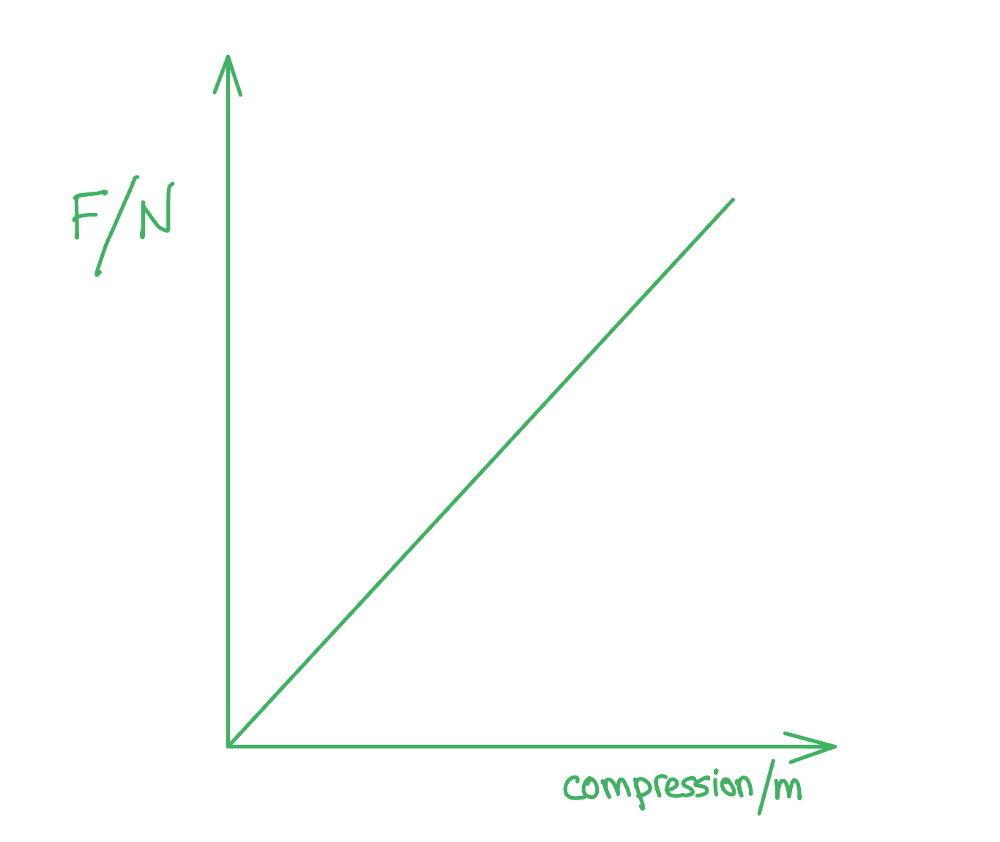

- Both axes labelled force and <u>compression</u> as shown; **[1 mark]**
- Straight line through the origin; **[1 mark]**

(ii) Suggest how the elastic potential energy could be ascertained from the graph:

- The area under the graph;** [1 mark]**

**[Total: 3 marks]**

### Q5
List the known quantities:

- Change in elastic potential energy, Δ*E* = 0.30 J
- Force, *F* = 4.0 N
- Extension of spring in Fig. 1.1, $\Deltax_{a}$= 10.5 cm – 2.2 cm = 8.3 cm = 0.083 m
- Original length, *L* = 2.2 cm = 0.022 m

Calculate the spring constant of the spring, *k*:

- Hooke’s law: *F* = *k *Δx
- *k * = $\frac{F}{\Deltax}$ = $\frac{4.0}{0.083}$ = 48.19 = 48 N m–1 **[1 mark]**

Determine the equation for the change in elastic potential energy, Δ*E*:

- Elastic potential energy, *E*  = $\frac{1}{2}$× *k *× (Δ*x*)2

  - It is the same spring, so both scenarios have the same value of *k*
- Δ*E*  = $\frac{1}{2}$*k *(($\Deltax_{b}$)2 – ($\Deltax_{a}$)2) **[1 mark]**

  - Where $\Deltax_{a}$ is the extension of the spring in Fig. 1.1 and $\Deltax_{b}$ is the extension in Fig. 1.2

Rearrange the equation for the extension in Fig. 1.2, $\Deltax_{b}$:

- $\Deltax_{b}$= $\sqrt{ \frac{2 \Delta E}{k} + ( \Delta x_{a} )^{2}}$
- $\Deltax_{b}$= $\sqrt{ \frac{2 \times 0.30}{48} + ( 0.083 )^{2}}$ = 0.139 = 0.14 m **[1 mark]**

Calculate length of the spring:

- Length = *L* + $\Deltax_{b}$ = 0.022 + 0.14 = 0.162 m (16.2 cm) **[1 mark]**** **

**[Total: 4 marks]**** **

> *Remember to convert to **metres** from **centimetres** for all the extension and lengths. This is because the change in elastic potential energy, **E** is measured in **Joules (J)**. The SI base unit for Joules is **N m**. Therefore, the calculation will not work if you keep all your values in cm!*
List the known quantities:

- Spring constant, *k* = 48 N m–1 (from part a)
- Extension, $\Deltax_{b}$= 0.139 m (from part a)
- Weight, *W* = 4.0 N

Calculate the mass, *m*:

- *W* = *mg*
- *m* = $\frac{W}{g}=\frac{4.0}{9.81}=0.408$ kg **[1 mark]**

Calculate the resultant force, *F* on the object:

- Downwards force, $F_{d}$ = *W* = 4.0 N
- Upwards force, $F_{u}$= $k$$\Deltax_{b}$= 48 × 0.139 = 6.672 N
- Resultant force = $F_{u}-F_{d}$ = 6.672 – 4.0 = 2.672 N **[1 mark]**

Calculate acceleration, *a*:

- Resultant force, *F* = *ma*
- $a=\frac{F}{m}=\frac{2.672}{0.408}=6.55$ m s–2 **[1 mark]**** **

**[Total: 3 marks]**** **

> *It is important to understand the direction of forces to understand this question. There isn’t just the weight force pushing the spring downwards, but since the spring has been stretched when released it will go back to its equilibrium position. This is the upwards force, therefore the resultant force is upwards.*
List the known quantities:

- Change in elastic strain energy, Δ*E* = 0.30 J
- Force on spring in Fig. 1.1 = 4.0 N
- Extension of spring in Fig. 1.1, $\Deltax_{a}$ = 0.083 m
- Force on spring in Fig. 1.2 = 6.72 N (from part b)
- Extension of spring in Fig. 1.2, $\Deltax_{b}$= 0.14 m (from part a)

(i)   Sketch a graph on Fig. 1.3 to show the key values from the spring in equilibrium

A graph that would score 3 marks should look like:

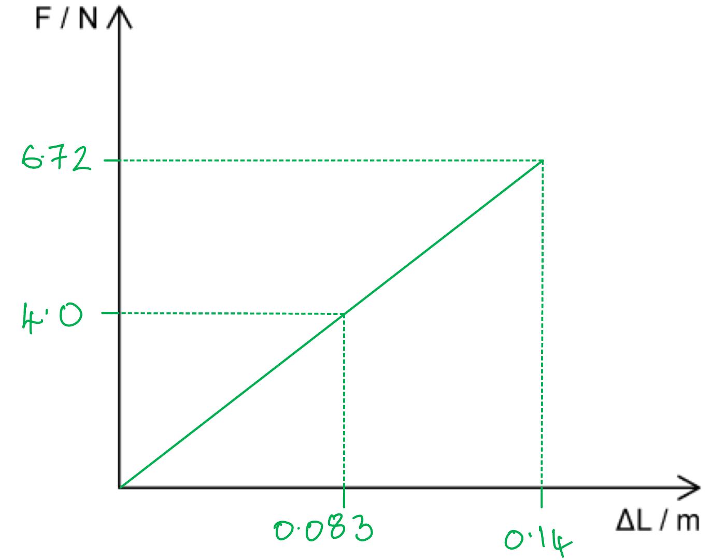

- Straight diagonal line upwards; **[1 mark]**
- Force and extension for spring in Fig. 1.1** **correctly labelled as 4.0 N; **[1 mark]**
- Force and extension for spring in Fig. 1.2** **correctly labelled as 6.72 N; **[1 mark]**
- The graph doesn’t extend past (0.14, 6.72); **[1 mark]**

(ii) Show that the graph also demonstrates that the change in elastic potential energy stored is 0.30 J

Calculate change in elastic potential energy from graph, Δ*E*:

- Elastic potential energy stored = <u>Area under the graph</u> =$\frac{1}{2}$*F Δx ***[1 mark]**
- Area under the graph for spring in Fig. 1.1 = 0.5 × 4.0 × 0.083 = 0.166 J
- Area under the graph for spring in Fig. 1.2** **= 0.5 × 6.72 × 0.14 = 0.4704 J
- Δ*E* = 0.4704 – 0.166 = 0.3044 = 0.30 J **[1 mark]**** **

**[Total: 6 marks]**** **

> *The final mark is for not extending the graph further than the values you have calculated. This is because past the point of extension in Fig. 1.2, it is not known whether or not the spring still obeys Hooke’s law. Therefore, the graph could still be a straight line **or** could start to curve, but this is not known in the question.** *

> *The area under the graph is a **right–angled triangle**.*

> *The area is equal to ½ × base × height.*
List the known quantities:

- Elastic potential energy in $S_{1}$, $E_{1}$= 19 mJ = 19 × 10–3 J
- Extension of $S_{1}$= *x*
- Extension of  $S_{2}=\frac{x}{5}$
- Spring constant of $S_{1}$= $k_{1}$
- Spring constant of $S_{2}$, $k_{2}$= 5$k_{1}$

Determine an expression for the elastic potential energy of $S_{2}$($E_{2}$) in terms of that of $S_{1}$($E_{1}$):

- $E_{1}$= $\frac{1}{2}k_{1}x^{2}$ = 19 × 10–3 J
- $E_{2}$ = $1 \frac{1}{2} k_{2} ( \frac{x}{5} )^{2}$ = $1 \frac{1}{2} k_{2} ( \frac{x^{2}}{25} )$ = $1 \frac{1}{2} 5 k_{1} ( \frac{x^{2}}{25} )$ = $\frac{1}{2}k_{1}\frac{x^{2}}{5}$  **[1 mark]**
- $E_{2}$= $\frac{E_{1}}{5}$** [1 mark] **

Calculate $E_{2}$:

- $E_{2}$= $\frac{19\times10^{-3}}{5}$ = 3.8 mJ **[1 mark]**** **

**[Total: 3 marks]**

### Q6
A graph that would score 2 marks should look like:

- Straight line starting at the origin (0,0);** [1 mark]**
- Ending at point** **A; **[1 mark]**** **

**[Total: 2 marks]**** **

> *We are told that the spring obeys Hooke’s law up to point A. This means that the extension of the spring will be **directly proportional** to the applied load. All directly proportional relationships will result in a graph which is a **straight line** through the **origin**.*
Point A is:

- Limit of proportionality; **[1 mark] **

**[Total: 1 mark] **

> *A common mistake is to mix up the limit of proportionality and the elastic limit. The limit of proportionality is the last point on the line where the load and extension are directly proportional.*
List the known quantities:

- Force applied to the spring, *F* = 12.0 N (from Fig. 1.1)
- Extension of the spring, Δ*L* = 8.0 cm = 0.08 m (from Fig. 1.1)

Calculate area under the graph:

- Energy stored in the spring, *E* = Area under graph = Area of a right-angled triangle;** [1 mark]**

- Area of a right-angled triangle = $\frac{1}{2}$ base ×  height

Substitute in values:

- *E* =$\frac{1}{2}$×12.0 × 0.08 **[1 mark]**
- *E* = 0.48 J** [1 mark] **

**[Total: 3 marks]**
(i) Point B is:

- The elastic limit; **[1 mark] **

(ii) Elastic deformation is:

- When the load extending the spring is removed; **[1 mark]**
- The spring will return to its original length; **[1 mark]**

**[Total: 3 marks]**

### Q7
(i) Describe, giving reasons for your answer, three properties of material **X**:

**Any ****three ****pairs (reason mark is dependent on being given for the correct description):**

- Larger Young Modulus / is stiffer than material Y; **[1 mark]**

  - *Reason*: the gradient is steeper; **[1 mark]**
- Does not undergo (any) plastic deformation before breaking; **[1 mark]**

  - *Reason*: the line does not curve / is straight to the end; **[1 mark]**
- Obeys Hooke's Law; **[1 mark]**

  - *Reason*: stress is always proportional to strain; **[1 mark]**
- Stronger (than Y); **[1 mark]**

  - *Reason*: higher breaking stress / needs greater force per area to break; **[1 mark]**

- Brittle; **[1 mark]**

  - *Reason*: does not exhibit plastic behaviour; **[1 mark]**

- Stores less elastic strain energy (for given values of strain); **[1 mark]**

  - *Reason*: extension is smaller / area under graph is always less; **[1 mark]**

(ii) State the meaning of points ***F*****x** and ***F*****y** and explain their significance:

- Breaking point / ultimate tensile strength; **[1 mark]**
- Shows the maximum stress per strain which material can withstand / how strong the material is; **[1 mark]**

**[Total: 8 marks]**

> *Dependent marks are given (or withheld) when an explanation is only worthy of credit if it attached to an explanation of something happening. Answers where you are asked to describe something (such as a graph changing, a spring stretching or a ball bouncing) in terms of a law of physics or an equation, will often have dependent marks.*

> *Make sure you give complete answers, rather than statements which are too short. Remember, your teacher may know you know something and be used to you skipping parts of answers, but your examiner has nothing to go on but what you write in the exam!*
State and explain which wire would be more suitable for use as cables and structural beams:

- Wire **Y**; **[1 mark]**
- Because cables and structural beams need to be able to bend / deform (by some amount) before they break;** [1 mark]**

**[Total: 2 marks]**
State two safety precautions which they must take and explain your answer:

- Wear safety glasses / goggles, <u>because</u> the wires will snap (and may cause eye damage); **[1 mark]**
- Wear safety shoes / steel-toed boots / arrange a safety mat under the weights,** **<u>because</u> (when the wire snaps) the weights will fall;** [1 mark]**

**[Total: 2 marks]**

### Q8
To calculate the spring constant of the spring:

Find the gradient of the graph:

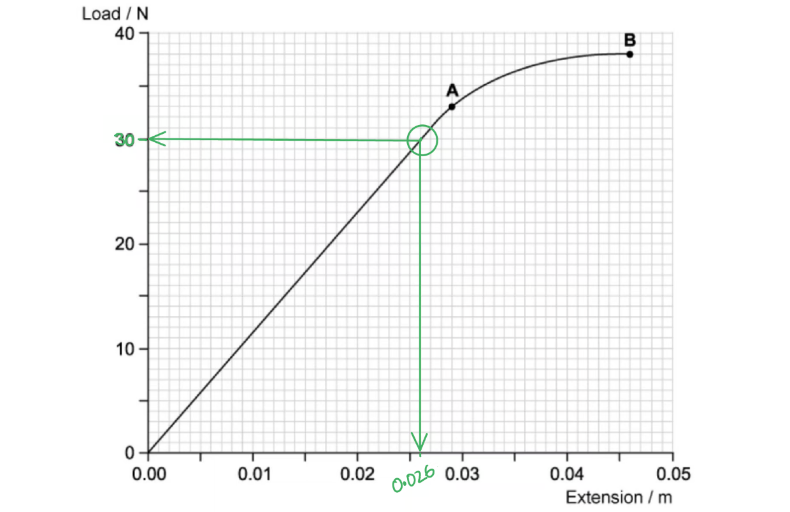

- A large triangle (must occupy at least half of the line) or other method clearly marked, on the straight part of the line; **[1 mark]**
- Spring constant = gradient, therefore $k=\frac{Δy}{Δx}=\frac{30}{0.026}$  **[1 mark]**
- $k=1154\mathrm{Nm}^{-1}$ **[1 mark]**

**[Total: 3 marks]**

> *Notice that the first mark here is for taking the gradient of the **straight** part of the graph, using **as much of the line as possible**, and **marking it clearly** on the graph.*

> *If you mark out a large section of line but get the gradient wrong, you **will **still get this mark.*

> *If you use a small triangle, even if you are lucky enough to get the gradient correct, you will **not **get this mark.*
Show that the work done in extending the spring up to point **A** is approximately 0.5 J:

Determine the area under the graph by dividing it into sections:

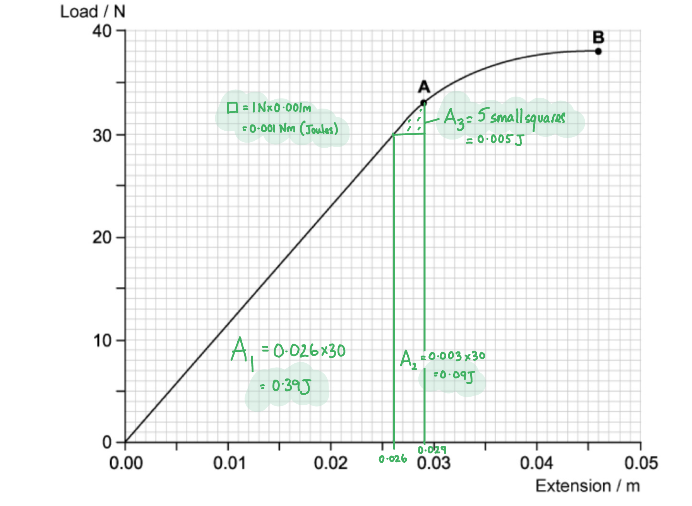

**Final answer:** **Any ****two ****from:**

- Area of triangle, $A_{1}=\frac{1}{2}\times0.026\times30=0.39J$ **[1 mark]**
- Area of rectangle,$A_{2}=0.003\times30=0.09J$  **[1 mark]**
- Area of small square, $A_{square} = 1 \times 0.001 = 0.001$ **[1 mark]**
- Count small squares = 5 **[1 mark]**
- So, $A_{3}$ = 0.005

Add up all *A* values for total work done:

- $W=0.39+0.09+0.005=0.485J$ **[1 mark]**

**[Total: 3 marks]**

> *The exact values you get for splitting the area under the graph into triangles and rectangles, and then counting squares, will depend on where you judged the sections to be. *

> *The examiner would check your working and mark it correct for your method. If you want to check your method, first check if you got the correct area. If so, then you did well. If not, ask a friend or teacher to take a look. The most likely mistake is in getting the decimal point in the correct place for the values on the x-axis.*

> *The final mark checks the accuracy of your method overall.*
Sketch the extension of the spring as the load is reduced to zero and explain the graph's shape:

**A graph that would score ****2 marks**** looks like:**

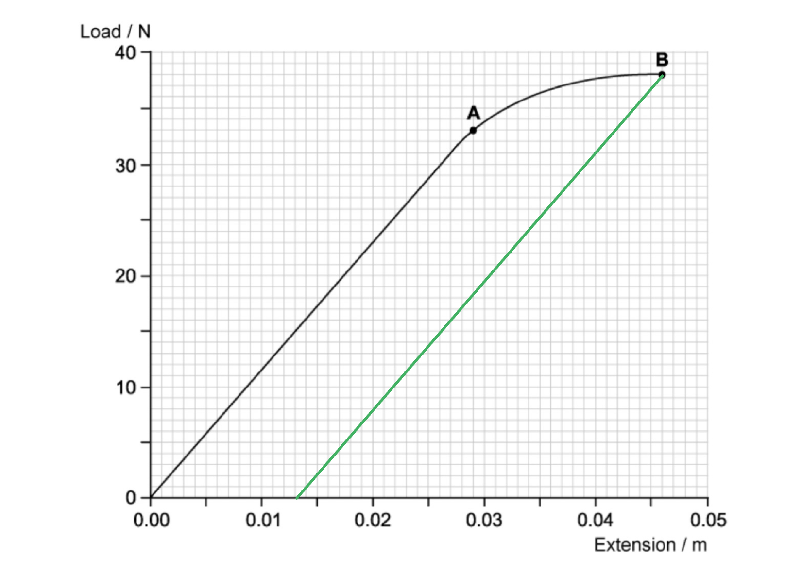

- Straight line from point **B** to the *x*-axis;** [1 mark]**
- Ends on *x*-axis in range 0.013 m - 0.014 m;** [1 mark]**

*Explanation*

- (The spring does not return to its original length because) it has been permanently deformed / has undergone plastic deformation; **[1 mark]**

**[Total: 3 marks]**
Compare the total work done unloading and loading the spring and explain how this is represented on the graph:

- The total work done when the load is removed / work done by spring is less than the work done by the load (in producing the extension);** [1 mark]**
- The area under a force-extension graph is the work done; ** [1 mark]**
- Therefore as the load is reduced to zero the area under the unloading curve is smaller since less work is done (OR reverse argument); ** [1 mark]**

**[Total: 3 marks]**

### Q9
List the known quantities:

- Unstretched length, *L* = 23 m
- Height of** **B above the ground, *x* = 3.1 m
- Mass of rider and harness, *m* = 65 kg
- Height of** **A above the ground, *h* = 51 m

Calculate the extension, Δ*L*:

- Since the rider is at their maximum height when the rope is unstretched, this means Δ*L* is the amplitude of the oscillations of the rider
- *h* = *x* + Δ*x + *Δ*x + L*
- *2*Δ*L *= *h – x – L *= 51 – 3.1 – 23 = 24.9
- Δ*L* = $\frac{24.9}{2}=12.45$ m **[1 mark]*** *

Compared forces on the rider in equilibrium:

- When the rider eventually comes to rest, suspended above the ground, their force downwards (weight) will equal the force upwards from Hooke’s law
- So, *mg* = *k*Δ*x ***[1 mark]**

Calculate the spring constant, *k*:

- $k=\frac{mg}{\Deltax}=\frac{65\times9.81}{12.45}=51.22$ N m–1 
- $k = 51 \mathrm{N} \mathrm{m}^{- 1} ( 2 \mathrm{s} . \mathrm{f} . )$ **[1 mark]**** **

**[Total: 3 marks]**** **

> *Although the calculations for this question are not necessarily difficult, the setup of the question requires some thinking. Drawing a free-body diagram can help visualise which forces and distances are required here. The important part is that **A** is adjusted so that the rope is unstretched when the rider reaches the maximum amplitude of their oscillation (i.e. the rope doesn’t go completely slack and continue upwards from the force, and instead is still vertically downwards, just unstretched). *

> *This means that the combination of the initial height above the ground (**x**) the maximum (Δ**L**) and minimum amplitude (Δ**L**) of the oscillation (which is the extension of the rope due to the rider) **and** the unstretched length of the rope (**L**) all make up the distance from the ground to point A (**h**).*

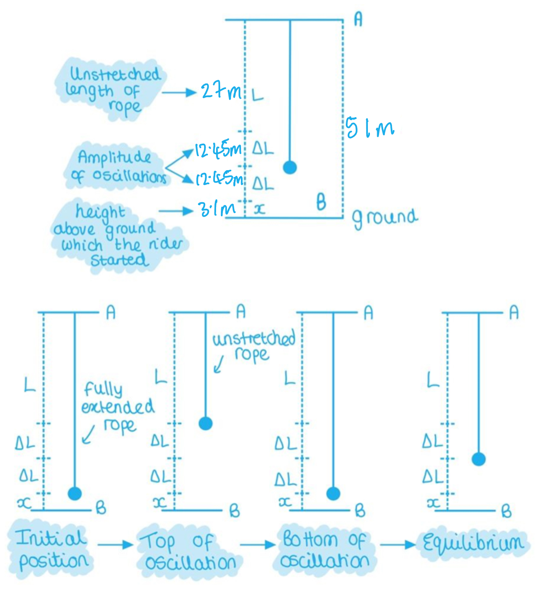

> *The second half of the diagram shows the movement of the rider from the start to its final position at equilibrium (the rider and the harness is represented by the circle as a point mass. Art is not my strong point). In practice, the rider’s oscillations will become smaller and smaller till they reach equilibrium and at rest. This is where their weight downwards is equal to the force upwards due to Hooke’s law.*
List the known quantities:

- Young Modulus = 1920 N
- Unstretched length of rope, *L* = 15 m

Calculate the extension of the rope:

- The final length of the rope is 2 × PR (or 2 × RQ)
- PR = $\sqrt{8^{2}+15^{2}}$ = 17 m
- Final length = 2 × 17 = 34 m
- Extension, *x *= 34 – *L* = 34 – 15 = 19 m **[1 mark]**

Calculate the spring constant, *k*:

- Young Modulus =$\frac{FL}{Ax}$
- From Hooke’s Law: *F* = *kx*
- Young Modulus =* *$kx\times\frac{L}{\Deltax}=kL$* ***[1 mark]**
- $k=\frac{Youngmodulus}{L}=\frac{1920}{15}=128$ N m–1 **[1 mark]*** *

Calculate the elastic potential energy, *E*:

- *E* = $\frac{1}{2}$*k *(Δ*x*)2 = $\frac{1}{2}$ × 128 × (19)2 = 23104 = 23 000 J (23 kJ) **[1 mark]**** **

**[Total: 4 marks]**
The minimum energy required to stretch the elastic to an extension of 0.40 m is:

- The area under the loading graph

Calculate the value of 1 cm square:

- 1 cm square = 0.05 × 10 = 0.5 J **[1 mark]**

Area under loading graph (work done to stretch the rubber):

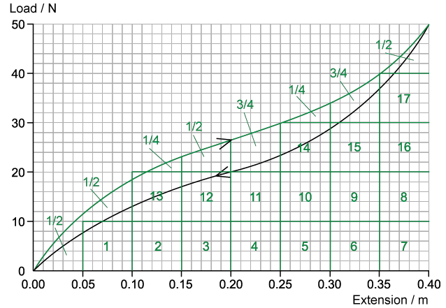

Calculate the number of cm squares:

- 17 whole squares + (2 × $\frac{1}{4}$) squares + (4 × $\frac{1}{2}$) squares + (2 × $\frac{3}{4}$) squares = 21 squares
- Total work done to stretch rubber = 0.5 × 21 = 10.5 J (Acceptable answers: 10.25 to 10.75) **[1 mark]**

**[Total: 4 marks]**

> *Remember your answer is simply an estimation since everyone will have a different opinion of which squares to count, so don’t worry too much about getting the exact value. Always use this method for finding the area under a curved graph. *

> *Remember the area underneath each curve represents slightly different things:*

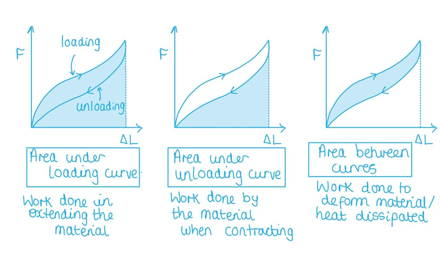

### Q10
(i) State the type of force used when exercising with this machine;

- Compressive (force); **[1 mark]**

(ii) Explain why using this machine would help the person to burn calories:

- <u>Force</u> is applied across a <u>distance</u>; **[1 mark]**
- <u>Work done</u> to compress springs; **[1 mark]**
- <u>Energy transferred</u> from <u>chemical</u> energy store <u>of the person</u> exercising; **[1 mark]**

**[Total: 4 marks]**
The force exerted by the spring over a range of compressions was measured and a graph plotted:

(i) State, with a reason, whether the spring obeys Hooke’s law over the range of values tested:

- <u>Yes</u>, the spring obeys Hooke’s law; **[1 mark]**
- (Because) the graph is a straight line <u>through the origin</u>; **[1 mark]**

(ii) Use the graph in Fig. 1.3 to calculate the spring constant, stating an appropriate unit:

- Clear attempt <u>marked on the graph</u> to find the gradient  **[1 mark]** 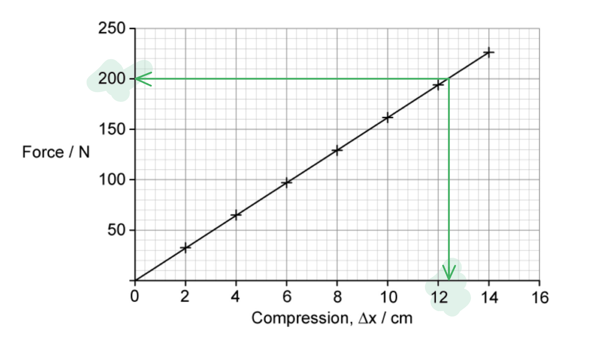
- Gradient, $k=\frac{200N}{0.124m}$ (values must be separated by at least two-thirds of the line) **[1 mark]**
- $k=1600\mathrm{Nm}^{-1}$ **[1 mark]**

**[Total: 5 marks]**

> *In graphical questions the examiner is often looking for evidence that you know how to use a graph to analyse data. *

> *Make sure that you **write on the graph**, showing the points where you are taking the gradient from, or shading or boxing an area you are going to calculate.*

> *This way, even if the working is incorrect (and scores no marks) you will get a 'method mark' for demonstrating that you understood the principle.*
Derive the formula for the elastic potential energy stored by the spring from the graph of force against extension:

*Work done*

- The work done on / by the spring to stretch or compress it is equal to the elastic potential energy stored in the spring; **[1 mark]**
- Work done, $ΔW=F\timesd$ (by definition)
- *d*, distance moved in the direction of the force = Δ*x*, (the compression or extension)

* Area under the force-compression graph*

- Therefore, the area under the graph represents the work done / energy required to compress / extend the spring; **[1 mark]**
- Area under graph = area of a right-angle triangle = ½ × base height =  ½ × Δ*x × F ***[1 mark]**
- Which is the same as elastic potential energy $E_{p}=\frac{1}{2}Fx$ **[1 mark]**

**[Total: 4 marks]**
State and explain whether the material chosen for the spring for the equipment in Fig. 1.1 should exhibit elastic or plastic behaviour.

- Elastic; **[1 mark]**
- The spring should return to original length / shape once the applied <u>force</u> is <u>removed</u>;** [1 mark]**

**[Total: 2 marks]**
