# Exam Questions — Elastic & Plastic Behaviour
**6. Deformation of Solids** · Cambridge (CIE) A-LEVEL physics (9702)
> Source: [https://www.savemyexams.com/a-level/physics/cie/25/topic-questions/](https://www.savemyexams.com/a-level/physics/cie/25/topic-questions/) · 25 questions across 1 sets

## Multiple Choice Questions (25 questions)

### Q1 — medium — 1 marks

**Q1** [1 mark]

A sample of metal was stretched until it started to go into plastic deformation. The graph below shows the behaviour of the metal.

When the sample was stretched from 0 to 12.0 mm extension, what is the work done? Assume that the curve SY is a straight line to simplify the calculation

### Q2 — hard — 1 marks

**Q2** [1 mark]

A material with elastic properties that obeys Hooke’s law has a Young modulus *E* and has a tensile stress of *S* applied.

What is the expression for the elastic energy stored per unit volume of the material?

### Q3 — hard — 1 marks

**Q3** [1 mark]

A graph was drawn of the effect on the length of applying a force to a rubber cord.

What is the maximum strain energy in this deformed rubber cord?

### Q4 — medium — 1 marks

**Q4** [1 mark]

A wire made from a new composite material was loaded with masses and the force-extension curve drawn.

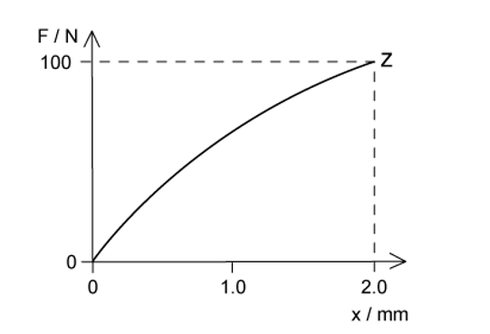

What could be the value of the strain energy stored in the wire when it is stretched elastically to point Z ?

### Q5 — easy — 1 marks

**Q5** [1 mark]

A spring is extended with varying forces; the graph below shows the results.

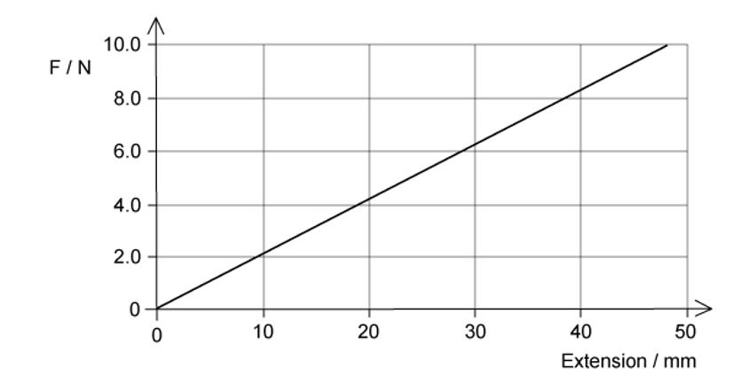

What is the energy stored in the spring when the extension is 30 mm?

### Q6 — medium — 1 marks

**Q6** [1 mark]

A student was investigating a spring with a spring constant *k* of 3.0 N cm−1, the spring was stretched over a range in which elastic deformation occurred.

Which row, for the stated applied force, gives the correct extension and strain energy?

| ** ** | **Force / N** | **Extension / cm** | **Strain energy / mJ** |
|---|---|---|---|
| **A**  **B**  **C**  **D** | 24.0  12.0  6.0  3.0 | 8.0  3.0  2.0  1.0 | 960  200  120  1.5 |

### Q7 — easy — 1 marks

**Q7** [1 mark]

The graphs below all show force-extension graphs; they are all drawn to the same scale.

Which graph shows the object that has been deformed and has the greatest amount of elastic potential energy ?

### Q8 — hard — 1 marks

**Q8** [1 mark]

A wire undergoes elastic deformation; the graph below shows the load-extension graph.

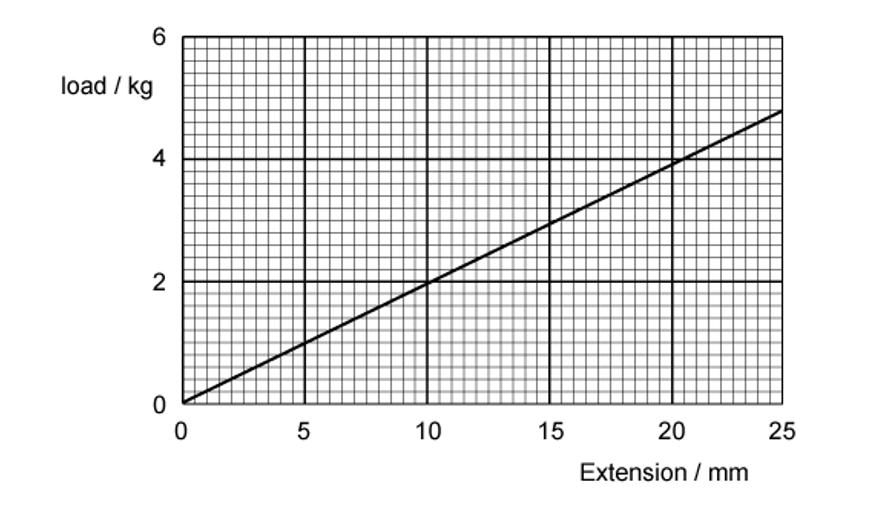

How much work is done on the wire to increase the extension from 10 mm to 20 mm?

### Q9 — easy — 1 marks

**Q9** [1 mark]

Four rods were made from four different materials; all the rods had the same dimensions.

At room temperature, which of the following would sustain the biggest plastic deformation?

### Q10 — medium — 1 marks

**Q10** [1 mark]

A student was investigating a rubber band when stretched and relaxed to its original length. The graph shows the force-extension of the rubber band.

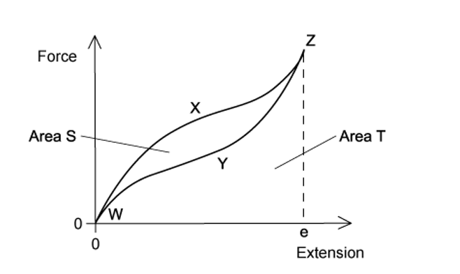

As the force is increased, the curve follows the path WXZ to extension *e*. As the force is reduced, the curve follows the path ZYW to return to zero extension.

The area labelled S is between the curves WXZ and ZYW. The area labelled T is bounded by the curve ZYW and the horizontal axis.

Which statement about the process is correct?

### Q11 — easy — 1 marks

**Q11** [1 mark]

The graphs below are force-extension graphs, which one is a rubber band this is stretched almost to its breaking point ?

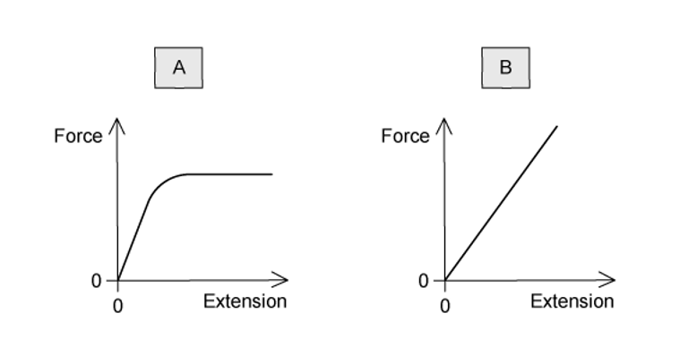

### Q12 — easy — 1 marks

**Q12** [1 mark]

A metal wire had a tension *F *and extension *x* with a Young modulus of *E*; the wire obeyed Hooke’s law

Which expression represents the elastic strain energy stored in the wire?

### Q13 — easy — 1 marks

**Q13** [1 mark]

A student experimented on a metal wire; the graph below was plotted.

The area under the graph shows the total strain energy stored in the wire when stretched.

How should the axes be labelled?

| ** ** | **Y** | **X** |
|---|---|---|
| **A**  **B**  **C**  **D** | mass  force  strain  stress | extension  extension  energy  strain |

### Q14 — medium — 1 marks

**Q14** [1 mark]

A force of 2.0 N is applied to a spring of unextended length 0.50 m and has a new length of 0.90 m.

A graph shows the variation of its length with tension.

How much strain energy is stored in the spring ?

### Q15 — easy — 1 marks

**Q15** [1 mark]

A student drew a force-extension graph for a sample of metal. She subjected the sample to a force that increased to a maximum then decreased to zero.

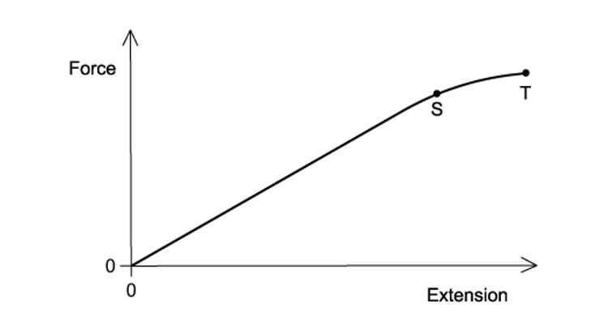

When the sample contracts it follows the same force-extension curve as when it was being stretched.

What is the behaviour of the metal between S and T?

### Q16 — medium — 1 marks

**Q16** [1 mark]

A student carried out an experiment on a ductile material; stretching it with a tensile force beyond its elastic limit. The force is removed.

The graph shows the force-extension of this experiment.

Which area represents the net work done on the sample?

### Q17 — medium — 1 marks

**Q17** [1 mark]

A force compresses a mattress spring by 100 mm. The graph shows the effect of the force *F* on the length *l* of the spring.

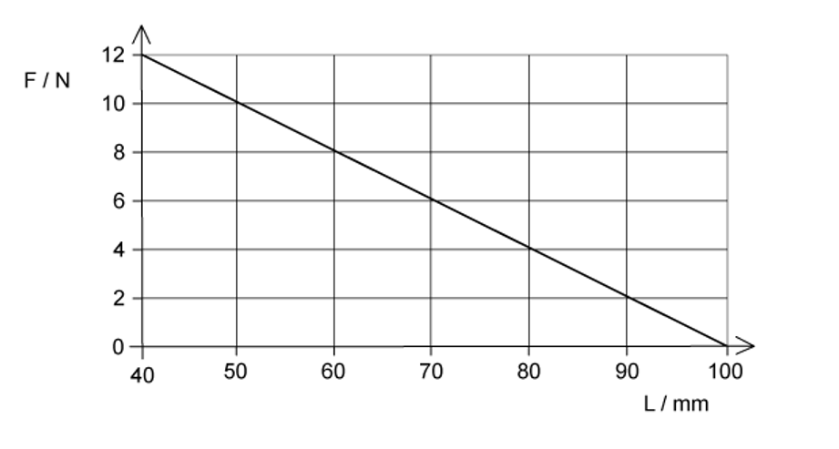

What is the energy stored in the spring when the length is 70 mm?

### Q18 — medium — 1 marks

**Q18** [1 mark]

A student was investigating the extension in a long thin metal wire. They suspended the wire from a fixed support, and hung it vertically then hung masses from the lower end.

The load was increased and decreased from zero to the maximum and back again.

The graph shows the force-extension of the wire.

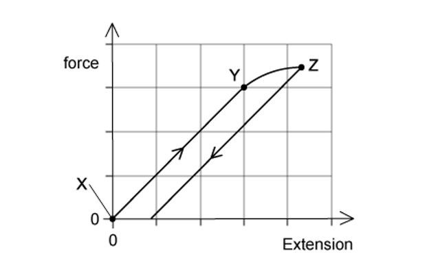

Where on the graph would the elastic limit be found?

### Q19 — hard — 1 marks

**Q19** [1 mark]

The graph below shows how force changes the extension of a spring.

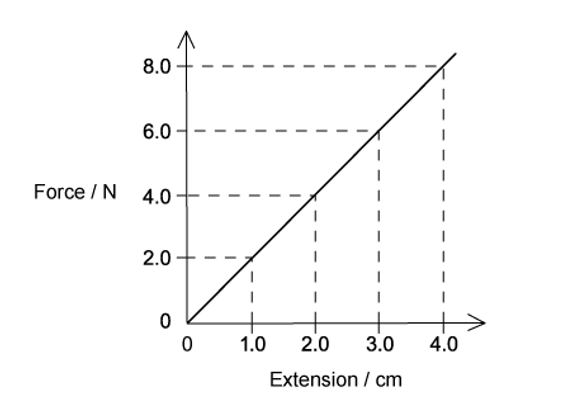

The length of the spring with no force applied was 1 cm.

What is the **increase** in the strain energy stored in the spring when its **length** is increased from 2.0 cm to 3.0 cm ?

### Q20 — easy — 1 marks

**Q20** [1 mark]

Which of the following is the correct definition for elastic and plastic behaviour?

|   | **Elastic behaviour of a material** | **Plastic behaviour of a material** |
|---|---|---|
| **A** | returns to its original shape and size | suffers permanent deformation |
| **B** | obeys Hooke’s Law | extends continuously under a steady load |
| **C** | has a linear force-extension curve | has a horizontal force-extension curve |
| **D** | extends only within the limit of proportionality | extends beyond the limit of proportionality |

### Q21 — medium — 1 marks

**Q21** [1 mark]

A rod is extended with a force so that its length increases. The variation with load *L* of the extension *e* of the rod is shown in the graph.

Point **P** is the elastic limit.

Which shaded area represents the work done during the plastic deformation of the rod ?

### Q22 — medium — 1 marks

**Q22** [1 mark]

A spring is extended due to a force. The graph shows the effect of changing force on the extension of the spring.

What is the elastic potential energy of the spring with a force of 8.0 N ?

### Q23 — easy — 1 marks

**Q23** [1 mark]

Graphs of the stress-strain for four different materials are shown below.

Which one shows the correct graph for a ductile metal ?

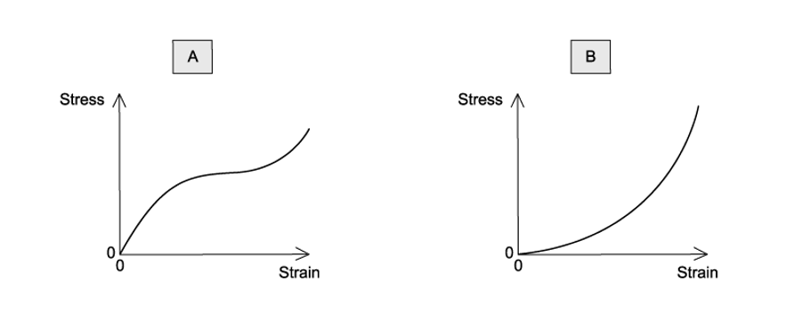

### Q24 — hard — 1 marks

**Q24** [1 mark]

Two springs are attached to a rod, S1 and S2. ­A load is applied to the bottom of S1, and it extends by *x* with an elastic potential energy in the spring of *E*.

The same load is applied to the bottom of S2. The extension of S2 is $\frac{x}{3}$ , as shown in the diagram

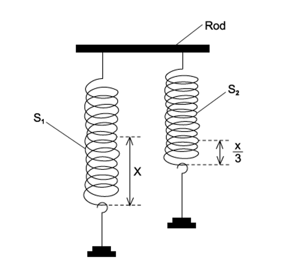

Which equation shows the elastic potential energy in S2?

### Q25 — easy — 1 marks

**Q25** [1 mark]

A weight was attached to the lower end of a length of rubber. The rubber was hung from a solid support. The weight was gradually increased from zero then gradually reduced to zero.

The graph shows the force-extension curve for contraction (below) and the force-extension curve for stretching.

What does the shaded area between the curves represent?
