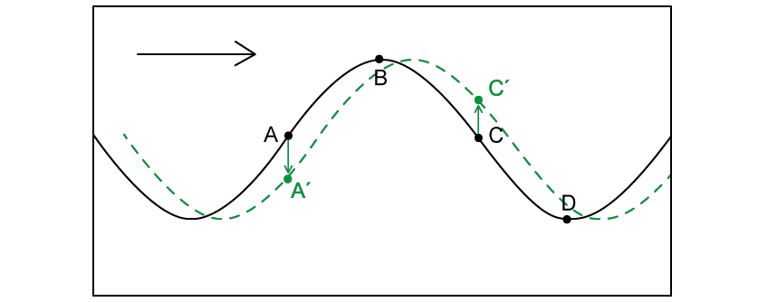
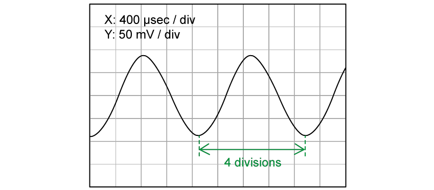
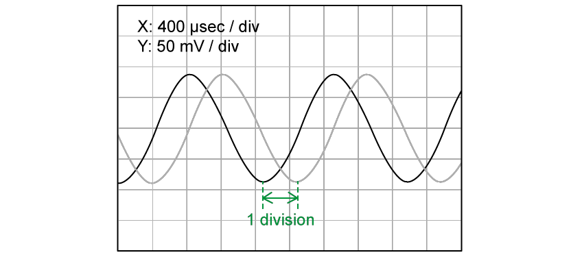
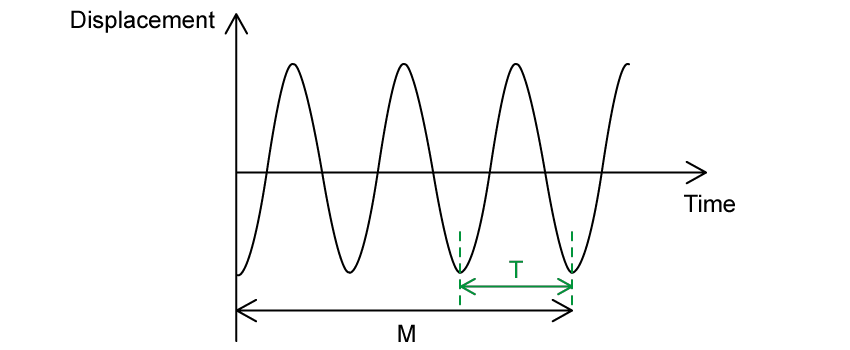
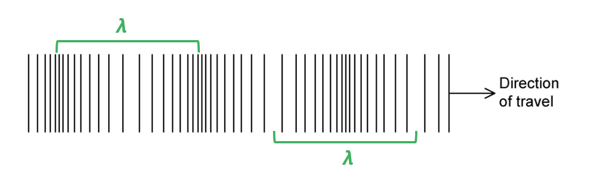
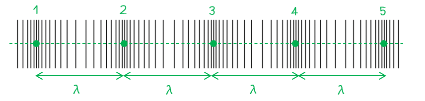
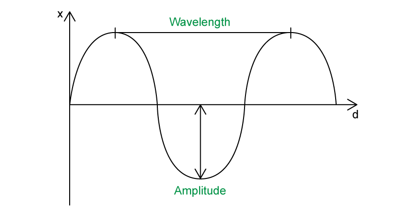
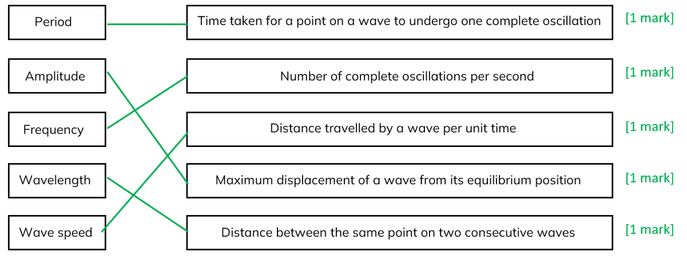
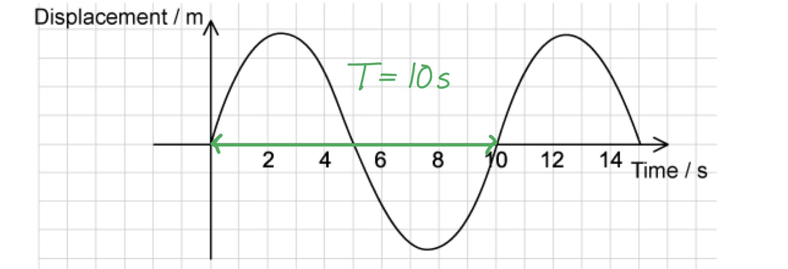
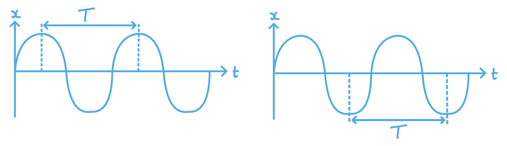

# Mark Schemes — Progressive Waves
**7. Waves** · Cambridge (CIE) A-LEVEL physics (9702)

## Multiple Choice Questions (20 questions)

### Q1
**Final answer:** **The correct answer is B**

- The question states that the speed of the radio waves in a vacuum is *c*
- Speed is given by

$c = f λ$

- Therefore, wavelength is equal to

$λ = \frac{c}{f}$

- The speed of electromagnetic waves is constant in a vacuum so the speed will stay as *c*
- The frequency has increased to $3 f$ so the new wavelength is

$λ'=\frac{c}{3f}$

- Comparing $λ = \frac{c}{f}$ with $λ'=\frac{c}{3f}$

$λ'=\frac{1}{3}\times\frac{c}{f}=\frac{1}{3}λ$

- Therefore,  the new wavelength is $λ'=\frac{λ}{3}$

### Q2
**Final answer:** **The correct answer is ****A**** because:**

- The intensity of light *I* is proportional to the square of the amplitude *A*

  - $A^{2}αI$
- The amplitude of the emerging light, let’s call this $A_{em}=Acos60^{\circ}$
- Intensity of the emerging light is proportional to $A^{2}_{e m} = A^{2} c o s^{2} ( 60^{\circ} ) = 0.250 A^{2}$

  - $A^{2}_{em}αI$
  - $0.250A^{2}αI$
- Therefore, the intensity of the emerging light = 0.250 *I*

### Q3
**Final answer:** **The correct answer is ****B**** because:**

- The equation for the speed of a wave is $v=fλ$

  - So, frequency is $f=\frac{v}{λ}$

- From the graph, the wavelength is 50 m
- The question states that the speed is 8.0 m s–1

  - $f=\frac{8}{50}=0.16\mathrm{Hz}$

- From the graph, the amplitude is 2 m
- The equation for the maximum speed of the particles is

  - $2 \mathrm{\pi } \mathrm{a} f = 2 \mathrm{\pi } ( 2 ) ( 0.16 ) = 0.64 \mathrm{\pi } \mathrm{m} \mathrm{s}^{- 1}$

- Therefore, the maximum kinetic energy is equal to

  - $1 \frac{1}{2} m v^{2} = 1 \frac{1}{2} ( 2.5 \times 10^{- 3} ) ( 0.64 \mathrm{\pi } )^{2} = 0.0051 = 5.1 \text{mJ}$

### Q4
**Final answer:** **The correct answer is ****C**** because:**

- From the diagram:

  - 5 divisions = 1 cm
  - So, 1 division = 0.2 cm = 2 mm
- The time base setting is 5 μs mm–1

  - Therefore, 1 division = 5 μs mm–1 × 2 mm = 10 μs
- 1.5 waves occupy 30 divisions

  - $1.5T=30\times10$
  - $T=\frac{30\times10}{1.5}=200$
- The period of the wave is *T* = 200 μs = 2 × 10–4 s
- Frequency =$\frac{1}{T} = \frac{1}{( 2 \times 10^{- 4} )} = 5000 \text{Hz} = 5 \text{kHz}$

### Q5
**Final answer:** **The correct answer is ****B**** because:**

- The speed of the wave is given by the wave equation

  - $v=fλ$
- The speed of light is 3.0 × 108 m s–1
- The wavelength is 600 nm or 6.0 × 10–7 m
- The frequency is calculated by $f=\frac{v}{λ}$

  - So, $f=\frac{3.0\times10^{8}}{6.0\times10^{-7}}=5.0\times10^{14}\mathrm{Hz}$
- There are 1 × 1012 Hz in 1 THz

  - Therefore, the frequency of this light is 5.0 × 1014 Hz = 500 THz

### Q6
**Final answer:** **The correct answer is ****B**** because:**

- The question states that the speed of the electromagnetic (EM) waves in a vacuum is *c*

  - Speed is given by $c=fλ$
  - Therefore, wavelength is equal to $λ=\frac{c}{f}$
- The speed of EM waves is constant in a vacuum so the speed will stay as *c*
- The frequency has decreased to $\frac{f}{2}$  so the new wavelength is $=\frac{c}{\frac{f}{2}}=\frac{2c}{f}$
- Comparing  $λ=\frac{c}{f}$ with $\frac{2c}{f}$, we can see the new wavelength is  $=2λ$

### Q7
**Final answer:** **The correct answer is ****A ****because:**

- The wave formed along the rope is a transverse wave
- In a transverse wave, the particles oscillate perpendicular (90°) to the direction of wave travel, which is to the right in this question.
- The particles can only oscillate in a vertical motion (up and down)
- The diagram below shows the wave in an instant later, moving the wave to the right

- The particle Q will move according to the form of the wave, a sudden jump up, followed by a high value of displacement and then with a final negative peak
- The answer therefore is **A**

**B** is incorrect because the graph shows a long negative displacement with a positive peak, this is the opposite direction to what would happen to particle Q

**C **is incorrect because the graph shows a positive peak with a long negative displacement

**D** is incorrect because the graph shows a negative peak then long positive displacement which is the opposite order to what would happen to particle Q

### Q8
**Final answer:** **The correct answer is ****A**** because :**

- Intensity is directly proportional to the square of the amplitude, i.e.

  - $IαA^{2}or\frac{I_{1}}{I_{2}}=\frac{a_{1}^{2}}{a_{2}^{2}}$**  **
- Where *I *is the intensity of the wave and *a* is the amplitude of the wave
- So, we get:

  - $\frac{2.5Wm^{-2}}{I_{2}}=\frac{0.2\mathrm{mm}^{2}}{0.4\mathrm{mm}^{2}}=\frac{0.04}{0.16}=\frac{1}{4}$
  - $.^{.}.I_{2}=\frac{4}{1}\times2.5Wm^{-2}=10Wm^{-2}$

### Q9
**Final answer:** **The correct answer is ****D**** because:**

- The time is shown on the x-axis so **X** must be period as this is in units of time, not distance
- The amplitude of a wave is the maximum displacement of the wave
- **W** is not showing amplitude, **W** is displacement

**A **& **C **are incorrect because W is not showing the maximum displacement, this is not the amplitude and just the displacement

**B **is incorrect because the units on the graph is time, if the graph was in m then this would be the wavelength

> *Always look at the units on the graph as the first instinct for students would be to assume that X is the wavelength.*

### Q10
**Final answer:** **The correct answer is ****C**** because:**

- Amplitude is the maximum displacement of a particle on the medium from its resting position
- The amplitude is shown as the arrow from the resting position to the top of the peak. This is shown in answers **A, B** and **C**
- The wavelength is the minimum distance between two points on the wave oscillating in phase

**A **& **B **are incorrect because the x-axis on the graph is time so this would show the period of the wave not distance

**D **is incorrect because the amplitude shown is the displacement of one complete wave and not from the resting position

### Q11
**Final answer:** **The correct answer is A because:**

- Intensity I is proportional to amplitude squared $A^{2}$

  - $IαA^{2}$
- From the equation given in the question, we can see that

  - $Iα\frac{1}{r^{2}}$
- So, $A^{2}$ is inversely proportional to r2 : $A^{2}α\frac{1}{r^{2}}$

  - Therefore, $Aα\frac{1}{r}$

### Q12
**Final answer:** **The correct answer is ****A**** because:**

- We are told intensity is inversely proportional to the square of the distance *x* from the source so

  - $Iα\frac{1}{x^{2}}$
- When the distance is doubled this causes the intensity to decrease by a quarter

  - $I \\alpha \frac{1}{( 2 x )^{2}} = \frac{1}{4 x^{2}}$
- Intensity *I* is also proportional to amplitude squared *A**2*

  - $IαA^{2}$
- From the question, we can see the amplitude is 8 μm, so intensity is proportional to 82

  - $I \\alpha ( 8 A )^{2}$
- So, at a distance 2*r*, the intensity will be $\frac{1}{4}$and *A**2* is equal to $\frac{8^{2}}{4}$
- Therefore, the amplitude at T is equal to $A=\sqrt{8.0^{2}\div4}=4.0\mathrm{μm}$

### Q13
**Final answer:** **The correct answer is ****B**** because:**

- Intensity *I* is proportional to amplitude squared *A**2*

  - $IαA^{2}$
- The amplitude of P is 3 units and the amplitude of Q is 1 unit

  - The intensity of P = 32 = 9
  - The intensity of Q = 12 = 1
- Therefore the ratio is $\frac{intensityofsoundwaveP}{intensityofsoundwaveQ}=\frac{9}{1}$

### Q14
**Final answer:** **The correct answer is ****B**** because:**

- To see where the position of the particle in the next second just shift the wave in the direction of travel
- Point 3 is the only part of the wave that is moving upwards with maximum speed

From the diagram, the particle at position 1 will be moving downwards and the particle at position 3 is moving upwards. At point 4 the particle is moving up but the question states the maximum speed so **D **is incorrect. This means the correct option is **B**

### Q15
**Final answer:** **The correct answer is ****D**** because:**

- The period of a wave is $T=\frac{1}{f}$
- The question states the frequency of the wave is 4 GHz which is equal to 4 × 109 Hz

  - $T=\frac{1}{4\times10^{9}}=2.5\times10^{-10}$ s
- 2.5 × 10–10 s is the same as 250 ps

> *You need to be confident converting units from milli-, micro-, nano- and pico-, especially in the topic of waves. Remember that to go from a larger unit to a smaller unit (e.g. s to ps) you multiply by the prefix factor, and to go from a smaller unit to a larger unit, you divide by the prefix factor.*

### Q16
**Final answer:** **The correct answer is ****C**** because:**

- The wavelength of the wave is

  - $λ=\frac{v}{f}=\frac{330}{50}=6.6m$
- 60˚ is $\frac{60^{^{\circ}}}{360^{^{\circ}}}=\frac{1}{6}$  of the total wavelength:

  - $60^{^{\circ}}=6.6m\times\frac{1}{6}=1.1m$

### Q17
**Final answer:** **The correct answer is ****B**** because:**

- The only statement that is correct from the options listed is that all electromagnetic waves travel at the same speed in a vacuum
- Statement 1 is incorrect as longitudinal waves can’t be polarised as their particles vibrate in the same direction that the wave travels
- Statement 2 is incorrect as the square of the amplitude of a wave is directly proportional to the energy transferred. This means that doubling the amplitude results in a quadrupling of the energy
- Statement 4 is incorrect as the frequency of ultra-violet light is greater than the frequency of infra-red light

  - Range of frequencies of infrared: 3 × 1012 – 4.3 × 1014
  - Range of frequencies of ultraviolet: 7.5 × 1014 – 3 × 1016

### Q18
**Final answer:** **The correct answer is ****B**** because:**

- The equation for the speed of a wave $v=fλ$
- So, wavelength is $λ=\frac{v}{f}=\frac{340}{500}=0.68m$
- One wavelength *λ* is equivalent to a phase difference of 360 degrees (which is equal to $2π$ rad)
- Therefore, a separation of 0.68 m (one wavelength) corresponds to a phase difference of 2$π$ rad
- So, a separation of 0.17m corresponds to `= ( (0.17)/(0.68) ) x 2 pi = pi / 2 rad`

### Q19
**Final answer:** **The correct answer is ****D**** because:**

- The equation given in the question is $v^{2}=\frac{gλ}{2π}$
- The equation for the speed of the wave is $v=fλ$
- By substituting $v=fλ$ into the first equation gives

  - $( f \\lambda )^{2} = \frac{g \\lambda }{2 \mathrm{\pi } }$
  - `f ^2 = ( (g lambda)/(2 pi) ) ( 1 / lambda ^2 ) = ( (g)/(2 pi) ) ( 1 / lambda )`
- The equation of a straight line is $y=mx+c$
- A line going through the origin has a y-intercept of c = 0 so $y=mx$

  - Comparing with $f ^{2} = ( \frac{g}{2 pi} ) ( \frac{1}{ \lambda } ) w i t h y = m x$
- We can see y is equal to *f **2* and x is equal to $\frac{1}{λ}$, so, a plot of these two quantities on a graph would give a straight line through the origin

### Q20
**Final answer:** **The correct answer is ****B**** because:**

- The power per unit area $=\frac{power}{area}$ intensity
- When the surface area is *S* and the amplitude is *A*, the power per unit area = *P*
- The surface area has decreased to $\frac{1}{3}S$ , since intensity is inversely proportional to the area, i.e.

  - $Iα\frac{1}{\frac{1}{3}S}=\frac{3}{S}$
- So, when the surface area is decreased by a factor of 3 the intensity is increased by a factor of 3
- The second factor in the question is the amplitude of the wave, which is doubled to 2*A*
- Intensity is directly proportional to the square of the amplitude, i.e.

  - $IαA^{2}$
- Doubling the amplitude increases the intensity to increase by a factor of 22

  - $I \\alpha ( 2 A )^{2} = 4 A^{2}$
- The new power will therefore be $4\times3P=12P$

## Structured Questions (6 questions)

### Q1
Deduce the position on the wave where it moves upwards with maximum speed:

- C; **[1 mark] **

Explain the motion of the progressive wave:

- Since this is a <u>progressive</u> wave moving left to right, position C will move upward; **[1 mark]**

- Point** **C is at the equilibrium / undisturbed position / mid-point on the wave **AND** (Therefore) it is moving at maximum speed;** [1 mark]**** **

**[Total: 3 marks]**
List the known quantities:

- Wave speed, *v* = 330 m s–1

Determine the time period of the oscilloscope trace using the time-base:

- The time-base on the X-axis is set to a scale of 400 μs / div
- Therefore, each division represents 400 × 10–6 s
- One time period is 4 divisions (shown below); **[1 mark]**

- Therefore, time period (one full cycle), *T *= 4 × (400 × 10–6) = 1.6 × 10–3 s **[1 mark] **

Calculate the frequency of the wave:

- *f* = $\frac{1}{T}$
- *f* = $\frac{1}{1.6\times10^{-3}}$= 625 Hz **[1 mark] **

Use the wave speed equation to calculate the wavelength of the sound wave:

- *v = fλ*
- 330 = 625 × *λ*
- *λ* =$\frac{330}{625}$ = 0.53 m **[1 mark] **

**[Total: 4 marks]**
Determine the displacement between the two signals in terms of number of divisions:

- The two signals are displaced by 1 division; **[1 mark]**

Use the displacement to calculate a phase difference:

- If the two signals were in phase, the displacement would either be 0 divisions or 4 divisions
- Therefore, 1 division of displacement represents 25% of phase difference
- Phase difference = $\frac{1}{4}$ × 2π = $\frac{1}{2}$ π **OR** Phase difference = $\frac{1}{4}$ × 360 = 90 **[1 mark] **

State the unit for phase difference:

- Phase difference = $\frac{1}{2}$π rad **OR** Phase difference = 90º **[1 mark] **

**[Total: 3 marks]**
Show that the wave speed *v *is given by $v=\frac{3N}{2M}$:

Use Fig. 1.4 to write an expression for the time period, *T*:

- The time period is the time taken for one complete wave cycle
- This is determined using the time axis in the time-view of the wave, shown below:

- Therefore, *T* =$\frac{M}{3}$ **[1 mark] **

Write an expression for the frequency *f* of the wave:

- *f* = $\frac{1}{T}$
- Therefore *f = *$\frac{1}{\frac{M}{3}}$= $\frac{3}{M}$** [1 mark] **

Use Fig. 1.5 to write an expression for the wavelength *λ* of the wave:

- The wavelength of a wave is the distance between two corresponding points, e.g., peak to peak
- This is determined using the position axis in the space-view of the wave, shown below:

- Therefore,* λ* = $\frac{N}{2}$ **[1 mark]**

Write an equation for the wave speed *v* using the wave speed equation:

- *v* = *fλ *= $\frac{3}{M}$× $\frac{N}{2}$ = $\frac{3N}{2M}$ **[1 mark] **

**[Total: 4 marks]**

### Q2
State which type of wave ultrasound is and explain your answer:

- Ultrasound is a <u>sound wave</u> (with a frequency above the range of human hearing); **[1 mark]**
- Therefore, ultrasound is a <u>longitudinal wave</u>; **[1 mark]**

**[Total: 2 marks]**
(i) For the ultrasound pulses, calculate the frequency, *f:*

List the known quantities:

- Speed of ultrasound wave in water, *v* = 1452 m s−1
- Wavelength of ultrasound pulse, *λ *= 0.023 m

Using the wave speed equation:

- $v=fλ\rightarrowf=\frac{v}{λ}$
- $f=\frac{1452}{0.023}$ = 63130 Hz **[1 mark]**

(ii) For the ultrasound pulses, calculate the distance to the sea bed:

From the graph determine the time taken for the pulse to reach the sea bed:

- The tall pulses are those sent from the boat, the small pulses are those reflected from the sea floor
- The time between the tall emitted pulse and the smaller echo is two divisions of the axis

  - Each division of the axis is 0.10 s
  - Therefore, the time between sending and receiving the pulses is 0.20 s
- However, the pulse travels from the boat to the sea bed and back in this time

  - Therefore, the time taken to reach the sea bed is 0.10 s
  - *t* = 0.10 s **[1 mark]**
- $v=\frac{d}{t}$

  - Therefore, *d* = *vt*
  - *d = *1452 × 0.10 = 145.2 m **[1 mark]**

**[Total: 3 marks]**
(i) State and explain two changes that would occur on the cathode-ray oscilloscope trace:

**Change 1**

State change 1:

- The <u>horizontal separation</u> between the transmitted pulse and the reflected pulse will <u>increase;</u> **[1 mark]**

Explain change 1:

- The sea is deeper so the <u>distance</u> travelled by the pulses <u>increases</u>, and will therefore <u>take longer</u> to reach the sea bed, (and longer to return); **[1 mark]**

**Change 2**

State change 2:

- The <u>amplitude</u> of the <u>reflected pulses</u> will be <u>smaller / decrease</u>; **[1 mark]**

Explain change 2:

- Some of the <u>energy is absorbed by</u> the surrounding <u>water</u>. Since they have to travel through a <u>greater depth</u> of water, <u>more energy will be lost;</u> **[1 mark]**

(ii) When the sea is over 450 m deep, the pulses must be transmitted less frequently. Explain why this is the case

Calculate the time taken between the transmission and detection of each pulse at 450 m:

- $t=\frac{d}{v}=\frac{450\times2}{1452}$ = 0.6 s** [1 mark]**

Explain why this means the pulses must be transmitted less frequently:

- The cathode-ray oscilloscope trace shows that the pulses are transmitted <u>every 0.6 s</u>; **[1 mark]**
- <u>At a depth of 450 m</u>, the reflected pulses would coincide with / arrive at the same time as the transmitted pulses;** [1 mark]**
- <u>At greater depths</u>, the reflected pulses would be detected after subsequent / the next pulses have been transmitted; **[1 mark]**

** ****[Total: 8 marks]**

### Q3
List the known quantities:

- Wave speed, $v$ = 4.0 cm s–1
- Time period, $T=\frac{1}{f}$ = 1.5 s
- Distance PR = 44 cm
- Distance QR = 29 cm

i) Use the wave equation to determine wavelength, $λ$:

- $v=fλ$
- $λ=\frac{v}{f}$ **[1 mark]**
- $λ$ = 4.0 × 1.5 = 6.0 cm **[1 mark]**

ii) Calculate the path difference at point R of the waves from P and Q:

- The difference between distances PR and QR = 44 − 29 = 15 cm
- Number of wavelengths in 15 cm = $\frac{15}{6}=\frac{5}{2}$ = 2.5
- Path difference = 2.5$λ$ or $\frac{5}{2}λ$ **[1 mark]** ** **

iii) Describe the motion, if any, of the water particles at point R:

- The path difference is an odd number of half wavelengths **OR **the waves have a phase difference of 180°; **[1 mark]**
- (This results in destructive interference, hence) the particles are at rest / have no motion; **[1 mark]**

**[Total: 5 marks]**

- *Spotting that *$λ=\frac{v}{f}=v\times\frac{1}{f}=v\timesT$* can save you some time in part (i)*
- *Remember to state **path difference** as a **multiple of wavelength** for part (ii)*

### Q4
The oscillations are perpendicular to the direction of energy transfer for...

- Transverse waves;** [1 mark]**

**[Total: 1 mark]**

> *If you need a handy way to remember which is which*

> *For transverse waves, the oscillations are at right angles (perpendicular) to the direction of energy transfer and wave motion. *

> *Longitudinal waves have compressions and rarefactions and so need particles to propagate.*
Two objects that can be used in the classroom to demonstrate wave motion are...

**Final answer:** **Any ****two**** from:**

- Rope; **[1 mark]**
- Spring; **[1 mark]**
- Ripple tank;** [1 mark]**

**[Total: 2 marks]**

> *You are expected to be familiar with all three.*
A wavelength on a longitudinal wave is as follows:

- A line spanning from the centre of one compression (**or** rarefaction) to the same point on the next compression (**or** rarefaction); **[1 mark]**

**[Total: 1 mark]**
Determine the number of complete wavelengths:

- Over 5 compressions, there are 4 complete wavelengths

Determine the frequency of the wave:

- $\mathrm{Frequency}=\frac{\mathrm{number} \mathrm{of} \mathrm{complete} \mathrm{wavelengths}}{\mathrm{time} \mathrm{taken}}$
- $f=\frac{4}{2}$ **[1 mark]**
- $f=2\mathrm{Hz}$** [1 mark]**

**[Total: 2 marks]**

> *Be careful with the wording of the question. 5 compression points pass a fixed point. The first compression point passing triggers the timing to start. When the second compression point passes, this means that one full wavelength has passed.*

### Q5
A correctly labelled diagram scoring two marks:

(i) Label the wavelength:

- Wavelength / *λ* correctly labelled from crest to crest; **[1 mark]**

(ii) Label the amplitude:

- Amplitude / *x**0* correctly labelled from point of zero disturbance to maximum displacement; **[1 mark]**

**[Total: 2 marks]**

> *Writing the words, or giving the correct symbols would get you full marks.*
An answer scoring 5 marks:

**[Total: 5 marks]**

> *Key words and definitions are extremely important in every topic. In extended answer questions, you will need to use key words correctly to score the marks. *
Determine the time period *T* from the graph:

- Measure the time between the same point on two consecutive waves

- Correctly determine the period <u>*T*</u><u> = 10 s</u>; **[1 mark]**

**[Total: 1 mark]**

> *Remember that the time period on a displacement-time graph is the distance between one point on one wave and **the same point** on the next wave. You can measure the period from any point, such as crest to crest, or trough to trough.*

> *Always chose the point that will give you the most accurate reading. In this example, the most accurate point to measure from was time **t** = 0.*
List the known quantities:

- Time period, *T* = 10 s (from part c)
- Wavelength, *λ* = 5 m

(i) Calculate the frequency *f*:

- $f=\frac{1}{T}$ **[1 mark]**
- $f=\frac{1}{10}$ = 0.1 Hz **[1 mark]**

(ii) Calculate the wave speed *v*:

- $v=fλ$* ***[1 mark]**
- $v$ = 0.1 × 5 = 0.5 m s−1 **[1 mark]**

**[Total: 4 marks]**** **

### Q6
To calculate the speed:

Determine the wavelength:

- **XY** = 70 cm = 1$\frac{1}{4}λ$  (or $\frac{5}{4}λ$ )
- $λ$= 70 × $\frac{4}{5}$ = 56 cm = 0.56 m **[1 mark]**

Wave speed calculation:

- *v* =$fλ$
- *v* = 30 × 0.56
- *v* = 16.8 m s–1 **[1 mark]**

**[Total: 2 marks]**
The phase difference is:

- 90 / 450 **[1 mark]**
- ° / degrees **[1 mark]**

**OR**

- $\frac{π}{2}$or $\frac{3π}{2}$ or $\frac{5π}{2}$**  [1 mark]**
- Radians / rad / **r** **[1 mark]**

*Do not accept R, Rad etc.*** **

**[Total: 2 marks]**** **

> *It is much better to represent the phase in terms of an angle instead of the number of wavelengths, unless you are asked to do so.*
To describe how the vertical displacement of point **X** on the string varies in the next period:

First  $\frac{1}{4}$  cycle:

- Displacement of X will be **positive** (or ‘**up’**) to a maximum positive displacement; **[1 mark]**

Next  $\frac{1}{2}$  cycle:

- **Downwards** to equilibrium position ($\frac{1}{4}$ cycle) **and **maximum negative displacement ( $\frac{1}{4}$ cycle); **[1 mark]**

Last  $\frac{1}{4}$  cycle:

- **Upwards** to equilibrium position / zero displacement; **[1 mark]**

*If the motion of X is 180 degrees out of phase with the one shown then a maximum of two marks can be gained (i.e. X initially moving downwards)*

*Accept 0.008 s for  *$\frac{1}{4}$* cycle and 0.017 for *$\frac{1}{2}$* cycle*

**[Total: 3 marks]**

> *Visualising the subsequent motion of a point on the wave is tricky. The wave is travelling to the right hand side, so it's subsequent motion will be the wave motion drawn **behind** it. *
List the known quantities:

- Frequency, *f *= 30 Hz (From part (a))

To determine the phase difference between the current position of **X** and the position of **X** 0.0825 s later:

Calculate the time period of 1 wave cycle:

- 1 period = $\frac{1}{f}$= $\frac{1}{30}$ = 0.033 s

Determine the number of wave cycles in 0.0825 s:

- 0.0825 s is $\frac{0.0825}{0.033}$= 2.5 complete cycles **[1 mark]**

Determine the phase difference over 2.5 cycles:

- The phase difference of 1 cycle = 360 °
- So, the phase difference of ½ cycle = 180°
- (Therefore, there is a) phase difference of 180° / $π$ radians / anti-phase (between the two positions of **X**) **[1 mark]**** **

**[Total: 2 marks]**

> *Remember that a phase difference of 360 degrees is a complete 1 wavelength cycle, so there is actually no phase difference. *
