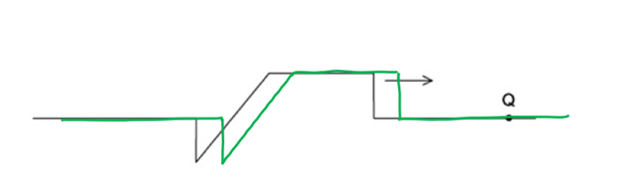
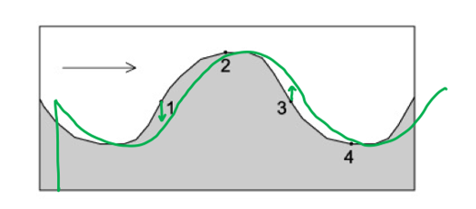

# Mark Schemes — Progressive Waves
**7. Waves** · Cambridge (CIE) A-LEVEL physics (9702)

## Multiple Choice Questions (20 questions)

### Q1
**Final answer:** **The correct answer is B**

- The question states that the speed of the radio waves in a vacuum is *c*
- Speed is given by

$c = f λ$

- Therefore, wavelength is equal to

$λ = \frac{c}{f}$

- The speed of electromagnetic waves is constant in a vacuum so the speed will stay as *c*
- The frequency has increased to $3 f$ so the new wavelength is

$λ'=\frac{c}{3f}$

- Comparing $λ = \frac{c}{f}$ with $λ'=\frac{c}{3f}$

$λ'=\frac{1}{3}\times\frac{c}{f}=\frac{1}{3}λ$

- Therefore,  the new wavelength is $λ'=\frac{λ}{3}$

### Q2
**Final answer:** **The correct answer is ****A**** because:**

- The intensity of light *I* is proportional to the square of the amplitude *A*

  - $A^{2}αI$
- The amplitude of the emerging light, let’s call this $A_{em}=Acos60^{\circ}$
- Intensity of the emerging light is proportional to `A squared subscript e m end subscript equals A squared c o s squared open parentheses 60 degree close parentheses equals 0.250 space A squared`

  - $A^{2}_{em}αI$
  - $0.250A^{2}αI$
- Therefore, the intensity of the emerging light = 0.250 *I*

### Q3
**Final answer:** **The correct answer is ****B**** because:**

- The equation for the speed of a wave is $v=fλ$

  - So, frequency is $f=\frac{v}{λ}$

- From the graph, the wavelength is 50 m
- The question states that the speed is 8.0 m s–1

  - $f=\frac{8}{50}=0.16\mathrm{Hz}$

- From the graph, the amplitude is 2 m
- The equation for the maximum speed of the particles is

  - `2 straight pi straight a f equals 2 straight pi open parentheses 2 close parentheses open parentheses 0.16 close parentheses equals 0.64 straight pi space straight m space straight s to the power of negative 1 end exponent`

- Therefore, the maximum kinetic energy is equal to

  - `1 half m v squared equals 1 half open parentheses 2.5 cross times 10 to the power of negative 3 end exponent close parentheses open parentheses 0.64 straight pi close parentheses squared equals 0.0051 equals 5.1 space mJ`

### Q4
**Final answer:** **The correct answer is ****C**** because:**

- From the diagram:

  - 5 divisions = 1 cm
  - So, 1 division = 0.2 cm = 2 mm
- The time base setting is 5 μs mm–1

  - Therefore, 1 division = 5 μs mm–1 × 2 mm = 10 μs
- 1.5 waves occupy 30 divisions

  - $1.5T=30\times10$
  - $T=\frac{30\times10}{1.5}=200$
- The period of the wave is *T* = 200 μs = 2 × 10–4 s
- Frequency =`1 over T equals fraction numerator 1 over denominator open parentheses 2 cross times 10 to the power of negative 4 end exponent close parentheses end fraction equals 5000 space Hz equals 5 space kHz`

### Q5
**Final answer:** **The correct answer is ****B**** because:**

- The speed of the wave is given by the wave equation

  - $v=fλ$
- The speed of light is 3.0 × 108 m s–1
- The wavelength is 600 nm or 6.0 × 10–7 m
- The frequency is calculated by $f=\frac{v}{λ}$

  - So, $f=\frac{3.0\times10^{8}}{6.0\times10^{-7}}=5.0\times10^{14}\mathrm{Hz}$
- There are 1 × 1012 Hz in 1 THz

  - Therefore, the frequency of this light is 5.0 × 1014 Hz = 500 THz

### Q6
**Final answer:** **The correct answer is ****B**** because:**

- The question states that the speed of the electromagnetic (EM) waves in a vacuum is *c*

  - Speed is given by $c=fλ$
  - Therefore, wavelength is equal to $λ=\frac{c}{f}$
- The speed of EM waves is constant in a vacuum so the speed will stay as *c*
- The frequency has decreased to $\frac{f}{2}$  so the new wavelength is $=\frac{c}{\frac{f}{2}}=\frac{2c}{f}$
- Comparing  $λ=\frac{c}{f}$ with $\frac{2c}{f}$, we can see the new wavelength is  $=2λ$

### Q7
**Final answer:** **The correct answer is ****A ****because:**

- The wave formed along the rope is a transverse wave
- In a transverse wave, the particles oscillate perpendicular (90°) to the direction of wave travel, which is to the right in this question.
- The particles can only oscillate in a vertical motion (up and down)
- The diagram below shows the wave in an instant later, moving the wave to the right

- The particle Q will move according to the form of the wave, a sudden jump up, followed by a high value of displacement and then with a final negative peak
- The answer therefore is **A**

**B** is incorrect because the graph shows a long negative displacement with a positive peak, this is the opposite direction to what would happen to particle Q

**C **is incorrect because the graph shows a positive peak with a long negative displacement

**D** is incorrect because the graph shows a negative peak then long positive displacement which is the opposite order to what would happen to particle Q

### Q8
**Final answer:** **The correct answer is ****A**** because :**

- Intensity is directly proportional to the square of the amplitude, i.e.

  - $IαA^{2}or\frac{I_{1}}{I_{2}}=\frac{a_{1}^{2}}{a_{2}^{2}}$**  **
- Where *I *is the intensity of the wave and *a* is the amplitude of the wave
- So, we get:

  - $\frac{2.5Wm^{-2}}{I_{2}}=\frac{0.2\mathrm{mm}^{2}}{0.4\mathrm{mm}^{2}}=\frac{0.04}{0.16}=\frac{1}{4}$
  - $.^{.}.I_{2}=\frac{4}{1}\times2.5Wm^{-2}=10Wm^{-2}$

### Q9
**Final answer:** **The correct answer is ****D**** because:**

- The time is shown on the x-axis so **X** must be period as this is in units of time, not distance
- The amplitude of a wave is the maximum displacement of the wave
- **W** is not showing amplitude, **W** is displacement

**A **& **C **are incorrect because W is not showing the maximum displacement, this is not the amplitude and just the displacement

**B **is incorrect because the units on the graph is time, if the graph was in m then this would be the wavelength

> *Always look at the units on the graph as the first instinct for students would be to assume that X is the wavelength.*

### Q10
**Final answer:** **The correct answer is ****C**** because:**

- Amplitude is the maximum displacement of a particle on the medium from its resting position
- The amplitude is shown as the arrow from the resting position to the top of the peak. This is shown in answers **A, B** and **C**
- The wavelength is the minimum distance between two points on the wave oscillating in phase

**A **& **B **are incorrect because the x-axis on the graph is time so this would show the period of the wave not distance

**D **is incorrect because the amplitude shown is the displacement of one complete wave and not from the resting position

### Q11
**Final answer:** **The correct answer is A because:**

- Intensity I is proportional to amplitude squared $A^{2}$

  - $IαA^{2}$
- From the equation given in the question, we can see that

  - $Iα\frac{1}{r^{2}}$
- So, $A^{2}$ is inversely proportional to r2 : $A^{2}α\frac{1}{r^{2}}$

  - Therefore, $Aα\frac{1}{r}$

### Q12
**Final answer:** **The correct answer is ****A**** because:**

- We are told intensity is inversely proportional to the square of the distance *x* from the source so

  - $Iα\frac{1}{x^{2}}$
- When the distance is doubled this causes the intensity to decrease by a quarter

  - `I space alpha space 1 over open parentheses 2 x close parentheses squared equals fraction numerator 1 over denominator 4 x squared end fraction`
- Intensity *I* is also proportional to amplitude squared *A**2*

  - $IαA^{2}$
- From the question, we can see the amplitude is 8 μm, so intensity is proportional to 82

  - `I space alpha space open parentheses 8 A close parentheses squared`
- So, at a distance 2*r*, the intensity will be $\frac{1}{4}$and *A**2* is equal to $\frac{8^{2}}{4}$
- Therefore, the amplitude at T is equal to $A=\sqrt{8.0^{2}\div4}=4.0\mathrm{μm}$

### Q13
**Final answer:** **The correct answer is ****B**** because:**

- Intensity *I* is proportional to amplitude squared *A**2*

  - $IαA^{2}$
- The amplitude of P is 3 units and the amplitude of Q is 1 unit

  - The intensity of P = 32 = 9
  - The intensity of Q = 12 = 1
- Therefore the ratio is $\frac{intensityofsoundwaveP}{intensityofsoundwaveQ}=\frac{9}{1}$

### Q14
**Final answer:** **The correct answer is ****B**** because:**

- To see where the position of the particle in the next second just shift the wave in the direction of travel
- Point 3 is the only part of the wave that is moving upwards with maximum speed

From the diagram, the particle at position 1 will be moving downwards and the particle at position 3 is moving upwards. At point 4 the particle is moving up but the question states the maximum speed so **D **is incorrect. This means the correct option is **B**

### Q15
**Final answer:** **The correct answer is ****D**** because:**

- The period of a wave is $T=\frac{1}{f}$
- The question states the frequency of the wave is 4 GHz which is equal to 4 × 109 Hz

  - $T=\frac{1}{4\times10^{9}}=2.5\times10^{-10}$ s
- 2.5 × 10–10 s is the same as 250 ps

> *You need to be confident converting units from milli-, micro-, nano- and pico-, especially in the topic of waves. Remember that to go from a larger unit to a smaller unit (e.g. s to ps) you multiply by the prefix factor, and to go from a smaller unit to a larger unit, you divide by the prefix factor.*

### Q16
**Final answer:** **The correct answer is ****C**** because:**

- The wavelength of the wave is

  - $λ=\frac{v}{f}=\frac{330}{50}=6.6m$
- 60˚ is $\frac{60^{^{\circ}}}{360^{^{\circ}}}=\frac{1}{6}$  of the total wavelength:

  - $60^{^{\circ}}=6.6m\times\frac{1}{6}=1.1m$

### Q17
**Final answer:** **The correct answer is ****B**** because:**

- The only statement that is correct from the options listed is that all electromagnetic waves travel at the same speed in a vacuum
- Statement 1 is incorrect as longitudinal waves can’t be polarised as their particles vibrate in the same direction that the wave travels
- Statement 2 is incorrect as the square of the amplitude of a wave is directly proportional to the energy transferred. This means that doubling the amplitude results in a quadrupling of the energy
- Statement 4 is incorrect as the frequency of ultra-violet light is greater than the frequency of infra-red light

  - Range of frequencies of infrared: 3 × 1012 – 4.3 × 1014
  - Range of frequencies of ultraviolet: 7.5 × 1014 – 3 × 1016

### Q18
**Final answer:** **The correct answer is ****B**** because:**

- The equation for the speed of a wave $v=fλ$
- So, wavelength is $λ=\frac{v}{f}=\frac{340}{500}=0.68m$
- One wavelength *λ* is equivalent to a phase difference of 360 degrees (which is equal to $2π$ rad)
- Therefore, a separation of 0.68 m (one wavelength) corresponds to a phase difference of 2$π$ rad
- So, a separation of 0.17m corresponds to `equals open parentheses fraction numerator 0.17 over denominator 0.68 end fraction close parentheses cross times 2 straight pi equals straight pi over 2 space rad`

### Q19
**Final answer:** **The correct answer is ****D**** because:**

- The equation given in the question is $v^{2}=\frac{gλ}{2π}$
- The equation for the speed of the wave is $v=fλ$
- By substituting $v=fλ$ into the first equation gives

  - `open parentheses f lambda close parentheses squared equals fraction numerator g lambda over denominator 2 straight pi end fraction`
  - `f squared equals open parentheses fraction numerator g lambda over denominator 2 straight pi end fraction close parentheses open parentheses 1 over lambda squared close parentheses equals open parentheses fraction numerator g over denominator 2 straight pi end fraction close parentheses open parentheses 1 over lambda close parentheses`
- The equation of a straight line is $y=mx+c$
- A line going through the origin has a y-intercept of c = 0 so $y=mx$

  - Comparing with `f squared equals open parentheses fraction numerator g over denominator 2 pi end fraction close parentheses open parentheses 1 over lambda close parentheses space w i t h space y equals m x`
- We can see y is equal to *f **2* and x is equal to $\frac{1}{λ}$, so, a plot of these two quantities on a graph would give a straight line through the origin

### Q20
**Final answer:** **The correct answer is ****B**** because:**

- The power per unit area $=\frac{power}{area}$ intensity
- When the surface area is *S* and the amplitude is *A*, the power per unit area = *P*
- The surface area has decreased to $\frac{1}{3}S$ , since intensity is inversely proportional to the area, i.e.

  - $Iα\frac{1}{\frac{1}{3}S}=\frac{3}{S}$
- So, when the surface area is decreased by a factor of 3 the intensity is increased by a factor of 3
- The second factor in the question is the amplitude of the wave, which is doubled to 2*A*
- Intensity is directly proportional to the square of the amplitude, i.e.

  - $IαA^{2}$
- Doubling the amplitude increases the intensity to increase by a factor of 22

  - `I space alpha space open parentheses 2 A close parentheses squared equals 4 A squared`
- The new power will therefore be $4\times3P=12P$
