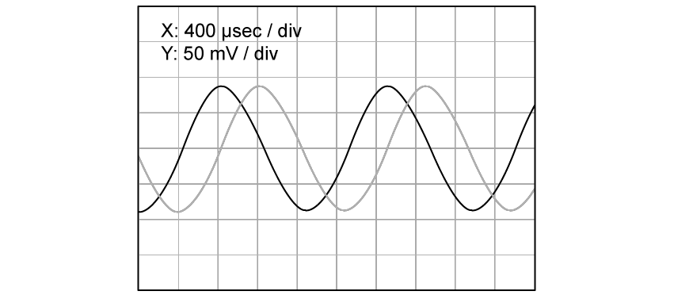
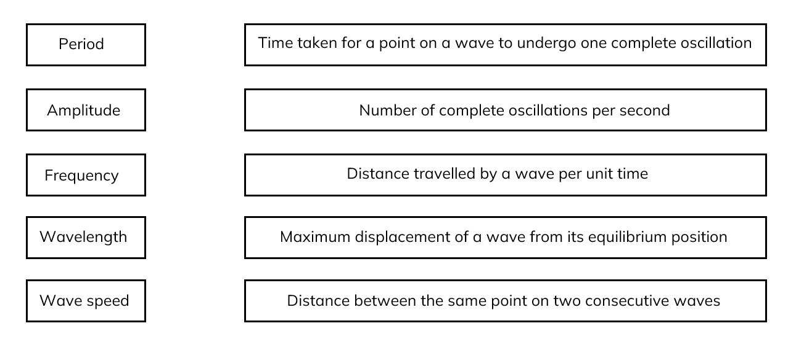
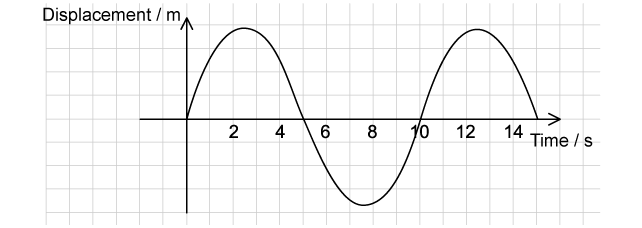

# Exam Questions — Progressive Waves
**7. Waves** · Cambridge (CIE) A-LEVEL physics (9702)
> Source: [https://www.savemyexams.com/a-level/physics/cie/25/topic-questions/](https://www.savemyexams.com/a-level/physics/cie/25/topic-questions/) · 26 questions across 2 sets

## Multiple Choice Questions (20 questions)

### Q1 — medium — 1 marks

**Q1** [1 mark]

Radio waves are electromagnetic waves that travel at speed *c* in a vacuum with a frequency *f* and wavelength *λ*.

Which row in the table describes the wavelength and speed of radio waves with a frequency $3 f$ ?

| ** ** | **Speed in a vacuum** | **Wavelength** |
|---|---|---|
| **A** | 3*c* | 3*λ* |
| **B** | *c* | $\frac{λ}{3}$ |
| **C** | *c* | 3*λ* |
| **D** | $\frac{c}{3}$ | $\frac{λ}{3}$ |

### Q2 — medium — 1 marks

**Q2** [1 mark]

A plane polarised light of amplitude *A* is passed through a polarising filter as show in the diagram. The emerging light has an amplitude of A cos $θ$

If the intensity of the beam is *I,* what is the intensity of the emerging light when *θ* is 60.0˚?

### Q3 — hard — 1 marks

**Q3** [1 mark]

The graph shows a sinusoidal wave in water travelling at a speed of 8.0 m s–1.

The maximum speed of the particles in the wave is $2πaf$, where *a* is the amplitude and *f* is the frequency.

An object Q is floating on the water it has a mass of 2.5 × 10–3 kg.

What is the maximum kinetic energy of Q due to the wave? Assume the motion is vertical.

### Q4 — medium — 1 marks

**Q4** [1 mark]

A sound wave can be displayed on a cathode ray oscilloscope (C.R.O.). The time base is set to 5 μs mm-1.

What is the frequency of the sound wave?

### Q5 — easy — 1 marks

**Q5** [1 mark]

A light with wavelength of 600 nm has an orange colour.

What is the frequency of this light?

### Q6 — hard — 1 marks

**Q6** [1 mark]

All electromagnetic waves travel at speed *c* in a vacuum with a frequency *f* and wavelength *λ*.

Which row in the table describes the wavelength and speed of electromagnetic waves with a frequency $\frac{f}{2}$  ?

| ** ** | **Speed in a vacuum** | **Wavelength** |
|---|---|---|
| **A** | 2*c* | 2*λ* |
| **B** | *c* | 2*λ* |
| **C** | *c* | $\frac{λ}{2}$ |
| **D** | $\frac{c}{2}$ | $\frac{λ}{2}$ |

### Q7 — medium — 1 marks

**Q7** [1 mark]

The diagram shows a wave moving along a stretched rope in the direction shown.

Which of the following will be the correct graph to show the variation with time *t* of the displacement *s* of the particle Q in the rope ?

### Q8 — medium — 1 marks

**Q8** [1 mark]

A sound wave with an amplitude *a *of 0.2 mm has an intensity of 2.5 W m–2

If a wave with the same frequency has an amplitude of 2*a* what is the intensity of the wave?

### Q9 — easy — 1 marks

**Q9** [1 mark]

The diagram below is a graph showing how the height of water at a point in a marina varies with time *t* as the waves pass the point.

What is the correct label for W and X?

| ** ** | **W** | **X** |
|---|---|---|
| **A**  **B**  **C**  **D** | amplitude  displacement  amplitude  displacement | period  wavelength  wavelength  period |

### Q10 — easy — 1 marks

**Q10** [1 mark]

A sound wave has a displacement *y* at a distance *x* from its source at time *t*.

Which graph shows correctly the amplitude *a* and the wavelength *λ* of the wave ?

### Q11 — medium — 1 marks

**Q11** [1 mark]

A source of sound power $P$ is situated in an open space. The intensity $I$ of sound at distance $r$ from this source is given by

$I=\frac{P}{4\mathrm{πr}^{2}}$

How does the amplitude $A$ of the vibrating air molecules vary with the distance $r$ from the source?

### Q12 — hard — 1 marks

**Q12** [1 mark]

The intensity *I* of a sound at point Q is inversely proportional to the square of the distance *x* of Q from the source of the sound. This can be shown by the equation

$Iα\frac{1}{x^{2}}$

Molecules of air at Q are a distance *r* from S and oscillate with amplitude 8.0 μm.

Point T is a distance 2*r* from S.

What is the amplitude of oscillation of air molecules at T?

### Q13 — hard — 1 marks

**Q13** [1 mark]

Sound waves can be displayed on a cathode ray oscilloscope (C.R.O.). The graph below represents two waves seen on the screen. They are labelled P and Q as shown in the diagram

What is the ratio $\frac{intensityofsoundwaveP}{intensityofsoundwaveQ}$  ?

### Q14 — easy — 1 marks

**Q14** [1 mark]

The vertical cross-section diagram shows a water wave moving from left to right.

Which points on the diagram show the water moving upwards with maximum speed?

### Q15 — easy — 1 marks

**Q15** [1 mark]

A wave has a frequency of 4 GHz.

What is the period of the wave?

### Q16 — easy — 1 marks

**Q16** [1 mark]

A sound wave has a frequency of 50 Hz and a speed of 330 m s–1

If two waves have a phase difference of 60˚, what is the possible distance between two points on the wave?

### Q17 — easy — 1 marks

**Q17** [1 mark]

The following are statements about waves.

| 1 | Longitudinal waves can be polarised. |
|---|---|
| 2 | The amplitude of a wave is directly proportional to the energy transferred by the wave. |
| 3 | All electromagnetic waves travel at the same speed in a vacuum. |
| 4 | The frequency of infra-red light is greater than the frequency of ultra-violet light. |

Which ones are incorrect?

### Q18 — hard — 1 marks

**Q18** [1 mark]

A wave has a speed of 340 m s–1 and a frequency of 500 Hz

If two points on a wave are 0.17 m apart, what is the phase difference?

### Q19 — hard — 1 marks

**Q19** [1 mark]

The equation below shows the speed of *v* waves in deep water

$v^{2}=\frac{gλ}{2π}$

Where *g *is the acceleration of free fall and *λ* is the wavelength of the waves. The wavelength *λ* and the frequency *f* of the wave were measured.

If the graph was to give a straight line through the origin which of the following graphs should be plotted?

### Q20 — hard — 1 marks

**Q20** [1 mark]

A light wave is incident normally on a surface of area *S* with an amplitude *A*. The power per unit area reaching the surface is *P*.

If the light is focused on a smaller area of $\frac{1}{3}S$, and the amplitude of wave is doubled to 2*A* what is the power per unit area?

## Structured Questions (6 questions)

### Q1 — hard — 14 marks

**Q1** [3 marks]

Fig. 1.1 shows a vertical cross-section through a water wave moving from left to right.

**Fig. 1.1**

Determine the point at which the water is moving upwards at maximum speed and explain your reasoning.

**Q1** [4 marks]

While a microphone is connected to a cathode-ray oscilloscope, a student strikes a tuning fork nearby. The sound wave produced by the tuning fork is displayed as a trace on the screen.

Fig. 1.2 shows the resulting trace. The time-base and gain are given on the screen.

**Fig. 1.2**

Use Fig. 1.2** **to calculate the wavelength of the sound wave produced.

(The speed of sound is approximately 330 m s–1).

**Q1** [3 marks]

**Extract:**

While a microphone is connected to a cathode-ray oscilloscope, a student strikes a tuning fork nearby. The sound wave produced by the tuning fork is displayed as a trace on the screen. Fig. 1.2 shows the resulting trace. The time-base and gain are given on the screen.
The time-base on the X-axis is set to a scale of 400 μs / div. One time period is 4 divisions.

The student’s lab partner strikes another identical tuning fork near the microphone, so that both sound wave signals can be overlaid on the oscilloscope trace. Fig. 1.3 shows the new trace.

**Fig. 1.3**

Using Fig. 1.3, determine the phase difference between the two signals as shown on the oscilloscope trace.

Give a suitable unit with your answer.

**Q1** [4 marks]

The oscilloscope trace is known as a ‘time-view’ of the sound wave because it shows the displacement of an oscillating signal against time. One of the students makes a time-view sketch as shown in Fig. 1.4, including a label *M*.

An oscillating signal can also be shown in terms of a ‘space-view’, which would show the displacement of the signal against its position. The other student makes a space-view sketch as shown in Fig. 1.5, including a label *N*.

**Fig. 1.4**

**Fig. 1.5**

Show that the wave speed *v *is given by:

$v=\frac{3N}{2M}$

### Q2 — hard — 13 marks

**Q2** [2 marks]

Ultrasound is used to measure the depth of oceans, seas and lakes.

Fig. 1.1 shows a pulse of ultrasound being emitted from the boat, travelling down to the sea bed and being reflected back to the boat.

**Fig.1.1**

State which type of wave ultrasound is and explain your answer.

**Q2** [3 marks]

A cathode-ray oscilloscope (C.R.O.) is used to trace the ultrasound pulses sent from the boat and the reflected pulses returning to the boat. The C.R.O. trace is shown in Fig. 1.2.

**Fig. 1.2**

The ultrasound travels through water at 1452 m s−1, and the wavelength of the pulse is 0.023 m.

For the ultrasound pulses:

(i) Calculate the frequency

[1]

(ii) Calculate the distance to the sea bed

[2]

**Q2** [8 marks]

**Extract:**

Ultrasound is used to measure the depth of oceans, seas and lakes. Fig. 1.1 shows a pulse of ultrasound being emitted from the boat, travelling down to the sea bed and being reflected back to the boat.

A cathode-ray oscilloscope (C.R.O.) is used to trace the ultrasound pulses sent from the boat and the reflected pulses returning to the boat. The C.R.O. trace is shown in Fig. 1.2. The ultrasound travels through water at 1452 m s^−1^, and the wavelength of the pulse is 0.023 m.

The boat moves out to an area where the sea is deeper.

(i) State and explain two changes that would occur on the cathode-ray oscilloscope trace. You may include diagrams in your answer.

[4]

(ii) When the sea is over 450 m deep, the pulses must be transmitted less frequently. Explain why this is the case.

[4]

### Q3 — medium — 5 marks

**Q3** [5 marks]

Circular water waves are produced by vibrating dippers at points P and Q, as illustrated in Fig. 4.1.

**Fig. 4.1** (not to scale)

The waves from P alone have the same amplitude at point R as the waves from Q alone. Distance PR is 44 cm and distance QR is 29 cm.

The dippers vibrate in phase with a period of 1.5 s to produce waves of speed 4.0 cm s–1.

(i) Calculate the wavelength of the waves.

wavelength = .................................................... cm [2]

(ii) Calculate the path difference at point R of the waves from P and Q.

Give your answer in terms of the wavelength λ of the waves.

path difference = ....................................................... λ [1]

(iii) Describe the motion, if any, of the water particles at point R.

Explain your answer.

[2]

*Source: Specimen 2022 Paper 2 Q4B*

### Q4 — easy — 6 marks

**Q4** [1 mark]

State the type of wave for which the oscillations are perpendicular to the direction of energy transfer.

**Q4** [2 marks]

State two objects that can be used in the classroom to demonstrate wave motion.

**Q4** [1 mark]

Fig. 1.1 shows a waveform consisting of compressions and rarefactions.

**Fig. 1.1**

Annotate the diagram to show one complete wavelength, and label it *λ.*

**Q4** [2 marks]

**Extract:**

Fig. 1.1 shows a waveform consisting of compressions and rarefactions. Fig. 1.1

The compression wave in Fig. 1.1 is a progressive wave in which 5 compressions pass a fixed point every 2 seconds.

Determine the frequency of the wave.

### Q5 — easy — 12 marks

**Q5** [2 marks]

Fig. 1.1 shows a displacement-distance graph for a travelling wave.

**Fig. 1.1**

Annotate Fig. 1.1, by adding labels to show:

(i) the wavelength

[1]

(ii) the amplitude

[1]

**Q5** [5 marks]

Identify the key word and its correct definition by connecting them with a line.

**Q5** [1 mark]

Fig. 1.2 shows a displacement-time graph for an oscillating object.

**Fig. 1.2**

Determine the time period *T *for this oscillation

**Q5** [4 marks]

**Extract:**

Fig. 1.2 shows a displacement-time graph for an oscillating object. Determine the time period T for this oscillation. Correctly determine the period T = 10 s;

The oscillation shown in Fig. 1.2 has a wavelength *λ* of 5 m.

Calculate:

(i) the frequency *f *of the oscillation

[2]

(ii) the wave speed *v*.

[2]

### Q6 — medium — 9 marks

**Q6** [2 marks]

Fig. 1.1** **represents a progressive wave travelling from left to right on a stretched string.

**Fig. 1.1**

The frequency of the wave is 30 Hz. Calculate the speed of the wave.

**Q6** [2 marks]

**Extract:**

Fig. 1.1 represents a progressive wave travelling from left to right on a stretched string. The frequency of the wave is 30 Hz. XY = 70 cm = 5/4 λ (λ = 56 cm = 0.56 m).

State the phase difference between points **X** and **Y** on the string, giving an appropriate unit.

**Q6** [3 marks]

**Extract:**

Fig. 1.1 represents a progressive wave travelling from left to right on a stretched string. The frequency of the wave is 30 Hz.

Describe how the vertical displacement of point **X** on the string varies in the next period.

**Q6** [2 marks]

**Extract:**

Fig. 1.1 represents a progressive wave travelling from left to right on a stretched string. The frequency of the wave is 30 Hz.

Determine the phase difference between the current position of **X** and the position of **X** 0.0825 s later.
