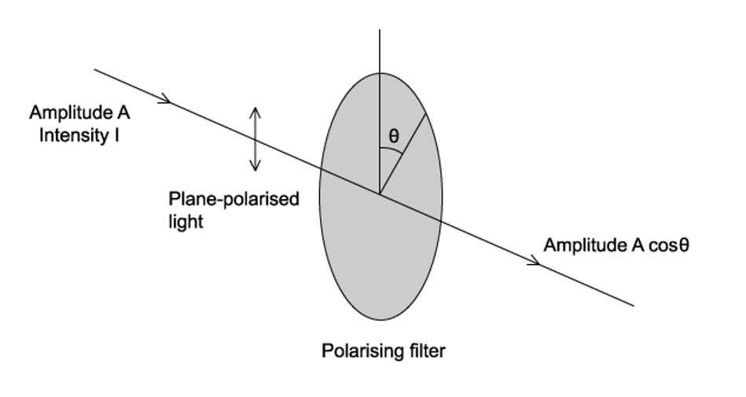
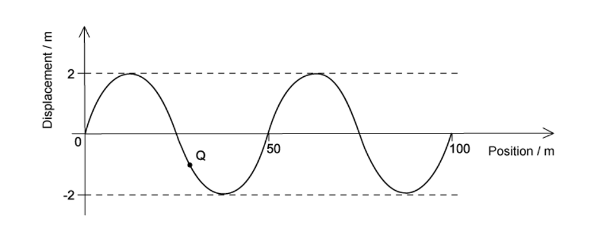
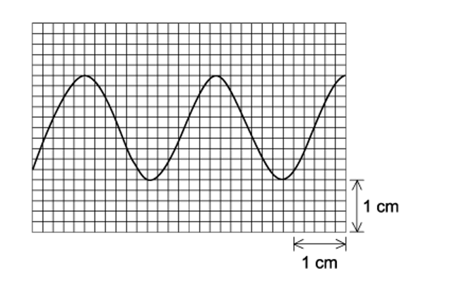
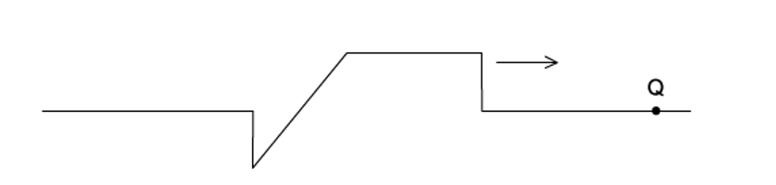
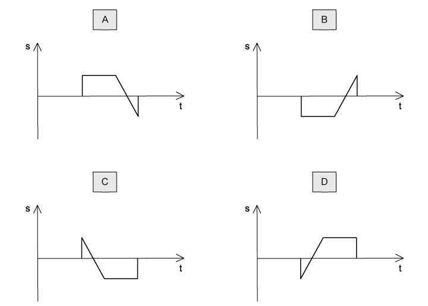
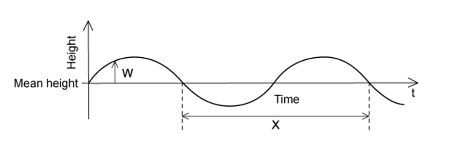
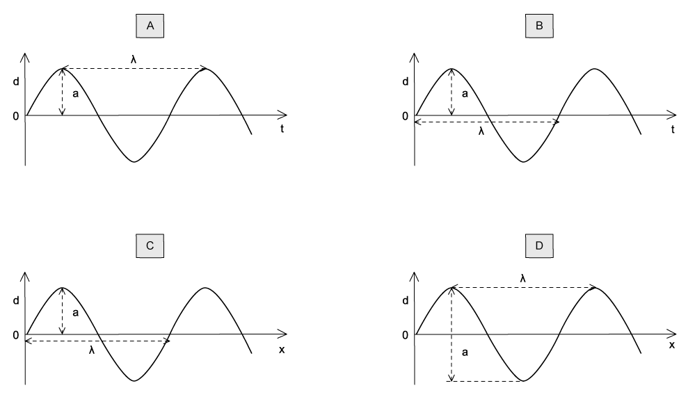
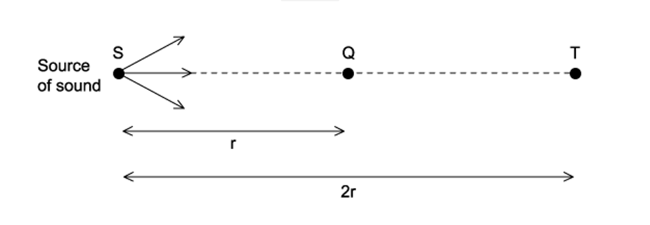
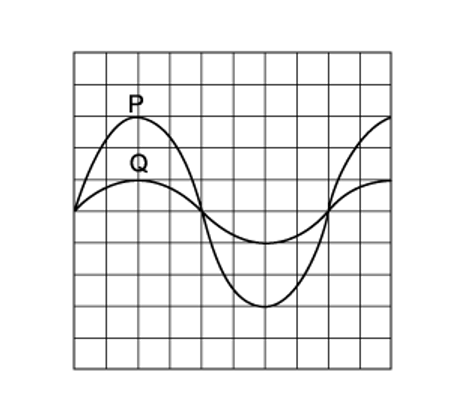
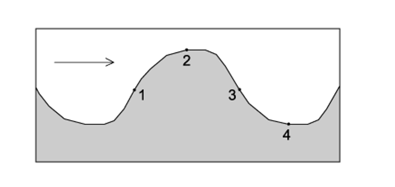

# Exam Questions — Progressive Waves
**7. Waves** · Cambridge (CIE) A-LEVEL physics (9702)
> Source: [https://www.savemyexams.com/a-level/physics/cie/25/topic-questions/](https://www.savemyexams.com/a-level/physics/cie/25/topic-questions/) · 20 questions across 1 sets

## Multiple Choice Questions (20 questions)

### Q1 — medium — 1 marks

**Q1** [1 mark]

Radio waves are electromagnetic waves that travel at speed *c* in a vacuum with a frequency *f* and wavelength *λ*.

Which row in the table describes the wavelength and speed of radio waves with a frequency $3 f$ ?

| ** ** | **Speed in a vacuum** | **Wavelength** |
|---|---|---|
| **A** | 3*c* | 3*λ* |
| **B** | *c* | $\frac{λ}{3}$ |
| **C** | *c* | 3*λ* |
| **D** | $\frac{c}{3}$ | $\frac{λ}{3}$ |

### Q2 — medium — 1 marks

**Q2** [1 mark]

A plane polarised light of amplitude *A* is passed through a polarising filter as show in the diagram. The emerging light has an amplitude of A cos $θ$

If the intensity of the beam is *I,* what is the intensity of the emerging light when *θ* is 60.0˚?

### Q3 — hard — 1 marks

**Q3** [1 mark]

The graph shows a sinusoidal wave in water travelling at a speed of 8.0 m s–1.

The maximum speed of the particles in the wave is $2πaf$, where *a* is the amplitude and *f* is the frequency.

An object Q is floating on the water it has a mass of 2.5 × 10–3 kg.

What is the maximum kinetic energy of Q due to the wave? Assume the motion is vertical.

### Q4 — medium — 1 marks

**Q4** [1 mark]

A sound wave can be displayed on a cathode ray oscilloscope (C.R.O.). The time base is set to 5 μs mm-1.

What is the frequency of the sound wave?

### Q5 — easy — 1 marks

**Q5** [1 mark]

A light with wavelength of 600 nm has an orange colour.

What is the frequency of this light?

### Q6 — hard — 1 marks

**Q6** [1 mark]

All electromagnetic waves travel at speed *c* in a vacuum with a frequency *f* and wavelength *λ*.

Which row in the table describes the wavelength and speed of electromagnetic waves with a frequency $\frac{f}{2}$  ?

| ** ** | **Speed in a vacuum** | **Wavelength** |
|---|---|---|
| **A** | 2*c* | 2*λ* |
| **B** | *c* | 2*λ* |
| **C** | *c* | $\frac{λ}{2}$ |
| **D** | $\frac{c}{2}$ | $\frac{λ}{2}$ |

### Q7 — medium — 1 marks

**Q7** [1 mark]

The diagram shows a wave moving along a stretched rope in the direction shown.

Which of the following will be the correct graph to show the variation with time *t* of the displacement *s* of the particle Q in the rope ?

### Q8 — medium — 1 marks

**Q8** [1 mark]

A sound wave with an amplitude *a *of 0.2 mm has an intensity of 2.5 W m–2

If a wave with the same frequency has an amplitude of 2*a* what is the intensity of the wave?

### Q9 — easy — 1 marks

**Q9** [1 mark]

The diagram below is a graph showing how the height of water at a point in a marina varies with time *t* as the waves pass the point.

What is the correct label for W and X?

| ** ** | **W** | **X** |
|---|---|---|
| **A**  **B**  **C**  **D** | amplitude  displacement  amplitude  displacement | period  wavelength  wavelength  period |

### Q10 — easy — 1 marks

**Q10** [1 mark]

A sound wave has a displacement *y* at a distance *x* from its source at time *t*.

Which graph shows correctly the amplitude *a* and the wavelength *λ* of the wave ?

### Q11 — medium — 1 marks

**Q11** [1 mark]

A source of sound power $P$ is situated in an open space. The intensity $I$ of sound at distance $r$ from this source is given by

$I=\frac{P}{4\mathrm{πr}^{2}}$

How does the amplitude $A$ of the vibrating air molecules vary with the distance $r$ from the source?

### Q12 — hard — 1 marks

**Q12** [1 mark]

The intensity *I* of a sound at point Q is inversely proportional to the square of the distance *x* of Q from the source of the sound. This can be shown by the equation

$Iα\frac{1}{x^{2}}$

Molecules of air at Q are a distance *r* from S and oscillate with amplitude 8.0 μm.

Point T is a distance 2*r* from S.

What is the amplitude of oscillation of air molecules at T?

### Q13 — hard — 1 marks

**Q13** [1 mark]

Sound waves can be displayed on a cathode ray oscilloscope (C.R.O.). The graph below represents two waves seen on the screen. They are labelled P and Q as shown in the diagram

What is the ratio $\frac{intensityofsoundwaveP}{intensityofsoundwaveQ}$  ?

### Q14 — easy — 1 marks

**Q14** [1 mark]

The vertical cross-section diagram shows a water wave moving from left to right.

Which points on the diagram show the water moving upwards with maximum speed?

### Q15 — easy — 1 marks

**Q15** [1 mark]

A wave has a frequency of 4 GHz.

What is the period of the wave?

### Q16 — easy — 1 marks

**Q16** [1 mark]

A sound wave has a frequency of 50 Hz and a speed of 330 m s–1

If two waves have a phase difference of 60˚, what is the possible distance between two points on the wave?

### Q17 — easy — 1 marks

**Q17** [1 mark]

The following are statements about waves.

| 1 | Longitudinal waves can be polarised. |
|---|---|
| 2 | The amplitude of a wave is directly proportional to the energy transferred by the wave. |
| 3 | All electromagnetic waves travel at the same speed in a vacuum. |
| 4 | The frequency of infra-red light is greater than the frequency of ultra-violet light. |

Which ones are incorrect?

### Q18 — hard — 1 marks

**Q18** [1 mark]

A wave has a speed of 340 m s–1 and a frequency of 500 Hz

If two points on a wave are 0.17 m apart, what is the phase difference?

### Q19 — hard — 1 marks

**Q19** [1 mark]

The equation below shows the speed of *v* waves in deep water

$v^{2}=\frac{gλ}{2π}$

Where *g *is the acceleration of free fall and *λ* is the wavelength of the waves. The wavelength *λ* and the frequency *f* of the wave were measured.

If the graph was to give a straight line through the origin which of the following graphs should be plotted?

### Q20 — hard — 1 marks

**Q20** [1 mark]

A light wave is incident normally on a surface of area *S* with an amplitude *A*. The power per unit area reaching the surface is *P*.

If the light is focused on a smaller area of $\frac{1}{3}S$, and the amplitude of wave is doubled to 2*A* what is the power per unit area?
