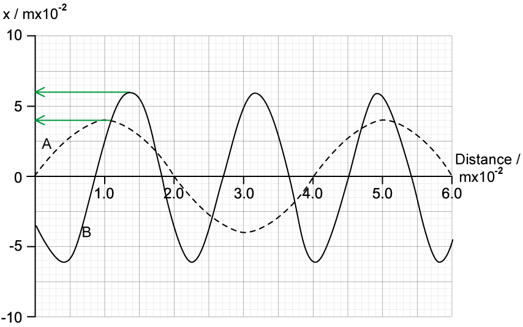
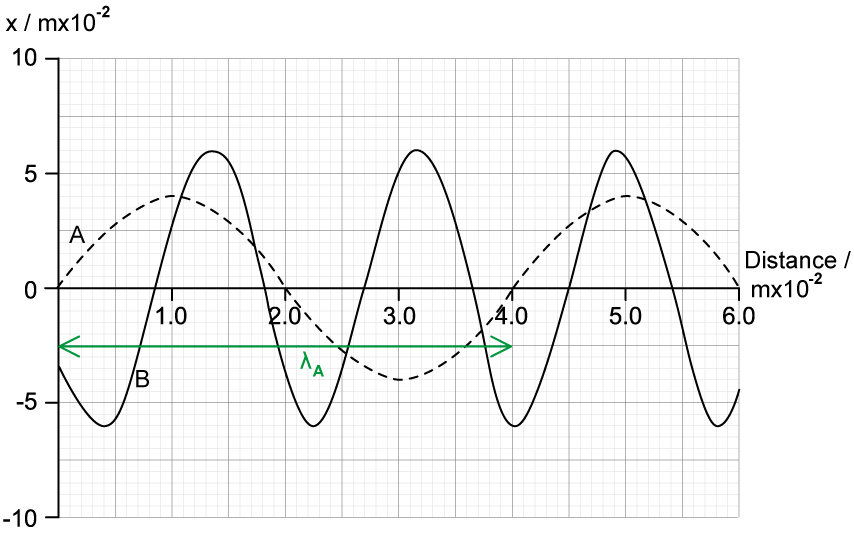
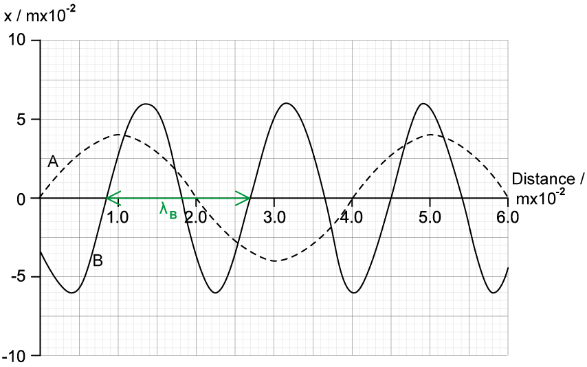
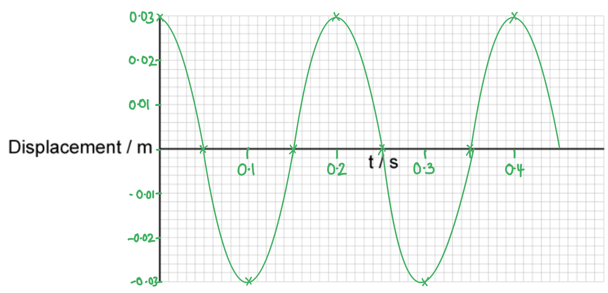

# Mark Schemes — Transverse & Longitudinal Waves
**7. Waves** · Cambridge (CIE) A-LEVEL physics (9702)

## Multiple Choice Questions (14 questions)

### Q1
**Final answer:** **The correct answer is ****C**** because:**

- Intensity *I* is proportional to amplitude squared *A**2*, i.e.

  - $A^{2}αI$
  - $\frac{I_{1}}{I_{2}}=\frac{A_{1}^{2}}{A_{2}^{2}}$
- From the graph we can see the amplitude and intensity of wave 1 is equal to

  - *A**1* = 2
  - *I**1* = 22 = 4
- This corresponds to an intensity of 1.6 × 10–6 W m–2
- From the graph we can see the amplitude and intensity of wave 2 is equal to

  - *A**2* = 3
  - *I**2* = 32 = 9
- The ratios of *I**1* and *I**2* can be used to find the corresponding intensity of wave 2

  - $\frac{I_{1}}{I_{2}}=\frac{A_{1}^{2}}{A_{2}^{2}}$
  - $\frac{1.6\times10^{-6}}{I_{2}}=\frac{4}{9}$
  - $I_{2} = \frac{9}{4} \times ( 1.6 \times 10^{- 6} ) = 3.6 \times 10^{- 6}$
- Therefore, the intensity of wave 2 is 3.6 × 10–6 W m–2

### Q2
**Final answer:** **The correct answer is ****D**** because:**

- In wave A, two full waves occur in time *t*

  - This means *t* is twice the period of wave A
  - $t=2T_{A}$
- In wave B, four full waves occur in time *t*

  - This means *t* is four times the period of wave B
  - $t=4T_{B}$
- The period of wave A is twice the period of wave B

  - $T_{A}=2T_{B}$
- Frequency is the reciprocal of period

  - $f_{A}=\frac{1}{T_{A}}$
  - Substitute $T_{B}$ into the above to relate the frequencies of wave A and wave B
  - $f_{A}=\frac{1}{2T_{B}}=\frac{1}{2}\times\frac{1}{T_{B}}=\frac{1}{2}f_{B}$
- Recall that intensity is proportional to frequency squared

  - $I\proptof^{2}$
- Therefore the ratio of intensity A to intensity B is

  - $\frac{I_{B}}{I_{A}}=\frac{f_{B}^{2}}{f_{A}^{2}}$
  - Substitute the expression for frequency A in terms of frequency B
  - `I _ B / I _ A = f _ B ^2 / ( 1 half f _ B ) ^2 = 1 / ( 1 half ) ^2 = 4`
- Rearranging this gives $I_{B}=4I_{A}$

### Q3
**Final answer:** **The correct answer is ****B**** because:**

- Intensity *I* is proportional to amplitude squared *A**2*, i.e.

  - $A^{2}αIorAα\sqrt{1}$
- If intensity is halved, $\frac{1}{2}$ , then the new amplitude is proportional to $\sqrt{\frac{1}{2}}$

  - $Aα\sqrt{\frac{1}{2}}=\frac{1}{\sqrt{2}}\sqrt{1}$
- The new amplitude is therefore $\frac{1}{\sqrt{2}}A$

  - Therefore, the amplitude is reduced by a factor of $\frac{1}{\sqrt{2}}$= 0.71 which is shown in graph B

**A** is incorrect because the graph shows that the amplitude is halved this is not the case as it is reduced by a factor of 0.71

**C** & **D **are incorrect because the graphs show the same amplitude and increased frequency

### Q4
**Final answer:** **The correct answer is ****A**** because:**

- The diagram shows a displacement time graph of a sound wave which is a longitudinal wave
- As time is on the x-axis, we can work out the period but not the wavelength of the wave
- Two complete cycles have a period of 2*T* = 8 ms

  - So, *T* = 4 ms
- From this frequency can be calculated from the equation

  - $f=\frac{1}{T}=\frac{1}{4\times10^{-3}}=250\mathrm{Hz}$
- The speed of the wave is calculated by the equation $v=fλ$
- Re-arrange for wavelength, $λ=\frac{330}{250}=1.32m$

**B** is incorrect because the graph shows a sine wave or sinusoid wave, this is a graphical depiction of the wave that describes a periodic oscillation this will be seen for both transverse and longitudinal waves

**C** is incorrect because when the frequency is calculated from the graph it is 250 Hz, not 500 Hz

**D** is incorrect because the intensity of the wave depends on the square of the amplitude. Doubling of the amplitude multiplies the intensity by a factor of 4

### Q5
**Final answer:** **The correct answer is ****B**** because:**

- The graph shows displacement against time, where the displacement is given in metres and the time in milliseconds
- It is possible to calculate the period from the graph since there are 3.5 waves in 12.2 milliseconds

  - $3.5T=12.2\times10^{-3}s$
  - Period, $T=\frac{12.2\times10^{-3}}{3.5}=0.0035s$
  - Frequency, $f=\frac{1}{T}=\frac{1}{0.0035}=290\mathrm{Hz}$
- The amplitude is the maximum displacement of the wave, this can be read from the y axis = 6.5 mm = 0.0065 m

### Q6
**Final answer:** **The correct answer is ****B**** because:**

- The known quantities are

  - The speed of sound, *v* = 340 ms-1
  - The speed of the source, *v*s = 85 ms-1
- From the graph, the wavelength of the source is

  - $λ=20-0=20\mathrm{cm}=2\times10^{-2}m$
- The frequency *f*s of the sound wave from the source is

  - $v=f_{s}λ$
  - $f_{s}=\frac{v}{λ}$
  - $f_{s}=\frac{340}{20\times10^{-2}}=1700$Hz
- The observed frequency of a sound wave from a moving source is

  - $f_{o}=\frac{f_{s}v}{v\pmv_{s}}$
- When a source is moving away from an observer the denominator is *v* + *v*s
- Therefore the observed frequency is

  - $f_{o}=\frac{1700\times340}{340+85}=1360=1400$ Hz (2 s.f)
- This is option **B**

### Q7
**Final answer:** **The correct answer is ****D ****because:**

- The known quantity is

  - Speed of the wave, *v* = 64 m s-1
  - Time elapsed, *t *= 0.034 s
- The wavelength of the wave is the distance from a peak to peak, or trough to trough

  - $λ=1.0-0.2=0.8$m
- The wave equation is

  - $v=fλ$
- The frequency of the wave is therefore

  - $f=\frac{v}{λ}$
  - $f=\frac{64}{0.8}=80$ Hz
- The time period of the wave is

  - $T=\frac{1}{f}$
  - $T=\frac{1}{80}=0.0125$ s
- The ratio of time *t* and *T* is

  - $\frac{t}{T}=\frac{0.034}{0.0125}=2.72$
- This means the wave has completed 2.72 oscillations when *t* = 0.034 s
- When a whole oscillation has been completed, the particle will return to its original position

  - The phase difference will therefore be 0.72 of one oscillation
- The phase difference in degrees is

  - $θ=0.72\times360=$260° (2 s.f)
- This is option **D**

> *If the question had asked for the phase difference in radians, you would multiply the ratio of *$\frac{t}{T}$* by 2π rather than 360°*

- $θ=0.72\times2π$*= 4.5 rad (2 s.f)*

### Q8
**Final answer:** **The correct answer is ****C**** because:**

- Frequency *f* = 15 Hz
- Speed *v* = 24 m s–1

  - The wave equation is $v=fλ$
- Wavelength $λ=\frac{v}{f}=\frac{24}{15}=1.6m$

  - 1.6 m = 1 cycle of the wave
- The question states that there is a phase difference of 2 m so $\frac{2}{1.6}=1\frac{1}{4}$
- A phase difference that is equal to $1\frac{1}{4}$ is the same as saying it has a phase difference of $\frac{1}{4}$

**A **is incorrect because the distance between two points would be 2.4 m if they were out of phase by half a cycle

**B **is incorrect because if there was no phase difference then the wavelength and the distance between two points would be equal

**D **is incorrect because the distance between two points would be 3.0 m if they were out of phase by 0.8 of a cycle

### Q9
**Final answer:** **The correct answer is ****A**** because:**

- The amplitude is the maximum displacement of the wave
- The amplitude of P is 8 cm and from the diagram we can see wave Q has an amplitude of half that so 4 cm
- Frequency is the number of waves per second of the wave
- Wave P has a frequency of 100 Hz, for every 1 wave that passes of P there are 3 waves of Q
- The period is the time it takes for a wave to complete one wavelength

  - So, the period of P$=\frac{1}{100}=0.01s$
- The period of Q is $=\frac{0.01}{3}$
- The frequency of Q $=\frac{1}{period}=\frac{3}{0.01}=300\mathrm{Hz}$

  - Therefore, wave Q has an amplitude of 4 cm and a frequency of 300 Hz

### Q10
**Final answer:** **The correct answer is ****A**** because:**

- The only statement that applies to both light and sound is statement 3, as the relationship between frequency and wavelength is inversely proportional i.e.:

  - $fα\frac{1}{λ}$
- That means doubling the frequency halves the wavelength

**B **& **C **are incorrect because the intensity of a wave is proportional to the square of the amplitude

**D **is incorrect because only transverse waves can be polarised as in a longitudinal wave the particles vibrate in the same direction that the wave travels. Sound waves are not able to travel through free space so statement 1 is incorrect

### Q11
**Final answer:** **The correct answer is ****C**** because:**

- Ultraviolet waves have a range of frequencies from 7.5 × 1014 – 3 × 1016 Hz

### Q12
**Final answer:** **The correct answer is ****C**** because**

- The label goes from the middle of one compression to another
- This is the wavelength

Option **A** is incorrect because

- The label highlights one compression

Option **B** is incorrect because

- The label highlights one rarefaction

Option **D** is incorrect because

- The label goes from the middle of a compression to a middle of a  rarefaction
- This is half a wavelength
- For a longitudinal wave, a wavelength can also be measured from one rarefaction to another

### Q13
**Final answer:** **The correct answer is ****B**** because**

- An X-ray is a transverse wave as it is part of the electromagnetic spectrum
- An ultrasound wave is a longitudinal wave as it is a high frequency sound wave

Option **A** is incorrect because

- Water waves and visible light are both transverse waves

Option **C** is incorrect because

- Primary (P) waves and sound waves are both longitudinal waves

Option **D** is incorrect because

- Infrared waves and vibrations on guitar strings are both transverse waves

### Q14
**Final answer:** **The correct answer is ****C**** because:**

- Polarisation is the process by which the oscillations are made to occur in one plane only
- Sound is a longitudinal wave
- Longitudinal waves can’t be polarised as they oscillate parallel to the direction of travel
- Transverse waves can be polarised as they can oscillate in any plane

**A **is incorrect because both transverse and longitudinal waves can be diffracted around corners

**B **is incorrect because both transverse and longitudinal waves can be refracted as they pass from hot to cold air

**D **is incorrect because both transverse and longitudinal waves can be reflected from a solid surface

## Structured Questions (5 questions)

### Q1
The similarities between waves X and Y are:

- Both waves have the <u>same period</u> (10 squares); **[1 mark]**
- Both waves have the <u>same frequency</u> (3 complete waves in the time shown); **[1 mark]**

**[Total: 2 marks]**

> *Wavelength would not be an acceptable answer here, because the graph shows time on the x-axis not distance. When time is on the x-axis, the distance between each trough or crest is the period.*
The difference between waves X and Y is:

- The waves have different amplitudes **OR** wave X has a greater amplitude than wave Y;** [1 mark]**

**[Total: 1 mark]**
Transverse waves are:

- Vibrations / oscillations that are perpendicular / normal to the direction of energy transfer; **[1 mark]**

Longitudinal waves are:

- Vibrations / oscillations that are parallel to the direction of energy transfer; **[1 mark]**

**[Total: 2 marks]**
The wave type can be determined by:

**EITHER**

- Determining the motion of the particles relative to the direction of propagation / energy transfer; **[1 mark]**

**OR**

- Polarisation only works for transverse waves / longitudinal waves cannot be polarised; **[1 mark]**

**[Total: 1 mark]**

### Q2
Determine the amplitudes from the graphs:

- In each case reading maximum displacement from the *y*-axis of the graph:

- Wave A = 4 cm **AND **Wave B = 6 cm; **[1 mark]**

Calculate how much B is larger than A:

- $\frac{B}{A}$= $\frac{6}{4}$ = $\frac{3}{2}$
- B is $\frac{3}{2}$ **OR** 1.5 times larger than A; **[1 mark]**

**[Total: 2 marks]**
(i) The velocity of wave A:

List the known quantities:

- Frequency A, *f**A* = 8.0 Hz

Determine wavelength of A from the graph:

- Wavelength A, *λ**A* = 4.0 cm **OR**** **= 0.04 m **[1 mark]**

  - You can read wavelength it from the x-axis, at the point where one wave completes 

Calculate the speed of the wave:

- velocity of wave A:

  - *v = fλ*
  - *v**A** = f**A**λ**A*= 4.0 × 8.0
  - *v  *= 32 cm s–1 **OR**** **= 0.32 m s–1 **[1 mark]**

(ii) Determine the frequency of wave B:

List the known quantities:

- Velocity of wave A, *v*A= 32 cm s–1

Determine wavelength of B from the graph:

- Wavelength B, *λ**B* = 1.8 cm **OR**** **= 0.018 m **[1 mark]**

Determine velocity of wave B:

- Velocity of wave B = velocity wave A, *v**B** *= 32 cm s–1 (because they are travelling at the same speed)

Calculate the frequency of the wave:

- *f**B** = *$\frac{v_{B}}{λ_{B}}$*= *$\frac{32}{1.8}$
- *f**B** =* 18 Hz **[1 mark]**

**[Total: 4 marks]**

> *In a question like this, where measurements are given in non-SI units, you must state your units in your final answer. It is reasonable to calculate for these waves in either centimetres or metres, so be careful to show which you worked in and clearly show in your answer which is applicable. Notice that in the final calculation for frequency, as long as you do not mix up your units, i.e.: use all centimetres or all metres, then the value for frequency will be correct as the unit of length has cancelled out as this is a ratio.*
The stationary wave is generated in the tank by:

- Two (water) waves (in the tank) move in opposite directions; **[1 mark]**
- As they are reflected from the fixed ends of the tank; **[1 mark]**
- The two waves interfere / superpose to produce a standing / stationary wave; **[1 mark]**

**[Total: 3 marks]**

> *The key words here are the ‘interfere’ or ‘superpose’ for how the waves ‘meet’ to create the stationary wave. It is better to use these terms instead of just ‘meet’ or ‘overlap’ as they are more relevant to this scenario and not as vague. This makes it much easier for the examiner to award you the mark!*

### Q3
A wave is transverse if...

- The oscillations are perpendicular / at right angles to the direction of wave motion / energy transfer; **[1 mark]**

**[Total: 1 mark]**
The properties of a longitudinal wave are:

**Final answer:** **Any ****two**** from:**

- The oscillations are parallel to the direction of wave motion / energy transfer;** [1 mark]**
- Comprises of areas of compressions and rarefactions; **[1 mark]**
- Requires a medium to propagate; **[1 mark]**
- Cannot be polarised; **[1 mark]**

**[Total: 2 marks]**
Examples of transverse waves are:

**Final answer:** **Any ****two**** from:**

- Water waves; **[1 mark]**
- Secondary waves / S-waves; **[1 mark]**
- Vibrations on a (guitar) string; **[1 mark]**
- Electromagnetic waves / any named EM wave (gamma, X-ray, ultraviolet, visible light, infrared, microwave, radio); **[1 mark] **

**[Total: 2 marks]**
Examples of longitudinal waves are:

**Final answer:** **Any ****two**** from:**

- Sound waves;** [1 mark]**
- Ultrasound; **[1 mark]**
- Primary waves / P-waves; **[1 mark]**

**[Total: 2 marks]**

### Q4
Explain what is meant by a progressive wave:

- A transfer of energy; **[1 mark]**
- With no transfer of matter; **[1 mark]**

**[Total: 2 marks]**
A correctly completed graph of the oscillation looks like:

- Shape is sinusoidal with exactly two cycles shown; **[1 mark]**
- Amplitude at ± 0.03; **[1 mark]**
- Period = 0.2 s **AND **x-axis labelled 0.1, 0.2, 0.3 and 0.4; **[1 mark]**
- Curve starts at (0, 0.03); **[1 mark]**

**[Total: 4 marks]**
For time *t* = 0, state which of the points W, X, Y and Z:

i) Is instantaneously at rest:

- X;** [1 mark]**

ii) Has the greatest speed:

- W; **[1 mark]**

**[Total: 2 marks]**
Calculate the new speed of point W at *t* = 0. Explain your reasoning:

- The speed of the oscillation is proportional to frequency when amplitude is constant, so doubling *f* doubles the maximum speed; **[1 mark]**
- Therefore speed doubles **OR** new speed = 1.9 m s–1 **[1 mark]**

**[Total: 2 marks]**

Frequency has doubled, so point W has got to move double the distance in the same time / move the same distance in half the time.

### Q5
Explain:

- The disturbances/oscillations/vibrations are parallel for longitudinal and perpendicular for transverse **[1 mark]**
- To the direction of transmission of energy/wave/propagation/direction **[1 mark]**

*Do not accept ‘movement’ of the wave*

Example:

**Final answer:** **Any ****one**** from:**

- Electromagnetic waves e.g. microwaves, radio waves, UV **[1 mark]**
- Waves on a string **[1 mark]**
- Seismic S-waves **[1 mark]**
- Ripples on the surface of water **[1 mark]**** **

**[Total: 3 marks]**

- Clear diagram of particle oscillations / pressure variations (compressions and rarefactions)

**AND**

- Includes label indicating direction of propagation;* ***[1 mark]**

Explain:

**Final answer:** **Any ****two**** from:**

- The sound source is a vibrating source (e.g. speaker); **[1 mark]**
- Energy is transferred to (air) molecules; **[1 mark]**
- Energy is transferred by collisions between molecules; **[1 mark]**
- Oscillations of (air) molecule neighbours are slightly out of phase; **[1 mark]**
- Oscillations / waves are longitudinal / energy transfer is parallel to vibrations; **[1 mark]**** **

**[Total: 3 marks]**
The total distance is equal to the distance to and from the wall

- Distance travelled = 2 × 30 = 60 m **[1 mark]**

Calculating the speed of sound:

- Speed = $\frac{\mathrm{distance}}{\mathrm{time}}$
- Speed =$\frac{60}{0.18}$ **[1 mark]**
- Speed = 333.3 = 330 m s–1 (2 s .f.) **[1 mark]**** **

**[Total: 3 marks]**
To calculate the frequency of the sound wave:

List the known quantities:

- Speed of sound, *v* = 333** **m s–1 (from part (c))

Determine the wavelength:

- From Fig. 1.1: 140 cm = 2$λ$
- $λ$= 70 cm **[1 mark]**

Calculate the frequency:

- *f* = $\frac{v}{λ}$
- *f* = $\frac{333}{0.70}$**[1 mark]**
- *f *= 476 =** **480 Hz (2 s. f.) **[1 mark]**** **

**[Total: 3 marks]**
