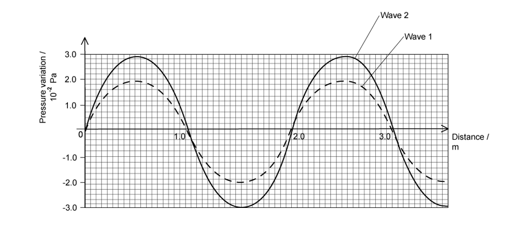
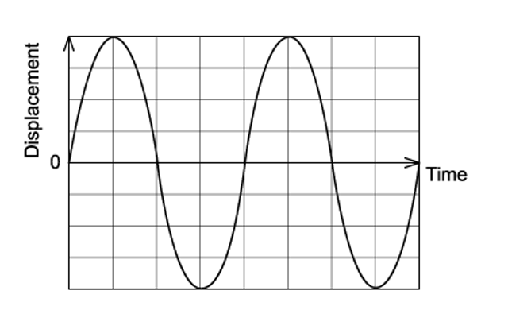
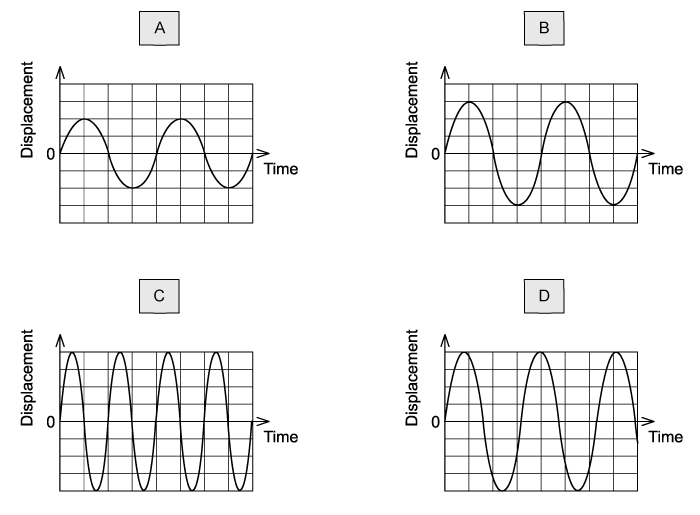
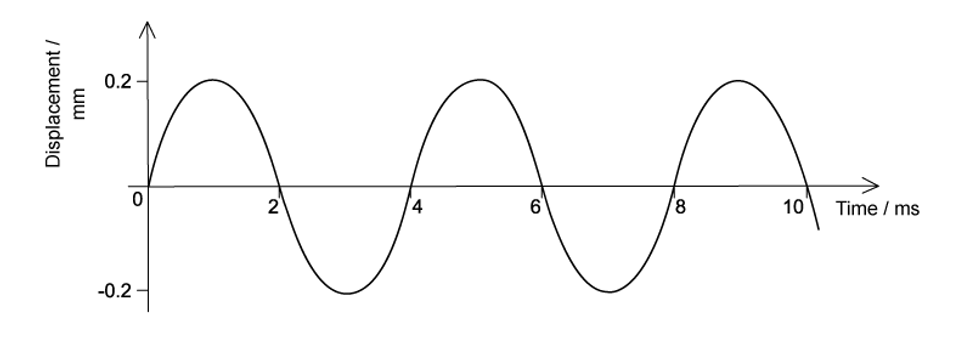
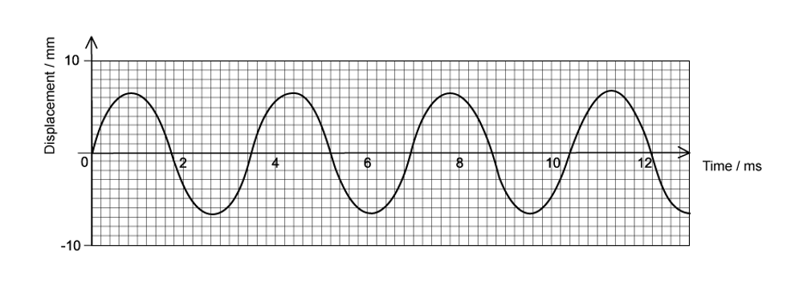
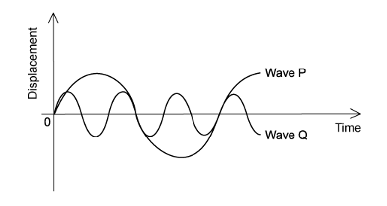
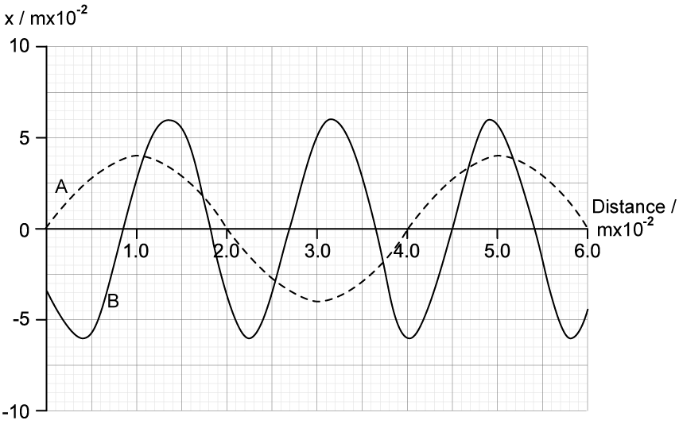
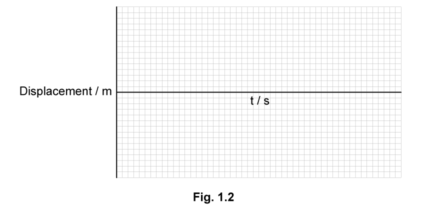

# Exam Questions — Transverse & Longitudinal Waves
**7. Waves** · Cambridge (CIE) A-LEVEL physics (9702)
> Source: [https://www.savemyexams.com/a-level/physics/cie/25/topic-questions/](https://www.savemyexams.com/a-level/physics/cie/25/topic-questions/) · 19 questions across 2 sets

## Multiple Choice Questions (14 questions)

### Q1 — hard — 1 marks

**Q1** [1 mark]

The graph below shows two sound waves, the sound wave is a series of moving pressure variations.

Wave 1 has an intensity of 1.6 × 10–6 W m–2, what is the intensity of wave 2 ?

### Q2 — hard — 1 marks

**Q2** [1 mark]

Fig 1.1 shows two longitudinal waves, wave A and wave B, over time *t*. Wave A has an intensity of *I**A*.

**Fig. 1.1**

Assuming both waves have equal amplitude, what is the intensity of wave B?

### Q3 — medium — 1 marks

**Q3** [1 mark]

The graph shows the displacement of a sound wave over time.

When the intensity of the wave is halved, which graph shows the correct displacement of the wave ?

### Q4 — medium — 1 marks

**Q4** [1 mark]

Sound travels with a speed of 330 m s–1 in air. The variation with time of the displacement of an air particle due to a sound wave is shown below.

Which of the following statements about the wave is correct?

### Q5 — medium — 1 marks

**Q5** [1 mark]

What is the frequency, amplitude and period of the wave shown in the graph below, to 2 significant figures?

| ** ** | **Period / s** | **Frequency / Hz** | **Amplitude / m** |
|---|---|---|---|
| **A**  **B**  **C**  **D** | 0.0042  0.0035  0.0031  0.0027 | 240  290  320  290 | 0.013  0.0065  0.013  0.0065 |

### Q6 — hard — 1 marks

**Q6** [1 mark]

A source emits a sound wave and moves away from an observer at a speed of 85 m s-1. Fig 1.1 shows the displacement-distance graph of the sound wave at the source.

**Fig. 1.1**

What is the observed frequency of the sound wave?

The speed of sound, *v* = 340 ms-1

### Q7 — hard — 1 marks

**Q7** [1 mark]

Fig 1.1 shows a displacement-distance graph of a transverse wave at *t* = 0 s. The wave is travelling at 64 m s-1. Particle R is marked at a position of 0.2 m.

**Fig. 1.1**

What would be the phase difference between the position of Particle R at *t* = 0 s and *t* = 0.034 s?

### Q8 — medium — 1 marks

**Q8** [1 mark]

A wave is travelling through a medium at 24 m s–1 with a frequency of 15 Hz.

What is the phase difference between two points 2 m apart?

### Q9 — hard — 1 marks

**Q9** [1 mark]

The graph shows two waves P and Q.

Wave P has an amplitude of 8 cm and a frequency 100 Hz.

What is the amplitude and the frequency of wave Q?

| ** ** | **Amplitude / cm** | **Frequency / Hz** |
|---|---|---|
| **A**  **B**  **C**  **D** | 4  4  2  2 | 300  33  300  33 |

### Q10 — easy — 1 marks

**Q10** [1 mark]

The following statements are about waves.

| 1 | Waves can travel through free space |
|---|---|
| 2 | Waves can be polarised |
| 3 | Waves have a frequency inversely proportional to their wavelength |
| 4 | Waves have an intensity proportional to their amplitude |

Which ones would apply to both sound and light waves?

### Q11 — easy — 1 marks

**Q11** [1 mark]

The shortest wavelength of ultraviolet waves have a frequency in the order of magnitude of 10x Hz.

What is the value of *x *?

### Q12 — easy — 1 marks

**Q12** [1 mark]

Fig 1.1 shows a longitudinal wave.

**Fig. 1.1**

Which label correctly shows the wavelength of a longitudinal wave?

### Q13 — easy — 1 marks

**Q13** [1 mark]

Which pair contains one transverse and one longitudinal wave?

| **A.** | Water wave | Visible light |
|---|---|---|
| **B.** | X-ray | Ultrasound |
| **C.** | Primary (P) wave | Sound wave |
| **D.** | Infrared wave | Vibration on a guitar string |

### Q14 — easy — 1 marks

**Q14** [1 mark]

Which of the following statements shows that sound waves are longitudinal?

## Structured Questions (5 questions)

### Q1 — easy — 6 marks

**Q1** [2 marks]

Fig. 1.1 shows graphs of waves X and Y. The scales of the graphs are identical.

**Fig. 1.1**

Describe **two **similarities between the properties of waves X and Y.

**Q1** [1 mark]

**Extract:**

Fig. 1.1 shows graphs of waves X and Y. The scales of the graphs are identical.

State **one **difference between waves X and Y.

**Q1** [2 marks]

Describe the difference between transverse and longitudinal waves.

**Q1** [1 mark]

**Extract:**

Fig. 1.1 shows graphs of waves X and Y. The scales of the graphs are identical.

Explain how it could be determined whether waves X and Y are transverse or longitudinal.

### Q2 — medium — 9 marks

**Q2** [2 marks]

A large water tank is set up so that a wave can be generated at each end of the tank. The two waves, A and B, travel towards each other at the same speed.

Fig. 1.1 shows the variation of displacement of the water surface with distance travelled at a particular instant.

**Fig. 1.1**

Deduce how many times greater the amplitude of B is to the amplitude of A.

**Q2** [4 marks]

**Extract:**

A large water tank is set up so that a wave can be generated at each end of the tank. The two waves, A and B, travel towards each other at the same speed. Fig. 1.1 shows the variation of displacement of the water surface with distance travelled at a particular instant.

Wave A has a frequency of 8.0 Hz.

**Fig. 1.1 **

(i) Calculate the velocity of wave A.

[2]

(ii) Determine the frequency of wave B.

[2]

**Q2** [3 marks]

**Extract:**

A large water tank is set up so that a wave can be generated at each end of the tank. The two waves, A and B, travel towards each other at the same speed.

Explain how the stationary wave is generated in the tank.

### Q3 — easy — 7 marks

**Q3** [1 mark]

Define a transverse wave.

**Q3** [2 marks]

State **two** properties of a longitudinal wave.

**Q3** [2 marks]

State **two **examples of transverse waves.

**Q3** [2 marks]

State **two** examples of longitudinal waves.

### Q4 — medium — 10 marks

**Q4** [2 marks]

Explain what is meant by a progressive wave.

**Q4** [4 marks]

An elastic cord is fixed at one end and attached to a mechanical oscillator at the other end. Fig. 1.1 shows, at time *t* = 0, the shape of a section of the cord as the wave travels from left to right. W, X, Y and Z are four marked points on the cord.

The mechanical oscillator has a steady frequency of 5.0 Hz. The wave has a wavelength of 0.60 m and an amplitude of 0.030 m.

On the axes of Fig. 1.2 sketch the graph of the displacement of point X over the period *t* = 0 to 0.40 s. Add suitable scales to the axes.

**Q4** [2 marks]

**Extract:**

An elastic cord is fixed at one end and attached to a mechanical oscillator at the other end. Fig. 1.1 shows, at time *t* = 0, the shape of a section of the cord as the wave travels from left to right. W, X, Y and Z are four marked points on the cord.

The mechanical oscillator has a steady frequency of 5.0 Hz. The wave has a wavelength of 0.60 m and an amplitude of 0.030 m.

For time *t* = 0, state which of the points W, X, Y and Z

i) is instantaneously at rest

[1]

ii) has the greatest speed

[1]

**Q4** [2 marks]

**Extract:**

An elastic cord is fixed at one end and attached to a mechanical oscillator at the other end. Fig. 1.1 shows, at time t = 0, the shape of a section of the cord as the wave travels from left to right. W, X, Y and Z are four marked points on the cord. The mechanical oscillator has a steady frequency of 5.0 Hz. The wave has a wavelength of 0.60 m and an amplitude of 0.030 m.

The speed of point W on the cord at *t* = 0 is 0.94 m s–1. With the cord at its original tension, the frequency of oscillation is now doubled to 10 Hz.

The amplitude is kept at 0.030 m. Calculate the new speed of point W at *t* = 0. Explain your reasoning.

### Q5 — medium — 12 marks

**Q5** [3 marks]

Explain briefly how transmission of energy by a longitudinal wave differs from transmission of energy by a transverse wave. Give **one** example of a transverse wave.

**Q5** [3 marks]

Sketch a diagram showing the direction of the propagation of a sound wave, and explain how a sound wave in air transmits energy away from its source.

**Q5** [3 marks]

Short pulses of sound are reflected from a wall 30 m from the sound source. The reflected pulses return to the source after 0.18 s.

Calculate the speed of sound.

**Q5** [3 marks]

**Extract:**

Short pulses of sound are reflected from a wall 30 m from the sound source. The reflected pulses return to the source after 0.18 s. Calculate the speed of sound. Speed = 60/0.18 = 333.3 = 330 m s^–1

Fig.1.1 represents the sound wave from part (c).

**Fig. 1.1**

Calculate the frequency of the sound wave.
