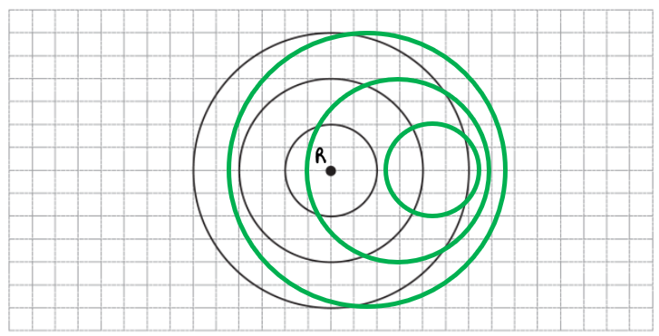

# Mark Schemes — Doppler Effect for Sound Waves
**7. Waves** · Cambridge (CIE) A-LEVEL physics (9702)

## Multiple Choice Questions (14 questions)

### Q1
**Final answer:** **The correct answer is ****A**** because:**

- The known quantities are

  - Mass of the source, *m* = 0.5 kg
  - Length of string, *r* = 0.2 m
  - Tension of the string, *F* = 800 N
  - Speed of sound, *v* = 340 m s-1
- The source is moving in a circular path, therefore

  - $F=\frac{mv_{s}^{2}}{r}$
  - $v_{s}^{2}=\frac{Fr}{m}$
  - $v=\sqrt{\frac{Fr}{m}}$
- The centripetal force on the source is equal to the tension on the rope, so

  - $v_{s}=\sqrt{\frac{800\times0.2}{0.5}}=17.9ms^{-1}$ (3 s.f)
- The observed frequency of a sound wave from a moving source is

  - $f_{0}=\frac{f_{s}v}{v\pmv_{s}}$
- At point **P** the source is moving directly towards the observer at point **O**

  - The denominator is therefore $v-v_{s}$
- The value of the ratio of $f_{0}$ and $f_{s}$ is

  - $f_{0}=\frac{f_{s}v}{v-v_{s}}$
  - $\frac{f_{0}}{f_{s}}=\frac{v}{v-v_{s}}$
  - $\frac{f_{0}}{f_{s}}=\frac{340}{340-17.9}=1.06$(3 s.f)
- This is option **A**

- Once you have calculated *v*s, you know that the only two options available is **A** or **B**
- As the source is moving towards the observer, the observed frequency must be greater than the emitted frequency, therefore

  - $\frac{f_{0}}{f_{s}}>1$
- By process of elimination, the answer must be option **A**

### Q2
**Final answer:** **The correct answer is ****B**** because:**

- The known quantities are

  - The ratio of λo and λs, $\frac{λ_{o}}{λ_{s}}=\frac{5}{4}$
  - Speed of sound, *v* = 340 m s-1
- The wavelength of a wave is

  - $v=fλ$
  - $λ=\frac{v}{f}$
- The emitted wavelength is equal to

  - $λ_{s}=\frac{v}{f_{s}}$
- The observed wavelength is equal to

  - $λ_{o}=\frac{v}{f_{o}}$
- Therefore the ratio of λo and λs is

  - $\frac{λ_{o}}{λ_{s}}=\frac{v}{f_{o}}\times\frac{f_{s}}{v}$
  - $\frac{λ_{o}}{λ_{s}}=\frac{f_{s}}{f_{o}}$
- The observed frequency of a sound wave from a moving source is

  - $f_{o}=\frac{f_{s}v}{v\pmv_{s}}$
- If the source is moving away from an observer, the observed wavelength would be greater than the emitted wavelength so $\frac{λ_{o}}{λ_{s}}$ > 1

  - As $\frac{λ_{o}}{λ_{s}}$ is equal to $\frac{5}{4}$ and this is greater than one, the source is moving away from the observer
- As the source is moving away, the denominator is therefore $v+v_{s}$
- The velocity of the source *v*s is

  - $f_{o}=\frac{f_{s}v}{v+v_{s}}$
  - $v+v_{s}=\frac{f_{s}v}{f_{o}}$
  - $v_{s}=\frac{f_{s}v}{f_{o}}-v$
  - $v_{s}=\frac{5}{4}\times340-340=85.0$  m s-1
- This is option **B**

### Q3
**Final answer:** **The correct answer is ****B**** because:**

- The Doppler equation for a source moving towards a stationary observer is  $f_{0}=\frac{f_{s}v}{v-v_{s}}$
- Rearranging to make the source frequency the subject gives $f_{s} = \frac{f_{0} ( v - v_{s} )}{v}$
- Where:

  - Observed frequency, $f_{0}=170\mathrm{Hz}$
  - Velocity of source, $v_{s}=10ms^{-1}$
  - Speed of sound in air, $v=340ms^{-1}$
- Therefore, $f_{s} = \frac{170 \times ( 340 - 10 )}{340} = 165 \text{Hz}$

  - This is answer **B**

**A **is incorrect as 100 m s−1 has been used for the speed rather than 10

**C **is incorrect as the operator + has been used rather than −

**D **is incorrect as 100 m s−1 has been used for the speed rather than 10 AND the operator + has been used rather than −

> *In many films where a T. rex chases a car, both dinosaur and car are moving. Luckily, you do not have to worry about relative motion when both source and observer are moving!*

### Q4
**Final answer:** **The correct answer is ****C**** because:**

- The frequency of a wave is

  - $v=fλ$
  - $f=\frac{v}{λ}$
- Frequency ∝ 1/*λ* when *v* is constant
- When a source is moving towards an observer, the observed wavelength is less than the emitted wavelength

  - The graph shows that the wavelength is 0.85 m when the sound is moving toward the observer
- The observed frequency $f_{T}$ when the source is moving towards the observer is

  - $f_{T}=\frac{v}{0.85}$
- When a source is moving away from an observer, the observed wavelength is greater than the emitted wavelength

  - The graph shows that the wavelength of the wave when it is moving away from the observer is 1.25 m
- The observed frequency $f_{A}$ when the source is moving away from the observer is

  - $f_{A}=\frac{v}{1.25}$
- Therefore the ratio of *f*A and *f*T is

  - $\frac{f_{A}}{f_{T}}=\frac{v}{1.25}\times\frac{0.85}{v}$
  - $\frac{f_{A}}{f_{T}}=\frac{0.85}{1.25}=\frac{17}{25}$
- This is option **C**

### Q5
**Final answer:** **The correct answer is ****D**** because:**

- The observed frequency of a sound wave from a moving source is

  - $f_{o}=\frac{f_{s}v}{v\pmv_{s}}$
- When the source is moving away from the observer, the denominator is *v* + *v*s
- At point **D**, the source is moving away, so option **D **must be correct

Option **A** and **C** are incorrect because:

- Points **A** and **C** do not lie along the line of motion, so the component of the source velocity toward the observers is smaller; the denominator is not $( v \pm v_{s} )$

Option **B** is incorrect because:

- When the source is moving towards the observer, the denominator is *v* - *v*s
- The source is moving towards point **B, **therefore the observed frequency at point **B **is $\frac{f_{s}v}{v-v_{s}}$
- Make sure you understand when to use the + or − for this equation

### Q6
**Final answer:** **The correct answer is ****A**** because:**

- The Doppler effect is when the sound heard by an observer changes depending on the relative motion between the source and the observer

- The observed frequency of a sound wave from a moving source is

  - $f_{o}=\frac{f_{s}v}{v\pmv_{s}}$
- When the source is moving away from the observer, the waves spread out resulting in the wavelength increasing, so, the frequency decreases from the original emitted value.
- So the denominator is *v* + *v*s

  - $f_{o}=\frac{f_{s}v}{v+v_{s}}$
- In this scenario, the source is the police car, and the person is the observer

- From the question

  - $f_{s}=440$ Hz
  - `v equals 340` m s−1
  - `v subscript s equals 30` m s−1

- Therefore

  - $f_{o} = \frac{( 440 ) ( 340 )}{( 340 + 30 )} = 404.32 \text{Hz}$

### Q7
**Final answer:** **The correct answer is ****C**** because:**

- The observed frequency$f_{o}$ of a sound wave from a moving source is:

  - $f_{o} = f_{s} ( \frac{v}{v \pm v_{s} } )$
  - Where$f_{s}$ is the source frequency, $v$ is the speed of the sound wave, and $v_{s}$ is the speed of the source (police car)
- Runner A is moving in the same direction as the police car

  - Since the police car is halfway between the runners, this means it has passed Runner A, and must be moving away
  - Therefore, the denominator is $v+v_{s}$
- The frequency of the sound wave observed by Runner A is:

  - $f_{A} = f_{s} ( \frac{v}{v + v_{s} } )$
  - $f_{A} = f_{s} ( \frac{v}{v + 10 u} )$
- Runner B is moving in the opposite direction to Runner A

  - Since the police car is halfway between the runners, this means it must be moving towards Runner B
  - Therefore, the denominator is $v-v_{s}$
- The frequency of the sound wave observed by Runner B is:

  - $f_{B} = f_{s} ( \frac{v}{v - v_{s} } )$
  - $f_{B} = f_{s} ( \frac{v}{v - 10 u} )$
- Therefore, the ratio of$f_{A}$ and $f_{B}$ is:

  - `f _ A / f _ B = ( (f _ s v)/(v + 10 u) ) x ( (v - 10 u)/(f _ s v) )`
  - $\frac{f_{A}}{f_{B}}=\frac{v-10u}{v+10u}$
- This is option **C**

When both the observer and the source are moving, the frequency of the observed wave is usually calculated using:

$f_{o} = f_{s} ( \frac{v \pm v_{o} }{v \pm v_{s} } )$

Where $v_{o}$ is the speed of the observer, which is equal to $u$ for both observers. Since the speed of sound $v$ is much greater than the running speed of the observers, $v \text{much} greater-than u$, this allows us to simplify the equation:

$f_{o} = f_{s} ( \frac{v}{v \pm v_{s} } )$

This means that relative to the wave, the observers can be treated as effectively stationary.

### Q8
**Final answer:** **The correct answer is ****D**** because:**

- The Doppler equation for a moving source is $f_{0}=\frac{f_{s}v}{v\pmv_{s}}$
- As the car is moving **towards **the observer, the denominator becomes (*v − v**s*)
- Substituting 0.2*v* for *v**s* gives:

  - $f_{0} = \frac{f_{s} v}{v - 0.2 v} = \frac{f_{s} v}{0.8 v} = f_{s} ( \frac{1}{0.8} ) = 1.25 f_{s}$

**A **is incorrect as 0.83 *f*s is found when + is used in the denominator instead of −

**B **is incorrect as 0.2 has been used for *v**s* rather than *v*

**C **is incorrect as  1.20 *f**s* is found when *v + v**s* is used incorrectly as the numerator

### Q9
**Final answer:** **The correct answer is ****A**** because:**

- The known quantities are:

  - Source frequency, *f*s = 450 Hz
  - Observed frequency, *f*o = 300 Hz
  - Speed of sound, *v* = 340 m s-1
- The observed frequency is less than the source frequency

  - This means observed frequency < emitted frequency
  - Therefore, the source must be moving **away** from the observer
- The observed frequency of a sound wave from a moving source is

  - $f_{o}=\frac{f_{s}v}{v\pmv_{s}}$
- When the source is moving away from the observer, the denominator is *v* + *v*s

  - $f_{o}=\frac{f_{s}v}{v+v_{s}}$
- Rearrange for *v*S

  - $f_{o}(v+v_{s})=f_{s}v$
  - $v+v_{s}=\frac{f_{s}v}{f_{o}}$
  - $v_{s}=\frac{f_{s}v}{f_{o}}-v$
- Substitute the values into the equation

  - $v_{s}=\frac{450\times340}{300}-340=170$ m s-1
- This is option **A**

### Q10
**Final answer:** **The correct answer is ****A**** because:**

- If the train is moving towards the observer then the wavelength of the sound waves is going to become shorter

  - This eliminates answer **D**
- If wavelength is shorter, then, because $c=fλ$, a decrease in wavelength will result in an increase in frequency

  - This eliminates answer** C**
- The pitch of a sound is linked to its frequency

  - A higher frequency means a higher pitch
  - Therefore the correct answer is **A**

### Q11
**Final answer:** **The correct answer is ****D**** because:**

- The doppler effect equation for a source travelling toward an observer is $f_{0}=\frac{f_{s}v}{v-v_{s}}$
- Where:

  - Frequency of source, $f_{s}=10\mathrm{kHz}=10000\mathrm{Hz}$
  - Velocity of source, $v_{s}=10ms^{-1}$
  - Speed of sound in air, $v=330ms^{-1}$
- Therefore, $f_{0}=\frac{10000\times330}{330-10}=10313\mathrm{Hz}$
- 10 313 ≈ 10.3 kHz

  - This is answer **D**

### Q12
**Final answer:** **The correct answer is ****C**** because:**

- The observed frequency *f*o of a sound wave from a moving source is

  - $f_{o}=\frac{f_{s}v}{v\pmv_{s}}$
- When a source is moving towards an observer, the denominator is $v-v_{s}$
- Therefore, the observed frequency is

  - $f_{o}=\frac{f_{s}v}{v-v_{s}}$

In the Doppler effect for sound, minus sign is used when the source moves towards the observer.

### Q13
**Final answer:** **The correct answer is ****B**** because:**

- When a source emitting a sound wave moves away from an observer, the waves are stretched

  - Therefore to an observer the wavelength increases

Option **A** is incorrect because

- When a source emitting a sound wave moves away from an observer, the observed frequency decreases as the waves are stretched

Option **C **and **D** is incorrect because

- When a source emitting a sound wave towards an observer, the waves are compressed
- Therefore the observed wavelength decreases and the frequency increases

### Q14
**Final answer:** **The correct answer is ****A**** because:**

- The correct rearrangement of the doppler effect for sound equation to make the source frequency the subject is:

  - $f_{0} = \frac{f_{s} v}{v \pm v_{s} } \rightarrow f_{s} = \frac{f_{0} ( v \pm v_{s} )}{v}$
- When the source is moving toward the observer the expression is $v-v_{s}$
- Therefore, the correct equation is:

  - $f_{s} = \frac{f_{0} ( v - v_{s} )}{v}$
- This is answer option **A**

## Structured Questions (7 questions)

### Q1
To calculate the change in frequency:

List the known quantities:

- Speed of the ambulance, *v*s* *= 13.4 m s−1
- Frequency of sound emitted by the ambulance,* f**S** *= 650 Hz
- Speed of sound in air, *v* = 340 m s−1

From the formula page:

- $f_{0} = f_{S} \frac{v}{( v \pm v_{s} )}$

Calculate the frequency heard by the observer, *f**0**:*

- A source moving <u>towards</u> a stationary observer has a denominator $(v-v_{s})$
- Therefore, the equation becomes $f_{0} = f_{S} \frac{v}{( v - v_{s} )}$
- $f_{0} = 650 \times ( \frac{340}{340 - 13.4} )$ = 677 Hz **[1 mark]**

Determine the change in frequency, Δ*f*:

- $\Deltaf=f_{0}-f_{S}=677-650=27\mathrm{Hz}$  **[1 mark]**

**[Total: 2 marks]**

> *This is a straightforward question, with a twist that you're being asked for the change in frequency, Δ**f **not just the observed frequency, **f**0**.** This means an extra step is required to calculate Δ**f**.*
List the known quantities:

- Lower frequency emitted sound, *f**S** *1 = 650 Hz (from part (a))
- Lower frequency observed sound, *f**0 *1* *= 677 Hz (from part (a))
- Higher frequency emitted sound = *f**S 2*
- Higher frequency observed sound *= f**O 2*
- Speed of sound, *v* = 340 m s−1
- Speed of ambulance, *v*s = 13.4 m s−1

(i) Describe the relationship between the ratio of observed frequencies and the ratio of emitted frequencies:

- The ratio between the two emitted frequencies is the same as the ratio between the two frequencies as heard by the observer; **[1 mark]**

Determine the higher frequency of emitted sound, *f**S** *2:

- $\frac{f_{S1}}{f_{S2}}=0.722$
- $f_{S1}=0.722\timesf_{S2}$
- $f_{S2}=\frac{f_{S1}}{0.722}=\frac{650}{0.722}=900$ Hz **[1 mark]**

Determine the higher frequency of observed sound, *f*O 2

- $f_{O 2} = f_{s 2} \frac{v}{( v - v_{s} )} = 900 \times \frac{340}{( 340 - 13.4 )}$ **[1 mark]**
- $f_{O2}=937\mathrm{Hz}$ **[1 mark]**

(ii) The effect of a change in the speed of the ambulance on the observed frequencies:

- If the ambulance is moving faster the observed frequencies will both be higher **OR**
- If the ambulance is moving slower the observed frequencies will both be lower; **[1 mark]**

- However, the ratio between them will remain at 0.722; **[1 mark]**

**[Total: 6 marks]**

> *In part (ii) the key is to recognise that whilst speed will change the pitch of the observed frequencies, the ratio between them does not change. This is because both emitted frequencies are multiplied by the same factor, *$( \frac{v}{v - v_{s} } )$*.*
List the known quantities:

- Frequency of observed sound, *f**0** *= 700 Hz
- Speed of the ambulance, *v**s* = 5.3 m s−1
- Speed of sound, *v* = 340 m s−1

Calculate wavelength of the observed sound:

- $v=fλ$
- $λ_{0}=\frac{v}{f_{0}}=\frac{340}{700}$= 0.486 m **[1 mark]**

State the conditions for calculating the observed wavelength from a source moving away from the observer:

- When a source is moving towards the observer, the operator in the brackets will be '−'
- Therefore, the equation $lambda_{o} = lambda_{S} ( 1 - v_\frac{{s}}{v} )$ is used; **[1 mark]**

Substitute in values and calculate the wavelength, *λ *of sound emitted by the ambulance:

- $lambda_{o} = lambda_{s} ( 1 - v_\frac{{s}}{v} )$
- $lambda_{S} = \frac{lambda_{o}}{ ( 1 - v_\frac{{s}}{v} ) } = \frac{0.486}{ ( 1 - \frac{5.3}{340} ) }$ **[1 mark]**

- Therefore, *λ *= 0.494 m **[1 mark]**

**[Total: 4 marks]**

> *Make sure you know which operators to use with each equation: it is dependent on whether it is the source is moving or the observer, and on whether the motion is towards or away from each other.*

### Q2
List the known quantities:

- Speed of the train, $v_{s}$= 45 m s−1
- Frequency of the source, $f$ = 750 Hz
- Speed of sound, $v$ = 340 m s−1
- Wind speed = 10 m s−1

(i) Substitute in values and calculate the observed frequency in still air:

- Recall the Doppler Equation: $f_{0} = f_{s} ( \frac{v}{v \pm v_{s} } )$
- The source is moving towards the observer, therefore the operator in the denominator is −
- $f_{0} = 750 ( \frac{340}{340 - 45} ) = 864 \text{Hz}$ **[1 mark]**

(ii) To calculate the frequency observed when the wind is blowing at 10 m s−1 towards the train and away from the person:

Determine the speed of sound in the wind:

- Sound travelling from the train to the observer moves against the wind, reducing its effective speed
- New speed of sound = 340 − 10 = 330 m s−1 **[1 mark]**

Substitute in known values and calculate the observed frequency:

- $f_{0} = 750 ( \frac{330}{330 - 45} ) = 868 \text{Hz}$ **[1 mark]**

**[Total: 3 marks]**

> *"A person is waiting at a level crossing for the train to pass". This tells us that the train is travelling towards the observer. *

> *Remember that velocity is a vector, so the wind is travelling in the opposite direction to the train, so it will be **negative**.*
List the known quantities:

- Speed of the wind = 27 m s−1
- Observed frequency, $f_{0}$= 729 Hz
- Frequency of the whistle, $f_{s}$ = 750 Hz (from part (a))
- Speed of sound, $v$ = 340 m s−1 (from part (a))

Calculate the new speed of sound taking the wind into effect:

- $v_{new}=340-27=313$ m s−1 **[1 mark]**

Rearrange the Doppler equation to make $v_{s}$ the subject:

- Recall the Doppler equation: $f_{0} = f_{s} ( \frac{v}{v \pm v_{s} } )$
- The train is moving away from the observer, and so the operator is +
- $\frac{f_{0}}{f_{s}v}=\frac{1}{v+v_{s}}$
- $v+v_{s}=\frac{f_{s}v}{f_{0}}$
- $v_{s}=\frac{f_{s}v}{f_{0}}-v$

Substitute in known quantities and calculate $u_{s}$:

- $v_{s}=\frac{750\times313}{729}-313=9.02ms^{-1}$ **[1 mark]**

**[Total: 2 marks]**

> *Read the question carefully. The wind is blowing towards the train (i.e. against the direction of sound travel from train to observer), so it reduces the effective speed of sound. This is why the effective speed of sound is 313 m s⁻¹. Note the difference between the frequency emitted by the whistle and the frequency heard by the observer and don't mix them up!*
List the known quantities:

- Frequency of the whistle, $f$ = 750 Hz (from part (a))
- Speed of the observer $v_{o}$= 1.5 m s−1
- Speed of sound in air, $v$ = 340 m (from part (a))
- Resolution of human hearing = 3.6 Hz

From the question:

- $f_{o} = f_{s} ( \frac{v \pm v_{o} }{v} )$

Calculate $f_{0}$:

- $f_{0} = 750 ( \frac{340 + 1.5}{340} ) = 753.3 \text{Hz}$ **[1 mark]**

Explain why this frequency change is negligible:

- The resolution of human hearing is around 3.6 Hz

  - Therefore any change in frequency less than this will be undetectable
- The change in frequency heard by the moving observer in this case is 753.3 − 750 = 3.3 Hz

  - This is less than 3.6 Hz
  - Therefore the frequency change can be considered negligible; **[1 mark]**

**[Total: 2 marks]**

> *Here the walker is moving in the same direction as the train was moving in parts a) and b) towards the platform. It can be helpful to sketch a diagram showing the train journey across the crossing, through the tunnel and to the platform, as there is a lot in each question part.*

> *The observer is moving towards the stationary source so in the equation the numerator is **v + v**o**, and their velocities are added together.*

> *It is important to recognise also that the person is moving too slowly to observe a change in the frequency of the sound. *
List the known quantities:

- Speed of approaching train, $v_{o}$= 7.6 m s−1
- Frequency of the whistle, $f$ = 750 Hz (from part (a))
- Speed of sound, $v$ = 340 m s−1 (from part (a))

From the question:

- $f_{o} = f_{s} ( \frac{v + v_{o} }{v - v_{s} } )$

Substitute in values and calculate $f_{0}$:

- $f_{0} = 750 \times ( \frac{340 + 7.6}{340 - 6.31} ) = 781 \text{Hz}$ **[1 mark]**

Determine $f_{0}$ as a percentage of $f_{s}$:

- $\frac{781}{750} = 1.04 = 104 \%$ of $f$ **[1 mark]**

**[Total: 2 marks]**

> *The signs of the velocities here can be confusing. Always take the observer to be positive and the opposite direction negative. This makes the question much easier, even though it is the reverse of parts a) to c). *

### Q3
List the known quantities:

- Speed of the car, $v_{s}$= 300 km h−1
- Frequency of sound heard by the stationary observer in front of the car, $f_{o}$ = 1550 Hz
- Speed of sound in air, $v$ = 340 m s−1

(i) To determine the frequency of the sound heard by a stationary observer as the car passes:

Note the relationship between $f_{s}$ and $f_{0}$ in this situation:

- At that instant, the radial component of the car’s velocity is zero, so there is no Doppler shift

  - Therefore, the frequency heard by the observer will be equal to that emitted by the car exhaust, $f_{s}$

Convert 300 km h−1 to m s−1:

- 1 km h−1 = $\frac{1000}{3600}$m s−1
- 300 km h−1 = $\frac{1000}{3600}\times300=83.3$ m s−1

Substitute in known values to the Doppler equation and calculate $f$:

- Recall the Doppler equation: $f_{0} = f_{s} ( \frac{v}{v \pm v_{s} } )$
- The car is moving towards the original observer and so the denominator is −
- $1550 = f_{s} ( \frac{340}{340 - 83.3} )$
- $f_{s}=\frac{1550\times256.7}{340}=1170\mathrm{Hz}$ **[1 mark]**

(ii) To determine the frequency heard by the stationary observer as the car moves away:

Substitute in known values and calculate $f_{0}$:

- The car is moving away from the observer so the denominator is +
- $f_{0} = 1170 ( \frac{340}{340 + 83.3} ) = 940 \text{Hz}$ **[1 mark]**

**[Total: 2 marks]**
State the known quantities:

- Speed of observer, $v_{o}$= 300 km h−1 = 83.3 m s−1 (from part (a))
- Maximum speed of source, $v_{smax}$= 310 km h−1 = 86.1 m s−1
- Frequency emitted by a car at 300 km h−1, $f_{o}$= 1170 Hz (from part (a))
- Speed of sound in air, *v* = 340 m s−1 (from part (a))

From the question:

- $f_{0} = f_{s} ( \frac{v \pm v_{o} }{v \pm v_{s} } )$

Calculate $f_{s}$ when the source and observer are stationary:

- Frequency is directly proportional to the speed
- Rearrange $f_{0} = f_{s} ( \frac{v \pm v_{o} }{v \pm v_{s} } )$ and make *v *= 0 m s−1
- Therefore, $f_{s} = 1170 \times ( \frac{86.1}{83.3} ) = 1209 \text{Hz}$ **[1 mark]**

Determine the nature of the operators when the observed frequency is at a maximum:

- Maximum frequency is observed when the faster car is catching the slower car
- When the source is moving towards the observer, the operators will be consistent with the denominators when only one is moving
- The source is moving towards the observer: **AND**

  - $v-v_{s}$ in the denominator
- The observer is moving away from the source (or at least trying to!)

  - $v-v_{o}$ in the numerator; **[1 mark]**

Calculate the maximum frequency:

- $f_{0} = f_{s} ( \frac{v - v_{o} }{v - v_{s} } ) = 1209 \times ( \frac{340 - 83.3}{340 - 86.1} ) = 1222 \text{Hz}$ **[1 mark]**

Determine the nature of the operators when the observed frequency is at a minimum:

- Minimum frequency is observed when the faster car is pulling away from the slower car
- When the source is moving away from the observer, the operators will be consistent with the denominators when only one is moving.
- The source is moving away from the observer: **AND**

  - $v+v_{s}$ in the denominator
- The observer is moving towards the source (or at least trying to!)

  - $v+v_{o}$ in the numerator; **[1 mark]**

Calculate the minimum frequency:

$f_{o} = f_{s} ( \frac{v + v_{o} }{v + v_{s} } ) = 1209 \times ( \frac{340 + 83.3}{340 + 86.1} ) = 1201 \text{Hz}$ **[1 mark]**

**[Total: 5 marks]**

> *Here the overtaking car is the source and the car being overtaken the observer. To determine the operators in the equation for maximum frequency (when the faster car is behind), consider that the source is driving towards the observer, and the observer is driving away from the source, only more slowly.*

- *This gives *$v-v_{o}$* in the numerator and *
- $v-v_{s}$* in the denominator*
List the known quantities:

- Speed of car, $v_{car}$ = 11.7 m s−1
- Wavelength of microwaves, $λ$ = 20 cm = 0.20 m
- Speed of light in free space, $c$* = *3.00 × 108 m s−1

Determine the frequency of the emitted microwaves, $f$:

- Recall the wave equation: $v=fλ$
- $f=\frac{v}{λ}$
- $f=\frac{3.00\times10^{8}}{0.2}$
- $f=1.5\times10^{9}\mathrm{Hz}$  **OR** 1.5 GHz **[1 mark]**

Calculate the change in frequency, $\Deltaf$ detected by the gun:

- From the question: $\Deltaf=\frac{2fv}{c}$
- $\Deltaf=\frac{2\times58.5\times11.7}{3.00\times10^{8}}$
- $\Deltaf=117\mathrm{Hz}$  **[1 mark]**

Calculate the frequency detected by the gun, $f_{d}$:

- $\Deltaf=f_{d}-f$
- $f_{d}=\Deltaf+f$
- $f_{d}=117+1.5\times10^{9}$
- $f_{d}=1500000117\mathrm{Hz}$ **[1 mark]**

**[Total: 3 marks]**

> *The change in frequency is really small, so don't let that confuse you. You must give your answer fully to show that the detected frequency is different to the emitted frequency. *

### Q4
As the source moves away from an observer...

- The frequency decreases; **[1 mark]**
- The pitch decreases / gets lower; **[1 mark]**

**[Total: 2 marks]**
The name of the effect is...

- The Doppler effect / Doppler shift; **[1 mark]**

**[Total: 1 mark]**
(i) $f_{o}$ represents:

- The observed frequency, measured in hertz (Hz); **[1 mark]**

(ii) $f_{s}$ represents:

- The frequency of source, measured in hertz (Hz); **[1 mark]**

(iii) $v$ represents:

- The wave velocity / speed of sound, measured in m s−1; **[1 mark]**

(iv) $v_{s}$ represents:

- The velocity of the source relative to the observer, measured in m s−1; **[1 mark]**

**[Total: 4 marks]**
When an observed sound is moving away from an observer:

- $f_{o} = f_{s} \frac{v}{( v + v_{s} )}$** [1 mark]**

**[Total: 1 mark]**

> *If you forget which is + and which is − just think about it logically.*

> *A sound moving away from the observer decreases in pitch and therefore frequency. For the frequency to decrease, the denominator needs to be larger, hence (**v** + **v**s**).*

> *A sound moving toward the observer increases in pitch and therefore frequency. For the frequency to increase, the denominator needs to be smaller, hence (**v** − **v**s**).*

### Q5
A sketch which would obtain 2 marks is:

- The time between the emission of each wavefront from the source = time period, *T*

  - $\mathrm{time} \mathrm{period} \mathrm{of}a\mathrm{wave},T=\frac{1}{\mathrm{wave} \mathrm{frequency},f}$
- The distance travelled by each wavefront is given by $s=vt$
- If *t* = *T*, then:

  - $s=vT=\frac{v}{f}$
- Since $v=f\timesλ$

  - $\frac{v}{f}=λ=s$
- Therefore, the distance travelled by the wavefront in one time period, *T* = *λ* **[1 mark]**

- The source is moving at 0.75v. Therefore, at the same time, the source has moved 0.75*λ*

  - This is one and a half a square on the diagram
  - Therefore, for each successive wavefront the centre of the circle will be half a square further on;** [1 mark]**

**[Total: 2 marks]**

> *To construct the diagram, it is easiest to think about where the source will have moved to in a unit time, i.e. 0.75**v** each time. This means the wavefront which has travelled the furthest (largest diameter) will be centred on 0.75**λ** from point R (1.5 squares). The next wavefront at 1.5**λ **(3 squares) and the final one at 2.25**λ** (4.5 squares).*
The scientist will make the following observation:

- Due to the Doppler effect, when a source moves relative to a stationary observer, the frequency will change; **[1 mark]**
- Therefore, as the source is moving towards the scientist, the observed frequency of the waves at the scientist's position will be greater than those emitted by the source; **[1 mark]**

**[Total: 2 marks]**

> *Make sure you can explain the difference in frequency for a source moving towards and away from a stationary observer.*
List the known quantities:

- Speed of sound, *v* = 330 m s−1
- Speed of the source, *v*s* *= 0.75v = 0.75 × 330 = 247.5 m s−1 (from part (b))
- Wavelength,* λ* = 2.50 m

From the formula page:

- $f_{0} = f_{S} \frac{v}{( v \pm v_{s} )}$

Determine the frequency, *f* of the emitted waves:

- $v=fλ$
- $f=\frac{v}{λ}=\frac{330}{2.50}=132$ Hz **[1 mark]**

Calculate the frequency as observed by the scientist, *f**0**:*

- A source moving towards a stationary observer has a denominator $(v-v_{s})$
- Therefore the equation becomes $f_{0} = f_{S} \frac{v}{( v - v_{s} )}$
- $f_{0} = 132 \times ( \frac{330}{330 - 247.5} ) = 528$ Hz **[1 mark]**

**[Total: 2 marks]**

### Q6
To explain the pattern of sound detected by the microphone:

Describe how the pitch of sound changes:

- Frequency / pitch increases as bee approaches **[1 mark]**
- Maximum at closest point **[1 mark]**
- Frequency / pitch decreases as bee recedes **[1 mark]**

Explain the cause of this change:

- This is due to the Doppler effect **[1 mark]**
- The Doppler effect is defined as the <u>observed change</u> in the frequency of the wave emitted by a source moving relative to an observer **[1 mark] **

**[Total: 5 marks]**

> *A higher pitch indicates a higher frequency, and therefore a lower pitch indicates a lower frequency.*
List the known quantities:

- Speed of the bee, *u*s* *= 8.9 m s−1
- Maximum frequency of sound, *f*max* *= 271 Hz
- Speed of sound in air, *v* = 340 m s−1

From the formula page:

- $f_{0} = f_{S} \frac{v}{( v \pm u_{s} )}$

(i) To determine the frequency of sound produced by the bee, *f**S*:

State the conditions for maximum frequency of sound:

- The maximum frequency is found when the bee is moving towards the microphone
- Therefore, the equation becomes $f_{0} = f_{S} \frac{v}{( v - u_{s} )}$ **[1 mark]**

Rearrange the equation and substitute in values to find* f*:

- $f_{0}(v-u_{s})=f_{S}v$
- $f_{S}=\frac{f_{0}(v-u_{s})}{v}$
- $f_{S}=\frac{271\times(340-8.9)}{340}=264\mathrm{Hz}$ **[1 mark]**

(ii) To determine the minimum frequency of sound recorded by the microphone, *f*min:

State the conditions for minimum frequency of sound:

- The minimum frequency is found when the bee is moving away from the microphone
- Therefore, the equation becomes $f_{0} = f_{S} ( \frac{v}{v + u_{s} } )$  **[1 mark]**

Calculate minimum *f**S**:*

- $f_{0} = 264 \times ( \frac{340}{340 + 8.9} ) = 257 \text{Hz}$  **[1 mark]**

**[Total: 4 marks]**

> *The approximation equation, *$\frac{Δλ}{λ}=\frac{v}{c}$*, cannot be used as the speed of sound is too similar in magnitude to the speed of the bee.*
To explain the assumptions and their effects:

**Final answer:** **Any**** two ****from:**

- The scientist walks in a straight line towards the hive

  - If they did not walk straight, then the observed frequency would be <u>incorrect</u>; **[1 mark]**
- The scientist walks at a constant speed towards the hive

  - A non-constant speed would give a varying value for *f**0*
  - Hence accurate calculation of speed is impossible; **[1 mark]**
- The swarm emits a constant frequency of sound

  - The equations are based on a constant emitted frequency from the source, *f**S*
  - If *f**S* is varying, then the equations cannot be used; **[1 mark]**
- The microphone is only detecting sound from the swarm

  - Other frequencies of sound could give inaccurate values for *f**S* and *f**0*; **[1 mark]**

**[Total: 2 marks]**

> *Questions which ask about assumptions often have more than one possible answer. Make sure you always give both the assumption **and** the effect it would have on the answer calculated. Sometimes this can include a calculation which describes mathematically the change you would see. *

### Q7
When the source of a sound is moving towards an observer:

- The wavelength of the sound wave** ****decreases**; **[1 mark]**
- The frequency of the sound **increases**; **[1 mark]**
- The pitch of the sound **increases**; **[1 mark]**

When the source of a sound is moving away from an observer:

- The wavelength of the sound wave **increases**; **[1 mark]**
- The frequency of the sound **decreases**; **[1 mark]**
- The pitch of the sound **decreases**; **[1 mark]**

**[Total: 6 marks]**
Determine the observed frequency as the car moves towards the observer:

List the known quantities:

- Emitted frequency, $f_{s}$ = 1.11 kHz = 1110 Hz
- Velocity of source, $v_{s}$ = 27 m s−1
- Wave speed, $v$* *= 340 m s−1

Use the Doppler equation to calculate observed frequency:

- Doppler effect for sound waves:  $f_{o}=f_{s}\frac{v}{v\pmv_{s}}$ (from the data page)
- When moving towards an observer:  $f_{o}=f_{s}\frac{v}{v-v_{s}}$** [1 mark]**
- $f_{o} = 1110 \times \frac{ 340}{( 340 - 27 )} = 1206 \text{Hz}$** [1 mark]**

**[Total: 2 marks]**

> *Always do a logic check at the end of your calculation. The sound is moving toward the observer, so the observed frequency should be higher than the source frequency.*
Determine the observed frequency as the sound moves away from the observer:

List the known quantities:

- Emitted frequency, $f_{s}$ = 1.11 kHz = 1110 Hz
- Velocity of source, $v_{s}$ = 27 m s−1
- Wave speed, $v$* *= 340 m s−1

Use the Doppler equation to calculate observed frequency:

- Doppler effect for sound waves:  $f_{o}=f_{s}\frac{v}{v\pmv_{s}}$ (from the data page)
- When moving away from an observer:  $f_{o}=f_{s}\frac{v}{v+v_{s}}$** [1 mark]**
- $f_{o} = 1110 \times \frac{ 340}{( 340 + 27 )} = 1028 \text{Hz}$** [1 mark]**

**[Total: 2 marks]**

> *Always do a logic check at the end of your calculation. The sound is moving away from the observer, so the observed frequency should be lower than the source frequency.*
