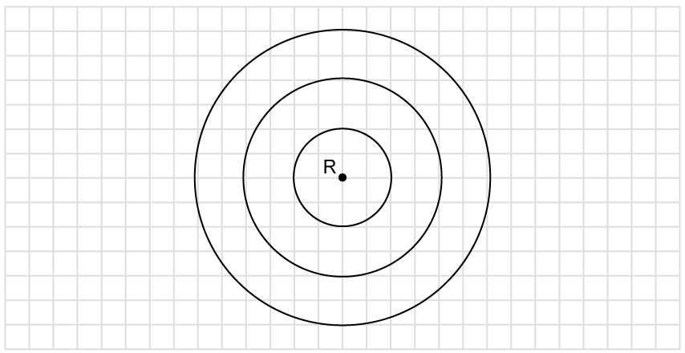

# Exam Questions — Doppler Effect for Sound Waves
**7. Waves** · Cambridge (CIE) A-LEVEL physics (9702)
> Source: [https://www.savemyexams.com/a-level/physics/cie/25/topic-questions/](https://www.savemyexams.com/a-level/physics/cie/25/topic-questions/) · 21 questions across 2 sets

## Multiple Choice Questions (14 questions)

### Q1 — hard — 1 marks

**Q1** [1 mark]

Fig 1.1 is a diagram of a source that has a mass of 500 g and is connected to a rope of length 20 cm. The rope is attached to point *Q* and has a tension of 800 N. The source travels around point Q anticlockwise in a circular path with a velocity of *v*s. It emits a sound wave of frequency *f*s. When the source is at point P, an observer stands directly in line to the direction of motion at point O.

**Fig 1.1**

What is the value of *v*s and $\frac{f_{o}}{f_{s}}$ when the source is at point P?

Speed of sound, *v* = 340 m s-1

|   | ***v*****s**** / m s****-1** | $\frac{f_{o}}{f_{s}}$ |
|---|---|---|
| **A.** | 17.9 | 1.06 |
| **B.** | 17.9 | 0.950 |
| **C.** | 320 | 17.0 |
| **D.** | 320 | 0.515 |

### Q2 — hard — 1 marks

**Q2** [1 mark]

A source moves directly in line with an observer at a constant velocity *v*s and emits a sound wave with a wavelength of λs. The observed wavelength of the source is λ0 and the ratio $\frac{λ_{0}}{λ_{s}}$ is equal to $\frac{5}{4}$.

What is the value of *v*s?

Speed of sound, *v* = 340 m s-1

### Q3 — medium — 1 marks

**Q3** [1 mark]

A car of terrified observers try to get the car to start to drive away from a hungry T. rex, running toward them at a speed of 10 m s−1. They hear the roar of the T. rex at a frequency of 170 Hz. The speed of sound in air is 340 m s−1.

What is the frequency of the sound as emitted by the T. rex?

### Q4 — hard — 1 marks

**Q4** [1 mark]

Fig. 1.1 is a graph of the observed wavelength against time of a sound wave emitted from a single source. The emitted sound wave has a frequency $f_{s}$. The sound travels at a constant velocity directly towards an observer and a frequency of $f_{T}$ is observed. It then travels directly away from the observer and a frequency of $f_{A}$ is observed.

**Fig. 1.1**

What is the value of the ratio$\frac{f_{A}}{f_{T}}$?

### Q5 — medium — 1 marks

**Q5** [1 mark]

Figure 1.1 shows object *P*, moving at velocity *v*s. It emits a sound wave of frequency *f*s. The speed of sound is *v*.

**Fig. 1.1**

At which point on the diagram will the observed frequency be $\frac{f_{s}v}{v+v_{s}}$?

### Q6 — medium — 1 marks

**Q6** [1 mark]

A police car siren emits a sound wave with a frequency *f**s* of 440 Hz. The car is travelling away from an observer at a speed of 30 m s−1.

The speed of sound is 340 m s−1.

Which of the following is the frequency the observer hears?

### Q7 — hard — 1 marks

**Q7** [1 mark]

Two runners, A and B, are running towards each other along the same road at speed $u$. A police car sounds its sirens while travelling at speed $10u$ along the road in the same direction as Runner A. At the halfway point, the police car is moving away from Runner A and toward Runner B, and they observe the sound wave from the siren at frequencies$f_{A}$ and$f_{B}$ respectively. The speed of sound is $v$, where $v \text{much} greater-than u$.

What is the ratio of $\frac{f_{A}}{f_{B}}$?

### Q8 — medium — 1 marks

**Q8** [1 mark]

A car travels in a straight line towards a stationary observer at a speed of 0.2*v*, where *v* is the speed of sound. The car's horn emits a pure sound of frequency *f**s*.

What is the frequency of the sound of the horn as heard by the observer, *f**0*?

### Q9 — medium — 1 marks

**Q9** [1 mark]

A source moving at constant velocity *v*s, emits a sound wave of frequency 450 Hz. A stationary observer records a frequency of 300 Hz.

What is the value of *v*s, and is it moving towards or away from the observer?

Speed of sound, *v* = 340 m s-1

|   | ***v*****s**** / m s****-1** | **Towards / Away** |
|---|---|---|
| **A.** | 170 | Away |
| **B.** | 170 | Towards |
| **C.** | 850 | Away |
| **D.** | 850 | Towards |

### Q10 — easy — 1 marks

**Q10** [1 mark]

A train is moving towards a stationary observer. The train sounds its horn.

What are the correct changes in frequency, wavelength and pitch of the horn as heard by the observer?

|   | **Frequency** | **Wavelength** | **Pitch** |
|---|---|---|---|
| **A.** | higher | shorter | higher |
| **B.** | higher | shorter | lower |
| **C.** | lower | shorter | lower |
| **D.** | lower | longer | higher |

### Q11 — easy — 1 marks

**Q11** [1 mark]

A car driving at a velocity of 10 m s−1 toward an observer sounds its horn with a frequency of 10 kHz. The speed of sound in air is 330 m s−1.

What frequency does the observer hear?

### Q12 — easy — 1 marks

**Q12** [1 mark]

A source emits a sound wave of speed *v* and frequency *f*s. The source moves towards an observer at a speed of *v*s.

What is the observed frequency of the source?

### Q13 — easy — 1 marks

**Q13** [1 mark]

Which of the following statements are true?

### Q14 — easy — 1 marks

**Q14** [1 mark]

Which of the following equations is correct for the frequency of a source that is moving toward an observer?

## Structured Questions (7 questions)

### Q1 — medium — 12 marks

**Q1** [2 marks]

An ambulance siren emits two pure sounds. The lower of the two sounds has a frequency of 650 Hz. It is travelling towards a stationary observer at 13.4 m s−1. The speed of sound in air is 340 m s−1.

Calculate the change in frequency, Δ*f*,* *between the source frequency and that heard by the observer.

**Q1** [6 marks]

**Extract:**

An ambulance siren emits two pure sounds. The lower of the two sounds has a frequency of 650 Hz. It is travelling towards a stationary observer at 13.4 m s^−1^. The speed of sound in air is 340 m s^−1^.

Calculate the change in frequency, Δf, between the source frequency and that heard by the observer. (From part (a): observed frequency f0 = 677 Hz, Δf = 27 Hz)

The ratio between the two frequencies emitted by the ambulance is 0.722.

(i) Determine the second frequency as heard by the observer.

[4]

(ii) Explain the effect a change in speed of the ambulance will have on the ratio between the two observed frequencies.

[2]

**Q1** [4 marks]

**Extract:**

The speed of sound in air is 340 m s^−1^.

As the ambulance approaches a red light at which a number of cars are stopped, it changes its siren to a single monotone sound which the car drivers observe as 700 Hz. The ambulance slows further to 5.3 m s−1.

Observed wavelength can be calculated using the following equation:

$lambda_{0} = lambda_{S} ( 1 \pm v_\frac{{s}}{v} )$

Calculate the wavelength of sound emitted by the ambulance.

### Q2 — hard — 9 marks

**Q2** [3 marks]

A train is travelling at 45 m s−1 and blows a whistle at a frequency of 750 Hz. A person is waiting at a level crossing for the train to pass. Take the speed of sound in air as 340 m s−1.

Calculate the frequency observed by the person:

(i) In still air.

[1]

(ii) When the wind is blowing at 10 m s−1 towards the train and away from the person.

[2]

**Q2** [2 marks]

**Extract:**

A train is travelling at 45 m s^−1^ and blows a whistle at a frequency of 750 Hz. A person is waiting at a level crossing for the train to pass. Take the speed of sound in air as 340 m s^−1^.

After the train passes the level crossing, it slows down as it approaches a tunnel. Wind is funnelled down the tunnel towards the train reaching a velocity of 27 m s−1. The observer at the level crossing hears the whistle at a frequency of 729 Hz.

Calculate the new speed of the train.

**Q2** [2 marks]

**Extract:**

A train is travelling at 45 m s^−1^ and blows a whistle at a frequency of 750 Hz. A person is waiting at a level crossing for the train to pass. Take the speed of sound in air as 340 m s^−1^.

After exiting the tunnel, the train stops at a station. The observer from part (a) is now walking to the platform to catch the train at a speed of 1.5 m s−1. The human ear can distinguish between frequency differences of around 3.6 Hz.

The Doppler equation for a moving observer is:

$f_{o} = f_{s} ( \frac{v \pm v_{o} }{v} )$

Show that the change in frequency of the train's whistle, as heard by the walking observer, can be considered negligible.

**Q2** [2 marks]

**Extract:**

A train is travelling at 45 m s^−1^ and blows a whistle at a frequency of 750 Hz. A person is waiting at a level crossing for the train to pass. Take the speed of sound in air as 340 m s^−1^.

Once the train has left the station, it travels down a line with two tracks. Another train is approaching on the opposite track with a speed of 7.6 m s−1. The speed of the departing train is 83% of the speed of the second train.

When both the observer and source are moving, the following equation can be used to determine the new frequency:

$f_{o} = f_{s} ( \frac{v + v_{o} }{v - v_{s} } )$

Calculate the frequency of this same whistle as observed by a passenger on the approaching train as a percentage of $f_{s}$.

### Q3 — hard — 10 marks

**Q3** [2 marks]

A racing car is travelling at 300 km h−1 on a race track.

The stationary observer hears a frequency of sound of 1550 Hz from the exhaust as the car approaches them (position 1). You can assume the speed of sound to be 340 m s−1.

Determine the frequency of sound heard by:

(i) A stationary observer standing next to the track as the car passes (position 2) .

[1]

(ii) A stationary observer standing next to the track behind the current position of the car (position 3).

[1]

**Q3** [5 marks]

**Extract:**

A racing car is travelling at 300 km h^−1^ on a race track. The stationary observer hears a frequency of sound of 1550 Hz from the exhaust as the car approaches them (position 1). You can assume the speed of sound to be 340 m s^−1^. Speed of the car, v_s = 300 km h^−1^; Frequency of sound heard by the stationary observer in front of the car, f_o = 1550 Hz; Speed of sound in air, v = 340 m s^−1^. Convert 300 km h^−1^ to m s^−1^: 300 km h^−1^ = 83.3 m s^−1^. Using the Doppler equation f_0 = f_s(v/(v ± v_s)): 1550 = f_s(340/(340 − 83.3)), f_s = 1170 Hz (frequency emitted by the car at 300 km h^−1^).

The car from part (a) opens its Drag Reduction System (DRS) increasing its top speed by 10 km h−1. It then overtakes another car which is travelling at 300 km h−1.

The equation which can be used when both source and observer are moving is:

$f_{o} = f_{s} ( \frac{v \pm v_{o} }{v \pm v_{s} } )$

The frequency of the sound emitted by the car exhaust is directly proportional to the speed. When the maximum frequency is observed then $v\pmv_{o}$ and $v\pmv_{s}$ are both at their minimum.

Calculate the maximum and minimum frequency of sound heard from the faster car, as heard by the driver of the car being overtaken during this manoeuvre.

**Q3** [3 marks]

A different scientist uses a speed gun to observe the speed of the car in part c). The car has a speed of 11.7 m s−1. The speed gun emits microwaves of wavelength 20 cm and measures the change in frequency between the emitted and received microwaves which is calculated using the equation:

$\Deltaf=\frac{2fv}{c}$

Where:

- *f *is the frequency of the emitted microwaves
- *v *is the speed of the approaching car
- *c *is the speed of the microwaves through the air

Calculate the frequency of the microwaves received by the speed gun. Give your answer as accurately as required.

### Q4 — easy — 8 marks

**Q4** [2 marks]

State what happens to the frequency and pitch of a sound as the source moves away from an observer.

**Q4** [1 mark]

State the name of the effect in which the frequency of a sound wave changes as the source of the sound moves relative to an observer.

**Q4** [4 marks]

The change in frequency of a sound wave as the source of the sound moves relative to an observer can be described by the equation

$f_{o} = f_{s} \frac{v}{( v \pm v_{s} )}$

State the meaning of the following terms and their associated units

(i) $f_{o}$

[1]

(ii) $f_{s}$

[1]

(iii) $v$

[1]

(iv) $v_{s}$

[1]

**Q4** [1 mark]

**Extract:**

The change in frequency of a sound wave as the source of the sound moves relative to an observer can be described by the equation f_o = f_s (v/(v ± v_s))

State the equation as it would be used to calculate the frequency of an observed sound moving away from an observer.

### Q5 — medium — 6 marks

**Q5** [2 marks]

Fig. 1.1 shows a stationary wave source, R, emitting a sound wave. The source produces waves with a constant frequency. The distance between each successive wavefront is equal to the wavelength of the waves produced by R.

**Fig. 1.1**

The speed of sound in air is *v*.

Sketch three successive wavefronts produced when the source is moving to the right at a speed of 0.75*v*.

**Q5** [2 marks]

**Extract:**

Fig. 1.1 shows a stationary wave source, R, emitting a sound wave. The source produces waves with a constant frequency. The distance between each successive wavefront is equal to the wavelength of the waves produced by R. The speed of sound in air is v. Sketch three successive wavefronts produced when the source is moving to the right at a speed of 0.75v.

A scientist measures the frequency of the waves as they approach from a position to the right of the source.

Explain the observations the scientist will make.

**Q5** [2 marks]

**Extract:**

The speed of sound in air is v. Sketch three successive wavefronts produced when the source is moving to the right at a speed of 0.75v.
A scientist measures the frequency of the waves as they approach from a position to the right of the source. Explain the observations the scientist will make. (Due to the Doppler effect, as the source is moving towards the scientist, the observed frequency will be greater than those emitted by the source.)

The speed of sound in air is 330 m s−1. The wavelength of the waves as emitted by the source is 2.50 m.

Calculate the frequency of the waves as observed by the scientist.

### Q6 — medium — 11 marks

**Q6** [5 marks]

A scientist is conducting an experiment on bees. Fig 1.1 shows the set up monitoring equipment near a hive, including a microphone which picks up the buzz from individual bees flying past.

**Fig 1.1**

A single bee flies at a constant speed in a straight line past the microphone, and the frequency of the buzz is detected.

Explain the sound pattern detected by the microphone as the bee moves towards and away from the microphone.

**Q6** [4 marks]

**Extract:**

A scientist is conducting an experiment on bees. Fig 1.1 shows the set up monitoring equipment near a hive, including a microphone which picks up the buzz from individual bees flying past. A single bee flies at a constant speed in a straight line past the microphone, and the frequency of the buzz is detected.

The speed of the bee is 8.9 m s−1. The maximum frequency of sound recorded by the microphone is 271 Hz. The speed of sound in air is 340 m s−1.

(i) Calculate the frequency of sound produced by the bee.

[2]

(ii) Determine the minimum frequency recorded by the microphone.

[2]

**Q6** [2 marks]

When bees are about to swarm, they produce a higher-pitched buzz, known as 'piping'. The frequency of the piping sound is 550.0 Hz. The scientist moves the microphone closer to the hive during this process. Whilst they are moving, the change in observed frequency is 3.4 Hz. The scientist wants to calculate the speed with which they walk to the hive.

Explain the effect of any assumptions they would have to make in determining this speed.

### Q7 — easy — 10 marks

**Q7** [6 marks]

Circle the correct words to complete the following sentences about the Doppler effect

When the source of a sound is moving towards an observer, the wavelength of the sound wave **increases / decreases**, the frequency of the sound **increases / decreases**, and the pitch of the sound **increases / decreases**.

When the source of a sound is moving away from an observer, the wavelength of the sound wave **increases / decreases**, the frequency of the sound **increases / decreases**, and the pitch of the sound **increases / decreases**.

**Q7** [2 marks]

A police car siren emits a sound of 1.11 kHz.

Determine the frequency of the sound an observer would hear as the police car speeds toward them at 27 m s−1.

Speed of sound = 340 m s−1.

**Q7** [2 marks]

**Extract:**

A police car siren emits a sound of 1.11 kHz. Determine the frequency of the sound an observer would hear as the police car speeds toward them at 27 m s^−1^. Speed of sound = 340 m s^−1^.

Another observer hears the same siren. The police car is travelling away from this observer.

Calculate the frequency of the siren as heard by this observer.
