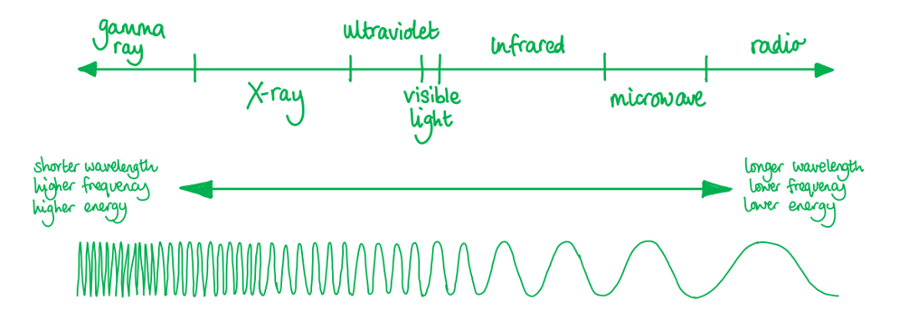
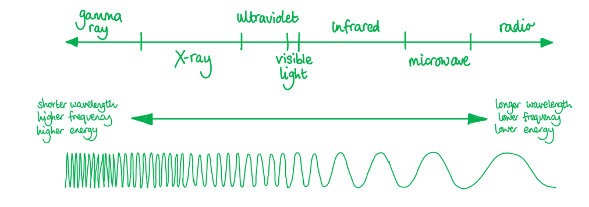
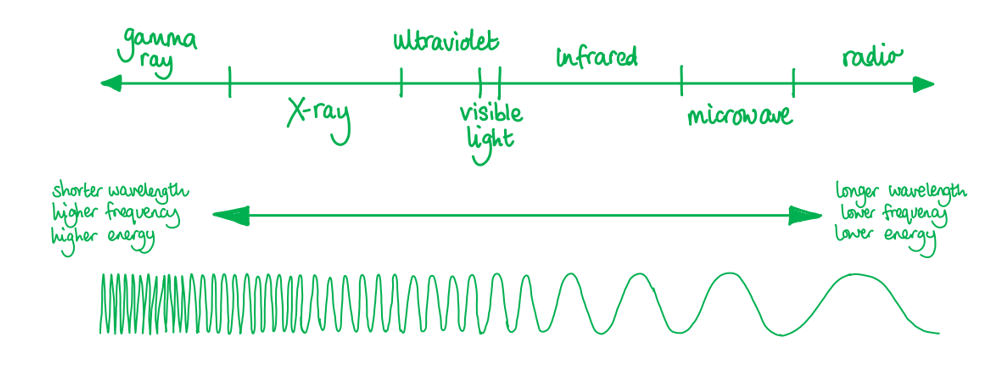

# Mark Schemes — Electromagnetic Spectrum
**7. Waves** · Cambridge (CIE) A-LEVEL physics (9702)

## Multiple Choice Questions (18 questions)

### Q1
**Final answer:** **The correct answer is A **

- Source P is emitting radio waves

  - Radio waves span a very wide range, typically from about  $10^{-1}$ to $10^{3}$ m and beyond
  - This, $3\times10^{-1}$ m is in the radio wave region
- Source Q is emitting X-rays

  - X-rays have a wavelength in the range of $10^{-8}$ to $10^{-13}$ m
- The only answer that would fit both of these ranges is option **A**

**B** is incorrect because P is in the wavelength range of UV and Q is in the wavelength range of gamma waves

**C** is incorrect because P is in the correct range, but Q is in the range of the wavelengths of gamma waves

**D** is incorrect because P is in the range of UV and Q is in the correct range

### Q2
**Final answer:** **The correct answer is ****D**** because:**

- The electromagnetic spectrum is a term used to describe waves created as a result of vibrations between an electric field and a magnetic field.
- The electromagnetic spectrum is made up of

- The speed of all EM waves in a vacuum is 3.0 × 108 m s−1
- Electrons are not EM waves
- Electrons have mass, and therefore cannot travel at speed c

All the other options are part of the electromagnetic spectrum, so all travel at the same speed in a vacuum.

Electrons typically travel at roughly one one-hundredth the speed of light in a vacuum tube.

### Q3
**Final answer:** **The correct answer is ****C**** because:**

- The electromagnetic spectrum is a term used to describe waves created as a result of vibrations between an electric field and a magnetic field
- The spectrum is made up of:

- P is on the high-frequency, short-wavelength side = X-ray
- Q is on low-frequency side = infrared

> *Make sure to check the labelling for which end is high frequency and low frequency.*

### Q4
**Final answer:** **The correct answer is ****B**** because:**

- The range of wavelength of visible light is typically 400 – 700 nm
- If we take the average value of this range: 550 nm = 550 × 10–9 m
- The number of wavelengths in one metre is equal to

  - $\frac{1}{550\times10^{-9}}=1.8\times10^{6}$
- Therefore, there are around 106 wavelengths of visible light in 1 m

**A **is incorrect because this corresponds to a wavelength of $\frac{1}{10^{4}}=10^{-4}$  which corresponds to **infra-red** light

**C **is incorrect because this corresponds to a wavelength of $\frac{1}{10^{8}}=10^{-8}$   which corresponds to **ultraviolet** light

**D **is incorrect because this corresponds to a wavelength of $\frac{1}{10^{10}}=10^{-10}$ which corresponds to **x-rays**

### Q5
**Final answer:** **The correct answer is ****C**** because:**

- Visible light is part of the electromagnetic spectrum

- A laser is a highly directional beam of light
- The **frequency** of the light determines the colour of the laser light
- Since red and green are on different parts of the spectrum, they have different frequencies

**A **is incorrect because the speed of all EM waves in a vacuum is the same (3.0 × 108 m s−1)

**B **is incorrect because polarisation does not determine colour, and both beams may share the same polarisation

**D **is incorrect because the amplitude of the light wave determines the intensity or brightness of the wave, it tells you how much energy the wave carries

### Q6
**Final answer:** **The correct answer is ****A**** because:**

- Wavelength is defined as the distance between successive crests of a wave
- Frequency of a wave is defined as the number of waves passing a point in one second
- The wave equation that links speed, wavelength and frequency is:

  - $v=λ\timesf$
- The speed of light is 3.0 × 108 m s−1
- The wavelength is 6.0 × 10–7 m

  - Therefore, the frequency is equal to $=\frac{3.0\times10^{8}}{6.0\times10^{-7}}=5.0\times10^{14}\mathrm{Hz}$

### Q7
**Final answer:** **The correct answer is ****B**** because: **

- 1014 Hz is in the visible light range of 4.3 – 7.5 × 1014 Hz

**A **is incorrect because 1015 Hz is in the **ultraviolet** light range: 7.5 × 1014 – 3.0 × 1016 Hz

**C **is incorrect because 1013 Hz is in the **infrared** range: 3.0 × 1011 – 4 × 1014 Hz

**D **is incorrect because 1016 Hz is in the **x-ray** range: 3.0 × 1016 – 3 × 1019 Hz

### Q8
**Final answer:** **The correct answer is ****B**** because:**

- Wavelength is defined as the distance between successive crests of a wave

  - The wavelength of x-rays is in the range 1 × 10−8– 1 × 10−13 m
  - The wavelength of radio waves is greater than 1 × 10−1 m
- Therefore, the wavelength range for x-rays is less than that for radio waves

**A **is incorrect because the wavelength of radio waves is greater than 1 × 10−1 m, the wavelengths of infrared waves is in the range of 1 × 10−3 – 7 × 10−7 m

**C **is incorrect because the wavelength of red light is 620 – 750 nm whereas green light is shorter with a range of 495 – 570 nm

**D **is incorrect because X-rays have far shorter wavelengths than any visible colour, including green

The key to answering this question correctly is recognising that options A and B use the word **range**.

### Q9
**Final answer:** **The correct answer is ****D**** because:**

- Waves with a wavelength in the range of 4 × 10−7 to 10–8 m are **ultraviolet**

**A **is incorrect because waves with a wavelength in the range 4 – 7 × 10–7 m are visible light

**B** is incorrect because waves with a wavelength in the range 10–8 – 4 × 10–13 m are x-rays

**C** is incorrect because waves with a wavelength in the range 10–3 – 7 × 10–7 are infra-red

### Q10
**Final answer:** **The correct answer is ****D**** because:**

- The diameter of a hydrogen nucleus is 1.76 × 10−15m
- The wavelength of a gamma-ray is in the range of 10−10 to 10−16 m
- Therefore, gamma rays have a wavelength similar to the diameter of a hydrogen nucleus

**A **is incorrect because **infrared **waves have a wavelength in the range: 10–3 to 7 × 10–7 m

**B **is incorrect because **visible light **has waves with a wavelength in the range: 4 × 10–7 to 7 × 10–7 m

**C **is incorrect because **x-rays **have a wavelength in the range: 10–9 to 10–12 m

### Q11
**Final answer:** **The correct answer is ****C**** because:**

- Wavelength is defined as the distance between successive crests of a wave

  - Wavelengths of 2 cm are 0.02 m or 2 × 10−2 m
  - The wavelengths of microwaves are in the range of 0.1 – 1 × 10−3 m
- Therefore, the telescope detects microwave radiation

**A **is incorrect because x-rays are in the range: 1 × 10−8 – 4 × 10−13 m

**B **is incorrect because visible light rays are in the range: 4 × 10−7 – 7 × 10−7 m

**D **is incorrect because radio waves have wavelengths greater than 1 × 10−1 m

Most homes use a microwave oven. Consider the possible size of the microwaves used inside the oven.* *

### Q12
**Final answer:** **The correct answer is ****B**** because:**

- Wavelength is defined as the distance between successive crests of a wave
- Frequency of a wave is defined as the number of waves passing a point in one second
- The wave equation that links speed, wavelength and frequency is:

  - $v=λ\timesf$
- The speed *c* of all EM waves in a vacuum is constant
- So, a change in *f* will only cause *λ *to change

  - $c=fλ$
  - `c equals open parentheses f over 2 close parentheses open parentheses 2 lambda close parentheses`
- Therefore, if the frequency of the wave is halved, then the wavelength will double

### Q13
**Final answer:** **The correct answer is ****C**** because:**

- Source R is emitting infra-red radiation; infra-red radiation has a wavelength in the range of 10–3 to 7 × 10–7 m
- Source S is emitting ultra-violet radiation, ultra-violet radiation has a wavelength in the range of 4 × 10–7 to 10–9 m
- The only answer that would fit both of these ranges is option **C**

**A **is incorrect because R is in the wavelength range of visible light and S is in the wavelength range of ultra-violet radiation

**B **is incorrect because** **R is in the range of ultra-violet radiation and S in the range of the wavelengths of x-rays

**D** is incorrect because R is in the correct range, but S is in the range of the wavelengths of x-rays

### Q14
**The correct answer is ****B**** because:*** *

- The range of **infrared** radiation is 3.0 × 1011 – 4 × 1014 Hz

**A **is incorrect because the **ultraviolet** light range is 7.5 × 1014 – 3.0 × 1016 Hz

**C **is incorrect because the **microwave** range is 3.0 × 109 – 3.0 × 1011 Hz

**D **is incorrect because the **radio** range is less than 3.0 × 109 Hz

### Q15
**Final answer:** **The correct answer is ****D**** because:**

- The known quantities are

  - Wavelength of infrared wave, *λ* = 30 × 10−6 m
  - Wavelength of x-ray, *λ* = 400 × 10−12 m
- The wave equation is

  - *c = f λ*
  - $f=\frac{c}{λ}$
- The frequencies of the infrared wave and x-rays are

  - $f_{infrared}=\frac{c}{30\times10^{-6}}$
  - $f_{x-ray}=\frac{c}{400\times10^{-12}}$
- The value of the ratio $\frac{f_{x-ray}}{f_{infrared}}$ is

  - $\frac{f_{x-ray}}{f_{infrared}}=\frac{c}{400\times10^{-12}}\times\frac{30\times10^{-6}}{c}$
  - $\frac{f_{x-ray}}{f_{infrared}}=\frac{30\times10^{-6}}{400\times10^{-12}}=7.5\times10^{4}$
- This is option **D**

### Q16
**Final answer:** **The correct answer is ****D**** because:**

- The known quantities are

  - Distance between the slits, *d* = 0.02 × 10−3 m
  - Angle between the second-order and central maxima, *θ* = 3.96°
- The diffraction grating equation is given by

  - *d* sin *θ* = *n*λ
- When *n* = 2 for the second-order maxima

  - 2λ = *d* sin *θ*
  - $λ=\frac{dsinθ}{2}$
  - `lambda equals fraction numerator open parentheses 0.02 cross times 10 to the power of negative 3 end exponent close parentheses cross times sin space open parentheses 3.96 close parentheses over denominator 2 end fraction`= 690 nm (2 s.f)
- The range of wavelengths for the colour red is around 620 nm to 700 nm

  - Therefore, the colour of the monochromatic light is red
- This is option **D**
- You are not expected to know the wavelength ranges for the individual colours for visible light
- For this particular question you can use a process of elimination to determine the correct answer

  - The range of wavelengths for the visible light spectrum is between 400 nm and 700 nm
  - Violet and blue have the shortest wavelengths and red has the largest wavelength
  - Green generally sits in the middle of the visible light wavelength range
  - 690 nm is close to the largest wavelength of visible light, so the answer is red

### Q17
**Final answer:** **The correct answer is ****C**** because:**

- The wave equation is

  - $c=fλ$
  - $f=\frac{c}{λ}$
- The wavelengths that are transmitted through Earth’s atmosphere and reach sea level are those which have a transmitted % above zero

  - This is wavelengths 100 nm to 100 μm and 1 mm to 10 m
- Between 100 μm and 1 mm transmission falls to zero, so the spectrum is split into two separate frequency ranges
- When *λ* = 100 nm =  100 × 10-9 m

  - $f=\frac{3\times10^{8}}{100\times10^{-9}}$
  - *f *= 3 × 1015 = 3000 THz
- When *λ* = 100 μm = 100 × 10-6 m

  - $f=\frac{3\times10^{8}}{100\times10^{-6}}$
  - *f *= 3 × 1012 = 3 THz
- When *λ* = 1 mm = 1 × 10-3 m

  - $f=\frac{3\times10^{8}}{1\times10^{-3}}$
  - *f *= 3 × 1011 = 300 GHz
- When *λ* = 10 m

  - $f=\frac{3\times10^{8}}{10}$
  - *f *= 3 × 107 = 30 MHz
- Therefore the range of electromagnetic frequencies that can penetrate Earth’s atmosphere is

  - $30MHz\leqf\leq300GHz,3THz\leqf\leq3000THz$
- This is option **C**
- Although this seems like a lot of calculations, you can figure out the correct answer by process of elimination
- Between 100 μm and 1 mm there are no electromagnetic waves reaching sea level

  - Therefore there must be two sets of ranges
  - This rules out option **B** and **D**
- Option **A **must be incorrect as the values of the frequencies match the wavelengths from the graph

  - As $f=\frac{c}{λ}$  the values from the graph cannot match the values of the frequencies

The graph shows two transmission windows, so any single continuous range can be rejected. Only option C gives two separated ranges.

### Q18
**Final answer:** **The correct answer is ****D**** because:**

- The speed, frequency and wavelength of an electromagnetic wave is defined by:

  - *c* = *fλ*
- Rearranging for *λ *gives:

  - $λ=\frac{c}{f}$
  - *c* = 3.00 × 108 m s−1
- X = 3 × 1014 Hz

  - $λ=\frac{3.00\times10^{8}}{3\times10^{14}}$
  - Therefore, *λ* = 1 × 10−6 m
- Infrared wavelengths vary between 1 × 10−3 m and 7 × 10−7 m

  - Therefore, X is infrared
- Y = 3 × 1019 Hz

  - $λ=\frac{3.00\times10^{8}}{3\times10^{19}}$
  - Therefore, *λ* = 1 × 10−11 m
- X-ray wavelengths vary between 1 × 10−8 m and 4 × 10−13 m

  - Therefore, Y is an x-ray
- Answer **D **is the only answer that fits these criteria

**A **is incorrect as:

- X = 3 × 105 Hz, therefore *λ* = 1 × 103 m which is a radio wave
- Y = 3 × 1020 Hz, therefore *λ* = 1 × 10−12 m which is an x-ray

**B **is incorrect as:

- X = 3 × 1010 Hz, therefore *λ* = 1 × 10−2 m which is a microwaves
- Y = 3 × 1016 Hz, therefore *λ* = 1 × 10−8 m which is a UV wave

**C **is incorrect as:

- X = 3 × 1018 Hz, therefore *λ* = 1 × 10−10 m which is an x-ray
- Y = 3 × 1014 Hz, therefore *λ* = 1 × 10−6 m which is an infrared

If you need a reminder of the wavelengths of the EM spectrum:

| **Electromagnetic Wave** | **Wavelength, λ (m)** |
|---|---|
| Radio Waves | > 0.1 |
| Microwaves | 0.1 – 1 × 10–3 |
| Infrared | 1 × 10–3 – 7 × 10–7 |
| Visible Light | 4 × 10–7 – 7 × 10–7 |
| Ultraviolet | 4 × 10–7 – 1 × 10–8 |
| X-rays | 1 × 10–8 – 4 × 10–13 |
| Gamma Rays | 4 × 10–13 – 10–16 |
