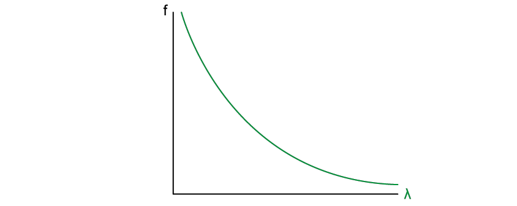
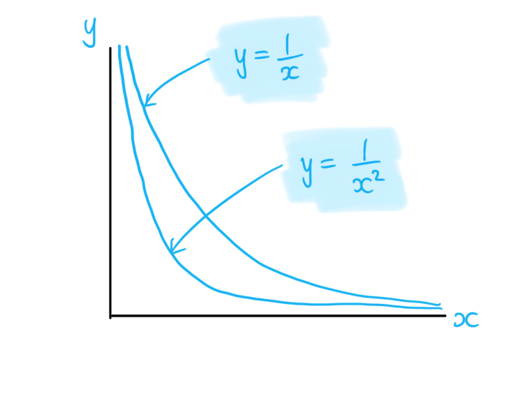

# Mark Schemes — Electromagnetic Spectrum
**7. Waves** · Cambridge (CIE) A-LEVEL physics (9702)

## Multiple Choice Questions (18 questions)

### Q1
**Final answer:** **The correct answer is A **

- Source P is emitting radio waves

  - Radio waves span a very wide range, typically from about  $10^{-1}$ to $10^{3}$ m and beyond
  - This, $3\times10^{-1}$ m is in the radio wave region
- Source Q is emitting X-rays

  - X-rays have a wavelength in the range of $10^{-8}$ to $10^{-13}$ m
- The only answer that would fit both of these ranges is option **A**

**B** is incorrect because P is in the wavelength range of UV and Q is in the wavelength range of gamma waves

**C** is incorrect because P is in the correct range, but Q is in the range of the wavelengths of gamma waves

**D** is incorrect because P is in the range of UV and Q is in the correct range

### Q2
**Final answer:** **The correct answer is ****D**** because:**

- The electromagnetic spectrum is a term used to describe waves created as a result of vibrations between an electric field and a magnetic field.
- The electromagnetic spectrum is made up of

- The speed of all EM waves in a vacuum is 3.0 × 108 m s−1
- Electrons are not EM waves
- Electrons have mass, and therefore cannot travel at speed c

All the other options are part of the electromagnetic spectrum, so all travel at the same speed in a vacuum.

Electrons typically travel at roughly one one-hundredth the speed of light in a vacuum tube.

### Q3
**Final answer:** **The correct answer is ****C**** because:**

- The electromagnetic spectrum is a term used to describe waves created as a result of vibrations between an electric field and a magnetic field
- The spectrum is made up of:

- P is on the high-frequency, short-wavelength side = X-ray
- Q is on low-frequency side = infrared

> *Make sure to check the labelling for which end is high frequency and low frequency.*

### Q4
**Final answer:** **The correct answer is ****B**** because:**

- The range of wavelength of visible light is typically 400 – 700 nm
- If we take the average value of this range: 550 nm = 550 × 10–9 m
- The number of wavelengths in one metre is equal to

  - $\frac{1}{550\times10^{-9}}=1.8\times10^{6}$
- Therefore, there are around 106 wavelengths of visible light in 1 m

**A **is incorrect because this corresponds to a wavelength of $\frac{1}{10^{4}}=10^{-4}$  which corresponds to **infra-red** light

**C **is incorrect because this corresponds to a wavelength of $\frac{1}{10^{8}}=10^{-8}$   which corresponds to **ultraviolet** light

**D **is incorrect because this corresponds to a wavelength of $\frac{1}{10^{10}}=10^{-10}$ which corresponds to **x-rays**

### Q5
**Final answer:** **The correct answer is ****C**** because:**

- Visible light is part of the electromagnetic spectrum

- A laser is a highly directional beam of light
- The **frequency** of the light determines the colour of the laser light
- Since red and green are on different parts of the spectrum, they have different frequencies

**A **is incorrect because the speed of all EM waves in a vacuum is the same (3.0 × 108 m s−1)

**B **is incorrect because polarisation does not determine colour, and both beams may share the same polarisation

**D **is incorrect because the amplitude of the light wave determines the intensity or brightness of the wave, it tells you how much energy the wave carries

### Q6
**Final answer:** **The correct answer is ****A**** because:**

- Wavelength is defined as the distance between successive crests of a wave
- Frequency of a wave is defined as the number of waves passing a point in one second
- The wave equation that links speed, wavelength and frequency is:

  - $v=λ\timesf$
- The speed of light is 3.0 × 108 m s−1
- The wavelength is 6.0 × 10–7 m

  - Therefore, the frequency is equal to $=\frac{3.0\times10^{8}}{6.0\times10^{-7}}=5.0\times10^{14}\mathrm{Hz}$

### Q7
**Final answer:** **The correct answer is ****B**** because: **

- 1014 Hz is in the visible light range of 4.3 – 7.5 × 1014 Hz

**A **is incorrect because 1015 Hz is in the **ultraviolet** light range: 7.5 × 1014 – 3.0 × 1016 Hz

**C **is incorrect because 1013 Hz is in the **infrared** range: 3.0 × 1011 – 4 × 1014 Hz

**D **is incorrect because 1016 Hz is in the **x-ray** range: 3.0 × 1016 – 3 × 1019 Hz

### Q8
**Final answer:** **The correct answer is ****B**** because:**

- Wavelength is defined as the distance between successive crests of a wave

  - The wavelength of x-rays is in the range 1 × 10−8– 1 × 10−13 m
  - The wavelength of radio waves is greater than 1 × 10−1 m
- Therefore, the wavelength range for x-rays is less than that for radio waves

**A **is incorrect because the wavelength of radio waves is greater than 1 × 10−1 m, the wavelengths of infrared waves is in the range of 1 × 10−3 – 7 × 10−7 m

**C **is incorrect because the wavelength of red light is 620 – 750 nm whereas green light is shorter with a range of 495 – 570 nm

**D **is incorrect because X-rays have far shorter wavelengths than any visible colour, including green

The key to answering this question correctly is recognising that options A and B use the word **range**.

### Q9
**Final answer:** **The correct answer is ****D**** because:**

- Waves with a wavelength in the range of 4 × 10−7 to 10–8 m are **ultraviolet**

**A **is incorrect because waves with a wavelength in the range 4 – 7 × 10–7 m are visible light

**B** is incorrect because waves with a wavelength in the range 10–8 – 4 × 10–13 m are x-rays

**C** is incorrect because waves with a wavelength in the range 10–3 – 7 × 10–7 are infra-red

### Q10
**Final answer:** **The correct answer is ****D**** because:**

- The diameter of a hydrogen nucleus is 1.76 × 10−15m
- The wavelength of a gamma-ray is in the range of 10−10 to 10−16 m
- Therefore, gamma rays have a wavelength similar to the diameter of a hydrogen nucleus

**A **is incorrect because **infrared **waves have a wavelength in the range: 10–3 to 7 × 10–7 m

**B **is incorrect because **visible light **has waves with a wavelength in the range: 4 × 10–7 to 7 × 10–7 m

**C **is incorrect because **x-rays **have a wavelength in the range: 10–9 to 10–12 m

### Q11
**Final answer:** **The correct answer is ****C**** because:**

- Wavelength is defined as the distance between successive crests of a wave

  - Wavelengths of 2 cm are 0.02 m or 2 × 10−2 m
  - The wavelengths of microwaves are in the range of 0.1 – 1 × 10−3 m
- Therefore, the telescope detects microwave radiation

**A **is incorrect because x-rays are in the range: 1 × 10−8 – 4 × 10−13 m

**B **is incorrect because visible light rays are in the range: 4 × 10−7 – 7 × 10−7 m

**D **is incorrect because radio waves have wavelengths greater than 1 × 10−1 m

Most homes use a microwave oven. Consider the possible size of the microwaves used inside the oven.* *

### Q12
**Final answer:** **The correct answer is ****B**** because:**

- Wavelength is defined as the distance between successive crests of a wave
- Frequency of a wave is defined as the number of waves passing a point in one second
- The wave equation that links speed, wavelength and frequency is:

  - $v=λ\timesf$
- The speed *c* of all EM waves in a vacuum is constant
- So, a change in *f* will only cause *λ *to change

  - $c=fλ$
  - $c = ( \frac{f}{2} ) ( 2 \\lambda )$
- Therefore, if the frequency of the wave is halved, then the wavelength will double

### Q13
**Final answer:** **The correct answer is ****C**** because:**

- Source R is emitting infra-red radiation; infra-red radiation has a wavelength in the range of 10–3 to 7 × 10–7 m
- Source S is emitting ultra-violet radiation, ultra-violet radiation has a wavelength in the range of 4 × 10–7 to 10–9 m
- The only answer that would fit both of these ranges is option **C**

**A **is incorrect because R is in the wavelength range of visible light and S is in the wavelength range of ultra-violet radiation

**B **is incorrect because** **R is in the range of ultra-violet radiation and S in the range of the wavelengths of x-rays

**D** is incorrect because R is in the correct range, but S is in the range of the wavelengths of x-rays

### Q14
**The correct answer is ****B**** because:*** *

- The range of **infrared** radiation is 3.0 × 1011 – 4 × 1014 Hz

**A **is incorrect because the **ultraviolet** light range is 7.5 × 1014 – 3.0 × 1016 Hz

**C **is incorrect because the **microwave** range is 3.0 × 109 – 3.0 × 1011 Hz

**D **is incorrect because the **radio** range is less than 3.0 × 109 Hz

### Q15
**Final answer:** **The correct answer is ****D**** because:**

- The known quantities are

  - Wavelength of infrared wave, *λ* = 30 × 10−6 m
  - Wavelength of x-ray, *λ* = 400 × 10−12 m
- The wave equation is

  - *c = f λ*
  - $f=\frac{c}{λ}$
- The frequencies of the infrared wave and x-rays are

  - $f_{infrared}=\frac{c}{30\times10^{-6}}$
  - $f_{x-ray}=\frac{c}{400\times10^{-12}}$
- The value of the ratio $\frac{f_{x-ray}}{f_{infrared}}$ is

  - $\frac{f_{x-ray}}{f_{infrared}}=\frac{c}{400\times10^{-12}}\times\frac{30\times10^{-6}}{c}$
  - $\frac{f_{x-ray}}{f_{infrared}}=\frac{30\times10^{-6}}{400\times10^{-12}}=7.5\times10^{4}$
- This is option **D**

### Q16
**Final answer:** **The correct answer is ****D**** because:**

- The known quantities are

  - Distance between the slits, *d* = 0.02 × 10−3 m
  - Angle between the second-order and central maxima, *θ* = 3.96°
- The diffraction grating equation is given by

  - *d* sin *θ* = *n*λ
- When *n* = 2 for the second-order maxima

  - 2λ = *d* sin *θ*
  - $λ=\frac{dsinθ}{2}$
  - $\\lambda = \frac{( 0.02 \times 10^{- 3} ) \times \sin ( 3.96 )}{2}$= 690 nm (2 s.f)
- The range of wavelengths for the colour red is around 620 nm to 700 nm

  - Therefore, the colour of the monochromatic light is red
- This is option **D**
- You are not expected to know the wavelength ranges for the individual colours for visible light
- For this particular question you can use a process of elimination to determine the correct answer

  - The range of wavelengths for the visible light spectrum is between 400 nm and 700 nm
  - Violet and blue have the shortest wavelengths and red has the largest wavelength
  - Green generally sits in the middle of the visible light wavelength range
  - 690 nm is close to the largest wavelength of visible light, so the answer is red

### Q17
**Final answer:** **The correct answer is ****C**** because:**

- The wave equation is

  - $c=fλ$
  - $f=\frac{c}{λ}$
- The wavelengths that are transmitted through Earth’s atmosphere and reach sea level are those which have a transmitted % above zero

  - This is wavelengths 100 nm to 100 μm and 1 mm to 10 m
- Between 100 μm and 1 mm transmission falls to zero, so the spectrum is split into two separate frequency ranges
- When *λ* = 100 nm =  100 × 10-9 m

  - $f=\frac{3\times10^{8}}{100\times10^{-9}}$
  - *f *= 3 × 1015 = 3000 THz
- When *λ* = 100 μm = 100 × 10-6 m

  - $f=\frac{3\times10^{8}}{100\times10^{-6}}$
  - *f *= 3 × 1012 = 3 THz
- When *λ* = 1 mm = 1 × 10-3 m

  - $f=\frac{3\times10^{8}}{1\times10^{-3}}$
  - *f *= 3 × 1011 = 300 GHz
- When *λ* = 10 m

  - $f=\frac{3\times10^{8}}{10}$
  - *f *= 3 × 107 = 30 MHz
- Therefore the range of electromagnetic frequencies that can penetrate Earth’s atmosphere is

  - $30MHz\leqf\leq300GHz,3THz\leqf\leq3000THz$
- This is option **C**
- Although this seems like a lot of calculations, you can figure out the correct answer by process of elimination
- Between 100 μm and 1 mm there are no electromagnetic waves reaching sea level

  - Therefore there must be two sets of ranges
  - This rules out option **B** and **D**
- Option **A **must be incorrect as the values of the frequencies match the wavelengths from the graph

  - As $f=\frac{c}{λ}$  the values from the graph cannot match the values of the frequencies

The graph shows two transmission windows, so any single continuous range can be rejected. Only option C gives two separated ranges.

### Q18
**Final answer:** **The correct answer is ****D**** because:**

- The speed, frequency and wavelength of an electromagnetic wave is defined by:

  - *c* = *fλ*
- Rearranging for *λ *gives:

  - $λ=\frac{c}{f}$
  - *c* = 3.00 × 108 m s−1
- X = 3 × 1014 Hz

  - $λ=\frac{3.00\times10^{8}}{3\times10^{14}}$
  - Therefore, *λ* = 1 × 10−6 m
- Infrared wavelengths vary between 1 × 10−3 m and 7 × 10−7 m

  - Therefore, X is infrared
- Y = 3 × 1019 Hz

  - $λ=\frac{3.00\times10^{8}}{3\times10^{19}}$
  - Therefore, *λ* = 1 × 10−11 m
- X-ray wavelengths vary between 1 × 10−8 m and 4 × 10−13 m

  - Therefore, Y is an x-ray
- Answer **D **is the only answer that fits these criteria

**A **is incorrect as:

- X = 3 × 105 Hz, therefore *λ* = 1 × 103 m which is a radio wave
- Y = 3 × 1020 Hz, therefore *λ* = 1 × 10−12 m which is an x-ray

**B **is incorrect as:

- X = 3 × 1010 Hz, therefore *λ* = 1 × 10−2 m which is a microwaves
- Y = 3 × 1016 Hz, therefore *λ* = 1 × 10−8 m which is a UV wave

**C **is incorrect as:

- X = 3 × 1018 Hz, therefore *λ* = 1 × 10−10 m which is an x-ray
- Y = 3 × 1014 Hz, therefore *λ* = 1 × 10−6 m which is an infrared

If you need a reminder of the wavelengths of the EM spectrum:

| **Electromagnetic Wave** | **Wavelength, λ (m)** |
|---|---|
| Radio Waves | > 0.1 |
| Microwaves | 0.1 – 1 × 10–3 |
| Infrared | 1 × 10–3 – 7 × 10–7 |
| Visible Light | 4 × 10–7 – 7 × 10–7 |
| Ultraviolet | 4 × 10–7 – 1 × 10–8 |
| X-rays | 1 × 10–8 – 4 × 10–13 |
| Gamma Rays | 4 × 10–13 – 10–16 |

## Structured Questions (7 questions)

### Q1
Justify the approximation of the speed of light in air as 3.00×108 m s−1:

- 3.00×108 m s−1 is the speed of light in free space / a vacuum;** [1 mark]**
- The reduction in speed as light travels through air is negligible (therefore 3.00×108 m s−1 is a reasonable approximation); **[1 mark]**

**[Total: 2 marks]**

> *The CIE IAL Physics specification defines **justify** as 'support a case with evidence / argument'.*

> *Therefore, you must provide evidence (speed of light in free space) and then present your argument or reason as to why this is a reasonable approximation of the speed of light in air (that the decrease in speed is negligible).*
The relationship between the frequency and wavelength of an electromagnetic wave:

- A sketch graph that would score 2 marks:

- Inverse proportion curve;** [1 mark]**
- Axes labelled frequency / *f ***AND** wavelength / *λ*;** [1 mark] **

**[Total: 2 marks]**** **

> *The axes could be labelled either way around because the relationship is still inversely proportional.*

> *This question assesses your understanding of the fact that the speed of electromagnetic waves is constant. We know the equation for wave speed is given by: *

> *v = fλ                         *

> *Therefore, if the speed **v** is constant, then it is true that **f** is inversely proportional to **λ**. Examiners sometimes like to test your recognition of inverse-proportionality graphs – not to be confused with inverse-square relationships (which look steeper). This distinction is sketched below:*

Describe the motion of the fields which comprise an electromagnetic wave:

- Electromagnetic waves are made of electric and magnetic fields; **[1 mark]**
- These fields oscillate at 90 degrees / perpendicular to each other; **[1 mark] **

Describe the direction of energy transfer:

- (Because electromagnetic waves are transverse,) energy transfer is 90 degrees / perpendicular to the direction of (field) oscillations; **[1 mark]**

**[Total: 3 marks]**

### Q2
(i) The EM wave with the lowest energy is...

- Radio; **[1 mark]**

(ii) The EM wave with the shortest wavelength is...

- Gamma; **[1 mark]**

(iii) The EM wave with the lowest frequency is...

- Radio; **[1 mark]**

**[Total: 3 marks]**

> *The shorter the wavelength, the higher the frequency. The higher the frequency, the higher the energy. You need to be super confident in these relationships. Questions may be asked in terms of increasing or decreasing wavelength and frequency. Make sure you are never caught out by this. *
EM radiation falls between...

- 7×10−7 m **[1 mark]** to
- 1×10−3 m **[1 mark]**

**[Total: 2 marks]**

> *You need to give your answer as a range to score the mark.*
To determine the range of frequencies for infrared radiation:

List the known quantities:

- Longest wavelength = 1×10−3 m (from part (b))
- Shortest wavelength = 7×10−7 m (from part (b))
- Speed of light in free space, c = 3.00×108 m s−1 (from the data page)

To determine the highest frequency:

- $v=fλ\rightarrowf=\frac{v}{λ}$
- $f_{H}=\frac{3.00\times10^{8}}{7\times10^{-7}}$ **[1 mark]**
- $f_{H}=4\times10^{14}\mathrm{Hz}$** [1 mark]**

To determine the lowest frequency:

- $f_{L}=\frac{3.00\times10^{8}}{1\times10^{-3}}$** [1 mark]**
- $f_{L}=3\times10^{11}\mathrm{Hz}$** [1 mark]**

**[Total: 4 marks]**

> *Remember that to calculate the highest frequency you need to use the shortest wavelength and vice versa.*

> *The expected final answers here are expressed to 1 significant figure, consistent with the data given. Marks are awarded for correct working and a correct final answer — you will not be penalised for expressing a correct answer to more significant figures*
To show that the wavelength of visible light is 400 nm to 700 nm:

List the known quantities:

- Lowest frequency = 4.3×1014 Hz
- Highest frequency = 7.5×1014 Hz
- Speed of light in free space, c = 3.00×108 m s−1 (from the data page)

To determine the longest wavelength:

- $v = f λ \rightarrow λ = \frac{v}{f}$ **[1 mark]**
- $λ_{L}=\frac{3.00\times10^{8}}{4.3\times10^{14}}=7.0\times10^{-7}m=700\times10^{-9}m=700\mathrm{nm}$** [1 mark]**

To determine the shortest wavelength:

- $λ_{S}=\frac{3.00\times10^{8}}{7.5\times10^{14}}=4\times10^{-7}m=400\times10^{-9}m=400\mathrm{nm}$** [1 mark]**

**[Total: 3 marks]**

> *Remember that to calculate the longest wavelength you need to use the lowest frequency and vice versa.*

### Q3
The perpendicular fields in which EM waves oscillate are:

- Electric; **[1 mark]**
- Magnetic; **[1 mark]**

**[Total: 2 marks]**
A table scoring 3 marks:

| **EM wave** |
|---|
| Radio |
| **Microwave****; ****[1 mark]** |
| Infrared |
| **Visible light****; ****[1 mark]** |
| Ultraviolet |
| **X-rays****; ****[1 mark]** |
| Gamma |

**[Total: 3 marks]**
Uses of infrared radiation:

**Final answer:** **Any ****two**** from:**

- Remote controls; **[1 mark]**
- Fibre optic communication; **[1 mark]**
- Wireless communications; **[1 mark]**
- Thermal imaging; **[1 mark]**
- Night vision; **[1 mark]**
- Heating; **[1 mark]**
- Cooking; **[1 mark]**
- Motion sensors; **[1 mark]**

**[Total: 2 marks]**

> *You should know this already from IGCSE, but make sure you can name a couple of uses for each EM wave.*
The speed of gamma radiation travelling through a vacuum is:

- 3.00×108 m s−1 **[1 mark]**

**[Total: 1 mark]**

> *This question can be asked in many ways, but it will always have the same answer! **All** EM waves travel at the speed of light!*

### Q4
The three types of EM radiation that are used for communications are...

- Radio waves
- Microwaves
- Infrared

**All correct for 1 mark**

**[Total: 1 mark]**
The properties common to all types of EM radiation are:

- Travel at the speed of light (3.00×108 m s−1) in free space; **[1 mark]**
- Transverse **OR** oscillations are perpendicular to the direction of energy transfer; **[1 mark]**
- Progressive waves **OR** carry energy; **[1 mark]**
- Can be polarised / diffracted / refracted / reflected / undergo interference; **[1 mark]**

**[Total: 4 marks]**
To determine the range of frequencies which dog's eyes can detect:

List the known quantities:

Blue:

- $λ_{Bmax}=475\mathrm{nm}=475\times10^{-9}m$
- $λ_{Bmin}=430\mathrm{nm}=430\times10^{-9}m$

Yellow:

- $λ_{Ymax}=620\mathrm{nm}=620\times10^{-9}m$
- $λ_{Ymin}=500\mathrm{nm}=500\times10^{-9}m$

From the data page:

- Speed of light in free space, $c=3.00\times10^{8}ms^{-1}$

To determine the range for (perceived) blue light:

- Using the wave speed equation, $v=fλ\Rightarrowf=\frac{c}{λ}$

  - $f_{Bmax}=\frac{3.00\times10^{8}}{430\times10^{-9}}=7.0\times10^{14}\mathrm{Hz}$** [1 mark]**
  - $f_{Bmin}=\frac{3.00\times10^{8}}{475\times10^{-9}}=6.32\times10^{14}\mathrm{Hz}$** [1 mark]**

To determine the range for (perceived) yellow light:

- $f_{Ymax}=\frac{3.00\times10^{8}}{500\times10^{-9}}=6\times10^{14}\mathrm{Hz}$** [1 mark]**
- $f_{Ymin}=\frac{3.00\times10^{8}}{620\times10^{-9}}=4.8\times10^{14}\mathrm{Hz}$** [1 mark]**

State the range of frequencies that a dog's eye can detect:

- $4.8\times10^{14}\mathrm{Hz}$  to  $7.0\times10^{14}\mathrm{Hz}$ **[1 mark]**

**[Total: 5 marks]**

> *Remember that when calculating ranges, to find the maximum frequency you need to use the minimum wavelength and vice versa.*

### Q5
A table scoring three marks:

| EM wave | Range of wavelengths / m |
|---|---|
| **Radio waves****; [1 mark]** | 10−1 - 106 |
| **Visible light****; [1 mark]** | 4×10−7 - 7×10−7 |
| **Gamma****; ****[1 mark]** | 10−16 -  10−10 |

**[Total: 3 marks]**
To determine the range of frequencies for the three waves given in part (a):

Radio waves:

- $λ_{Rmax}=1\times10^{6}m$
- $λ_{Rmin}=1\times10^{-1}m$
- Speed of light in free space, $c=3.00\times10^{8}ms^{-1}$

- Using the wave speed equation:

  - $v=fλ\Rightarrowf=\frac{c}{λ}$
  - $f_{Rmin}=\frac{3.00\times10^{8}}{1\times10^{6}}=300\mathrm{Hz}$ **[1 mark]**
  - $f_{Rmax}=\frac{3.00\times10^{8}}{1\times10^{-1}}=3.00\times10^{9}\mathrm{Hz}$ **[1 mark]**

Visible light:

- $λ_{Vmax}=7\times10^{-7}m$
- $λ_{Vmin}=4\times10^{-7}m$

- Using the wave speed equation:

  - $f_{Vmin}=\frac{3.00\times10^{8}}{7\times10^{-7}}=4.3\times10^{14}\mathrm{Hz}$ **[1 mark]**
  - $f_{Vmax}=\frac{3.00\times10^{8}}{4\times10^{-7}}=7.5\times10^{14}\mathrm{Hz}$ **[1 mark]**

Gamma radiation:

- $λ_{Gmax}=1\times10^{-10}m$
- $λ_{Gmin}=1\times10^{-16}m$

- Using the wave speed equation:

  - $f_{Gmin}=\frac{3.00\times10^{8}}{1\times10^{-10}}=3\times10^{18}\mathrm{Hz}$ **[1 mark]**
  - $f_{Gmax}=\frac{3.00\times10^{8}}{1\times10^{-16}}=3\times10^{24}\mathrm{Hz}$ **[1 mark]**

**[Total: 6 marks]**

> *Remember that to find the **minimum** frequency of a range you need to use the **maximum** wavelength and vice versa.*
A reasonable estimate for the wavelength of green light is...

- 550 nm **OR** 5.5 × 10−7 m **[1 mark]**

Explanation:

- There are seven colours in the visible spectrum and green is exactly in the middle; **[1 mark]**

  - Red, orange, yellow, green, blue, indigo, violet
- The range of visible light is 400 nm - 700 nm, so green light is exactly in the middle of this range; **[1 mark]**

  - Range = $700-400=300\mathrm{nm}$
  - Half of range = $\frac{300}{2}=150\mathrm{nm}$
  - Min wavelength + half of range  = $400+150=550\mathrm{nm}$

**[Total: 3 marks]**

### Q6
The electromagnetic waves in order of increasing wavelength are:

- Gamma
- X-rays
- Ultraviolet
- Visible light
- Infrared
- Microwaves
- Radio waves

**All correct for 1 mark**

**[Total: 1 mark]**
Two types of EM radiation that can cause ionisation are:

**Final answer:** **Any**** two**** from:**

- Gamma; **[1 mark]**
- X-rays; **[1 mark]**
- Ultraviolet;** [1 mark]**

**[Total: 2 marks]**
The energy of an electromagnetic wave is directly proportional to....

- Frequency; **[1 mark]**

**[Total: 1 mark]**

> *Energy is **inversely** **proportional** to wavelength (the shorter wavelengths have the highest energy), and **intensity** is **proportional** to amplitude squared. *

### Q7
To determine the range of frequencies for microwave radiation:

List the known quantities:

- Speed of light in free space, *c* = 3.00×108 m s−1 (from the data page)
- Range of wavelengths for microwave radiation = 0.1 m - 1×10−3 m **[1 mark]**

Determine the highest and lowest frequency:

- Highest frequency comes from the shortest wavelength
- Lowest frequency comes from the longest wavelength

- $v=fλ\rightarrowf=\frac{v}{λ}$
- $f_{H}=\frac{3.00\times10^{8}}{1\times10^{-3}}=3\times10^{11}\mathrm{Hz}$
- $f_{L}=\frac{3.00\times10^{8}}{0.1}=3\times10^{9}\mathrm{Hz}$** **
- Range of frequencies of microwave radiation = 3×1011 Hz - 3×109 Hz **[1 mark]**

**[Total: 2 marks]**

> *You are expected to be able to recall the ranges of wavelengths for the different waves in the EM spectrum.*
(i) Calculate the time taken for the signal to be detected by the controller:

List the known quantities:

- Distance from satellite to controller, *s* = 4.40 × 1012 m
- Speed of light in free space, *c* = 3.00 × 108 m s−1 (from the data page)

Using the speed equation, calculate time taken:

- $v=\frac{d}{t}\rightarrowt=\frac{d}{v}$
- $t=\frac{4.40\times10^{12}}{3.00\times10^{8}}$ = 1.47 × 104 s** [1 mark]  **

(ii) Calculate the energy of a microwave photon:

List the known quantities:

- Wavelength of microwave, *λ* = 78 900 µm
- Planck constant, *h* = 6.63 × 10−34 J s (from the data page)

Combine the photon energy and wave speed equations to give a formula for energy using wavelength:

- Wave speed, $v=fλ$ and photon energy, $E=hf$
- $E=\frac{hc}{λ}$ **[1 mark]**

Substitute the known values to calculate the energy of a microwave photon:

- $E = \frac{( 6.63 \times 10^{- 34} ) \times ( 3.00 \times 10^{8 )}{78900 \times 10^{-6} } }$ = 2.52 × 10−24 J (3 s.f.) **[1 mark]**

**[Total: 3 marks]**
(i) Determine the power received by the controller dish aerial:

List the known quantities:

- Output power of satellite = 24.0 W (from part (b))
- Distance from satellite to controller = 4.40 × 1012 m
- Area of controller dish aerial = 258 m2

Devise a formula for the amount of power reaching the controller dish:

- Surface area of a sphere, $A=4πr^{2}$
- Since the power transmitted by the satellite is assumed to radiate uniformly in all directions
- $P=\frac{\mathrm{Output} \mathrm{power}}{4πr^{2}}\times\mathrm{area} \mathrm{of} \mathrm{controller} \mathrm{dish}$** [1 mark]**

Substitute the known values to calculate the power reaching the controller dish:

- $P = \frac{24.0}{4 \mathrm{\pi } \times ( 4.40 \times 10^{12} )^{2}} \times 258$ = 2.55 × 10−23 W (3 s.f.)** [1 mark]**

(ii) The actual power received by the controller dish aerial is 1.4 × 10−15 W. Suggest why this is different to the calculated power received:

- The calculation <u>assumed that power is radiated uniformly in all directions</u>, but (in reality) the signal emitted by the satellite is directed to Earth (by a dish); **[1 mark]**
- Therefore, the calculated power received is less than the actual power received because <u>less power is lost</u> (radiating in different directions); **[1 mark]**

(iii) Calculate the rate at which the microwave photons actually arrive at the controller dish aerial:

List the known quantities:

- Energy of a microwave photon, *E* = 2.52 × 10−24 J (from part (b))

Devise a formula for the rate of photon detection:

- $\mathrm{Rate} \mathrm{of} \mathrm{photon} \mathrm{detection}=\frac{\mathrm{Power} \mathrm{received}}{\mathrm{Energy} \mathrm{of}a\mathrm{microwave} \mathrm{photon}}$**[1 mark]**

Substitute in the known values to calculate the rate of photon detection:

- $\mathrm{Rate} \mathrm{of} \mathrm{photon} \mathrm{detection}=\frac{1.4\times10^{-15}}{2.52\times10^{-24}}$ = 5.6 × 108 s-1 (2 s.f.)** [1 mark]**

**[Total: 6 marks]**

> *This question is synoptic; it draws on content from multiple topics, as exam questions frequently do. If you need some help with the maths, it is covered in more detail in the *[*Luminosity & Radiant Flux*](https://www.savemyexams.com/a-level/physics/cie/25/revision-notes/25-astronomy-and-cosmology/25-1-standard-candles/luminosity-and-radiant-flux/)* Revision Note.*
