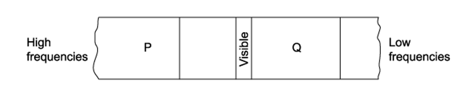

# Exam Questions — Electromagnetic Spectrum
**7. Waves** · Cambridge (CIE) A-LEVEL physics (9702)
> Source: [https://www.savemyexams.com/a-level/physics/cie/25/topic-questions/](https://www.savemyexams.com/a-level/physics/cie/25/topic-questions/) · 25 questions across 2 sets

## Multiple Choice Questions (18 questions)

### Q1 — medium — 1 marks

**Q1** [1 mark]

P is a source emitting radio waves and Q is a source emitting X-rays. The table suggests the wavelengths for P and Q.

Which row is correct?

| ** ** | **Wavelength emitted by P / m** | **Wavelength emitted by Q / m** |
|---|---|---|
| **A** | $3\times10^{-1}$ | $3 \times 10^{-11}$ |
| **B** | $3 \times 10^{-7}$ | $3\times10^{-15}$ |
| **C** | $3 \times 10^{-2}$ | $3\times10^{-15}$ |
| **D** | $3 \times 10^{-7}$ | $3 \times 10^{-11}$ |

### Q2 — easy — 1 marks

**Q2** [1 mark]

Which of the following do **not **travel at the speed of light in a vacuum?

### Q3 — easy — 1 marks

**Q3** [1 mark]

The diagram shows part of the electromagnetic spectrum.

Which row correctly labels the regions marked P and Q?

| ** ** | P | Q |
|---|---|---|
| **A** | infrared | x-ray |
| **B** | ultraviolet | x-ray |
| **C** | x-ray | infrared |
| **D** | infrared | microwaves |

### Q4 — easy — 1 marks

**Q4** [1 mark]

Which of the following is the number of wavelengths in one metre of visible light?

### Q5 — medium — 1 marks

**Q5** [1 mark]

Two lasers are set up to pass through a vacuum. One laser emits red light; the other emits green light.

Which property of the two lasers are different?

### Q6 — medium — 1 marks

**Q6** [1 mark]

The wavelength of light emitted by a laser is 600 nm.

Which of the following is the distance in number of wavelengths, that is travelled by light in one second?

### Q7 — easy — 1 marks

**Q7** [1 mark]

Which of the following give the order of magnitude of frequencies of the visible part of the electromagnetic spectrum?

### Q8 — medium — 1 marks

**Q8** [1 mark]

Which statement would be deduced from a table of wavelengths of the waves in the electromagnetic spectrum?

### Q9 — easy — 1 marks

**Q9** [1 mark]

Which of the following statements is a correct description of part of the electromagnetic spectrum?

### Q10 — medium — 1 marks

**Q10** [1 mark]

The diameter of a nucleus and the wavelength of an electromagnetic wave are in the same order of magnitude.

In which region of the electromagnetic spectrum would that wavelength occur?

### Q11 — medium — 1 marks

**Q11** [1 mark]

A telescope detects electromagnetic radiation with wavelengths 2 cm.

Which type of telescope is it ?

### Q12 — medium — 1 marks

**Q12** [1 mark]

Waves of the electromagnetic spectrum travel through a vacuum at speed *c* and with a wavelength *λ* and frequency *f*

Which of the following describes the speed and wavelength when the frequency is $\frac{f}{2}$  ?

| ** ** | ***λ*** | ***c*** |
|---|---|---|
| **A** | $2λ$ | $2c$ |
| **B** | $2λ$ | $c$ |
| **C** | $\frac{λ}{2}$ | $c$ |
| **D** | $\frac{λ}{2}$ | $\frac{c}{2}$ |

### Q13 — medium — 1 marks

**Q13** [1 mark]

R is a source emitting infra-red radiation and S is a source emitting ultra-violet radiation. The table suggests the wavelengths for R and S.

Which row is correct?

| ** ** | **Wavelength emitted by R / m** | **Wavelength emitted by S / m** |
|---|---|---|
| **A** | 5 × 10–7 | 5 × 10–8 |
| **B** | 5 × 10–8 | 5 × 10–10 |
| **C** | 5 × 10–5 | 5 × 10–8 |
| **D** | 5 × 10–5 | 5 × 10–10 |

### Q14 — easy — 1 marks

**Q14** [1 mark]

Which of the following is the approximate range of frequencies of infrared radiation?

### Q15 — hard — 1 marks

**Q15** [1 mark]

An infrared wave has a wavelength of 30 µm and frequency *f*infrared. An x-ray has a wavelength of 400 pm and frequency *f*x-ray.

What is the value of the ratio $\frac{f_{x-ray}}{f_{infrared}}$?

### Q16 — hard — 1 marks

**Q16** [1 mark]

Monochromatic light is incident normally upon a double slit where the distance between the slits is 0.02 mm. The angle between the second-order and central maxima is 3.96°.

What is the colour of the monochromatic light?

### Q17 — hard — 1 marks

**Q17** [1 mark]

Fig. 1.1 shows the percentage of transmitted wavelengths which can travel through Earth’s atmosphere and reach sea level.

**Fig. 1.1**

What is the range of frequencies that can penetrate Earth’s atmosphere and reach sea level?

### Q18 — hard — 1 marks

**Q18** [1 mark]

The table below contains the frequencies of various parts of the electromagnetic spectrum.

Which row correctly describes X as infrared and Y as X-rays?

|   | **X** | **Y** |
|---|---|---|
| **A.** | 3 × 105 Hz | 3 × 1020 Hz |
| **B.** | 3 × 1010 Hz | 3 × 1016 Hz |
| **C.** | 3 × 1018 Hz | 3 × 1014 Hz |
| **D.** | 3 × 1014 Hz | 3 × 1019 Hz |

## Structured Questions (7 questions)

### Q1 — hard — 7 marks

**Q1** [2 marks]

Justify the approximation of the speed of light in air as 3.00×108 m s−1.

**Q1** [2 marks]

Frequency and wavelength are fundamental properties of all waves. The relationship between them depends on the context of interaction and on the type of wave in question.

Sketch a graph showing the relationship between the frequency and wavelength of an electromagnetic wave.

**Q1** [3 marks]

Electromagnetic waves carry energy through the vacuum of space as progressive transverse waves.

Describe the motion of an electromagnetic wave with reference to the appropriate fields.

### Q2 — easy — 12 marks

**Q2** [3 marks]

Give the name of electromagnetic wave with the

(i) Lowest energy.

[1]

(ii) Shortest wavelength.

[1]

(iii) Lowest frequency.

[1]

**Q2** [2 marks]

State the range of wavelengths for infrared radiation.

**Q2** [4 marks]

**Extract:**

State the range of wavelengths for infrared radiation.
EM radiation falls between 7×10^−7 m to 1×10^−3 m

Determine the range of frequencies for infrared radiation.

**Q2** [3 marks]

The visible region of the electromagnetic spectrum has frequencies ranging from 4.3×1014 Hz to 7.5×1014 Hz.

Show that the wavelength of visible light is 400 nm to 700 nm.

### Q3 — easy — 8 marks

**Q3** [2 marks]

EM waves consist of oscillations in two perpendicular fields.

State the names of the fields.

**Q3** [3 marks]

Table 1.1 lists the names of the waves in the EM spectrum in order of increasing frequency.

**Table 1.1**

| **EM wave** |
|---|
| Radio |
|   |
| Infrared |
|   |
| Ultraviolet |
|   |
| Gamma |

Complete Table 1.1 by adding in the missing information.

**Q3** [2 marks]

State two uses for infrared radiation.

**Q3** [1 mark]

Give a value for the speed of gamma radiation travelling through a vacuum.

### Q4 — medium — 10 marks

**Q4** [1 mark]

State the three types of EM radiation that are used for communications.

**Q4** [4 marks]

State the properties common to all electromagnetic radiation.

**Q4** [5 marks]

Dogs can see wavelengths in the range of 430 - 475 nm which they perceive as blue, and 500 - 620 nm which they perceive as yellow.

Determine the range of frequencies which dog's eyes can detect.

### Q5 — medium — 12 marks

**Q5** [3 marks]

Complete the table by stating the correct electromagnetic wave for each range of wavelengths.

| EM wave | Range of wavelengths / m |
|---|---|
|   | 10−1 - 106 |
|   | 4×10−7 - 7×10−7 |
|   | 10−16 -  10−10 |

**Q5** [6 marks]

**Extract:**

Complete the table by stating the correct electromagnetic wave for each range of wavelengths.

EM wave / Range of wavelengths / m
Radio waves: 10^−1 - 10^6
Visible light: 4×10^−7 - 7×10^−7
Gamma: 10^−16 - 10^−10

Determine the range of frequencies for the three waves given in part (a).

**Q5** [3 marks]

**Extract:**

Complete the table by stating the correct electromagnetic wave for each range of wavelengths. Visible light: 4×10^−7 - 7×10^−7 (Range of wavelengths / m)

Suggest a reasonable estimate for the wavelength of green light. Explain your answer.

### Q6 — medium — 4 marks

**Q6** [1 mark]

List the electromagnetic waves in order of increasing wavelength.

**Q6** [2 marks]

State the two types of electromagnetic radiation that can knock electrons out of orbit.

**Q6** [1 mark]

Complete the following sentence about electromagnetic radiation by choosing the correct word.

| **wavelength** | **frequency** | **amplitude****2** |
|---|---|---|

The energy of an electromagnetic wave is directly proportional to ..............................

### Q7 — hard — 11 marks

**Q7** [2 marks]

Microwaves can be used in communications between satellites.

Calculate the frequency range for microwaves.

**Q7** [3 marks]

A satellite passing Neptune communicates with Earth using a microwave transmitter with an output power of 24.0 W and wavelength 78 900 µm.

The satellite's controller is located on Earth, at a distance of 4.40 × 1012 m when the signal is transmitted.

For this communication

(i) Calculate the time taken for the signal to be detected by the controller.

[1]

(ii) Calculate the energy of a microwave photon.

[2]

**Q7** [6 marks]

**Extract:**

A satellite passing Neptune communicates with Earth using a microwave transmitter with an output power of 24.0 W and wavelength 78 900 µm. The satellite's controller is located on Earth, at a distance of 4.40 × 10^12 m when the signal is transmitted.

(ii) Calculate the energy of a microwave photon: E = hc/λ = (6.63 × 10^−34 × 3.00 × 10^8)/(78900 × 10^−6) = 2.52 × 10^−24 J (3 s.f.)

The controller dish aerial has an effective area of 258 m2.

For the communication from part (b)

(i) Determine the power received by the controller dish aerial. You may assume that the power transmitted by the satellite radiates uniformly in all directions.

[2]

(ii) The actual power received by the controller dish aerial is 1.4 × 10−15 W. Suggest why this is different to the calculated power received.

[2]

(iii) Calculate the rate at which microwave photons arrive at the controller dish aerial.

[2]
