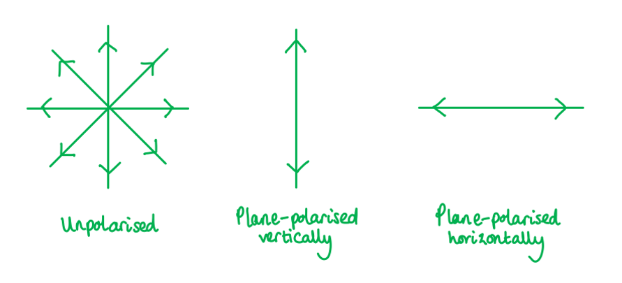
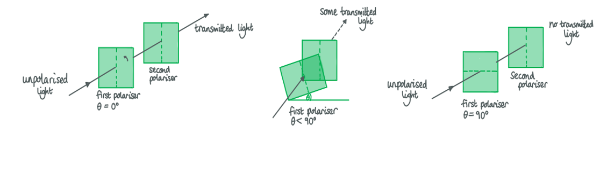
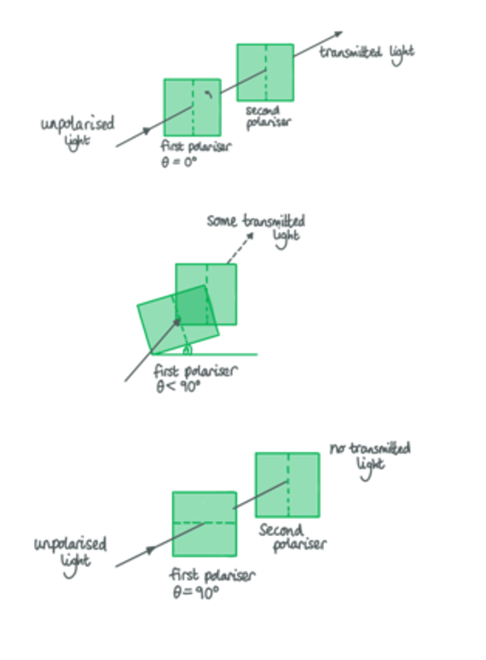
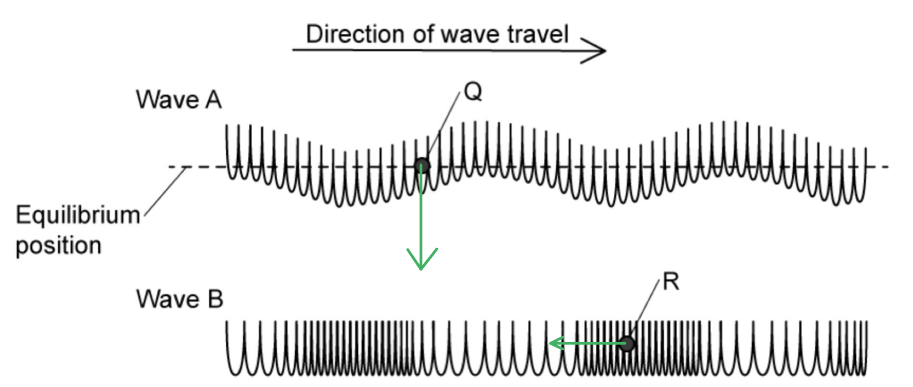
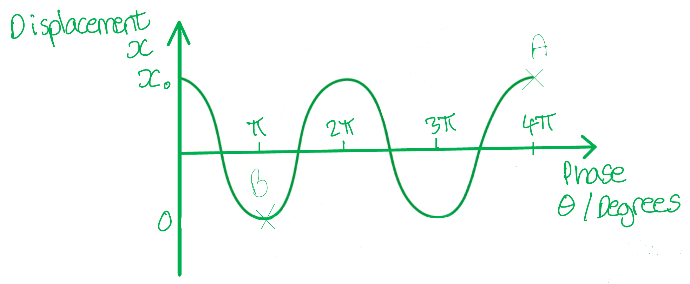
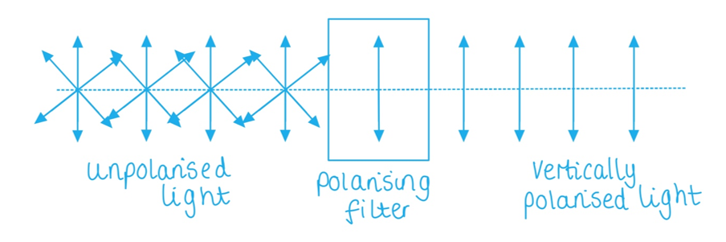
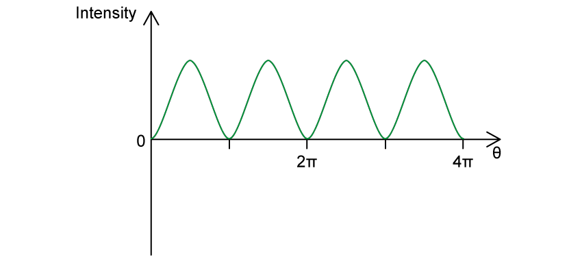
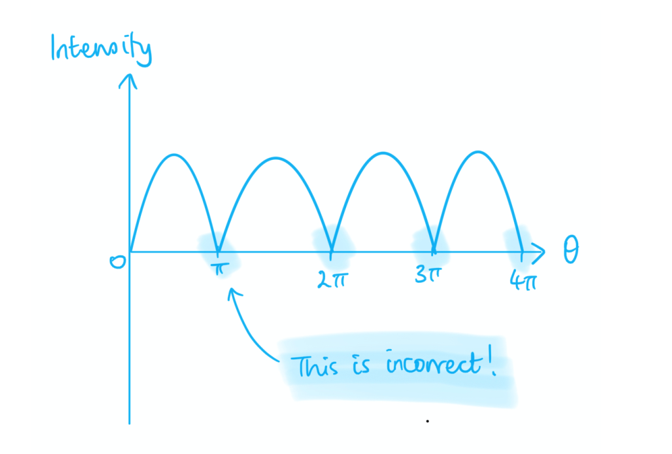

# Mark Schemes — Polarisation
**7. Waves** · Cambridge (CIE) A-LEVEL physics (9702)

## Multiple Choice Questions (14 questions)

### Q1
**Final answer:** **The correct answer is ****B**** because:**

- The known quantities are

  - Initial intensity, *I*0 = 8.0 W m-2
  - Angle between the first and second polariser, *θ* = 25°
- When unpolarised light is incident on the first polariser, the intensity is reduced by half

  - $I_{1}=\frac{1}{2}I_{0}$
  - $I_{1}=\frac{1}{2}\times8.0=4.0$W m-2
- There is a 25° angle between the first and second polariser so Malus’s Law should be used

  - $I = I_{0} \cos ^{2} ( \\theta )$
- As the light incident on the second polariser comes from the first, *I*0 will be replaced with *I*1

  - $I = I_{1} \cos ^{2} ( \\theta )$
  - $I = 4.0 \times \cos ^{2} ( 25 ) = 3.3$ W m-2 (2 s.f)
- This is option **B**

- You can’t write $\cos ^{2} ( \\theta )$ on your calculator
- In order to  do Malus’s Law calculations, you can write instead $\cos ^{2} ( \\theta )$ of the following

  - $( \cos ( \\theta ) )^{2}$
  - $\cos ( \\theta ) \times \cos ( \\theta )$

### Q2
**Final answer:** **The correct answer is ****C ****because:**

- An angle of 180° means that the analyser is parallel to the light transmitted from the polariser
- All of the light incident upon the analyser will emerge from the analyser

  - Therefore the light will be at its maximum intensity

Option **B** and **D** are incorrect because

- Angles of 90° and 270° means that the analyser is perpendicular to the light transmitted from the polariser
- No light will emerge from the analyser at these angles

Option **A** is incorrect because

- An angle of 45° will mean that some light will emerge from the analyser but it will not be at maximum intensity
- In an exam if you can’t remember which angles result in maximum intensity use Malus’s Law

  - $I=I_{0}cos^{2}(θ)$
- When *θ* is 90° or 270°

  - $I=I_{0}\times0$ = 0
- When is 0° or 180°

  - $I=I_{0}\times1=I_{0}$
- When is 45°

  - $I=I_{0}\times\frac{1}{2}=\frac{I_{0}}{2}$

### Q3
**Final answer:** **The correct answer is ****B**** because:**

- Polarisation is the process by which oscillations of transverse waves are made to occur in one plane only
- Transverse waves can be polarised as they can oscillate in many planes
- Sound, however, is a longitudinal wave
- Longitudinal waves cannot be polarised as they oscillate parallel to the direction of travel
- Therefore, sound waves would not be polarised by a metal grid

**A **is incorrect because microwaves are **transverse** waves so can be polarised, this can be done by passing the waves through a grid so that only the waves that fit through the slits can continue

**C **is incorrect because if light strikes a surface so that there is a 90o angle between the **reflected** and refracted rays, the **reflected** light will be linearly **polarised**

**D **is incorrect because the scattering of light off air molecules produces linearly polarised light in the plane perpendicular to the incident light

### Q4
**Final answer:** **The correct answer is ****D**** because:**

- Malus’s law allows the calculation of the intensity of the beam of plane polarised light, it is given by

  - $I=I_{0}cos^{2}θ$
- The initial intensity is equal to *I­**0* = 16 W m−2
- The angle of incidence is *θ* = 45°

  - $I=16\times\mathrm{cos}^{2}45=8.0Wm^{-2}$
- Therefore, the intensity of the transmitted beam is 8 W m–2

### Q5
**Final answer:** **The correct answer is ****A**** because:**

- Polarisation is the process by which oscillations of transverse waves are made to occur in one plane only
- Transverse waves can be polarised as they can oscillate in many planes
- Light is an example of a transverse wave, and polarisation is a property which is unique to transverse waves only

**B** is incorrect because a progressive wave is simply a wave that transfers energy through a medium or space; it can be transverse or longitudinal, so “progressive” by itself does not tell you whether it can be polarised

**C** is incorrect because stationary waves can be either transverse (can be polarised) or longitudinal (cannot be polarised), therefore, 'stationary' is not the property that guarantees polarisation.

**D** is incorrect because longitudinal waves have oscillations parallel to the direction of energy transfer, so they **cannot** be plane-polarised

### Q6
**Final answer:** **The correct answer is ****A**** because:**

- Polarisation is the process by which the oscillations are made to occur in one plane only
- As the light passes through the first polariser half of the intensity $( I_\frac{{0}}{2} )$ of the ray is lost

  - This is known as the half rule

The other graphs do not recognise that the incoming light is unpolarised, so the other graphs are incorrect

### Q7
**Final answer:** **The correct answer is ****B**** because:**

- The two polarisers begin perpendicular, so no light is transmitted
- Rotating either sheet changes only the **relative** angle between their axes, which determines the transmitted intensity via Malus’s law:

$I_{2}=\frac{I_{0}}{2}\mathrm{cos}^{2}θ$

- As the light passes through the first sheet half of the intensity of the ray is lost, this is known as the half rule
- The second filter will need to reduce the intensity by another half in order for the emerging light to be $\frac{I_{0}}{4}$

  - So $\mathrm{cos}^{2}θ=\frac{1}{2}$
- Rearrange to obtain a value for *θ*

  - $\mathrm{cos}θ=\sqrt{\frac{1}{2}}$
  - $θ=\mathrm{cos}^{-1}\sqrt{\frac{1}{2}}=\mathrm{cos}^{-1}\frac{\sqrt{2}}{2}$
- Either sheet may be rotated, because only the **relative angle** matters

**A **is incorrect because $\mathrm{cos}^{-1}\frac{1}{2}$  would give an angle of 60˚. This would reduce the intensity of the light greater than 50%

**C **& **D **are incorrect because either filter could be rotated

### Q8
**Final answer:** **The correct answer is ****D**** because:**

- When unpolarised light is incident on the first polariser, the intensity is reduced by half

  - $I_{1}=\frac{1}{2}I$
- When the second and third polarisers have the same transmission axis as the first, the angle between their axes is $0^{\circ}$
- By Malus’s law,$I=I_{0}\mathrm{cos}^{2}0=I_{0}$, so no additional reduction occurs after the first polariser
- Therefore, the intensity of the third polariser is

  - $I_{3}=\frac{1}{2}I$
- This is option **D**

Options **A** and **B** are incorrect because

- The intensity of the second polariser is also the same as the first polariser

  - $I_{2}=\frac{1}{2}I$
- When the polarisers are not of the same orientation, Malus’s Law should be used

  - $I = I_{0} c o s^{2} ( \\theta )$

### Q9
**Final answer:** **The correct answer is ****C**** because:**

- Polarisation is the process by which the oscillations are made to occur in one plane only
- As the light passes through the first polariser half of the intensity $( I_\frac{{0}}{2} )$  of the ray is lost

  - This is known as the half rule
  - Therefore, the light incident on the second polariser is:

$I_{1}=\frac{I_{0}}{2}$

- Malus’s law allows us to calculate the intensity of a beam of plane polarised light, it is given by

$I=I_{0}\mathrm{cos}^{2}θ$

- The intensity of light emerging from the second polariser is equal to

$I_{2}=I_{1}\mathrm{cos}^{2}60=\frac{I_{0}}{2}\times\frac{1}{4}=\frac{I_{0}}{8}$

- Therefore, the initial intensity incident on the first polariser is  $I_{0}=8I_{2}$

### Q10
**Final answer:** **The correct answer is ****D**** because:**

- Polarisation is the process by which the oscillations are made to occur in one plane only
- Radio waves emitted by an antenna are usually transmitted with a specific polarisation, and therefore, receiving aerials will generally only receive radio waves of this polarisation
- If the aerial is moved and this improves the signal then this proves the radio waves must be polarised

**A **is incorrect because the waves will not become polarised as a result of adjusting the aerial. The source of the waves will determine whether they are polarised or not.

**B **is incorrect because the waves will not become unpolarised as a result of adjusting the aerial

**C **is incorrect because if the waves from the transmitter where unpolarised then an adjustment on the aerial would not make a difference as waves would be travelling in all directions

### Q11
**Final answer:** **The correct answer is ****D**** because:**

- Rotating the first polariser by an angle *θ*  sets the plane of polarisation of the light emerging from it to the same angle *θ*
- The second polariser has a fixed axis
- When the axes are no longer parallel, the transmitted intensity decreases according to Malus’s law

$I=I_{0}\mathrm{cos}^{2}θ$

- The light emerging from the second polariser is always polarised **along the axis of the second polariser**, so its polarisation direction does not change as the first sheet is rotated
- Therefore:

  - intensity decreases
  - polarisation (after the second polariser) does not change
- This is answer **D**

Polarisation is the process by which the oscillations are made to occur in one plane only. The first polariser causes the polarisation of the light to be orientated by angle *θ.*

If the second polariser was aligned at 90° to the first, it would block the light completely. However, since the second polariser is aligned at an angle smaller than 90° to the first, it will allow some light of polarisation with angle *θ * through and hence reduce the intensity of the light.

A polariser can only transmit the component of the electric field aligned with its transmission axis.  If the incident beam is already polarised, a misaligned analyser reduces its amplitude, but the emerging beam is still plane-polarised.

### Q12
**Final answer:** **The correct answer is ****A**** because:**

- Polarisation is the process by which oscillations of transverse waves are made to occur in one plane only
- Transverse waves can be polarised as they can oscillate in many planes
- The radiation emitted from the calculator’s display is visible light
- Visible light is part of the electromagnetic spectrum, which is an example of a transverse wave

**B **is incorrect because a wave with a 3 cm wavelength would be a **microwave**

**C i**s incorrect because as the display is changed as the film rotated this is evidence that the light emitted from the calculator is polarised

**D** is incorrect because a longitudinal wave can’t be polarised as it oscillates parallel to the direction of travel

### Q13
**Final answer:** **The correct answer is ****B**** because:**

- Polarisation is the process by which the oscillations are made to occur in one plane only
- Malus’s law states that the transmitted intensity of the plane polarised light passing through a rotatable polariser is directly proportional to the square of the cosine of the angle through which the polariser is rotated from the position which gives the maximum intensity.
- Malus’s law allows us to calculate the intensity of a beam of plane polarised light, it is given by

  - $I=I_{0}cos^{2}θ$

### Q14
**Final answer:** **The correct answer is ****C**** because:**

- Polarisation is the process by which oscillations are made to occur in one plane only
- Unpolarised light incident on the first polariser is reduced to half its initial intensity
- If the first polarising sheet is on a vertical plane, then material X could be either another vertical plane or a non-polarising glass, because neither option will change the polarisation or affect the intensity of the transmitted light

**A & B **are incorrect because if X was a polariser with a horizontal transmission axis, then the intensity of the transmitted light would be zero. Any analyser at 90° to the polarised light extinguishes the beam

**D **is incorrect because since the light will be polarised vertically after passing through the first filter, options 1 and 3 are both valid

A non-polarising glass sheet does not alter the plane of polarisation.
In the context of this question, it is assumed to transmit the beam without further intensity reduction.

## Structured Questions (7 questions)

### Q1
No light will be transmitted through the polarising filter if the transmission axis is rotated to be:

- 90° (to the vertical); **[1 mark]**

**[Total: 1 mark]**
(i) Calculate angle *θ*:

List the known quantities:

- $\frac{\mathrm{intensity} \mathrm{of} \mathrm{transmitted} \mathrm{light}}{\mathrm{intensity} \mathrm{of} \mathrm{incident} \mathrm{light}}=\frac{I}{I_{0}}$ = 0.75

Use Malus's Law to obtain a value for the ratio $\frac{I}{I_{0}}$:

- $I=I_{0}\mathrm{cos}^{2}θ$
- $\frac{I}{I_{0}}=\mathrm{cos}^{2}θ=0.75$ **[1 mark]**

Calculate angle $θ$:

- $\mathrm{cos}θ=\sqrt{0.75}$
- $\\theta = \cos ^{- 1} ( \sqrt{0.75} ) = 30^{\circ}$ **[1 mark]**

(ii) Calculate the ratio $\frac{A}{A_{0}}$:

- $I\proptoA^{2}$ **[1 mark]**
- $\frac{I}{I} _{0} = ( \frac{A}{A} _{0} )^{2} = 0.75$
- $0.75 = ( \frac{A}{A} _{0} )^{2}$
- $0.75^{\frac{1}{2}}=\frac{A}{A_{0}}$
- Therefore, $\frac{A}{A} _{0} = 0.866 = 0.87 ( 2 \mathrm{s} . \mathrm{f} . )$ **[1 mark]**

**[Total: 4 marks]**

> *Linking **Malus's Law** to the** ratio given** is the key to answering part (i).*

### Q2
Ways that light can be polarised:

**Final answer:** **Any ****two**** from:**

- Reflection; **[1 mark]**
- Refraction; **[1 mark]**
- Scattering; **[1 mark]**

**[Total: 2 marks]**
To determine the intensity of the light leaving analyser B:

List the known quantities:

- Intensity of incident light, $I_{0}$ = 64 W m−2

Determine the intensity of the polarised light, $I_{1}$ incident on analyser B:

- When unpolarised light passes through a polariser, the intensity of the light falls by half
- Therefore, $I_{1}=\frac{I_{0}}{2}=\frac{64}{2}=32Wm^{-2}$** [1 mark]**

Determine the intensity, $I$, of the light leaving the analyser:

- The analyser is at the same angle as the polariser
- Therefore, all the polarised light will pass through the analyser
- $I=I_{1}=32Wm^{-2}$ **[1 mark]**

**[Total: 2 marks]**

> *Always remember to apply the half rule if the question includes the light passing through the polariser before the analyser.*
To determine the intensity of the light leaving analyser B:

List the known quantities:

- Intensity of incident light, $I_{0}$ = 64 W m−2 
- Intensity of polarised light, $I_{1}$ = 32 W m−2 (from part (b))
- Angle of analyser, $θ$ = 35°

Determine the intensity, $I$, of the light leaving the analyser:

- Recall Malus' Law, $I=I_{1}\mathrm{cos}^{2}θ$** [1 mark]**
- $I = 32 \times \cos ^{2} ( 35 )$ **[1 mark]**
- $I = 21 \mathrm{W} \mathrm{m}^{- 2} ( 2 \mathrm{s} . \mathrm{f} . )$ **[1 mark]**

**[Total: 3 marks]**

> *Remember that when using Malus' law:*

- * *$I_{0}$*  = intensity before a polariser or analyser*
- * *$I_{1}$* = intensity incident on the analyser*
To show that there is no light passing through analyser B:

List the known quantities:

- Maximum intensity = Intensity of polarised light, $I_{1}$ = 32 W m−2
- Angle of analyser, $θ$ = 90°

Use Malus' Law:

- $I=I_{1}\mathrm{cos}^{2}θ$
- $\cos ( 90 ) = 0$ **[1 mark]**
- Therefore, $I = 32 \times \cos ^{2} ( 90 ) = 0 \mathrm{W} \mathrm{m}^{- 2}$** [1 mark]**

**[Total: 2 marks]**

### Q3
Explain the difference between unpolarised and plane polarised light:

- <u>Unpolarised</u> light vibrates / oscillates in <u>all</u> planes; **[1 mark]**
- Plane <u>polarised</u> light vibrates / oscillates in <u>one</u> plane; **[1 mark]**
- (Planes of oscillation are) <u>perpendicular</u> to the <u>direction of wave</u> travel; **[1 mark]**

**[Total: 3 marks]**
Explain how this photograph can be used to identify areas of the material with different amounts of stress:

- (Polarising) filters at 90° to each other do not allow light to pass through; **[1 mark]**
- Rotation of plane of polarisation (due to stress) allows light to pass; **[1 mark]**
- Darker areas represent less stress **OR** brighter areas represent greater stress; **[1 mark]**

**[Total: 3 marks]**

### Q4
Use arrows to show how points Q and R will move next as the two waves move to the right:

Correctly drawn arrows look like:

- Q moving downwards; **[1 mark]**
- R moving to the left; **[1 mark]**

**[Total: 2 marks]**

> *You may have thought that R will follow the direction of the wave. However, it is to the left of the centre of a compression. Therefore as the compression expands to a rarefaction, R will be pushed backwards compared to the direction of travel of the wave.*
Use the diagram in Fig. 1.1.

(i) State which wave can be used to model an electromagnetic wave:

- Wave A can be used to model electromagnetic waves; **[1 mark]**

(ii) Hence explain why it is important to correctly align a radio antenna in order to receive the strongest signal.

- Transmitted radio waves are polarised; **[1 mark]**
- Antennae must be aligned to the same angle / plane of polarisation; **[1 mark]**

**[Total: 3 marks]**
Explain why the observer cannot see light from the filament lamp:

- Light passing through polarising filter **A** is vertically polarised; **[1 mark]**
- Only light in the horizontal plane / horizontally polarised light will pass through polarising filter **B **but after being vertically polarised no light can pass through; **[1 mark]**

**[Total: 2 marks]**

### Q5
Determine the possible displacement angles when A passes through the polariser:

- When A passes through the polariser, the amplitude is maximum, so the displacement angle is 0, 180 or 360 degrees; **[1 mark]**

Determine the possible displacement angles when B passes through the polariser:

- A and B are $\frac{3}{2}λ$* *apart / out of phase by $\frac{3}{2}λ$
- So, when B passes through the polariser, the amplitude is a minimum and the displacement angle is 90 or 270 degrees; **[1 mark]**

A graph to show wave amplitude against displacement angle / phase should look like this:

- Sinusoidal graph drawn with a maximum displacement (amplitude) $x_{0}$ at 0, 180 and 360 degrees; **[1 mark]**
- B drawn at 90 degrees and A drawn $\frac{3}{2}λ$ in front at 360 degrees; **[1 mark]**

**[Total: 4 marks]**

> *Don't get confused with the graph of intensity and transmission angle. This is what is normally related to a polariser. The question is asking you to sketch a graph showing the phase difference of a wave passing straight through a polariser, so nothing to do with polarisation at all. *

> *Remember that the wave is travelling from left to right, so part A will be in front of part B. There is only one combination of correct angles that will fit on this graph. *
Describe the motion of the fields which comprise an electromagnetic wave:

- Electromagnetic waves are made of electric and magnetic fields; **[1 mark]**
- These fields oscillate at 90 degrees / perpendicular to each other; **[1 mark]**

Describe the direction of energy transfer:

- (Because electromagnetic waves are transverse) energy transfer is 90 degrees / perpendicular to the direction of (field) oscillations; **[1 mark]**

**[Total: 3 marks]**
List the known quantities:

- Change in direction of the aerial = 40°

Find an expression linking the initial and final amplitude of the waves following polarisation:

- Malus's law: $I=I_{0}\mathrm{cos}^{2}θ$
- Since $I\proptoA^{2}$:

  - $\frac{I}{I} _{0} = ( \frac{A}{A} _{0} )^{2} = \cos ^{2} \\theta$
  - $\frac{A}{A_{0}}=\mathrm{cos}θ$
- Therefore, $A=A_{0}\mathrm{cos}θ$ **[1 mark]**

Find an expression for the percentage reduction:

- $A=A_{0}\mathrm{cos}40$
- Percentage reduction = $\frac{initial \text{amplitude} - \text{final} amplitude}{initial amplitude} \times 100 \%$
- Percentage reduction = $\frac{A_{0} - A_{0} \cos 40}{A_{0} } \times 100 \%$ **[1 mark]**

Evaluate to find percentage reduction:

- $\frac{A_{0} - A_{0} \cos 40}{A_{0} } \times 100 \% = ( 1 - \cos 40 ) \times 100 \% = 23.4 \%$ **[1 mark]**

**[Total: 3 marks]**
List the known quantities:

- Maximum vibration amplitude, $A_{0}$ = 55.9 μm, when $θ=0^{\circ}$
- Measured vibration amplitude, $A$ = 54.0 μm, when $θ=15^{\circ}$
- $A=A_{0}\mathrm{cos}θ$
- $I\proptoA^{2}$

Determine the ratio between the intensities:

- The maximum response is achieved when the aerial is perfectly aligned with the plane of wave oscillation, where $θ=0^{\circ}$ and $I=I_{0}$
- Since intensity is proportional to the square of amplitude:

  - $I_{0}\proptoA_{0}^{2}$
  - $\frac{I}{I} _{0} = ( \frac{A}{A} _{0} )^{2}$
- $\frac{I}{I} _{0} = ( \frac{54.0}{55.9} )^{2} = 0.933$ **[1 mark]**

Determine the incident intensity of the waves:

- $I_{0}=\frac{I}{0.933}$
- $I_{0}=\frac{0.056}{0.933}=0.060\mathrm{mW}m^{-2}$ **[1 mark]**

**[Total: 2 marks]**

### Q6
Polarised waves are waves which...

- Have their oscillations / vibration restricted; **[1 mark]**
- To one plane / direction; **[1 mark]**

**[Total: 2 marks]**

> *Below is a diagram of an unpolarised transverse waves passing through a polarising filter. The transmitted light is polarised in the vertical plane.*

Longitudinal waves cannot be polarised because...

- Their oscillations are parallel to the direction of wave travel; **[1 mark]**
- Polarising filters restrict oscillations that are perpendicular to the direction of wave travel;** [1 mark] **
- Therefore, (in longitudinal waves) there are no oscillations that can be restricted by a polarising filter; **[1 mark]**

**[Total: 3 marks]**

> *Longitudinal waves cannot be polarised at all. This is one of the characteristics of longitudinal waves.*
After passing through polarising filter** **B:

- There is no light / the light doesn’t transmit through; **[1 mark]**

Because:

- The light is vertically** **polarised after (polarising filter) A

**OR**

- Only horizontally polarised light can transmit through (polarising filter) B; **[1 mark]**** **

**[Total: 2 marks]**
The intensity of the polarised light exiting filter A is...

- Half of $I_{0}$ **OR**  $0.5I_{0}$  **OR**  $\frac{I_{0}}{2}$** [1 mark] **

**[Total: 1 mark]**

> *When unpolarised light passes through the first polariser, half of the intensity of the wave is always lost. This is the **half rule**. *

### Q7
State the use of a polaroid filter:

- Hold a <u>polaroid filter</u> up to the reflected light; **[1 mark]**

Describe the effect of rotating the polaroid filter:

- <u>Rotating</u> the polaroid filter will determine if the light is polarised **AND**
- If the light is polarised (along a certain plane) the polaroid filter will not transmit it <u>at some angle</u>; **[1 mark]**

**[Total: 3 marks]**

> *Generally speaking, it’s really good practice to specify angles of rotation in polaroid filter questions. For example, if the intensity of light transmitted behind two polaroid filters is 100% when the two filters are aligned at an angle **θ**, then the light intensity will fall to 0% when this angle is (**θ **+ 90**º**) and then back up to 100% at (**θ **+ 180**º**) and back to 0% at (**θ **+ 270**º**) and then finally back to 100% at (**θ **+ 360**º**) – yes really, this much detail! You will usually secure full credit for specific descriptions through a full rotation.*

> *However, in this question, it is sufficient to refer to ‘some angle **θ**’ because you are only required to determine if the light is polarised or not. A full description of the effects on the intensity of transmitted light through a full rotation is not required.*
State the angles of *θ  *with respect to the first polaroid filter P1:

- Polarised light, parallel to the orientation of P2, is incident on P3
- This means that, when *θ *= 20º emergent light is at maximum intensity (P3 is parallel to the alignment of P2); **[1 mark]**

Determine the angles of minimum and maximum intensity:

- *θ* = (20º + 90º) = 110º is the first angle of minimum intensity; **[1 mark]**
- *θ* = (20º + 180º) = 200º is the first angle of maximum intensity **AND** *θ* = (20º + 270º) = 290º is the second angle of minimum intensity; **[1 mark]**

**[Total: 3 marks]**
Identify the properties of each wave and how it is generated:

| **Wave** | **Polarised or Unpolarised** | **Reason** |
|---|---|---|
| Light from the sun | **Final answer:** **Unpolarised** | **Final answer:** **Light in the sun is generated randomly / oscillates in all planes** |
| Compression waves caused by an earthquake | Unpolarised | Longitudinal waves cannot be polarised |
| Electromagnetic waves from the sun passing through a sunglass lens | **Final answer:** **Polarised** | **Final answer:** **The sunglasses act as a polariser removing one plane of oscillation of the sunlight (making it easier for people to see in the Sun)** |
| Ultra-sonic waves from an echo sounder | **Final answer:** **Unpolarised** | **Final answer:** **Sound waves cannot be polarised** |

- All waves correctly identified as polarised or unpolarised; **[1 mark]**
- All reasons correct; **[1 mark]**** **

**[Total: 2 marks]**
Draw the variation of intensity beginning from the origin:

- A sketch which would score full marks would look like this:

- Correct general shape; **[1 mark]**
- Minima at π, 2π, 3π, and 4π radians; **[1 mark]**
- Therefore, maxima at $\frac{1}{2}$π, $\frac{3}{2}$ π, $\frac{5}{2}$ π and $\frac{7}{2}$ π **[1 mark]**
- Constant maximum intensity; **[1 mark]**

**[Total: 4 marks]**** **

> *The minima occur at whole integers of π because the initial orientation is *$\frac{π}{2}$* radians (intensity begins at zero), so after a further *$π$* radians, the intensity will be reduced to zero once more, and so on every *$π$* radians.*

> *Examiners point out a common mistake here is to sketch a graph that looks like the following:*

