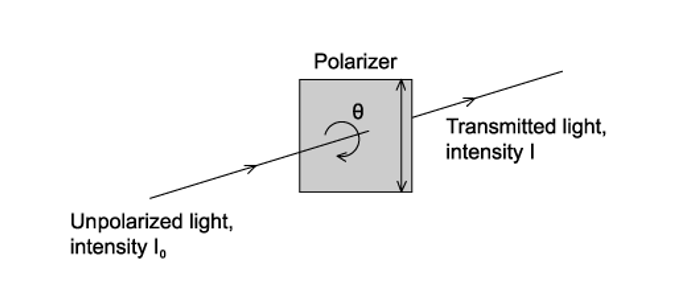

# Exam Questions — Polarisation
**7. Waves** · Cambridge (CIE) A-LEVEL physics (9702)
> Source: [https://www.savemyexams.com/a-level/physics/cie/25/topic-questions/](https://www.savemyexams.com/a-level/physics/cie/25/topic-questions/) · 14 questions across 1 sets

## Multiple Choice Questions (14 questions)

### Q1 — medium — 1 marks

**Q1** [1 mark]

Unpolarised light of intensity 8.0 W m-2 is incident upon a polariser. The light is then transmitted to a second polariser at an angle of 25° to that of the first polariser.

What is the intensity of the light beam emerging from the second polariser?

### Q2 — easy — 1 marks

**Q2** [1 mark]

A polarised light beam emerges from a polariser. It is then transmitted onto an analyser, which is at angle $θ$ to the polariser.

What does the value of the angle $θ$ need to be, so that the light emerging from the analyser is at maximum intensity?

### Q3 — easy — 1 marks

**Q3** [1 mark]

The following are statements about waves. Which statement below describes a situation in which polarisation would not happen?

### Q4 — medium — 1 marks

**Q4** [1 mark]

A linearly polarised electromagnetic beam has an intensity of 16 W m–2 with an angle of incidence of 45° to the vertical.

What is the intensity of the transmitted beam?

### Q5 — easy — 1 marks

**Q5** [1 mark]

Which of the following waves can be polarised?

### Q6 — hard — 1 marks

**Q6** [1 mark]

Unpolarised light of intensity *I**0* is incident on a polariser that has a vertical transmission axis, as shown in the diagram below.

Which graph shows the intensity of the transmitted light ?

### Q7 — hard — 1 marks

**Q7** [1 mark]

Unpolarised light of intensity *I**0** *is incident on the first of two polarising sheets. Initially the planes of polarisation of the sheets are perpendicular.

** **Which sheet must be rotated and by what angle *θ*, so that light intensity  $\frac{I_{0}}{4}$   can emerge from the second sheet ?

| ** ** | **Rotated sheet** | **Angle θ of rotation** |
|---|---|---|
| **A** | 1 or 2 | $\mathrm{cos}^{-1}\frac{1}{2}$ |
| **B** | 1 or 2 | $\mathrm{cos}^{-1}\frac{\sqrt{2}}{2}$ |
| **C** | 2 only | $\mathrm{cos}^{-1}\frac{1}{2}$ |
| **D** | 1 only | $\mathrm{cos}^{-1}\frac{\sqrt{2}}{2}$ |

### Q8 — medium — 1 marks

**Q8** [1 mark]

Unpolarised light of intensity $I$* *is incident upon a polariser. The light is then transmitted to a second polariser and then a third. The polarisers have the same orientation.

Which statement is true?

### Q9 — hard — 1 marks

**Q9** [1 mark]

Unpolarised light is incident on a polariser. The light transmitted by the first polariser is then incident on a second polariser. The polarising axis of the second sheet is 60˚ to that of the first.

The intensity emerging from the second polariser is *I**2*.

Which of the following gives the intensity incident on the first polariser?

### Q10 — medium — 1 marks

**Q10** [1 mark]

The quality of the sound produced by a portable radio can be improved by changing the orientation of the aerial.

Which statement will correctly describe the explanation of this improvement?

### Q11 — hard — 1 marks

**Q11** [1 mark]

A beam of unpolarised light is incident on the first of two parallel polarisers. The transmission axis of the two polarisers are initially parallel.

The first polariser is now rotated about the direction of the incident beam by an angle smaller than 90°.

Which row in the table describes the changes to the intensity and polarisation of the light transmitted through the polarisers?

| ** ** | **Intensity** | **Polarisation** |
|---|---|---|
| **A**  **B**  **C**  **D** | no change  no change  different  different | no change  different  different  no change |

### Q12 — easy — 1 marks

**Q12** [1 mark]

A student looked at the liquid crystal display on their calculator with a polarising film. They observed that as they rotated the film, the display changed.

Which property of the radiation from the calculator display is described correctly?

### Q13 — easy — 1 marks

**Q13** [1 mark]

Malus’s law shows the intensity of polarised light as it emerges through an analyser. Which is the correct equation to calculate the intensity?

### Q14 — medium — 1 marks

**Q14** [1 mark]

Unpolarised light of intensity *I**0* is incident on a polariser with a vertical transmission axis. The transmitted light is incident on a sheet of material X. After transmission through X the intensity of light is $\frac{I_{0}}{2}$.

It is suggested that X could be

| **1** | a polariser with a vertical transmission axis |
|---|---|
| **2** | a polariser with a horizontal transmission axis |
| **3** | non-polarising glass |
