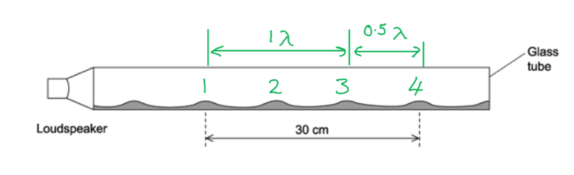
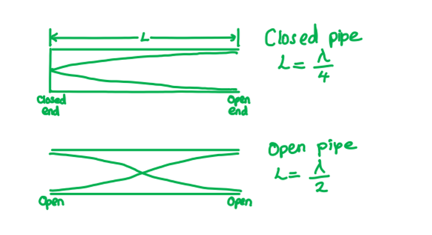
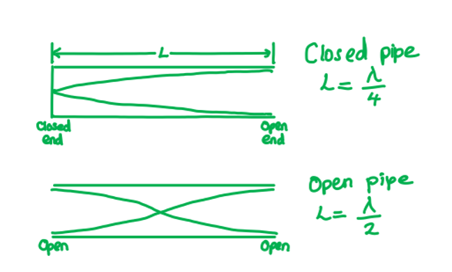
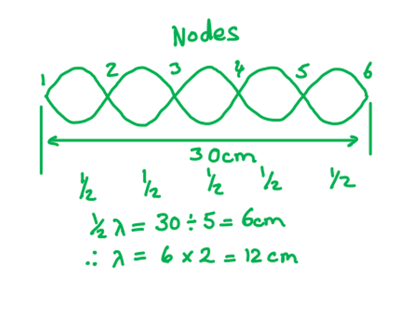
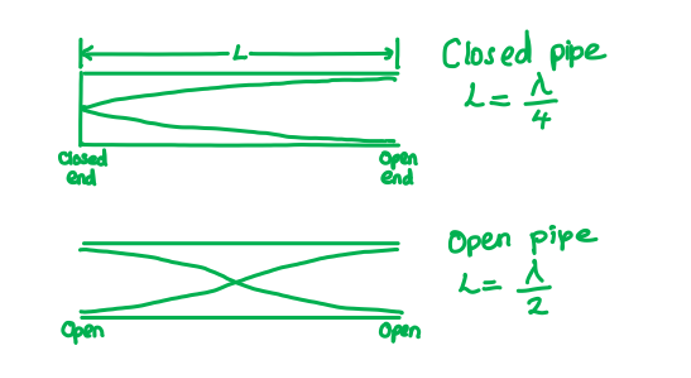

# Mark Schemes — Stationary Waves
**8. Superposition** · Cambridge (CIE) A-LEVEL physics (9702)

## Multiple Choice Questions (29 questions)

### Q1
**Final answer:** **The correct answer is A **

- There are 9 nodes
- The distance between adjacent nodes is $\frac{λ}{2}$
- From node 1 to node 9, there are 8 node–node intervals

$\frac{1}{2}λ=\frac{18.0}{8}=2.25\mathrm{cm}$

$\frac{λ}{2}=2.25\mathrm{cm}$

- Therefore

$λ=2.25\times2=4.50\mathrm{cm}$

### Q2
**Final answer:** **The correct answer is ****B**** because:**

- A standing or stationary wave is formed from the superposition of two travelling waves with the same frequency, polarisation and amplitude
- The wave equation is equal to $c=λf$
- Where:

  - Speed of electromagnetic waves : *c* = 3.0 × 108 m s−1
  - Frequency : *f* = 1 GHz = 1 × 109 Hz
  - Wavelength : $λ=\frac{v}{f}=\frac{3.0\times10^{8}}{1\times10^{9}}=0.3m$
- The distance between the transmitter and the reflective surface = 45 cm

  - So, the number of periods =$\frac{0.45}{0.30}=1.5$
- One antinode is half a period, so, in 1.5 periods there are 3 antinodes

### Q3
**Final answer:** **The correct answer is ****D**** because:**

- A standing or stationary wave is formed from the superposition of two travelling waves with the same frequency, polarisation and amplitude
- When air is blown over the top of an empty bottle, the bottom of the bottle has a fixed end, creating a wave travelling in the opposite direction with the same frequency and wavelength

**A **is incorrect because a single slit would diffract the wave into semicircular waves

**B **is incorrect because this would create the characteristic fringes caused by the superposition of the overlapping light from the two slits

**C **is incorrect because this would create an echo, which is a reflection of a sound wave

### Q4
**Final answer:** **The correct answer is ****A**** because:**

- A standing or stationary wave is formed from the superposition of two travelling waves with the same frequency, polarisation and amplitude
- The pile of dust will correspond to a node
- The distance between every two adjacent nodes = λ/2
- Three successive heaps (nodes) = two spacings =  λ

- So, the wavelength of the sound wave is :

  - $\frac{3}{2}λ=0.3$
  - $λ=0.3\times\frac{2}{3}=0.2m$
- The wave equation is given by $v=fλ$

  - Therefore, frequency, $f=\frac{v}{λ}=\frac{330}{0.2}=1650\mathrm{Hz}$

### Q5
**Final answer:** **The correct answer is ****D**** because:**

- A standing or stationary wave is formed from the superposition of two travelling waves with the same frequency, polarisation and amplitude
- The waves are moving in opposite directions, and the standing wave results from alternately constructive and destructive interference
- A node is represented by a dot on the diagram, which shows zero displacement
- Arrows indicate particle oscillation direction in a longitudinal standing wave

  - Hence diagram **D** shows two nodes and two antinodes

**A **is incorrect because the diagram only shows one node

**B **is incorrect because the diagram only shows one antinode

**C **is incorrect because a stationary wave is produced by the superposition of the wave travelling in the opposite direction. This diagram shows the particles all travelling in the same direction

### Q6
**Final answer:** **The correct answer is ****A**** because:**

- The diagram shows one complete wavelength is produced with a frequency of 650 Hz

  - The wave equation is given by $v=fλ$
- In order for the wavelength to stay the same as the frequency increases, the speed of the wave also needs to be increased

**B **& **C **are incorrect because in order to maintain the same wave pattern, the number of loops must stay the same

**D **is incorrect because if the speed is decreased, then the wavelength will decrease changing the wave pattern

### Q7
**Final answer:** **The correct answer is ****C**** because:**

- A standing or stationary wave is formed from the superposition of two travelling waves with the same frequency, polarisation and amplitude
- The points that are equidistant from Q2 will vibrate with the same frequency and amplitude

**A **is incorrect because not all the points on the wave vibrate in phase. Points within the loops will vibrate in phase but vibrate out of phase with the adjacent loop

**B **is incorrect because not all the points on the string vibrate with the same amplitude. Points closer to the nodes have a smaller amplitude than those as the crest of the loop

**D **is incorrect because points that an equidistant from Q2 are not in phase as points in adjacent loops are out of phase

### Q8
**Final answer:** **The correct answer is ****D**** because:**

- In order for the displacement to be zero the sum of the displacements needs to be zero
- The diagram for **D** shows three waves with phases that sum to zero displacement at every point, resulting in zero resultant

**A** & **B **are incorrect because they both give a negative displacement

**C **is incorrect because two of the three waves will have a negative displacement but will still leave one wave; therefore the resultant wave will not be zero

### Q9
**Final answer:** **The correct answer is ****B**** because:**

- A wavelength is the length of one complete wave

  - Each loop is the equivalent of one-half of a wavelength
- A node is the point of zero displacement

**A **& **C **are incorrect because there are not two wavelengths in the diagram

**D **is incorrect because the antinode is the point of maximum amplitude of the wave and found at the crest of the loop

### Q10
**Final answer:** **The correct answer is ****D**** because:**

- A standing or stationary wave is formed from the superposition of two travelling waves with the same frequency, polarisation and amplitude
- A standing wave is one in which two waves combine constructively giving an amplitude of twice the original wave

  - Therefore, the stationary wave in the cylinder is caused by the superposition of two waves moving in opposite directions

**A **is incorrect because sound waves can’t be polarised

**B **is incorrect because in a tube closed at the bottom, the bottom must be a displacement node, not an antinode

**C **is incorrect because decreasing the length of the column (done by adding water to the cylinder) will increase the fundamental frequency of the system

### Q11
**Final answer:** **The correct answer is ****C**** because:**

- A standing or stationary wave is formed from the superposition of two travelling waves with the same frequency, polarisation and amplitude
- The lowest or fundamental note produced will have only one node at the closed end and an antinode at the open end, creating ¼ of a wavelength

- A quarter of a wavelength is formed in a 10 m pipe

  - Therefore, one wavelength = 40 m
- The wave equation is given by $v=fλ$

  - $f=\frac{v}{λ}=\frac{320}{40}=8\mathrm{Hz}$

### Q12
**Final answer:** **The correct answer is ****A**** because:**

- In a progressive wave, the wavefronts move through the medium transferring energy from one point to the next
- A standing or stationary wave is formed from the superposition of two travelling waves with the same frequency, polarisation and amplitude

  - The waves in a standing wave are one wavelength apart and vibrate in phase
  - Particles in a progressive wave can also be one wavelength apart and vibrate in phase

**B **is incorrect because in a standing wave, adjacent particles are vibrating in antiphase phase with each other

**C **is incorrect because only a progressive wave transfers energy, in a standing wave there is no net transfer of energy

**D **is incorrect because amplitudes vary continuously from zero at nodes to maximum at antinodes

### Q13
**Final answer:** **The correct answer is ****A**** because:**

- A standing or stationary wave is formed from the superposition of two travelling waves with the same frequency, polarisation and amplitude
- The question states that a node is formed at the mouthpiece and an antinode at the bell of the horn
- The lowest or fundamental note produced will have only one node at the mouthpiece and an antinode at the bell, creating a quarter of a wavelength

- The first higher note will have a node at the mouthpiece, then a node, followed by an antinode at the bell, giving  $\frac{3}{4}$ of a wavelength

  - So, the frequency is 3 times that of the lowest note
  - Therefore, frequency $=3\times75=225\mathrm{Hz}$
- The second-highest note would be $\frac{5}{4}$    of a wavelength

  - So, the frequency is 5 times that of the lowest note
  - Therefore, frequency $=5\times75=375\mathrm{Hz}$

### Q14
**Final answer:** **The correct answer is ****A**** because:**

- The diagram is a transverse wave as the displacement is vertical and the direction of travel is horizontal
- Each loop corresponds to λ/2
- The diagram shows 2.5 waves in 1.0 m
- Therefore, λ = 40 cm
- n a stationary wave, nodes remain permanently at zero displacement

**B **is incorrect because the diagram shows a stationary wave, not a progressive wave

**C **&** D **are incorrect because there are 2.5 waves in 100 cm, so the wavelength is 40 cm, not 20 cm

### Q15
**Final answer:** **The correct answer is ****B**** because:**

- In a progressive wave, the wavefronts move through the medium transferring energy from one point to the next
- A standing or stationary wave is formed from the superposition of two travelling waves with the same frequency, polarisation and amplitude
- The wave speed of a standing wave is the speed that one of the progressive wave travels that is producing the standing wave

**A **is incorrect because the wave speed is, $v=fλ$, at a node the wave speed = 0

**C **is incorrect because a standing wave does not transfer energy

**D **is incorrect because the distance between adjacent antinodes is λ/2, not λ

### Q16
**Final answer:** **The correct answer is ****A**** because:**

- A standing or stationary wave is formed from the superposition of two travelling waves with the same frequency, polarisation and amplitude
- Tube S is a close-ended pipe, with a node at the closed-end, and an antinode at the open end
- Tube T is an open-ended pipe, with an antinode at both ends

- In a closed tube, the lowest or fundamental note produced will have only one node at the fixed end and an antinode at the open, creating a quarter of a wavelength

  - So $L=\frac{λ}{4}$, giving, $λ=4L$
- In an open tube, the lowest or fundamental note produced will have an antinode at each end with a node in the middle, creating half of a wavelength

  - So $L=\frac{λ}{2}$, giving, $λ=2L$
- For the closed tube S, the resonant frequencies are equal to:

  - $f_{c}=\frac{nv}{4L}$
  - Where *v* = speed of the wave, *L* = length of the tube and *n* = 1,3,5…
- For the open tube T, the resonant frequencies are equal to:

  - $f_{o}=\frac{nv}{2L}$
  - Where *n* = 1,2,3…
- So, the resonant frequency for the open tube T (when *n* = 1):

  - $f_{o}=2f_{c}$

### Q17
**Final answer:** **The correct answer is ****C**** because:**

- The wave is a sound wave, which is a longitudinal wave

  - Longitudinal waves travel parallel to the direction of travel
- The wave created by constructive combining of the sound waves created the largest amplitude, so the loudest sound

  - Hence the wave created is a stationary wave

**A** &** B **are incorrect because sound waves are not transverse waves; transverse waves travel perpendicular to the direction of travel

**D **is incorrect because superposition of the wave has occurred creating a standing wave, so the wave is not progressive

### Q18
**Final answer:** **The correct answer is ****B**** because:**

- A standing or stationary wave is formed from the superposition of two travelling waves with the same frequency, polarisation and amplitude
- The organ pipe is open at both ends, in order for it to have the lowest (fundamental) frequency it will have two antinodes, with a single node in the middle

- The wavelength can be measured by measuring the length between 3 consecutive nodes, the distance between the 1st and 2nd nodes give half the wavelength

  - So, in the organ pipe $L=\frac{λ}{2}$
  - Speed of a wave, $v=λf$
  
    - Therefore, the fundamental frequency is $f_{f}=\frac{v}{λ}=\frac{v}{2L}$

### Q19
**Final answer:** **The correct answer is ****D**** because:**

- The diagram shows $\frac{3}{4}$   of a wavelength is formed in a 60 cm tube

  - Displacement node at closed end
  - Displacement **antinode** at open end
  - Pattern matches 3/4 λ mode
- Therefore, one wavelength is equal to $λ=80\mathrm{cm}=0.8m$
- The wave equation is given by $v=fλ$

  - $f=\frac{v}{λ}=\frac{330}{0.8}=412.5\mathrm{Hz}$
- Therefore, the frequency of the wave is $413\mathrm{Hz}$

### Q20
**Final answer:** **The correct answer is ****C**** because:**

- N and P are vibrating in phase

  - This means they are vibrating up and down at the same time

**A **is incorrect because there are 1.5 wavelengths between M and Q

**B **is incorrect because a wave with the lowest frequency will be half a wave

**D **is incorrect because point O is at an antinode

### Q21
**Final answer:** **The correct answer is ****B**** because:**

- Wave speed = frequency × wavelength

  - $v=fλ$
- Frequency = 13 Hz
- Wavelength: in the diagram there are 1.5 waves in 90 cm

  - $\frac{90}{1.5}=60\mathrm{cm}=0.6m$
- Therefore, $v=13\times0.6=7.8ms^{-1}$

### Q22
**Final answer:** **The correct answer is ****A**** because:**

- There are six nodes
- There are 5 half wavelengths between the six nodes

  - 30 cm divided by 5 = 6 cm
  - So, $\frac{λ}{2}=6.0\mathrm{cm}$
- Therefore, *λ* = 12.0 cm

### Q23
**Final answer:** **The correct answer is ****D**** because:**

- A standing or stationary wave is formed from the superposition of two travelling waves with the same frequency, polarisation and amplitude 
- In this open-ended pipe, there are six nodes in 1.5 m each have half a wavelength between each one

  - 1.5 m divided by 6 = 0.25 m
  - So, $\frac{λ}{2}=0.25m$
- Therefore, λ = 0.5 m

### Q24
**Final answer:** **The correct answer is ****B**** because:**

- A standing or stationary wave is formed from the superposition of two travelling waves with the same frequency, polarisation and amplitude
- A node would be present at the wall, the same as in a closed tube

- The distance between a node and antinode is equal to $\frac{λ}{4}$

  - So, $\frac{λ}{4}=x$, so, wavelength $λ=4x$
- The wave equation is equal to $c=fλ$

  - Therefore, frequency : $f=\frac{c}{λ}=\frac{c}{4x}$

### Q25
**Final answer:** **The correct answer is ****B**** because:**

- A standing or stationary wave is formed from the superposition of two travelling waves with the same frequency, polarisation and amplitude
- The pipe is closed at one end; there are two nodes present, therefore, the length of the tube is equal to $\frac{3}{4}λ$

- The maximum pressure change happens at the displacement node, where the particles are stationary, but density fluctuates the most

### Q26
**Final answer:** **The correct answer is ****C**** because:**

- The principle of superposition is applied when two or more waves are travelling through the same medium at the same time
- Noise-cancelling headphones use destructive interference to cancel out the external noise
- Therefore, the headphone will need to produce a wave with the same frequency and amplitude but with a phase difference of 180°

**A **is incorrect because a phase difference of 360° will mean that the waves are in phase and this will cause constructive interference making the external noise louder

**B **& **D** are incorrect because 90° or 270° phase difference produces partial interference, not full cancellation

### Q27
**Final answer:** **The correct answer is ****A**** because:**

- A standing or stationary wave is formed from the superposition of two travelling waves with the same frequency, polarisation and amplitude
- A standing wave is one in which two waves combine constructively giving an amplitude of twice the original wave

  - Therefore, the waves must have equal speed, frequency and wavelength

**B** & **D **are incorrect because  if the waves had a different wavelengths, then they would not be in phase

**C **is incorrect because the waves must have the same frequency to create a standing wave

### Q28
**Final answer:** **The correct answer is ****B**** because:**

- A standing or stationary wave is formed from the superposition of two travelling waves with the same frequency, polarisation and amplitude

- In an open-ended pipe there will be half a wavelength, so for pipe Y:

  - $L=\frac{x}{2}\timesλ$
  - $50=\frac{x}{2}\times20$
  - $x=5$
- There is an odd whole number produced

  - Therefore, a standing wave will be created
- In a close-ended pipe there will be a quarter of a wavelength, so for pipe X:

  - $L=\frac{x}{4}\timesλ$
  - $35=\frac{x}{4}\times20$
  - $x=7$
- There is an odd whole number produced

  - Therefore, a standing wave will be created
- So, both X and Y will produce a standing wave

### Q29
**Final answer:** **The correct answer is ****A**** because:**

- A standing or stationary wave is formed from the superposition of two travelling waves with the same frequency, polarisation and amplitude
- A node is produced with zero displacement and an antinode at maximum displacement
- The distance between two nodes is half a wavelength, and there is an antinode at the middle of two successive nodes

  - Therefore, a node is a quarter of a wavelength from an adjacent antinode

**B **is incorrect because the wave pattern is stationary, but the particles oscillate

**C **is incorrect because at a rigid metal sheet, air cannot move, so displacement is zero and a node forms

**D **is incorrect because in a stationary wave, the points a loop are in phase and out of phase with adjacent loops
