# Exam Questions — Stationary Waves
**8. Superposition** · Cambridge (CIE) A-LEVEL physics (9702)
> Source: [https://www.savemyexams.com/a-level/physics/cie/25/topic-questions/](https://www.savemyexams.com/a-level/physics/cie/25/topic-questions/) · 29 questions across 1 sets

## Multiple Choice Questions (29 questions)

### Q1 — medium — 1 marks

**Q1** [1 mark]

A standing wave is formed in a closed pipe. The distance between the first node and the ninth node is 18.0 cm.

What is the wavelength of the wave?

### Q2 — hard — 1 marks

**Q2** [1 mark]

A student was investigating the reflection of electromagnetic waves. They set up a transmitter 45 cm from a reflective surface, as shown in the diagram.

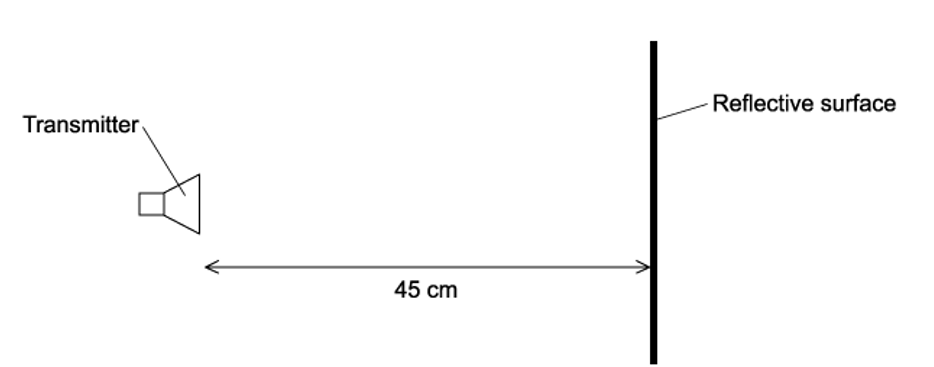

The waves had a frequency of 1.00 GHz. A stationary wave was produced with a node at the transmitter and a node at the surface.

How many antinodes are there in the space between the surface and the transmitter?

### Q3 — easy — 1 marks

**Q3** [1 mark]

A student wants to demonstrate a stationary wave.

What could they use to produce this?

### Q4 — hard — 1 marks

**Q4** [1 mark]

A glass tube closed at one end, with a layer of fine powder laid inside as shown in the diagram, was set up. Sound was emitted from the loudspeaker and placed near the open end of the tube.

The frequency of the sound wave was changed, at one frequency a stationary wave was formed, and the powder formed 4 heaps. The distance between the four heaps of powder was 30 cm.

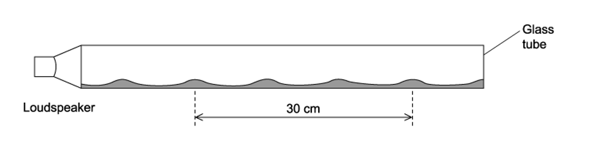

The speed of sound in the tube is 330 m s–1

What is the frequency of the sound?

### Q5 — hard — 1 marks

**Q5** [1 mark]

A pipe is used to set up a stationary longitudinal wave. The length of each arrow in the diagrams below shows the motion of the air molecules. The arrowheads show the direction of the motion of the particle.

Which diagram shows a stationary wave with two nodes and two antinodes?

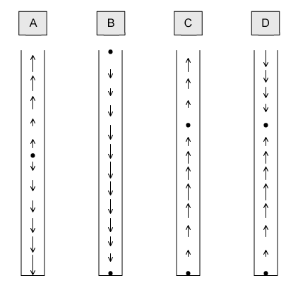

### Q6 — medium — 1 marks

**Q6** [1 mark]

A student was investigating the speed of a transverse wave on a stretched spring. They found that by adjusting the tension on the spring, they were able to change the speed.

The wave pattern produced is shown in the diagram the frequency of the oscillator was set to 650 Hz

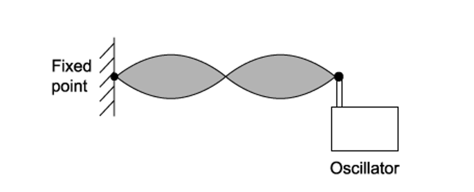

What needs to be changed to maintain the same wave pattern when the frequency is increased to 750 Hz?

### Q7 — easy — 1 marks

**Q7** [1 mark]

A stationary wave on a string is shown in the diagram below. The standing wave has three nodes Q1, Q2 and Q3

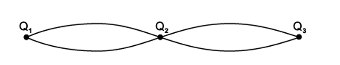

Which of the following statements are correct ?

### Q8 — medium — 1 marks

**Q8** [1 mark]

Each of the diagrams below show three waves; each of the waves have the same amplitude and frequency but have different phases.

The waves are added together to give a resultant wave. In which case would the resultant wave be zero ?

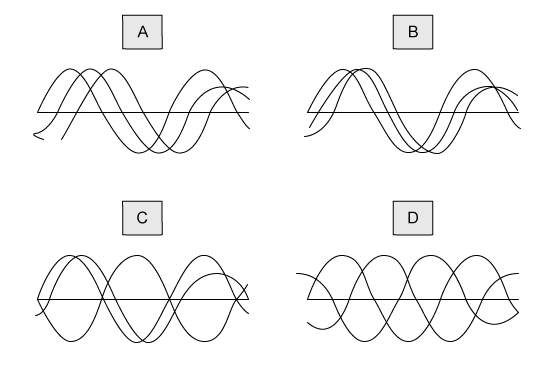

### Q9 — easy — 1 marks

**Q9** [1 mark]

A stretched string is used to demonstrate a stationary wave, as shown in the diagram.

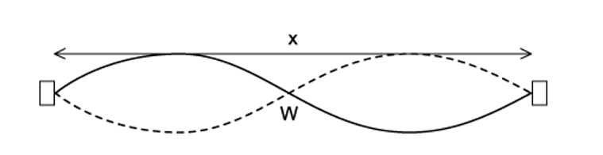

Which row in the table correctly describes the length of x and the name of W?** **

| ** ** | **Length x** | **Point W** |
|---|---|---|
| **A** | two wavelengths | node |
| **B** | one wavelength | node |
| **C** | two wavelengths | antinode |
| **D** | one wavelength | antinode |

### Q10 — easy — 1 marks

**Q10** [1 mark]

A student formed a stationary wave in a tube by blowing over the top as shown in the diagram

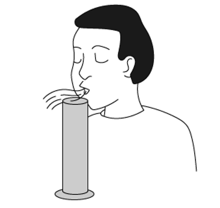

Which of the following statements are correct ?

### Q11 — medium — 1 marks

**Q11** [1 mark]

A stationary sound wave produced in a musical instrument, this instrument has the pipes open at one end and closed at the other.

If the length of the pipe was 10 m what it is the lowest frequency of sound when the speed of sound is 320 m s−1?

### Q12 — easy — 1 marks

**Q12** [1 mark]

The table shows some statements about stationary and progressive waves.

Which row is correct ?

| ** ** | **Progressive wave** | **Stationary wave** |
|---|---|---|
| **A** | particles one wavelength apart vibrate in phase | particles one wavelength apart vibrate in phase |
| **B** | particles vibrate in phase with their immediate neighbours | particles in adjacent loops vibrate in phase |
| **C** | energy is transferred along the wave | energy is transferred along the wave |
| **D** | all particles vibrate with the same amplitude | all particles vibrate with the same amplitude |

### Q13 — hard — 1 marks

**Q13** [1 mark]

When a wind instrument is used to create a note, a stationary wave is produced in the column. An example of this is the horn.

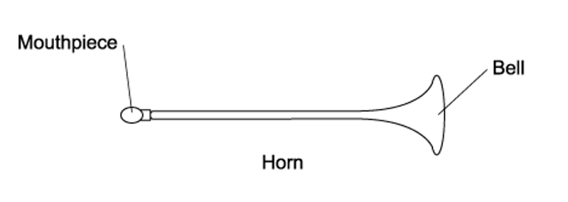

For the range of notes produced by the horn, a node is formed at the mouthpiece and an antinode is formed at the bell. The frequency of the lowest note is 75 Hz.

What would be the frequencies of the next two higher notes for this air column?

| ** ** | **First higher note / Hz** | **Second higher note / Hz** |
|---|---|---|
| **A**  **B**  **C**  **D** | 225  150  150  113 | 375  300  225  150 |

### Q14 — medium — 1 marks

**Q14** [1 mark]

The diagram below shows a wave pattern over time

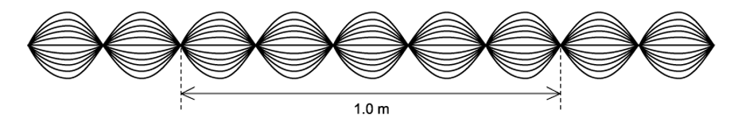

What is the correct description of the wave?

### Q15 — easy — 1 marks

**Q15** [1 mark]

When a stationary wave is produced in a tube, which of the following statements describes the wave speed?

### Q16 — hard — 1 marks

**Q16** [1 mark]

A student was investigating a tuning fork over two tubes. The tube were identical in length and size except tube S is closed at one end, and tube T is open at the lower end.

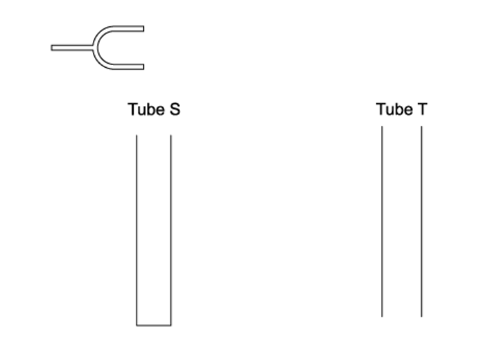

The tuning fork was placed above tube S and caused a resonance of the air at frequency *f.* No resonance is found at any lower frequency than *f* with tube S.

Which tuning fork will produce resonance when placed above tube T?

### Q17 — easy — 1 marks

**Q17** [1 mark]

A student sets up a sound wave in a long tube, and the tube is closed at one end. The tube length is changed until the sound from the tube is loudest.

Which of the following statements describe the nature of the wave in the tube?

### Q18 — hard — 1 marks

**Q18** [1 mark]

Stationary sound waves can be produced in an organ pipe of length $L$ when both ends are open, and this creates a note from an organ.

The speed of sound in the air column is v.

What is the lowest (fundamental) frequency of the note produced in the pipe?

### Q19 — medium — 1 marks

**Q19** [1 mark]

The diagram below shows sound wave produced in a column by a loudspeaker. The speed of sound in air is 330 m s−1

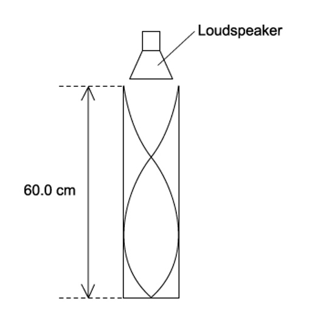

What is the frequency of the wave?

### Q20 — easy — 1 marks

**Q20** [1 mark]

A stretched string is set up to demonstrate a stationary wave between two points M and Q.

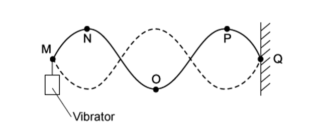

Which of the following statements are correct?

### Q21 — easy — 1 marks

**Q21** [1 mark]

A stationary wave shown in the diagram was created on a stretched string.

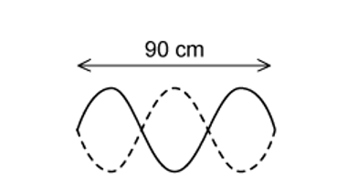

The frequency of the wave is 13 Hz.

What is the speed of the wave?

### Q22 — medium — 1 marks

**Q22** [1 mark]

A stationary sound wave produced in a tube has a series of nodes. The distance between the first node and the sixth node is 30 cm

What is the wavelength of the wave ?

### Q23 — medium — 1 marks

**Q23** [1 mark]

Two loudspeakers emitting sound of the same frequency produces a stationary wave. This is shown in the diagram

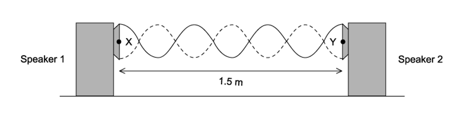

The microphone is moved between X and Y for a distance of 1.5 m. There were six nodes and seven antinodes observed.

What is the wavelength of the sound?

### Q24 — hard — 1 marks

**Q24** [1 mark]

An investigation to sound waves reflected by a wall was carried out. The frequency *f* of the wave was adjusted until a stationary wave is formed with an antinode with a distance *x* closest to the wall.

Which expression gives *f* in terms of *x* and the speed of sound *c *?

### Q25 — medium — 1 marks

**Q25** [1 mark]

A stationary wave was formed in a column. The diagram below shows the movement of the air particles.

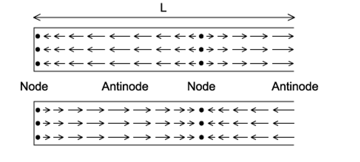

The first diagram shows the displacement and the second is the displacement half a cycle later.

Which position will the pressure change by the most significant amount, and what is the length, *L* of the column in terms of wavelength, *λ*?

| ** ** | **Length *****L*** | **Maximum pressure change** |
|---|---|---|
| **A** | $\frac{3}{4}λ$ | antinode |
| **B** | $\frac{3}{4}λ$ | node |
| **C** | $\frac{3}{2}λ$ | antinode |
| **D** | $\frac{3}{2}λ$ | node |

### Q26 — medium — 1 marks

**Q26** [1 mark]

Headphones that have noise reduction can cancel out external noise by producing their own waves.

They are fitted with a microphone that detects the external sound frequency. The loudspeaker then produces a wave with the same frequency but different phase.

What would the phase difference needed to cancel out the external sound?

### Q27 — easy — 1 marks

**Q27** [1 mark]

A stationary wave is formed when two waves travel in opposite directions through the same space.

Which of the following statements must also be correct?

### Q28 — hard — 1 marks

**Q28** [1 mark]

A student was investigating the creation of stationary waves. They set up travelling waves with a wavelength of 20 cm in a closed pipe X and an open pipe Y. The lengths of the pipes are shown in the diagram.

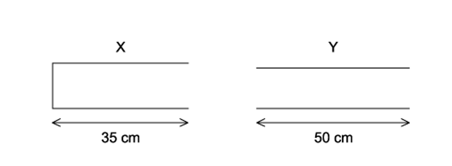

In which pipe did the student observe stationary waves?

### Q29 — medium — 1 marks

**Q29** [1 mark]

The diagram shows the pattern produced by the superposition of sound waves from a loudspeaker reflected by a metal sheet.

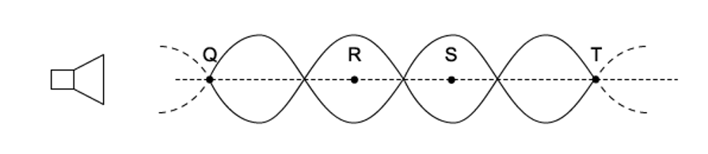

Q, R, S and T are four points on the line through the centre of these waves.

Which of the following statements is correct?
