# Mark Schemes — Diffraction
**8. Superposition** · Cambridge (CIE) A-LEVEL physics (9702)

## Multiple Choice Questions (15 questions)

### Q1
**Final answer:** **The correct answer is ****C ****because**

- The greatest diffraction occurs when the gap is the same size as the wavelength going through it
- The wave equation is

  - $v=fλ$
  - $λ=\frac{v}{f}$
- When the frequency is 1700 Hz

  - $λ=\frac{340}{1700}=0.2$ m
- This is option **C**

### Q2
**Final answer:** **The correct answer is ****A ****because:**

- Wavefronts are lines joining all the points on a wave that oscillate in-phase, such as crests or troughs

  - The distance between two wavefronts is equal to one wavelength
- Lower frequency waves have longer wavelengths, and higher frequency waves have shorter wavelengths
- Wave **A** has the longest wavelength

  - Therefore, wave **A** has the lowest frequency

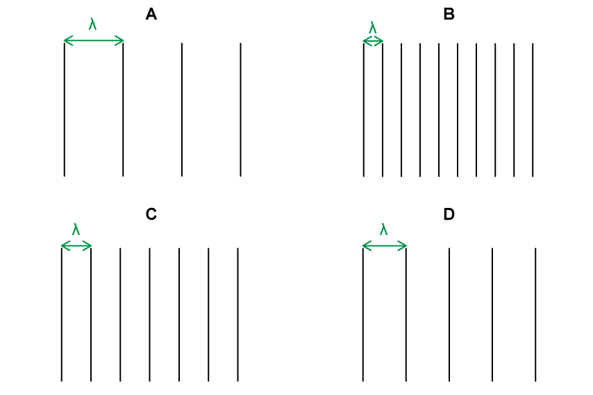

Wavefront diagrams are a model, a simplified version of a scenario that allows us to focus on the most relevant aspects of a situation. It is helpful to think of wavefront diagrams as a snapshot in time over a specific area that shows you where the wavefronts are at that moment. Higher frequency waves will have more wavefronts in their snapshot than lower frequency waves.

In this way, we can use wavelength as a guide to determine the frequency from a wavefront diagram.

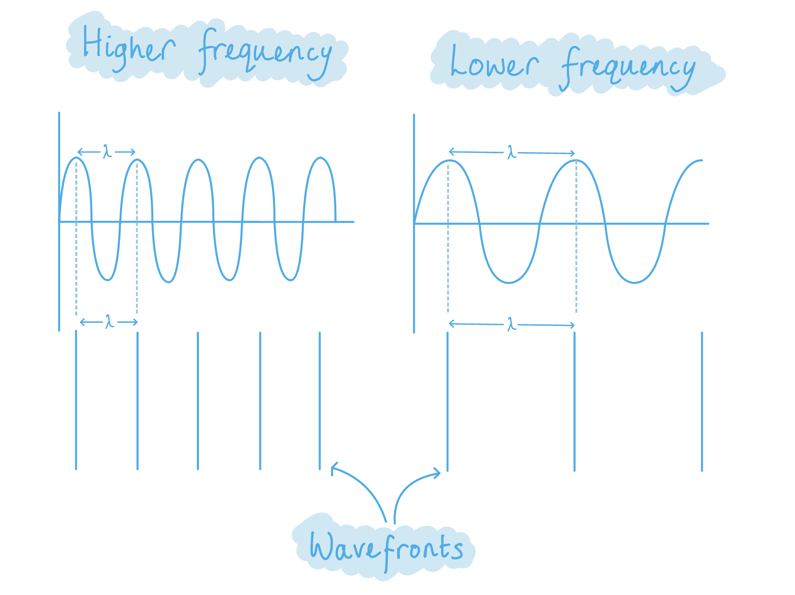

### Q3
**Final answer:** **The correct answer is ****C**** because:**

- Significant diffraction occurs when the size of the aperture is similar to the wavelength of the wave
- $v=fλ\rightarrowλ=\frac{v}{f}=\frac{340}{3000}=0.11m$
- $11\mathrm{cm}\approx15\mathrm{cm}$ therefore significant diffraction would occur

### Q4
**Final answer:** **The correct answer is ****B**** because:**

- Frequency and wavelength are related to each by the equation : $v=fλ$
- The diagram shows the wavefronts at S and T, the only difference between the two points is that the wave has travelled through a slit or gap
- Only the amplitude of the wave changes as some energy is dissipated as it passes through the gap

**A **is incorrect because the frequency is determined by the source and so remains constant

**C **is incorrect because the wavelength is constant as the wavefronts are constant in the diagram

**D **is incorrect because the velocity would remain constant as both wavelength and frequency are constant

### Q5
**Final answer:** **The correct answer is ****D**** because:**

- Diffraction happens when a wave meets an object or slit
- It is defined as the bending of the waves around corners or through an aperture
- When the light is passed through a double slit two coherent sources of waves are produced that interfere
- Light diffracts from each slit, because the slits are narrow
- These waves overlap and interfere constructively (maximum intensity) and destructively (minimum intensity)

**A **is incorrect because diffraction through a single slit and would not produce the pattern seen

**B **is incorrect because the light would need to be diffracted by a single slit to produce the wave pattern seen

**C **is incorrect because coherence is when the frequency and waveform are identical, and the phase difference is constant. A coherent wave would not produce this wave pattern

### Q6
**Final answer:** **The correct answer is ****A**** because:**

- Diffraction is the spreading out of a wave around an obstacle or aperture
- Diffraction occurs in **all types of wave**

  - Including sound waves, water waves, and electromagnetic waves such as light and radio

Diffraction is greatest when the wavelength of the wave is of a **similar size** to the aperture, or** larger** than the aperture.

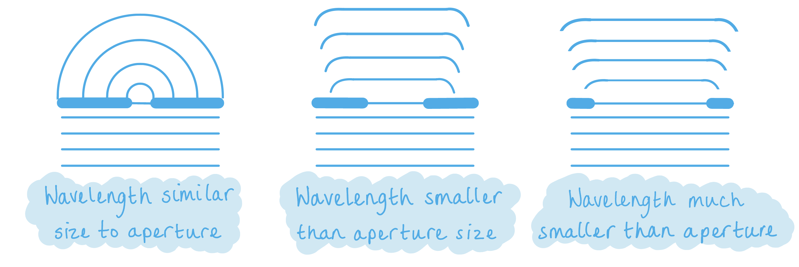

Sound waves are easily diffracted around open doors (the human voice has a wavelength very similar in size to the width of an open door). Long wave radio signals (with wavelengths of around a kilometre) are diffracted around most objects so that the signal can be received in most places. However, shorter wave radio signals (with wavelengths of around one metre) do not diffract significantly around hills and cliffs leaving areas of 'shadow' where the signals cannot be received. To observe diffraction in visible light (with wavelengths of 400 - 700 nm) the apertures used need to be similar in size to the wavelength.

### Q7
**Final answer:** **The correct answer is ****A**** because:**

- Diffraction happens when a wave meets an object or slit
- It is defined as the bending of the waves around corners or through an aperture
- For very small aperture sizes the majority of the wave is blocked
- For large aperture sizes, the wave passes with very little diffraction, largely at the edges
- For the largest diffraction effect to be seen the wavelength needs to be close to the aperture size

  - X-rays have a wavelength of 10−8 to 10−13 m

**B **is incorrect because infra-red waves have a wavelength of 10−3  to 10−7 m

**C **is incorrect because microwaves have a wavelength of 10−1  to 10−3 m

**D **is incorrect because ultraviolet waves have a wavelength of 10−7  to 10−8 m

### Q8
**Final answer:** **The correct answer is ****C ****because:**

- Diffraction is the **spreading out** of waves, as shown in the diagram below

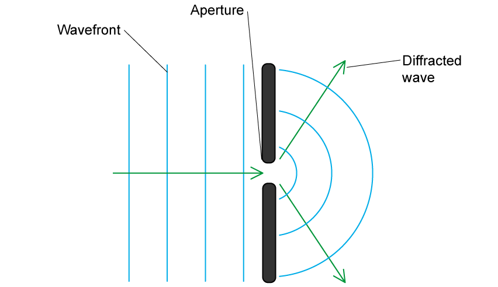

**A** is incorrect as this is describing reflection

**B** is incorrect as this is describing refraction

**D** is incorrect as this is describing a situation of interference

### Q9
**Final answer:** **The correct answer is ****A**** because:**

- When a wavefront meets the obstacle, it diffracts around the edges
- Behind the obstacle a 'shadow' forms where the wave is blocked
- When the wavelength of the wave is similar to the width of the object, significant diffraction occurs

  - This means that the waves join back up after the 'shadow'
- When the wavelength is significantly smaller than the width of the object, the diffraction is less, so the shadow is longer
- Therefore, **A** is the only correct answer option

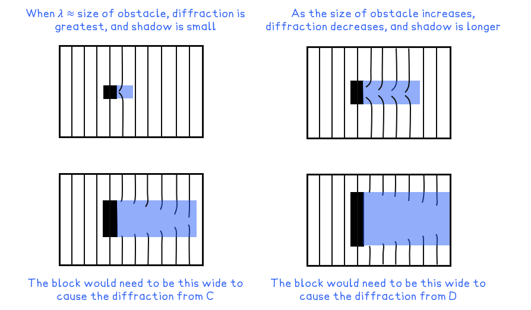

### Q10
**Final answer:** **The correct answer is ****D**** because:**

- $v=\frac{s}{t}\rightarrowt=\frac{s}{v}$
- Distance, *s*, is equal to the number of wavelengths between AB and X

  - Therefore, $s=5λ$
- Speed, v, is equal to the speed of the wave

  - Therefore, $v=c$
- Hence, the time taken is $t=\frac{5λ}{c}$

  - This is answer option **D**

### Q11
**Final answer:** **The correct answer is ****D**** because:**

- Diffraction happens when a wave meets an object or slit
- It is defined as the bending of the waves around corners or through an aperture
- For very small aperture sizes the majority of the wave is blocked
- For large aperture sizes, the wave passes with very little diffraction, largely at the edges

**A **is incorrect because this definition describes refraction

**B **is incorrect because this definition describes dispersion

**C **is incorrect because this definition describes superposition

### Q12
**Final answer:** **The correct answer is ****C**** because:**

- The sound waves have much longer wavelengths than the width of the cube
- For sound, $v=fλ\rightarrowλ=\frac{v}{f}=\frac{340}{4000}=0.085m$

  - 8.5 cm is close to 5 cm significant diffraction will occur
- For light, the wavelength of the visible spectrum at 700 nm to 400 nm

  - $700 \text{nm} \text{much} less-than 5 \text{cm}$ therefore no diffraction will occur

### Q13
**Final answer:** **The correct answer is ****A**** because:**

- The greatest amount of diffraction occurs when the wavelength is equal to the size of the aperture

**B** is incorrect because when the size of the aperture is larger than the wavelength, less diffraction will occur

**C** is incorrect  because when the size of the aperture is much larger than the wavelength, much less diffraction will occur

**D** is incorrect because when the wavelength is much greater than the size of the aperture, less diffraction will occur

### Q14
**Final answer:** **The correct answer is ****C**** because:**

- Diffraction happens when a wave meets an object or slit
- It is defined as the bending of the waves around corners or through an aperture
- For very small aperture sizes the majority of the wave is blocked
- For large aperture sizes, the wave passes with very little diffraction, largely at the edges
- For the largest diffraction effect to be seen the wavelength needs to be close to the aperture size

  - Microwaves have a wavelength of 1 m to 10−3 m so would be a similar size to the steel post

**A **is incorrect because radio waves have a wavelength of 10−1 to 106 m so would not be diffracted by the copper wire

**B **is incorrect because visible light has a wavelength of 7 – 4 × 10−7 m so would not be diffracted by the gate post

**D **is incorrect because sound waves have a wavelength of 1.7 × 10−2 m to 17 m so would not be diffracted by the human hair

### Q15
**Final answer:** **The correct answer is ****A**** because:**

- The wave would diffract through the aperture

  - This discounts options **B** and **C**
- The wavelength is larger than the size of the aperture

  - Therefore the diffraction would be great
  - This discounts option **D**
- Option **A **is the only answer that fits these criteria

**B **is incorrect as this pattern is the double-slit diffraction pattern that cannot be formed from a single aperture

**C **is incorrect as no diffraction is occurring in the diagram. This would only happen if the wavelength was very much smaller than the aperture

**D **is incorrect as the wave is not diffracting very much. This is the pattern we would expect to see if the wavelength was smaller than the aperture, but the wavelength is actually larger than the aperture

## Structured Questions (5 questions)

### Q1
Describe the pattern observed on the screen:

- (A single slit diffraction pattern with) a white central maximum; **[1 mark]**

**Final answer:** **Any ****one**** from:**

- Surrounded by coloured fringes; **[1 mark]**
- With red light diffracted more / further away from the centre; **[1 mark]**
- With blue / violet light diffracted less / closer to the centre; **[1 mark]**

**[Total: 2 marks]**

> *Instead of 'red light being further away from the centre' and 'blue light closer to the centre' make sure **not **to just say 'at a higher order' or 'at a lower order'. You must relate the colours to their relation to the centre of the pattern.*

> *The reason it wouldn’t be accurate to say that red is at a higher order/blue is a lower order of diffraction on the pattern is because each spectrum has its own order when white light is diffracted through a single slit. The zero order will be the white fringe.*

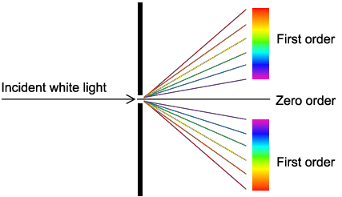
The effect on the diffraction pattern if the width of the narrow slit is decreased will be:

**Final answer:** **Any ****two**** from:**

- The bright and dark fringes become further apart; **[1 mark]**
- The maxima / the pattern becomes broader; **[1 mark]**
- The pattern is dimmer; **[1 mark]**** **

**[Total: 2 marks]**
The effect on the width of the fringes on the diffraction pattern if the blue light is replaced with a red light of the same intensity will be:

State:

- The maxima / fringes become further apart / wider; **[1 mark]**** **

Explain:

- Because red light has a longer wavelength; **[1 mark]**

**[Total: 2 marks]**** **
A diagram scoring 3 marks:

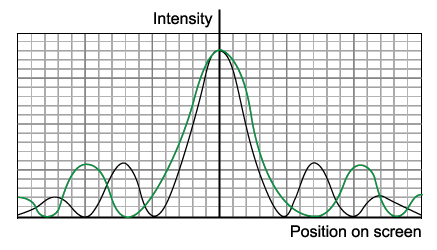

- Centre of all maxima (apart from the first/central) peaks further away from the centre; **[1 mark]**
- Central maximum twice the width of the other maxima **AND** symmetrical; **[1 mark]**
- The intensities of all maxima should remain the same; **[1 mark]**** **

**[Total: 3 marks]**

> *Part (c) helps you to know how the graph would change. Question parts often build like this, so get into the habit of thinking of terms of a whole question, rather than individual question parts, to be sure you don't miss any clues that are there to help you!*

### Q2
The correct diagram is as follows:

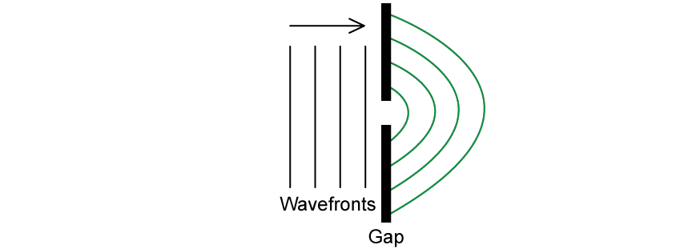

- At least four curved wavefronts drawn; **[1 mark]**
- Distance between each wavefront roughly the same as before they entered the gap; **[1 mark]**** **

**[Total: 2 marks]**** **

> *The distance between each wavefront should be the same after it passes through the gap since this represents the **wavelength** of the wave. The wavelength does **not** change when the wave is diffracted, so make sure to draw your sketch accurately!*
The changes which would decrease the amount of diffraction are:

- Increasing the size of the gap; **[1 mark]**
- Reducing the wavelength (relative to the gap size) **OR** increasing the frequency of the wave;** [1 mark]**

**[Total: 2 marks]**
Complete the diagram to show the wavefronts after they have passed the edge:

- Same wavelength (equal gap between wavefronts) drawn; **[1 mark]**
- Wavefronts curve at the end near the barrier; **[1 mark]**

**[Total: 2 marks]**
The correct diagram is as follows:

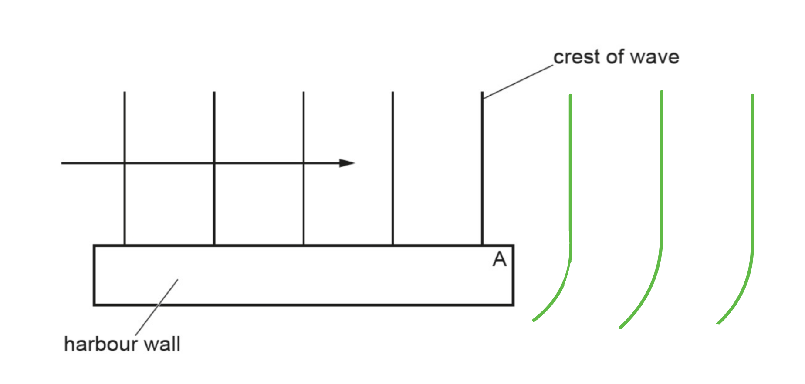

- Same wavelength (equal gap between wavefronts) drawn; **[1 mark]**
- Wavefronts curve near point A; **[1 mark]**

**[Total: 2 marks]**

> *When sketching the continuation of a wave pattern as in part (i) of this question **there will always be a mark for getting the wavelength** (the distance between the lines you draw) correct.*

- *If the wave speed stays the same, wavelength stays the same.*
- *If the wave gets slower then wavelength shrinks (as the waves catch up with each other).*
- *If the wave gets faster then wavelength extends (as the leading wavefronts get away from those following).*

### Q3
Describe fringes formed by superposition causing interference:

- Superposition of light from each of the double slits will interfere both constructively and destructively; **[1 mark]**

Specific explanation of how a bright fringe is formed:

- A path difference of integer multiple of wavelengths will give bright fringes; **[1 mark]**

**[Total: 2 marks]**
The separation of the fringes will:

- Decrease, due to wavelength decreasing by a factor of two **AND**
- Decrease further due to the doubled distance between the slits; **[1 mark]**

Describe the overall effect on fringe separation:

- Therefore, the total decrease in the separation of fringes in this interference pattern will be 4 times smaller; **[1 mark]**

**[Total: 2 marks]**

> *This answer could be directly related to the equation: **s **= *$\frac{λD}{d}$*, however it does not need to reference the equation to get full marks.*
Describe how the pattern changes:

- The width of the central maximum (fringe) will be increased **AND**
- With larger widths for each subsequent maxima (on each side); **[1 mark]**

Describe how the intensities will change:

- The intensity of the maxima next to the central maximum will decrease; **[1 mark]**

**[Total: 2 marks]**

### Q4
Diffraction is defined as:

- When a wave passes through a slit / gap / barrier / an obstruction / an edge; **[1 mark]**
- The wave spreads out / changes direction; **[1 mark]**

**[Total: 2 marks]**
A property of a wave that changes when diffracted is:

- Amplitude;** [1 mark]**** **

A property of a wave that remains the same when diffracted is:

**Final answer:** **Any ****one**** from:**

- Speed / velocity;** [1 mark]**
- Wavelength;** [1 mark]**
- Frequency;** [1 mark]**
- Phase (difference);** [1 mark]**** **

**[Total: 2 marks]**
The correct sentence is as follows:

**Final answer:** **Any ****one pair**** from:**

- **X–rays**** [1 mark] **passing through **atoms**** [1 mark] **will produce a large diffraction effect.
- **Radio**** ****waves** **[1 mark]** passing through **mountains ****[1 mark] **will produce a large diffraction effect.
- **Red light**** [1 mark]** passing through **a diffraction**** ****grating**** ****[1 mark]** will produce a large diffraction effect.** **

**[Total: 2 marks]**** **

> *The largest diffraction effect when a wave passes through a gap is when the wavelength of the wave is roughly the **same** size as the gap itself. Therefore, it is important to revisit the order of magnitude of the wavelengths of electromagnetic waves.*
The correct sentences are as follows:

- Sound waves emitted by the toy **diffract** around the corner; **[1 mark]**
- Because the** ****wavelength** is similar in size to the width of the hallway; **[1 mark]**
- The **wavelength** of light is much** ****smaller** than that of the sound waves; **[1 mark]**
- So light is not **diffracted**** **around the corner; **[1 mark]**

**[Total: 4 marks]**

> *Diffraction is greatest when the obstacle size is similar to the wavelength **λ** of the wave. The wavelength of sound (in the range of human hearing) is roughly the same size as the hallway, so the sound waves emitted by the toy diffract greatly around the corner. Light waves have a much shorter wavelength so light does not diffract around the corner. *

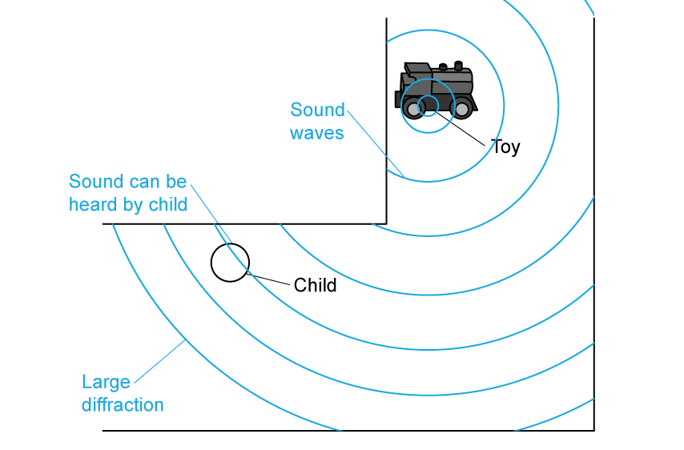

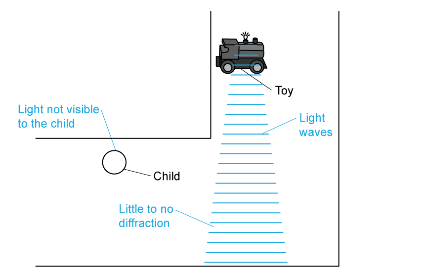

### Q5
The definition of diffraction is:

- The spreading out of waves around an obstacle or aperture; **[1 mark]**

**[Total: 1 mark]**

> *Make sure you learn the definitions of key words so that you can define them and use them correctly in extended answer questions. *
The student can hear the sound of the television, but cannot see the picture coming from it because:

- Sound waves emitted from the television** **diffract around the opening of the door; **[1 mark]**
- The** **wavelengths of the sound waves are a similar size to the door opening; **[1 mark]**
- The wavelength of light is much** **smaller than that of the sound waves / door opening; **[1 mark]**
- So light is not diffracted** **around the opening of the door; **[1 mark]**

**[Total: 4 marks]**

> *Diffraction is greatest when the aperture size is similar to the the wavelength **λ** of the wave. The wavelength of a speaking voice is roughly the same size as a door opening, so the soundwaves of people talking diffract greatly around door sized apertures. Light waves have a much much shorter wavelength so light does not diffract around a door sized aperture. *

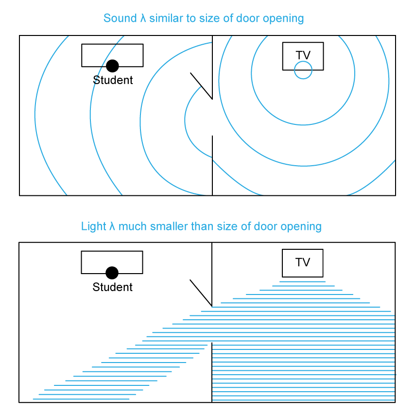
