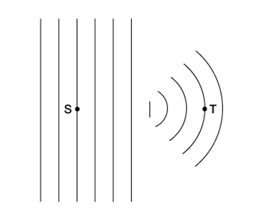
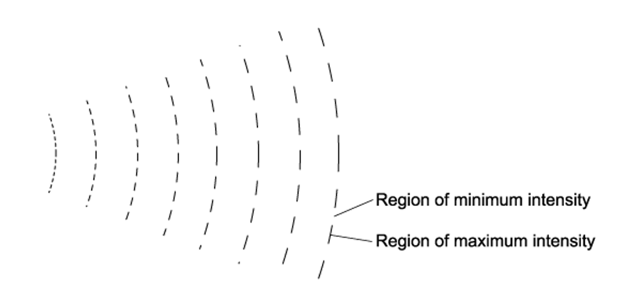
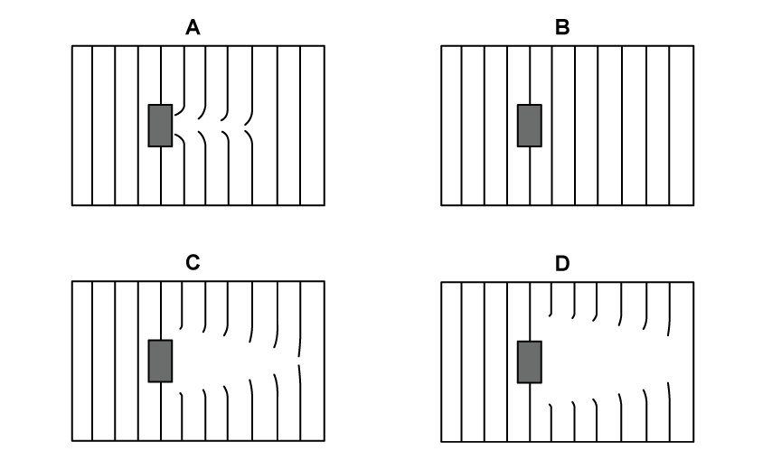
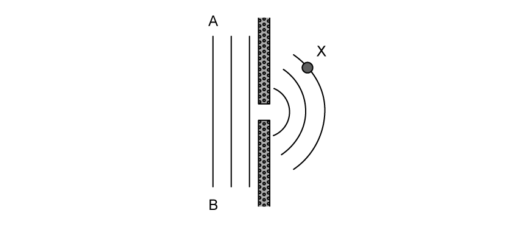
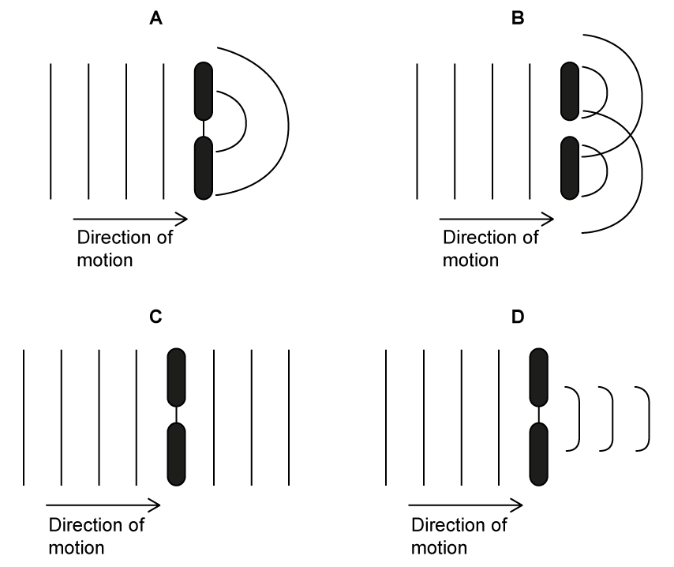
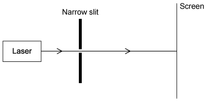
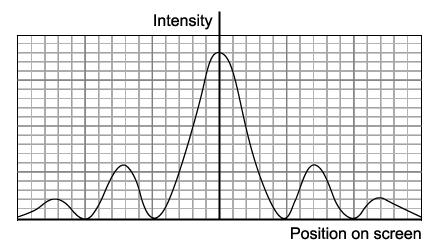
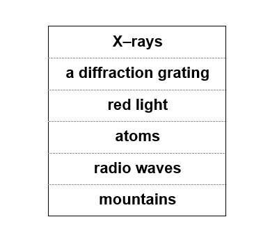
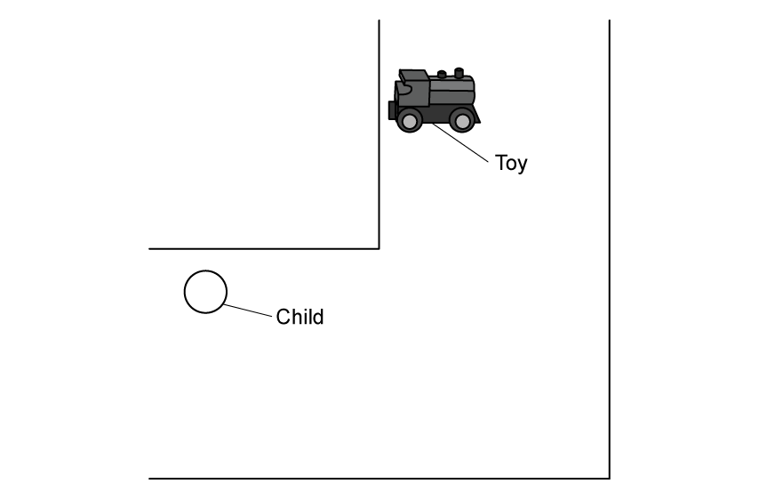

# Exam Questions — Diffraction
**8. Superposition** · Cambridge (CIE) A-LEVEL physics (9702)
> Source: [https://www.savemyexams.com/a-level/physics/cie/25/topic-questions/](https://www.savemyexams.com/a-level/physics/cie/25/topic-questions/) · 20 questions across 2 sets

## Multiple Choice Questions (15 questions)

### Q1 — medium — 1 marks

**Q1** [1 mark]

A slit of width 0.2 m has sound waves incident upon it. The speed of sound is 340 ms-1.

What does the frequency of the sound wave need to be for the greatest diffraction to occur?

### Q2 — easy — 1 marks

**Q2** [1 mark]

Wavefront diagrams can be used to indicate the frequency of waves. The following waves travel at the same constant speed.

Which wave has the lowest frequency?

### Q3 — hard — 1 marks

**Q3** [1 mark]

Sound diffracts around a loudspeaker aperture of diameter 15 cm.

The speed of sound is 340 m s−1, and the frequency of the sound is 3 kHz.

What effect would be observed?

### Q4 — medium — 1 marks

**Q4** [1 mark]

A ripple tank was used to demonstrate plain wavefronts passed through a gap, as shown in the diagram.

Which property would be different at S compared to T?

### Q5 — medium — 1 marks

**Q5** [1 mark]

The diagram shows the pattern of waves. The source of the waves was unable to be seen.

Which of the following would cause this pattern?

### Q6 — easy — 1 marks

**Q6** [1 mark]

For which types of wave does diffraction occur?

### Q7 — medium — 1 marks

**Q7** [1 mark]

An atomic lattice has a spacing of around 10-10 m, which electromagnetic wave would cause the most significant diffraction effect?

### Q8 — easy — 1 marks

**Q8** [1 mark]

Which answer option gives a correct description of wave diffraction?

### Q9 — hard — 1 marks

**Q9** [1 mark]

A block is placed in a ripple tank as shown in the diagram.

Which answer option shows the effect on the wavefront pattern observed?

### Q10 — hard — 1 marks

**Q10** [1 mark]

The diagram shows wavefronts in a ripple tank diffracting through an aperture. The waves have a speed, *c*, and a wavelength, *λ*.

Which of the following expressions gives the time taken for the wavefront AB to reach point X?

### Q11 — easy — 1 marks

**Q11** [1 mark]

Which of the following is the definition of diffraction?

### Q12 — hard — 1 marks

**Q12** [1 mark]

A 5 cm cube casts a shadow when a torch is shone from behind it. When a speaker is placed behind it emitting sound of a frequency 4000 Hz, the sound can still be detected behind the cube.

Which of the following statements explain this observation?

### Q13 — hard — 1 marks

**Q13** [1 mark]

Where wavelength is given as *λ*, and *w* is the width of the aperture, which of the following answer options would result in the greatest diffraction?

### Q14 — medium — 1 marks

**Q14** [1 mark]

When a wave passes an obstruction diffraction can be observed, this effect is greatest when the wavelength and obstruction are similar in size.

When waves are travelling through the air, which of the following would best demonstrate diffraction?

### Q15 — easy — 1 marks

**Q15** [1 mark]

The diagram shows a wave approaching an aperture.

Which diagram correctly shows the resulting diffraction pattern for the wave?

## Structured Questions (5 questions)

### Q1 — medium — 9 marks

**Q1** [2 marks]

White light is passed through a single narrow slit and illuminates a screen.

Describe the pattern observed on the screen.

**Q1** [2 marks]

Blue light from a laser is now passed through a single narrow slit, as shown in Fig 1.1. A pattern of bright and dark regions can be observed on the screen which is placed several metres beyond the slit.

**Fig. 1.1**

Describe the effect on the diffraction pattern if the width of the narrow slit is decreased.

**Q1** [2 marks]

**Extract:**

Blue light from a laser is now passed through a single narrow slit, as shown in Fig 1.1. A pattern of bright and dark regions can be observed on the screen which is placed several metres beyond the slit.

Describe the effect on the diffraction pattern if the width of the narrow slit is decreased.

With the original slit width, state and explain the effect on the width of the fringes on the diffraction pattern if the blue light is replaced with a red light of the same intensity.

**Q1** [3 marks]

**Extract:**

Blue light from a laser is now passed through a single narrow slit, as shown in Fig 1.1. A pattern of bright and dark regions can be observed on the screen which is placed several metres beyond the slit.

With the original slit width, state and explain the effect on the width of the fringes on the diffraction pattern if the blue light is replaced with a red light of the same intensity. The maxima / fringes become further apart / wider because red light has a longer wavelength.

The intensity graph for the diffracted blue light is shown in Fig 1.2.** **

**Fig. 1.2**

On the axes shown in Fig 1.2, sketch the intensity graph for the laser emitting red light.

### Q2 — easy — 8 marks

**Q2** [2 marks]

Wavefronts of a water wave pass through a gap in a harbour, as shown in Fig 1.1.

**Fig. 1.1**

Annotate Fig 1.1 to show four wavefronts after they have emerged from the gap.

**Q2** [2 marks]

**Extract:**

Wavefronts of a water wave pass through a gap in a harbour, as shown in Fig 1.1.

State **two **changes to Fig. 1.1 that would decrease the amount of diffraction of the water waves.

**Q2** [2 marks]

Fig. 1.2 shows a water wave meeting a barrier.

**Fig 1.2**

Annotate Fig. 1.2 to show the wavefronts after they have passed the barrier.

**Q2** [2 marks]

Fig. 1.3 shows the wavefronts of a water wave moving from left to right in a harbour.

**Fig. 1.3**

Annotate Fig. 1.3 to show the wavefronts as they pass to the right of point A.

### Q3 — medium — 6 marks

**Q3** [2 marks]

A beam of monochromatic light is incident upon two slits. The distance between the slits is *d *as shown in Fig 1.1.

**Fig 1.1**

A series of bright and dark fringes appear on the screen. Explain how a bright fringe is formed.

**Q3** [2 marks]

**Extract:**

A beam of monochromatic light is incident upon two slits. The distance between the slits is d as shown in Fig 1.1. A series of bright and dark fringes appear on the screen.

If the wavelength of the incident light is halved and the distance between the slits is doubled, outline the effect on the separation of the fringes of the interference pattern.

**Q3** [2 marks]

**Extract:**

A beam of monochromatic light is incident upon two slits. The distance between the slits is *d *as shown in Fig 1.1. A series of bright and dark fringes appear on the screen.

One of the slits is covered so it emits no light.

Describe how this changes the pattern's appearance and the intensities observed on the screen.

### Q4 — easy — 10 marks

**Q4** [2 marks]

State what is meant by the *diffraction* of a wave.

**Q4** [2 marks]

State **one** property of a wave that changes when it is diffracted and **one** that remains the same.

**Q4** [2 marks]

Use words from Table 1.1 to complete the following sentence:

................................ passing through  ................................ will produce a large diffraction effect.

**Table 1.1**

**Q4** [4 marks]

Fig. 1.1 shows a child in a hallway looking for a toy which is making a noise and emitting light.

**Fig. 1.1**

The child can hear the sound of the toy, but cannot see the light coming from it.

Complete the following sentences by circling the correct word:

Sound waves emitted by the toy **diffract / refract** around the corner because the **amplitude / wavelength** is** **similar in size to the width of the hallway.

The **amplitude / wavelength** of light is much** larger / smaller** than that of the sound waves, so light is not **diffracted / refracted** around the corner.

### Q5 — medium — 5 marks

**Q5** [1 mark]

Define diffraction.

**Q5** [4 marks]

The diagram shows a student in a room with an open door and a television in the next room.

The student can hear the sound of the television, but cannot see the picture coming from it.

Explain why this is the case.
