# Mark Schemes — Interference
**8. Superposition** · Cambridge (CIE) A-LEVEL physics (9702)

## Multiple Choice Questions (16 questions)

### Q1
**Final answer:** **The correct answer is D **

- The fringe separation equation is given by

$x = \frac{λD}{a}$

- Where:

  - *x* is the fringe separation
  - *a* is the slit separation = 0.80 mm
  - *λ* is the wavelength = 650 nm
  - *D* is the distance = 2.5 m

• Substituting the values:

`x = \frac{\left(650 \times 10^{-9}\right) \left(2.5\right)}{0.80 \times 10^{-3}} = 2.0 \times 10^{-3} \text{ m} = 2.0 \text{ mm}`

- Therefore, the fringe separation on the screen is 2.0 mm

### Q2
**Final answer:** **The correct answer is ****D**** because:**

- When two or more sound waves from different sources are emitted at the same time, they interact with each other

  - This is called interference
- If the compressions and rarefactions of the two waves line up, they constructively interfere, creating a wave with a higher intensity or loudness
- As the student walks from point S to T, the sound will increase in amplitude due to the constructive interference

**A **is incorrect because sound waves are longitudinal waves, and longitudinal waves can't be polarised

**B **is incorrect because reflection of sound waves is an echo and will not increase the amplitude of the sound

**C **is incorrect because diffraction happens when a wave meets an object or slit

### Q3
**Final answer:** **The correct answer is ****D**** because:**

- The known quantities are

  - The distance between the slit and the screen when
- The double-slit equation is

  - $λ=\frac{ax}{D}$
- The distance between the slits *a* and fringes $x$ will remain the same

  - $λ\propto\frac{1}{D}$
- When the wavelength is equal to λ

  - $D\propto\frac{1}{λ}$
- When the wavelength is equal to $\frac{3}{4}λ$

  - $\frac{3}{4}λ\propto\frac{1}{D_{2}}$
  - $D_{2}\propto\frac{4}{3λ}$
- The ratio of *D*2 and *D* is

  - $\frac{D_{2}}{D}=\frac{4}{3λ}\times\frac{λ}{1}=\frac{4}{3}$
  - $D_{2}=\frac{4}{3}D$
- This is option **D**

### Q4
**Final answer:** **The correct answer is ****B**** because:**

- The fringe separation equation is given by

  - $x=\frac{λD}{a}$
- Consider option B:

  - If we decrease the distance *a* between the two slits, this will increase the fringe separation *x*

**A **is incorrect because the width of each slit is not a quantity in the fringe spacing equation

**C **is incorrect because using light of a higher frequency will result in a smaller wavelength *λ*, and hence cause a decrease in fringe spacing *x*

**D** is incorrect because moving the screen closer to the double-slit will decrease the value of *D* and hence the value of fringe spacing *x *will decrease

### Q5
**Final answer:** **The correct answer is ****C**** because:**

- In order to observe interference in light waves, the following conditions must be met:

  - The source must be coherent – they must have the same phase
  - The source must be monochromatic – the light must be of a single wavelength
- Interference occurs when light waves are coherent (they have a constant phase difference and the same frequency)
- If the light waves are not coherent, the experiment will not work

**A **& **B **are incorrect because the LED's are identical, they are monochromatic and have the same wavelength

**D **is incorrect because amplitude is not a condition for interference

### Q6
**Final answer:** **The correct answer is ****C**** because:**

- In order to observe interference in light waves, the following conditions must be met:

  - The source must be coherent – they must have the same phase
  - The source must be monochromatic – the light must be of a single wavelength
- Using blue light of a single wavelength satisfies the second condition

**A **is incorrect because light will only interfere with a light of the same polarisation

**B **is incorrect because light will only interfere if both sources are coherent

**D **is incorrect because the light sources must overlap in order for interference occur

### Q7
**Final answer:** **The correct answer is ****A**** because:**

- The fringe separation equation is given by

  - $x=\frac{λD}{a}$
- Where:

  - *x**1* is the fringe separation = 4.0 mm, which changes to *x**2*
  - *λ**1* is the wavelength = 600 nm, which changes to *λ**2** *= 400 nm
  - *a* is the slit separation, which changes to 2*a*
  - *D* is the distance** **between the double slit and the screen, which does not change
- So, since distance *D* does not change, we should rearrange for *D*:

  - $D=\frac{xa}{λ}$
  - $D=\frac{x_{1}a_{1}}{λ_{1}}=\frac{x_{2}a_{2}}{λ_{1}}$
- Substitute $a_{2}=2a_{1}$ into the equation

  - $\frac{x_{1}a_{1}}{λ_{1}}=\frac{x_{2}2a_{1}}{λ_{2}}$
  - $\frac{x_{1}}{λ_{1}}=\frac{2x_{2}}{λ_{2}}$
- Rearrange for the new fringe spacing *x**2*:

  - `x _ 2 = x _ 1 ( lambda _ 2 / lambda _ 1 ) ( 1 half )`
  - $x_{2}=4.0\times\frac{400}{600}\times\frac{1}{2}=4.0\times\frac{1}{3}$
  - $x_{2}=1.33\mathrm{mm}$
- Therefore, the new fringe spacing is 1.3 mm

You can also solve this question by figuring out the ratio required to move from *x**1* to *x**2*. The wavelength changes by a multiple of $\frac{2}{3}$.

### Q8
**Final answer:** **The correct answer is ****A**** because:**

- The fringe separation equation is given by

  - $x=\frac{λD}{a}$
- Where:

  - *x* is the fringe separation = 4.0 mm
  - *a* is the slit separation = 0.60 mm
  - *λ* is the wavelength = 600 nm
- So, rearranging for distance *D*:

  - $D = \frac{x a}{\\lambda } = \frac{( 4.0 \times 10^{- 3} ) ( 0.60 \times 10^{- 3} )}{600 \times 10^{- 9} } = 4.0 \mathrm{m}$
- Therefore, the distance between the double slit and the screen is 4.0 m

### Q9
**Final answer:** **The correct answer is ****A**** because:**

- The waves are coherent as they have the same frequency and a constant phase difference

Option **B** is incorrect because

- The waves are coherent

Option **C **is incorrect because

- When one wave has a peak, the other wave has a trough

  - Therefore the waves are 180° out of phase

Option **D **is incorrect because

- When added together, the waves would cause destructive interference

  - This is because the waves are 180° out of phase
  - The waves will cancel each other out

### Q10
**Final answer:** **The correct answer is ****A**** because:**

- An interference pattern consists of a series of alternating constructive interference bright spots and destructive interference dark spots

  - An interference pattern will not be observed along a line where only constructive or destructive interference occurs
- The waves are produced at S and T – the phase difference between the waves from S and T is constant along line XY since the waves are coherent and XY is midway from S and T
- Therefore, the path difference along XY is always zero — that means, only constructive interference occurs along this line (for constructive interference, path difference where n = 0, 1, 2, 3 etc.)
- So, there can be no interference pattern along XY

  - Therefore, an interference pattern will only observed along line WZ

### Q11
**Final answer:** **The correct answer is ****C**** because:**

- The fringe separation equation is given by

  - $x=\frac{λD}{a}$
- Where:

  - *x* is the fringe separation
  - *λ* is the wavelength
  - 2*D* is the distance between the slits and the screen
  - 2*a* is the slit separation
- So, the new fringe spacing is equal to:

  - $x = \frac{\\lambda ( 2 D )}{( 2 a )} = \frac{\\lambda D}{a}$
- Therefore, the value of the fringe spacing *x* does not change

### Q12
**Final answer:** **The correct answer is ****A**** because:**

- A minima is found at W since the signal keeps on decreasing until it reaches W, so, at W, the signal has the lowest amplitude

  - Therefore, W is the first minima: this is where destructive interference takes place
- S2W and S1W are the distances between the slits and the screen, hence the path difference is equal to $S_{2}W-S_{1}W$
- The condition for destructive interference is a path difference $\frac{nλ}{2}$
- For the first minima (n = 1):

  - Path difference $=\frac{λ}{2}$
  - $S_{2}W-S_{1}W=\frac{λ}{2}$
- So, the distance $\frac{λ}{2}$ is equal to the path difference between S2W and S1W which is $S_{2}W-S_{1}W$

**B **is incorrect because this would be at the first maxima, where path difference = $nλ$

**C & D **are incorrect because

- Fringe separation is equal to $x=\frac{λD}{a}$
- The distance between the central maxima (Y) and the first minima (at W) is half the fringe separation $YW=\frac{x}{2}$
- YW is half the fringe spacing measured on the screen and is unrelated to the path difference$\frac{λ}{2}$  between the slits

### Q13
**Final answer:** **The correct answer is ****B**** because:**

- Minimas occur when there is destructive interference
- Destructive interference happens when the path difference is a whole number of wavelengths plus half a wavelength

  - Path difference = $( n + 1 \frac{1}{2} ) \\lambda$
  - Path difference = $( 1 + 1 \frac{1}{2} ) \\lambda = \frac{3}{2} \\lambda$
- This is option **B**

Option **A** is incorrect because

- A path difference of zero is the central maxima on the screen

Option **C** and **D **is incorrect because

- Maximas occur when there is constructive interference
- Constructive interference happens when the path difference is a whole number of wavelengths

  - Path difference = $nλ$
- $3λ$ and $5λ$ are both whole number of wavelengths

  - Maximas will occur at these path differences

### Q14
**Final answer:** **The correct answer is ****A**** because:**

- The fringe separation equation is given by

  - $x=\frac{λD}{a}$
- Where:

  - *x* is the fringe separation = 3.0 mm
  - *a* is the slit separation = 0.90 mm
  - *D* is the distance** **between the double slit and the screen = 5.0 m
  - *λ* is the wavelength of the light
- Rearranging for wavelength *λ*

  - $λ=\frac{xa}{D}$
  - $\\lambda = \frac{( 3.0 \times 10^{- 3} ) ( 0.90 \times 10^{- 3} )}{5.0} = 5.4 \times 10^{- 7 } \mathrm{m}$
- Therefore, the wavelength of the light is equal to 540 nm

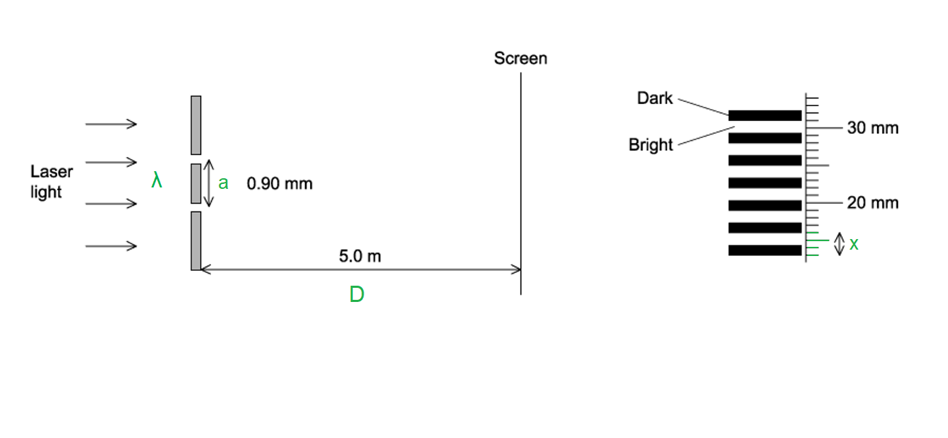

Remember that fringe separation is measured between adjacent maxima, not the entire width shown in the diagram.

### Q15
**Final answer:** **The correct answer is ****C**** because:**

- In the diagram below you can see that screen A is closer than screen B

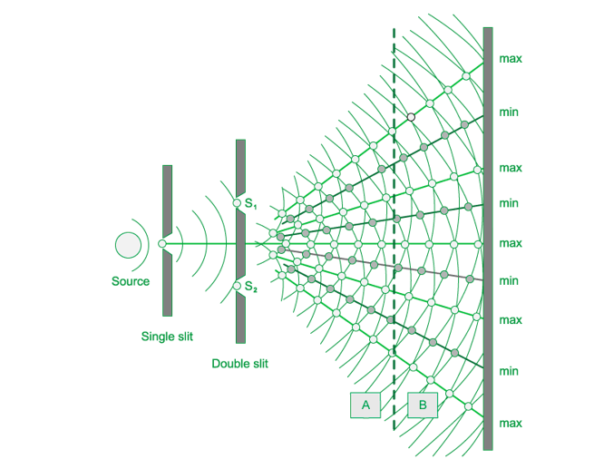

- Fringe separation $\Deltax=\frac{λD}{a}$ where *a* is the slit separation, *λ* is the wavelength of light and *D* the distance from the slits to the screen

**A **is incorrect because increasing the frequency decreases wavelength, and since $x\proptoλ$, fringe spacing becomes smaller

**B **is incorrect because changing the distance between the source and the slits does not affect fringe spacing; it only affects brightness

**D **is incorrect because increasing slit separation decreases fringe spacing because $x=\frac{λD}{a}$

### Q16
**Final answer:** **The correct answer is ****D**** because:**

- The fringe separation equation is given by

  - Fringe separation $=\frac{λx}{w}$
- Consider option D:

  - Decreasing the distance *w*, or slit separation, causes the fringe separation to increase

**A **is incorrect because decreasing the wavelength *λ* of the light will cause the fringe separation to decrease

**B **is incorrect because decreasing the distance *y* between the slits and the screen will cause the fringe separation to decrease

**C **is incorrect because the distance *x* is not a quantity in the fringe spacing equation

Don't let the notation used in this question confuse you. It different to that used in your course specification and the revision notes.

## Structured Questions (8 questions)

### Q1
Calculate the distance between the two slits:

List the known quantities:

- Wavelength,* λ* = 650 nm = 650 × 10−9 m
- Angle of diffraction,* θ* = 5.00 × 10−4 rad

Write an expression for *θ* using the small-angle approximation:

- From Fig. 1.1:  $\mathrm{tan}θ=\frac{s}{D}$
- At small angles, $\mathrm{tan}θ\approxθ$
- Therefore, $\mathrm{tan}θ=\frac{s}{D}\Rightarrowθ=\frac{s}{D}$ **[1 mark]**

Combine the equation for Young's Double sit with the small-angle approximation:

- Fringe spacing:  $s=\frac{λD}{d}$
- From the small-angle approximation: *s* = *θD*
- So,* *$θD=\frac{λD}{d}\Rightarrowθ=\frac{λ}{d}$* ***[1 mark]**

Rearrange and substitute the values into the combined equation:

- $θ=\frac{λ}{d}\Rightarrowd=\frac{λ}{θ}$
- Distance between the two slits, *d *= $\frac{650\times10^{-9}}{5\times10^{-4}}$ = 1.3 × 10−3 m** ****[1 mark]**

**[Total: 3 marks]**
(i) A bright fringe will occur at A due to:

- Constructive interference; **[1 mark]**

The conditions for constructive interference are:

- Light (coming from S1 and S2) must be coherent **AND**
- The path difference (between S1A and S2A) must be a whole number of wavelengths;** [1 mark]**

(ii) State the equation for the distance S2Y:

- S2Y = *nλ* (where n is an integer); **[1 mark]**

**[Total: 3 marks]**

> *Remember constructive interference occurs when waves meet in phase. The phase difference between them is a whole number of wavelengths, so the same place on each wave will meet.*
(i) Determine an expression for *θ* in terms of S2Y and *d:*

Consider the trigonometry of the triangle S1S2Y:

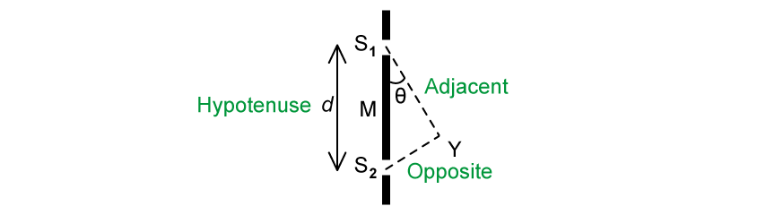

- Sin*θ *= $\frac{opposite}{hypotenuse}=\frac{S_{2}Y}{d}$ **[1 mark]**

Use the small-angle approximation for sinθ ≈ θ:

- *θ *= $\frac{S_{2}Y}{d}$ **[1 mark]**

(ii) Determine an expression for *ϕ* in terms of D and fn:

Consider the trigonometry of the triangle MOA:

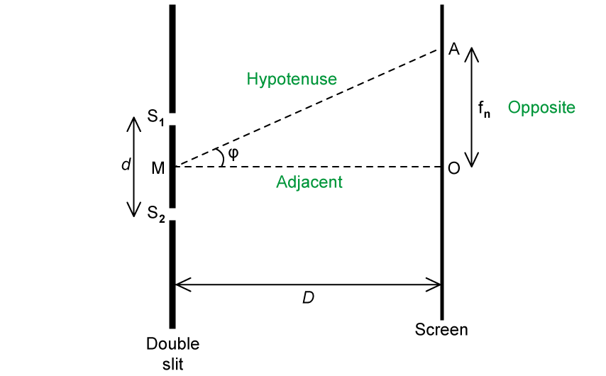

- tan*ϕ *= $\frac{opposite}{adjacent}=\frac{f_{n}}{D}$ **[1 mark]**

Use small angle approximation for tan*ϕ* ≈ *ϕ*:

- *ϕ *= $\frac{f_{n}}{D}$ **[1 mark]**

**[Total: 4 marks]**
Calculate the wavelength of the laser light:

- S2Y = *nλ* (from **(b)**)
- $θ=\frac{S_{2}Y}{d}$(from **(c)**)

Combine the equations for path difference and angle of diffraction:

- *dθ* = S2Y = *nλ*
- So, $λ=\frac{dθ}{n}$ **[1 mark]**

Substitute in the known values to calculate the wavelength:

- $λ=\frac{dθ}{n}=\frac{(1.3\times10^{-3})\times(3.7\times10^{-3})}{9}$ = 5.34 × 10−7 m **[1 mark]**

**[Total: 2 marks]**

### Q2
Deduce whether the detected signal at P is a maximum or minimum:

- Path difference BP – AP = 1.19 – 0.93 = 0.26 m **[1 mark]**
- Number of wavelengths: * *$n=\frac{pathdifference}{wavelength}=\frac{0.26}{40\times10^{-3}}$ = 6.5 **[1 mark]**

Explain the magnitude of the signal at** **P in terms of the phase difference:

- Constructive interference occurs when path difference = $nλ$
- Destructive interference occurs when path difference = $( n + 1 \frac{1}{2} ) \\lambda$

- Since path difference = 6.5λ, microwaves arrive at** **P with a phase difference of 180° (π rad) and interfere destructively
- Therefore, the magnitude of the signal at P is a <u>minimum</u>; **[1 mark]**

**[Total: 3 marks]**

> *Path difference, in terms of the number of wavelengths, is super popular among examiners – because it links so well with phase difference. And let’s face it: ‘path difference’ and ‘phase difference’ sound very similar – so lots of students are likely to mix them up! *

> *You should practice looking out for the length of a path or ray of light in questions to do with interference – if more than one length is given, you’ll likely need the path difference between them. Then you should always think about that path difference in terms of a multiple of wavelengths. *

> *A subtle point to bear in mind is that this question specifies whether the two sources A and B are coherent and in phase with each other. This means any phase difference is only due to a path difference – i.e., a difference in the distance travelled by each source of waves.*
Calculate the ratio of the intensity at P to the intensity at O:

List the known quantities:

- Amplitude of waves from source A =* A*
- Amplitude of waves from source B = 2*A*

Determine the amplitude at O:

- The path difference between AO and BO is zero
- Therefore, the amplitude at O is a maximum; **[1 mark]**

Write an expression for the ratio of the intensity at P to the intensity at O in terms of amplitude:

- Intensity:  $I\proptoA^{2}$
- Hence, the ratio:  $\frac{i n t e n s i t y a t P}{i n t e n s i t y a t O} = ( \frac{a m p l i t u d e a t P}{a m p l i t u d e a t O} )^{2}$
- The resultant amplitude at P is a minimum = 2*A – A*
- The resultant amplitude at O is a maximum = 2*A *+ *A*
- Therefore, $( \frac{a m p l i t u d e a t P}{a m p l i t u d e a t O} )^{2} = ( \frac{2 A - A}{2 A + A} )^{2}$ **[1 mark]**

Simplify the expression to determine the ratio:

- $\frac{i n t e n s i t y a t P}{i n t e n s i t y a t O} = ( \frac{2 A - A}{2 A + A} )^{2}$= $( \frac{A}{3 A} )^{2}$ = $( 1 \frac{1}{3} )^{2}$= $\frac{1}{9}$
- $\frac{intensityatP}{intensityatO}$ = 0.11 **[1 mark]**

**[Total: 3 marks]**

> *To see why the resultant amplitude at O is given by 2**A** + **A**, remember that this question specifies the centre axis is a bisector to the line joining A and B: in other words, AO and BO are the same length. This means the path difference is 0 m, and therefore waves from A arrive in phase with waves from B; point O has a maximum (resultant) amplitude.*

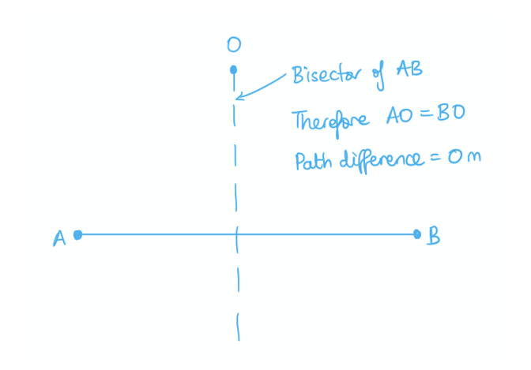

> *Since** **O is a position of maximum resultant amplitude, by the principle of superposition, this is the result of the sum of the two amplitudes which meet: in this case, 2**A** + **A**. *

> *Similarly, the resultant amplitude is minimised at P by 2**A** – **A**.*
As the detector moves from P to O:

- The intensity varies as a series of maxima and minima (due to interference of waves emitted from A and B)

- When the path difference = $nλ$, the waves arrive in phase (constructive interference)
- When the path difference = $( n + 1 \frac{1}{2} ) \\lambda$, the waves arrive in antiphase (destructive interference)

Calculate the number of maxima and minima between P and O:

- Path difference from P to O = 6.5λ (from part a)
- At P, the intensity is a minimum
- At O, the intensity is a maximum
- Maxima occur at *n* = 0, 1, 2, 3, 4, 5, 6
- Minima occur at *n* = 0.5, 1.5, 2.5, 3.5, 4.5, 5.5, 6.5
- Therefore, number of maxima = 7 **AND** number of minima = 7; **[1 mark]**
- Total maxima and minima = 14 **[1 mark]**

**[Total: 2 marks]**
The type of interference occurring at point P is now:

- Constructive interference; **[1 mark]**

Explain the type of interference in terms of phase:

- Waves arriving at P were originally out of phase / originally undergoing destructive interference
- 180° phase change to B means the waves will now be in phase; **[1 mark]**

**[Total: 2 marks]**

### Q3
(i) The appearance of the dark fringes is because:

- Dark fringes are brighter than before; **[1 mark]**
- So, the resultant amplitude is no longer zero; **[1 mark]**
- Complete destructive interference from light sources of different intensities do not cancel each other out; **[1 mark]**

(ii) The appearance of the bright fringes is because:

- Bright fringes are darker than before; **[1 mark]**
- The resultant amplitude is less; **[1 mark]**
- Due to the reduction in the intensity of the light causing the interference; **[1 mark]**

**[Total: 6 marks]**

> *To achieve full marks full descriptions of both situations with reasons must be given. There must be a reference in each reason to the resultant amplitude.*
Calculate the distance between the central and first maximum as seen on the screen:

List the known quantities:

- Wavelength of light, *λ *= 600 nm = 600 × 10−9 m
- Slit separation, *d *= 0.350 mm = 0.35 × 10−3 m
- Distance from slit to screen, *D *= 6.35 m

Substitute the known values into Young's Double Slit equation:

- Fringe separation, *s *= $\frac{λD}{d}$
- *s* = $\frac{(600\times10^{-9})\times6.35}{(0.35\times10^{-3})}$ = 0.0109 m **[1 mark]**

Explain your answer:

- The fringe separation is the distance between successive bright fringes
- (Hence) the distance between the central and first maximum is equal to the fringe separation;** [1 mark]**

**[Total: 2 marks]**
On the screen, there will be:

- No interference pattern; **[1 mark]**

Because:

- Light from the LED is not <u>coherent;</u> **[1 mark]**
- The phase difference between the light from the two slits will be continuously changing (hence interference cannot occur); **[1 mark]**

**[Total: 3 marks]**

> *Remembering the conditions for constructive and destructive interference in Young's Double Slit experiment is important.*

> *Light must also be coherent (same frequency and constant phase difference) and monochromatic (contains light of just one wavelength).*

### Q4
A sketch that would gain 3 marks is shown below:

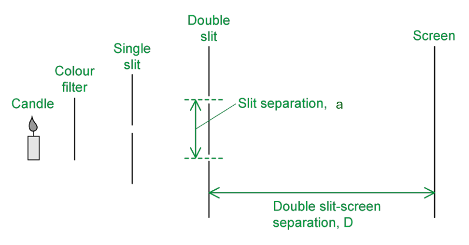

- Apparatus including candle, colour filter, single slit, double slit and screen; **[1 mark]**
- Slit separation *a* labelled as the <u>distance between the centre of the slits;</u> **[1 mark]**
- Distance between the double slit and the screen labelled *D*; **[1 mark]**

**[Total: 3 marks]**

> *You do not need to include the interference fringes in your sketch, as the question asks for the **experimental setup **and **relevant measurements** rather than the results or specifically the interference fringes that would be observed.*
Explain the effects, if any, this will have on the student’s observations:

- There will still be an interference pattern / bright and dark fringes observed (on the screen); **[1 mark]**
- Bright fringes are less bright than before because the total resultant amplitude is smaller; **[1 mark]**
- Dark fringes are no longer completely dark / some light remains because the amplitudes from the two slits are unequal (so they do not cancel exactly); **[1 mark]**

**[Total: 3 marks]**

> *Even though overall intensity is reduced, light is still emerging from both slits*
Interpret the information in Fig. 1.1:

- The two quantities in the equation for fringe spacing are the distance between the slits *a* and the distance between the double-slit and the screen *D*
- *a* is much shorter in length than *D*, hence *a <<* D
- Therefore, *a* = 0.75 mm, *D* = 2.0 m

Calculate the fringe spacing using Fig. 1.2:

- The fringe spacing is determined as the distance between the centre of each maxima

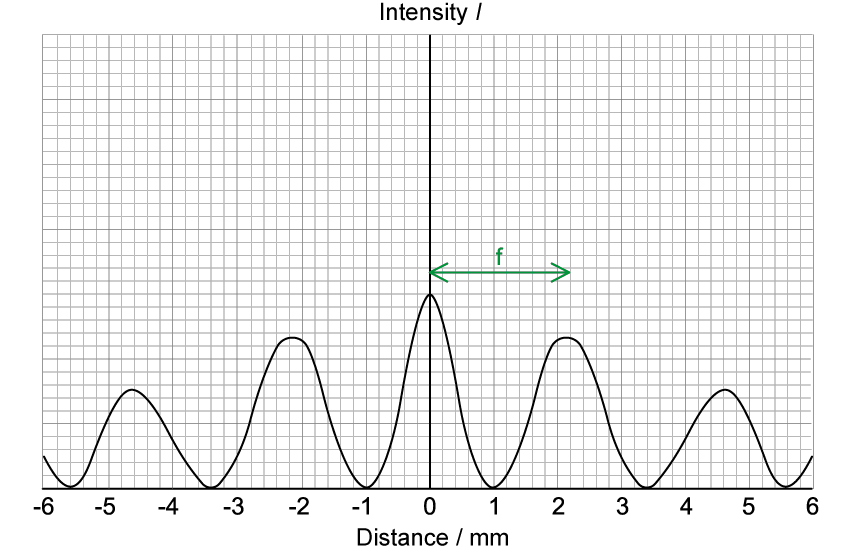

- (From the graph) fringe spacing = 2.2 mm = 2.2 × 10–3 m **[1 mark]**

Calculate the wavelength *λ *of light incident on the screen:

- Fringe spacing: * *$x=\frac{λD}{a}$
- Substitute:  $2.2\times10^{-3}=\frac{2.0\timesλ}{0.75\times10^{-3}}$
- Evaluate:  $\\lambda = \frac{( 2.2 \times 10^{- 3} ) \times ( 0.75 \times 10^{- 3} )}{2.0}$ = 8.3 × 10–7 m **[1 mark]**

Assess the most likely colour corresponding to this wavelength:

- Visible light lies in the range 400 nm – 700 nm
- Since the wavelength of light incident on the screen is about 830 nm, the student most likely used a red/infrared filter; **[1 mark]**

**[Total: 3 marks]**

> *Whenever you have multiple fringes, always measure across as many as possible and divide by the number of fringes to get the most accurate value.*
Use Fig. 1.2 to determine the relative intensity of light at a point 2.8 mm from the centre:

- At 2.8 mm away from the screen, the intensity falls to 50% of the centre of the bright fringe

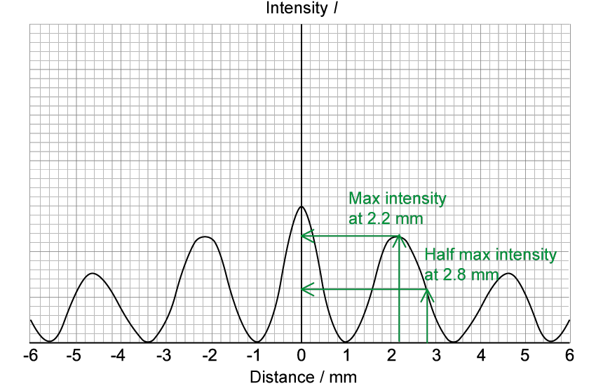

- Lines drawn at 2.2 and 2.8 mm to show 50% drop in intensity; **[1 mark]**

Calculate the phase difference between waves at this point:

- At 2.8 mm, intensity is halfway between maximum and minimum
- Hence, phase difference must be halfway between 0° and 180° / 0 and π rad
- Therefore, phase difference = 90° or $\frac{π}{2}$ rad; **[1 mark]**

**[Total: 2 marks]**

### Q5
Explain how the path difference determines that the light intensity at point P is a maximum:

- When the light intensity at point P is a maximum <u>constructive</u> interference will occur at point P; **[1 mark]**
- The path difference between the waves BP and AP is a whole number of wavelengths / $nλ$ (where *n *is an integer); **[1 mark]**
- The waves from A and B that arrive at P** **are in phase / exactly in phase / 0° phase difference; **[1 mark]**

**[Total: 3 marks]**
Determine path difference:

- Path difference = BP – AP = 1.40 – 1.13 = 0.27 m **[1 mark]**

Recall constructive interference occurs when:

- Path difference = $nλ$ = 0.27

Calculate the number of wavelengths:

- Number of wavelengths = $\frac{\mathrm{path} \mathrm{difference}}{\mathrm{wavelength}}$
- Number of wavelengths =$\frac{0.27}{0.045}$ = 6 **[1 mark]**

Type of interference:

- Constructive interference / maximum occurs at P because the path difference is a whole number of wavelengths;, *n *= 6 **[1 mark]**** **

**[Total: 3 marks]**
Role of the single slit:

- (The single slit makes) the waves from the light source coherent / identical / in phase (before they hit the double slit); **[1 mark]**

Explanation of why coherent light is required:

- Coherent light is needed to observe clear interference fringes **OR**
- The waves (from the double slit) must have a constant phase difference to observe clear interference fringes; **[1 mark]**** **

**[Total: 2 marks]**

### Q6
**One**** mark for each correct line drawn:**

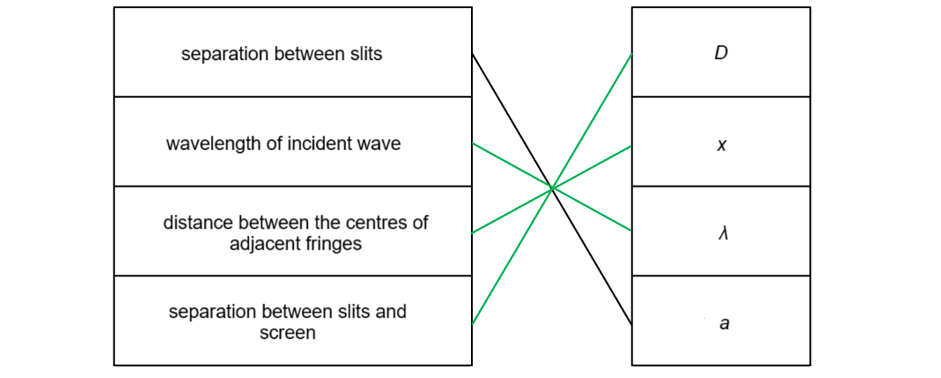

**[Total: 3 marks]**

> *You will **not **be** **given this equation on the formula page, so make sure you learn it and know what each symbol represents. Since the quantities are all distances, the units for each quantity are in metres (m), so the units don't give you an obvious clue!*
If blue laser light were used:

- Blue light has a <u>shorter wavelength</u> than red light; **[1 mark]**
- So the distance between fringes would <u>decrease</u>; **[1 mark]**

**[Total: 2 marks]**

> *If all the other quantities remain the same and only the wavelength **λ **is changed, then the longer the wavelength, the greater the distance between the fringes on the screen. *

> *This is because of the equation:*

$x=\frac{λD}{a}$

> *Which shows that *$x\proptoλ$*, so a decrease in wavelength, **λ** leads to a decrease in the distance between fringes.*
Calculate the separation distance *s* between the fringes on the screen*:*

List the known quantities:

- Wavelength, *λ* = 650 nm = 650 × 10−9 m
- Separation between slits, *a* = 0.2 mm = 0.2 × 10−3 m
- Distance between slits and screen, *D* = 1.2 m

Substitute the known values into the double-slit equation:

- Fringe spacing:  $x=\frac{λD}{a}$
- Substitute:  $x = \frac{( 650 \times 10^{- 9} ) \times 1.2}{0.2 \times 10^{- 3} }$ **[1 mark]**

Calculate the separation of the fringes on the screen:

- $x$ = 3.9 × 10−3 m (3.9 mm) **[1 mark]**

**[Total: 2 marks]**

> *Remember that all these quantities need to be in metres (m). Any that are not given in metres must be converted. *

> *Forgetting to convert units is a common mistake that students often make under the time pressure of the exam. It is best practice to make it a part of your calculation routine to check that the values given are in the correct units before beginning your calculation. *
There is no bright fringe at point P because:

- The waves at point P interfere destructively: **[1 mark]**
- Because the waves meet with a path difference of $( n + 1 \frac{1}{2} ) \\lambda$;** ****[1 mark]**

**[Total: 2 marks]**

> *You may have phrased your answer slightly differently. Take care when you are phrasing the conditions for destructive interference, it is tricky to get the wording right.*

> *Here are some examples of the pitfalls in achieving that second marking point:*

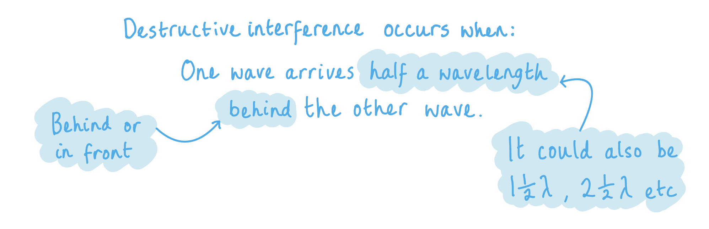

> *The phrasing in this example makes the answer simply untrue, so the examiner would not be able to award the mark.*

> *Here is another example:*

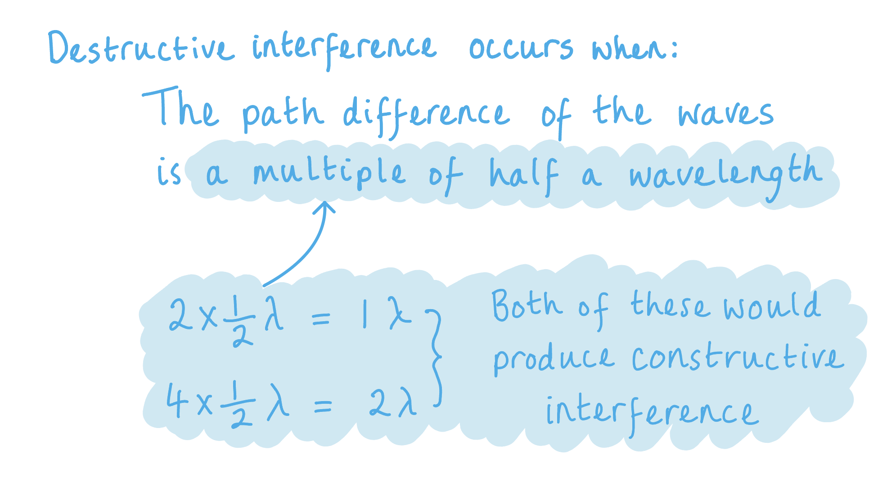

> *Likewise, the phrasing makes the answer incorrect, so the mark cannot be awarded. *

> *It is worth spending some time as part of your revision to learn a correct way to phrase the conditions for destructive interference to save you time and marks in the exam.*

> *Here is an example that would get the mark:*

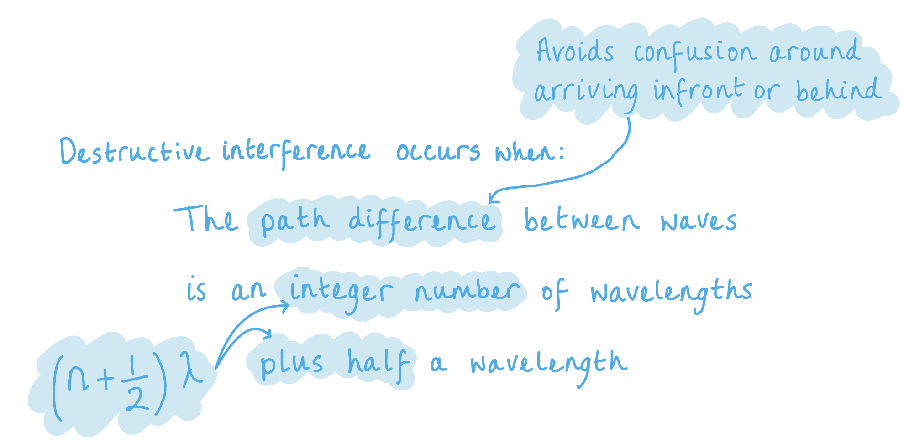

### Q7
A monochromatic source is:

- A source of light of a single frequency / wavelength;** [1 mark]**

**[Total: 1 mark]**

> *Monochromatic waves are a feature of coherent beams. Coherent light is monochromatic and has a constant phase difference.*

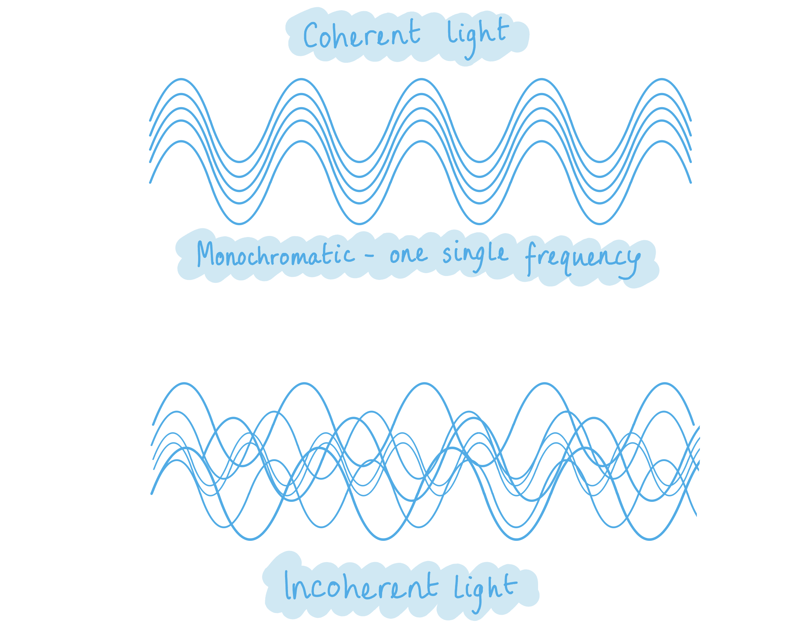
Destructive interference occurs when:

- The path difference (between two waves) is a half number of wavelengths **OR** path difference = $( n + 1 \frac{1}{2} ) \\lambda$* ***[1 mark]**

**[Total: 1 mark]**
(i) Determine the path difference of the waves at point P:

Determine the number of wavelengths between s1 → P:

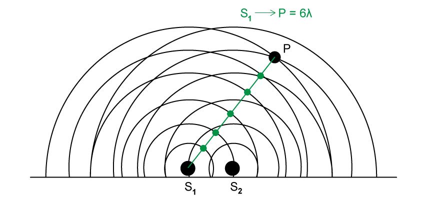

- Number of wavelengths (s1 → P) = 6*λ*** ****[1 mark]**

Determine the number of wavelengths *λ *between s2 → P:

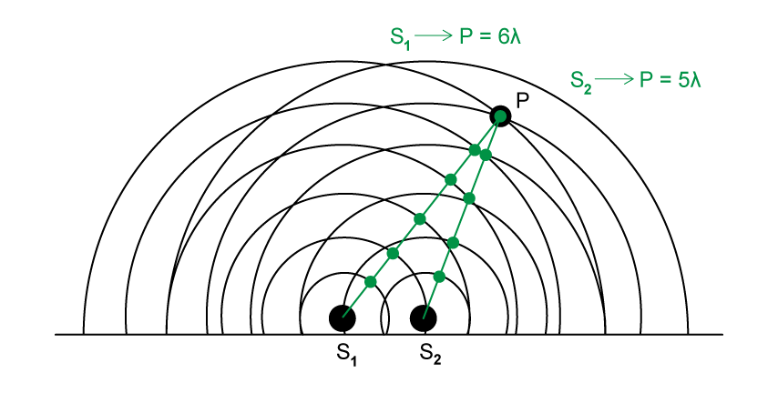

- Number of wavelengths (s2 → P) = 5*λ ***[1 mark]**

Calculate the path difference at point P:

- Path difference = (6 − 5)*λ = λ ***[1 mark]**

(ii) Determine whether constructive or destructive interference occurs at point P:

- Constructive interference occurs when path difference = *nλ *(where n is an integer)
- Therefore, constructive interference will occur; **[1 mark]**

**[Total: 4 marks]**

> *On a wavefront diagram, the distance between wavefronts is equal to one wavelength. So, to find the total number of wavelengths, you simply count the number of wavefronts. Be careful to follow the wavefronts from the correct point source. It is easy to make a mistake when the wavefronts overlap such as in this question.*
(i) At point A:

- The crest of one wave meets the trough of the other wave
- (When a crest and trough meet) <u>destructive</u> interference occurs; **[1 mark]**

(ii) At point B:

- The crest of one wave meets the crest of the other wave
- (When a crest and crest meet) <u>constructive</u> interference occurs; **[1 mark]**

**[Total: 2 marks]**

> *When two waves meet crest and crest (or trough and trough), constructive interference will occur producing a bright fringe on the screen. When two waves meet at the crest of one wave and the trough of the other wave, destructive interference will occur producing a dark fringe on the screen.*

### Q8
Waves are said to be coherent if they:

- Have a constant / zero phase difference **OR**** **are always in phase; **[1 mark]**
- Have the same frequency / wavelength; **[1 mark]**** **

**[Total: 2 marks]**

> *Coherence is vital in order to produce an observable interference pattern. An example of a coherent light source is a laser. Other light sources such as filament lamps and LEDs produce incoherent light waves. *

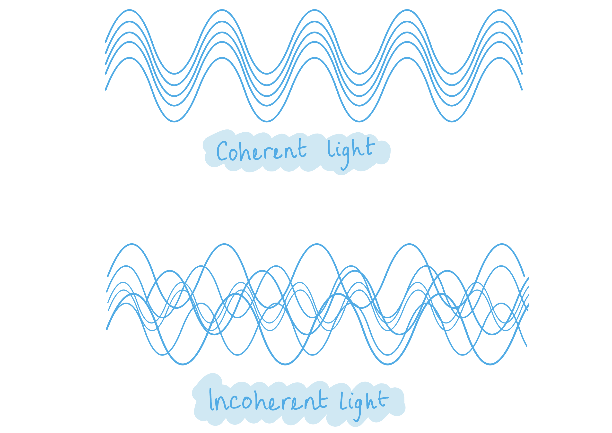
(i) The fringes will be observed if the light sources are:

- Monochromatic; **[1 mark]**
- Coherent; **[1 mark]**

(ii) The bright fringes represent:

- Constructive interference; **[1 mark]**** **

The dark fringes represent:

- Destructive interference; **[1 mark]**** **

**[Total: 4 marks]**** **

> *A common mistake when defining a monochromatic source is saying it is a ‘source with one colour’. Although this is technically true, it is better to define it in terms of frequency or wavelength. Stating ‘one colour’ will not unfortunately achieve a mark.*
The single slit is included in the setup to ensure that:

**Final answer:** **Any ****one**** from:**

- The light is <u>coherent</u> (when it arrives at the double slit); **[1 mark]**
- The light acts as a point / single source; **[1 mark]**
- The light diffracts / spreads out by the same amount (by the time it reaches the double slit); **[1 mark]**
- The path length of the light is constant / the same / fixed (between the slits); **[1 mark]**** **

**[Total: 1 mark]**** **

> *It is a common misconception that the single-slit is not needed in this setup at all, but this is not true! The only time you would **not** need a single slit before a double slit is when using a laser as it is already a **coherent** light source. *

> *To ensure the source is as coherent as possible, the slit should be narrow. This eliminates the different paths the light could take between the light source and the double slits. Therefore, it correlates that the **smaller** the **range** of paths, the more **coherent** the source*
(i) Determine the path difference:

Determine the number of wavelengths in wave s1:

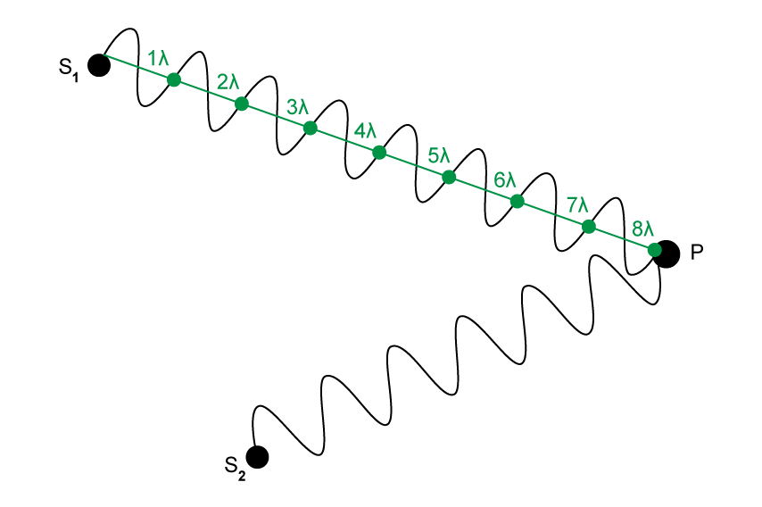

- Number of wavelengths (s1 → P) = 8*λ ***[1 mark]**

Determine the number of wavelengths* *in wave s2:

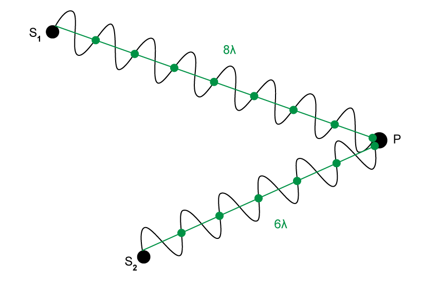

- Number of wavelengths (s2 → P) = 6*λ ***[1 mark]**

Determine the path difference between s1 and s2:

- Path difference is the distance travelled by s1 → P minus the distance travelled by s2 → P
- Path difference at point P = (8 − 6)*λ* = 2*λ ***[1 mark]**

(ii) Determine whether a bright or dark fringe forms:

- Waves that meet with a path difference of *nλ* will interfere constructively
- The path difference between the waves is 2*λ, *so* *constructive interference occurs
- Therefore, a <u>bright</u> fringe will form at point P; **[1 mark]**

**[Total: 4 marks]**

> *If the path difference is an integer number of wavelengths *$nλ$* then **constructive **interference will occur.*

> *If the path difference is a half number of wavelengths *$( n + 1 \frac{1}{2} ) \\lambda$* **then **destructive **interference will occur.*
