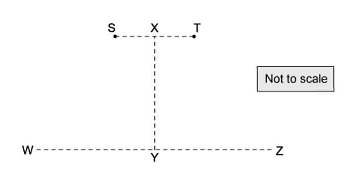
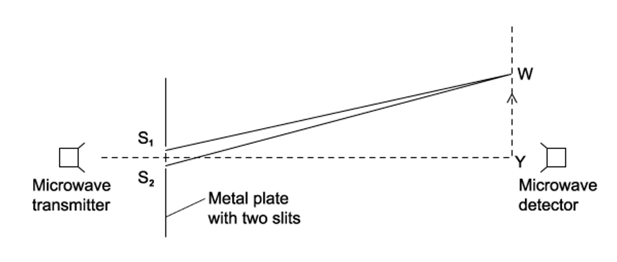
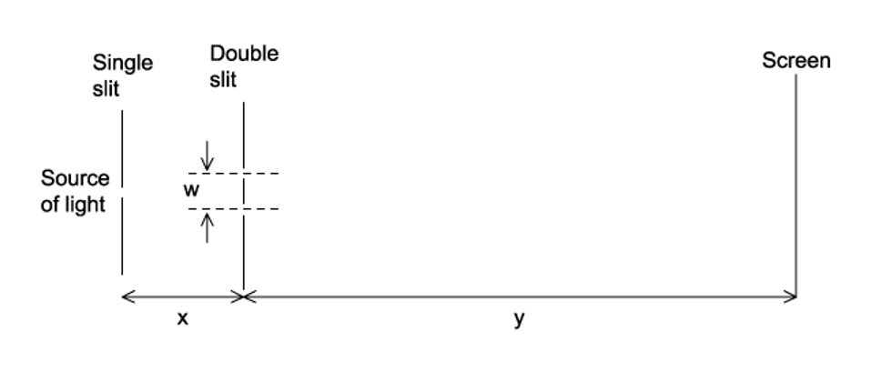

# Exam Questions — Interference
**8. Superposition** · Cambridge (CIE) A-LEVEL physics (9702)
> Source: [https://www.savemyexams.com/a-level/physics/cie/25/topic-questions/](https://www.savemyexams.com/a-level/physics/cie/25/topic-questions/) · 16 questions across 1 sets

## Multiple Choice Questions (16 questions)

### Q1 — medium — 1 marks

**Q1** [1 mark]

Red light with a wavelength of 650 nm is used in a Young's double-slit experiment. The distance between the double slit and the screen is 2.5 m and the separation of the slits is 0.80 mm.

What would be the fringe separation on the screen?

### Q2 — easy — 1 marks

**Q2** [1 mark]

Two loudspeakers are connected to a signal generator, as shown in the diagram.

As the student walks between S to T she notices that the loudness of the sound increases then decreases repeatedly.

Why does the loudness change?

### Q3 — hard — 1 marks

**Q3** [1 mark]

A beam of monochromatic light with wavelength *λ* is shone through a double slit at distance *D* away from a screen. An interference pattern is produced where the distance between the fringes is $x$.

What would the distance between the double slit and the screen need to be for the fringe distance to remain $x$ when a light beam of wavelength $\frac{3}{4}λ$ is used instead?

### Q4 — medium — 1 marks

**Q4** [1 mark]

The effect of a double slit on monochromatic light is observed by set up in the diagram

Interference fringes are seen on the screen.

Which of the following changes would increase the distance between the adjacent fringes?

### Q5 — easy — 1 marks

**Q5** [1 mark]

A student investigates the interference of light using two identical green LEDs.

Which statement would explain why the investigation will not work?

### Q6 — medium — 1 marks

**Q6** [1 mark]

Certain circumstances will produce visible interference fringes from two light sources.

Which of the following conditions will enable visible interference fringes to be seen?

### Q7 — hard — 1 marks

**Q7** [1 mark]

Yellow light with a wavelength of 600 nm is used in an experiment to show interference fringes produced by double-slit interference. The fringe separation is 4.0 mm on the screen.

What would be the fringe spacing if the wavelength is changed to 400 nm and the separation of the slits is doubled?

### Q8 — hard — 1 marks

**Q8** [1 mark]

Yellow light with a wavelength of 600 nm is used in an experiment to show interference fringes produced by double-slit interference. The fringe separation is 4.0 mm and the separation of the slits is 0.60 mm.

What would be the distance between the double slit and the screen?

### Q9 — easy — 1 marks

**Q9** [1 mark]

Fig 1.1 shows two waves

**Fig 1.1**

Which of the following statements is true?

### Q10 — medium — 1 marks

**Q10** [1 mark]

A student is investigating the interference of waves. They set up coherent waves produced at points S and T that travel outwards in all directions.

The line XY is halfway between S and T and perpendicular to the joining line S and T. The distance XY is much greater than the distance ST.

Which line or lines would an interference pattern be seen on?

### Q11 — medium — 1 marks

**Q11** [1 mark]

Monochromatic light produces interference fringes with a separation of *x* on a screen a distance *D* from a pair of slits with separation *a*.

The student doubles *a *and *D*.

What would be the new fringe separation?

### Q12 — hard — 1 marks

**Q12** [1 mark]

An experiment was set up to investigate two-source interference. Microwaves of wavelength *λ* are passed through S1 and S2.

The detector is moved in the direction of the arrow from Y to W. The signal detected is decreased to zero at point W and then starts to increase again as it continues past W.

Which of the following would be the equation to determine the position of point W?

### Q13 — easy — 1 marks

**Q13** [1 mark]

Monochromatic light of wavelength λ is incident upon a double slit and forms an interference pattern on a screen.

What is a possible path difference for a minima that appears on the screen?

### Q14 — hard — 1 marks

**Q14** [1 mark]

A student carried out an experiment on Young's slits using a laser light. There is also a section of the pattern produced with a ruler placed next to it.

What is the wavelength of the light?

### Q15 — easy — 1 marks

**Q15** [1 mark]

Two fringes were created on a screen in a double-slit experiment; the distances were too small to measure.

Which of the following would increase the distance between the fringes?

### Q16 — medium — 1 marks

**Q16** [1 mark]

The equipment was set up as in the diagram to investigate the interference of a double slit.

Which of the following changes would increase the fringe spacing?
