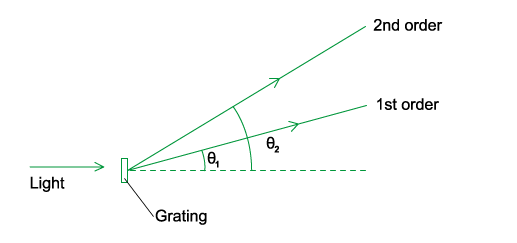
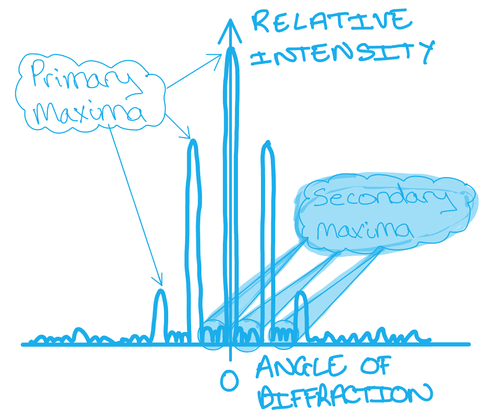
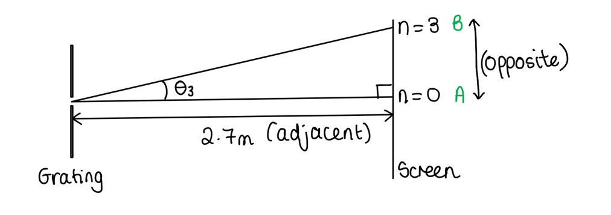
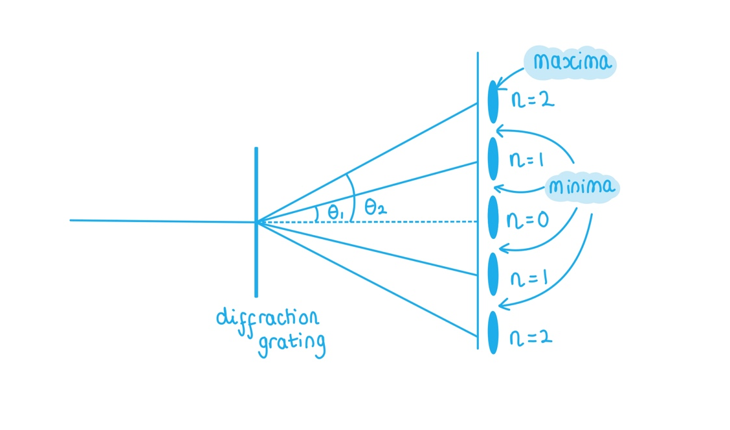
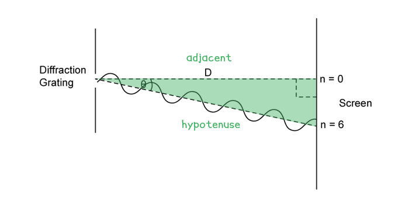
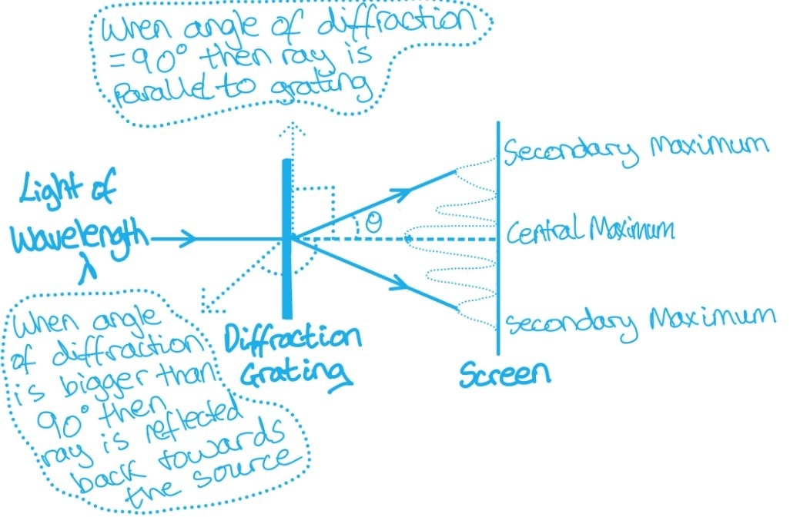
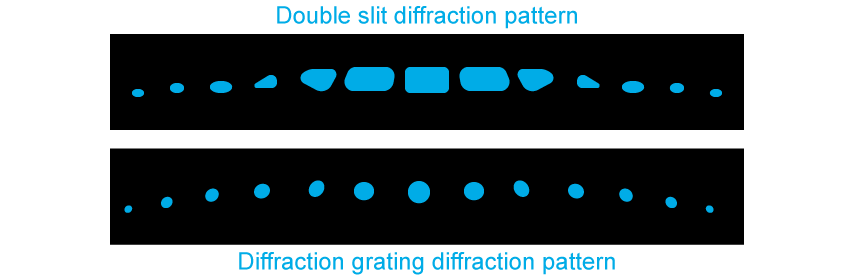
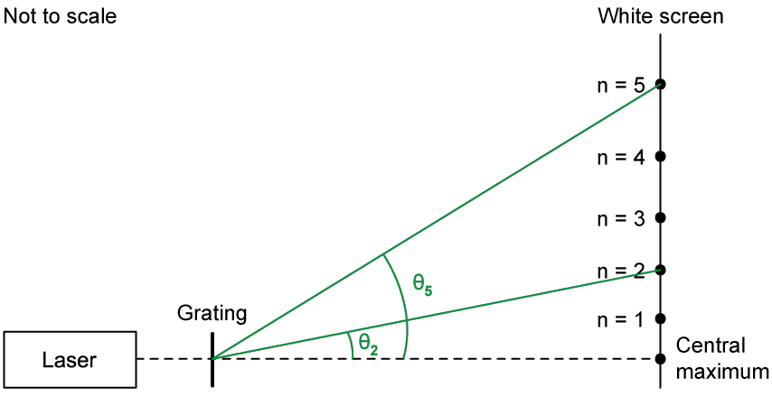

# Mark Schemes — The Diffraction Grating
**8. Superposition** · Cambridge (CIE) A-LEVEL physics (9702)

## Multiple Choice Questions (16 questions)

### Q1
**Final answer:** **The correct answer is B**

- The diffraction grating equation is given by

$d\mathrm{sin}θ=nλ$

- When $n = 2$

$\mathrm{sin}θ_{2}=\frac{2λ}{d}$

- The angle between  n = 2 and the normal is

$θ_{2}=32^{\circ}$

$\mathrm{sin}32^{\circ}=0.530$

- When $n = 3$

$\mathrm{sin}θ_{3}=\frac{3λ}{d}$

- $\frac{λ}{d}$ is the same at both the second-order and third-order maxima, so:

$\frac{λ}{d}=\frac{\mathrm{sin}θ_{2}}{2}=\frac{\mathrm{sin}θ_{3}}{3}=\frac{0.530}{2}=0.265$

$\mathrm{sin}θ_{3}=3\times0.265=0.795$

$θ_{3}=\mathrm{sin}^{-1}(0.795)=52.7\approx53^{\circ}$

- Therefore, the angle between the second order and third order maxima is:

$θ_{3}-θ_{2}=53^{\circ}-32^{\circ}=21^{\circ}$

### Q2
**Final answer:** **The correct answer is ****D**** because:**

- The known quantity is

  - The angle between the central and second-order maxima, *θ* = 18°
- The diffraction grating equation is given by

  - $dsinθ=nλ$
- When *n* = 2 for the second-order maxima

  - $d s i n ( 18 ) = 2 \\lambda$
  - $\frac{ \lambda }{d} = \frac{s i n ( 18 ) }{2} = 0.1545$
- $\frac{λ}{d}$ remains constant for all of the maximas
- When *n* = 3 for the third-order maxima

  - $dsinθ=3λ$
  - $sinθ=3\frac{λ}{d}=3\times0.1545$
  - $\\theta = s i n^{- 1} ( 3 \times 0.1545 ) = 27.6^{\circ}$(3 s.f)
- This is the angle between the central and third-order maxima
- The angle between the two third-order maximas is

  - $2\times27.6=55.2^{\circ}$
- This is option **D**

### Q3
**Final answer:** **The correct answer is ****C**** because:**

- The diffraction grating equation is given by

  - *d* sin *θ* = *n*λ
- The maximum angle *θ*  a fringe can be from the central maxima is 90°
- For the maximum value of *n*

  - *d* sin (90) = *n*λ
  - *d *= *n*λ
  - $n=\frac{d}{λ}$
- There are nine maximas on the screen which means there are four maximas either side of the central maxima
- If the value of $\frac{d}{λ}$ is not a whole number, it must be rounded down as there cannot be a fraction of a fringe
- Therefore, $\frac{d}{λ}$is greater or equal to 4 and less than 5

  - 4 ≤ n ≤ 5
  - 4 ≤ $\frac{d}{λ}$*<* 5
- When *n* = 1 for the first-order maxima

  - *d* sin *θ* = λ
  - sin *θ = *$\frac{λ}{d}$
  - *θ = *sin−1$( \frac{ \lambda }{d} )$
- If $\frac{d}{λ}=4$

  - $\frac{λ}{d}=\frac{1}{4}$
  - *θ = *sin−1 $( 1 \frac{1}{4} )$
  - *θ = *14.5*° *(3 s.f)
- If $\frac{d}{λ}=5$

  - $\frac{λ}{d}=\frac{1}{5}$
  - *θ = *sin−1 $( 1 \frac{1}{5} )$
  - *θ = *11.5*° *(3 s.f)
- Therefore the range for the angle between the central and first-order maxima is

  - 11.5° < *θ *≤ 14.5°
- This is option **C**

### Q4
**Final answer:** **The correct answer is ****B**** because:**

- The diffraction grating equation is given by

  - $dsinθ=nλ$
- For *n *= 1

  - $sinβ=\frac{λ}{d}$
  - So, $\beta = s i n^{ - } 1 ( \frac{ \lambda }{d} )$
- From the diagram, $2β=α$
- Therefore, $2 \beta = \alpha = 2 s i n^{ - } 1 ( \frac{ \lambda }{d} )$

### Q5
**Final answer:** **The correct answer is ****A**** because:**

- The diffraction grating equation is given by

  - $dsinθ=nλ$
- Where:

  - *n* = 1, since these are first-order lines
  - *d* is the split spacing = 1.15 × 10–6 m
  - *θ* is the angle between the light and the horizontal =$\frac{60^{^{\circ}}}{2}=30^{\circ}$
- Rearranging for wavelength λ

  - $\\lambda = \frac{d s i n \\theta }{n} = 1.15 \times 10^{- 6} ( s i n 30 ) = 5.75 \times 10^{- 7} \mathrm{m}$
- Therefore, the wavelength of the light is 575 nm

### Q6
**Final answer:** **The correct answer is ****C**** because:**

- The diffraction grating equation is given by

  - $dsinθ=nλ$
- When *n* = 1

  - $sinθ_{1}=\frac{λ}{d}$
  - The angle *θ**1* = 15.4°, so, $sin15.4=0.2656$
- When *n* = 2

  - The angle is *θ**2*
  - $sinθ_{2}=\frac{2λ}{d}$
- $\frac{λ}{d}$ is the same at both the first-order and second-order maxima, so:

  - $\frac{λ}{d}=sinθ_{1}=\frac{1}{2}sinθ_{2}=0.2656$
  - $sinθ_{2}=2\times0.2656=0.5311$
  - $theta_{2} = \text{sin} ^{ - } 1 ( 0.5311 ) = 32.08^{ ^{\circ} }$
- Therefore, the angle between the first order and second order maxima is:

  - $θ_{2}-θ_{1}=32.1^{\circ}-15.4^{\circ}=16.7^{\circ}$

### Q7
**Final answer:** **The correct answer is ****C**** because:**

- The diffraction grating equation is given by

  - $dsinθ=nλ$
- For *n *= 1

  - $dsinθ_{1}=nλ$
  - $sinθ_{1}=\frac{λ}{d}=\frac{600\times10^{-9}}{2.00\times10^{-6}}=0.30$
  - So, $\theta_{1} = s i n^{- 1} ( 0.30 ) = 17.45^{\circ}$
- For *n* = 2

  - $dsinθ_{2}=2λ$
  - $sinθ_{2}=\frac{2λ}{d}=2\times0.30=0.60$
  - So,$\theta_{2} = s i n^{- 1} ( 0.60 ) = 36.87^{\circ}$
- Angular separation is equal to (*θ**2* – *θ**1*), so:

  - $( \theta_{2} - \theta_{1} ) = 36.87^{\circ} - 17.45^{\circ} = 19.42^{\circ}$
- Therefore, the angular separation is equal to 19.4°

### Q8
**Final answer:** **The correct answer is ****C**** because:**

- The diffraction grating equation is given by

  - $dsinθ_{n}=nλ_{n}$
- When the second-order and third-order spectra overlap:

  - $θ_{2}=θ_{3}$
  - $dsinθ_{2}=2λ_{2}=dsinθ_{3}=3λ_{3}$
  - Therefore, $2λ_{2}=3λ_{3}$
- Rearranging for *λ**3*:

  - $λ_{3}=\frac{2}{3}λ_{2}=\frac{2}{3}\times600=400\text{nm}$
- So, a wavelength of 400 nm would appear at the same angle as the 600 nm wavelength

### Q9
**Final answer:** **The correct answer is ****B ****because:**

- Diffraction gratings are made up of hundreds of slits per mm of their width
- The slits must all be:

  - In the same direction (therefore parallel to each other)
  - Have the same width and height (identical to each other)
  - Very close together
- This arrangement makes it possible to observe:

  - The diffraction of monochromatic visible light
  - The diffraction of visible white light into its colours
  - Phenomenons such as spectroscopy

### Q10
**Final answer:** **The correct answer is ****C**** because:**

- When the wavelength of the light is increased, it must diffract through a gap that is much smaller in relation to its length
- This means it “bends” or diffracts more, creating a larger angle of diffraction (*θ*)
- This can also be seen from the diffraction grating equation

  - *d* sin(*θ*) = n*λ*
- sin(*θ*) is directly proportional to *λ*

  - This means that if *λ* increases then so does sin(*θ*)
  - If sin(*θ*) is increasing then so is *θ*

**A** is incorrect as the angle of diffraction increases, so does not remain the same.

**B** is incorrect as the angle of diffraction increases, so does not decrease.

**D** is incorrect as there is enough information to know that the angle of diffraction will increase because of an increase in wavelength (*λ*).

It is important to be confident in how the terms of the diffraction equation (*d* sin(*θ*) = n*λ*) relate to each other. This is the easiest method to answer questions where you are asked how one variable varies with another – always look for the equations linking them both!

### Q11
**Final answer:** **The correct answer is ****C**** because:**

- The diffraction grating equation is

  - $\frac{nλ}{d}$ = sin(*θ*)
- This means that sin(*θ*) is inversely proportional to *d*

  - sin(*θ*) $\propto\frac{1}{d}$
- When the slit separation (*d*) is decreased then sin(*θ*) will increase
- As the angle of diffraction increases, sin(*θ*) also increases

  - This can be seen from the graph of sin(*θ*) between 0 < *θ* < 90°sin(*θ*)
  - Until 90º, as *θ* increases so does sin(*θ*)

**A** is incorrect as the angle of diffraction increases, so does not remain the same.

**B** is incorrect as the angle of diffraction increases, so does not decrease.

**D** is incorrect as there is enough information to know that the angle of diffraction will increase because of a decrease in slit separation (*d*).

> *It is helpful to be able to sketch graphs of sin(**θ**) and know how it’s size changes with different values of **θ**, this is not always the case for the other trigonometric functions! As **θ** increases, so does  sin(**θ**) only for **certain values of **θ**.*

### Q12
**Final answer:** **The correct answer is ****A**** because:**

- The diffraction grating equation is given by

  - $dsinθ=nλ$
- Where:

  - Slit separation $d=\frac{1}{300}=3.33\times10^{-3}\mathrm{mm}=3.33\times10^{-6}m$
  - Wavelength $λ=690\times10^{-9}m$
  - Number of bright fringes on one side of the central maximum = *n*
- The maximum angle *θ* from the central fringe is 90° on each side
- Rearrange the diffraction equation to make *n *the subject:

  - $dsinθ=nλ$
  - $n = \frac{d s i n \\theta }{\\lambda } = \frac{( 3.33 \times 10^{- 6} ) s i n 90^{\circ}}{690 \times 10^{- 9} } = 4.8$
- This means, the 4th bright fringe can be observed but not the 5th bright fringe

  - Since 4.8 < 5
- We will also have 4 bright fringes on the other side and one central fringe

  - Therefore, the total number of fringes = 4 + 1 + 4 = 9

### Q13
**Final answer:** **The correct answer is ****A**** because:**

- The diffraction grating equation is given by

  - $dsinθ=nλ$
- Where:

  - Slit separation $d=\frac{1}{500}=2.0\times10^{-3}\mathrm{mm}=2.0\times10^{-6}m$
  - Wavelength $λ=600\times10^{-9}m$
  - Number of images on one side = *n*
- The maximum angle *θ* from the central fringe is 90° on each side
- Rearranging for *n *:

  - $dsinθ=nλ$
  - $n = \frac{d s i n \\theta }{\\lambda } = \frac{( 2.0 \times 10^{- 6} ) s i n 90^{\circ}}{600 \times 10^{- 9} } = 3.3$
- This means, the 3rd image can be seen but not the 4th image since we cannot have 3.3 images, so, we can have up to 3 images on one side
- We will also have 3 bright fringes on the other side and one central fringe

  - Therefore, the total number of fringes = 3 + 1 + 3 = 7

### Q14
**Final answer:** **The correct answer is ****C**** because:**

- The diffraction grating equation is given by

  - $dsinθ=nλ$
- If the number of lines per metre increases, the slit spacing $d$ becomes smaller

  - The maximum order occurs when $\mathrm{sin}θ=1$
  - $n_{max}=\frac{d}{λ}$
  - Because a greater line density makes $d$ smaller, fewer integer values of $n$ satisfy the condition
  - So the number of observable orders decreases
- The diffraction angle increases

  - For any given order $n$
  - $\mathrm{sin}θ=\frac{nλ}{d}$
  - If$d$ decreases, $\mathrm{sin}θ$ must increase for the same $n$
  - This means the diffraction angle *θ* becomes larger

### Q15
**Final answer:** **The correct answer is ****D ****because:**

- It can be observed by investigating light incident on a diffraction grating with different numbers of slits that:

  - When the number of slits is **greater** than two (*N *> 2) then **secondary** maxima appear
- E.g. when there are 3 slits in the diffraction grating then there is 3–2 = 1 secondary maxima between each primary maxima
- When there are 4 slits in the diffraction grating then there are 4 –2 = 2 secondary maxima between each primary maxima

  - Hence, the relationship between the number of secondary maxima and the number of slits in the diffraction grating is the **number of slits minus two**
- So, option **D **is correct

The diagram illustrates the difference between primary and secondary maxima.  It shows the diffraction pattern for a diffraction grating with **five** slits. The number of secondary maxima visible is N − 2 = 5 − 2 = 3.

### Q16
**Final answer:** **The correct answer is ****C**** because:**

- The diffraction grating equation is given by

  - $dsinθ=nλ$
- Rearrange the equation to obtain the ratio for *n *and sin*θ*

  - $\frac{λ}{d}=\frac{sinθ}{n}$
- When *n* = 3 (third order), *θ* = 45°

  - $\frac{λ}{d}=\frac{sin45}{3}$
  - $\frac{λ}{d}=\frac{\sqrt{2}}{6}$
- For the highest order of diffracted beam, the angle *θ* should be equal to 90˚
- Consider the angle of 90°:

  - $\frac{λ}{d}=\frac{sin90}{n}=\frac{\sqrt{2}}{6}$
- Rearrange to obtain the highest order *n*

  - $\frac{\sqrt{2}}{6}=\frac{1}{n}$
  - $n = \frac{1}{( \frac{ \sqrt{2} }{6} )} = \frac{6}{ \sqrt{2} }$
  - $n=4.2$
- The order should be an integer, so the highest order is *n* = 4

## Structured Questions (8 questions)

### Q1
> **[mark-scheme]**
> When light is incident on the diffraction grating:
> 
> - The light wave(s) pass through / enter the slit(s) **[1 mark]**
> - And spread (into a geometric shadow) **[1 mark]**
To determine the total number ofgaps between orders, formed  on the screen:

- List the known quantities:

  - Wavelength, $λ$ = 630 nm = 630 × 10-9 m
  - Number of lines*, *$N$ = 4.50 × 102 lines mm-1

- Recall the diffraction grating equation:

$d\mathrm{sin}θ=nλ$ **[1 mark]**

- Calculate the separation $d$ of the lines in the grating in metres:

$N=\frac{4.50\times10^{2}}{10^{-3}}=4.50\times10^{5}\mathrm{lines}m^{-1}$

$d=\frac{1}{N}=\frac{1}{4.50\times10^{5}}$

$d=2.22\times10^{-6}m$ **[1 mark]**

- Determine the highest diffraction order $n$ produced on the screen:

The highest possible order is at $θ=90^{\circ}$ **OR** $\mathrm{sin}θ=1$

$d\mathrm{sin}90^{\circ}=nλ$

$n=\frac{d}{λ}$ **[1 mark]**

$n=\frac{2.22\times10^{-6}}{630\times10^{-9}}$

$n=3.52...$

The highest order produced is $n=3$

- Determine the total number of gaps formed on the screen:

Total number of gaps = 2 × 3

Total number of gaps = **6** **[1 mark]**

> **[mark-scheme]**
> 1 mark for stating the diffraction grating equation $d\mathrm{sin}θ=nλ$
> 
> 1 mark for $d=\frac{1}{4.50\times10^{5}}$ **OR** $d=2.22\times10^{-6}m$
> 
> 1 mark for $d\mathrm{sin}90^{\circ}=nλ$ **OR** $d=nλ$ **OR**  $n=\frac{d}{λ}$
> 
> 1 mark for the total number of gaps = $2n$ **AND** given as an integer

> **[exam-tip]**
> Remember to always round your calculated value of $n$ down rather than up. This is because $n$ indicates the total number of visible maxima.
> 
> In a diffraction pattern, there is one gap between each pair of adjacent maxima. In this case, there are three diffraction maxima on either side of the central maximum, and therefore 6 gaps between these as visible on the screen.
> **[mark-scheme]**
> (i) The frequency of the blue light is
> 
> - Greater than (the frequency of the original light) **[1 mark]**
> 
> (ii) The effect of this change on the number of gaps formed is:
> 
> - The number (of gaps formed) is greater **OR** more gaps form (on the screen) **[1 mark]**
> 
> Explanation:
> 
> - The wavelength of blue light is shorter (than 630 nm / wavelength of original light) so the maximum order $( n_{m a x} )$ increases $( n = \frac{d}{ \lambda } )$ and more diffraction orders appear on the screen **[1 mark]**

### Q2
Calculate the number of lines per metre on the grating:

List the known quantities:

- Wavelength, *λ* = 581.9 nm
- Second order angle, *θ* = 35°
- Order, n = 2

Calculate the spacing between slits:

- Grating equation: * *$d\mathrm{sin}θ=nλ\Rightarrowd=\frac{nλ}{\mathrm{sin}θ}$
- Slit separation:  $d = \frac{2 \times ( 581.9 \times 10^{- 9} )}{\sin 35}$ **[1 mark]**
- Slit separation:  $d$* *= 2.029 × 10–6* *m **[1 mark]**

Calculate the number of lines per metre:

- Number of lines per metre:  $N=\frac{1}{d}$**  **
- Number of lines per metre:  $N=\frac{1}{2.029\times10^{-6}}$ = 4.93 × 105 m–1 **[1 mark]**

**[Total: 3 marks]**
Calculate the highest order which is observable:

List the known quantities:

- Slit separation, $d$ = 2.029 × 10−6 m (from (a))
- Wavelength, $λ$ = 581.9 nm = 581.9 × 10−9 m

The highest order would be observed at:

- Diffraction angle:*  θ *= 90° / $\mathrm{sin}$ *θ* = 1 **[1 mark]**
- Grating equation:  $d\mathrm{sin}θ=nλ\Rightarrown=\frac{d\mathrm{sin}90^{\circ}}{λ}=\frac{d}{λ}$
- Highest order: * *$n=\frac{2.029\times10^{-6}}{581.9\times10^{-9}}$ = 3.49 **[1 mark]**
- The highest order is the third / n = 3 **[1 mark]**

**[Total: 3 marks]**

> *Make sure to always **round down** when calculating diffraction orders*
Calculate the angular separation between the n = 2 and n = 3:

List the known quantities:

- Wavelength, *λ* = 581.9 nm = 581.9 × 10−9 m
- Slit separation, *d* = 2.029 × 10−6 m (from (a))
- Second order, n = 2
- Highest order, n = 3
- Second-order angle, $θ_{2}$ = 35°

Calculate the third-order diffraction angle:

- Grating equation:  $d\mathrm{sin}θ=nλ\Rightarrow\mathrm{sin}θ=\frac{nλ}{d}$
- Third-order angle: * *$\sin \theta_{3} = \frac{3 \\lambda }{d} = \frac{3 \times ( 581.9 \times 10^{- 9} )}{2.029 \times 10^{- 6} }$* ***[1 mark]**
- Third-order angle:  $\theta_{3} = \sin ^{- 1} ( \frac{3 \times 581.9 \times 10^{- 9} }{2.029 \times 10^{- 6} } )$ = 59.4° **[1 mark]**

Calculate the angular separation:

- Angular separation:  $\Deltaθ=θ_{3}-θ_{2}$
- Angular separation:  $\Deltaθ$ = 59 – 35 = 24°** [1 mark]**

**[Total: 3 marks]**

> *Don't worry if you got the answers incorrect in parts (a) and (b), whatever answers you obtained, as long as you used them correctly here, you would still gain full marks - this is known as 'e.c.f.' or 'error carried forward' marks*
Calculate the wavelength of the second source:

List the known quantities:

- Diffraction order, n = 2
- Second order angle, $θ_{2}$ = 25.7°
- Slit separation, *d = *2.029 × 10–6* *m (from (a))

Calculate the new wavelength:

- Grating equation: * *$nλ=d\mathrm{sin}θ\Rightarrowλ=\frac{d\mathrm{sin}θ}{n}$
- New wavelength:  $\lambda_{n e w } = \frac{( 2.029 \times 10^{- 6} ) \times \sin 25.7^{\circ}}{2}$* ***[1 mark]**
- New wavelength:  $λ_{new}$ *=* 4.40 × 10–7 m = 440 nm **[1 mark]**** **

**[Total: 2 marks]**

### Q3
(i) Monochromatic is defined as:

- Having only one wavelength; **[1 mark]**

(ii) Coherent is defined as:

- Having the same frequency; **[1 mark]**
- And constant phase difference; **[1 mark]**

**[Total: 3 marks]**
(i) Calculate the number of lines per metre on the grating:

List the known quantities:

- Wavelength, *λ* = 581.9 nm = 581.9 × 10−9 m
- Second order angle, *θ* = 35°
- Order, *n* = 2

Spacing between slits, *d*:

- $nλ=d\mathrm{sin}θ$
- $d = \frac{n \\lambda }{ \sin \\theta } = \frac{2 \times ( 581.9 \times 10^{- 9} )}{\sin 35}$ **[1 mark]**
- $d=2.029\times10^{-6}m$ **[1 mark]**

Calculate the number of lines per metre:

- Number of lines per metre $N=\frac{1}{d}=\frac{1}{2.029\times10^{-6}}$
- $N=4.93\times10^{5}m^{-1}$ **[1 mark]**

(ii) Calculate the highest order which is observable:

- The highest order would be at *θ* = 90° / sin*θ* = 1 **[1 mark]**
- $n=\frac{d}{λ}=\frac{2.029\times10^{-6}}{581.9\times10^{-9}}=3.49$** [1 mark]**
- The highest order is the third / *n* = 3 **[1 mark]**

**[Total: 6 marks]**
Calculate the angular separation between the second and third maxima:

List the known quantities:

- Highest order, *n* = 3
- Second order angle, *θ*2 = 35°
- Wavelength, *λ* = 581.9 nm

Calculate the third-order angle:

- $\sin \theta_{3} = \frac{n \\lambda }{d} = \frac{3 \times ( 581.9 \times 10^{- 9} )}{2.029 \times 10^{- 6} }$* ***[1 mark]**
- $θ_{3}=59.36^{\circ}$ **[1 mark]**

Calculate the angular separation:

- $\Deltaθ=θ_{3}-θ_{2}$
- $\Deltaθ=59--35=24^{\circ}(2s.f.)$** [1 mark]**

**[Total: 3 marks]**
Calculate the wavelength of this second source:

List the known quantities:

- Order, *n* = 2
- Second order angle, θ2 = 25.7°
- Slit separation, *d = 2.*029 × 10–6* *m

Calculate the wavelength:

- $nλ=d\mathrm{sin}θ$
- $\lambda_{n e w} = \frac{d \sin \\theta }{n} = \frac{( 2.029 \times 10^{- 6} ) \times \sin 25.7}{2}$ **[1 mark]**
- $λ_{new}=4.40\times10^{--7}m=440\mathrm{nm}$ **[1 mark]**

**[Total: 2 marks]**

### Q4
Calculate the angle between the second-order maxima:

List the known quantities:

- Number of lines, *N* = 350 lines per mm = 350 × 103 lines per metre
- Wavelength, $λ$ = 672 nm = 672 × 10–9 m

Calculate the spacing between the slits:

- Slit separation:  $d=\frac{1}{N}$
- Slit separation:  $d=\frac{1}{350\times10^{3}}$** **= 2.86 × 10–6 m **[1 mark]**

Calculate the angle between the central and second-order maxima:

- Grating equation:  $d\mathrm{sin}θ=nλ\Rightarrow\mathrm{sin}θ=\frac{nλ}{d}$
- Diffraction angle:  $\sin \\theta = \frac{2 \times ( 672 \times 10^{- 9} )}{2.86 \times 10^{- 6} }$ **[1 mark]**
- Diffraction angle:  $\\theta = \sin ^{- 1} ( \frac{2 \times 672 \times 10^{- 9} }{2.86 \times 10^{- 6} } )$ = 28° **[1 mark]**

Determine the angle between both second-order maxima:

- Angle between <u>both</u> second-order maxima = 2 × 28° = 56° **[1 mark]**** **

**[Total: 4 marks]**

> *The angle we calculated in the second step is from the central maxima to **one** of the second-order maxima, remember, there are maxima on each side of the central maxima, so the final mark is for recognising this and multiplying your angle by 2*
To show that the highest order image shown in this arrangement is n = 4:

- The highest order would be at $θ$= 90° / $\mathrm{sin}θ$ = 1 **[1 mark]**
- $n=\frac{d}{λ}=\frac{2.86\times10^{-6}}{672\times10^{-9}}$ = 4.26 **[1 mark]**
- The highest order is the fourth / n = 4

**OR**

Substitute in *n = 5:*

- $\sin \\theta = \frac{n \\lambda }{d} = \frac{5 \times ( 672 \times 10^{- 9} )}{2.86 \times 10^{- 6} }$ = 1.17 **[1 mark]**
- $\mathrm{sin}θ$ cannot be greater than 1 **[1 mark]**

Final statement:

- Therefore, the fourth order is the maximum order possible / visible **[1 mark]**** **

**[Total: 3 marks]**
To calculate the angle for the third order maximum:

List the known quantities:

- *d *= 5$λ$

Calculate the angle of third order maximum:

- $\sin ( \theta_{3} )$=* *$\frac{3λ}{5λ}$* *=* *$\frac{3}{5}$* ***[1 mark]**
- $θ_{3}$= $\sin ^{- 1} ( \frac{3}{5} )$ = 37° **[1 mark]**

**[Total: 2 marks]**
To calculate the distance between the third diffraction order and the normal to the grating:

List the known quantities:

- Angle to third order maximum, $θ_{3}$= 37° (from part c)
- Distance from grating to screen = 2.7 m

Calculate from centre to third order:

- **AB** = 2.7 × $\mathrm{tan}$ (37) **[1 mark]**
- **AB** = 2.0 m **[1 mark]**

**[Total: 2 marks]**** **

> *Drawing out a diagram here to see which sides are the adjacent, hypotenuse and opposite of the right-angled triangle will make this question to visualise.*

### Q5
(i) *d *represents:

- Spacing between (adjacent) slits **AND**
- (Measured in) metres / m; **[1 mark]**

(ii) *θ* represents:

- Angular separation between (order of) maxima **AND**
- (Measured in) degrees / °; **[1 mark]**

(iii) *n* represents:

- Order of maxima **AND**
- It has no units; **[1 mark]**

(iv)* λ* represents:

- Wavelength (of the light source) **AND**
- (Measured in) metres / m; **[1 mark]**** **

**[Total: 4 marks]**
List the known quantities:

- Lines per m, *N* = 720 × 103

Calculate the distance between adjacent slits, *d*:

- $d=\frac{1}{N}$
- $d=\frac{1}{720\times10^{3}}$ **[1 mark]**
- $d$* *= 1.39 × 10–6 m (1.39 µm) **[1 mark]**** **

**[Total: 2 marks]**
Calculate the value of *θ*:

List the known quantities:

- Distance between adjacent slits, *d* = 1.39 × 10–6 m (from part b)
- Wavelength, *λ* = 635 nm = 635 × 10–9 m
- Order of maxima, *n* = 1

Rearrange the grating equation for *θ*:

- Grating equation:  $d\mathrm{sin}θ=nλ$
- Rearrange:  $\mathrm{sin}θ=\frac{nλ}{d}$
- $\\theta = \sin ^{- 1} ( \frac{n \\lambda }{d} )$ **[1 mark]**

Substitute in values to calculate *θ*:

- $\\theta = \sin ^{- 1} ( \frac{635 \times 10^{- 9} }{1.39 \times 10^{- 6} } )$ **[1 mark]**
- $θ$ = 27.2° **[1 mark]**** **

**[Total: 3 marks]**** **

> *Remember to always have your calculator in **degrees** (and not radians) mode when calculating the angles using this equation!*
The number of minima seen on the screen is:

- 4** [1 mark] **

**[Total: 1 mark]**** **

> *These minima are easier to see from drawing a diagram. The minima are in between all the maxima. Remember that **n** starts from 0 and the subsequent orders are measured from **both **sides of the centre.*

> *Minima occur between two adjacent maxima, therefore an answer of 6 would not be awarded the mark.*

### Q6
List the known quantities:

- Wavelength, $λ$ = 520 nm = 520 × 10-9 m
- *N* = 3.10 × 102 lines per mm = 3.10 × 105 lines per m

Calculate adjacent spacing between slits, *d*:

- *d = *$\frac{1}{N}$* = *$\frac{1}{3.10\times10^{5}}$*  =* 3.23 × 10–6 m **[1 mark]**

Calculate the highest order possible:

- Recall:* d* sin *θ* = *nλ*
- The highest order would be at *θ* = 90° **OR **sin *θ* = 1
- So *d* sin (90) = *nλ* becomes *d *= *nλ*
- *n *= $\frac{d}{λ}$= $\frac{3.23\times10^{-6}}{520\times10^{-9}}$ = 6.21
- The highest order is the sixth (*n *= 6) **[1 mark]**

Total minima:

- Total minima = (2 × 6) = 12 **[1 mark]*** *** **

**[Total: 3 marks]**

> *Remember, for a grating, there is one minimum between each pair of adjacent maxima. With maxima from n = -6 to n = +6 plus the central maximum, there are 13 maxima and therefore 12 minima. There are no additional minima beyond the outermost maxima.*

List the known quantities:

- *d *= 3.23 × 10–6 m (from part a)
- Wavelength,$λ$ = 490 nm = 490 × 10-9 m

Explain where the different wavelengths of light are most distinguishable:

- They are most likely to be distinguishable at the <u>highest</u> order; **[1 mark]**

Calculate the highest order visible:

- The highest order would be at *θ* = 90° **OR** $\mathrm{sin}θ$ = 1
- *n *= $\frac{d}{λ}$= $\frac{3.23\times10^{-6}}{490\times10^{-9}}$ = 6.59 **[1 mark]**
- The highest order is the sixth (*n *= 6)

**[Total: 2 marks]**** **

> *Remember to always round **down **for the value of your highest order since **n** indicates the number of visible maxima. For example, **n** = 4.8 means there will be at most 4 visible maxima (one central maxima, and three maxima either side of this). Note, we cannot round up to 5, because there are not 5 maxima visibly created. *
List the known quantities:

- Wavelength, $λ_{1}$ = 490 nm = 490 × 10­–9 m
- Wavelength, $λ_{2}$= 490.2 nm = 490.2 × 10–9 m
- Slit spacing, *d *= 3.23 × 10–6 m (from part a)
- Highest order visible *n* = 6 (from part b)

Calculate the angle for the highest order visible for the first wavelength, $θ_{1}$:

- *n*$λ$*= d *sin *θ *therefore *θ = *$\sin ^{- 1} ( \frac{n \\lambda }{d} )$
- $θ_{1}$*= *$\sin ^{- 1} ( \frac{6 \times ( 490 \times 10^{- 9} )}{3.23 \times 10^{- 6} } )$* = *65.535º

Calculate the angle of the highest order visible for the second wavelength, $θ_{2}$:

- $θ_{2}$*= *$\sin ^{- 1} ( \frac{6 \times ( 490.2 \times 10^{- 9} )}{3.23 \times 10^{- 6} } )$= 65.587º

Calculate the difference in angles:

- Δ*θ* = $θ_{2}-θ_{1}$ = 65.587º – 65.535º = 0.052º **[1 mark]**

Conclusion

- Since 0.052º > 0.05º the student can observe the two wavelengths as separate distinct images; **[1 mark]**** **

**[Total: 2 marks]**
List the known quantities:

- Wavelength of light, $λ$ = 490 nm = 490 × 10−9 m (from part b)
- Angle of diffraction, *θ *= 65.535° (from part c)

Determine the distance for the hypotenuse, *H* of the triangle from slit to sixth order:

- The number of complete wavelengths between the grating and the screen = 5.25 (from Fig. 1.1)
- Hence, the distance is 5.25$λ$
- *H *= 5.25 × (490 × 10−9) = 2.47 × 10−6 m **[1 mark]**

Use trigonometry to find the length of the adjacent side of the triangle, *D*:

- adj = cos*θ *× hyp
- *D *= cos*θ *× *H*
- *D *= cos(65.535)* *× (2.47 × 10−6)
- *D *= 1.07 × 10−6 m **[1 mark]**

**[Total: 2 marks]**

> *Look at the information on this diagram carefully. You can see that there are five and a quarter wavelengths of light between the slit and the screen, so this can give you the length of the hypotenuse of the triangle.*

> *Make sure you obtain the correct information from the previous parts of this question too.*

> *Drawing the triangle is essential, so you do not make a mistake with your trigonometry. *

### Q7
Consider the path difference in terms of wavelength, *λ* when bright fringes are created:

- Constructive interference between two parallel rays of light from two adjacent slits A and B results in bright fringes of light known as maxima; **[1 mark]**
- AC is the path difference between the two parallel rays of light; **[1 mark]**
- Constructive interference occurs when the path difference between the two rays is a whole number of wavelengths

  - Therefore, AC =* nλ, *where *n *is an integer and corresponds to the order of maxima; **[1 mark]**

Consider the path difference in terms of trigonometry:

- Using trigonometry:

  - $sinθ=\frac{AC}{AB}$
  - So, AC = *d *× sin*θ ***[1 mark]**

Equate the two expressions for path difference, AC:

- Therefore the equation to calculate the angle of diffraction, *θ* of each order of maxima *n *is:

  - *nλ *= *d*sin*θ *as required; **[1 mark]**

**[Total: 5 marks]**
List the known quantities:

- Wavelength of light, *λ *= 499 nm = 499 × 10−9 m

Obtain an expression for the gradient of the graph:

- The gradient of a straight line, $\frac{\Deltay}{\Deltax}$
- Therefore, $\frac{\Delta\mathrm{sin}θ}{\Deltan}=\frac{\mathrm{sin}θ}{n}$ **[1 mark]**

Consider the gradient of the graph in terms of the diffraction grating equation:

- Recall:* nλ *= *d*sin*θ *
- Dividing by *d* and* n* gives, $\frac{λ}{d}=\frac{\mathrm{sin}θ}{n}$ **[1 mark]**

Use the graph to calculate the value of the gradient:

- Δsin*θ *= 0.39
- Δ*n *= 5
- So, gradient = $\frac{0.39}{5}$ = 0.078** [1 mark]**

Consider the gradient in terms of *d*:

- Gradient = $\frac{λ}{d}$ so $d=\frac{λ}{Gradient}$
- $d=\frac{499\times10^{-9}}{0.078}$
- *d *= 6.40 × 10−6 m **[1 mark]**

Convert the slit separation to mm and calculate the mean number of slits per mm, *N*:

- 1000 mm = 1 m
- Therefore, 6.40 × 10−6 × 1000 = 6.40 × 10−3 mm
- Hence, in 1 mm there are $\frac{1}{6.40\times10^{-3}}$ slits
- Therefore, *N *= 156.25 = 156 **[1 mark]**

**[Total: 5 marks]**
List the known quantities:

- Wavelength, *λ* = 499 nm = 499 × 10−9 m (from part (b))
- Grating width = 30 mm = 30 × 10−3 m
- Number of maxima, *n *= 2

Consider the angle of diffraction required to obtain a maximum of 5 bright fringes:

- The maximum angle of diffraction is 90° **[1 mark]**

Rearrange the diffraction grating equation and substitute in the known quantities to calculate the slit separation, *d*:

- Recall: *nλ *= *d*sin*θ *
- $d=\frac{nλ}{\mathrm{sin}θ}$
- $d=\frac{2\times(499\times10^{-9})}{\mathrm{sin}(90)}$
- $d=9.98\times10^{-7}m$ **[1 mark]**

Calculate the number of slits required in the grating 30 mm wide:

- The grating is 30 × 10−3 m wide, so there are $\frac{30\times10^{-3}}{9.98\times10^{-7}}$ slits
- So the number of slits = 30 060 **[1 mark]**

**[Total: 3 marks]**

> *Recognising that the maximum angle of diffraction is 90° and using **n **= 5 at this angle is the key to answering this question correctly. The diagram shows why 90° is the maximum angle of diffraction. *

The diffraction pattern obtained cannot be correct because:

- The bright fringes are too wide; **[1 mark]**
- The dark fringes are too narrow (for a diffraction grating containing 30 060 slits); **[1 mark]**

**[Total: 2 marks]**

> *It can be difficult to identify problems with diffraction patterns, especially isolated patterns but putting it together with another diffraction pattern makes it possible to compare them. *

### Q8
The paths of the second and fifth-order diffraction maxima are as follows:

- Straight line from grating to n = 2 with angle labelled $θ_{2}$ from centre to line; **[1 mark]**
- Straight line from grating to n = 5 with angle labelled $θ_{5}$from centre to line; **[1 mark]**** **

**[Total: 2 marks]**** **

> *Remember to always draw straight lines with a ruler or straight edge and clearly label your diagrams. If the sketches look too messy or vague, the examiner is unlikely to award you full marks. The angles should always be considered from the line connecting the grating to the central maximum (dashed line in Fig 1.1)*
Calculate the number of lines per metre in this grating:

List the known quantities:

- Spacing between adjacent slits, *d* = 2.45 µm = 2.45 × 10–6 m

Calculate number of lines per metre, *N*:

- $N=\frac{1}{d}$
- $N=\frac{1}{2.45\times10^{-6}}$ **[1 mark]**
- $N$* *= 4.08 × 105 lines per metre **[1 mark]**** **

**[Total: 2 marks]**
List the known quantities:

- Spacing between adjacent slits, *d* = 2.45 µm = 2.45 × 10–6 m
- Order of maxima, *n* = 3
- Third-order diffraction angle, *θ* = 36°

Rearrange diffraction grating equation for *λ*:

- Grating equation:  $d\mathrm{sin}θ=nλ$ **[1 mark]**

- Rearrange: * *$λ=\frac{d\mathrm{sin}θ}{n}$

Substitute in the values:

- $\\lambda = \frac{( 2.45 \times 10^{- 6} ) \sin 36^{\circ}}{3}$ **[1 mark]**
- $λ$ = 480 × 10–9 m (480 nm) **[1 mark]**** **

**[Total: 3 marks]**
The order that would produce the brightest image is:

- Zeroth order / *n* = 0 **[1 mark]**** **

**[Total: 1 mark]**
