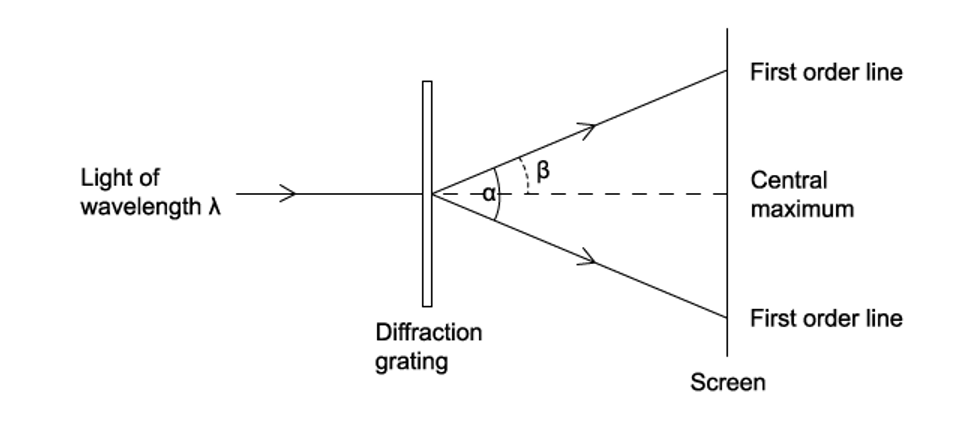
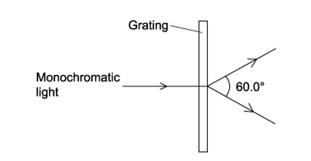
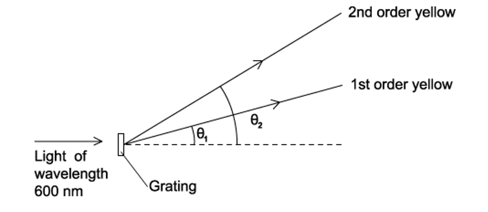
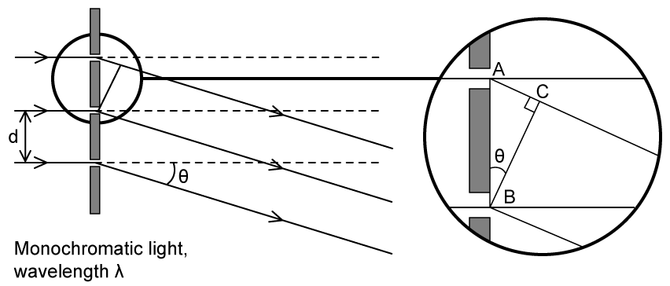
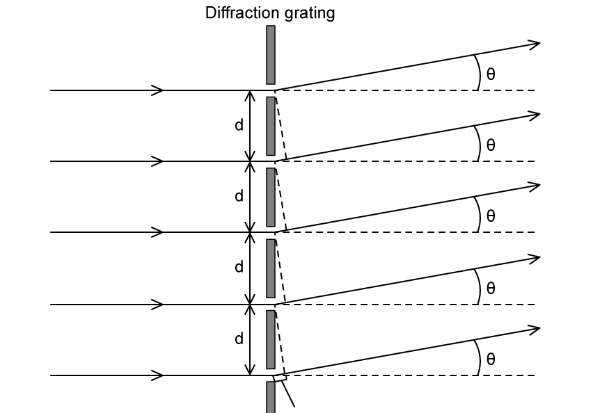
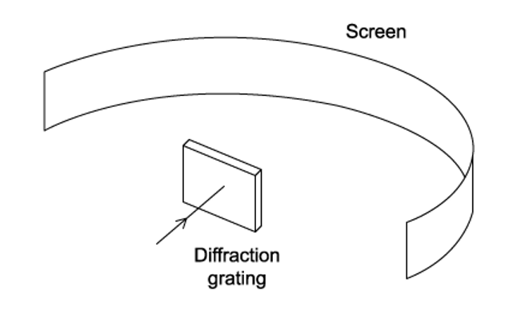
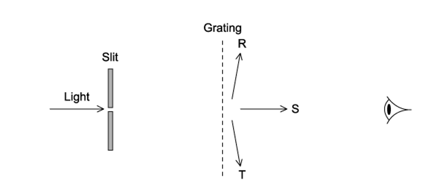
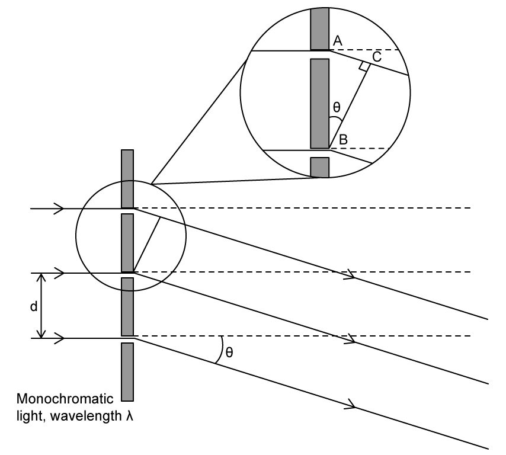
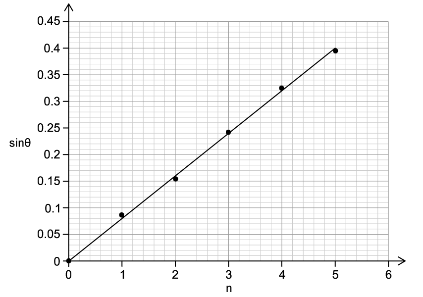

# Exam Questions — The Diffraction Grating
**8. Superposition** · Cambridge (CIE) A-LEVEL physics (9702)
> Source: [https://www.savemyexams.com/a-level/physics/cie/25/topic-questions/](https://www.savemyexams.com/a-level/physics/cie/25/topic-questions/) · 24 questions across 2 sets

## Multiple Choice Questions (16 questions)

### Q1 — hard — 1 marks

**Q1** [1 mark]

A physics student is investigating the properties of a diffraction grating using laser light with a wavelength of $6 . 20 \times 10^{-7}  \text{m}$. The laser beam is directed perpendicularly onto the grating surface.

During the experiment, the student measures the second-order maximum at an angle of $32^{\circ}$ from the normal to the grating.

What is the angle between the second-order and third-order maxima?

### Q2 — hard — 1 marks

**Q2** [1 mark]

Fig. 1.1 shows a monochromatic light beam which is incident normally to a diffraction grating. The angle between the central and second-order maxima is 18°.

**Fig. 1.1**

What is the angle between the two third-order maxima lines?

### Q3 — hard — 1 marks

**Q3** [1 mark]

A monochromatic light beam is incident normally to a diffraction grating and nine maximas are observed on the screen.

What is the range for the angle *θ* between the central and first-order maxima?

### Q4 — hard — 1 marks

**Q4** [1 mark]

An experiment was set up to investigate light passing through a diffraction grating with slit spacing *d*. The fringe pattern was observed on a screen.

Which of the following gives the angle between the two first-order lines?

### Q5 — hard — 1 marks

**Q5** [1 mark]

The wavelength of monochromatic light can be determined using a diffraction grating. This is shown in the diagram.

The angle between the first-order diffraction maxima is 60°, and the spacing of the slits is 1.15 × 10–6 m.

What is the wavelength of the light?

### Q6 — hard — 1 marks

**Q6** [1 mark]

A student carried out an experiment on monochromatic light with a wavelength of 5.30 × 10–7 m. They set up the source so that it was incident normally to the diffraction grating.

The student observed that the first-order maximum was 15.4° to the direction of the incident light.

What would be the angle between the first order and second order maxima?

### Q7 — hard — 1 marks

**Q7** [1 mark]

Yellow light with a wavelength of 600 nm is used in a diffraction grating experiment. The grating has a slit separation of 2.00 μm.

What would be the angular separation between the first order and second order maxima?

### Q8 — hard — 1 marks

**Q8** [1 mark]

When a parallel beam of white light is incident to normally on a diffraction grating the second-order and third-order spectra partially overlap.

When the second order wavelength is 600 nm, which of the following third-order wavelengths would appear at the same angle?

### Q9 — easy — 1 marks

**Q9** [1 mark]

What is a diffraction grating?

### Q10 — easy — 1 marks

**Q10** [1 mark]

The diagram shows a diffraction grating and a monochromatic source of light with wavelength (*λ*).

What happens to the angle of diffraction (*θ*) when the wavelength of light is increased, but all the other equipment remains the same?

### Q11 — easy — 1 marks

**Q11** [1 mark]

The diagram shows a diffraction grating with a slit distance (*d*) and a monochromatic source of light incident on the grating.

What happens to the angle of diffraction when the distance between the slits on the grating is reduced?

### Q12 — medium — 1 marks

**Q12** [1 mark]

A beam of monochromatic light with a wavelength of 690 nm is directed at a diffraction grating with 300 lines per mm as shown in the diagram

This set up produces a series of maxima on the screen, what is the greatest number of maxima that can be observed?

### Q13 — medium — 1 marks

**Q13** [1 mark]

Monochromatic light with a wavelength of 600 nm is observed through a diffraction grating with 500 lines per mm.

The light is first passed through a narrow slit where the lines from the slit are parallel to the lines in the grating.

The observer changes position to; R – parallel with the grating, S – opposite the slit, T – parallel to the grating on the opposite side.

What is the total number of images they would see from R, S and T combined?

### Q14 — easy — 1 marks

**Q14** [1 mark]

A diffraction pattern is observed when monochromatic light is incident on a diffraction grating.

Which row describes the effect of replacing the grating with one that has more lines per metre?

| ** ** | **Number of orders of diffraction visible** | **Angle between first and second orders of diffraction** |
|---|---|---|
| **A**  **B**  **C**  **D** | increases  increases  decreases  decreases | increases  decreases  increases  decreases |

### Q15 — easy — 1 marks

**Q15** [1 mark]

Monochromatic light incident on a diffraction grating creates both primary and secondary maxima in the diffraction pattern.

What is the relationship between the number of slits in the diffraction grating, when the number of slits is less than 20, and the number of secondary maxima that can be observed on the screen?

### Q16 — medium — 1 marks

**Q16** [1 mark]

A student set up an experiment with a diffraction grating. They put a narrow beam of monochromatic light incident along the normal. They found that the third-order diffracted beams are formed at angles of 45° to the original direction.

Which of the following gives the highest order of diffracted beam produced by this grating ?

## Structured Questions (8 questions)

### Q1 — hard — 9 marks

**Q1** [2 marks]

Monochromatic light is incident normally on a diffraction grating.

Describe the diffraction of the light waves at the grating.

**Q1** [4 marks]

**Extract:**

Monochromatic light is incident normally on a diffraction grating.

A diffraction pattern forms on a screen.

The light has a wavelength of 630 nm. The diffraction grating has 4.50 × 102 lines per millimetre.

Determine the total number of gaps between orders, formed on the screen.

**Q1** [3 marks]

**Extract:**

A diffraction pattern forms on a screen. The light has a wavelength of 630 nm. The diffraction grating has 4.50 × 10^2 lines per millimetre. Determine the total number of gaps between orders, formed on the screen.

The beam of light in **(b)** is replaced by a beam of blue light incident on the same diffraction grating.

(i) State whether the frequency of the blue light is greater than, less than, or the same as the frequency of the original light.

[1]

(ii) State and explain the effect of this change on the number of gaps formed on the screen. A calculation is not required.

[2]

### Q2 — medium — 11 marks

**Q2** [3 marks]

A laser produces a monochromatic light of wavelength 581.9 nm which falls normally on a diffraction grating. A second order maximum is produced at an angle of 35° measured from the normal to the grating.

Calculate the number of lines per metre on the grating.

**Q2** [3 marks]

**Extract:**

A laser produces a monochromatic light of wavelength 581.9 nm which falls normally on a diffraction grating. A second order maximum is produced at an angle of 35° measured from the normal to the grating. Calculate the number of lines per metre on the grating. Slit separation d = 2.029 × 10^–6 m

Calculate the highest order which is observable.

**Q2** [3 marks]

**Extract:**

A laser produces a monochromatic light of wavelength 581.9 nm which falls normally on a diffraction grating. A second order maximum is produced at an angle of 35° measured from the normal to the grating. Slit separation d = 2.029 × 10^–6 m.
Calculate the highest order which is observable. The highest order is the third / n = 3

Calculate the angular separation between the highest order and second order maxima.

**Q2** [2 marks]

**Extract:**

A laser produces a monochromatic light of wavelength 581.9 nm which falls normally on a diffraction grating. A second order maximum is produced at an angle of 35° measured from the normal to the grating. Slit separation d = 2.029 × 10^–6 m

When the same grating is used with a different monochromatic source, the second-order maximum is observed at an angle of 25.7°.

Calculate the wavelength of this second source.

### Q3 — medium — 14 marks

**Q3** [3 marks]

A teacher explains a diffraction investigation to a group of physics students.

'In this investigation a laser will be used to shine monochromatic light of wavelength 581.9 nm onto a diffraction grating. The light passing through the grating will therefore be coherent.'

Define the following terms used by the teacher

(i) Monochromatic

[1]

(ii) Coherent

[2]

**Q3** [6 marks]

**Extract:**

In this investigation a laser will be used to shine monochromatic light of wavelength 581.9 nm onto a diffraction grating. The light passing through the grating will therefore be coherent.

During the investigation, a second-order maximum is produced at an angle of 35° measured from the normal to the grating.

(i) Calculate the number of lines per metre on the grating.

[3]

(ii) Calculate the highest order which is observable.

[3]

**Q3** [3 marks]

**Extract:**

A teacher explains a diffraction investigation... monochromatic light of wavelength 581.9 nm onto a diffraction grating.

During the investigation, a second-order maximum is produced at an angle of 35° measured from the normal to the grating.
(i) Calculate the number of lines per metre on the grating. [d = 2.029 × 10⁻⁶ m]
(ii) Calculate the highest order which is observable. [The highest order is the third / n = 3]

Calculate the angular separation between the highest order and second order maxima.

**Q3** [2 marks]

**Extract:**

During the investigation, a second-order maximum is produced at an angle of 35° measured from the normal to the grating.

Calculate the number of lines per metre on the grating:
- Wavelength, λ = 581.9 nm = 581.9 × 10^−9 m
- Second order angle, θ = 35°
- Order, n = 2
- nλ = d sinθ
- d = nλ/sinθ = 2 × (581.9 × 10^−9)/sin35
- d = 2.029 × 10^−6 m

The investigation is repeated using the same grating but a different monochromatic source.

In this experiment, the second-order maximum is observed at an angle of 25.7°.

Calculate the wavelength of this second source.

### Q4 — medium — 11 marks

**Q4** [4 marks]

A helium-neon laser produces monochromatic light of wavelength 672 nm which falls perpendicular on a diffraction grating which has 350 lines per mm.

Calculate the angle between the second-order maxima.

**Q4** [3 marks]

**Extract:**

A helium-neon laser produces monochromatic light of wavelength 672 nm which falls perpendicular on a diffraction grating which has 350 lines per mm.
Number of lines, N = 350 lines per mm = 350 × 10^3 lines per metre; Wavelength, λ = 672 nm = 672 × 10^–9 m; Slit separation d = 1/N = 2.86 × 10^–6 m; Grating equation: d sin θ = n λ

Show that the highest order image shown in this arrangement is n = 4.

**Q4** [2 marks]

A different laser that produces monochromatic light of wavelength $λ$ falls perpendicular to a diffraction grating from which adjacent lines are 5$λ$ apart.

Calculate the angle for the third order maximum.

**Q4** [2 marks]

**Extract:**

A different laser that produces monochromatic light of wavelength λ falls perpendicular to a diffraction grating from which adjacent lines are 5λ apart. Calculate the angle for the third order maximum. To calculate the angle for the third order maximum: d = 5λ; sin(θ3) = 3λ/5λ = 3/5; θ3 = sin⁻¹(3/5) = 37°

The diffraction grating is placed 2.7 m from a screen.

Calculate the distance between the third diffraction order and the normal to the grating as measured on the screen.

### Q5 — easy — 10 marks

**Q5** [4 marks]

The diffraction grating equation is given by:

$d\mathrm{sin}θ=nλ$

State the definition of the following variables and an appropriate unit for each.

(i) $d$

[1]

(ii) $θ$

[1]

(iii) $n$

[1]

(iv) $λ$

[1]

**Q5** [2 marks]

A diffraction grating has 720 × 103 lines per metres.

Calculate the distance between adjacent slits of the grating.

**Q5** [3 marks]

**Extract:**

A diffraction grating has 720 × 10^3 lines per metres. Calculate the distance between adjacent slits of the grating. d = 1/N = 1/(720 × 10^3) = 1.39 × 10^–6 m (1.39 µm)

A narrow beam of light of wavelength 635 nm is incident normally on the diffraction grating, as shown in Fig. 1.1

**Fig. 1.1**

The first‑order diffraction maximum of the light is at an angle of *θ* to the direction of the incident light beam.

Calculate the value of *θ*.

**Q5** [1 mark]

The highest order observed on the screen is the **second-order** diffraction maximum.

State how many minima are seen on the screen.

### Q6 — hard — 8 marks

**Q6** [3 marks]

A narrow beam of coherent light of wavelength 520 nm is incident upon a diffraction grating that has 3.10 × 102 lines per mm. The diffraction pattern is seen on a screen.

Calculate the maximum number of minima that could be seen on the screen.

**Q6** [2 marks]

**Extract:**

A narrow beam of coherent light of wavelength 520 nm is incident upon a diffraction grating that has 3.10 × 10^2 lines per mm. The diffraction pattern is seen on a screen.
N = 3.10 × 10^2 lines per mm = 3.10 × 10^5 lines per m
d = 1/N = 1/(3.10 × 10^5) = 3.23 × 10^–6 m

A different light source is incident upon the same diffraction grating. A student suspects there are two wavelengths of light in this incident beam, one of wavelength 490 nm and another of wavelength 490.2 nm.

Determine the highest order of the visible diffracted light.

**Q6** [2 marks]

**Extract:**

A narrow beam of coherent light of wavelength 520 nm is incident upon a diffraction grating that has 3.10 × 10^2 lines per mm. Calculate adjacent spacing between slits, d = 1/N = 1/(3.10 × 10^5) = 3.23 × 10^–6 m.

A different light source is incident upon the same diffraction grating. A student suspects there are two wavelengths of light in this incident beam, one of wavelength 490 nm and another of wavelength 490.2 nm. Determine the highest order of the visible diffracted light. n = d/λ = 3.23 × 10^–6 / 490 × 10^-9 = 6.59; The highest order is the sixth (n = 6).

The minimum angular separation for which the two wavelengths may be differentiated is 0.05­­º.

Determine whether the student observed the two wavelengths as distinct images at this order. Support your answer with calculations ignoring the blurring effect often observed at higher order maxima.

**Q6** [1 mark]

**Extract:**

A different light source is incident upon the same diffraction grating. A student suspects there are two wavelengths of light in this incident beam, one of wavelength 490 nm and another of wavelength 490.2 nm.

θ1 = sin^-1(6 × (490 × 10^-9)/(3.23 × 10^-6)) = 65.535°

Fig. 1.1 shows the shortest wavelength of this light incident on the screen after the other has been removed from part c).

**Fig. 1.1**

Determine the distance between the diffraction grating and the screen, *D*.

### Q7 — hard — 15 marks

**Q7** [5 marks]

Students in a laboratory have created the following set-up shown in Fig 1.1. Parallel rays of monochromatic light from two adjacent slits A and B of wavelength *λ* are incident normally on a diffraction grating with a slit separation *d.*

**Fig. 1.1**

Use Figure 1.1 and the condition for constructive interference to show that the relationship between $d$, $λ$, $θ$, and $n$ is given by $nλ=d\mathrm{sin}θ$.

**Q7** [5 marks]

**Extract:**

Students in a laboratory have created the following set-up shown in Fig 1.1. Parallel rays of monochromatic light from two adjacent slits A and B of wavelength λ are incident normally on a diffraction grating with a slit separation d. Use Figure 1.1 and the condition for constructive interference to show that the relationship between d, λ, θ, and n is given by nλ = dsinθ.

The monochromatic light in the set-up in part (a) has a wavelength of 499 nm. The graph in Fig. 1.2 shows the variation of sin*θ *with the order *n *of the maximum. The central order corresponds to *n *= 0.

**Fig. 1.2**

Determine a mean value for the number of slits per mm of the grating.

*Source: 2021 2221-6514 QB)*

**Q7** [3 marks]

**Extract:**

The monochromatic light in the set-up in part (a) has a wavelength of 499 nm.
Use Figure 1.1 and the condition for constructive interference to show that the relationship between d, λ, θ, and n is given by nλ = dsinθ.

The grating is 30 mm wide.

Determine the number of slits required to obtain a maximum of five bright fringes on the screen.

**Q7** [2 marks]

**Extract:**

The grating is 30 mm wide. Determine the number of slits required to obtain a maximum of five bright fringes on the screen.
So the number of slits = 30 060

The students claim that they observed the following diffraction pattern in Fig. 1.3 on the screen for the grating from part (c).

**Fig. 1.3**

State two reasons why the interference pattern obtained cannot be correct.

### Q8 — easy — 8 marks

**Q8** [2 marks]

In a laboratory experiment, monochromatic light from a laser of wavelength *λ* is incident normally on a diffraction grating.

The diffracted laser light is projected on a white screen which is parallel to the plane of the grating. Fig 1.1 shows the position of the diffraction maxima.

**Fig. 1.1**

On Fig. 1.1, sketch the diffracted laser light and label the second and fifth-order diffraction maxima angles, $θ_{2}$ and $θ_{5}$ respectively.

**Q8** [2 marks]

The spacing between each slit in the grating is 2.45 µm.

Calculate the number of lines per metre in this grating.

**Q8** [3 marks]

**Extract:**

In a laboratory experiment, monochromatic light from a laser of wavelength λ is incident normally on a diffraction grating.
The spacing between each slit in the grating is 2.45 µm.

The third–order spectral line is formed at an angle of 36º from the normal to the grating.

Calculate the value of *λ*.

**Q8** [1 mark]

**Extract:**

In a laboratory experiment, monochromatic light from a laser of wavelength *λ* is incident normally on a diffraction grating. The diffracted laser light is projected on a white screen which is parallel to the plane of the grating. Fig 1.1 shows the position of the diffraction maxima.

State the order that would produce the brightest image on the white screen.
