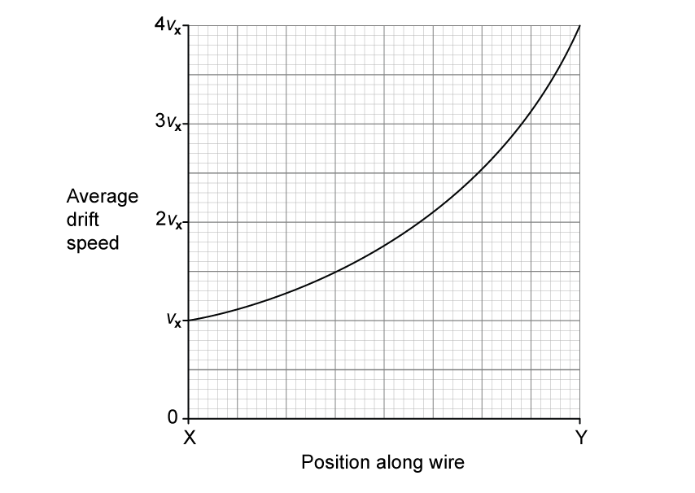
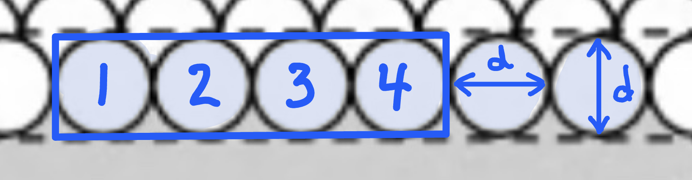
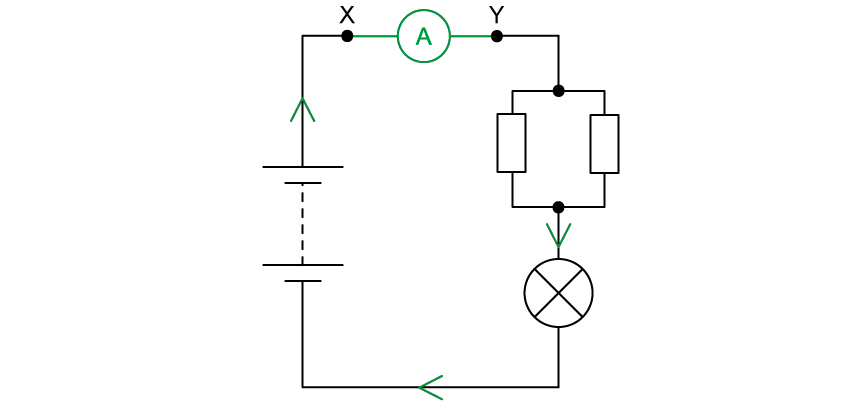
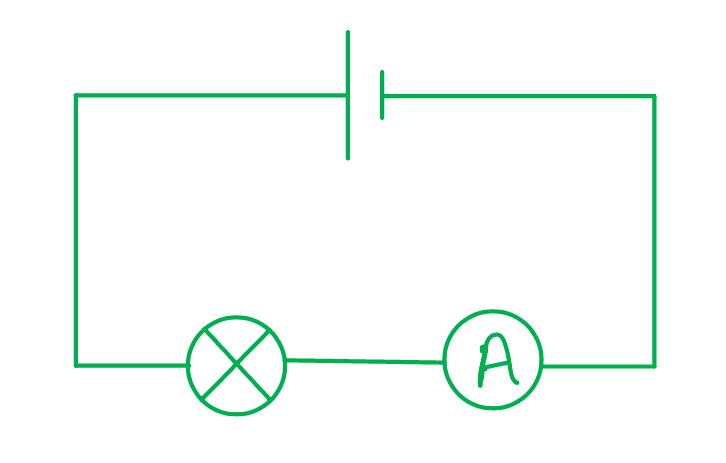

# Mark Schemes — Electric Current
**9. Electricity** · Cambridge (CIE) A-LEVEL physics (9702)

## Multiple Choice Questions (19 questions)

### Q1
**Final answer:** **The correct answer is B**

- The electrons form a beam moving with uniform velocity *v* through the vacuum tube
- Current is related to charge flow by the equation

$I = n A v e$

- Where:

  - *n* is the number density of electrons
  - *A* is the cross-sectional area of the vacuum tube
  - *v* is velocity
  - *e* is electron charge
- Rearranging for number density:

$n = \frac{I}{Ave}$

**A** is incorrect as it lacks the velocity term in the denominator

**C** is incorrect as velocity appears in the numerator rather than denominator

**D** is incorrect as it lacks the charge term in the denominator

### Q2
**Final answer:** **The correct answer is ****B**** because:**

- The question mentions the protons travel as a parallel beam, this is a beam which does not diverge or converge – its width stays the same as the beam travels out from its source
- The equation for current in a current-carrying conductor is given by

  - $I=nAve$
  - Where *n* is the number density of protons and *A* is the cross-sectional area of the beam
- This can be written as number of protons per unit length

  - Since the unit of *n* is m–3, the unit of *A* is m2 and the unit of *N* is m–1
- Rearranging this for *N* we find

  - $nA=N=\frac{I}{ev}$

### Q3
**Final answer:** **The correct answer is ****A**** because:**

- Even when there is no potential difference applied through a metal wire, the free electrons are still moving around rapidly
- Without the potential difference, the speed of the electrons is about 106 m s–1
- However, since they are moving at random, there is no net flow of electrons in any particular direction and so there is no current
- When a voltage is applied, the electrons gain an additional velocity, so that there is a net flow along the wire

**B** is incorrect because when there is no current flow in a wire, free electrons in a metal move around with a range of speeds and travel in random directions, much like molecules of gas in the air

**C** is incorrect because the current is the flow of electrons, but when there is no potential difference, there is no net flow of electrons, this doesn’t mean the electrons are stationary, it just means they are not all moving in a specific direction – this distinction is very important to learn

**D **is incorrect because the outer electrons in a metal are not confined to a fixed point, they are delocalised and are able to drift through the metal freely

> *A common misconception is that electrons orbit the individual metal atoms, but this is not true. In reality, the outermost electrons are orbiting among all the metal atoms all the time, in a sort of “sea of electrons”. Another misconception is that electrons **only** jump between atoms when a voltage is applied along the wires, this is also not true. As we discussed in the question, the electrons in the “sea of electrons” are moving randomly inside the metal all the time. Applying the voltage causes the electrons to start drifting towards the positive terminal, which is what leads to a flow of electrons, better known as the current.*

### Q4
**Final answer:** **The correct answer is ****C**** because:**

- Charge is defined by $Q=It$

  - Current *I* is equal to 10 × 10–3 A
  - The time *t* is equal to 30 minutes = 60 × 30 = 1800 s
- Charge is therefore equal to $Q = ( 10 \times 10^{- 3} ) \times 1800 = 18 \mathrm{C}$

### Q5
**Final answer:** **The correct answer is ****A**** because:**

- Electric current is the rate of flow of charge
- It is defined as the amount of charge that passes through a point on a wire per unit time
- The only statement that matches this definition is option A

**B, C **&** D **are incorrect because electrons are the most common carriers of charge in electricity, but current is not specifically the flow of electrons, it can be the flow of any particle which carries a charge, whether it’s electrons, protons or ions

### Q6
**Final answer:** **The correct answer is ****B**** because:**

- The known quantities are

  - Resistance, *R* = 3.0 Ω
  - Number of electrons, *n* = 7.5 × 1018
  - Time, *t* = 5.0 s
  - Charge of an electron, *e* = 1.6 × 10−19 C (from the data sheet)
- The charge through the resistor is

  - $Q=ne$
  - $Q = ( 7.5 \times 10^{18 ) \times ( 1.6 \times 10^{-19} } )$
  - $Q=1.2$ C
  - This eliminates options **C** and **D**
- The current through the resistor is

  - $I=\frac{Q}{t}$
  - $I=\frac{1.2}{5.0}=0.24$ A
- Therefore, the potential difference is

  - $V=IR$
  - *V* = 0.24 × 3.0 = 0.72 V
  - This means the answer is option **B**

### Q7
**Final answer:** **The correct answer is ****A**** because:**

- When a potential difference is applied to the ionised gas, the positive charges move towards the negative terminal and the negative charges (electrons) move towards the positive terminal
- The total current is given by the sum of these currents

  - $I=I^{+}+I^{-}$
- Current is equal to $I=\frac{totalcharge}{time}=\frac{Q}{t}$
- The total charge *Q* is equal to the sum of charges each with charge *q*

  - This can be expressed as $Q=Nq$
- The current of the positive charges is given by $I^{+} = ( \frac{N q}{t} )^{+}$

  - Where *q* = 3.2 × 10–19 C
- The current of the negative charges is given by $I^{-} = ( \frac{N q}{t} )^{-}$

  - Where *q* = 1.6 × 10–19 C and $\frac{N}{t}$= 2.58 × 1016 s–1
- We can combine these equations to give

  - $I = ( \frac{N q}{t} )^{+} + ( \frac{N q}{t} )^{-}$
  - $8.16 \times 10^{- 3} = ( \frac{N}{t} ) ( 3.2 \times 10^{- 19} ) + ( 2.58 \times 10^{16 ) ( 1.6 \times 10^{-19} } )$
  - $\frac{N}{t} = \frac{( 8.16 \times 10^{- 3} ) - ( 4.13 \times 10^{- 3} )}{3.2 \times 10^{- 19} } = 1.26 \times 10^{16 \mathrm{s}^{-1} }$
- Therefore, the number of positive charges passing a point is 1.26 × 1016 s–1

### Q8
**Final answer:** **The correct answer is ****C**** because:**

- Charge is defined by $Q=It$
- In option C, *I* = 5 × 10–3 A and *t* = 200 s

  - So, $Q = ( 5 \times 10^{- 3} ) \times 200 = 1 \mathrm{C}$

**A **is incorrect because in order to calculate charge, we need current and time, current and potential difference alone aren’t enough

**B **is incorrect because power and time can be used to calculate energy, not charge

**D **is incorrect because this gives  $Q=10\times10=100C$

### Q9
**Final answer:** **The correct answer is ****A**** because:**

- Charge is defined as $Q=It$
- The total charge on the disc is equal to $=Q+Q+Q+Q=4Q$
- The frequency of rotation is equal to $f=\frac{1}{periodforonerotation}=\frac{1}{t}$

  - So, $t=\frac{1}{f}$
- Current is equal to $I=\frac{Q}{t}$
- Equivalent electric current $=\frac{totalchargeflowperrotation}{timeperrotation}=\frac{4Q}{t}=4Qf$

  - Therefore, the equivalent electric current at the edge of the disc is $4Qf$.

### Q10
**Final answer:** **The correct answer is ****B**** because:**

- Charge is defined by $Q=It$
- Charge can be calculated from the area under a current-time graph
- We need to find the total charge that flows through the two circuits up to 7 seconds on the graph

  - Difference in total charge that flows through the two circuits = Difference in area under graphs for the first 7 seconds

- To work this out we will need three steps (as illustrated by the diagram)

  - Step 1: Charge through *I*1$= ( 7 \times 7 ) + 1 \frac{1}{2} ( 11 - 7 ) ( 7 ) = 63 \mathrm{C}$
  - Step 2: Charge through *I*2$= ( 7 \times 7 ) - 1 \frac{1}{2} ( 7 - 5 ) ( 7 ) = 42 \mathrm{C}$
  - Step 3: Difference in charges $=63-42=21C$

**Exam Tip:** a quicker way to do this problem would be to just find the area shown in green in the last graph in step 3, can you see how this could be done?

### Q11
**Final answer:** **The correct answer is ****D**** because:**

- Charge is defined by $Q=It$
- Current $I=20\times10^{-3}A$
- Time $t=10s$
- So, charge $Q = ( 20 \times 10^{- 3} ) \times 10 = 0.2 \mathrm{C}$
- The total charge is equal to $Q=ne$

  - Where *n* is the number of electrons and *e* is the charge of one electron
- So, the number of electrons is equal to $n=\frac{Q}{e}=\frac{0.2}{1.6\times10^{-19}}=1.25\times10^{18}$

  - Therefore, the number of electrons is 1.3 × 1018

### Q12
**Final answer:** **The correct answer is ****B**** because:**

- Electric power is equal to $P=VI$
- Let’s take another definition of power $P=\frac{E}{t}$
- We can combine these two equations to give $P=VI=\frac{E}{t}$

  - So, energy is equal to $E=VIt$
- A pulse of current of 15 A lasts for 2.0 ms
- Energy of each pulse$= 220 \times 15 \times ( 2.0 \times 10^{- 3} ) = 6.6 \mathrm{J}$
- Average power$=\frac{totalenergy}{time}$
- Average power$=no.ofpulses\times\frac{energyof1pulse}{time}$
- Average power$= ( \frac{n o. o f p u l s e s}{t i m e} ) \times e n e r g y o f 1 p u l s e$
- The fish produces 200 pulses per second

  - We can write this as $\frac{no.ofpulses}{time}=200s^{-1}$
- Average power$= ( \frac{n o. o f p u l s e s}{t i m e} ) \times e n e r g y o f 1 p u l s e$

  - Average power$=200\times6.6=1320W$
- Therefore, the average power output of the fish is 1.3 kW

### Q13
**Final answer:** **The correct answer is ****C**** because:**

- The known quantities are

  - Resistance, *R* = 2.0 Ω
  - Number of electrons, *n* = 8.2 × 1028
  - Potential difference, *V* = 12 V
  - Charge of an electron, *q* = 1.6 × 10−19 C (from the data sheet)
  - Average drift speed of electrons, *v* = 0.09 mm s-1 = 0.09 × 10−3 m s-1
- The current through the resistor is

  - $V=IR$
  - $I=\frac{V}{R}$
  - $I=\frac{12}{2.0}=6.0A$
- The cross-sectional area of the wire is

  - $I=Anvq$
  - $A=\frac{I}{nvq}$
  - $A = \frac{6.0}{( 8.2 \times 10^{28 ) \times ( 0.09 \times 10^{-3} } ) \times ( 1.6 \times 10^{- 19} )} = 5.1 \times 10^{- 6}$ m2 (2 s.f)
  - 10−6 m2 = mm2 therefore
  - *A = *5.1* *mm2
- This is option **C**

### Q14
**Final answer:** **The correct answer is ****D**** because:**

- Charge is defined by $Q=It$
- The charge on one electron is 1.6 × 10–19 C
- So, the total charge due to two electrons is $Q=2\times1.6\times10^{-19}$
- The frequency of revolutions is $f=1.0\times10^{15}\mathrm{Hz}$
- The time, or the period of one revolution, is given by $t=\frac{1}{f}$

  - So, $t=\frac{1}{1.0\times10^{15}}=1.0\times10^{-15}s$
- Therefore, the current is equal to $I=\frac{Q}{t}=\frac{2\times1.6\times10^{-19}}{1.0\times10^{-15}}=3.2\times10^{-4}A$

### Q15
**Final answer:** **The correct answer is ****C**** because:**

- Electrons flow from the negative terminal of the battery, since they are negatively-charged
- The negative terminal of the battery is represented by the shorter line at the symbol of the battery

  - So, the direction of flow of the electrons is from Y to X
- In terms of current, charge is defined as $Q=It$
- In terms of number of electrons, charge is equal to $Q=ne$

  - Where *n* and *e* are the number and charge of electrons respectively
- So, $ne=It$  and the rate of flow of electrons is equal to $\frac{n}{t}=\frac{I}{e}$

  - Rate of flow of electrons $=\frac{n}{t}=\frac{I}{e}=\frac{4.8}{1.6\times10^{-19}}=3.0\times10^{19}s^{-1}$

### Q16
**Final answer:** **The correct answer is ****A**** because:**

- Charge is defined by $Q=It$
- The total charge is equal to $Q=ne$

  - Where *n* is the number of electrons and *e* is the charge of one electron
- If we equate these two equations, we obtain $ne=It$

  - So, the number of electrons is given by $n=\frac{It}{e}$
- First, we must find the time taken to produce the 1 cm trace

  - $t=\frac{1}{1.0\times10^{4}}=1.0\times10^{-4}s$
- We know the current is $I=50μA=50\times10^{-6}A$

  - And the charge on an electron is $e=1.6\times10^{-19}C$
- So, the number of electrons arriving at the trace is

  - $n = \frac{I t}{e} = \frac{( 50 \times 10^{- 6} ) ( 1.0 \times 10^{- 4} )}{( 1.6 \times 10^{- 19} )} = 3.125 \times 10^{10}$
- Therefore, the number of electrons is 3.1 × 1010

### Q17
**Final answer:** **The correct answer is ****C**** because:**

- Current is defined as the amount of electric charge per unit of time

  - It is equal to $I=\frac{Q}{t}$
- First, we must find the charge *Q* over the period of 1 second:

  - $Q=It=10\times1=10C$
- The number of electrons is calculated by dividing the total charge by the charge of one electron
- The charge of one electron *e* is 1.6 × 10–19 C

  - Number of electrons $=\frac{Q}{e}=\frac{10}{1.6\times10^{-19}}=6.3\times10^{19}$

### Q18
**Final answer:** **The correct answer is ****A**** because:**

- Current in a current-carrying conductor is equal to

  - $I=nqAv$
- The drift velocity is found by rearranging for v

  - $v=\frac{I}{nqA}$
- First, we need to convert the quantities given into SI units.
- Cross-sectional area $A = 1.0 cm^{2} = 1.0 \times ( 10^{- 2} )^{2} \mathrm{m}^{2} = 1.0 \times 10^{- 4} \mathrm{m}^{2}$
- Number density $n=2.0\times10^{13}\mathrm{cm}^{-3}$
- This means, in every 1 cm3, there are 2.0 × 1013 charge carriers

  - $1 c m^{3} = 1 \times ( 10^{- 2} )^{3} \mathrm{m}^{3} = 1 \times 10^{- 6} \mathrm{m}^{3}$
- So, in every 1 m3, there are $\frac{2.0\times10^{13}}{1\times10^{-6}}=2.0\times10^{19}m^{-3}$ charge carriers
- So, number density $n=2.0\times10^{19}m^{-3}$
- The charge of one electron is $q=1.6\times10^{-19}C$

  - Drift velocity $v=\frac{I}{nqA}$
  - Drift velocity $v = \frac{56 \times 10^{- 6} }{( 2.0 \times 10^{19 ) ( 1.0 \times 10^{-4} } ) ( 1.6 \times 10^{- 19} )} = 0.175 \mathrm{m} \mathrm{s}^{- 1}$
- Therefore, the average drift velocity of the charge carriers is 0.18 m s–1

### Q19
**Final answer:** ** The correct answer is ****D**** because:**

- Power is equal to $P=\frac{E}{t}$
- Charge is equal to $Q=It$
- The units on the LHS

  - $P Q = [ W ] [ C ] = [ \mathrm{J} \mathrm{s}^{- 1} ] [ \mathrm{A} \mathrm{s} ] = \mathrm{J} \mathrm{A}$
- The units on the RHS

  - $E I = [ J ] [ A ] = \mathrm{J} \mathrm{A}$
- The units on the LHS match the units on the RHS so option D is correct

| **A **is incorrect because | LHS:  $P = [ W ] = \mathrm{J} \mathrm{s}^{- 1}$  RHS:  $\frac{Q^{2} R}{t} = \frac{( I t )^{2}}{t} \frac{V}{I} = V I t = E = \mathrm{J}$ | LHS ≠ RHS |
|---|---|---|
| **B **is incorrect because | LHS: $E R^{2} = V I t ( \frac{V}{I} )^{2} = \frac{V^{3} t}{I}$  RHS:  $V^{2}t$ | LHS ≠ RHS |
| **C **is incorrect because | LHS:  $\frac{VI}{P}=\frac{P}{P}=1$  RHS:  $t$ | LHS ≠ RHS |

## Structured Questions (7 questions)

### Q1
> **[mark-scheme]**
> A coulomb is defined as:
> 
> - An ampere second **OR** The charge moved by a current of 1 ampere in 1 second **[1 mark]**
Underline the possible charges for a charge carrier:

1.6 × 10–20 C ‎ ‎ ‎ ‎ ‎ ‎ ‎ ‎ ‎ <u>1.6 × 10</u><u>–19</u><u> C</u> ‎ ‎ ‎ ‎ ‎ ‎ ‎ ‎ ‎ 4.0 × 10–19 C ‎ ‎ ‎ ‎ ‎ ‎ ‎ ‎ ‎ <u>8.0 × 10</u><u>–19</u><u> C</u>

**[1 mark]**

> **[mark-scheme]**
> 1 mark is awarded if only 1.6 × 10–19 C **AND **8.0 × 10–19 C are underlined **AND **no others are underlined

> **[exam-tip]**
> The charge carried by charged particles is quantised. This means charge always occurs in multiples of the elementary charge $e$, which is equal to 1.6 × 10–19 C.
Sketch a graph to show the variation of the average drift speed with position along the wire:

- Determine the relationship between drift speed and wire diameter

Cross-sectional area of wire: $A = \mathrm{\pi } r^{2} = \mathrm{\pi } ( \frac{d}{2} )^{2}$

At X: $A = \mathrm{\pi } ( \frac{2 d}{2} )^{2} = \mathrm{\pi } d^{2}$

At Y: $A = \mathrm{\pi } ( \frac{d}{2} )^{2} = \frac{ \mathrm{\pi } d^{2}}{4}$

Drift speed: $I=Anvq$

$v=\frac{I}{Anq}$

Since $I$, $n$, and $q$ are constant $v\propto\frac{1}{A}$

$\frac{v_{Y}}{v_{X}}=\frac{d^{2}}{\frac{d^{2}}{4}}=4$

Therefore $v_{Y}=4v_{X}$

- Sketch a line on the graph:

**[2 marks]**

> **[mark-scheme]**
> 1 mark for a line drawn between (X, $v_{X}$) and (Y, $4v_{X}$)
> 
> 1 mark for a line drawn with an increasing magnitude of gradient

> **[exam-tip]**
> Since diameter $d$ varies linearly, area $A$ varies as $d^{2}$, so $v\propto\frac{1}{d^{2}}$. This means the variation of $v$ with $d$ is a non-linear increase. Hence, the gradient increases towards Y.

### Q2
Calculate the total charge that flows past a point in the component in 3 minutes:

List the known quantities:

- Current, *I *= 40.0 mA = 40.0 × 10−3 A
- Time, *t* = 3 minutes = 180 s

Use the equation for charge and calculate:

- $Q = I t = ( 40.0 \times 10^{- 3} ) \times 180 = 7.2 \mathrm{C}$ **[1 mark]**

**[Total: 1 mark]**
Calculate the number of electron charge carriers passing the same point in the conductor in this time:

List the known quantities:

- Total charge, *Q* = 7.2 C (from part a)
- Magnitude of charge per electron, *q* = 1.6 × 10−19 (from the data booklet)

Calculate the total number of electrons:

- $N = \frac{Q}{q} = \frac{7.2}{( 1.6 \times 10^{- 19} )} = 4.5 \times 10^{19}$ **[1 mark]**

**[Total: 1 mark]**
(i) Calculate the potential difference across the component:

List the known quantities:

- Energy, *W *= 8.6 J
- Charge, *Q* = 7.2 C

Use the equation defining potential difference:

- $V=\frac{W}{Q}=\frac{8.6}{7.2}$ **[1 mark]**
- $V = 1.2 \mathrm{V} ( 2 \mathrm{s} . \mathrm{f} . )$ **[1 mark]**

(ii) Calculate the resistance of the conductor:

List the known quantities:

- Potential difference, *V* = 1.2 V
- Current, *I* = 40 × 10−3 A (from part a)

Use the equation for resistance:

- $R = \frac{V}{I} = \frac{1.2}{( 40 \times 10^{- 3} )}$ **[1 mark]**
- $R=30Ω$ **[1 mark].**

**[Total: 4 marks]**

### Q3
The symbol for electric charge is:

- *Q *; **[1 mark] **

The SI unit for electric charge is:

- Coulomb **OR** C;** [****1 mark]**** **

**[Total: 2 marks]**
List the known quantities:

- Current *I* = 2.0 A
- Time *t* = 90 minutes = 90 × 60 s = 5400 s

Recall the equation for current:

- $I=\frac{Q}{t}$

Substitute known quantities into the equation for current:

- $2.0=\frac{Q}{5400}$ **[1 mark]**
- *Q* = 2.0 × 5400 = 10 800 C **[1 mark]**

**[Total: 2 marks]**
Determine the number of electrons in 10 800 C of charge:

List the known quantities:

- Total charge, *Q*  = 10 800 C (from part (b))
- Elementary charge, *e*  = 1.6 × 10–19 C

Calculate the number of electrons:

- The total amount of charge *Q* = *Ne*

  - where *N* is the number of charge carriers and *e* is the elementary charge carried by each
- Therefore, 10 800 = *N* × (1.6 × 10–19)
- *N* = $\frac{10800}{1.6\times10^{-19}}$ **[1 mark]**
- *N* = 6.8 × 1022 **[1 mark]**

**[Total: 2 marks]**
Explain why a current is present in the wire:

Refer to the existence of free electrons in copper:

- Copper wire has (many) <u>free</u>/<u>conducting/valence/delocalised</u> electrons; **[1 mark]**

Describe the effect of the potential difference:

- The potential difference produces an <u>electric field</u> (in the wire); **[1 mark]**

Explain the effect of an electric field:

- The electric field causes electrons to experience a force and gain a resultant drift velocity, producing a current; **[1 mark]**

**[Total: 3 marks]**

> *Copper is a good conductor of electricity, which means it has many **free electrons**. When placed in an electric field, or a region where there is a difference in electric potential, a force is applied to these free electrons, causing them to **flow toward the positive terminal**.*

### Q4
The amp is defined as:

- The current when one coulomb of charge passes a point; **[1 mark]**
- In one second; **[1 mark]**

**[Total: 2 marks]**
To calculate current from charge and time:

List the known quantities:

- Charge, *Q*  =  60.0 × 10–6 C
- Time, *t*  = 140 × 10–3 s

Recall the equation for current, *I *:

- $I=\frac{Q}{t}$

Substitute the numbers into the equation:

- $I=\frac{60.0\times10^{--6}}{140\times10^{--3}}$ = 4.286 × 10−4 A **[1 mark]**

Calculate the final answer in mA:

- *I* = 4.3 × 10-4 = 0.43 mA (2 s.f.) **[1 mark]**

**[Total: 2 marks]**

> *The charges in these questions are usually small fractions of a coulomb, so convert to standard form before substituting. In this question it was done for you, but in the exams, always do this right at the start, as it's very easy to forget later on.*

> *Also remember to round all answers to the same significant figures as those used in the question.*
The correct sentences state that:

- The charge carriers in a metal conductor are **delocalised **electrons; **[1 mark]**
- Normally the electrons move **randomly **in all directions, but if a potential difference is applied between two points on the conductor, then an **electric field** is created; **[1 mark]**
- This causes an **electric force** to act on the charge carriers, causing them to **drift **along the conductor in a resultant direction; **[1 mark]**
- Therefore we can say that  a steady **current** flows through the conductor; **[1 mark]**

**[Total: 4 marks]**
To find the number density of electrons:

List the known quantities:

- Cross-sectional area, *A*  = 1.1 × 10−7 m2
- Drift speed, *v*  = 18 mm s−1 = 18 × 10−3 m s−1 **[1 mark]**
- Current, *I*  = 4.3 × 10−4 A
- Charge on each electron (current carrier), *q*  = 1.60 × 10−19 C (from the data page)

From the formulae page:

- $I=Anvq$

Rearrange for number density:

- $n=\frac{I}{Avq}$

Substitute the known quantities:

- $n = \frac{4.3 \times 10^{- 4} }{( 1.1 \times 10^{- 7} ) \times ( 18 \times 10^{- 3} ) \times ( 1.60 \times 10^{- 19} )}$ **[1 mark]**
- $n=1.4\times10^{24}m^{-3}$ **[1 mark]**

**[Total: 3 marks]**

> *Converting units of known quantities should be your very first step in any calculation question. It's so easy to forget this once you begin the main calculation.*

### Q5
(i) Define current:

- The rate of flow of charge **OR**
- Charge passing a point per unit time; **[1 mark]**

(ii) Describe for this processing chip the properties which will affect the current:

**Final answer:** **Any ****three ****from:**

- Current depends on number density, charge per carrier, drift velocity, and area  **OR**  *I* = *Anvq* (any arrangement); **[1 mark]**
- Charge per carrier / electron = 1.6 × 10−19 C; **[1 mark]**
- Number density depends on the material and is fixed for a given conductor; **[1 mark]**
- Current depends on potential difference / voltage across the component;** [1 mark]**
- Current depends on cross-sectional area;** [1 mark]**
- Current depends on resistivity of the conducting material / phosphorus; **[1 mark]**
- Current depends on the length of the conducting wire (because it affects resistance); **[1 mark]**

**[Total: 4 marks]**
Calculate the number density of free electrons within the block:

Since each atom contributes one electron, calculate the number of atoms per unit volume:

- $n = \frac{1}{d^{3}} = \frac{1}{( 3.8 \times 10^{- 10} )^{3}} = 1.8 \times 10^{28 \mathrm{m}^{-3} }$ ( 2 s.f.) **[1 mark]**

**[Total: 1 mark]**
Calculate the current between P and Q when the mean drift velocity of free electrons in the block is 1.9 × 10–5 m s–1

List the known quantities:

- Drift velocity of free electrons, *v* = 1.9 × 10–5 m s–1
- Charge on an electron, *q* = −1.6 × 10−19 C (from the data sheet)
- Number density of electrons, *n* = 1.8 × 1028 m-3 (from part b)
- Diameter of atom, *d *= 3.8 × 10−10 m (from part a)

Determine the cross-sectional area of the conductor:

- The current flowing from P to Q moves through a surface area 4 atoms wide by 1 atom high
- $A = 4 \times ( 3.8 \times 10^{- 10} )^{2} = 5.776 \times 10^{- 19 } \mathrm{m}^{2}$ **[1 mark]**

Use the equation relating current and drift velocity:

- $I=Anvq$
- $I = ( 5.776 \times 10^{- 19 } ) \times ( 1.8 \times 10^{28 ) \times ( 1.9 \times 10^{-5} } ) \times ( 1.6 \times 10^{- 19} )$ **[1 mark]**
- $I=3.2\times10^{-14}A$ **[1 mark]**

**[Total: 3 marks]**

> *Using the diameter of a sphere to calculate the surface area of a cuboid may seem odd. It is an approximation - what we call a 'best estimate' - but using this kind of informed shortcut is an important aspect to calculations in physics.*

> *The sketch below shows how the idea works. You can see that although there are gaps, they are small, so the estimation is a valid one.*

> *Current flows along the 20-atom length, so the cross-section is 4 atoms wide × 1 atom high.*

### Q6
(i) The particle responsible for carrying electric charge around a circuit is:

- The electron; **[1 mark] ** **  **

(ii) Calculate the total charge carried by ten million electrons:

List the known quantities:

- Number of particles, *N*  = ten million = 10 × 106

From the data page:

- Elementary charge, *e * = 1.6 × 10–19 C

Calculate the total charge:

- The total charge *Q* is given by the number of electrons *N* × the charge carried by each electron *e*
- Therefore *Q* = (10 × 106) × (1.6 × 10–19) **[1 mark]**
- *Q* = 1.6 × 10–12 C **[1 mark]**** **

**[Total: 3 marks]*** *
List the known quantities:

- Current, *I* = 0.30 mA
- Time, *t * = 5 minutes

Recall the equation for current:

- $I=\frac{Q}{t}$

Convert current into amps and time into seconds:

- *I* = 0.30 mA = 0.30 × 10–3 A **AND**
- *t*  = 5 minutes = 5 × 60 = 300 s **[1 mark]**

Calculate the charge which passes through the lamp:

- The charge, *Q* = *I* × *t*
- *Q* = (0.30 × 10–3) × 300 **[1 mark]**
- *Q* = 0.090 C **[1 mark] **

**[Total: 3 marks]**** **

> *Remember to convert all quantities into their standard units! Prefixes, like the ‘milliamps (mA)’ used in this question, are common tricks used by examiners to check if students are on their toes: in this question, we have to remember to convert 0.30 mA to A, as well as minutes to seconds, before substituting into the equation for current. This is because the one coulomb (C) is equal to one amp second (A s).*
To find the average drift velocity of electrons:

List the known quantities:

- Cross-sectional area, *A*  = 4.5 × 10−5 m2
- Number density of electrons, *n*  =  3.6 × 1022 m−3
- Current, *I*  = 3.0 × 10−4 A (from part (b))
- Charge on each electron (current carrier), *q*  = 1.60 × 10−19 C (from the data page)

From the formulae page:

- $I=Anvq$

Rearrange for average drift speed, *v *:

- $v=\frac{I}{Anq}$

Substitute the known quantities:

- $v = \frac{3.0 \times 10^{- 4} }{( 4.5 \times 10^{- 5} ) \times ( 3.6 \times 10^{22 ) \times ( 1.60 \times 10^{-19} } )}$ **[1 mark]**
- $v=1.2\times10^{-3}ms^{-1}$ **[1 mark]**

**[Total: 2 marks]**
A diagram which would score 3 marks is shown below:

(i) An **ammeter** between **X** and **Y** that would measure the current in the circuit:** **

- Correct symbol for an ammeter used;** [1 mark]**
- Ammeter connected <u>in series</u> between **X** and **Y**; **[1 mark]**** **

(ii) The direction of **conventional current** in the circuit:

- Conventional current labelled in a <u>clockwise direction</u>;** ****[1 mark]**** **

**[Total: 3 marks] **

> *You should know that conventional current flows from the **positive** terminal of a battery to the **negative** terminal – i.e., it is the flow of positive charge (even though, in reality, **electrons** flow around the circuit!) *

> *Electron flow, therefore, is in the opposite direction to conventional current: flowing from the negative terminal to the positive terminal.*

### Q7
A possible circuit diagram that should score 2 marks would look like this:

- Cell / battery / power supply, light bulb and ammeter drawn; **[1 mark]**
- Components connected with straight lines in a series circuit; **[1 mark]**

**[Total: 2 marks]**
The ammeter needs to be connected in series because:

- An ammeter measures the amount of current in a circuit; **[1 mark]**
- It needs to be in series with the components of the circuit; **[1 mark]**
- So the ammeter measures the current flowing through the component (since current is the same everywhere in a series circuit); **[1 mark]**

**[Total: 3 marks]**
Nancy should expect to obtain results as follows:

- As the current through the light bulb increases the brightness of the light bulb also increases; **[1 mark]**
- This is because *P *= *I*2*R*; **[1 mark]**
- So, for a constant resistance, *R*, when *I  *increases the power *P *also increases, meaning the light bulb is brighter; **[1 mark]**

**[Total: 3 marks]**
The problem Nancy has with her circuit is:

- The ammeter is connected the wrong way around (in the circuit); **OR**
- The negative terminal of the ammeter is connected to the positive terminal of the power supply; **[1 mark]**

A solution to this problem is:

- Change the orientation / direction of the ammeter's connection in the circuit; **OR**
- Connect the positive terminal of the ammeter to the positive terminal of the power supply; **[1 mark]**

**[Total: 2 marks]**

> *It can be tricky to remember the nuances of current and electron direction but learn them so you don't get confused easily in your exam. Negative values of current are not physically negative current but a polarity convention.*
