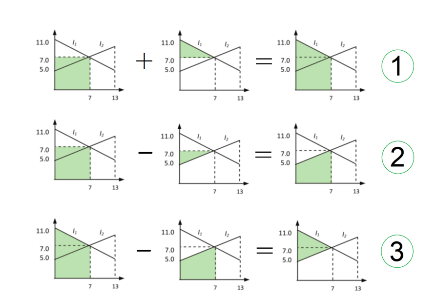

# Mark Schemes — Electric Current
**9. Electricity** · Cambridge (CIE) A-LEVEL physics (9702)

## Multiple Choice Questions (19 questions)

### Q1
**Final answer:** **The correct answer is B**

- The electrons form a beam moving with uniform velocity *v* through the vacuum tube
- Current is related to charge flow by the equation

$I = n A v e$

- Where:

  - *n* is the number density of electrons
  - *A* is the cross-sectional area of the vacuum tube
  - *v* is velocity
  - *e* is electron charge
- Rearranging for number density:

$n = \frac{I}{Ave}$

**A** is incorrect as it lacks the velocity term in the denominator

**C** is incorrect as velocity appears in the numerator rather than denominator

**D** is incorrect as it lacks the charge term in the denominator

### Q2
**Final answer:** **The correct answer is ****B**** because:**

- The question mentions the protons travel as a parallel beam, this is a beam which does not diverge or converge – its width stays the same as the beam travels out from its source
- The equation for current in a current-carrying conductor is given by

  - $I=nAve$
  - Where *n* is the number density of protons and *A* is the cross-sectional area of the beam
- This can be written as number of protons per unit length

  - Since the unit of *n* is m–3, the unit of *A* is m2 and the unit of *N* is m–1
- Rearranging this for *N* we find

  - $nA=N=\frac{I}{ev}$

### Q3
**Final answer:** **The correct answer is ****A**** because:**

- Even when there is no potential difference applied through a metal wire, the free electrons are still moving around rapidly
- Without the potential difference, the speed of the electrons is about 106 m s–1
- However, since they are moving at random, there is no net flow of electrons in any particular direction and so there is no current
- When a voltage is applied, the electrons gain an additional velocity, so that there is a net flow along the wire

**B** is incorrect because when there is no current flow in a wire, free electrons in a metal move around with a range of speeds and travel in random directions, much like molecules of gas in the air

**C** is incorrect because the current is the flow of electrons, but when there is no potential difference, there is no net flow of electrons, this doesn’t mean the electrons are stationary, it just means they are not all moving in a specific direction – this distinction is very important to learn

**D **is incorrect because the outer electrons in a metal are not confined to a fixed point, they are delocalised and are able to drift through the metal freely

> *A common misconception is that electrons orbit the individual metal atoms, but this is not true. In reality, the outermost electrons are orbiting among all the metal atoms all the time, in a sort of “sea of electrons”. Another misconception is that electrons **only** jump between atoms when a voltage is applied along the wires, this is also not true. As we discussed in the question, the electrons in the “sea of electrons” are moving randomly inside the metal all the time. Applying the voltage causes the electrons to start drifting towards the positive terminal, which is what leads to a flow of electrons, better known as the current.*

### Q4
**Final answer:** **The correct answer is ****C**** because:**

- Charge is defined by $Q=It$

  - Current *I* is equal to 10 × 10–3 A
  - The time *t* is equal to 30 minutes = 60 × 30 = 1800 s
- Charge is therefore equal to $Q = ( 10 \times 10^{- 3} ) \times 1800 = 18 \mathrm{C}$

### Q5
**Final answer:** **The correct answer is ****A**** because:**

- Electric current is the rate of flow of charge
- It is defined as the amount of charge that passes through a point on a wire per unit time
- The only statement that matches this definition is option A

**B, C **&** D **are incorrect because electrons are the most common carriers of charge in electricity, but current is not specifically the flow of electrons, it can be the flow of any particle which carries a charge, whether it’s electrons, protons or ions

### Q6
**Final answer:** **The correct answer is ****B**** because:**

- The known quantities are

  - Resistance, *R* = 3.0 Ω
  - Number of electrons, *n* = 7.5 × 1018
  - Time, *t* = 5.0 s
  - Charge of an electron, *e* = 1.6 × 10−19 C (from the data sheet)
- The charge through the resistor is

  - $Q=ne$
  - $Q = ( 7.5 \times 10^{18 ) \times ( 1.6 \times 10^{-19} } )$
  - $Q=1.2$ C
  - This eliminates options **C** and **D**
- The current through the resistor is

  - $I=\frac{Q}{t}$
  - $I=\frac{1.2}{5.0}=0.24$ A
- Therefore, the potential difference is

  - $V=IR$
  - *V* = 0.24 × 3.0 = 0.72 V
  - This means the answer is option **B**

### Q7
**Final answer:** **The correct answer is ****A**** because:**

- When a potential difference is applied to the ionised gas, the positive charges move towards the negative terminal and the negative charges (electrons) move towards the positive terminal
- The total current is given by the sum of these currents

  - $I=I^{+}+I^{-}$
- Current is equal to $I=\frac{totalcharge}{time}=\frac{Q}{t}$
- The total charge *Q* is equal to the sum of charges each with charge *q*

  - This can be expressed as $Q=Nq$
- The current of the positive charges is given by $I^{+} = ( \frac{N q}{t} )^{+}$

  - Where *q* = 3.2 × 10–19 C
- The current of the negative charges is given by $I^{-} = ( \frac{N q}{t} )^{-}$

  - Where *q* = 1.6 × 10–19 C and $\frac{N}{t}$= 2.58 × 1016 s–1
- We can combine these equations to give

  - $I = ( \frac{N q}{t} )^{+} + ( \frac{N q}{t} )^{-}$
  - $8.16 \times 10^{- 3} = ( \frac{N}{t} ) ( 3.2 \times 10^{- 19} ) + ( 2.58 \times 10^{16 ) ( 1.6 \times 10^{-19} } )$
  - $\frac{N}{t} = \frac{( 8.16 \times 10^{- 3} ) - ( 4.13 \times 10^{- 3} )}{3.2 \times 10^{- 19} } = 1.26 \times 10^{16 \mathrm{s}^{-1} }$
- Therefore, the number of positive charges passing a point is 1.26 × 1016 s–1

### Q8
**Final answer:** **The correct answer is ****C**** because:**

- Charge is defined by $Q=It$
- In option C, *I* = 5 × 10–3 A and *t* = 200 s

  - So, $Q = ( 5 \times 10^{- 3} ) \times 200 = 1 \mathrm{C}$

**A **is incorrect because in order to calculate charge, we need current and time, current and potential difference alone aren’t enough

**B **is incorrect because power and time can be used to calculate energy, not charge

**D **is incorrect because this gives  $Q=10\times10=100C$

### Q9
**Final answer:** **The correct answer is ****A**** because:**

- Charge is defined as $Q=It$
- The total charge on the disc is equal to $=Q+Q+Q+Q=4Q$
- The frequency of rotation is equal to $f=\frac{1}{periodforonerotation}=\frac{1}{t}$

  - So, $t=\frac{1}{f}$
- Current is equal to $I=\frac{Q}{t}$
- Equivalent electric current $=\frac{totalchargeflowperrotation}{timeperrotation}=\frac{4Q}{t}=4Qf$

  - Therefore, the equivalent electric current at the edge of the disc is $4Qf$.

### Q10
**Final answer:** **The correct answer is ****B**** because:**

- Charge is defined by $Q=It$
- Charge can be calculated from the area under a current-time graph
- We need to find the total charge that flows through the two circuits up to 7 seconds on the graph

  - Difference in total charge that flows through the two circuits = Difference in area under graphs for the first 7 seconds

- To work this out we will need three steps (as illustrated by the diagram)

  - Step 1: Charge through *I*1$= ( 7 \times 7 ) + 1 \frac{1}{2} ( 11 - 7 ) ( 7 ) = 63 \mathrm{C}$
  - Step 2: Charge through *I*2$= ( 7 \times 7 ) - 1 \frac{1}{2} ( 7 - 5 ) ( 7 ) = 42 \mathrm{C}$
  - Step 3: Difference in charges $=63-42=21C$

**Exam Tip:** a quicker way to do this problem would be to just find the area shown in green in the last graph in step 3, can you see how this could be done?

### Q11
**Final answer:** **The correct answer is ****D**** because:**

- Charge is defined by $Q=It$
- Current $I=20\times10^{-3}A$
- Time $t=10s$
- So, charge $Q = ( 20 \times 10^{- 3} ) \times 10 = 0.2 \mathrm{C}$
- The total charge is equal to $Q=ne$

  - Where *n* is the number of electrons and *e* is the charge of one electron
- So, the number of electrons is equal to $n=\frac{Q}{e}=\frac{0.2}{1.6\times10^{-19}}=1.25\times10^{18}$

  - Therefore, the number of electrons is 1.3 × 1018

### Q12
**Final answer:** **The correct answer is ****B**** because:**

- Electric power is equal to $P=VI$
- Let’s take another definition of power $P=\frac{E}{t}$
- We can combine these two equations to give $P=VI=\frac{E}{t}$

  - So, energy is equal to $E=VIt$
- A pulse of current of 15 A lasts for 2.0 ms
- Energy of each pulse$= 220 \times 15 \times ( 2.0 \times 10^{- 3} ) = 6.6 \mathrm{J}$
- Average power$=\frac{totalenergy}{time}$
- Average power$=no.ofpulses\times\frac{energyof1pulse}{time}$
- Average power$= ( \frac{n o. o f p u l s e s}{t i m e} ) \times e n e r g y o f 1 p u l s e$
- The fish produces 200 pulses per second

  - We can write this as $\frac{no.ofpulses}{time}=200s^{-1}$
- Average power$= ( \frac{n o. o f p u l s e s}{t i m e} ) \times e n e r g y o f 1 p u l s e$

  - Average power$=200\times6.6=1320W$
- Therefore, the average power output of the fish is 1.3 kW

### Q13
**Final answer:** **The correct answer is ****C**** because:**

- The known quantities are

  - Resistance, *R* = 2.0 Ω
  - Number of electrons, *n* = 8.2 × 1028
  - Potential difference, *V* = 12 V
  - Charge of an electron, *q* = 1.6 × 10−19 C (from the data sheet)
  - Average drift speed of electrons, *v* = 0.09 mm s-1 = 0.09 × 10−3 m s-1
- The current through the resistor is

  - $V=IR$
  - $I=\frac{V}{R}$
  - $I=\frac{12}{2.0}=6.0A$
- The cross-sectional area of the wire is

  - $I=Anvq$
  - $A=\frac{I}{nvq}$
  - $A = \frac{6.0}{( 8.2 \times 10^{28 ) \times ( 0.09 \times 10^{-3} } ) \times ( 1.6 \times 10^{- 19} )} = 5.1 \times 10^{- 6}$ m2 (2 s.f)
  - 10−6 m2 = mm2 therefore
  - *A = *5.1* *mm2
- This is option **C**

### Q14
**Final answer:** **The correct answer is ****D**** because:**

- Charge is defined by $Q=It$
- The charge on one electron is 1.6 × 10–19 C
- So, the total charge due to two electrons is $Q=2\times1.6\times10^{-19}$
- The frequency of revolutions is $f=1.0\times10^{15}\mathrm{Hz}$
- The time, or the period of one revolution, is given by $t=\frac{1}{f}$

  - So, $t=\frac{1}{1.0\times10^{15}}=1.0\times10^{-15}s$
- Therefore, the current is equal to $I=\frac{Q}{t}=\frac{2\times1.6\times10^{-19}}{1.0\times10^{-15}}=3.2\times10^{-4}A$

### Q15
**Final answer:** **The correct answer is ****C**** because:**

- Electrons flow from the negative terminal of the battery, since they are negatively-charged
- The negative terminal of the battery is represented by the shorter line at the symbol of the battery

  - So, the direction of flow of the electrons is from Y to X
- In terms of current, charge is defined as $Q=It$
- In terms of number of electrons, charge is equal to $Q=ne$

  - Where *n* and *e* are the number and charge of electrons respectively
- So, $ne=It$  and the rate of flow of electrons is equal to $\frac{n}{t}=\frac{I}{e}$

  - Rate of flow of electrons $=\frac{n}{t}=\frac{I}{e}=\frac{4.8}{1.6\times10^{-19}}=3.0\times10^{19}s^{-1}$

### Q16
**Final answer:** **The correct answer is ****A**** because:**

- Charge is defined by $Q=It$
- The total charge is equal to $Q=ne$

  - Where *n* is the number of electrons and *e* is the charge of one electron
- If we equate these two equations, we obtain $ne=It$

  - So, the number of electrons is given by $n=\frac{It}{e}$
- First, we must find the time taken to produce the 1 cm trace

  - $t=\frac{1}{1.0\times10^{4}}=1.0\times10^{-4}s$
- We know the current is $I=50μA=50\times10^{-6}A$

  - And the charge on an electron is $e=1.6\times10^{-19}C$
- So, the number of electrons arriving at the trace is

  - $n = \frac{I t}{e} = \frac{( 50 \times 10^{- 6} ) ( 1.0 \times 10^{- 4} )}{( 1.6 \times 10^{- 19} )} = 3.125 \times 10^{10}$
- Therefore, the number of electrons is 3.1 × 1010

### Q17
**Final answer:** **The correct answer is ****C**** because:**

- Current is defined as the amount of electric charge per unit of time

  - It is equal to $I=\frac{Q}{t}$
- First, we must find the charge *Q* over the period of 1 second:

  - $Q=It=10\times1=10C$
- The number of electrons is calculated by dividing the total charge by the charge of one electron
- The charge of one electron *e* is 1.6 × 10–19 C

  - Number of electrons $=\frac{Q}{e}=\frac{10}{1.6\times10^{-19}}=6.3\times10^{19}$

### Q18
**Final answer:** **The correct answer is ****A**** because:**

- Current in a current-carrying conductor is equal to

  - $I=nqAv$
- The drift velocity is found by rearranging for v

  - $v=\frac{I}{nqA}$
- First, we need to convert the quantities given into SI units.
- Cross-sectional area $A = 1.0 cm^{2} = 1.0 \times ( 10^{- 2} )^{2} \mathrm{m}^{2} = 1.0 \times 10^{- 4} \mathrm{m}^{2}$
- Number density $n=2.0\times10^{13}\mathrm{cm}^{-3}$
- This means, in every 1 cm3, there are 2.0 × 1013 charge carriers

  - $1 c m^{3} = 1 \times ( 10^{- 2} )^{3} \mathrm{m}^{3} = 1 \times 10^{- 6} \mathrm{m}^{3}$
- So, in every 1 m3, there are $\frac{2.0\times10^{13}}{1\times10^{-6}}=2.0\times10^{19}m^{-3}$ charge carriers
- So, number density $n=2.0\times10^{19}m^{-3}$
- The charge of one electron is $q=1.6\times10^{-19}C$

  - Drift velocity $v=\frac{I}{nqA}$
  - Drift velocity $v = \frac{56 \times 10^{- 6} }{( 2.0 \times 10^{19 ) ( 1.0 \times 10^{-4} } ) ( 1.6 \times 10^{- 19} )} = 0.175 \mathrm{m} \mathrm{s}^{- 1}$
- Therefore, the average drift velocity of the charge carriers is 0.18 m s–1

### Q19
**Final answer:** ** The correct answer is ****D**** because:**

- Power is equal to $P=\frac{E}{t}$
- Charge is equal to $Q=It$
- The units on the LHS

  - $P Q = [ W ] [ C ] = [ \mathrm{J} \mathrm{s}^{- 1} ] [ \mathrm{A} \mathrm{s} ] = \mathrm{J} \mathrm{A}$
- The units on the RHS

  - $E I = [ J ] [ A ] = \mathrm{J} \mathrm{A}$
- The units on the LHS match the units on the RHS so option D is correct

| **A **is incorrect because | LHS:  $P = [ W ] = \mathrm{J} \mathrm{s}^{- 1}$  RHS:  $\frac{Q^{2} R}{t} = \frac{( I t )^{2}}{t} \frac{V}{I} = V I t = E = \mathrm{J}$ | LHS ≠ RHS |
|---|---|---|
| **B **is incorrect because | LHS: $E R^{2} = V I t ( \frac{V}{I} )^{2} = \frac{V^{3} t}{I}$  RHS:  $V^{2}t$ | LHS ≠ RHS |
| **C **is incorrect because | LHS:  $\frac{VI}{P}=\frac{P}{P}=1$  RHS:  $t$ | LHS ≠ RHS |
