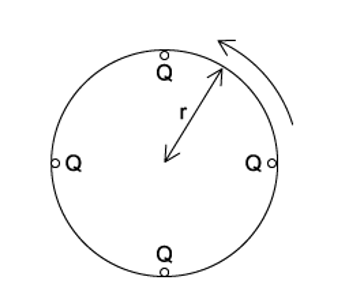
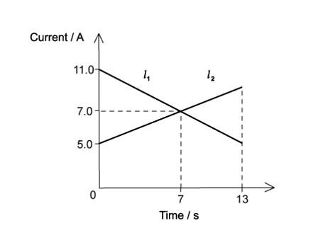
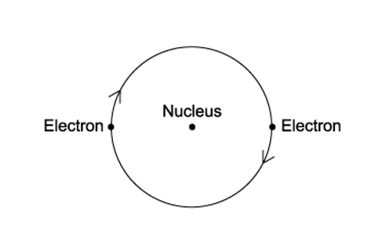
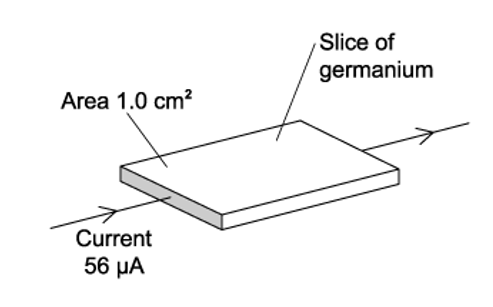

# Exam Questions — Electric Current
**9. Electricity** · Cambridge (CIE) A-LEVEL physics (9702)
> Source: [https://www.savemyexams.com/a-level/physics/cie/25/topic-questions/](https://www.savemyexams.com/a-level/physics/cie/25/topic-questions/) · 19 questions across 1 sets

## Multiple Choice Questions (19 questions)

### Q1 — medium — 1 marks

**Q1** [1 mark]

A beam of electrons, each carrying charge *e*, moves through a vacuum tube of uniform cross-sectional area *A *with uniform velocity *v*. The beam produces a current *I*.

What is the number density of electrons in the beam?

### Q2 — hard — 1 marks

**Q2** [1 mark]

A parallel beam of protons, each with charge *e*, travel at uniform velocity *v*. This results in current *I* being formed.

What is the number of protons present in a unit length of the beam?

### Q3 — easy — 1 marks

**Q3** [1 mark]

When there is **no** current in a wire, which statement about the conduction electrons in that wire is correct?

### Q4 — easy — 1 marks

**Q4** [1 mark]

There is a current of 10 mA in a conductor for half an hour.

How much charge passes a point in the conductor in this time?

### Q5 — easy — 1 marks

**Q5** [1 mark]

The diagram shows the symbol for a wire carrying a current *I*

What does this current represent?

### Q6 — medium — 1 marks

**Q6** [1 mark]

A 3.0 Ω resistor has 7.5 × 1018 electrons pass through it in 5.0 s.

What is the potential difference and charge of the resistor?

|   | **Charge / C** | **Potential difference / V** |
|---|---|---|
| **A.** | 1.2 | 0.24 |
| **B.** | 1.2 | 0.72 |
| **C.** | 12 | 2.4 |
| **D.** | 12 | 7.2 |

### Q7 — hard — 1 marks

**Q7** [1 mark]

A high potential is applied between the electrodes of an ionised gas. The gas carries a current of 8.16 mA and the number of electrons passing any point in the gas per unit time is 2.58 × 1016 s–1

If the charge on each positive particle is 3.2 × 10–19 C, what is the number of positively charged particles passing any point in the gas per unit time?

### Q8 — easy — 1 marks

**Q8** [1 mark]

When will 1 C of charge pass a point in an electrical circuit?

### Q9 — hard — 1 marks

**Q9** [1 mark]

Four point charges, each of charge *Q*, are placed on the edge of an insulating disc of radius *r*.

The frequency of rotation of the disc is *f*.

What is the equivalent electric current at the edge of the disc ?

### Q10 — hard — 1 marks

**Q10** [1 mark]

*I**1* and *I**2* are currents flowing through two different circuits, as shown in the diagram below.

Calculate the difference in the total charge that flows through the two circuits in the first 7 seconds.

### Q11 — medium — 1 marks

**Q11** [1 mark]

A milliammeter shows a reading of 20 mA.

How many electrons flow through the milliammeter in 10 seconds?

### Q12 — hard — 1 marks

**Q12** [1 mark]

The Atlantic torpedo is a large electric fish capable of generating a voltage of 220 V between its tail and its head. This drives a pulse of current of 15 A lasting for a time of 2.0 ms. The fish produces 200 pulses per second.

What is the average power output of the fish?

### Q13 — medium — 1 marks

**Q13** [1 mark]

A wire with a resistance of 2.0 Ω has a free electron density of 8.2 × 1028 m-3. The average drift speed is 0.09 mm s-1. The potential difference of the resistor is 12 V.

What is the cross-sectional area of the wire?

### Q14 — hard — 1 marks

**Q14** [1 mark]

The diagram shows a model of an atom in which two electrons move round a circular orbit. The electrons complete 1.0 × 1015 revolutions around the nucleus every second.

What is the current caused by the motion of the electrons in the orbit?

### Q15 — medium — 1 marks

**Q15** [1 mark]

The current in the circuit shown is 4.8 A.

What is the direction of flow and the rate of flow of electrons through the resistor *R *?

|   | **Direction of flow** | **Rate of flow** |
|---|---|---|
| **A** | X to Y | 3.0 × 1019 s–1 |
| **B** | X to Y | 6.0 × 1018 s–1 |
| **C** | Y to X | 3.0 × 1019 s–1 |
| **D** | Y to X | 6.0 × 1018 s–1 |

### Q16 — hard — 1 marks

**Q16** [1 mark]

An electron beam of current 50 μA flows in a cathode-ray oscilloscope. The time-base causes the beam to sweep horizontally across the screen at 1.0 × 104 cm s–1

What is the number of electrons arriving at the screen in one centimetre length of the horizontal trace?

### Q17 — easy — 1 marks

**Q17** [1 mark]

A copper wire of cross-sectional area 2.0 mm2 carries a current of 10 A.

How many electrons pass through a given cross-section of the wire in one second?

### Q18 — hard — 1 marks

**Q18** [1 mark]

A slice of germanium of cross-sectional area 1.0 cm2 carries a current of 56** **µA. The number density of charge carriers in the germanium is 2.0 × 1013 cm–3.

Each charge carrier has a charge equal to the charge on an electron.

What is the average drift velocity of the charge carriers in the germanium?

### Q19 — easy — 1 marks

**Q19** [1 mark]

Which equation that links some of the following terms is correct?

| potential difference (p.d.) | *V* |
|---|---|
| current | *I* |
| resistance | *R* |
| charge | *Q* |
| energy | *E* |
| power | *P* |
| time | *t* |
