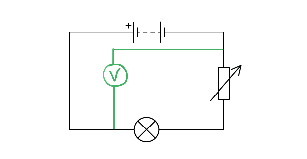
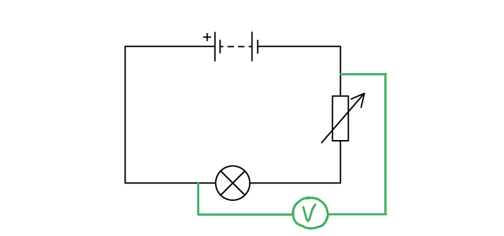
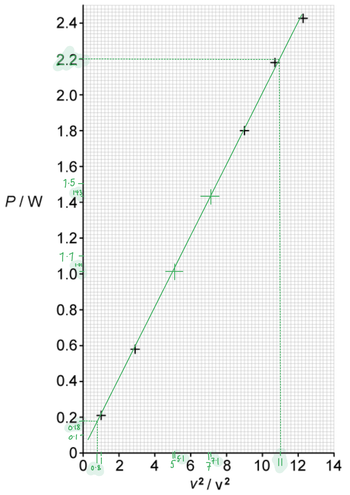

# Mark Schemes — Potential Difference & Power
**9. Electricity** · Cambridge (CIE) A-LEVEL physics (9702)

## Multiple Choice Questions (17 questions)

### Q1
**Final answer:** **The correct answer is C**

- List the known quantities

  - E.m.f., $E=240V$
  - Internal resistance of battery, $r=2.0Ω$
  - Current through heating element, $I_{H}=8.7A$
  - Resistance, $R=12Ω$
- Calculate the potential difference across the heating element

  - When a current $I_{H}$  is drawn from a non-ideal source (one with internal resistance *r*), the terminal potential difference $V_{H}$  across the load is less than the e.m.f.  $E$ due to the lost volts $I_{H}r$

$V_{H}=E-I_{H}r$

$V_{H} = 240 - ( 8.7 \times 2.0 )$

$V_{H}=222.6V$

- Calculate the power dissipated by the heating element

$P=V_{H}I_{H}$

$P=222.6\times8.7=1937W$

- Calculate the current through the resistor

$P=I^{2}R$

$I=\sqrt{\frac{P}{R}}$

$I = \sqrt{\frac{1937}{12}} = 12.7 \mathrm{A} = 13 \mathrm{A} ( 2 \mathrm{s} . \mathrm{f} . )$

### Q2
**Final answer:** **The correct answer is ****A**** because:**

- Potential difference is the energy transferred per unit charge, measured in volts (V) which is equivalent to joules per coulomb (J C−1)

Potential difference can also be described as:

- the difference in electrical potential between two points
- The work done per unit charge

### Q3
**Final answer:** **The correct answer is ****A**** because:**

- Power is equal to $P=VI$
- Potential difference, current and resistance are related by the equation $V=IR$
- We are given current and resistance, so we need to eliminate *V*
- Combining the two equations gives

  - $P = ( I R ) I = I^{2} R$
- So, $P = ( 550 \times 10^{- 3} )^{2} \times 180 = 54 = 50 \mathrm{W} ( 1 \mathrm{s} . \mathrm{f} . )$

### Q4
**Final answer:** **The correct answer is ****B**** because:**

- Power is equal to $P=VI$
- Potential difference, current and resistance are related by the equation $V=IR$
- We are given current and resistance, so we need to eliminate *V*
- Combining the two equations gives

  - $P = ( I R ) I = I^{ 2 } R$
- Let’s consider option B

  - Current *I* = 6 A, Resistance *R* = 4 Ω
  - $P=6^{2}\times4=144W$
- This is the highest power dissipation out of all the options (see other calculations below)

**A **is incorrect because $P=I^{2}R=8^{2}\times2=128W$

**C **is incorrect because $P=I^{2}R=4^{2}\times6=96W$

**D **is incorrect because $P=I^{2}R=2^{2}\times8=32W$

### Q5
**Final answer:** **The correct answer is ****C**** because:**

- $V=IR$
- $P=\frac{V^{2}}{R}$
- A fixed resistor means that the resistance does not change, therefore

  - $V\proptoI$
  - $P\proptoV^{2}$
- When the voltage doubles, the current also doubles

  - $2V\propto2I$
- When the voltage doubles, the power quadruples

  - $( 2 V )^{2} = 4 V^{2}$
  - $4 P \propto ( 2 V )^{2}$
- This is option **C**

### Q6
**Final answer:** **The correct answer is ****B**** because:**

- Potential difference is defined as the amount of electrical energy transferred between two points per unit of charge

  - In equation form this can be expressed as$V=\frac{E}{Q}$
  - Rearranging for charge *Q* gives $Q=\frac{E}{V}$
  - So, charge is equal to $Q=\frac{4.8}{2.0}=2.4C$
- The total charge is equal to $Q=ne$

  - Where *n* is the number of electrons and *e* is the charge of one electron
- So, the number of electrons is equal to $n=\frac{Q}{e}=\frac{2.4}{1.6\times10^{-19}}=1.5\times10^{19}$

### Q7
**Final answer:** **The correct answer is ****B**** because:**

- Power is equal to $P=VI$
- Potential difference is equal to $V=IR$
- Combining the two equations gives

  - $P = ( I R ) I = I^{2} R$
- The power dissipated in X is $=I^{2}R$
- The power dissipated in Y is $= ( 1 \frac{1}{2} )^{2} ( 2 R ) = \frac{2 I^{2} R}{4} = \frac{I^{2} R}{2}$

  - Therefore, the ratio  $\frac{powerdissipatedinY}{powerdissipatedinX}=\frac{I^{2}R}{2}\times\frac{1}{I^{2}R}=\frac{1}{2}$

### Q8
**Final answer:** **The correct answer is ****B**** because:**

- One lamp is rated 240 V, 60 W, this means that for the lamp to operate normally, there should be a potential difference (p.d.) of 240 V across it
- Electrical power is equal to $P=VI$

  - So, the current flowing through this lamp $=\frac{P}{V}=\frac{60}{240}=0.25A$
- The other lamp is rated 10 V, 2.5 W. This lamp operates normally when there is a p.d. of 10 V across it

  - Current flowing through the lamp$=\frac{P}{V}=\frac{2.5}{10}=0.25A$
- So, for normal operation, the same current of 0.25 A is required for both lamps. Since the lamps are connected in series, the same current would flow

  - So, both lamps light at their normal brightness
- In the same way, the sum of p.d. across the 2 lamps is equal to 240 + 10 = 250 V

### Q9
**Final answer:** **The correct answer is ****C**** because:**

- The known quantities are

  - Resistance of Lightbulb **X**, *R*X = 350 Ω
  - Resistance of Lightbulb **Y**, *R*Y = 500 Ω
- The power of the lightbulbs can be found using

  - $P=\frac{V^{2}}{R}$
- The potential difference for each light bulb will be the same as they are in parallel, therefore

  - $P\propto\frac{1}{R}$
- The power of Lightbulbs **X** and **Y** are

  - $P_{X}\propto\frac{1}{350}$
  - $P_{Y}\propto\frac{1}{500}$
- The value of the ratio of *P*X and *P*Y is

  - $\frac{P_{X}}{P_{Y}}=\frac{1}{350}\times\frac{500}{1}=\frac{500}{350}$
  - $\frac{P_{X}}{P_{Y}}=\frac{10}{7}$
- This is option **C**

### Q10
**Final answer:** **The correct answer is ****B**** because:**

- Power is equal to $P=VI$
- Current is equal to $I=\frac{V}{R}$
- Combining the two equations gives

  - $P = V ( \frac{V}{R} ) = \frac{V^{2}}{R}$
- For the circuit with the single resistor:

  - The power dissipated is $P_{1}=\frac{V^{2}}{R}$
- For the circuit with two resistors in series:

  - The combined resistance is 2R
  - The power dissipated is $P_{2}=\frac{V^{2}}{2R}$
- Comparing the two circuits:

  - 
  - on the right is $\frac{V^{2}}{2 R} = 1 \frac{1}{2} ( \frac{V^{2}}{R} ) = \frac{P}{2}$
- Therefore, the power dissipated by the circuit on the right is $\frac{P}{2}$

### Q11
**Final answer:** **The correct answer is ****C**** because:**

- Power is equal to $P=VI$
- Potential difference is equal to $V=IR$
- Combining the two equations gives

  - $P = ( I R ) I = I^{2} R$
- First, we must convert the uncertainty in current to a percentage uncertainty so we can add the percentage uncertainties together

  - Current $I=2.50A$
  - Uncertainty in current $\DeltaI=0.05A$
- So, the percentage uncertainty in current $= \frac{\Delta I}{I} \times 100 \% = \frac{0.05}{2.5} \times 100 = 2 \%$
- Since the power dissipated is given by $P=I^{2}R$  , the percentage uncertainty in power is $= ( 2 \times \% u n c e r t a i n t y i n I ) + ( \% u n c e r t a i n t y i n R )$

  - Therefore, $\% u n c e r t a i n t y i n P = ( 2 \times 2 \% ) + 2 \% = 4 + 2 = 6 \%$

### Q12
**Final answer:** **The correct answer is ****C**** because:**

- The known quantities are

  - The charge through the resistors, *Q* = 6 C
  - Resistance of **X**, *R*X = *R*
  - Resistance of **Y**, *R*Y = $\frac{R}{2}$
  - Potential difference in, *V*IN = *V*
- The potential difference of Resistor **X **can be calculated using

  - $V_{OUT}=\frac{R_{1}}{R_{1}+R_{2}}V_{IN}$
- Resistor **X** (*R*1) has a resistance of *R*, therefore

  - $V_{OUT}=\frac{R}{R+\frac{R}{2}}V$
  - $V_{OUT}=\frac{R}{\frac{3R}{2}}V$
  - $V_{OUT}=\frac{2}{3}V$
- The work done by Resistor **X** is

  - *W = QV*
  - $W=6\times\frac{2}{3}V=4V$
- The power of Resistor **X** is

  - $P=\frac{V^{2}}{R}$
  - $P = \frac{( \frac{2}{3} V )^{2}}{R}$
  - $P=\frac{4V^{2}}{9R}$
- This is option **C**

### Q13
**Final answer:** **The correct answer is ****B**** because:**

- Power is equal to $P=VI$
- Current is equal to $I=\frac{V}{R}$
- Combining the two equations gives

  - $P = V ( \frac{V}{R} ) = V^{ } \frac{2}{R}$
- For the same value of *V *:

  - $P\proptoI$ and $P\propto\frac{1}{R}$
  - Since$P\propto\frac{1}{R}$ at fixed$V$, lamp X (100 W) has a smaller resistance than Y (60 W)
- X has a higher power rating than Y, so it will have a greater current

  - $I_{X}>I_{Y}$
- X has a higher power rating than Y, so it will have a smaller resistance

  - $R_{X}<R_{Y}$

### Q14
**Final answer:** **The correct answer is ****D**** because:**

- Potential difference is defined as the amount of electrical energy transferred between two points per unit of charge

  - In equation form this can be expressed as $V=\frac{E}{Q}$
  - Rearranging for charge Q gives $Q=\frac{E}{V}$
- Therefore, the charge that flows is $Q=\frac{7.2\times10^{4}}{12}=6000C$

### Q15
**Final answer:** **The correct answer is ****C**** because:**

- Electrical power is equal to $P=VI$
- Power is also equal to $P=\frac{E}{t}$

  - Combining the two equations, $P=\frac{E}{t}=VI$
  - So, energy is equal to $E=VIt$
- The battery is described as '12 V, 40 ampere-hour', this means that the e. m .f. of the battery is *V* = 12 V
- From the example given, 40 ampere-hours means that a current of 0.2 A can be supplied for 200 hours or 0.2 A × 200 h = 40 A h
- We need to convert this to SI units
- We know that 1 hour = 3600 s, so, 40 ampere-hours = 40 × 3600 ampere-seconds
- This quantity represents current × time or $It$

  - Energy to $E=VIt=12\times40\times3600=1728000J$
- Therefore, the maximum energy that can be supplied is 1.7 MJ

### Q16
**Final answer:** **The correct answer is ****D**** because:**

- Power is equal to $P = V I = ( I R ) I = I^{ 2} R$
- The energy transferred in external resistor is equal to $E=Pt=I^{2}Rt$

  - Current $I=40.0\mathrm{mA}=40.0\times10^{-3}A$
  - Resistance $R=250Ω$
  - Time $t=60.0s$
- Energy transferred to the resistor $E = ( 40.0 \times 10^{- 3} )^{2} \times 250 \times 60.0 = 24.0 \mathrm{J}$

  - Therefore, since 6.0 J of energy is lost in internal resistance, the battery must supply a total of 6.0 + 24.0 = 30.0 J of energy to the whole circuit
- The energy supplied by battery is $E=QV$
- Where *Q* is the charge and *V* is the e. m .f of the battery.
- Charge transferred, $Q = I t = ( 40.0 \times 10^{- 3} ) \times 60.0 = 2.4 \mathrm{C}$

  - So, e. m. f of battery, $V=\frac{E}{Q}=\frac{30.0}{2.4}=12.5V$

### Q17
**Final answer:** **The correct answer is ****C**** because:**

- Potential difference is defined as the amount of electrical energy transferred between two points per unit of charge

  - In equation form this can be expressed as $V=\frac{E}{Q}$
  - Rearranging for energy gives $E=VQ$
- So, the amount of energy transferred $=VQ=20\times10=200J$
- Gravitational potential energy is equal to $=mgh$

  - Where *h* is the vertical distance moved by the mass,$h=x$
- We can equate this with the energy transferred by the charge:

  - $mgx=200J$
  - $x=\frac{200}{2\times10}=10m$
- Therefore, the charge is raised by 10 m

## Structured Questions (5 questions)

### Q1
Complete the table by adding the values for the current drawn for each appliance:

**One**** mark for each correct answer:**

| Appliance | Power rating | Current drawn |
|---|---|---|
| Desk lamp | 14 W | **Final answer:** **0.061 A** |
| 55 inch OLED TV | 125 W | **Final answer:** **0.54 A** |
| Toaster | 480 W | **Final answer:** **2.1 A** |
| Microwave | 900 W | **Final answer:** **3.9 A** |

**[Total: 4 marks]**

> *The equation used to calculate the answers is *$P=IV\RightarrowI=\frac{P}{V}$* *

> *The voltage for all appliances is 230 V. By substituting the powers given in the table, their corresponding currents can be easily calculated.*
Calculate the electrical work done by using the toaster on full power for 3 minutes:

List the known quantities:

- Toaster power, *P*  = 480 W
- Time, *t  = *3 minutes = 180 s **[1 mark]**

Recall the power equation:

- $P=\frac{W}{t}$

Rearrange for work and substitute the known quantities:

- $W=Pt$** **
- $W=480\times180$** [1 mark]**
- $W=86400J$** [1 mark]**

**[Total: 3 marks]**
Calculate the amount of charge that flowed through the toaster circuit during the 3 minutes of use:

List the known quantities:

- Work done, *W*  = 86 400 J (from part (b))
- Potential difference across toaster, *V*  = 230 V (from part (a))

Rearrange the equation for potential difference and charge:

- $V=\frac{W}{Q}$
- $Q=\frac{W}{V}$
- $Q=\frac{86400}{230}$ **[1 mark]**
- $Q=375.652$
- $Q=380C$ (2 s.f.) **[1 mark]**

**[Total: 2 marks]**
List the known quantities:

- Potential difference across the toaster, *V* = 230 V (from part (a))
- Power transferred to the toaster, *P*  = 480 W from part (a))

Recall the equation relating power, current and resistance:

- $P=\frac{V^{2}}{R}$ **[1 mark]**

Calculate the resistance:

- $R=\frac{V^{2}}{P}=\frac{230^{2}}{480}$ **[1 mark]**
- $R=110Ω$ **[1 mark]**

**[Total: 3 marks]**

> *This answer can also be found using **P = I**2**R , **with any differences being due to rounding. *

> *Ohm's law can also be used, but this is covered properly in the next topic.*

### Q2
The correct arrangement for the equation linking power, current and resistance is:

- $P=I^{2}R$ **[1 mark]**

**[Total: 1 mark]**
Calculate the power transferred to the resistor:

List the known quantities:

- Current, *I*  = 3.6 A
- Resistance, *R*  = 20 Ω

Substitute the known quantities into the equation from part (a):

- $P=I^{2}R$
- $P = ( 3.6 )^{2} \times 20$** [1 mark]**
- $P=259.2$** [1 mark]**
- $P = 260 \mathrm{W} ( 2 \mathrm{s} . \mathrm{f} . )$** [1 mark]**

**[Total: 3 marks]**
The correctly completed sentences are:

- When the **potential difference** is increased, more energy is transferred to each coulomb of charge passing through the cell; **[1 mark]**
- For a given potential difference, if **current**** **is increased, then the power transferred to a component is increased; **[1 mark]**
- A high current means that more power is wasted to the **thermal **store of the surroundings; **[1 mark]**

**[Total: 3 marks]**

> *When current is high, there are more collisions between charge-carrying electrons and the metal ions in the wire. This causes the ions to vibrate and in turn transfer energy to the thermal store of surroundings. This is why it is better to send electrical power over long distances with high voltages instead of high currents.*
A correct voltmeter looks like:

**One ****mark for correct placement of a voltmeter**

**OR**

**[Total: 1 mark]**

> *Your wires do not have to be perpendicular, or even straight, to gain this mark. This is just done for neatness. Provided the lines connecting the voltmeter to the circuit to the left of the bulb and above the variable resistor, your diagram will be correct.*

> *Just don't leave any gaps, however small, otherwise your voltmeter will not be connected. *

### Q3
A correctly completed table looks like:

| ***V***** / ****V** | ***V *****2**** / ****V ****2** | ***P***** / ****W** |
|---|---|---|
| 1.00 | 1.0 | **Final answer:** **0.21** |
| 1.71 | 2.9 | 0.58 |
| 2.25 | **Final answer:** **5.1** | **Final answer:** **1.01** |
| 2.67 | **Final answer:** **7.1** | 1.43 |
| 3.00 | 9.0 | 1.80 |
| 3.27 | 10.7 | **Final answer:** **2.18** |
| 3.50 | 12.3 | 2.43 |

i) Add correct units.

- All three units correct;** [1 mark]**

ii) Complete the missing data.

Square the corresponding value of *V*:

- Two missing data correct; **[1 mark]**

iii) Identify errors in the recorded the data and correct them:

- Power values are recorded to inconsistent precision; **[1 mark]**

**[Total: 3 marks]**
Complete the graph of the data on Fig. 1.2.

i) Plot the two missing points and complete the graph

A correct graph looks like:

- Plot at (5.1 , 1.01) correct to within half a small square; **[1 mark]**
- Plot at (7.1 , 1.43) correct to within half a small square; **[1 mark]**
- *Line of best fit: *thin, straight line (drawn with ruler) with approximately same number of plots on each side of the line; **[1 mark]**

ii) Determine the gradient of the graph

- Clear indication marked on the graph that the large triangle method has been used (occupying <u>at least two thirds</u> of the line); **[1 mark]**

*Gradient calculation*

- $gradient,m=\frac{Δy}{Δx}$
- $m=\frac{2.2-0.18}{11-0.8}$ **[1 mark]**
- $m=0.1980...$
- $m = 0.20 ( \mathrm{W} \mathrm{V}^{- 2} ) ( 2 \mathrm{s} . \mathrm{f} . )$ *(answer in the range 0.180 - 0.220, to 2 or 3 sig figs)* **[1 mark]**

iii) Use the gradient of the graph to obtain a value for R

- Since gradient represents *P*/*V*2 and *R* = *V*2/*P*, then *R* is the reciprocal of the gradient
- $R=\frac{1}{0.1980}=5.05=5.1Ω$ **[1 mark]**

**[Total: 7 marks]**

> *We have left the 'working out' annotations on our graph to demonstrate how important these are. Once you are finished with a graph question it should look like ours. By marking the scale we have made sure to get our plots correct. It's also worth trying the line of best fit a second time if you aren't sure about the first one.*

> *Your teacher wants you to work in pencil so that you can erase mistakes. This is very, very good advice, which you should follow. However, if you go over your final line in pen, and then rub out working or mistakes, your **examiner **will not mind. They are looking for accuracy.*
The rest of this question is based on the data in the table Fig. 1.1 in part (a)

i) Determine the value of *R* when *V* = 3.50 V

Use the data table to determine *P* when *V* = 3.50 V

- *P* = 2.43 W

Use the correct equation and substitute:

- $R=\frac{V^{2}}{P}=\frac{3.5^{2}}{2.43}=5.04$
- $R=5.0\mathrm{or}5.04Ω\mathrm{or}5.06Ω$ **[1 mark]**

ii) Calculate the percentage uncertainty in the value of *R* calculated in part (i):

List the known quantities:

- Uncertainty in *V* = ± 0.01 V
- Value of* V* = 3.5 V
- Uncertainty in *P* = ± 0.05 W
- Value of* P* = 2.43 W

Determine the percentage uncertainties in *V* and *P*:

**All marks are for answers to 2 or 3 sig figs ****only**

- Percentage uncertainty in *V*, $\%_{V} = ( \frac{0.01}{3.5} ) \times 100 = 0.29 \%$ **[1 mark]**
- Percentage uncertainty in *P*, $\%_{P} = ( \frac{0.05}{2.43} ) \times 100 = 2.1 \%$ **[1 mark]**

Write an expression to combine the percentage uncertainties in *V* and *P* and substitute:

- Percentage uncertainty in *R*, $\%_{R} = ( 2 \times \%_{V} ) + \%_{P}$
- $\%_{R} = ( 2 \times 0.29 ) + 2.1 = 2.7 \%$ **[1 mark]**

iii) Hence calculate the uncertainty in the value of *R*:

- Absolute uncertainty = percentage uncertainty × measured (or calculated) value
- Uncertainty of *R*, $U_{R}=0.027\times5.04=0.136=\pm0.1\mathrm{or}\pm0.14Ω$ **[1 mark]**

iv) State and explain whether the value of *R* you calculated in part (i) is consistent with the value of R you determined from the gradient in part (b):

Use the calculated value and uncertainty to establish a range of values:

- *R* from calculation = 5.04 ± 0.14 Ω **or **5.06 ± 0.14 Ω
- Therefore, 4.90 Ω ≤ *R* ≤ 5.18 Ω; **[1 mark]**

Compare to the value derived from the graph:

- *R* from graph = 5.05 Ω

- Therefore the value from the graph falls within the calculated range so they <u>are consistent</u>; **[1 mark]**

**[Total: 7 marks]**

### Q4
Calculate the power of each heater:

- From the data booklet: *P *= *IV*
- Heater A: *P**A* = 17 × 90 = 1530 W **AND**
- Heater B: *P**B* = 8.0 × 220 = 1760 W **AND**
- Heater C: *P**C* = 6.5 × 240 = 1560 W **[1 mark]**

Determine the efficiency of each heater:

- Recall the equation for efficiency, *E *= $\frac{\mathrm{useful} \mathrm{power} \mathrm{out}}{\mathrm{total} \mathrm{power} \mathrm{in}}$
- *E**A* = $\frac{1500}{1530}=0.98$ **AND**
- *E**B* = $\frac{1500}{1760}=0.85$ **AND**
- *E**C** = *$\frac{1500}{1560}=0.96$* ***[1 mark]**

Clarify the most efficient heater:

- Heater A is the most efficient heater; **[1 mark]**

**[Total: 3 marks]**

> *Don't let the efficiency confuse you. The power output is 1500 W because the heaters are all rated to provide an output power of 1500 W. The input power is the power obtained from the input current and potential difference. *

> *The marks can be awarded for efficiencies given as decimals or percentages.*
These heaters can be made more efficient by:

**Final answer:** **Any ****two ****from:**

- Reducing the internal resistance of the wiring / heating element; **[1 mark]**
- Reducing the length of the wiring in the heater; **[1 mark]**
- Increasing the cross-sectional area of the wires; **[1 mark]**
- Lubricating any moving parts within the heater; **[1 mark]**
- Using a heating element that produces less light; **[1 mark]**
- Using an LED requiring less potential difference in the heater; **[1 mark]**

**[Total: 2 marks]**
List the known quantities:

- Current, *I *= 17 A (From part (a))
- Potential difference, *V *= 90 V (From part (a))
- Time, *t  *= 20 minutes = 20 × 60 = 1200 s

Calculate the charge transferred, *Q*:

- From the data booklet: *Q *= *It*
- *Q *= 17 × 1200
- *Q* = 20 400 C **[1 mark]**

Calculate the work done by the heater, *W*:

- From the data booklet: $V=\frac{W}{Q}$$\rightarrow$*W *= *VQ* **[1 mark]**
- *W *= 90 × 20 400
- *W *= 1.8 × 106 J **[1 mark]**

**[Total: 3 marks]**
Use the equation for power with current to obtain the power of Y:

- From the data booklet: *P *= *I**2**R *
- Substitute the given quantities: *P *= (2*I*)2 × (5*R*)
- Simplify the equation: *P *= 4*I*2 × 5*R* **[1 mark]**
- So, *P *= 20*I*2*R* **[1 mark]**

**[Total: 2 marks]**

### Q5
The symbol for potential difference is:

- *V*; **[1 mark] **

The SI unit for potential difference is:

- Volt **OR** V; **[1 mark]**** **

**[Total: 2 marks] **

> *Confusingly, the letter used for the symbol of potential difference **V** is the same as its SI unit, V. You can tell the difference because symbols are always italicised and units never are.*
(i) The equation which relates electric charge and potential difference is:

- $\mathrm{potential} \mathrm{difference}=\frac{\mathrm{work} \mathrm{done}}{\mathrm{charge}}$ **[1 mark] **

(ii) Write one joule in equivalent units:

- *W* = *VQ, *where *W* is the energy transferred (or work done)
- Therefore, [*W*] = [*V*][*Q*]** [1 mark]**
- So, one joule J = volt × coulomb **OR** V C **[1 mark] **

**[Total: 3 marks]**

> *The first mark can also be gained with a symbol equation, but each symbol must be correctly defined.*
To find work done by a single electron:

List the known quantities:

- Potential difference, *V*  = 3.0 V

From the data page:

- Elementary charge, *e*  = 1.60 × 10−19 C

Recall the equation for potential difference:

- $V=\frac{W}{Q}$

Rearrange for work done and substitute the known quantities:

- Here, *Q*  is the charge on an electron
- $W = Q V = ( 1.60 \times 10^{- 19} ) \times 3.0$ **[1 mark]**
- $W=4.8\times10^{-19}J$ **[1 mark]**

**[Total: 2 marks]**
To find the new work done:

List the known quantities:

- Number of 3.0 V cell in total = 4
- Work done by an electron with one cell, *W*  = 4.8 × 10−19 J (from part (c))

Find the factor by which potential difference has increased:

- Potential difference was 3.0 V
- New potential difference is 3.0 × 4 = 12 V **[1 mark]**
- Potential difference has increased by a factor of 4

Find the new work done per electron:

- Potential difference is directly proportional to work

  - $W=QV$
  - Therefore, $W\proptoV$
- If p.d. has increased by a factor of 4, so has work done per electron
- New work done = 4 × 4.8 × 10−19 = 1.920...× 10−18
- New work done = 1.9 × 10−18 J (2 s.f.) **[1 mark]**

**[Total: 2 marks]**

> *This method uses proportionality, but you could have equally just found the new potential difference of 12 V and put it back into the potential difference equation. Notice how the answer is still given to two significant figures, as per the given quantities.*
