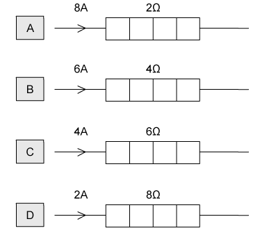
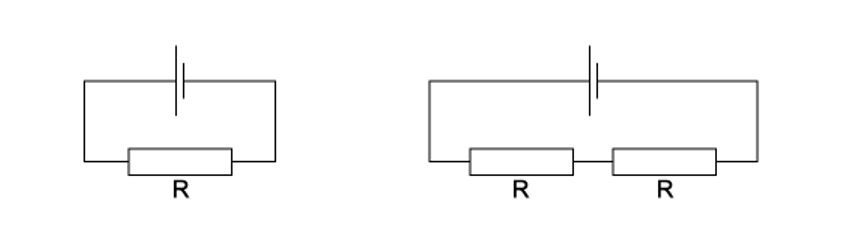

# Exam Questions — Potential Difference & Power
**9. Electricity** · Cambridge (CIE) A-LEVEL physics (9702)
> Source: [https://www.savemyexams.com/a-level/physics/cie/25/topic-questions/](https://www.savemyexams.com/a-level/physics/cie/25/topic-questions/) · 17 questions across 1 sets

## Multiple Choice Questions (17 questions)

### Q1 — hard — 1 marks

**Q1** [1 mark]

A battery with an electromotive force (e.m.f.) of 240 V and an internal resistance of 2.0 Ω is connected to a heating element. The element draws a current of 8.7 A.

The power dissipated by the heating element is the same as the power that would be dissipated by a 12 Ω resistor carrying a current of *I*.

What is the value of *I*?

### Q2 — easy — 1 marks

**Q2** [1 mark]

What is the correct definition for potential difference?

### Q3 — easy — 1 marks

**Q3** [1 mark]

A filament lamp has a resistance of 180 Ω when the current in it is 550 mA.

What is the power transformed in the lamp?

### Q4 — easy — 1 marks

**Q4** [1 mark]

The diagram shows four heaters and the current in each.

Which heater has the greatest power dissipation ?

### Q5 — hard — 1 marks

**Q5** [1 mark]

What is the effect on the current and power of a fixed resistor when the voltage across the resistor doubles?

|   | **Current** | ** Power** |
|---|---|---|
| **A.** | Quadruples | Doubles |
| **B.** | Doubles | Doubles |
| **C.** | Doubles | Quadruples |
| **D.** | Halves | Doubles |

### Q6 — medium — 1 marks

**Q6** [1 mark]

The potential difference across a component in a circuit is 2.0 V.

How many electrons must flow through this component in order for it to be supplied with 4.8 J of energy?

### Q7 — medium — 1 marks

**Q7** [1 mark]

A power cable X has resistance *R* and carries current $I$.

A second cable Y has resistance 2*R* and carries current $\frac{I}{2}$

What is the ratio $\frac{powerdissipatedinY}{powerdissipatedinX}$  ?

### Q8 — medium — 1 marks

**Q8** [1 mark]

Two lamps are connected in series to a 250V power supply. One lamp is rated 240V, 60W and the other is rated 10V, 2.5W.

Which statement most accurately describes what happens ?

### Q9 — hard — 1 marks

**Q9** [1 mark]

Two lightbulbs, **X** and **Y**, are in parallel and are attached to a cell which has a potential difference of 75 V. Lightbulb **X** has a resistance of 350 Ω and Lightbulb **Y **has a resistance of 500 Ω. The power of Lightbulbs **X** and **Y** are *P*X and *P*Y respectively.

What is the value of the ratio $\frac{P_{X}}{P_{Y}}$?

### Q10 — medium — 1 marks

**Q10** [1 mark]

The diagrams show two different circuits.

The cells in each circuit have the same electromotive force and zero internal resistance. The three resistors each have the same resistance *R*.

In the circuit on the left, the power dissipated in the resistor is *P*.

What is the total power dissipated in the circuit on the right?

### Q11 — medium — 1 marks

**Q11** [1 mark]

In a simple electrical circuit, the current in a resistor is measured as (2.50 ± 0.05) A. The resistor is marked as having a value of 4.7Ω  ± 2 %.

If these values were used to calculate the power dissipated in the resistor, what would be the percentage uncertainty in the value obtained?

### Q12 — hard — 1 marks

**Q12** [1 mark]

Two resistors, **X** and **Y**, are in series with a cell that has a potential difference of *V*. The resistance of **X** and **Y **is *R* and $\frac{R}{2}$ respectively.

Given that the charge through both resistors is 6 C, what is the power and work done by **X**?

|   | **Work done** | **Power** |
|---|---|---|
| **A.** | 2V | $\frac{8V^{2}}{9R}$ |
| **B.** | 3V | $\frac{V^{2}}{2R}$ |
| **C.** | 4V | $\frac{4V^{2}}{9R}$ |
| **D.** | 6V | $\frac{V^{2}}{R}$ |

### Q13 — hard — 1 marks

**Q13** [1 mark]

The ratings of two lamps are as follows:

| **X** | 230 V, 100 W |
|---|---|
| **Y** | 230 V, 60 W |

During normal operation, which of the lamps will have larger current and resistance?

### Q14 — easy — 1 marks

**Q14** [1 mark]

A 12 V battery is charged by connecting it to a source of electromotive force (e.m.f.). The battery is supplied with 7.2 × 104 J of energy in this time.

How much charge flows through the battery?

### Q15 — medium — 1 marks

**Q15** [1 mark]

The charge that an electric battery can deliver is specified in ampere-hours.

For example, a battery of capacity 40 ampere-hours could supply, when fully charged, 0.2 A for 200 hours.

What is the maximum energy that a fully charged 12 V, 40 ampere-hour battery could supply ?

### Q16 — medium — 1 marks

**Q16** [1 mark]

A battery, with a constant internal resistance, is connected to a resistor of resistance 250 Ω, as shown.

The current in the resistor is 40.0 mA for a time of 60.0 s. During this time 6.0 J of energy is lost in the internal resistance.

What is the energy supplied to the external resistor during the 60.0 s and the e.m.f of the battery ?

|   | **Energy / J** | **E. m. f / V** |
|---|---|---|
| **A**  **B**  **C**  **D** | 2.4  2.4  24.0  24.0 | 2.4  7.5  10.0  12.5 |

### Q17 — hard — 1 marks

**Q17** [1 mark]

The amount of energy transferred when 10 C of charge passes through a p. d. of 20 V is the same as the energy needed to raise a 2 kg mass through a distance *x*.

Taking gravitational field strength to be 10 N kg–1.

What is the value of *x*?
