# Mark Schemes — Resistance & Resistivity
**9. Electricity** · Cambridge (CIE) A-LEVEL physics (9702)

## Multiple Choice Questions (56 questions)

### Q1
**Final answer:** **The correct answer is ****C ****because:**

- The resistance of a wire is given by $R=\frac{ρL}{A}$
- Let's compare each of these quantities

  - The wires are all made of the same material, so the resistivity *ρ* is the same for both
  - Both wires have the same length *x*
  - The only difference between the two resistors is the number of wires in each configuration
- Both resistors contain the same amount (volume) of material, so the cross-sectional area *A* of resistor P will equal to collective cross-sectional areas of all the wires in resistor Q
- Therefore, since none of the quantities in  $R=\frac{ρL}{A}$are different, P and Q both have the same resistance

### Q2
**Final answer:** **The correct answer is ****C**** because:**

- In this question, we must look at the values of potential difference (p.d.) of each component at each current to determine which two values of p. d. add up to make 9 V
- Consider option C, at 0.3 A:

  - The p. d. of the resistor is 6 V
  - The p .d. of the lamp is 3 V
- In a series circuit, the e. m. f from the battery is split between the components, so we just add them together

  - So, the total p. d. of the components is 6 + 3 = 9 V
- This is the e. m .f of the battery, so the current is 0.3 A

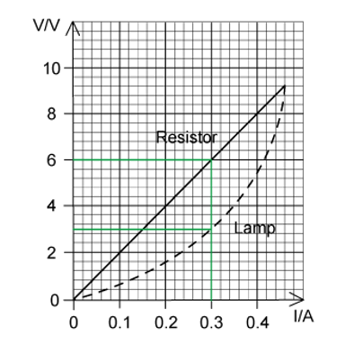

**A **is incorrect because p .d. of the resistor = 2 V, p. d. of the lamp = 0.6 V

Total p d. = 2.6 V

**B **is incorrect because p .d. of the resistor = 4 V, p. d. of the lamp = 1.6 V

Total p .d. = 5.6 V

**D **is incorrect because p. d. of the resistor = 8 V, p d. of the lamp = 5.4 V

Total p. d. = 13.4 V

### Q3
**Final answer:** **The correct answer is ****D ****because:**

- Potential difference across a resistor is equal to $V=IR$
- Current is equal to $I=\frac{Q}{t}$
- Combining these equations gives $V=\frac{QR}{t}$
- Rearranging this for charge *Q* gives $Q=\frac{Vt}{R}$

  - The p.d. through each 10 Ω resistor is $V=3.0V$
  - The time is equal to $t=60s$
- So, $Q=\frac{Vt}{R}=\frac{3.0\times60}{10}=18C$

### Q4
**Final answer:** **The correct answer is ****C ****because:**

- Potential difference across a resistor is equal to $V=IR$
- Current is equal to $I=\frac{Q}{t}$
- Combining these equations gives $V=\frac{QR}{t}$

  - So, the potential difference is $V=\frac{8.0\times30}{20}=12V$

### Q5
**Final answer:** **The correct answer is ****D ****because:**

- A thermistor is a type of resistor whose resistance varies significantly with temperature; generally, the resistance decreases with an increase in temperature

  - So, for the resistance of the thermistor to be high, the temperature must be low
- A light-dependent resistor (LDR) is a light-controlled variable resistor. The resistance of an LDR decreases with increasing incident light intensity

  - For the resistance of an LDR to be high, the light level must be low

### Q6
**Final answer:** **The correct answer is ****A ****because:**

- A semiconductor diode is a device that has very low resistance in one direction and a very high resistance in the other direction

  - Think of it like a ball at the top of a hill: it can roll from top to bottom easily, but requires external energy to take it from the bottom to the top of the hill

- When there is no current, the resistance is infinite. Because of this, the electrical resistance of the diode is very high or infinite for negative voltages until about –1.5 V

- The electrical resistance of the diode decreases from 0.5 V onwards
- At 1.0 V, the current is equal to 50 mA or 0.05 A

  - So, the resistance at this point is $R=\frac{V}{I}=\frac{1.0}{0.05}=20$** **Ω

### Q7
**Final answer:** **The correct answer is ****C**** because:**

- The resistance of a wire is given by $R=\frac{ρL}{A}$
- When a potential difference is applied across the metal rod and the case, current *I* will flow through the liquid as shown
- The current will flow over a length *L* and through a cross-sectional area *A*
- In this case, the cross-sectional area is the surface area of the cylinder $( 2 πrh )$, where *h* is equal to the depth *y*
- So, the cross-sectional area *A* is proportional to *y*

  - Therefore, *R* is inversely proportional to *y*

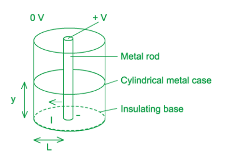

### Q8
**Final answer:** **The correct answer is ****B ****because:**

- The LDR and the 5 kΩ resistor form a potential divider
- The potential divider equation is given by $V_{e m f} \times ( \frac{R_{1} }{R_{1} + R_{2} } )$ , where:

  - *V **emf* is the e. m .f. of the supply = 1.5 V
  - *R**1* is the resistance across the LDR = *R*
  - *R**2* is the resistance of the fixed resistor = 5 kΩ
- So, the p. d. across the LDR is equal to $\frac{1.5 R}{( R + 5000 )}$
- When *R* is 1000 kΩ, the p. d. is very close to 1.5 V:

  - $V = 1.5 \times ( \frac{( 1 \times 10^{6} )}{( 1 \times 10^{6} ) + 5000} ) = 1.492 \approx 1.5 \mathrm{V}$
- When *R* is 1 kΩ, then the p. d. is about $\frac{1.5}{6}$  :

  - $V = 1.5 \times ( \frac{1000}{1000 + 5000} ) = 0.25 \mathrm{V}$
- So, the graph must show a peak value of very close to 1.5 and a minimum value that is more than zero

**A **is incorrect because this graph shows the minimum to be only slightly less than 1.5 V

**C **is incorrect because this graph shows the minimum to be zero

**D **is incorrect because the maximum is far below 1.5 V

### Q9
**Final answer:** **The correct answer is ****C ****because:**

- Ohm's law states $V=IR$
- Therefore, for the voltmeter to read a high value, the resistance of the component to which it is connected must be high
- A thermistor is a type of resistor whose resistance varies significantly with temperature; generally, the resistance decreases with an increase in temperature

  - So, for the reading on VT to be high, the resistance of the thermistor should be low meaning **the temperature must be high**
- A light-dependent resistor (LDR) is a light-controlled variable resistor. The resistance of an LDR decreases with increasing incident light intensity

  - For the reading on VL to be high, the resistance of LDR should be high meaning **the light level must be low**

### Q10
**Final answer:** **The correct answer is ****D ****because:**

- The value of *R* is $R=\frac{V}{I}=\frac{15.0}{2.0}=7.5$Ω
- From the equation , the formula to work out the uncertainty in resistance is

  - $( \frac{\Delta R}{R} ) = ( \frac{\Delta V}{V} ) + ( \frac{\Delta I}{I} )$
- To work out uncertainty in data which is multiplied or divided we add the uncertainties

  - $( \frac{\Delta R}{R} ) = ( \frac{0.5}{15.0} ) + ( \frac{0.2}{2.0} ) = \frac{2}{15}$
- Then, to find the uncertainty in *R* we multiply by the calculated value of *R*

  - $\DeltaR=\frac{2}{15}\times7.5=$± 1 Ω

### Q11
**Final answer:** **The correct answer is ****C**** because:**

- Ohm's Law states that $V=IR$
- This means the slope of an *I - V* graph that is a straight line is equal to $\frac{1}{R}$
- The *I-V* graph consists of two sections

  - The first section at lower voltages has constant resistance because it is a linear *I -V* relationship
  - The second half at higher voltages has increasing resistance because the gradient is decreasing
- Therefore, in an R–V graph, initially the line would be horizontal as $\frac{V}{I}$ is constant, then, the line will begin to curve upwards as *R* increases

  - Option C corresponds best to this description

**A **is incorrect because the resistance does not stay constant, or the *I - V* graph would be completely straight

**B **is incorrect because even though the first section of this graph is correct, the second half shows the resistance is decreasing in the second half, which is incorrect

**D **is incorrect because the first half of the *I - V* graph shows the component has an initial resistance which is constant, it does not begin at zero and it does not increase linearly

### Q12
**Final answer:** **The correct answer is ****D**** because:**

- In the first test, when all the switches are open, the meter reads infinity

  - This is obvious since the circuit is incomplete and no current flows
- In the second test, where only S1 is closed, we can see that lamp A is not faulty

  - This is because the ohm-meter reads 15Ω, proving that a current is passing through component A
- In the third test where S1 is open, S2 is closed and S3 is open, the meter reads a resistance of 30Ω, so, this test proves that lamp B is also not faulty

  - This is because components A and B are now connected in series, giving a total resistance of 15 + 15 = 30Ω
- In the last test, where only S1 is open, the resistance reading is 15Ω
- This proves that lamp C is shorted, meaning the current passes through as if there was no lamp

  - In this case, it's as if a wire of negligible resistance is connected in parallel with lamp B, and since Ohm's Law , $Iα\frac{1}{R}$ the current is larger when the resistance is smaller
  - So, all current would flow in that wire instead of through lamp B (since lamp B has some resistance)
  - Now, the only resistance encountered by the current is due to lamp A only, so, that's why the reading on the ohm-meter is 15Ω

**Exam Tip: **Remember current flow in a circuit will always take the route with the least resistance. If S1 and S2 were closed, and S3 was opened, the ohm-meter would again read 15Ω since all the current would pass through S1 (which has no resistance) instead of passing through lamp B (which has some resistance) and therefore, the current would then flow through lamp A (which is the only lamp that causes a resistance in this case)

### Q13
**Final answer:** **The correct answer is ****B**** because:**

- The resistance of a wire is given by $R=\frac{ρL}{A}$
- Cross-sectional area of a wire is equal to `A = pi r ^2 = pi ( d / 2 ) ^2 = pi ( d / 2 ) ^2 = pi d ^2 / 4`
- When the pipe expands

  - The new length is given by $L ' = ( 1 + 0.04 ) L = 1.04 L$
  - The new cross-sectional area is given by $A ' = ( 1 - 0.01 )^{2} A = ( 0.99 )^{2} A$  (squared because A is proportional to d2)
  - The resistivity ρ doesn't change since the material stays the same
- So, the new resistance is equal to

  - $R ' = \frac{\\rho L '}{A '} = \frac{1.04 \\rho L}{( 0.99 )^{2} A} = \frac{1.04}{( 0.99 )^{2}} R = \frac{1.04}{( 0.99 )^{2}} \times 2.5 = 2.653 \mathrm{k}$Ω
- Therefore, the new resistance is 2.65 kΩ

### Q14
**Final answer:** **The correct answer is ****D**** because:**

- Ohm's law states $V=IR$ or $I=\frac{V}{R}$
- From Kirchhoff's Second Law the p. d. is the same across P and Q
- So, ratio $\frac{I_{P}}{I_{Q}}=\frac{R_{Q}}{R_{P}}$
- The resistance of a wire is given by $R=\frac{ρL}{A}$
- Cross-sectional area is equal to `A = πr ^2 = pi ( d / 2 ) ^2 = πd ^2 / 4`

  - So, `R = (rho L)/(A) = rho L ( 4 / πd ^2 )`
- For wire Q, the length is *L,* and the diameter is 3*d*
- So, the resistance of wire Q is equal to

  - $R_{Q} = \\rho L ( \frac{4}{ \mathrm{\pi } ( 3 \mathrm{d} )^{2}} ) = \frac{4}{9} ( \frac{\\rho L}{πd^{2}} )$
- For wire P, the length is 2*L,* and the diameter is *d*
- So, the resistance of wire P is equal to

  - `R _ P = rho ( 2 L ) ( 4 / πd ^2 ) = 8 ( (rho L)/(πd ^2) )`
- Ratio  `I _ P / I _ Q = R _ Q / R _ P = 4 / 9 ( (rho L)/(πd ^2) ) / 8 ( (rho L)/(πd ^2) ) = 4 / 9 x 1 / 8 = 1 / 18`

### Q15
**Final answer:** **The correct answer is ****B because:**

- Copper has half the resistivity of the alloy $ρ_{c}=\frac{1}{2}ρ_{a}$
- The resistance of a wire is given by $R=\frac{ρL}{A}$
- Both wires have the same resistance, $R$ and length, $L$, so

  - $ρ_{c}\frac{L}{A_{c}}=ρ_{a}\frac{L}{A_{a}}$
  - $\frac{ρ_{c}}{A_{c}}=\frac{ρ_{a}}{A_{a}}$
- Substitute $p_{c}=\frac{1}{2}ρ_{a}$

  - $\frac{1}{2A_{c}}=\frac{1}{A_{a}}$
  - $A_{a}=2A_{c}$
- The alloy wire must have twice the cross-sectional area
- Since area is proportional to diameter squared

  - $\frac{A_{a}}{A_{c}}=\frac{d_{a}^{2}}{d_{c}^{2}}=2$
  - $\frac{d_{a}}{d_{c}}=\sqrt{2}$
- This is answer **B**

### Q16
**Final answer:** **The correct answer is ****D ****because:**

- The resistance of a wire is given by $R=\frac{ρL}{A}$
- As the strain in the specimen is increased, the wire is extended meaning its length increases
- Resistance and wire length are directly proportional, so an increase in length results in an increase in resistance
- At the same time, the strain causes the cross-sectional area of the wire to become smaller (as the overall volume does not change)
- Resistance and cross-sectional area are inversely proportional, so, a decrease in cross-sectional area also results in an increase in the resistance
- So, as the strain in the specimen increases, the resistance of the wire increases, because the length increases and the cross-sectional area decreases

### Q17
**Final answer:** **The correct answer is ****C ****because:**

- Ohm's Law is defined by the equation $V=IR$
- A filament lamp does not follow Ohm's Law since the variation of I with V is not linear, and a straight line is not obtained
- Resistance is equal to $R=\frac{V}{I}$
- As current increases, the filament temperature increases, increasing resistance
- Consider option **C**:

  - At *V* = 6.0 V, current *I* = 3.2 A
  - Resistance $R=\frac{V}{I}=\frac{6.0}{3.2}=1.875$Ω
- Therefore, the resistance at 6.0 V is 1.9 Ω; this matches option **C** correctly

**A **is incorrect because At *V* = 2.0 V, current *I* = 1.8 A, Resistance  $R=\frac{2.0}{1.8}=1.11$Ω

This value ≠ 1.5 Ω

**B **is incorrect because At *V* = 4.0 V, current *I* = 2.5 A, Resistance  $R=\frac{4.0}{2.5}=1.6$ Ω

This value ≠ 3.2 Ω

**D **is incorrect because At *V* = 8.0 V, current *I* = 3.6 A, Resistance  $R=\frac{8.0}{3.6}=2.2$ Ω

This value  ≠ 0.9 Ω

**Exam Tip:** The values of current *I* read from the graph may not be exact for all the points, but they are close to the correct value. You do not need to be extra precise in these types of question (but you do in the written answer questions!)

### Q18
**Final answer:** **The correct answer is ****C ****because:**

- The resistance of a wire is given by $R=\frac{ρL}{A}$
- Cross-sectional area is equal to `A = pi r ^2 = pi ( d / 2 ) ^2 = pi d ^2 / 4`

  - So, `R = (rho L)/(A) = rho L ( 4 / pi d ^2 )`
- The two wires have the same resistance and same length

  - Resistance in wire X$= \frac{4 ( 1.7 \times 10^{- 8} ) L}{ \mathrm{\pi } ( 0.315 )^{2}}$
  - Resistance in wire Y$= \frac{4 ( 5.6 \times 10^{- 8} ) L}{ \mathrm{\pi } \mathrm{d}^{2}}$
- Resistance in wire X = Resistance in wire Y

  - $\frac{4 ( 1.7 \times 10^{- 8} ) L}{ \mathrm{\pi } ( 0.315 )^{2}} = \frac{4 ( 5.6 \times 10^{- 8} ) L}{ \mathrm{\pi } \mathrm{d}^{2}}$
- Cancelling the common terms $( \frac{4 L}{ \mathrm{\pi } } )$  , we have

  - $\frac{1.7 \times 10^{- 8} }{( 0.315 )^{2}} = \frac{5.6 \times 10^{- 8} }{d^{2}}$
- Rearranging for *d**2*

  - $d^{ 2} = \frac{( 5.6 \times 10^{- 8} ) ( 0.315 )^{2}}{1.7 \times 10^{- 8} } = 0.327$
- Therefore, the diameter of wire Y is

  - $d=\sqrt{0.327}=0.57\mathrm{mm}$

### Q19
**Final answer:** **The correct answer is ****D**** because:**

- Ohm's Law states that $V=IR$ , or $R=\frac{V}{I}$
- For the metal conductor:

  - At *V* = 2 V, the current is *I* = 0.68 A
- So, the resistance of the metal conductor is:

  - $R_{M}=\frac{V}{I}=\frac{2}{0.68}=\frac{50}{17}=3$Ω
- For the thermistor, at point A:

  - At *V* = 2 V, the current is *I* = 0.27 A
- The resistance at point A is simply found by reading the values of current and p. d. from the axes, **not** from taking the tangent of this point on the curve, so the resistance of the thermistor is:

  - $R_{T}=\frac{V}{I}=\frac{2}{0.27}=\frac{200}{27}=7.4$ Ω
- So, the ratio is given by :

  - `R _ T / R _ M = ( 200 / 27 ) / ( 50 / 17 ) = ( 5 / 2 )`

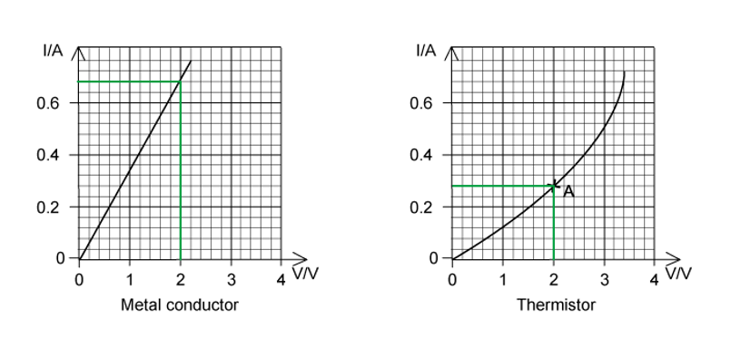

### Q20
**Final answer:** **The correct answer is ****C**** because:**

- The resistance of a wire is given by $R=\frac{ρL}{A}$
- Let's call the new length and cross-sectional area *L' *and *A'* respectively
- Since the volume remains constant

  - $V=AL=A'L'$
- When the wire expands

  - The new length is given by $L ' = ( 1 + 0.05 ) L = 1.05 L$
  - The new cross-sectional area is given by $V = A L = ( 1.05 L ) ( \frac{A}{1.05} )$
  - So, $A^{'}=\frac{A}{1.05}$
  - The resistivity *ρ* doesn't change since the material stays the same
- So, the new resistance is equal to

  - $R ' = \frac{\\rho L '}{A '} = \\rho ( 1.05 ) ( \frac{1.05}{A} ) = ( 1.05 )^{2} ( \frac{\\rho L}{A} ) = 1.10 R$
- Therefore, the percentage change in *R* is equal to

  - (1.10 – 1.00) × 100 % = 10 %

### Q21
**Final answer:** **The correct answer is ****C ****because:**

- The resistance of a wire is given by $R=\frac{ρL}{A}$
- So, resistivity is equal to $ρ=\frac{AR}{L}$
- From Ohm's law, resistance is equal to $R=\frac{V}{I}$
- So, combining this with the equation for resistivity, we get

  - $ρ=\frac{VA}{IL}$
- The cross-sectional area of the block is equal to the area of the grey rectangle through which the current flows

  - $A=lw$ , where *l* is the length and *w* is the width
- So, resistivity is equal to $ρ=\frac{Vlw}{IL}$

  - The p. d. is equal to* V* = 10.0 V
  - The current through the block is equal to* I* = 30 mA = 30 × 10–3 A
- The dimensions of the block are equal to

  - *l* = 15 × 10–3 m, *w* = 30 × 10–3 m, *L* = 15 × 10–3 m
- So, resistivity $\\rho = \frac{V l w}{I L} = \frac{10 \times ( 15 \times 10^{- 3} ) \times ( 30 \times 10^{- 3} )}{( 30 \times 10^{- 3} ) \times ( 15 \times 10^{- 3} )} = 10$ Ωm
- Next, we must consider the uncertainty in resistivity *ρ*

  - $\frac{\Delta \\rho }{\\rho } = ( \frac{\Delta V}{V} ) + ( \frac{\Delta l}{l} ) + ( \frac{\Delta w}{w} ) + ( \frac{\Delta I}{I} ) + ( \frac{\Delta L}{L} )$
  - $\Delta \\rho = [ ( \frac{\Delta v}{V} ) + ( \frac{\Delta l}{l} ) + ( \frac{\Delta w}{w} ) + ( \frac{\Delta I}{I} ) + ( \frac{\Delta L}{L} ) ] \times \\rho$
  - $\Delta \\rho = [ ( \frac{0.1}{10} ) + ( \frac{0.2}{15} ) + ( \frac{0.2}{30} ) + ( \frac{0.1}{30} ) + ( \frac{0.2}{15} ) ] \times 10$
  - Δ*ρ* = 0.467 = 0.5 Ωm
- Therefore, resistivity is equal to *ρ* = 10.0 ± 0.5 Ωm

### Q22
**Final answer:** **The correct answer is ****B**** because:**

- An incandescent bulb is equivalent to a filament lamp, in which the resistance increases as V increases
- You are not expected to know what the graph of a gas discharge bulb looks like, but just to realize it is non-Ohmic
- A device is said to be non-Ohmic if the resistance across it is not constant, but changes in a way that depends on the voltage across it
- In this case, the I-V graph is not a straight line but has some curvy shape. Devices such as this do not have a constant value of resistance; the resistance is called dynamic resistance because it is constantly changing as V and I change

The *I-V* graphs are for the following components:

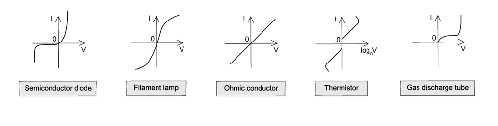

**Exam Tip:** Note the graph for the thermistor is plotted as *I* against log *V*, making it easier to plot large values of *V*. Don't let this confuse you, logs are just another way of writing exponential equations, one that allows you to separate the exponent on one side of the equation.  For example, the equation 24 = 16 can be rewritten as log2(16) = 4 and expressed as "log to the base 2 of 16 is 4". Rest assured; you will not be expected to deal with logarithmic scales in the AS course.

### Q23
**Final answer:** **The correct answer is ****C ****because:**

- When the train is present, it is stated that most of the current flows through the wheels and axles of the train in preference to the relay coil
- So, there is little current in the relay coil; therefore, the energy lost in the relay coil when a train is present is already limited
- Ohm's Law states $V=IR$ , so the link between current and resistance is $I=\frac{V}{R}$
- The resistor actually limits the current flowing in the circuit when the train is present
- Therefore, this prevents a short circuit of the battery when a train is present

**A **is incorrect because the heating of the wheels due to the current is small compared to the heating due to its motion

**B & D **are incorrect because the relay is already protected, so this isn't the reason for needing a resistor

### Q24
**Final answer:** **The correct answer is ****C**** because:**

- The sum of p.d.s around a closed loop equals the e.m.f.

  - Ohm's Law is $I=\frac{V}{R}$
- So, the current across the 375 Ω resistor is $\frac{1.2}{375}=3.2\times10^{-3}A=3.2\mathrm{mA}$

  - This means the current through the semiconductor diode and *R**1* is 7.6 – 3.2 = 4.4 mA

- To find the p. d. across the semiconductor diode we need to use the graph

  - For a current of 4.4 mA, the p. d. from graph is 0.5 V
- So, p. d. across *R**1* = 1.2 – 0.5 = 0.7 V

  - Resistance is equal to $R=\frac{V}{I}=\frac{0.7}{4.4\times10^{-3}}=159$ Ω
- Therefore, the resistance across *R**1* is 160 Ω

### Q25
**Final answer:** **The correct answer is ****B**** because:**

- In this question we will refer to density by *d *and resistivity by *ρ*
- Density of a material is given by $d=\frac{m}{v}$

  - The mass of the aluminium rod is $m_{A}=d_{A}V_{A}$
  - The mass of the copper rod is $m_{c}=d_{c}V_{c}$
- The volume of a rod is given by $V=AL$

  - The volume of the aluminium rod is $V_{A}=A_{A}L$
  - The volume of the copper rod is $V_{c}=A_{c}L$
- The ratio of mass of aluminium to mass of copper is equal to

  - $\frac{m_{A}}{m_{c}}=\frac{d_{A}V_{A}}{d_{c}V_{c}}=\frac{d_{A}A_{A}L}{d_{c}A_{c}L}=\frac{d_{A}A_{A}}{d_{c}A_{c}}$
- Since $d_{c}=3d_{A}$  (the density of copper is three times that of aluminium)

  - `m _ A / m _ c = (d _ A A _ A)/(3 d _ A A _ c) = 1 third ( A _ A / A _ c )`
- The resistance of a wire is given by $R=\frac{ρL}{A}$
- Since the resistance and length of the rods are the same, $\frac{ρ}{A}$ is constant, so:

  - $\frac{ρ_{c}}{A_{c}}=\frac{ρ_{A}}{A_{A}}$
  - $\frac{A_{A}}{A_{c}}=\frac{ρ_{A}}{ρ_{c}}$
- The question states the resistivity of copper is half that of aluminium, therefore  $ρ_{A}=2ρ_{c}$
- Since *R* and* L* are identical for both rods, the ratio of their cross-sectional areas must match the ratio of their resistivities

  - $\frac{A_{A}}{A_{c}}=\frac{ρ_{A}}{ρ_{C}}=\frac{2}{1}$
- Therefore, the ratio `(m a s s o f a l u m i n i u m)/(m a s s o f c o p p e r) = m _ A / m _ c = 1 third ( A _ A / A _ c ) = 1 third x 2 / 1 = 2 / 3`

### Q26
**Final answer:** **The correct answer is ****B**** because:**

- Ohm's Law states that $V=IR$, or $R=\frac{V}{I}$
- This means the slope of the *I -V* graph is equal to $\frac{1}{R}$
- Therefore, as current *I* increases, *R* increases gradually as the slope decreases
- Electrical power is equal to $P = V I = ( I R ) I = I^{2} R$ , or $R=\frac{P}{I^{2}}$
- The slope of a *P – I**2* graph is equal to *R*
- Therefore, from the graph of *P – I**2*, as *R* increases the slope of *P – I**2* increases as *I* increases

### Q27
**Final answer:** **The correct answer is ****C**** because:**

- Ohm's Law states $V=IR$

  - In this case, the current is constant along the wire, only the resistance changes and this causes a proportional change in the potential difference
- Resistance of wire is equal to $R=\frac{ρL}{A}$
- When the length of wire* L* is at a maximum distance from the zero potential reference, resistance *R* will also be at a maximum and hence, potential difference *V* too (since $RαLαV$ )

  - So, as distance *x* increases, the length *L* decreases, and so, *R* and *V* also decrease
- Now, the diameter of the wire is falling linearly as *x* increases, but the area of cross-section A is not falling linearly as `A = pi ( d / 2 ) ^2`   where *d* is the diameter
- Since resistance *R* is inversely proportional to cross-sectional area *A *$( R \\alpha \frac{1}{A} )$ it is also inversely proportional to *d**2* (when *d* is small, *R* is large)
- Therefore, there is a greater percentage fall (in resistance, and hence, potential difference) per unit length at the narrow end than at the wide end, meaning the decrease is not linear, but depends on *d**2*
- $\frac{V}{x}$This means that potential difference per unit length (this is represented by the gradient of the graphs shown which equal to  ) is less at the wide end than at the narrow end (the gradient at the highest value of *x* should be greater than the gradient at *x* = 0, and the gradient keeps on increasing from *x* = 0 as *x* increases)

**A **is incorrect because *V* decreases with distance, whereas this graph shows it stays constant

**B **is incorrect because *V* depends on *d **2* and therefore does not decrease linearly

**D **is incorrect because the gradient is highest at *x* = 0 and gradually increases

### Q28
**Final answer:** **The correct answer is ****D ****because:**

- Graph P shows a component which obeys Ohm's Law
- Graph Q shows a component whose resistance decreases with *V*, unlike the graph for a filament lamp
- Power dissipated is equal to $P=VI$
- At current *I* = 0.5 A

  - Graph P: *V* = 2.0 V
  - Graph Q: *V* = 4.0 V
- So, for graph Q, *V* is twice that of graph P ; therefore the power dissipated in Q is double that in P

  - Since $( 2 V ) I = 2 P$

**A **is incorrect because the *I-V* characteristics of a filament lamp would should a decreasing gradient, unlike the graph Q, which has an increasing gradient. This is because as *V* increases, the temperature of the lamp increases, causing the resistance to increase

**B **is incorrect because as *V* increases, the current *I* increases. From Ohm's Law, $I=\frac{V}{R}$ , so the resistance *R *should be getting larger

**C **is incorrect because at current *I* = 1.9 A, the 2 graphs intercept, so, they have the same value of *V* at that point, and hence the same resistance

### Q29
**Final answer:** **The correct answer is ****A ****because:**

- Ohm's Law states $V=IR$
- For the pump to perform acceptably, we are told the potential difference across it should be at least 218 V

  - So, the potential difference across the cables is 230 -218 = 12 V
- The current through the electric pump is 0.83 A
- The same current flows through the cable since it is in series with the pump. So, the cable has a total resistance of $R=\frac{230-218}{0.83}=14.5$Ω
- From the diagram, it can be seen that the cable is made up of two wires

  - So, the total length of wire in the cable is 2 × 18 = 36 m
- The wires are not connected to each other - so, they are not in parallel. Instead, one wire connects one terminal of the mains to one terminal of the pump, and the other wire connected the other terminal of the mains to the other terminal of the pump
- This total length of wire corresponds to a total resistance of 14.5 Ω

  - Therefore, the resistance per meter is equal to $=\frac{14.5}{36}=0.4$Ω $m^{-1}$

### Q30
**Final answer:** **The correct answer is ****C ****because:**

- The resistance of a wire is given by $R=\frac{ρL}{A}$
- Where *L* is the length of the wire and *A* is the cross-sectional area of the wire
- For a cube, all the sides are of equal lengths
- Let the length of a side be *L*

  - So, the volume of the cube is $V=L^{3}$
  - The cross-sectional area in contact with the plates is equal to $A=L^{2}$
- Resistance is therefore equal to $R=\frac{ρL}{L^{2}}=\frac{ρ}{L}$
- But since $V=L^{3}$  , length *L* is equal to $L = \sqrt[3]{V} = V^{1 \frac{1}{3}}$

  - So, resistance  $R=\frac{ρ}{V^{\frac{1}{3}}}$

**Exam Tip:** An alternative (and potentially quicker) method is to consider the units of the quantities involved, only choice **C** gives the unit of resistance (Ω):

- Unit of resistivity = Ωm
- Unit of volume *V* = m3
- Unit of    `rho / V ^ 1 third = [ capital omega m ] [ m ^3 ] ^ - 1 third = [ capital omega m ] m ^ - 1 = capital omega`

### Q31
**Final answer:** **The correct answer is ****D ****because:**

- The resistance of a thermistor decreases as the temperature increases
- The temperature of the thermistor is reduced, and no other changes are made, so, its resistance increases
- From Ohm's law, $V=IR$ , an increase in the resistance of the thermistor would cause the p.d. across it to increase
- Therefore, for the voltmeter reading to increase, the voltmeter should be connected in parallel to the thermistor so that it reads the p. d. across the thermistor

**A **is incorrect because the voltmeter reading remains constant since all three components are connected in parallel to each other

**B **is incorrect because the resistance of an LDR decreases as the light intensity increases, but in this case, the light intensity is unchanged, so its resistance is unchanged

**C **is incorrect because the voltmeter is across the variable resistor so the increase in resistance from the thermistor would cause a decrease in resistance across the variable resistor

### Q32
**Final answer:** **The correct answer is ****D ****because:**

- The e. m .f. of the supply in the circuit is constant and independent of the other components in the circuit. Without the resistors in the circuit, the voltmeter will read the e .m. f. of the supply. Since the e .m .f is constant, the first column, which is the only column with constant values, must be the e. m .f.
- The second column, which contain values close to 1.5, must be the p .d. across the resistor
- The values in this column increases from 1.3 to 1.4 when the values of the last column increase from 46 to 100
- Ohm's Law states $V=IR$ , so as p. d. increases, *R* increases, so the final column must be *R*
- Additionally, it can be seen that when the resistance *R* is greater, the current is smaller

**A **is incorrect because if you consider the voltage drop due to internal resistance, equal to *Ir*, there would be a more significant drop when the current is greater, but this wouldn't make sense if the p. d. increased from 1.3 to 1.4 V if the current increased from 46 – 100 mA

**B & C **are incorrect because the first column must be e. m .f. as this value does not change

**Exam Tip:** Note that usually, when filling columns, as in this example, the first column would be the values that remain constant (if any – here it is the e .m .f.) and the last column is a quantity that needs to be calculated (here, the resistance). The middle columns usually contain the measured quantities (here, current and p .d.).

### Q33
**Final answer:** **The correct answer is ****D**** because:**

- The cell has some e .m .f., say *E*. The negative terminal of the cell is usually taken to be at a potential of 0 V while the positive terminal is taken to be at a potential of *E*
- So, the positive terminal is at a higher potential than the negative terminal
- No component is connected between the positive terminal and point X, so they are at the same potential
- Therefore, point X is at potential E, while, point Y is at the same potential as the negative terminal of the cell, so, the potential at Y is zero
- Ohm's Law states *V= IR*
- Therefore, the p. d. across the 2Ω resistor must be less than the p .d. across the 4Ω resistor. That is, the change in potential across the 4Ω resistor is more significant than that across the 2Ω resistor
- In the graph, this is represented by the gradient. The gradient across the 4Ω resistor, which is just before point Y, is steeper than that across the 2Ω resistor which is just after point X

**A & B **are incorrect because the potential at point X is *E* and point Y is zero so the gradient should decrease

**C **is incorrect because Ohm's Law tells us that $VαR$ , so the gradient is steeper across the 4Ω resistor and shallower across the 2Ω resistor

### Q34
**Final answer:** **The correct answer is ****C ****because:**

- Ohm's law states $V=IR$
- From Kirchhoff's Second Law, the e. m .f. is shared between the thermistor and the 150 Ω resistor

  - So, when the p. d. across the 150 Ω resistor is 4.5 V, the p. d. across the thermistor is 12 - 4.5 = 7.5 V
- From Kirchhoff's First Law, the current through both components is the same

  - So, the current in the circuit is $I=\frac{V}{R}=\frac{4.5}{150}=0.03A$
- Therefore, the resistance of the thermistor is $R=\frac{V}{I}=\frac{7.5}{0.03}=250$ Ω

### Q35
**Final answer:** **The correct answer is ****A ****because:**

- The resistance of a wire is given by $R=\frac{ρL}{A}$
- Cross-sectional area is equal to `A = pi r ^2 = pi ( d / 2 ) ^2 = pi d ^2 / 4`

  - So, `R = (rho L)/(A) = rho L ( 4 / pi d ^2 )`
- For wire X, the length of the wire is *L,* and the diameter is *D*

  - `R _ X = rho L ( 4 / pi D ^2 ) = 4 ( (rho L)/( pi D ^2) )`
- For wire Y, the length of the wire is 2*L,* and the diameter is 2*D*

  - $R_{Y} = \\rho ( 2 L ) ( \frac{4}{ \mathrm{\pi } ( 2 \mathrm{D} )^{2}} ) = 2 ( \frac{\\rho L}{ \mathrm{\pi } \mathrm{D}^{2}} )$
- So, ratio  `R _ X / R _ Y = 4 ( (rho L)/( pi D ^2) ) / 2 ( (rho L)/( pi D ^2) ) = 2 / 1`

### Q36
**Final answer:** **The correct answer is ****C ****because:**

- Electrical power is given by $P=VI$
- Using Ohm's Law we can combine these to get

  - $P = ( I R ) I = I^{ 2} R$
- We can see from the graph, when *l* is 0.6 m:

  - The resistance of X is 20 Ω
  - The resistance of Y is 10 Ω
- Therefore, the resistance of X is double that of Y
- Since $P=I^{2}R$, power and resistance are directly proportional to each other

  - The ratio of power in X to power in Y is $\frac{P_{X}}{P_{Y}}=\frac{20I^{2}}{10I^{2}}=2$
- Therefore, when equal lengths of X and Y are connected in series to a battery, the power in X is double the power in Y

**A **is incorrect because from $R = ( \frac{rho}{A} ) l$  , we can see the gradient of the line is $\frac{ρ}{A}$ , since the resistivity is the same for both wires, the cross-sectional area in Y will be double that of X

**B **is incorrect because the wires are made from the same material; hence, they both have the same resistivity

**D **is incorrect because from $R=\frac{V}{I}$ , we can see resistance and current are inversely proportional, so the current in Y will be double the current in X

**Exam Tip: **Sometimes, in physics questions, you can use common sense to work out whether or not your answer makes logical sense. In this question, for example, as the resistance in wire X is double that of wire Y, it makes sense that the cross-sectional area, and hence, the current will be lower in wire X. Think about water flowing through a pipe - a smaller cross-sectional area means a thinner pipe, and hence water will travel at a slower rate than in a wider pipe (one with a larger cross-sectional area)

### Q37
**Final answer:** **The correct answer is ****D ****because:**

- Electrical power is defined as $P=VI$
- Ohm's Law is given by $V=IR$
- Substituting *I* for $I=\frac{V}{R}$

  - $P = V ( \frac{V}{R} ) = V^{ } \frac{2}{R}$
- Power delivered by X = Power delivered by Y

  - $P_{X}=P_{Y}$
  - $\frac{12^{2}}{R_{X}}=\frac{6^{2}}{R_{Y}}$
  - $\frac{R_{X}}{R_{Y}}=\frac{144}{36}=4$

### Q38
**Final answer:** **The correct answer is ****D ****because:**

- Resistance *R* of a wire is equal to $R=\frac{ρL}{A}$

  - $A = \frac{\\rho L}{R} = \frac{( 1.0 \times 10^{- 6} ) ( 4.0 )}{31} = 1.29 \times 10^{- 7} \mathrm{m}^{2}$
- Cross-sectional area is equal to $A=\mathrm{πr}^{2}$  , so, $r=\sqrt{\frac{A}{π}}$

  - So, the radius is $=\sqrt{\frac{1.29\times10^{-7}}{π}}=2.0\times10^{-4}m$

### Q39
**Final answer:** **The correct answer is ****C ****because:**

- Resistance *R* of a wire is equal to $R=\frac{ρL}{A}$
- Cross-sectional area is equal to `A = pi r ^2 = pi ( d / 2 ) ^2 = pi d ^2 / 4`
- Cross-sectional area of one strand is equal to $= \frac{ \mathrm{\pi } ( 0.51 \times 10^{- 3} )^{2}}{4} = 2.0 \times 10^{- 7} \mathrm{m}^{2}$
- Total cross-section of cable $= 12 \times ( 2.0 \times 10^{- 7} ) = 2.45 \times 10^{- 6} \mathrm{m}^{2}$

  - $R = \frac{\\rho L}{A} = \frac{( 1.7 \times 10^{- 8} ) ( 2000 )}{( 2.45 \times 10^{- 6} )} = 13.87$ Ω
- Therefore, the resistance of the cable is **14 Ω*** *

### Q40
**Final answer:** **The correct answer is ****B ****because:**

- Graph X describes a conductor which has a very low resistance in one direction (low $\frac{V}{I}$) and a very high resistance in the other direction (high $\frac{V}{I}$ )

  - This matches the description of a semiconductor diode
- Graph Y describes a conductor which obeys Ohm's Law, which means:
- The potential difference across a component is proportional to the current through it provided physical conditions (e.g. temperature and pressure) stay constant – in other words, $VαI$

  - This matches the description of a metal wire at constant temperature
- Graph Z describes a conductor in which the resistance increases due to a change in environmental conditions (e.g. temperature) as the ratio $\frac{V}{I}$  increases

  - This matches the description of a filament lamp

### Q41
**Final answer:** **The correct answer is ****D ****because:**

- Ohm's Law is defined by the equation $V=IR$
- At any point on the graph, the ratio of current to potential difference gives the value of $\frac{I}{V}$   where *R* is the resistance of $\frac{1}{R}$ the filament lamp
- It can be seen from the graph that this ratio decreases as the p. d. increases, since the gradient decreases
- So, this means that the resistance *R* of the filament lamp increases
- When resistance increases, less current can flow
- Note that when current passes through the filament, its temperature increases
- Therefore, from the graph, it can be concluded that the resistance of the filament increases with a rise in temperature

**A **is incorrect because as the filament temperature rises, the resistance increases, so electrons pass through the filament **less** easily

**B & C **are incorrect because these options do not explain the shape of the graph

### Q42
**Final answer:** **The correct answer is ****C ****because:**

- From the equation given, the formula to work out the uncertainty in resistance is

  - $( \frac{\Delta R}{R} ) = ( \frac{\Delta V}{V} ) + ( \frac{\Delta I}{I} )$
- To work out uncertainty in data which is multiplied or divided we add the percentage uncertainties

  - $\% u n c e r t a i n i t y = \frac{u n c e r t a i n i t y}{v a l u e} \times 100$
  - $( \frac{\Delta R}{R} \times 100 ) = ( \frac{0.05}{1.00} \times 100 ) + ( \frac{0.01}{0.50} \times 100 ) = 5.0 \% + 2.0 \% = 7.0 \%$

### Q43
**Final answer:** **The correct answer is ****D ****because:**

- Resistance is defined by Ohm's Law, which states:
- The potential difference across a component is proportional to the current through it provided physical conditions (e.g. temperature and pressure) stay constant

  - In other words, $VαI$
- From this proportionality, we can say $V=kI$, where *k* is a constant
- This constant is what is known as resistance *R*

  - So, $V=IR$ is the definition of resistance

### Q44
**Final answer:** **The correct answer is ****A ****because:**

- The resistance of an LDR decreases as the light intensity incident on it increases
- Ohm's law states or $V=IR$ or $R=\frac{V}{I}$
- The p. d. across a component is dependent on its resistance
- Since the resistance of the LDR decreases, the p. d. across it will also decrease

  - Therefore, if the original p. d. is 4 V, the only possible reading it can be when the light intensity is increased is 3 V

### Q45
**Final answer:** **The correct answer is ****A ****because:**

- Resistance is defined as the potential difference per unit current $R=\frac{V}{I}$
- In section WX, the straight line indicates $VαI$, so *R* is constant here
- In section XY, the current is increasing at a higher rate than the potential difference, which leads to a decrease in *R*

  - As well as this, the gradient becomes steeper, meaning $\frac{I}{V}=\frac{1}{R}$  is increasing, which leads to a decrease in *R*
- In section YZ, the potential difference is increasing at a higher rate than the current, which leads to an increase in *R*

  - As well as this, the gradient becomes less steep, meaning $\frac{I}{V}=\frac{1}{R}$  is decreasing, which leads to an increase in *R* 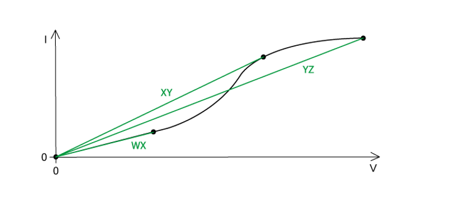

### Q46
**Final answer:** **The correct answer is ****D ****because:**

- The resistance of a filament lamp increases with temperature so the ratio $\frac{V}{I}$  increases as current increases
- As a result, the gradient decreases and a greater change in the potential difference is required to cause a change in the current
- On the *I–V* graph, it can be seen as the gradient on the curve becomes shallower, indicating a greater resistance
- The reason for this is that as the potential difference across a filament lamp increases, the current increases and the energy dissipated, as heat, increases, resulting in a higher temperature
- As the temperature increases, the resistance of the filament increases and the number of collisions between the free electrons and the lattice ions increases due to more rigorous vibration of the lattice ions

**A **is incorrect because this is the *I–V* graph for a semiconductor diode

**B **is incorrect because this is the *I–V* graph for an Ohmic conductor (obeys Ohm's Law)

**C **is incorrect because this is the *I–V* graph for a thermistor

### Q47
**Final answer:** **The correct answer is ****B ****because:**

- Resistance is defined by Ohm's Law, which states:
- The potential difference across a component is proportional to the current through it provided environmental conditions (e.g. temperature and pressure) stay constant

  - In other words, $V\proptoI$
- From this proportionality, we can say $V=kI$, where *k* is a constant
- This constant is what is known as resistance *R*

  - So, $V=IR$is the definition of resistance

### Q48
**Final answer:** **The correct answer is ****A ****because:**

- Graph P describes a conductor in which the resistance increases due to a change in environmental conditions (e.g. temperature) as the ratio $\frac{V}{I}$  increases

  - This matches the description of a filament lamp
- Graph R describes a conductor which has a very low resistance in one direction (low $\frac{V}{I}$) and a very high resistance in the other direction (high $\frac{V}{I}$)

  - This matches the description of a semiconductor diode

### Q49
**Final answer:** **The correct answer is ****A ****because:**

- A device whose resistance depends on temperature is called a **thermistor**

  - For a thermistor with a negative temperature coefficient, the resistance decreases significantly with a rise in temperature
- A device whose resistance depends on illumination is called a **light-dependent resistor or LDR**

  - The higher the intensity of light on the LDR, the greater the number of electrons in the semiconducting material that can move freely. Hence, as the light intensity increases, the resistance of the LDR decrease

### Q50
**Final answer:** **The correct answer is ****D ****because:**

- Resistance R of a wire is equal to $R=\frac{ρL}{A}$
- Cross-sectional area is equal to `A = pi r ^2 = pi ( d / 2 ) ^2 = pi d ^2 / 4`
- The resistance *R* is inversely proportional to the area, and therefore, *R* is also inversely proportional to the diameter squared $R\propto\frac{1}{d^{2}}$

  - So, when the wire is stretched, the diameter is reduced by half, which causes the cross-sectional area to be reduced by 4
  - So, the resistance *R* is increased by a factor of 4 due to the cross-sectional area *A*

- Since the volume of the wire is always constant, we can use this to find the new length – the volume of the unstretched wire is $V=AL$

  - Where *L* is the length of the wire

- The stretched wire has ¼ the cross-sectional area of the unstretched wire, for its volume to remain constant, its length must have been increased by a factor of 4

  - The volume of the stretched wire is $V = ( \frac{A}{4} ) ( 4 L )$

- So, the length of the stretched wire is 4*L*

  - Resistance *R* of unstretched wire $=\frac{ρL}{A}=0.2$ Ω
  - Resistance *R* of stretched wire $= \frac{\\rho ( 4 L )}{1 \frac{1}{4} A} = 16 ( \frac{\\rho L}{A} ) = 16 ( 0.2 ) = 3.2$ Ω

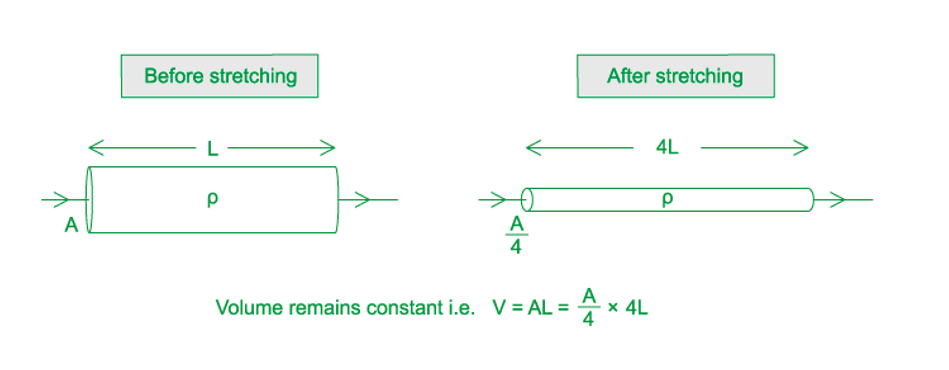

### Q51
**Final answer:** **The correct answer is ****A ****because:**

- The resistance of a wire is given by $R=\frac{ρL}{A}$
- If you stretch a wire to double its length, its cross-sectional area is halved
- This is because its volume must stay the same, i.e.:

  - If the volume of the unstretched wire is $V=AL$
  - Then, the volume of the stretched wire is $V = ( \frac{A}{2} ) ( 2 L )$
- So, in the above formula, you are multiplying L by 2 and dividing A by 2, this means the resistance goes up by a factor of 4

  - $\frac{\\rho ( 2 L )}{1 \frac{1}{2} A} = 4 ( \frac{\\rho L}{A} ) = 4 R$
- Therefore, the relationship between extension and resistance is a square law

  - $Rαx^{2}$
- At zero extension, there will be some resistance, so, the graph does not start from the origin

  - Therefore, the graph that best fits this description is option A

**B **is incorrect because even though this graph shows a non-linear relationship, it shows an initial sharp rise in resistance which levels off and becomes constant, but this is not the case - the resistance will continue to rise with extension

**C **is incorrect because this graph shows the first section as a linear relationship which is incorrect

**D **is incorrect because this graph shows the resistance starts from the origin, but at zero extension, there will be some resistance so this is incorrect

### Q52
**Final answer:** **The correct answer is ****B ****because:**

- Resistance is defined as the ratio of voltage *V* across a component to the current *I* through it

  - In equation form, this can be expressed as $R=\frac{V}{I}$
- Potential difference is defined as the amount of electrical energy transferred between two points per unit of charge

  - In equation form, this can be expressed as $V=\frac{E}{Q}$
- The SI base units of potential difference are

  - $V = \frac{E}{Q} = \frac{1 \frac{1}{2} m v^{2}}{I t} = [ \text{kg} \mathrm{m}^{2 } \mathrm{s}^{- 2} ] [ \mathrm{A} \mathrm{s} ]^{- 1} = \text{kg} \mathrm{m}^{2} \mathrm{s}^{- 3} \mathrm{A}^{- 1}$
- So, the SI base units of resistance are

  - $R = \frac{V}{I} = [ \text{kg} \mathrm{m}^{2} \mathrm{s}^{- 3} \mathrm{A}^{- 1} ] [ \mathrm{A} ]^{- 1} = \text{kg} \mathrm{m}^{2} \mathrm{s}^{- 3} \mathrm{A}^{- 2}$

### Q53
**Final answer:** **The correct answer is ****B ****because:**

- Resistance and resistivity are related by the equation $R=\frac{ρL}{A}$
- So, resistivity is equal to $ρ=\frac{RA}{L}$
- Ohm's law $V=IR$ and electrical power $P=VI$ can combine to make

  - $P = ( I R ) I = I^{ 2} R$
- So, resistance is equal to $R=\frac{P}{I^{2}}$
- Power is equal to $\frac{energy}{time}$

  - So, the units of power are $P = \frac{1 \frac{1}{2} m v^{2}}{t} = [ \text{kg} \mathrm{m}^{2} \mathrm{s}^{- 2} ] [ \text{s} ]^{- 1} = \text{kg} \mathrm{m}^{2} \mathrm{s}^{- 3}$
  - Therefore, the units of resistance are $R = \frac{P}{I^{ 2}} = [ \text{kg} \mathrm{m}^{2} \mathrm{s}^{- 3} ] [ \mathrm{A} ]^{- 2}$$=\mathrm{kg}m^{2}s^{-3}A^{-2}$

- And hence, the units of resistivity are

  - $\\rho = \frac{R A}{L} = [ \text{kg} \mathrm{m}^{2} \mathrm{s}^{- 3} \mathrm{A}^{- 2} ] [ \mathrm{m}^{2} ] [ \mathrm{m} ]^{- 1} = \text{kg} \mathrm{m}^{3} \mathrm{s}^{- 3} \mathrm{A}^{- 2}$
- If we compare this to $\mathrm{kg}x^{3}y^{-}^{2}z^{-3}$ , we can see ***x***** is meters, *****y***** is amperes, and***** z***** is seconds**

### Q54
**Final answer:** **The correct answer is ****C ****because:**

- Resistance and resistivity are related by the equation $R=\frac{ρL}{A}$
- So, resistivity is equal to $ρ=\frac{RA}{L}$
- The wire is cylindrical, so the cross-sectional area is equal to

  - `A = pi r ^2 = pi ( d / 2 ) ^2 = pi ( (2.0 x 10 ^ - 3 )/(2) ) ^2`
- Therefore, the resistivity is equal to

  - $\\rho = \frac{0.050}{10} \times \mathrm{\pi } ( \frac{2.0 \times 10^{- 3} }{2} )^{2} = 1.57 \times 10^{- 8}$ Ω $m$
- Therefore, the wire is made from **silver**, which has a resistivity of 1.6 × 10–8 Ω m

### Q55
**Final answer:** **The correct answer is ****D ****because:**

- The resistance of the LDR decreases as the light intensity increases
- Since the LDR and resistor R are connected in series, the current in both of them is the same
- Ohm's law states $V=IR$
- Since the resistance of the LDR decreases, the potential difference V across it also decreases

**A **&** B **are incorrect because a decrease in the resistance of the LDR causes the total resistance R in the circuit to decrease, from Ohm's law $I=\frac{V}{R}$, we can see the current through both the LDR and resistor R increases

**C **is incorrect because the battery has a fixed e. m. f., so this causes the p. d. across R to increase

### Q56
**The correct answer is ****B ****because:**

- Ohm's Law is defined by the equation $V=IR$
- Resistance, however, is the potential difference per unit current $R=\frac{V}{I}$
- In relation to the *I–V* graph, we are looking for the point on the curve which gives us the maximum gradient

  - This is because the gradient is equal to $\frac{\Deltay}{\Deltax}=\frac{I}{V}=\frac{1}{R}$  so a maximum gradient will give us the smallest *R*
- The point with the maximum gradient is point **B**

## Structured Questions (11 questions)

### Q1
Calculate the maximum resistance of the lamp over the range shown by the graph:

Identify the point of maximum resistance on the graph and choose *V* and *I* accordingly:

- resistance = gradient of a *VI* graph, therefore find steepest part of slope

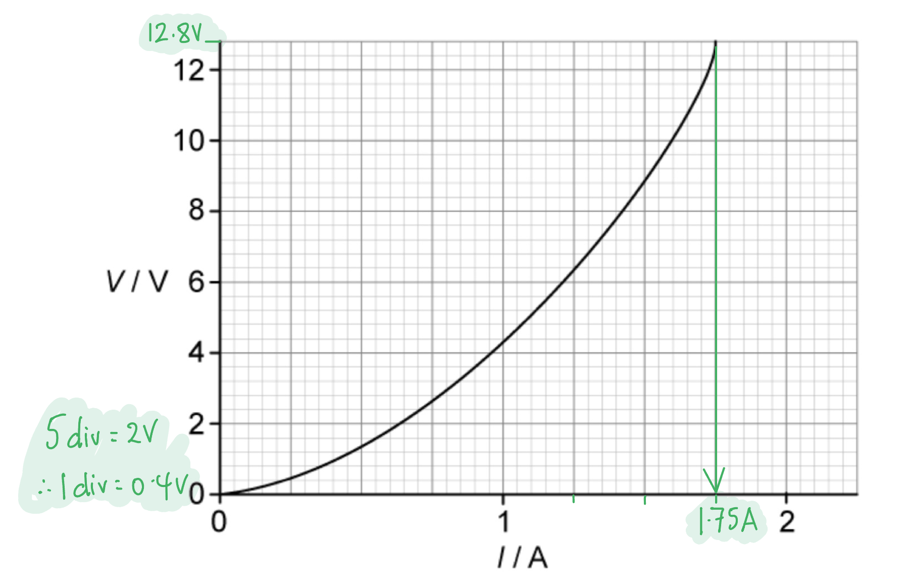

- V = 12.8 V **AND **I = 1.75 A **[1 mark]**

Use the equation for Ohm's Law:

- $V=IR$
- $R=\frac{V}{I}=\frac{12.8}{1.75}$ **[1 mark]**
- $R=7.3Ω$ **[1 mark]**

**[Total: 3 marks]**
Using the axes in Fig. 1.2. sketch the graph of current against potential difference for a diode:

**A graph which scores ****two marks**** looks like:**

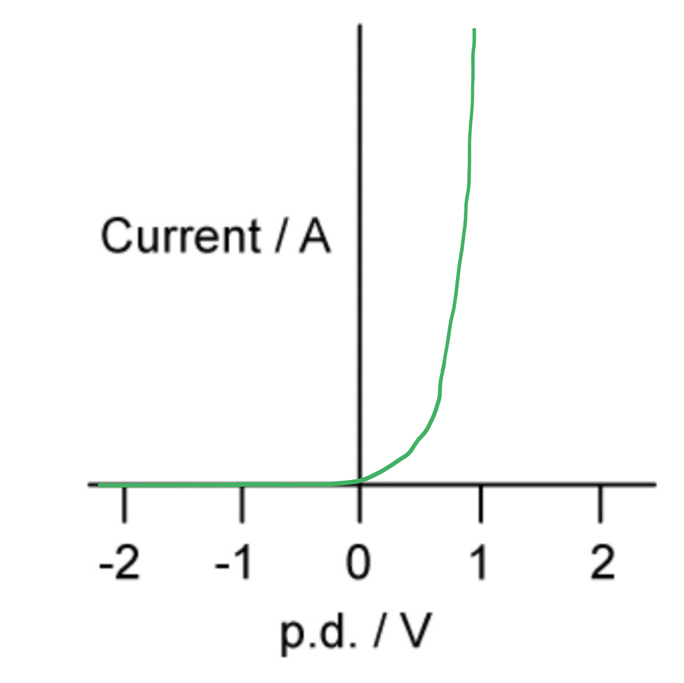

- Current zero for all negative voltages; **[1 mark]**
- For positive voltages line slopes up gently to about 0.6 V **AND **then has very steep rise between 0.6 - 1.0 V;** [1 mark]**

**[Total: 2 marks]**

> *It's a good idea to sketch out graph shapes in pencil first, so your final answer is correct. Our sketch above started off looking like this, with guidelines, points to pass through **and two **drafts of the graph, before we rubbed out all the preparation and mistakes!*

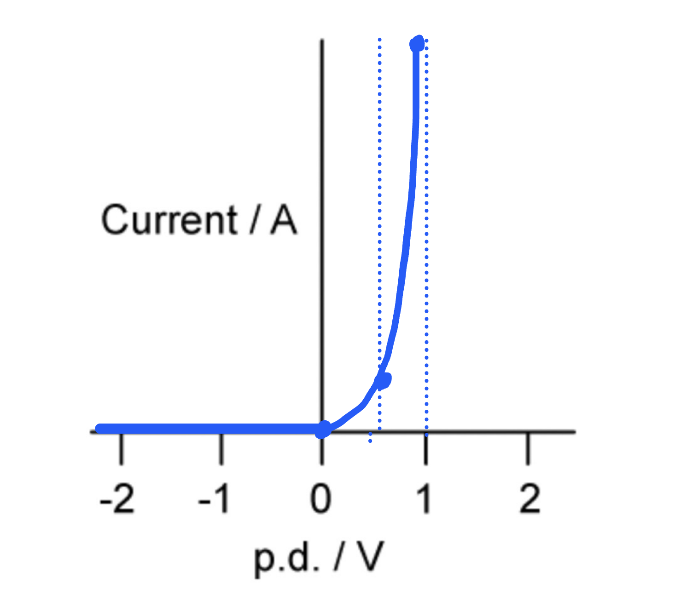
(i) The resistance when current = 10 mA:

Determine the corresponding value of potential difference from the graph:

- When *I* = 10 mA, V = 1.9 V

Calculate the resistance:

- $R=\frac{V}{I}=\frac{1.9}{10\times10^{-3}}$ **[1 mark]**
- $R=190Ω$  **[1 mark]**

(ii) The power when current = 10 mA:

Use the power equation which relates current and resistance:

- $P = I^{ 2 } R = ( 10 \times 10^{- 3} )^{2} \times 190 = 1.9 \times 10^{- 2} \mathrm{W} \text{or} 19 \text{mW}$ **[1 mark]**

**[Total: 3 marks]**

### Q2
A graph of the change in resistance with temperature for a thermistor should look like:

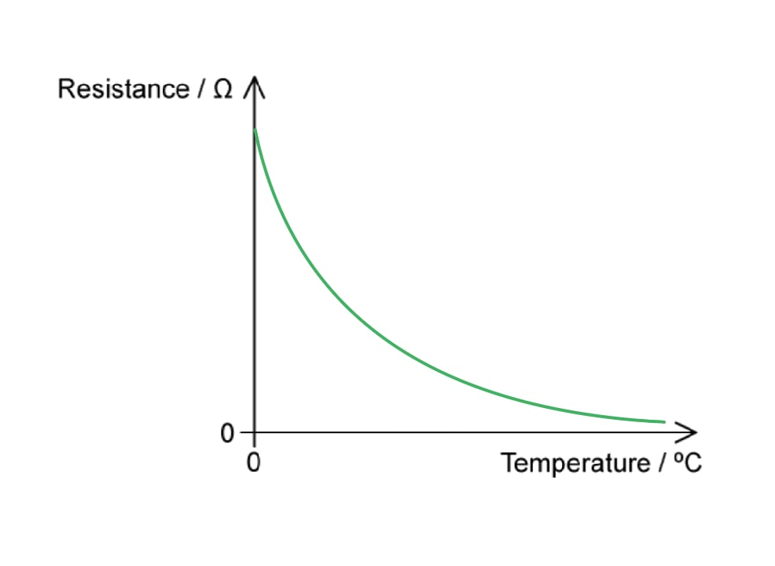

- Curved line showing decreasing gradient with rise in temperature; **[1 mark]**
- Smooth line not touching temperature axis **AND **no horizontal or vertical line anywhere; **[1 mark]**

**[Total: 2 marks]**
At 60 °C, the resistivity of the thermistor would:

- Decrease; **[1 mark]**

Because:

- The resistance would have decreased; **[1 mark]**
- Since resistivity is proportional to the resistance / $ρ\proptoR$; **[1 mark]**

**[Total: 3 marks]**

> *This question links directly back to part (a) of how temperature affects the resistance of a metal. Since the temperature increases, the resistance decreases in the thermistor. From the equation *$ρ=\frac{RA}{l}$*, where **A** and **l** are still constant, we can see that resistivity is directly proportional to the resistance and hence also decreases.*
(i) The meaning of *LDR* is:

- Light-dependent resistor; **[1 mark]**

(ii) A graph of the change in resistance with light intensity for an LDR should look like:

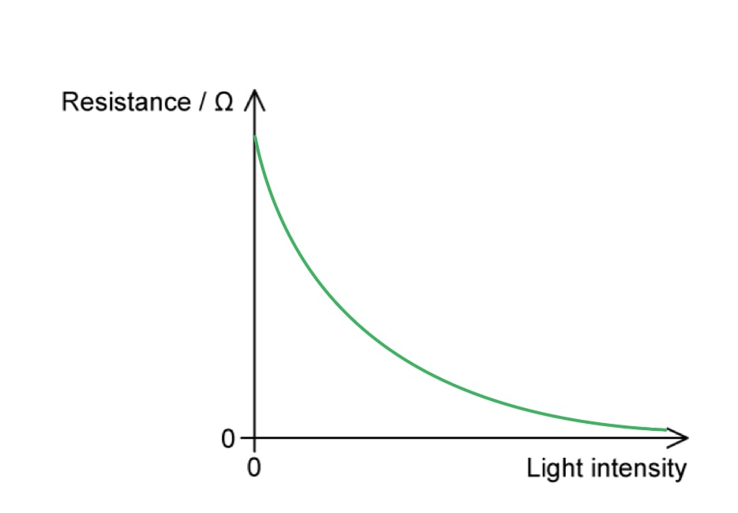

- Curved line showing decreasing gradient with greater light intensity; **[1 mark]**
- Smooth line not touching light intensity axis **AND **no horizontal or vertical line anywhere; **[1 mark]**

**[Total: 3 marks]**
The resistance the LDR is likely to be at:

- 5 kΩ during the <u>day</u>;** [1 mark]**
- 20 MΩ during the <u>night</u>;** [1 mark]**

**[Total: 2 marks]**

> *This question links to the graph in part (c). *

> *During the day, the light intensity is going to be very high on the LDR. Therefore, it has a smaller resistance - 5 kΩ. This is the opposite at night.*

### Q3
The relation between *R, L,* *A* and the resistivity *ρ *of the material of the wire is:

- $R=\frac{ρL}{A}$ **[1 mark]**

**[Total: 1 mark]**
The most appropriate instrument to use to measure...

(i) The resistance of the wire:

- Voltmeter and ammeter / ohmmeter / multimeter on 'ohm' setting; **[1 mark]**

(ii) The diameter of the wire:

- Micrometer (screw gauge) / digital / vernier callipers; **[1 mark]**

(iii) The length of the wire:

- A metre rule / tape measure; **[1 mark]**

**[Total: 3 marks]**
Show that the resistivity of the metal is 6.67 × 10–7 Ω m

List the known quantities:

- Resistance, *R* = 6.1 Ω
- Diameter, *d* = 0.44 mm* *= 0.44 × 10–3 m
- Length, *l* = 1390 mm = 1.39 m

Determine the equation for the resistivity, *ρ*:

- $R = \frac{ρl}{A} \Rightarrow ρ = \frac{RA}{l}$**[1 mark]**

Calculate the cross-sectional area, *A*:

- $A = \mathrm{\pi } r^{2} = \mathrm{\pi } ( \frac{d}{2} )^{2} = \frac{ \mathrm{\pi } d^{2}}{4}$
- $A = \frac{ \mathrm{\pi } ( 0.44 \times 10^{- 3} )^{2}}{4} = 1.52 \times 10^{- 7} \mathrm{m}^{2}$ **[1 mark]**

Substitute in the values:

- `rho = (6.1 x ( 1.52 x 10 ^ - 7 ))/(1.39) = 6.67 x 10 ^ - 7 capital omega m` **[1 mark]**

**[Total: 3 marks]**
If the diameter of the wire was doubled, the resistivity would:

- Not change; **[1 mark]**
- (This is because) resistivity is a property of a material / resistivity changes with temperature (only); **[1 mark]**

**[Total: 2 marks]**

### Q4
Determine the resistance of the component when a potential difference of 6.0 V is applied across it:

Use the graph to find current when p.d. = 6.0 V:

- Corresponding value of *I* = 1.425 A

Use Ohm's law equation to find resistance:

- $V=IR\RightarrowR=\frac{V}{I}$
- $R=\frac{6.0}{1.425}$** [1 mark]**
- $R=4.2Ω$ ** [1 mark]**

**[Total: 2 marks]**

> *The graph is linear at 6.0 V, so the corresponding value can be read off.*

> *It is encouraged, for more difficult scales, to draw a line using a pencil and ruler to the **y** axis to read off the most accurate value.*
For the component in part (a) calculate the minimum value of *R* as the potential difference across it changes over the range 0-10 V:

Determine where the answer lies on the graph:

- Least value of *R* is found where the gradient is steepest

Read the values of *V* and *I* at the point where the gradient is steepest and calculate:

- $R=\frac{V}{I}=\frac{3.0}{0.95}$** [1 mark]**
- $R=3.2Ω$ ** [1 mark]**

**[Total: 2 marks]**

> *Graphs of current and potential difference are commonly plotted as **V-I** and **I-V**, so you need to check rather than just memorising the shapes.*

> *Since the resistance is *$\frac{V}{I}$* and the gradient is *$\frac{I}{V}$*, this means the resistance is *$\frac{1}{gradient}$*.*
For the component in part (a) calculate:

(i) The power dissipated when *V* = 2.0 V:

Determine the current when *V* = 2.0 V by finding the corresponding value on the graph:

- Current, *I* = 0.425 A **[1 mark]**

Use the equation for power:

- $P=VI=2.0\times0.425=0.85W$ **[1 mark]**

(ii) The maximum power dissipated before the component heats up:

Use the graph to find where the component starts to heat up:

- Until the temperature changes, the component obeys Ohm's Law
- Therefore, identify the last point of the straight line / directly proportional area **OR **clear use of correct values / point marked on the graph; **[1 mark]** 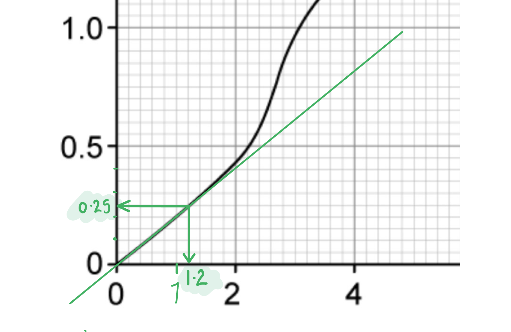

Determine the current and potential difference at this point:

- Current, *I* = 0.25 A
- Potential difference, *V* = 1.2 V

Calculate using the equation for power:

- $P=VI=1.2\times0.25=0.30W$** [1 mark]**

(iii) The value of resistance at the point identified in part (ii):

Use an equation relating power and resistance to find the value of *R*:

- $P=I^{2}R\mathrm{or}P=\frac{V^{2}}{R}$

- $R=\frac{P}{I^{2}}=\frac{0.30}{0.25^{2}}\mathrm{or}R=\frac{V^{2}}{P}=\frac{1.2^{2}}{0.30}$ **[1 mark]**
- $R=4.8Ω$** [1 mark]**

**[Total: 6 marks]**

> *A question like this, which depends on correctly reading a set of values from a graph, would always have the subsequent marks as 'error carried forward'.*

> *So if you read the graph incorrectly, but then continued with the calculation as you should have, then you'll have a different answer to ours, but still potentially get the marks. *

> *If this applies to you then check with a teacher or friend if you aren't sure about your answer.*

### Q5
Calculate the power dissipated in this length of wire when it carries a current of 10 mA:

List the known quantities:

- Resistivity of wire (at room temperature), *ρ* = 3.0 × 10–7 Ω m
- Cross-sectional area, *A* = 0.50 mm2
- Length of the wire, *L* = 2.5 m
- Current, *I* = 10 mA = 10 × 10–3 A

Convert the cross-section area into m2:

- 1 mm = 1 × 10–3 m therefore 1 mm2 = 1 × 10–6 m
- *A* = 0.50 mm2 = 0.50 × 10–6 m2 **[1 mark]**

Calculate the resistance of the wire at room temperature:

- $ρ=\frac{RA}{L}$*  *
- $R = \frac{\\rho L}{A} = \frac{( 3.0 \times 10^{- 7} ) \times 2.5}{( 0.5 \times 10^{- 6} )}$ **[1 mark]**
- $R=1.5Ω$ **[1 mark]**

Calculate the power dissipated:

- $P=I^{2}R=(10\times10^{--3})^{2}\times1.5$
- $P=1.5\times10^{--4}W$**[1 mark]**

**[Total: 4 marks]**
Explain the assumption that is necessary for calculating the answer to part (a):

State the assumption:

- The resistance of the wire is constant; **[1 mark]**

Explain why the resistance must be assumed constant:

- If the resistance changes (because the temperature of the wire increases) then the current (hence power) will change; **[1 mark]**

**[Total: 2 marks]**
Explain why the superconducting wires increase the efficiency of electrical power transmission:

- If the resistance is zero, then there is <u>no power loss</u> / the <u>waste energy</u> transferred as heat is <u>zero</u>; **[1 mark]**

**[Total: 1 mark]**

### Q6
A table that would score 4 marks should look like:

| **quantity** | **does not affect resistance** | **affects resistance** |
|---|---|---|
| cross-sectional area |   | **Final answer:** **✓** |
| length |   | **Final answer:** **✓** |
| resistivity |   | **Final answer:** **✓** |
| mass | **Final answer:** **✓** |   |

- Cross-sectional area does affect resistance; **[1 mark]**
- Length does affect resistance;** [1 mark]**
- Resistivity does affect resistance;** [1 mark]**
- Mass does not affect resistance;** [1 mark]**

**[Total: 4 marks]**

> *You can determine which quantities the resistance depends on, look at the equation for resistance*

> $R=\frac{ρl}{A}$*.*

> *Therefore, the resistance is affected by the resistivity (**ρ**), the length (**l**) and the cross-sectional area (**A).*
Calculate the cross-sectional area of the metal wire:

List the known quantities:

- Diameter of the wire, *d* = 66 µm = 66 × 10–6 m

Determine the equation for cross-sectional area, *A*:

- $A = \pi r^{2} = \pi ( \frac{d}{2} )^{2} = \frac{ \pi d^{2}}{4}$

Substitute in the values:

- $A = \frac{\pi ( 66 \times 10^{- 6} )^{2} }{4}$ **[1 mark]**
- $A=3.421\times10^{-9}=3.4\times10^{-9}m^{2}$ **[1 mark]**

**[Total: 2 marks]**
The resistance of the wire is:

List the known quantities:

- Current, *I* = 0.65 A
- Potential difference, *V* = 24 V

Calculate the resistance, *R*:

- $R=\frac{V}{I}=\frac{24}{0.65}$ **[1 mark]**
- $R=36.9=37Ω$ **[1 mark]**

**[Total: 2 marks]**
To determine which metal the filament is made from:

List the known quantities:

- Resistance, $R$ = 36.9 Ω (from **(b)**)
- Cross-sectional area, $A$ = 3.421 × 10–9 m2 (from **(a)**)
- Length, $l$ = 23 cm = 23 × 10–2 m

Determine the equation for the resistivity of the wire, *ρ*:

- $R=\frac{ρl}{A}\Rightarrowρ=\frac{RA}{l}$

Substitute in the values:

- $\\rho = \frac{36.9 \times ( 3.421 \times 10^{- 9} ) }{23 \times 10^{- 2} }$ **[1 mark]**
- $ρ=5.488\times10^{-7}=5.5\times10^{-7}Ωm$ **[1 mark]**

Identify the metal from Table 1.2:

- (Therefore, the metal is) <u>tungsten</u>; **[1 mark]**

**[Total: 3 marks]**

### Q7
Sketch on Fig 1.1 how the resistance *R *of the extending wires varies with the length *l*

Determine the relationship between *R* and *l*:

- $R=\frac{ρl}{A}$
- $V=Al\RightarrowA=\frac{V}{l}$
- $R=\frac{ρl}{\frac{V}{l}}=\frac{ρl^{2}}{V}$
- Therefore, $R\proptol^{2}$ **[1 mark]**

A graph that would score 1 mark should look like:

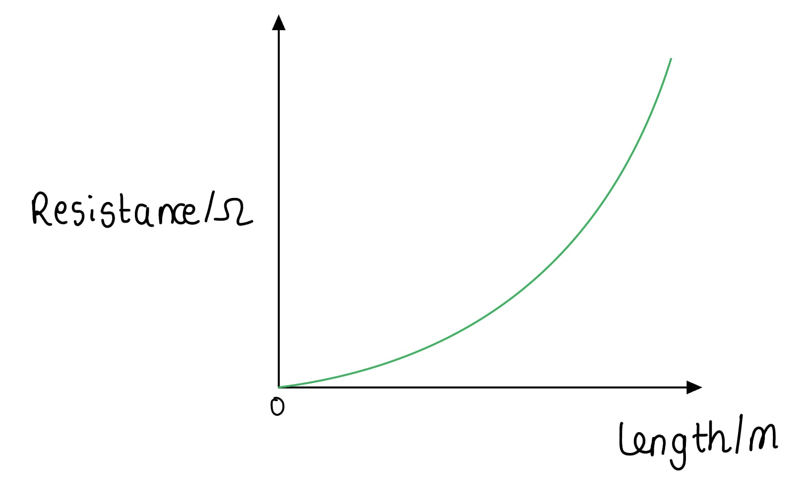

- Curve lined with increasing gradient; **[1 mark]**

**[Total: 2 marks]**
The ratio $\frac{powerdissipatedinY}{powerdissipatedinX}$ is:

Determine the equation for the ratio of power dissipated:

- $P=IV=I^{2}R$ where $R=\frac{ρl}{A}$ **[1 mark]**
- $\frac{P_{Y}}{P_{X}}=\frac{I^{2}R_{Y}}{I^{2}R_{X}}=\frac{\frac{ρ_{Y}l_{Y}}{A_{Y}}}{\frac{ρ_{X}l_{X}}{A_{X}}}$

Substitute the values from Table 1.1 into the equation and simplify:

- `P _ Y / P _ X = (begin display style (rho l )/(begin display style (pi d ^2)/(4) ) )/(begin display style (( begin display style rho / 3 ) 2 l)/(begin display style (pi ( 4 d ) ^2)/(4) ) ) = (begin display style (rho l )/(pi d ^2) )/(begin display style (begin display style 2 / 3 rho l)/(16 pi d ^2) )`**[1 mark]**
- $\frac{powerdissipatedinY}{powerdissipatedinX}=\frac{P_{Y}}{P_{X}}=24$ **[1 mark]**

**[Total: 3 marks]**

> *The reason *$P=I^{2}R$* is used and not *$P=\frac{V^{2}}{R}$* is because of the arranging of the resistors. *

> *Since they are in **series**, they have the **same** current **I** but a different potential difference **V**. Using *$P=I^{2}R$* means that '**I**' cancels out in the ratio whilst **V** wouldn't.*
The ratio $\frac{powerdissipatedinY}{powerdissipatedinX}$ of X and Y connected in series and connected in parallel is:

List the known quantities:

- $\frac{P_{Y}}{P_{X}}_{series}$ = 24 (from part b)

Determine $\frac{P_{Y}}{P_{X}}$ in parallel:

- $P=IV=\frac{V^{2}}{R}$ where $R=\frac{ρl}{A}$
- $\frac{P_{Y}}{P_{X}}=\frac{\frac{V^{2}}{R_{Y}}}{\frac{V^{2}}{R_{X}}}=\frac{R_{X}}{R_{Y}}=\frac{\frac{ρ_{X}l_{X}}{A_{X}}}{\frac{ρ_{Y}l_{Y}}{A_{Y}}}$ **[1 mark]**

Substitute the values from Table 1.1 into the equation and simplify:

- `P _ Y / P _ X = (begin display style (( begin display style rho / 3 ) 2 l)/(begin display style (pi ( 4 d ) ^2)/(4) ) )/(begin display style (rho l )/(begin display style (pi d ^2)/(4) ) ) = (begin display style (begin display style 2 / 3 rho l )/(16 pi d ^2) )/(begin display style (begin display style rho l )/(begin display style pi d ^2 ) )`
- $\frac{P_{Y}}{P_{X}}_{parallel}=\frac{1}{24}$** [1 mark]**

Calculate the product of the ratios:

- $\frac{P_{Y}}{P_{X}}_{series}\times\frac{P_{Y}}{P_{X}}_{parallel}=24\times\frac{1}{24}=1$ **[1 mark]**

**[Total: 3 marks]**

> *Both part (b) and (c) requires quite a bit of algebra here. You must be confident with dealing with fractions, as many of the harder questions are very algebraic. This style of question is quite common in MCQs too.*

### Q8
Calculate the energy transferred by the lightning strike:

List the known quantities:

- Potential difference, *V* = 2.7 MV = 2.7 × 106 V
- Current, *I* = 25 kA = 25 × 103 A
- Time, *t* = 7.5 ms = 7.5 × 10–3 s

Use the equation defining current to calculate the charge, *Q*:

- $Q = I t = ( 25 \times 10^{3} ) \times ( 7.5 \times 10^{- 3} )$
- $Q=187.5C$ **[1 mark]**

Use the equation defining potential difference to calculate work done, *W*:

- $V=\frac{W}{Q}$
- $W = ( 2.7 \times 10^{6} ) \times 187.5$ **[1 mark]**
- $W = 5.0625 \times 10^{8} = 5.1 \times 10^{8} \mathrm{J} ( 2 \mathrm{s} . \mathrm{f} . )$ **[1 mark]**

**[Total: 3 marks]**
The lightning conductor is made from copper. Sketch an IV graph for the rod when it conducts a lightning strike to earth:

Decide which type of conductor the rod is:

- (The rod will get hot since copper wires get hot, therefore) it is the equivalent of a non-ohmic resistor / filament lamp; **[1 mark]**

A sketch of the correct graph shape looks like:

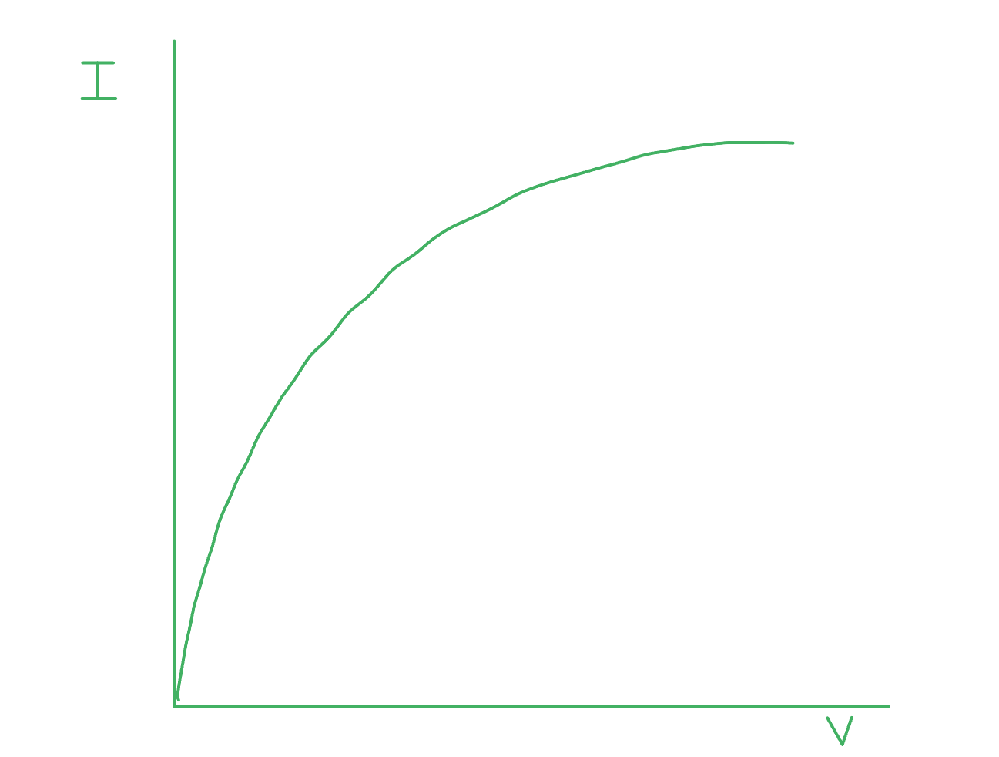

- Axes labelled *I* and *V* (either way round); **[1 mark**]
- Correct graph shape for chosen axes;** [1 mark]**

**[Total: 3 marks]**

> *If you attempted to draw **any **version of the filament lamp graph, even if it went a bit wrong, the examiner would award you the first mark.*
Explain any changes which the lightning rod would undergo during a lightning strike:

- Delocalised / free electrons move faster / increase kinetic energy;** [1 mark]**
- Therefore, as current increases the temperature increases; **[1 mark]**
- As temperature increases the resistance increases (as shown in the graph); **[1 mark]**

**[Total: 3 marks].**

### Q9
Calculate the length of nichrome wire required:

List the known quantities:

- Radius of the wire,* r* = 0.16 mm = 0.16 × 10–3 m
- Potential difference through wire,* V* = 230 V
- Power through wire, *P* = 600 W
- Resistivity of nichrome, *ρ* = 1.1 × 10–6 Ω m

Use the equation relating power and resistance and calculate to find resistance, *R*:

- $P=\frac{V^{2}}{R}$
- $R=\frac{V^{2}}{P}=\frac{230^{2}}{600}$ **[1 mark]**
- $R=88.2Ω$ **[1 mark]**

Calculate cross-sectional area *A*:

- Area of a circle $A = \pi r^{2} = \pi \times ( 0.16 \times 10^{- 3} )^{2} = 8.042 \times 10^{- 8} \mathrm{m}^{2}$ **[1 mark]**

Use the resistivity equation to calculate length:

- $ρ=\frac{RA}{L}$
- $L = \frac{R A}{\\rho } = \frac{88.2 \times ( 8.042 \times 10^{- 8} )}{( 1.1 \times 10^{- 6} )}$ **[1 mark]**
- $L = 6.4 \mathrm{m} ( 2 \mathrm{s} . \mathrm{f} . )$** [1 mark]**

**[Total: 5 marks]**
Two properties that the nichrome wire must have to make it suitable as an electrical heating element are:

**Final answer:** **Any ****two ****from:**

- High resistance / resistivity / low electrical conductivity (so it gets hot); **[1 mark]**
- High melting point (to withstand high temperatures); **[1 mark]**
- Low thermal capacity / low specific heat capacity (to reduce the amount of energy needed to make it hot); **[1 mark]**

**[Total: 2 marks]**
The resistivity of the nichrome wire changes with temperature because:

- The resistivity / resistance increases with increasing temperature; **[1 mark]**
- This is due to the (lattice) ions / atoms vibrating more / with a greater amplitude; **[1 mark]**
- The rate of momentum of the charge carriers / electrons (along the wire) is therefore reduced; **[1 mark]**

**[Total: 3 marks]**
Calculate the length needed for this new nichrome wire to produce the same current through the heating element:

List the known quantities:

- Length of old wire *L* = 6.4 m (from part c)
- Old wire radius = 0.16 mm
- New wire radius = 0.08 mm
- Resistivity of nichrome, *ρ* = 1.1 × 10–6 Ω m

Determine how the area would change for ½ *r *:

- Area of a circle, $A=πr^{2}$
- Therefore for *r'* = ½ *r*, $A^{'} = \pi ( \frac{r}{2} )^{2} = \frac{\pi r^{2}}{4} = \frac{A}{4}$ **OR **new area is one quarter original area; **[1 mark]**

Determine how the length would change for ¼ *A *:

- $L=\frac{RA}{ρ}$
- $L^{'}=\frac{R}{ρ}\times\frac{A}{4}=\frac{L}{4}$ **OR **new length is one-quarter original length; **[1 mark]**
- $L'=\frac{6.4}{4}=1.6m$ **[1 mark]**

**[Total: 3 marks]**

### Q10
Calculate the current which passes through the carbon film in Fig. 1.1. for an applied voltage of 2.5 mV:

List the known quantities:

- Resistivity of carbon, *ρ *= 4.0 × 10–5 Ω m
- Applied voltage, *V* = 2.5 mV = 2.5 × 10–3 V

Interpret the correct dimensions from Fig. 1.1:

- Length which current passes through, *L* = 3.0 × 10–3 m **AND**
- Cross-sectional area of conductor, *A* = (8.0 × 10–3) × (2.0 × 10–6) = 1.6 × 10–8 m2 **[1 mark]**

Use the resistivity equation to calculate the resistance *R* of the carbon film:

- $ρ=\frac{RA}{L}$*  *
- $R=\frac{ρL}{A}$$= \frac{( 4.0 \times 10^{- 5} ) \times ( 3.0 \times 10^{- 3} )}{( 1.6 \times 10^{- 8} )}$ **[1 mark]**
- $R$ = 7.5 Ω **[1 mark]**

Use Ohm's law to calculate the current flowing through the carbon film:

- $V=IR$
- $I = \frac{V}{R} = \frac{( 2.5 \times 10^{- 3} )}{7.5}$ **[1 mark]**
- $I$ = 3.3 × 10–4 A **[1 mark]**

**[Total: 5 marks]**
Show that the current is approximately a million times larger if it is directed through the carbon film as shown in Fig. 1.2:

List the known quantities:

- Resistivity of carbon, *ρ *= 4.0 × 10–5 Ω m
- Applied voltage, *V* = 2.5 mV = 2.5 × 10–3 V
- Current when directed horizontally, *I*A = 3.3 × 10–4 A (from (a))

Interpret the correct dimensions from Fig. 1.2:

- The length that the current passes through, *L *= 2.0 × 10–6 m **AND**
- The cross-sectional area of conductor, $A = ( 8.0 \times 10^{- 3} ) \times ( 3.0 \times 10^{- 3} ) = 2.4 \times 10^{- 5} \mathrm{m}^{2}$ **[1 mark]**

Use the resistivity equation to calculate the resistance *R* of the carbon film:

- $ρ = \frac{RA}{L}$
- `R = (rho L)/(A) = (( 4.0 x 10 ^ - 5 ) x ( 2.0 x 10 ^ - 6 ))/(( 2.4 x 10 ^ - 5 )) = 3.3 x 10 ^ - 6 capital omega` **[1 mark]**

Use Ohm's Law to calculate the current flowing through the carbon film, *I*b:

- $V = I R$
- $I = \frac{V}{R} = \frac{( 2.5 \times 10^{- 3} )}{( 3.3 \times 10^{- 6} )} = 750 \mathrm{A}$ **[1 mark]**

Calculate the ratio of currents:

- $\frac{I_{b}}{I_{a}} = \frac{750}{3.3\times10^{-4}}$ = 2.25 × 106 **[1 mark]**

State a conclusion:

- Therefore, the current in Fig. 1.2 is about a million times / 106 larger than the current in Fig. 1.1

**[Total: 4 marks]**
Discuss how the resistance of the carbon film changes as a result of the applied tensile force:

State how the resistance changes:

- The resistance decreases; **[1 mark]**

Describe the dimensional changes caused by the tensile force:

- The tensile force causes the <u>length</u> (of the carbon film through which current is flowing) to decrease **AND **the cross-sectional <u>area to increase</u>; **[1 mark]**

Explain how dimensional changes affects the resistance:

- (Resistance decreases because) resistance is proportional to length **AND i**nversely proportional to the cross-sectional area; **[1 mark]**

State any assumptions:

**Final answer:** **Any ****one**** of the following:**

- The tensile force acts uniformly / is a constant magnitude; **[1 mark]**
- The tensile force acts in all directions;** [1 mark]**
- There are no tears / rips / deformities in the carbon film as it stretches; **[1 mark]**

**[Total: 4 marks]**

> *A **tensile** force is a **pulling force**, so the carbon film will be stretched by this force. *

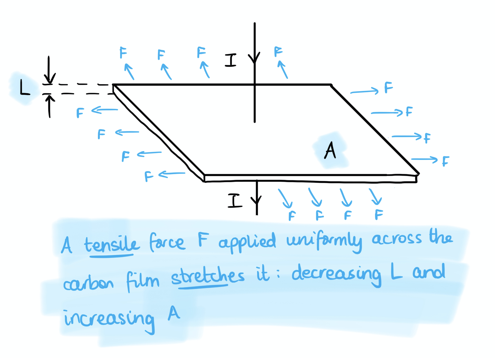

### Q11
The resistivity, in terms of* ρ*, of a wire with a diameter 2*d *and* *a* *potential difference 3*V* through it is:

Determine the equation for the resistivity of the first wire:

- $R=\frac{ρl}{A}\Rightarrowρ=\frac{RA}{l}$
- $\text{rho} = \frac{R \times pi r ^{2} }{l} = \frac{R \times pi ( \frac{d}{2} ) ^{2} }{l}$ **[1 mark]**

Determine the new resistance, *R*:

- $R=\frac{V}{I}$ therefore $\frac{3V}{I}=3R$ **[1 mark]**

Determine the new resistivity:

- `rho _ 2 = ( 3 R x pi ( (2 d)/(2) ) ^2)/(l) = (( 3 x 2 ^2 ) R x pi ( d / 2 ) ^2)/(l)`
- $rho_{2} = \frac{ 12 R \times pi ( \text{begin} \text{display} \text{style} \frac{d}{2} ) ^{2} }{l} = 12 \text{rho}$ **[1 mark]**

**[Total: 3 marks]**
The student would accurately determine the cross-sectional area of the wires by:

- Measuring the diameter at (at least) 3 different parts of each wire; **[1 mark]**
- Using a micrometer (screw gauge); **[1 mark]**
- Calculate an average diameter *d* and calculate the cross-sectional area *A* using $A = \pi ( \frac{d}{2} )^{2} = \frac{ \pi d^{2}}{4}$ **[1 mark]**

**[Total: 3 marks]**

> *Make sure not to just stop your answer by measuring the diameter. The question asks how to measure the **area**, which requires a calculation using the diameter which you must provide to complete your answer.*
Sketch a graph of voltage *V* against the current *I* for each of the wires.

Determine how the cross-sectional area *A* related to the gradient of the graph:

- $R=\frac{V}{I}$ is the gradient of the graph
- $R=\frac{ρl}{A}$ therefore $R\propto\frac{1}{A}$

A graph that would score 2 marks should look like:

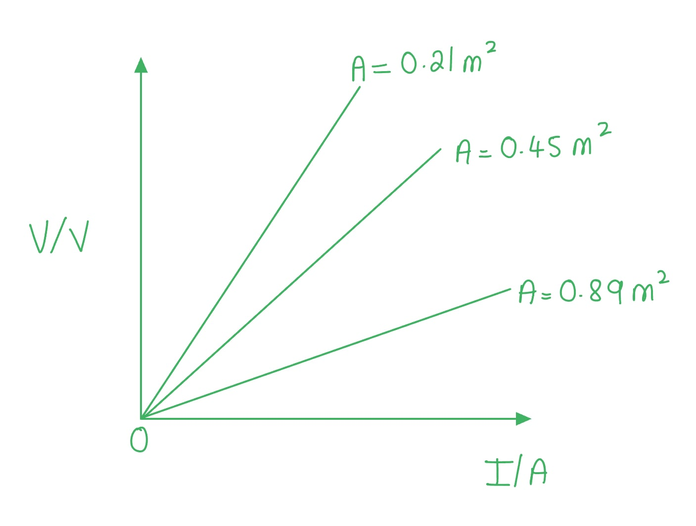

- Voltage (*V*)/V labelled on the *y-*axis and current (*I*)/A labelled on the *x*-axis; **[1 mark]**
- Three straight lines drawn with a positive gradient; **[1 mark]**
- Labelled 0.21 m2, 0.45 m2 and 0.89 m2 from steepest to shallowest gradient; **[1 mark]**

**[Total: 3 marks]**

> *You must be as accurate and neat as possible with any graph sketches. Always label the axes and add units where applicable!*
