# Exam Questions — Resistance & Resistivity
**9. Electricity** · Cambridge (CIE) A-LEVEL physics (9702)
> Source: [https://www.savemyexams.com/a-level/physics/cie/25/topic-questions/](https://www.savemyexams.com/a-level/physics/cie/25/topic-questions/) · 56 questions across 1 sets

## Multiple Choice Questions (56 questions)

### Q1 — medium — 1 marks

**Q1** [1 mark]

A researcher has two pieces of copper of the same volume. All of the first piece is made into a cylindrical resistor P of length *x*.

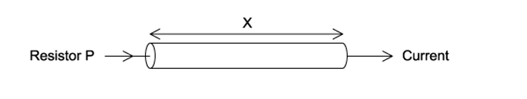

All of the second piece is made into uniform wires each of the same length *x* which he connects between two bars of negligible resistance to form a resistor Q.

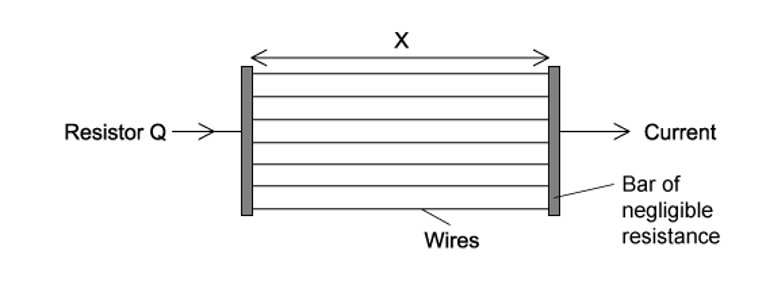

How do the electrical resistances of P and Q compare ?

### Q2 — hard — 1 marks

**Q2** [1 mark]

The graph shows the relationship between potential difference *V* and current *I* for a fixed 20 Ω resistor and a filament lamp.

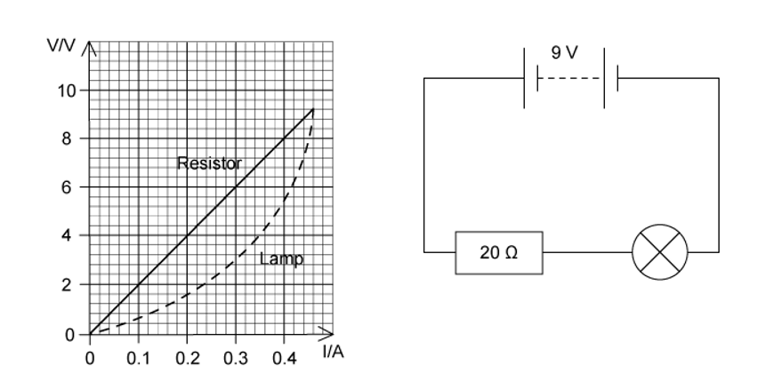

The resistor and lamp are placed in series with a 9 V battery of negligible internal resistance. What is the current in the circuit ?

### Q3 — medium — 1 marks

**Q3** [1 mark]

A battery of negligible internal resistance is connected to two 10 Ω resistors in series.

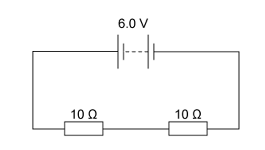

What charge flows through each of the 10 Ω resistors in 1 minute?

### Q4 — medium — 1 marks

**Q4** [1 mark]

A charge of 8.0 C passes through a resistor of resistance 30 Ω at a constant rate in a time of 20 s.

What is the potential difference across the resistor?

### Q5 — medium — 1 marks

**Q5** [1 mark]

The resistance of a thermistor depends on its temperature, and the resistance of a light-dependent resistor (LDR) depends on the illumination.

Under which conditions will the resistance of both a thermistor and an LDR be highest ?

|   | **Thermistor** | **LDR** |
|---|---|---|
| **A** | highest temperature | highest illumination |
| **B** | highest temperature | lowest illumination |
| **C** | lowest temperature | highest illumination |
| **D** | lowest temperature | lowest illumination |

### Q6 — medium — 1 marks

**Q6** [1 mark]

The variation with potential difference *V* of the current *I* in a semiconductor diode is shown below.

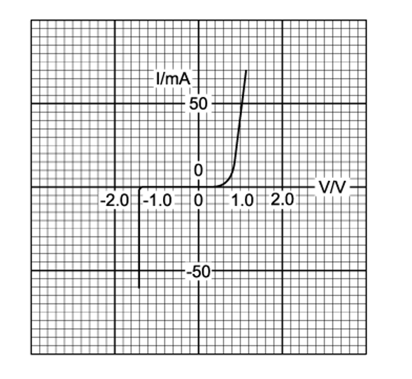

What is the resistance of the diode for applied potential differences of +1.0 V and –1.0 V ?

| ** ** | **Resistance** |   |
|---|---|---|
| **at +1.0 V** | **at –1.0 V** |   |
| **A**  **B**  **C**  **D** | 20 Ω  20 Ω  0.05 Ω  0.05 Ω | infinite  zero  infinite  zero |

### Q7 — hard — 1 marks

**Q7** [1 mark]

A conducting liquid fills a cylinder metal case to a depth *y* as shown in the diagram.

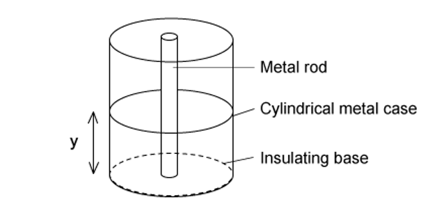

The resistance between the case and the metal rod is

### Q8 — medium — 1 marks

**Q8** [1 mark]

A light-dependent resistor *R* has a resistance of about 1 MΩ in the dark and about 1 kΩ when illuminated. It is connected in series with a 5 kΩ resistor to a 1.5 V cell of negligible internal resistance.

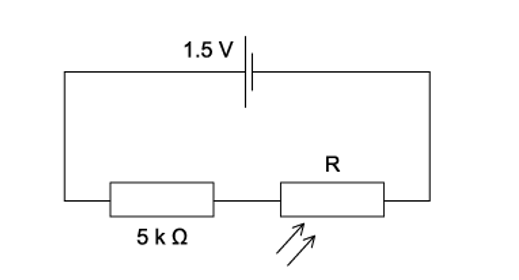

The light-dependent resistor is illuminated (in an otherwise dark room) by a flashing light.

Which graph best shows the variation with time *t* of potential difference *V* across *R *?

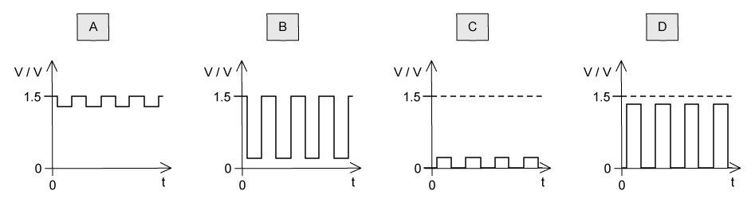

### Q9 — medium — 1 marks

**Q9** [1 mark]

In the circuit below, the reading *V**T* on the voltmeter changes from high to low as the temperature of the thermistor changes. The reading *V**L* on the voltmeter changes from high to low as the level of light on the light-dependent resistor (LDR) changes.

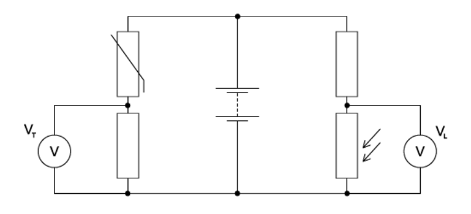

The readings *V**T* and *V**L* are both high.

What are the conditions of temperature and light level ?

| ** ** | **Temperature** | **Light level** |
|---|---|---|
| **A**  **B**  **C**  **D** | low  low  high  high | low  high  low  high |

### Q10 — medium — 1 marks

**Q10** [1 mark]

The resistance *R* of a resistor is to be determined. The current *I *in the resistor and the potential difference *V* across it are measured.

The results, with their uncertainties, are

*I* = (2.0 ± 0.2) A                    * V* = (15.0 ± 0.5) V

What is the uncertainty in this value for *R *?

### Q11 — hard — 1 marks

**Q11** [1 mark]

The current flowing through a component varies with the potential difference *V* across it as shown.

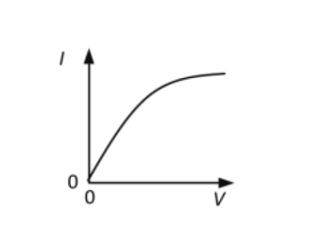

Which graph best represents how the resistance *R* varies with *V *?

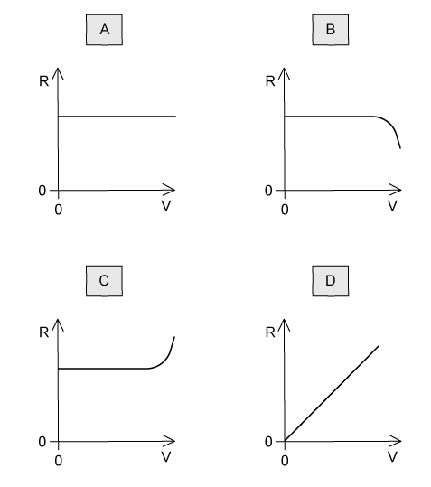

### Q12 — hard — 1 marks

**Q12** [1 mark]

Circuit contains three identical lamps **A**, **B** and **C**. Circuit also contains three switches, S1, S2 and S3, as shown.

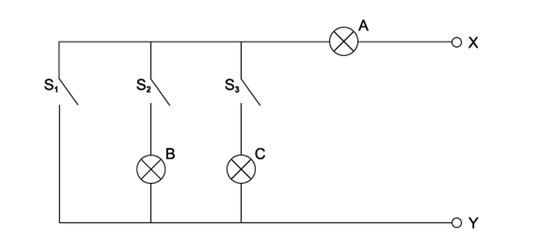

One of the lamps is faulty. In order to detect the fault, an ohm-meter is connected between terminals X and Y.

When measuring resistance, the ohm-meter causes negligible current in the circuit. Readings of the ohm-meter for different switch positions are shown in the table.

| **Switch** | **Meter reading / Ω** |   |   |
|---|---|---|---|
| **S****1** | **S****2** | **S****3** |   |
| open  closed  open  open | open  open  closed  closed | open  open  open  closed | ∞  15  30  15 |

Which lamps are faulty?

### Q13 — hard — 1 marks

**Q13** [1 mark]

A strain gauge consists of a length of wire with a uniform cross-sectional area. Its resistance is 2.50 kΩ. It is attached to a large pipe.

When the pipe expands, the strain gauge changes in dimensions, such that the length increases by 4% and the diameter reduced by 1%.

What is the new resistance of the strain gauge?

### Q14 — medium — 1 marks

**Q14** [1 mark]

Two wires P and Q made of the same material are connected to the same electrical supply.

P has twice the length of Q and one-third of the diameter of Q, as shown in the diagram.

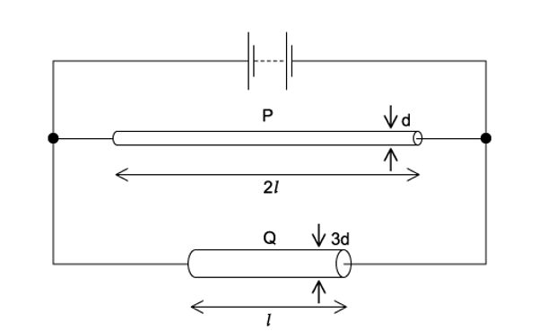

What is the ratio  $\frac{currentinP}{currentinQ}$ ?

### Q15 — hard — 1 marks

**Q15** [1 mark]

A copper wire is to be replaced by an aluminium alloy wire of the same length and resistance.

Copper has half the resistivity of the alloy.

What is the ratio  $\frac{diameterofalloywire}{diameterofcopperwire}$?

### Q16 — medium — 1 marks

**Q16** [1 mark]

Tensile strain may be measured by the change in electrical resistance of a strain gauge.

A strain gauge consists of folded fine metal wire mounted on a flexible insulating backing sheet.

The strain gauge is firmly attached to the specimen, so that the strain in the metal wire is always identical to that in the specimen.

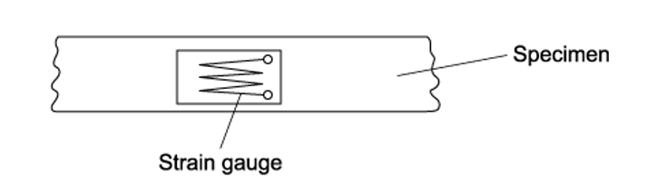

When the strain in the specimen is increased, what happens to the resistance of the wire?

### Q17 — medium — 1 marks

**Q17** [1 mark]

The graph shows how current *I* varies with voltage *V* for a filament lamp.

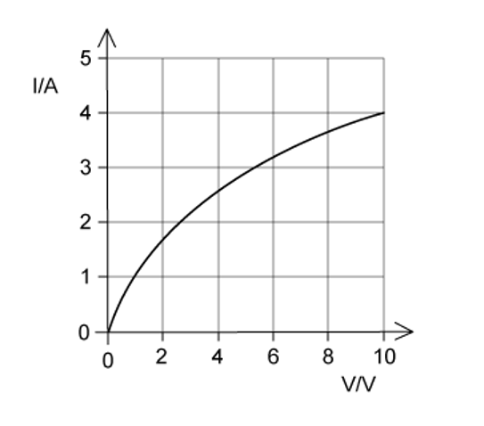

Since the graph is not a straight line, the resistance of the lamp varies with *V*.

Which row gives the correct resistance at the stated value of *V*?

| ** ** | ***V***** / V** | ***R***** / Ω** |
|---|---|---|
| **A**  **B**  **C**  **D** | 2.0  4.0  6.0  8.0 | 1.5  3.2  1.9  0.9 |

### Q18 — medium — 1 marks

**Q18** [1 mark]

Two wires have the same length and the same resistance. Wire X is made of a metal of resistivity 1.7 × 10–8 Ωm, and wire Y is made of a metal of resistivity 5.6 × 10–8 Ωm.

The diameter of wire X is 0.315 mm.

What is the diameter of wire Y?

### Q19 — hard — 1 marks

**Q19** [1 mark]

The graphs show the *I -V* characteristics for a metal conductor and a thermistor

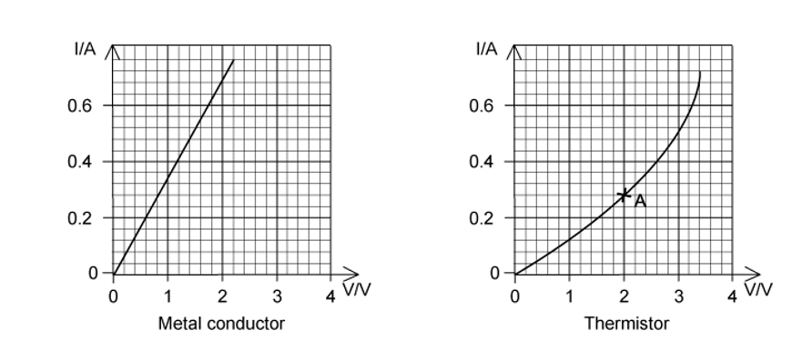

What is the ratio $\frac{resis\mathrm{tan}ceofthermistoratpointA}{resis\mathrm{tan}ceofmetalconductor}$  ?

### Q20 — hard — 1 marks

**Q20** [1 mark]

The following strain gauge consists of a fine metal wire, so that an applied tension on the strain gauge results in changes in the length and cross-sectional area of the wire.

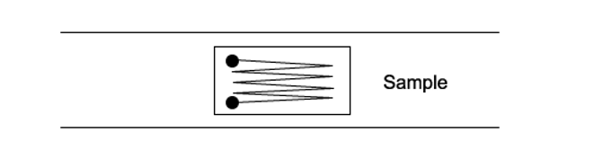

When the length of the wire is stretched by 5%, what is the percentage change in the resistance of the wire? Assume that the volume of a wire remains constant when it is stretched.

### Q21 — hard — 1 marks

**Q21** [1 mark]

The current in a block of semiconductor is 30.0 mA when there is a potential difference (p.d.) of 10.0 V across it. The dimensions of the block and the direction of the current in it are as shown.

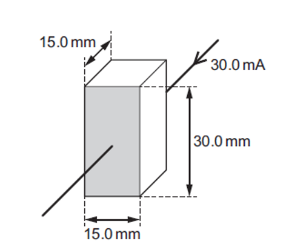

The electrical meters used are accurate to ± 0.1 mA and ± 0.1 V. The dimensions of the block are accurate to ± 0.2 mm.

What is the resistivity of the semiconductor?

### Q22 — hard — 1 marks

**Q22** [1 mark]

One style of light bulb, very different from the "incandescent" design which works on the principle of a super-heated wire filament emitting light, is called a gas discharge tube.

In this design of light bulb, light is produced by the direct excitation of gas molecules as electric current passes between two electrodes.

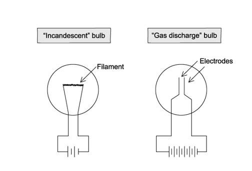

What will the *I - V *graphs of these bulbs look like?

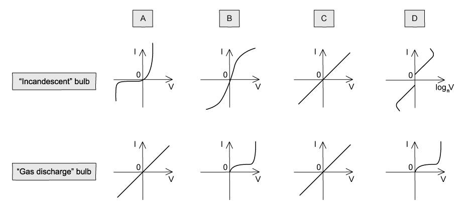

### Q23 — medium — 1 marks

**Q23** [1 mark]

The diagram shows a length of track from a model railway connected to a battery, a resistor and a relay coil.

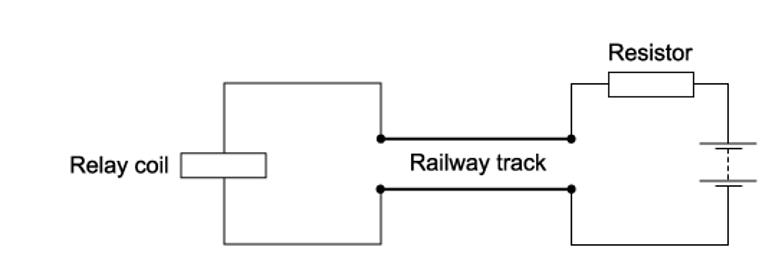

With no train present, there is a current in the relay coil which operates a switch to turn on a light.

When a train occupies the section of track, most of the current flows through the wheels and axles of the train in preference to the relay coil. The switch in the relay turns off the light.

Why is a resistor placed between the battery and the track?

### Q24 — hard — 1 marks

**Q24** [1 mark]

The graph shows the *I -V* characteristics of a semiconductor diode

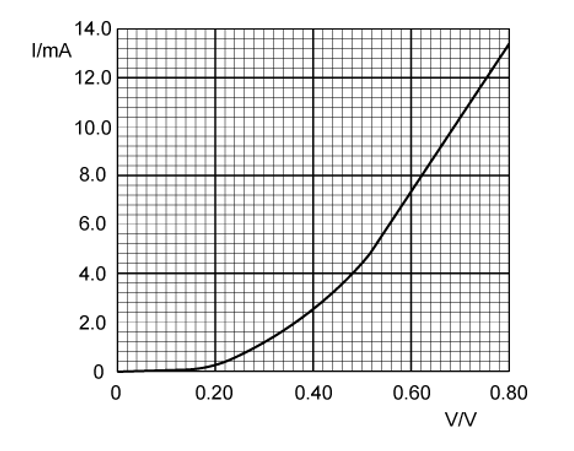

A cell of e. m .f. 1.2 V and negligible internal resistance is connected in series to a semiconductor diode and a resistor *R**1*, as shown below

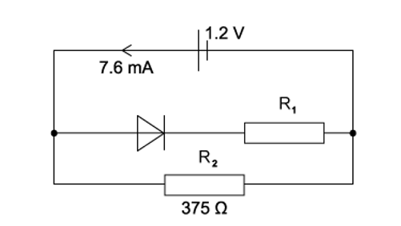

A resistor *R**2* of resistance 375 Ω is connected across the cell. The diode has the characteristic shown in the graph. The current supplied by the cell is 7.6 mA.

What is the resistance of *R**1*?

### Q25 — hard — 1 marks

**Q25** [1 mark]

Aluminum and copper rods are designed to have the same length and the same resistance.

The resistivity of copper is half that of aluminum, but its density is three times that of aluminum.

Determine the ratio of the mass of the aluminum rod to the mass of the copper rod.

### Q26 — hard — 1 marks

**Q26** [1 mark]

The graph below shows the variation of the current *I* through a lamp with potential difference *V* across it.

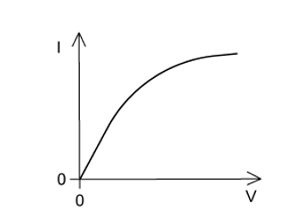

Which of the following graphs best represents the variation of power *P* dissipated in the same lamp with *I **2 *?

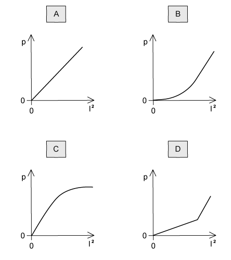

### Q27 — hard — 1 marks

**Q27** [1 mark]

The circular cross-sectional area of a uniform metal wire varies along its length. There is a current in the wire. The narrow end of the wire is at a reference potential of zero.

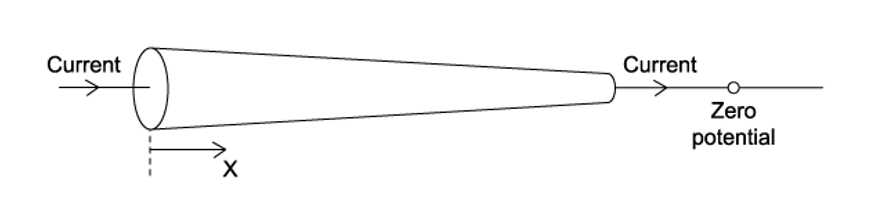

Which graph best represents the variation with distance *x* along the wire of the potential difference *V* relative to the reference zero?

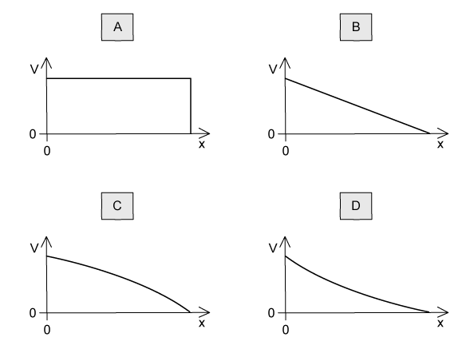

### Q28 — medium — 1 marks

**Q28** [1 mark]

The *I -V* characteristics of two electrical components P and Q are shown below.

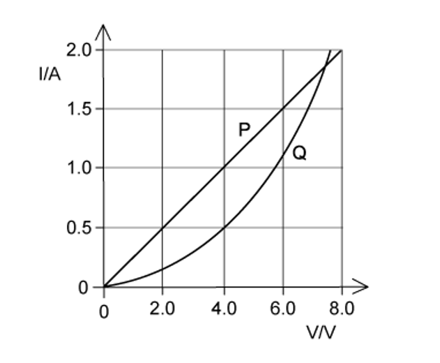

Which statement is correct ?

### Q29 — hard — 1 marks

**Q29** [1 mark]

The diagram shows an electric pump for a garden fountain connected by an 18 m cable to a 230 V mains electrical supply.

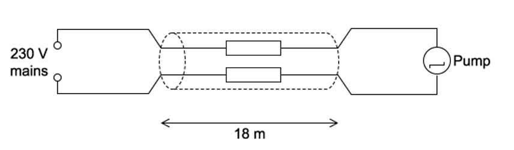

The performance of the pump is acceptable if the potential difference (p.d.) across it is at least 218 V. The current through it is then 0.83 A.

What is the maximum resistance per meter of each of the two wires in the cable if the pump is to perform acceptably?

### Q30 — hard — 1 marks

**Q30** [1 mark]

The resistance of a metal cube is measured by placing it between two parallel plates, as shown.

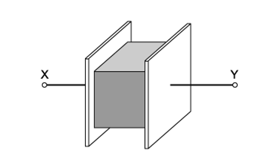

The cube has volume *V* and is made of a material with resistivity *ρ*. The connections to the cube have negligible resistance.

Which expression gives the electrical resistance of the metal cube between X and Y?

### Q31 — hard — 1 marks

**Q31** [1 mark]

A thermistor and another component are connected to a constant voltage supply. A voltmeter is connected across one of the components. The temperature of the thermistor is then reduced, but no other changes are made.

In which circuit will the voltmeter reading increase ?

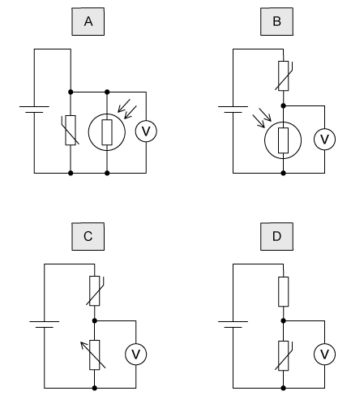

### Q32 — medium — 1 marks

**Q32** [1 mark]

A student found two unmarked resistors. To determine the resistance of the resistors, the circuit below was set up. The resistors were connected in turn between P and Q, noting the current readings.

The voltage readings were noted without the resistors and with each resistor in turn.

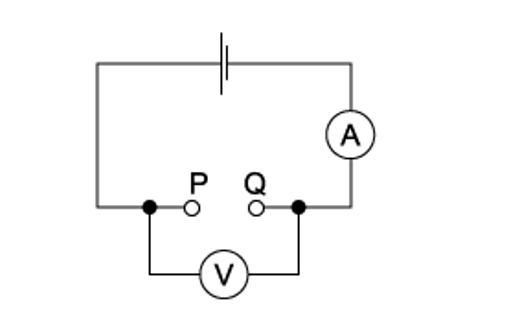

The results were entered into a spreadsheet, as shown.

| 1.5 | 1.3 | 28 | 46 |
|---|---|---|---|
| 1.5 | 1.4 | 14 | 100 |

The student forgot to enter the column headings.

Which order of the headings would be correct?

| **A** | \| e.m.f / V \| *V* / V \| *R */ Ω \| *I* / mA \| \|---\|---\|---\|---\| |
|---|---|
| **B** | \| *V* / V \| e.m.f / V \| *R* / Ω \| *I* / mA \| \|---\|---\|---\|---\| |
| **C** | \| *V* / V \| e.m.f / V \| *I* / mA \| *R* / Ω \| \|---\|---\|---\|---\| |
| **D** | \| e.m.f / V \| *V* / V \| *I* / mA \| *R* / Ω \| \|---\|---\|---\|---\| |

### Q33 — medium — 1 marks

**Q33** [1 mark]

A 2 Ω resistor and a 4 Ω resistor are connected to a cell.

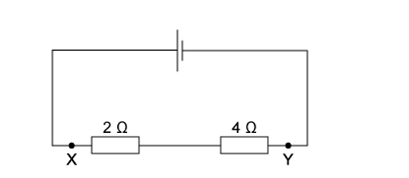

Which graph shows how the potential V varies with distance between X and Y ?

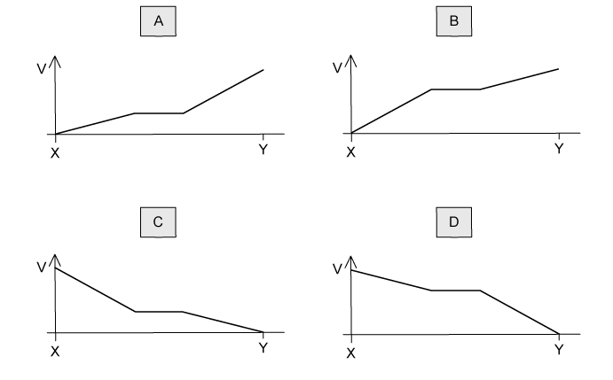

### Q34 — medium — 1 marks

**Q34** [1 mark]

In a fire alarm system, a thermistor T has a resistance of 2000 Ω at room temperature. Its resistance decreases as the temperature increases. The alarm is triggered when the potential difference between X and Y reaches 4.5 V.

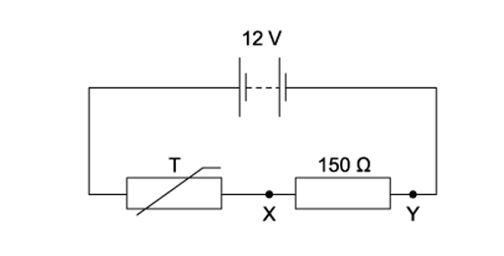

What is the resistance of the thermistor when the alarm is triggered ?

### Q35 — medium — 1 marks

**Q35** [1 mark]

Two electrically-conducting cylinders X and Y are made from the same material.

Their dimensions are as shown.

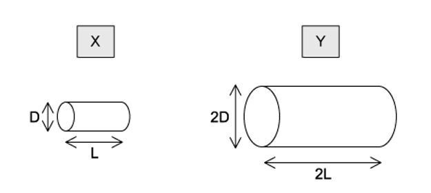

The resistance between the ends of each cylinder is measured.

What is the ratio $\frac{resis\mathrm{tan}ceofX}{resis\mathrm{tan}ceofY}$ ?

### Q36 — medium — 1 marks

**Q36** [1 mark]

The graph shows the variation with length *l *of resistance *R* for two wires X and Y made from the same material.

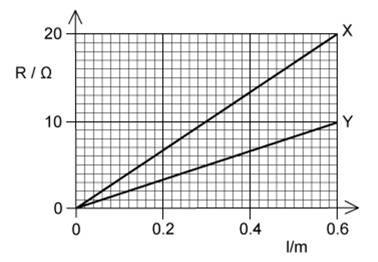

What does the graph show?

### Q37 — medium — 1 marks

**Q37** [1 mark]

Two heating coils X and Y, of resistance *R**X* and *R**Y* respectively, deliver the same power when 12 V is applied across X and 6 V is applied across Y.

What is the ratio $\frac{R_{X}}{R_{Y}}$  ?

### Q38 — easy — 1 marks

**Q38** [1 mark]

A cylindrical wire 4.0 m long has a resistance of 31 Ω and is made of metal of resistivity 1.0 × 10–6 Ω m.

What is the radius of cross-section of the wire?

### Q39 — easy — 1 marks

**Q39** [1 mark]

A power cable has length 2000 m. The cable is made of twelve parallel strands of copper wire, each with diameter 0.51 mm.

What is the resistance of the cable ? (resistivity of copper = 1.7 × 10–8 Ω m)

### Q40 — easy — 1 marks

**Q40** [1 mark]

** **The graphs show the variation with potential difference *V* of the current *I* for three circuit components.

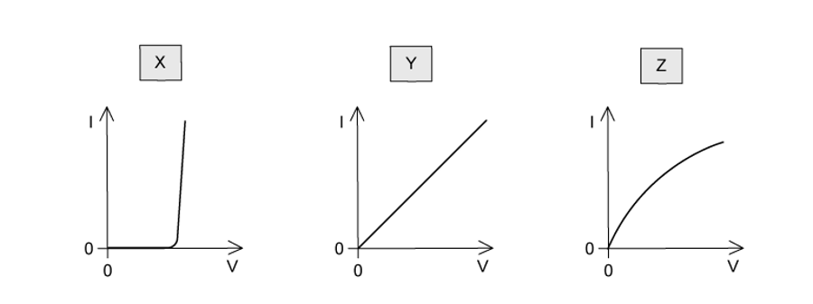

The components are a metal wire at constant temperature, a semiconductor diode and a filament lamp.

Which row of the table correctly identifies these graphs?

| ** ** | **Metal wire at constant temperature** | **Semiconductor diode** | **Filament lamp** |
|---|---|---|---|
| **A**  **B**  **C**  **D** | X  Y  Y  Z | Z  X  Z  X | Y  Z  X  Y |

### Q41 — easy — 1 marks

**Q41** [1 mark]

The graph shows the variation with potential difference (p. d.) of the current in a lamp filament.

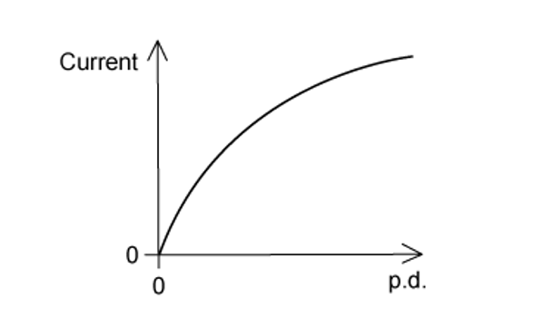

Which statement explains the shape of this graph?

### Q42 — easy — 1 marks

**Q42** [1 mark]

The resistance *R* of a resistor is determined by measuring the potential difference *V* across it and the current *I* in it. The value of *R* is then calculated using the equation

$R=\frac{V}{I}$

The values measured are *V* = 1.00 ± 0.05 V and *I*  = 0.50 ± 0.01 A.

What is the percentage uncertainty in the value of *R *?

### Q43 — easy — 1 marks

**Q43** [1 mark]

What is a correct statement of Ohm's Law?

### Q44 — easy — 1 marks

**Q44** [1 mark]

A circuit is set up with an LDR and a fixed resistor as shown.

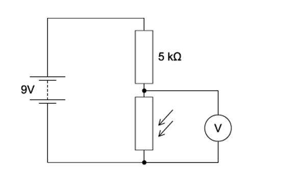

The voltmeter reads 4 V.

The light intensity is increased.

What is a possible voltmeter reading?

### Q45 — easy — 1 marks

**Q45** [1 mark]

An electrical component has a potential difference *V* across it and a current *I*  through it. A graph of *I* against *V* is drawn and is marked in three sections WX, XY and YZ.

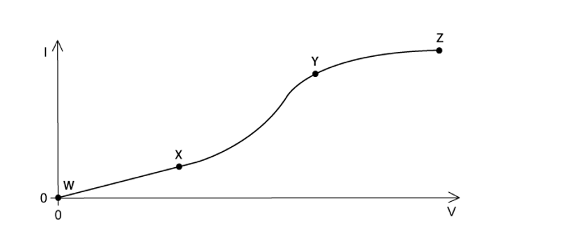

In which ways does the resistance of the component vary within each of the three sections?

| ** ** | **WX** | **XY** | **YZ** |
|---|---|---|---|
| **A**  **B**  **C**  **D** | constant  constant  increases  increases | decreases  increases  decreases  increases | increases  increases  constant  decreases |

### Q46 — easy — 1 marks

**Q46** [1 mark]

Which graph shows the *I*–*V* characteristic of a filament lamp ?

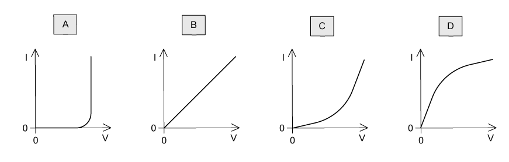

### Q47 — easy — 1 marks

**Q47** [1 mark]

Which equation is used to define resistance?

### Q48 — easy — 1 marks

**Q48** [1 mark]

The graphs show possible current-voltage (*I–V*) relationships for a filament lamp and a semiconductor diode.

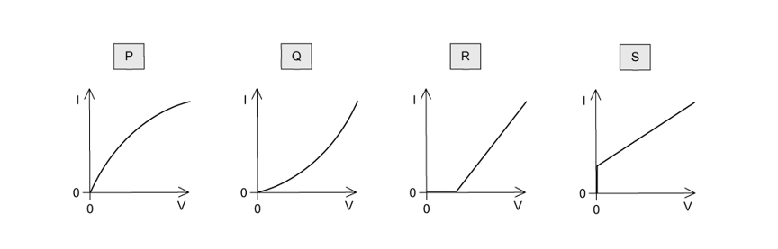

Which row best specifies the correct *I–V* graphs for the lamp and the diode?

| ** ** | **Filament lamp** | **Semiconductor diode** |
|---|---|---|
| **A**  **B**  **C**  **D** | P  P  Q  Q | R  S  R  S |

### Q49 — easy — 1 marks

**Q49** [1 mark]

The resistance of one device *R**1* is designed to change with temperature; the resistance of another device *R**2* is designed to change with illumination.

What are the names of these devices ?

| ** ** | ***R******1*** | ***R******2*** |
|---|---|---|
| **A** | thermistor | light-dependent resistor |
| **B** | thermistor | potential divider |
| **C** | semiconductor diode | light-dependent resistor |
| **D** | semiconductor diode | potential divider |

### Q50 — easy — 1 marks

**Q50** [1 mark]

A copper wire is stretched so that its diameter is reduced from 1.0 mm to a uniform 0.5 mm. The resistance of the unstretched copper wire is 0.2 Ω.

What is the resistance of the stretched wire?

### Q51 — easy — 1 marks

**Q51** [1 mark]

When a thin metal wire is stretched, it becomes longer and thinner. This causes a change in the resistance of the wire. The volume of the wire remains constant.

Which graph could represent the variation with extension *x* of the resistance *R* of the wire ?

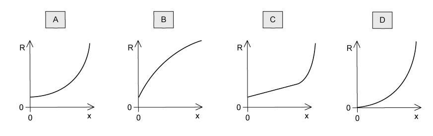

### Q52 — easy — 1 marks

**Q52** [1 mark]

What is the unit of resistance when expressed in SI base units?

### Q53 — easy — 1 marks

**Q53** [1 mark]

The unit of resistivity, expressed in terms of base units, is given by

$\mathrm{kg}x^{3}y^{-2}z^{-3}$

Which base units are *x*, *y *and *z *?

| ** ** | ***x*** | ***y*** | ***z*** |
|---|---|---|---|
| **A**  **B**  **C**  **D** | ampere  metre  metre  second | metre  ampere  second  ampere | second  second  ampere  metre |

### Q54 — easy — 1 marks

**Q54** [1 mark]

A cylindrical wire of length 10 m and diameter 2.0 mm has a resistance of 0.050 Ω.

From which material is the wire made?

| ** ** | **Material** | **Resistivity / Ω m** |
|---|---|---|
| **A** | bronze | 1.6 × 10–7 |
| **B** | nichrome | 1.6 ×10–6 |
| **C** | silver | 1.6 × 10–8 |
| **D** | zinc | 6.3 × 10–8 |

### Q55 — easy — 1 marks

**Q55** [1 mark]

A light-dependent resistor (LDR) is connected in series with a resistor *R* and a battery.

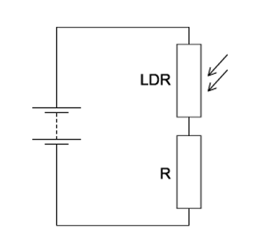

The resistance of the LDR is equal to the resistance of *R* when no light falls on the LDR. When the light intensity falling on the LDR increases, which statement is correct?

### Q56 — easy — 1 marks

**Q56** [1 mark]

The graph shows how the electric current *I*  through a conducting liquid varies with the potential difference *V* across it.

At which point on the graph does the liquid have the smallest resistance?

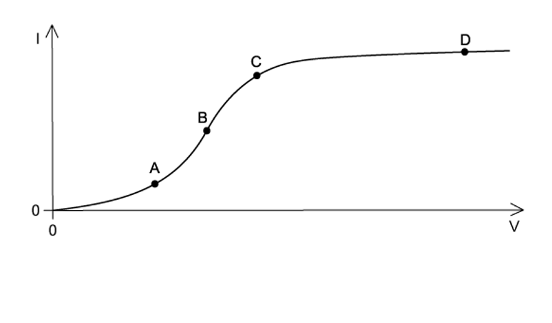
