# Exam Questions — The Microscope in Cell Studies
**1. Cell Structure** · Cambridge (CIE) AS biology (9700)
> Source: [https://www.savemyexams.com/as/biology/cie/25/topic-questions/](https://www.savemyexams.com/as/biology/cie/25/topic-questions/) · 44 questions across 2 sets

## Multiple Choice Questions (29 questions)

### Q1 — hard — 1 marks

**Q1** [1 mark]

Cells can vary considerably in diameter, e.g.

- Eukaryotic cells, such as a white blood cell          1.5 x 101 µm
- Prokaryotic cells, such as *Streptococcus              *7.5 x 102 nm

Use these measurements to find the maximum number of each cell that could be arranged, end-to-end, along a 1 cm line.

|   | Number of white blood cells | Number of *Streptococcus* cells |
|---|---|---|
| **A** | 6.7 x 100 | 1.3  x 102 |
| **B** | 6.7 x 101 | 1.3  x 103 |
| **C** | 6.7 x 102 | 1.3  x 104 |
| **D** | 6.7 x 103 | 1.3  x 105 |

### Q2 — hard — 1 marks

**Q2** [1 mark]

The diagram shows a stage micrometer (top) being used to calibrate an eyepiece graticule (bottom). The divisions on this micrometer measure 0.1 mm.

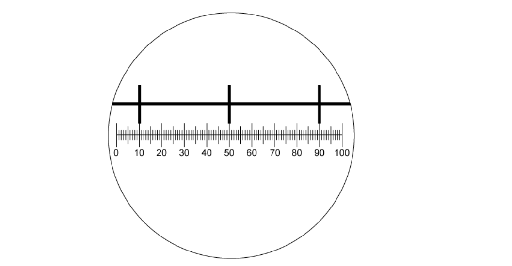

A slide of a plant cell was placed on the stage in place of the stage micrometer.

What is the width of a single chloroplast shown on the slide below?

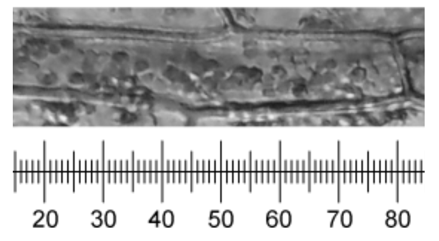

### Q3 — hard — 1 marks

**Q3** [1 mark]

The diagram below shows a view through a microscope eyepiece with a graticule scale and a stage micrometer, using a magnification of x400.

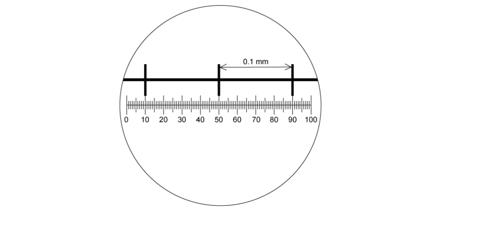

Using the magnification of x400, a chloroplast was measured to be 4 eyepiece graticule divisions in length.

How long is the chloroplast?

### Q4 — hard — 1 marks

**Q4** [1 mark]

The image below shows an electron micrograph of a bacterial cell. The scale bar measures 2 cm and represents a length of 500 nm. A ruler has been placed below the image to help you measure the image size.

*CC BY 2.5, via **[Wikimedia Commons](https://commons.wikimedia.org/wiki/File:Santarella_plosbio_2010_gemmata_obscuriglobus_fig3_topright.png)*

What is the actual length of the bacterial cell?

### Q5 — hard — 1 marks

**Q5** [1 mark]

The diagram below shows the view through an eyepiece when a stage micrometer is used. This stage micrometer (shown here at the top of the image) has divisions that are 0.1 mm apart.

The same eyepiece is used to examine a blood smear.

How many of the graticule divisions will cover the diameter of a white cell of 12.5 µm?

### Q6 — hard — 1 marks

**Q6** [1 mark]

The actual length of a cellular structure is 6 µm.

A student was asked to write an equation that could be used to calculate the magnification of an electron micrograph of this cell structure. The student used the letters *q* to *u* in their equation.

*q* = the length of the cell structure in the image in cm

*r* = the length of the cell structure in the image in mm

*s* = 1000

*t* = 1/6

*u* = 6

Which of the following would be the correct equation to calculate the magnification?

### Q7 — hard — 1 marks

**Q7** [1 mark]

The diagram below shows a view through a microscope eyepiece with a graticule scale (bottom) and a stage micrometer (top).

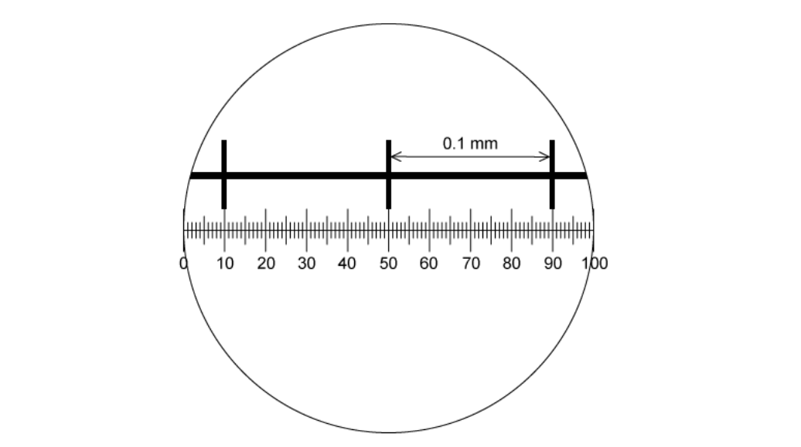

What is the area of the field of view at this magnification?

Note that π = 3.14

### Q8 — hard — 1 marks

**Q8** [1 mark]

A light microscope is used at a magnification of x400 and with a green light source that has a wavelength of 510 nm.

The same specimen is viewed again under the same conditions, but with the light source switched to red light with a wavelength of 650 nm.

What effect would this have on the magnification and resolution of the microscope?

|   | **magnification** | **resolution** |
|---|---|---|
| **A** | stays the same | increased |
| **B** | stays the same | decreased |
| **C** | increased | decreased |
| **D** | decreased | increased |

### Q9 — hard — 1 marks

**Q9** [1 mark]

A student was using an eyepiece graticule with 100 small divisions and a stage micrometer with 50 divisions, each 0.04 mm apart.

Using a x40 objective lens, the whole length of the stage micrometer lined up with 15 divisions of the eyepiece graticule.

What is the length of the 100 division scale of the eyepiece graticule at this magnification?

### Q10 — medium — 1 marks

**Q10** [1 mark]

The electron micrograph below shows the organelles in a leaf cell, as well as a scale bar and on-screen ruler.

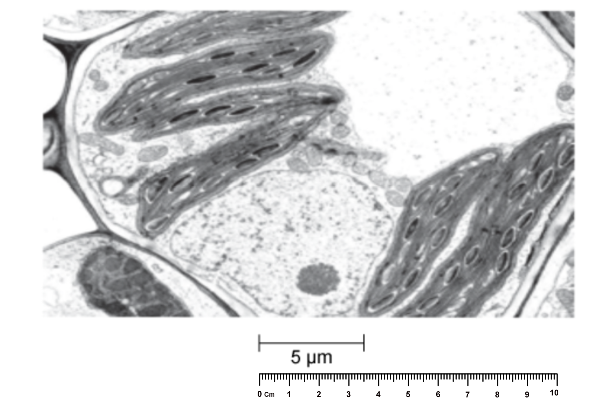

What is the magnification of the image?

### Q11 — medium — 1 marks

**Q11** [1 mark]

The table shows some approximate units for measuring the diameters of alveoli, white blood cells and the width of cell walls.

Which of the rows show the correct units for these structures?

|   | **Diameter of alveoli** | **Diameter of white blood cells** | **Width of cell walls** |
|---|---|---|---|
| **A** | mm | µm | µm |
| **B** | mm | µm | nm |
| **C** | µm | nm | µm |
| **D** | µm | µm | nm |

### Q12 — medium — 1 marks

**Q12** [1 mark]

The following statements describe producing a scientific drawing.

Which is **not** a correct statement about drawing scientifically?

### Q13 — medium — 1 marks

**Q13** [1 mark]

A prokaryotic cell with a diameter of 1 µm is magnified 50 000 times by an electron microscope.

What is the diameter of the cell in the resulting electron micrograph?

### Q14 — medium — 1 marks

**Q14** [1 mark]

To view the actual width of a transverse section of a xylem vessel with a x40 lens, which steps are needed?

| 1 | measure the width of the xylem vessel using an eyepiece graticule |
|---|---|
| 2 | calibrate the eyepiece graticule using a stage micrometer on x10 objective lens |
| 3 | convert from mm to µm by multiplying by 10-3 |
| 4 | multiply the number of eyepiece graticule units by the calibration of the eyepiece graticule. |

### Q15 — medium — 1 marks

**Q15** [1 mark]

The following statements describe slide preparation.

Which statement would not be relevant in the preparation of a wet mount for observation with a light microscope?

### Q16 — medium — 1 marks

**Q16** [1 mark]

The electron micrograph below shows a root vascular system.

The magnification of the image is x200 and Y has a diameter of 1 cm when measured using a ruler.

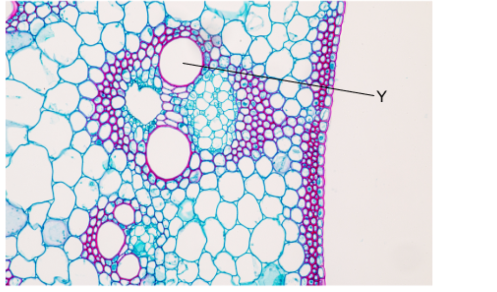

What is the diameter of the cell labelled Y?

### Q17 — medium — 1 marks

**Q17** [1 mark]

The electron micrograph of a bacterial cell has a 2 cm scale bar.

What is the magnification of the image?

### Q18 — medium — 1 marks

**Q18** [1 mark]

Erythrocytes (red blood cells) have a diameter of 7 000 nm. Pancreatic cells have a diameter of 35 µm.

Which of these statements about the relative sizes of these cells is correct?

### Q19 — medium — 1 marks

**Q19** [1 mark]

Which of the following descriptions of light and electron microscopes is **not** correct?

### Q20 — easy — 1 marks

**Q20** [1 mark]

Which row correctly describes the magnification and resolution of an electron microscope in relation to a light microscope?

|   | **magnification** | **resolution** |
|---|---|---|
| **A** | lower | higher |
| **B** | higher | lower |
| **C** | higher | higher |
| **D** | lower | lower |

### Q21 — easy — 1 marks

**Q21** [1 mark]

Which of the following is **not** a step involved in the preparation of an onion cell specimen for viewing under a light microscope?

### Q22 — easy — 1 marks

**Q22** [1 mark]

At approximately which magnification would the resolution of a light microscope become too low to produce a clear image?

### Q23 — easy — 1 marks

**Q23** [1 mark]

Specimens can be measured using eyepiece graticules and stage micrometers.

Which of the following correctly describes the role of a stage micrometer?

### Q24 — easy — 1 marks

**Q24** [1 mark]

A microscope has a resolution of 200 nm.

Which of the following organelles would not be resolved by this microscope?

### Q25 — easy — 1 marks

**Q25** [1 mark]

Which of the following correctly defines the term** resolution** in light microscopy?

### Q26 — easy — 1 marks

**Q26** [1 mark]

Which of the following is **not** a convention that should be used when producing biological drawings of cells?

### Q27 — easy — 1 marks

**Q27** [1 mark]

A lysosome has a diameter of 0.4 µm.

Which of the following gives the lysosome diameter in nm?

### Q28 — easy — 1 marks

**Q28** [1 mark]

Which of the options gives the resolution, in nanometres, of an electron microscope and a light microscope?

|   | **electron microscope** | **light microscope** |
|---|---|---|
| **A** | 5.0 | 20 |
| **B** | 5.0 | 200 |
| **C** | 0.5 | 20 |
| **D** | 0.5 | 200 |

### Q29 — easy — 1 marks

**Q29** [1 mark]

Which of the statements about light microscopes are correct?

| 1 | The magnification of a light microscope is limited by the wavelength of light |
|---|---|
| 2 | The resolution of a light microscope is limited by the wavelength of light |
| 3 | To calculate the magnification of a light microscope the eyepiece lens and objective lens magnifications are added together |

## Structured Questions (15 questions)

### Q1 — hard — 9 marks

**Q1** [4 marks]

Biologists use two main types of microscope to examine cellular structure: optical microscopes and electron microscopes.

Give **two advantages** and **two limitations** of using electron microscopes to investigate cell structure.

**Q1** [1 mark]

Fig. 1 shows an electron micrograph of part of an intestinal epithelial cell.

**Fig. 1**

Name the structures labelled **X**.

**Q1** [2 marks]

Use the scale bar to calculate the magnification of the drawing in Fig. 1.Show your working.

**Q1** [2 marks]

**Extract:**

Fig. 1 shows an electron micrograph of part of an intestinal epithelial cell.

The two mitochondria identified in Fig. 1 appear to be different in shape.

Suggest **two** reasons for this difference.

### Q2 — hard — 11 marks

**Q2** [3 marks]

Describe the process of making a temporary mount of a piece of plant tissue that would allow observation of starch grains within a cell with a light microscope.

**Q2** [1 mark]

Fig. 1 shows two micrographs.

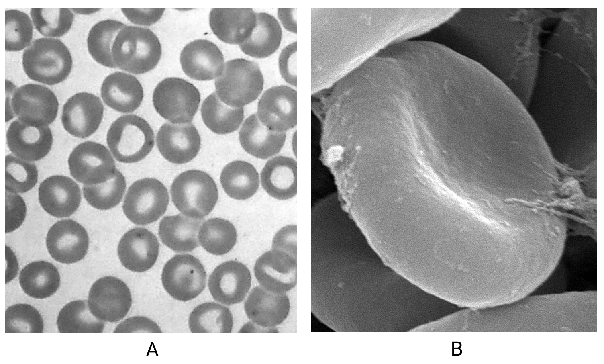

| Photo by Dr. Mae Melvin, CC0, via pixnio.com | Photo by Janice Carr, CC0, via pixnio.com |
|---|---|

**Fig. 1**

Compare the images shown by the two micrographs.

**Q2** [4 marks]

**Extract:**

Fig. 1 shows two micrographs.

| Photo by Dr. Mae Melvin, CC0, via pixnio.com | Photo by Janice Carr, CC0, via pixnio.com |
**Fig. 1**

(i) State the role of the cell type visible in Fig. 1.

[1]

(ii) Explain the adaptations of these cells.

[3]

**Q2** [3 marks]

A student doctor wanted to take a number of different measurements from a sample of blood cells in a blood smear.

They used a light microscope with an eyepiece graticule as part of their method, but they did not use a stage micrometer.

Identify the type of error this would lead to **and** explain the effect on their data.

### Q3 — hard — 8 marks

**Q3** [2 marks]

A student used a light microscope to view a specimen. They wanted to work out the actual size of the specimen, and decided to use a stage micrometer, together with the ruler visible inside the eyepiece of the microscope (known as the eyepiece graticule).

Outline why a stage micrometer is needed as well as the eyepiece graticule.

**Q3** [3 marks]

Describe the steps required to calibrate the eyepiece graticule of a light microscope using a stage micrometer.

**Q3** [2 marks]

**Extract:**

Describe the steps required to calibrate the eyepiece graticule of a light microscope using a stage micrometer.

The steps required to calibrate the eyepiece graticule of a light microscope using a stage micrometer are...

- Line up the scale of the graticule with the scale on the stage micrometer; [1 mark]
- Count the number of subdivisions of the stage micrometer that fit into each division of the eyepiece graticule; [1 mark]
- Multiply that number by the distance between each subdivision of the stage micrometer to give the distance between each division of the eyepiece graticule; [1 mark]

Explain why the steps outlined in part (b) would need to be repeated when the student changes to a more powerful objective lens.

**Q3** [1 mark]

Fig. 1 shows the appearance of the scale of a stage micrometer. The length of the whole scale is 1 mm. Point **A** shows the point at which the edge of a human cheek cell appears in the microscope display. A typical cheek cell has diameter of approximately 50 μm.

**Fig. 1**

Indicate on Fig. 1, with an arrow labelled **B**, the position of the opposite edge of the cheek cell.

### Q4 — hard — 7 marks

**Q4** [2 marks]

Fig. 2 below shows a stage micrometer scale and an eyepiece graticule in a light microscope. The upper scale is the micrometer while the lower scale is the eyepiece graticule.

The length of one division on this stage micrometer is **0.1 mm**.

**Fig. 2**

Calculate the actual length of one eyepiece graticule division using this stage micrometre. Give your answer in µm and show your working.

**Q4** [1 mark]

**Extract:**

Fig. 2 below shows a stage micrometer scale and an eyepiece graticule in a light microscope. The upper scale is the micrometer while the lower scale is the eyepiece graticule.

The length of one division on this stage micrometer is 0.1 mm.

Calculate the actual length of one eyepiece graticule division using this stage micrometre. Give your answer in µm and show your working.

The actual length of one eyepiece graticule unit is 2.5 µm.

The photomicrograph in Fig. 3 was taken using the same microscope and the same lenses as part (b).

The same eyepiece graticule was also used and is shown in Fig. 3.

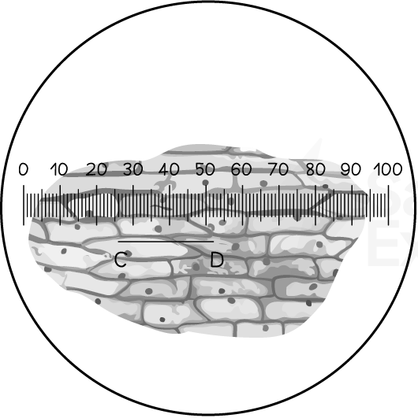

**Fig. 3**

Use the calibration of the eyepiece graticule unit from part (a) and the information in the photomicrograph to estimate the actual length **in μm **of the region of plant tissue shown between **C** and **D**.

**Q4** [4 marks]

**Extract:**

The photomicrograph in Fig. 3 was taken using the same microscope and the same lenses as part (b).

The same eyepiece graticule was also used and is shown in Fig. 3.

onion-cell-micrometer-micrograph

Fig. 3

Use the calibration of the eyepiece graticule unit from part (a) and the information in the photomicrograph to estimate the actual length in μm of the region of plant tissue shown between C and D.

Draw a biological drawing of at least four cells from Fig. 3, including the cell labelled **C**-**D**. Your drawing should be drawn to scale at x1000 magnification.

### Q5 — hard — 8 marks

**Q5** [3 marks]

A typical animal cell is surrounded by a cell membrane with a mean thickness of 8 nm, measured using electron microscopy.

A light microscope-generated image of the whole cell itself measures 5 cm across at a magnification of x1250.

Calculate the number of times wider the whole cell is than the thickness of its membrane.

**Q5** [3 marks]

A light microscope and an electron microscope were used to examine the contents of a plant cell.

The light microscope was used at two different magnification settings to produce the images shown in Fig .1. The electron microscope image is also shown in Fig.1

In all three images the field of view contained the same piece of biological material.

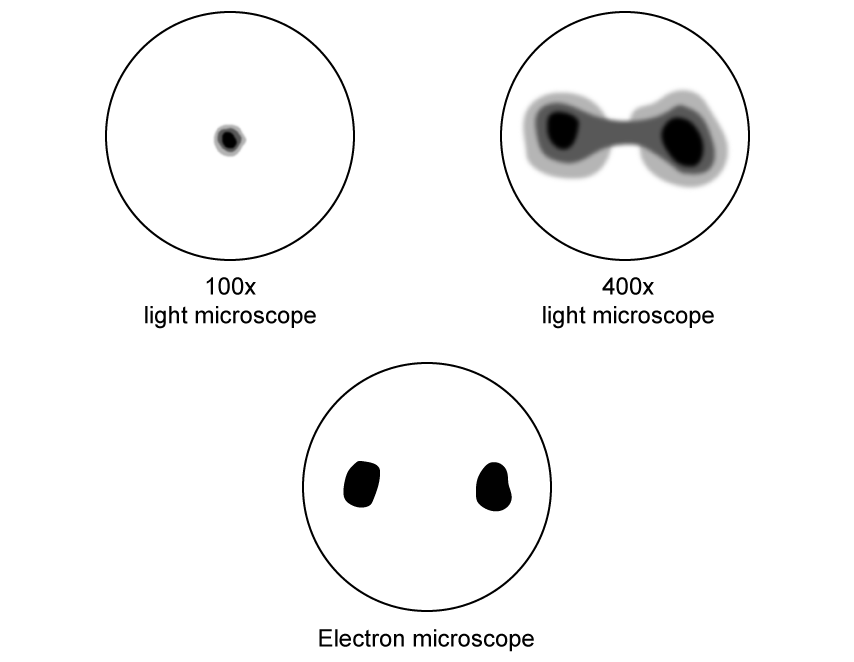

**Fig.1 **

Suggest reasons for the differences in the appearance of the three images in Fig. 1.

**Q5** [2 marks]

**Extract:**

A light microscope and an electron microscope were used to examine the contents of a plant cell.

The light microscope was used at two different magnification settings to produce the images shown in Fig .1. The electron microscope image is also shown in Fig.1 

In all three images the field of view contained the same piece of biological material. 

**Fig.1 **

Give **two** possible names of cell components that could be shown in Fig. 1.

Assume that the setup of the microscopes and sample preparation has been carried out to give the best possible view of the specimens under observation in each case.

### Q6 — medium — 9 marks

**Q6** [2 marks]

Fig. 1 below shows a cross-section of a leaf taken using a light microscope with a magnification of x250.

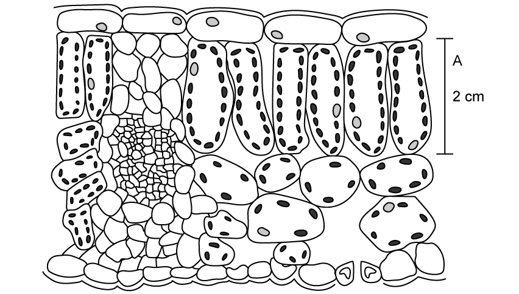

**Fig. 1**

Fig. 1 shows some cell organelles inside the cells of the leaf, but it doesn’t show structures such as ribosomes or cell membranes.

Use your knowledge of microscopes to explain why this is the case.

**Q6** [1 mark]

**Extract:**

Fig. 1 below shows a cross-section of a leaf taken using a light microscope with a magnification of x250.

Fig. 1 shows some cell organelles inside the cells of the leaf, but it doesn't show structures such as ribosomes or cell membranes.

If the leaf sample in Fig. 1 were viewed under an electron microscope, ribosomes and cell membranes could be viewed clearly.

Explain why.

**Q6** [4 marks]

Outline the general advantages and disadvantages of using an electron microscope.

**Q6** [2 marks]

Fig. 2 below shows an image of algae taken using an electron microscope.

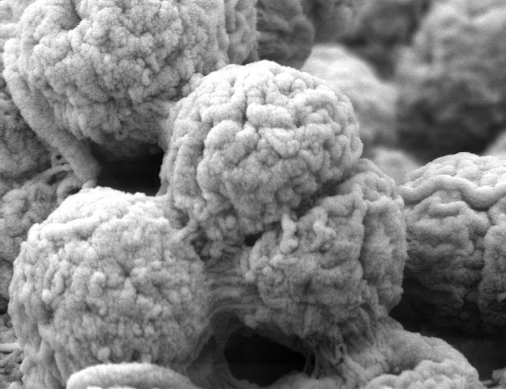

*SecretDisc, CC BY-SA 3.0, via **[Wikimedia Commons](https://commons.wikimedia.org/wiki/File:Algae_in_Scanning_Electron_Microscope%2C_magnification_20.000x.JPG)*

**Fig. 2**

For the image shown in Fig. 2

(i) Name the type of microscope used to produce this image.

[1]

(ii) Give one piece of evidence to support your answer to part i)

[1]

### Q7 — medium — 15 marks

**Q7** [2 marks]

With reference to resolution, explain the limitations of using a light microscope.

**Q7** [8 marks]

Fig. 1 shows a photomicrograph of onion epidermal cells at a magnification of x250.

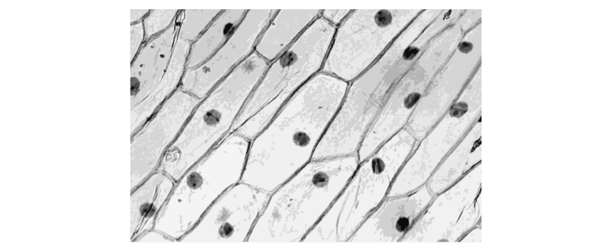

**Fig. 1**

(i) Draw a biological drawing of the cells in Fig. 1.

[5]

(ii) Name three organelles that are **not** visible in Fig. 1.

[3]

**Q7** [2 marks]

**Extract:**

Fig. 1 shows a photomicrograph of onion epidermal cells at a magnification of x250.

One of the cells of the image in Fig. 1 was measured to be 24 mm.

Calculate the actual width of one of the cells in Fig. 1. Give your answer in micrometres (µm).

**Q7** [3 marks]

Describe how a student would make a temporary mount of some onion epidermal tissue.

### Q8 — medium — 8 marks

**Q8** [4 marks]

A student decided to produce a biological drawing of a plant cell they were viewed using a light microscope.

Give **four** conventions that the student must be sure to follow for their diagram to be classed as a biological drawing.

**Q8** [2 marks]

In order to produce a scale line for their biological drawing in part a), the student needs to calculate the size of each eyepiece graticule subdivision. Fig. 1 shows the field of view of the light microscope used by the student at a magnification of x200. The student is told that each subdivision on the stage micrometer represents 10 µm.

**                                                 Fig. 1**

Calculate the distance represented by one subdivision of the eyepiece graticule scale at this magnification.

**Q8** [2 marks]

The student in parts a) and b) wants to be able to draw more detail of the plant cell infrastructure.

Explain why an electron microscope would give a more detailed image of the plant cell infrastructure than a light microscope.

### Q9 — medium — 8 marks

**Q9** [2 marks]

Fig. 1 is a drawing of part of a plant cell as seen with an electron microscope. The scale bar (measuring 45 mm in length) on this drawing represents a length of 10 μm.

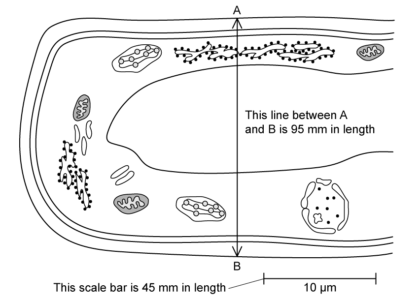

**                                                             Fig. 1**

Calculate the magnification of the drawing in Fig. 1

**Q9** [2 marks]

**Extract:**

Fig. 1 is a drawing of part of a plant cell as seen with an electron microscope. The scale bar (measuring 45 mm in length) on this drawing represents a length of 10 μm.

Calculate the magnification of the drawing in Fig. 1

The magnification of the drawing in Fig. 1 is 4500.

Calculate the actual width of the cell in Fig. 1 from **A** to **B**. Give your answer in micrometres (µm).

**Q9** [2 marks]

Fig. 2 is a drawing of a mitochondrion at a magnification of ×20 000. The distance between points **A **and **B** in the diagram is 6.4 cm.

**                                                                    Fig. 2**

Calculate the actual length of the mitochondrion in Fig. 2 in micrometres (µm).

**Q9** [2 marks]

The circumference of a mitochondrion, labelled **C** in Fig. 2, is 1.5 µm. A student is making an accurate scale model of a mitochondrion for a school science project and wants to magnify a mitochondrion 50,000 times.

Calculate (in cm) what the circumference of the student’s model will be.

### Q10 — medium — 9 marks

**Q10** [3 marks]

A student is given a sample of plant tissue.

Describe how the student would prepare a sample of cells from this tissue to be viewed using a light microscope.

**Q10** [4 marks]

Describe how the student in part (a) would then view their sample of cells using a light microscope.

**Q10** [2 marks]

Identify **two** structures in a eukaryotic cell that cannot be identified using a light microscope.

### Q11 — easy — 5 marks

**Q11** [1 mark]

Fig. 1 shows an electron micrograph of ciliated epithelial cells. The actual height of the cilia cell is 30 µm, and the image height is 28 mm.

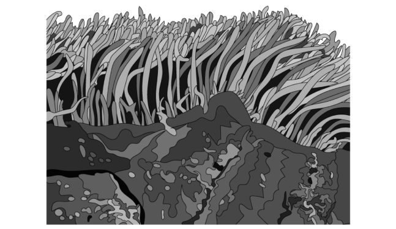

**Fig. 1**

Calculate the magnification used to generate the image. Give your answer to three significant figures.

**Q11** [1 mark]

Although cilia can be viewed under a light microscope, they are best seen with an electron microscope.

Suggest why this is the case.

**Q11** [2 marks]

**Extract:**

Although cilia can be viewed under a light microscope, they are best seen with an electron microscope.

When viewed under a light microscope it is hard to distinguish individual cilia.

Explain why.

**Q11** [1 mark]

Light microscopes have limitations that make some structures difficult to study in detail. Electron microscopes also have limitations.

State **one **limitation of an electron microscope.

### Q12 — easy — 12 marks

**Q12** [5 marks]

Fig. 1 shows a cell as viewed down a scanning electron microscope.

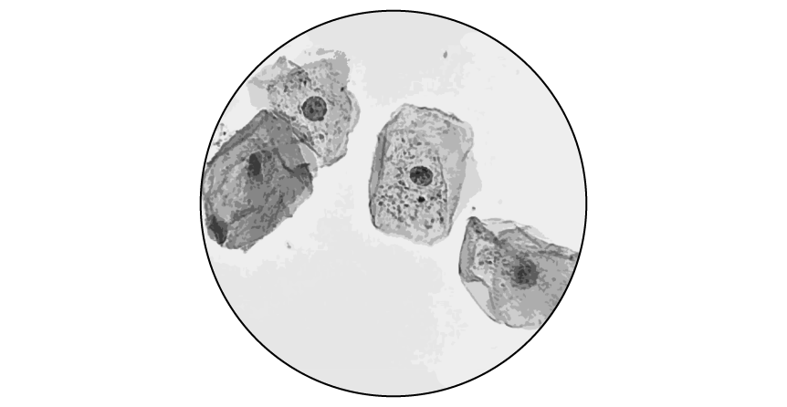

x 400

**Fig. 1**

In the space below sketch a biological drawing of the field of view. Do **not **include labels.

|   |
|---|

**Q12** [5 marks]

**Extract:**

Fig. 1 shows a cell as viewed down a scanning electron microscope.

x 400

**Fig. 1**

In the space below sketch a biological drawing of the field of view. Do **not **include labels.

Identify visible organelles in your biological drawing by adding appropriate labels.

**Q12** [1 mark]

The cells in Fig. 1 appear blue when viewed down the microscope lens.

Suggest why.

**Q12** [1 mark]

**Extract:**

Identify visible organelles in your biological drawing by adding appropriate labels.

The labels added should include:
- Nucleus/nuclei
- Cell membrane
- Cytoplasm
- Bacteria OR mitochondria/mitochondrion labelled

State the function of one of the organelles labelled in part (b).

State the name of the organelle to which your answer refers.

### Q13 — easy — 10 marks

**Q13** [5 marks]

Table 1 compares some of the features of light and electron microscopes.

**Table 1**

|   | light microscope | electron microscope |
|---|---|---|
| image is formed using... | light | **A** |
| resolution | **B** | **C** |
| magnification | lower | **D** |
| can be used to observe organelles as small as... | mitochondria / chloroplasts | **E** |

Identify the missing words labelled **A**-**E**.

**Q13** [2 marks]

A student used a light microscope to view a specimen. They wanted to work out the actual size of the specimen and decided to use a stage micrometer together with an eyepiece graticule.

Explain why the stage micrometer is needed as well as the eyepiece graticule.

**Q13** [2 marks]

The specimen the student wanted to view required a stain.

State why stain is needed for some structures and specimens.

**Q13** [1 mark]

The specimen also needs to be thin to view with a light microscope.

Explain why.

### Q14 — easy — 8 marks

**Q14** [1 mark]

**Extract:**

- Accept "the number of times the (real-life) specimen has been enlarged to give the image" and "image size divided by actual size" as equivalent to the marking point.
- Do not accept "how much bigger the image is" without reference to the actual/real size of the specimen.

Define the term **magnification**.

**Q14** [1 mark]

Define the term **resolution**.

**Q14** [3 marks]

A student is reading a biology textbook. There is an image of a cell with the magnification stated as ×10 000.

Describe how the student would calculate the actual length of the cell.

Assume that the student has a ruler which measures in cm and mm.

**Q14** [3 marks]

The student wanted to make a biological drawing of the photomicrograph of the cell.

State **three **conventions for biological drawing that the student should follow.

### Q15 — easy — 7 marks

**Q15** [2 marks]

A student wants to prepare a temporary mount of some cells isolated from the root tip of a garlic bulb. They placed a thin layer of tissue onto a slide before adding a drop of iodine and a coverslip.

Explain how the coverslip should be added to the slide.

**Q15** [1 mark]

**Extract:**

A student wants to prepare a temporary mount of some cells isolated from the root tip of a garlic bulb. They placed a thin layer of tissue onto a slide before adding a drop of iodine and a coverslip.

State how the procedure described in (a) would differ if animal tissue were being viewed rather than plant tissue.

**Q15** [2 marks]

Fig. 1 shows an image as seen down the microscope.

The actual diameter of the structure, labelled **X**, is 200 µm.

A student used a ruler and measured the length of **X** as 8 cm.

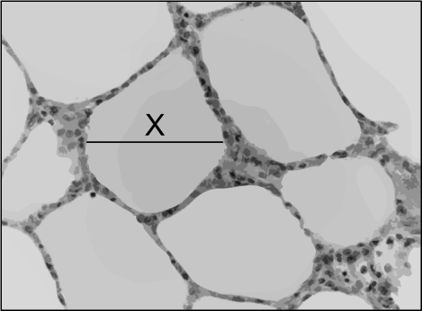

**Fig. 1**

Calculate the magnification of the image.

**Q15** [2 marks]

Fig. 2 shows a labelled organelle taken using an electron microscope.

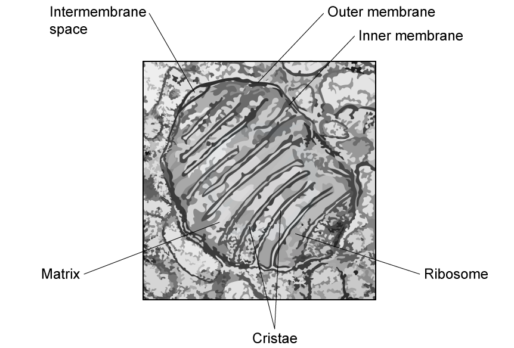

**Fig. 2**

Explain the evidence from Fig. 2 that shows that this is an image from an electron microscope.
