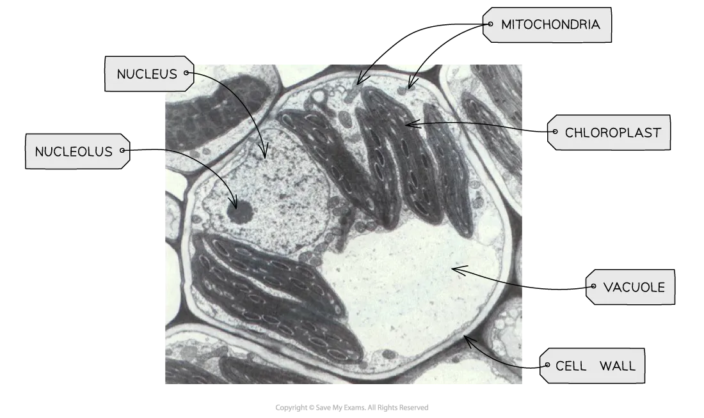
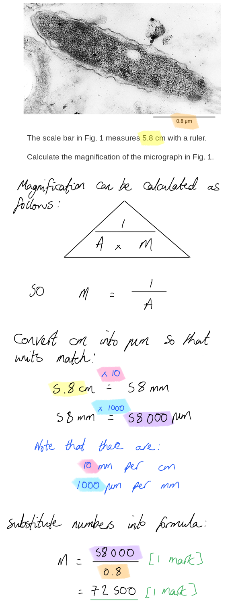
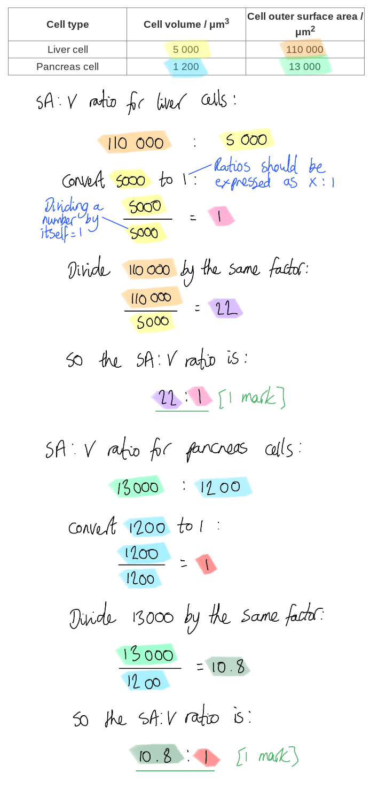
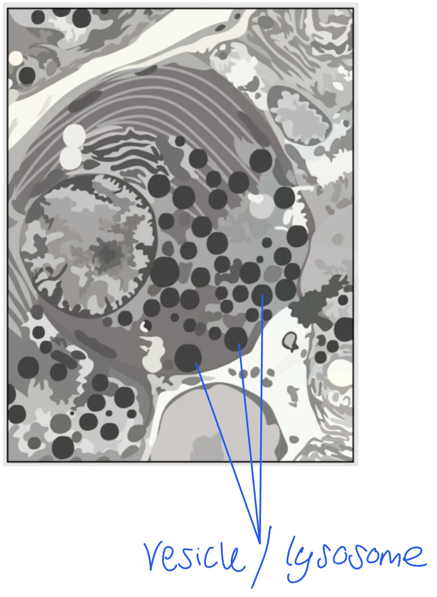
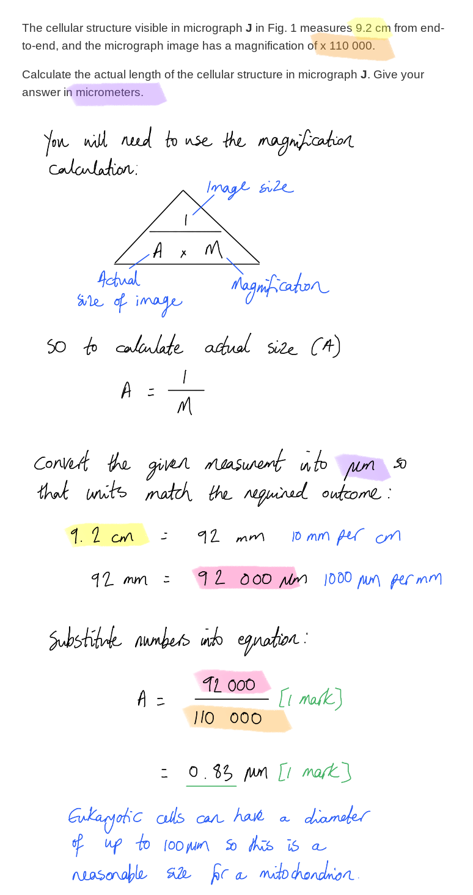
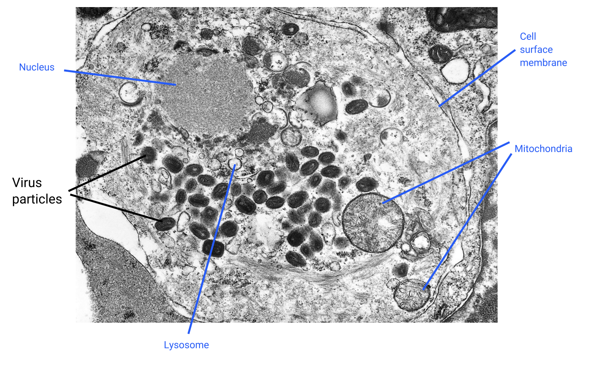
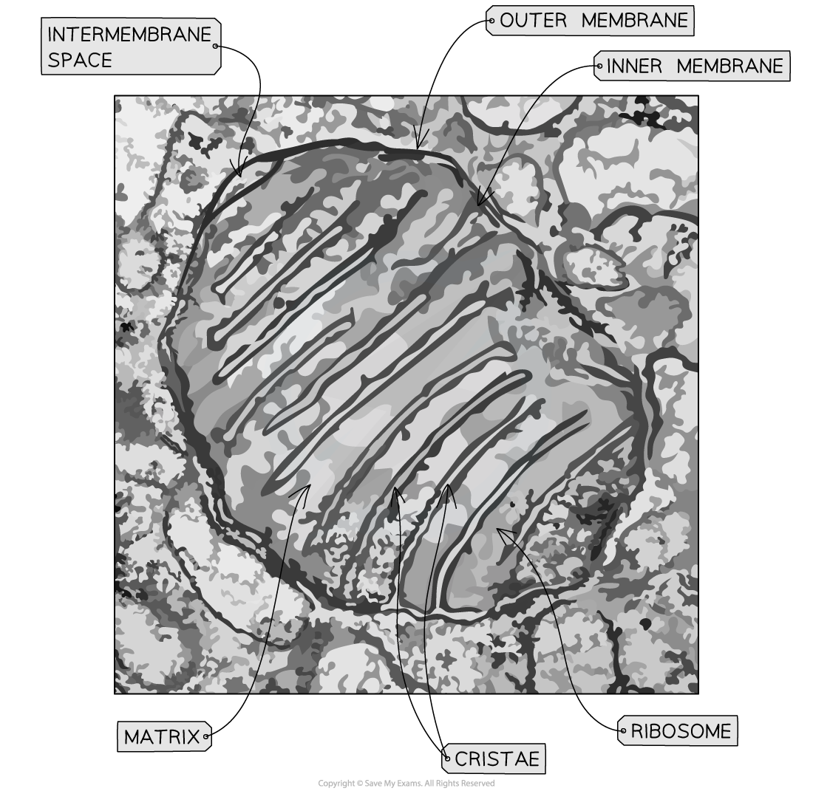

# Mark Schemes — Cells as the Basic Units of Living Organisms
**1. Cell Structure** · Cambridge (CIE) AS biology (9700)

## Multiple Choice Questions (30 questions)

### Q1
**Final answer:** **The correct answer is ****A**** because:**

- **The DNA in prokaryotic cells is found in a circular form**
- **The DNA is not found inside a nuclear membrane**

> *B **is incorrect as centrioles are found in eukaryotic cells.*

> *C **is incorrect as the smooth endoplasmic reticulum is a membrane-bound organelle, and is therefore not found in prokaryotes.*

> *D **is incorrect as the cell wall in prokaryotes is made of** **peptidoglycan (or murein), not cellulose.*

### Q2
**Final answer:** **The correct answer is ****A**** because:**

**Final answer:** **The rough endoplasmic reticulum has ****ribosomes**** on its surface membrane, and the amino acids are incorporated into new proteins here during the process of protein synthesis.**

> *B **is incorrect as the function of the Golgi apparatus is to modify, process and package proteins; this occurs after production of proteins at the ribosomes.*

> *C **is incorrect as the mitochondria are the site of aerobic respiration reactions.*

> *D **is incorrect as the nucleus contains the genetic information; transcription occurs here, but this process does not involve amino acids.*

### Q3
**Final answer:** **The correct answer is ****D**** because:**

- **The smooth endoplasmic reticulum is a network of membrane that encloses flattened sacs called cisternae**
- **Lipids are synthesised by the smooth endoplasmic reticulum**

> *A **is incorrect as this structure describes the Golgi apparatus, which has the function of modifying and packaging new lipids and proteins.*

> *B **is incorrect as this structure describes ribosomes; which have the function of protein synthesis.*

> *C **is incorrect as this describes the structure of the nucleus, which has the function of storing the genetic information in the form of DNA packaged as chromosomes.*

### Q4
**Final answer:** **The correct answer is ****D**** because the link between chloroplasts, mitochondria and prokaryotic cells is that they all have 70S ribosomes!**

> *All the other options have 80S ribosomes linking 3 and 5; 80S ribosomes are only found eukaryotes and not prokaryotes.*

### Q5
**Final answer:** **The correct answer is ****A**** because:**

**Final answer:** **The genetic material of a virus is either made of RNA ****or**** ****DNA**

- **Retroviruses, like HIV, are RNA viruses, meaning that their genetic material is RNA**
- **The varicella zoster virus and smallpox virus both have DNA genomes**

> *B **&** C **are incorrect as a virus can contain either RNA or DNA.*

> *D **is incorrect as a virus will not have both RNA and DNA in its genetic material; it will be one or the other.*

### Q6
**Final answer:** **The correct answer is ****B**** because:**

- **In column 1 the cell contains: a cell wall, chloroplast, Golgi apparatus and a large vacuole. These would all be features of a leaf cell. The leaf cell in the options is the spongy mesophyll cell.**
- **In column 2 the cell contains: a cell wall, Golgi apparatus and a large vacuole. The absence of chloroplasts show that this could be a root cell**
- **In column 3 the cell contains: centrioles and Golgi apparatus. This is an animal cell. The animal cell option is the ciliated epithelial cell**
- **As outlined in column 4, this cell only contains a cell wall; all the other features are seen in eukaryotic cells. This cell must be prokaryotic**

### Q7
**Final answer:** **The correct answer is ****B**** because:**

**Final answer:** **This cell has a lot of rough endoplasmic reticulum, the role of the which is protein synthesis; this means that there will be a great deal of RNA being produced during the transcription stage of this process.**

**Final answer:** **ATP is produced in the mitochondria, two of which are visible in the image here. Protein synthesis will require plenty of ATP in order to take place.**

> *A, C **& **D **are incorrect a as glucose is not produced in aerobic respiration; it is a substrate used during ATP synthesis.*

### Q8
**Final answer:** **The correct answer is ****C**** because:**

**Final answer:** **This graph shows high biochemical activity in the nuclei, which is where DNA would be transcribed into mRNA.**

**Final answer:** **The graph also shows high biochemical activity in the mitochondria, providing the ATP for the biochemical activity in the nuclei.**

> *A** is incorrect as the highest biochemical activity is in the ribosomes; this will indicate cells that are carrying out high rates of translation. While this process is closely related to the production of mRNA, the processes are not the same and do not involve the same organelles.*

> *B** is incorrect as the highest biochemical activity here is in the mitochondria; this indicates cells that are producing large quantities of ATP.*

> *D** is incorrect as the highest biochemical activity here is in the lysosomes, e.g. a group of cells in the immune system.*

### Q9
**Final answer:** **The correct answer is ****C**** because:**

**Final answer:** **The protein coat surrounding the genetic material of a virus is called the capsid.**

> *A **is incorrect as a **peplomer** is a glycoprotein spike on a viral capsid.*

> *B **is incorrect as a **capsomere** is a subunit of the capsid.*

> *D **is incorrect as a **virion** is the complete infective form of the virus including the RNA and capsid.*

### Q10
**Final answer:** **The correct answer is ****C**** because:**

**Final answer:** **This can be identified as the Golgi apparatus, the function of which is to modify and package proteins. Note that while the image is not perfectly clear, the distinctive structure of the Golgi can be seen here; it is a series of flattened membrane discs that are stacked, a bit like a wifi symbol!**

> *A** is likely to be a lysosome or vesicle.*

> *B** is most probably a mitochondrion.*

> *D **indicates a region of cytoplasm.*

### Q11
**Final answer:** **The correct answer is ****A**** because:**

**Final answer:** **This is the cytoplasm, which is present in all cell types.**

> *B **is incorrect as this structure is likely to be a chloroplast, though it could also be a mitochondrion; these are the next-largest cellular structures after the nucleus and vacuole. Prokaryotic cells do not contain membrane-bound organelles, so this is an incorrect answer either way.*

> *C **is incorrect as this is the vacuole, surrounded by the tonoplast membrane; prokaryotic cells do not contain membrane-bound organelles.*

> *D **is incorrect as this is the nucleus; another membrane-bound organelle not present in prokaryotes.*

### Q12
**Final answer:** **The correct answer is ****C**** because:**

**Final answer:** **Exocytosis is bulk transport of substance across a cell membrane from the inside to the outside of a cell; it occurs when vesicles inside the cell fuse with the cell surface membrane and release their contents.**

> *A **is incorrect as facilitated diffusion does not require ATP from the mitochondria.*

> *B **is incorrect as lysosomes are not involved in DNA synthesis.*

> *D **is incorrect as ribosomes are not involved in phospholipid production.*

### Q13
**Final answer:** **The correct answer is ****C**** because:**

- **Eukaryotic cells have ****membrane-bound**** organelles, so will have endoplasmic reticulum in the cytoplasm**
- **The DNA in eukaryotic cells is wound around proteins called ****histones**** to make chromatin that forms the chromosomes**
- **The ribosomes in eukaryotic cells are found freely in the cytoplasm or associated with an endoplasmic reticulum forming RER.**

### Q14
**Final answer:** **The correct answer is ****B**** because:**

- **Prokaryotic cells have circular chromosomes**
- **Prokaryotic cells produce proteins**** ****using 70S ribosomes**
- **A prokaryotic cell has a cell surface membrane**** ****to separate the cell from the environment.**

> *A **& **C **are incorrect as **cell walls **in prokaryotes are made of **peptidoglycan** (**murein)** not cellulose.*

> *D **is incorrect as prokaryotes do not contain membrane-bound organelles. Photosynthesis in a photosynthetic prokaryote would need to occur in a different location.*

### Q15
**Final answer:** **The correct answer is ****D**** because:**

**Final answer:** **Products of metabolism,**** ****such as enzymes, can work intracellularly or extracellularly.**

**Final answer:** **Remember that the term 'metabolism', while often used when referring to respiration, applies to all of the chemical processes of a cell, including protein synthesis.**

> *A **is incorrect as lysosomes contain hydrolytic enzymes which are released to break down waste material in cells.*

> *B **&** C **are incorrect as enzymes can work internally to catalyse intracellular reactions, or externally, e.g. digestive enzymes like salivary amylase.*

### Q16
**Final answer:** **The correct answer is ****C**** because:**

- **The addition of carbohydrate to protein occurs inside the Golgi apparatus during protein modification**
- **Vesicles then leave the Golgi apparatus**
- **Golgi vesicles then fuse with the cell surface membrane before glycoproteins are released**

> *Note that you don't need to understand the relationship between glycoproteins and mucus here, you just need to recognise the steps as being part of the process of producing and secreting proteins inside a cell.*

### Q17
**Final answer:** **The correct answer is ****C**** because:**

- **The nucleus, chloroplast and mitochondria all have a double membrane**
- **The chloroplast has a double membrane known as the chloroplast envelope, which has an outer and inner membrane**
- **The mitochondria have a double membrane; the inner membrane is folded to form structures called the cristae, which contains many of the structures needed to synthesis ATP**

> *The double membrane of the nucleus connects directly with the lumen of the rough endoplasmic reticulum, meaning that there is only a single layer of membrane surrounding the ER.*

> *Vesicles are surrounded by a single layer of membrane.*

### Q18
**Final answer:** **The correct answer is ****B**** because:**

**Final answer:** **This is the Golgi apparatus, the function of which is to modify proteins and package them for export. To produce glycoproteins, the proteins produced at C will need to be modified with sugars (carbohydrate); this takes place in the Golgi apparatus.**

> *A **is incorrect as this shows the vesicles secreting the glycoproteins by **exocytosis.*

> *C **is incorrect as this is the** rough endoplasmic reticulum**, where the proteins for glycoprotein production are synthesised.*

> *D **is incorrect as this is the** nucleus**, where the DNA for glycoprotein production is transcribed.*

### Q19
**Final answer:** **The correct answer is ****C**** because:**

**Final answer:** **The mitochondria and the nucleus both have a double membrane.**

> *The other structures listed all have single membranes surrounding them, including the cytoplasm, which is surrounded by a single cell surface membrane.*

### Q20
**Final answer:** **The correct answer is ****C**** because:**

**Final answer:** **The nucleus, mitochondria, and chloroplasts are all visible in the image.**

> *A **is incorrect as plant cells do not have a capsule, so it would not be possible to see one in this image.*

> *B **is incorrect as ribosomes are not visible at this magnification.*

> *D **is incorrect as, while we might expect to see endoplasmic reticulum in a plant cell at this magnification, ER cannot be seen in this particular image.*

### Q21
**Final answer:** **The correct answer is ****B**** because:**

- **Centrioles are not present from flowering plant cells**
- **Cilia are hair-like structures found on some epithelial cells in animals, but not in the cells of plants **
- **Plant cells contain mitochondria for aerobic respiration**
- **Plant cells have a permanent vacuole to store cell sap**

> *Most eukaryotic cells do have centrioles (which play a vital role in cell division), but they are not found in flowering plants, coniferous plants, or fungi.*

### Q22
**The correct answer is ****D**** because having circular DNA is the only feature listed that is only present in prokaryotes****.**

*All the other features can be seen in different types of eukaryotic organisms. *

### Q23
**Final answer:** **The correct answer is ****B**** because:**

- **The structure highlighted is the rough endoplasmic reticulum (RER)**
- **The function of the rough endoplasmic reticulum is to synthesise proteins on the ribosomes attached to its surface**
- **Proteins are transported from the RER to the Golgi apparatus in vesicles **

> *A **is incorrect as the rough endoplasmic reticulum is also involved in the transport of proteins.*

> *C & D **are incorrect as the function of the smooth ER is to synthesise, process and transport lipids.*

### Q24
**Final answer:** **The correct answer is ****C**** because:**

**Final answer:** **The function of a ribosome is protein synthesis; all prokaryotic and eukaryotic cells need to produce proteins, so all cells have them!**

> *The other structures are present in **some** prokaryotic cells, but they are not found in** all** prokaryotic cells.*

### Q25
**Final answer:** **The correct answer is ****C**** because:**

**Final answer:** **The smooth endoplasmic reticulum produces steroid hormones, such as oestrogen and testosterone, as well as lipids, such as phospholipids.**

> *A **is incorrect as **enzymes **are **proteins**, which are synthesised on ribosomes; ribosomes are not found associated with the smooth ER.*

> *B **is incorrect as proteins are synthesised on** ribosomes.*

> *D **is incorrect as **antibodies** are part of the immune system and made by specialised cells known as plasma cells; they are proteins, so they are also synthesised by the ribosomes.*

### Q26
**Final answer:** **The correct answer is ****A**** because:**

**Final answer:** **The nucleolus, a region of the nucleus, is where ribosomal subunits are made from ribosomal RNA (rRNA) and proteins. Ribosomes are made from a large subunit (60S in eukaryotes, 50S in prokaryotes) and a smaller subunit (40S and 30S in eukaryotes and prokaryotes respectively).**

> *B **is incorrect as the synthesis of ribosomal proteins takes place in the cytoplasm.*

> *C **is incorrect as this process occurs during cell division.*

> *D **is incorrect as the rough endoplasmic reticulum is continuous with the nuclear envelope.*

### Q27
**Final answer:** **The correct answer is ****C**** because:**

**Final answer:** **The structure is the rough endoplasmic reticulum (RER), the function of which is to synthesise proteins on the ribosomes attached to its surface.**

**Final answer:** **Proteins that will be secreted by the cell tend to be synthesised by ribosomes on the RER; they pass directly into the ER where they may be modified before being packaged into vesicles and transported to the Golgi apparatus where they are further processes before secretion.     **

> *A **is incorrect as this is a vesicle which will fuse with the surface membrane to secreting its contents by exocytosis.*

> *B **is incorrect as this is the Golgi apparatus, which is involved in processing and modifying proteins but not in making them.*

> *D **is incorrect as this is a mitochondrion, the site of aerobic respiration.*

### Q28
**Final answer:** **The correct answer is ****A**** because:**

- **Chromatin**** is the substance that makes up chromosomes in eukaryotic cells.**
- **It is a complex of DNA and ****histones ****proteins; it primarily allows long DNA molecules to be packaged into more compact and dense structures**
- **Prokaryotic cells have very different structures for organising their ****chromosomes, ****which are circular and therefore closed structures (unlike linear chromosomes in eukaryotes which have terminal ends)**

> *B **is incorrect as prokaryotic cells can have cell walls (made from peptidoglycan), while animal cells do not have cell walls.*

> *C **is incorrect as prokaryotic cells may have one or more plasmids.*

> *D **is incorrect as prokaryotic cells have 70S ribosomes, while eukaryotic cells have 80S ribosomes.*

### Q29
**Final answer:** **The correct answer is ****C**** because:     **

- **Eukaryotic cells have their DNA packaged in linear chromosomes which are found in the nucleus**
- **The ribosomes in a eukaryotic cell are 80S ribosomes; they are typically large and able to form more complex proteins**

> *A & B **are incorrect as eukaryotic cells do not have circular DNA.*

> *D **is incorrect as the ribosomes in prokaryotic cells are smaller, referred to as 70S ribosomes.*

> *The ‘S’ stands for Svedberg unit; this is a measure of particle size based on the rate of travel of a particle in a tube that is subjected to a high g-force! 70S ribosomes are smaller than 80S ribosomes.*

### Q30
**Final answer:** **The correct answer is ****B**** because:**

- **Animal cells do not have a cell wall, but all cells have a membrane**
- **Animal and bacterial cells have DNA; the DNA in an animal cell will have a linear structure and be found in the nucleus, in a bacterium it is circular and found in a region of the cytoplasm**
- **All cells need to synthesise proteins, so both have ribosomes; the ribosomes found in bacterial (prokaryotic) cells are smaller than those found in animal (eukaryotic) cells**

> *A **is incorrect as animal cells do not have a cell wall.*

> *C & D **are incorrect as animal cells do not have a capsule.*

## Structured Questions (15 questions)

### Q1
(i) The cell type in Fig. 1 is...

- Prokaryotic (cell); **[1 mark]**

(ii) This is because...

- The cell contains no membrane-bound organelles / no nucleus / endoplasmic reticulum / Golgi / lysosomes; **[1 mark]**
- The cell has a (slime) capsule; **[1 mark]**

*Accept other named membrane-bound structures for marking point 1.*

> *There are many differences between prokaryotic and eukaryotic cells, but here you need to focus on those that are clearly visible in Fig. 1.*

**[Total: 3 marks]**
The magnification of the micrograph is...

- 58 000 ÷ 0.8; **[1 mark]**
- (x) 72 500; **[1 mark]**

**[Total: 2 marks]**

> *Using and rearranging the magnification formula is generally straightforward, but students can be thrown when this is applied to the scale bar rather than to an entire image. Remember that the **measurement written beneath a scale bar can be used as the 'actual size' (A)** so provided that you also know the **image measurement (I)** of the scale bar (in an exam you would be expected to measure this yourself with a ruler) you just need to **use the magnification formula** in the usual way to find out the magnification (M) of the entire image. Some questions might then ask you to use this magnification to calculate the actual size (A) of an object within the micrograph.*

(i) The structure in Fig. 2 is...

- Flagellum/flagella / pilus/pili **OR **microtubule(s); **[1 mark]**

*Accept cytoskeleton.*

*Reject centrioles.*

> *This is a tricky image to interpret and relies on you recognising the structures as being **similar** to centrioles, while also realising that they** cannot be** centrioles.*

> *Remember that centrioles are **only present in eukaryotic cells**, where they assist with the separation of chromosomes during cell division. Prokaryotic cells do not have linear chromosomes and do not divide in the same way, so they do not need centrioles. You should also note that centrioles are made up of **triplets **of microtubules rather than pairs (as present in Fig. 2), and that they do not have any central microtubules.*

> *Given that the structures in Fig. 2 are similar to centrioles, and that they are described as being made up of **'protein cylinders'**, it is reasonable to assume that they are made of **microtubules**. Structures on the surface of prokaryotes that are made of microtubules are** flagella **and **pili**.*

(ii) The composition of the protein cylinders (microtubules) is as follows...

**Final answer:** **Any ****two**** of the following:**

- Tubulin; **[1 mark]**
- Dimers of alpha and beta tubulin; **[1 mark]**
- Dimers join to form a polymer / protofilament; **[1 mark]**
- Protofilaments join together to form cylinders/hollow tubes; **[1 mark]**

> *Note that the specification does not require detailed knowledge of the structure of microrubules, but this detail is covered in our revision notes on cell structure.*

**[Total: 3 marks]**
The role of the structures in prokaryotic cells is...

**Final answer:** **Any ****one**** of the following:**

- Movement/motion/motility; **[1 mark]**
- Attachment to surfaces / other cells for sexual reproduction/conjugation/exchange of genetic material; **[1 mark]**

*Accept descriptions of the role of the cytoskeleton, e.g. maintaining the structure of the cell / internal cell transport*

*Accept error carried forward from part (a) (i), meaning that if the structures have been incorrectly identified as centrioles, a mark can still be awarded for stating that their role is to separate chromosomes during cell division / form the spindle fibres.*

**[Total: 1 mark]**

### Q2
Conclusions about the activities of liver and pancreas cells that can be drawn from the data are...

**Final answer:** **Any ****three**** of the following:**

- Pancreas cells carry out more protein synthesis / produce more proteins than liver cells; **[1 mark]**
- Liver cells produce/process/store more lipids/carbohydrates/steroids than pancreas cells; **[1 mark]**
- Pancreas cells carry out more modification of proteins / secrete more proteins than liver cells; **[1 mark]**
- Liver cells are more metabolically active / carry out more aerobic respiration / produce more ATP than pancreas cells; **[1 mark]**

**[Total: 3 marks]**

> *This question tests your ability to **apply your knowledge of organelle function** to this data set. The percentage of total cell membrane that is found in each type of organelle gives **an indication of the amount/number of each organelle **inside the cell, which in turn gives an indication of the activities of the cell:*

- *A higher percentage of the membrane is found in rough ER in pancreas cells than in liver cells. The role of rough ER is to synthesise proteins, so the pancreas cells must synthesise more proteins than liver cells.*
- *A higher percentage of the membrane is found in smooth ER in liver cells. A role of smooth ER is to produce lipids, so liver cells must produce more lipids than pancreas cells.*
- *A higher percentage of the membrane is found in Golgi bodies in the pancreas. The role of the Golgi is to modify and secrete proteins, so the pancreas must modify and secrete more proteins.*
- *A higher percentage of the membrane is found in the inner membrane of the mitochondria in liver cells. This is the site of aerobic respiration, so liver cells must carry out more aerobic respiration than pancreas cells.*
(i) The data in Table 1 would be different for a prokaryotic cell as follows...

- 100 %/all of the membrane would be in the cell surface/plasma membrane / there would be no membrane found in internal organelles; **[1 mark]**

(ii) The data in Table 1 would be different for a plant cell as follows...

**Final answer:** **Any ****two**** of the following:**

- Membrane would be present in a chloroplast outer/inner membrane; **[1 mark]**
- Membrane would be present in the thylakoids/grana / lamellae; **[1 mark]**
- Membrane would be present in the permanent vacuole / as the tonoplast; **[1 mark]**

**[Total: 3 marks]**
(i) The surface area to volume ratio for liver cells is...

- 22 : 1; **[1 mark]**

(ii) The surface area to volume ratio for pancreas cells is...

- 10.8 : 1; **[1 mark]**

**[Total: 2 marks]**

(i) An organelle visible in the micrograph that is not listed in Table 1 is...

- Lysosomes / vesicles; **[1 mark]**

> *This micrograph is a little bit tricky to interpret, and it is not possible to identify all of the organelles listed in Table 1, but it is clear that the cell contains many small, membrane-bound compartments that are not identified in Table 1. Such compartments are known as **vesicles**, and specialised vesicles known as **lysosomes** are often clearly visible in micrographs.*

(ii) The role of this organelle is to...

*Lysosomes*

- Contain hydrolytic enzymes; **[1 mark]**
- To break down waste / worn out organelles / pathogens inside cells **OR** to carry out apoptosis / programmed cell death; **[1 mark]**

*Vesicles*

- Transport / store substances/named substance, e.g. enzymes / proteins inside cells; **[1 mark]**
- Transport proteins from the rough ER to the Golgi / from the Golgi to the cell surface membrane for secretion/exocytosis; **[1 mark]**

*The description of the function must be a match to the organelle named in part (i).*

**[Total: 3 marks]**

### Q3
(i) The null hypothesis would be...

- The bacteriophage has <u>no effect</u> on the number of bacteria **OR** there will be <u>no difference</u> in the number of bacteria in untreated rats / **J** and treated rats / **K**; **[1 mark]**

(ii) The experimental hypothesis would be...

- The bacteriophage has <u>an effect</u> on the number of bacteria **OR** there will be <u>an effect</u> on the number of bacteria in treated and untreated rats **OR** there will be <u>an effect</u> on the number of bacteria in **J** and **K**; **[1 mark]**

**[Total: 2 marks]**

> *For both marking points it is essential to refer to a difference/effect (or no difference/effect) **in the number of bacteria**, which is the **dependent variable **in this experiment. Avoid just referring to a **difference** (or no difference) between rats; this would not be specific enough to gain credit.*
The effectiveness of the bacteriophage for treating lung infection can be assessed as follows...

- The phage decreased the count of bacteria in the lungs of the rats; **[1 mark]**
- In all cases/rats because the ranges <u>don’t overlap</u>; **[1 mark]**
- There is a wide range of effectiveness **OR** some rats show a big reduction in bacteria number **OR** there are a few rats with large reductions in bacteria number **OR** it doesn’t bring bacteria down to 0 in any rats; **[1 mark]**

**[Total: 3 marks]**

> *It is not enough to just say that the bacteriophages reduce the number of bacteria in the lungs of all rats here. You need to look more closely at the results and comment on the different range of effects.*
Comparable points between eukaryotic and prokaryotic cells include...

**Final answer:** **A ****maximum of three**** of the following:**

- Both (prokaryotic and eukaryotic cells) have cytoplasm; **[1 mark]**
- Both have a plasma/cell surface membrane; **[1 mark]**
- Both contain DNA/genetic material; **[1 mark]**
- Both prokaryotic and plant cells/fungal cells have cell walls;** [1 mark]**

Contrasting points between eukaryotic and prokaryotic cells include...

**Final answer:** **A ****maximum of three**** of the following:**

- Prokaryotic cells do not have a nucleus **WHEREAS** eukaryotic cells do; **[1 mark]**
- Prokaryotic DNA is naked/not associated with histones/proteins **WHEREAS** eukaryotic DNA is associated with histones/proteins; **[1 mark]**
- Prokaryotic cells have a (single) circular chromosome **WHEREAS** eukaryotic cells have (multiple) linear chromosomes; **[1 mark]**
- Prokaryotic cells do not have membrane-bound organelles/named membrane-bound organelle **WHEREAS** eukaryotic cells do; **[1 mark]**
- Prokaryotic cells have 70S/smaller ribosomes **WHEREAS** eukaryotic cells have 80S/larger ribosomes;** [1 mark]**
- Prokaryotic cells are smaller in size/(approximately) 1-10 µm **WHEREAS** eukaryotic cells are larger in size/(approximately) 10-100 µm; **[1 mark]**
- Prokaryotic cells have a peptidoglycan cell wall **WHEREAS** eukaryotic cells do not / plant cells have a cellulose cell wall / fungal cells have a chitin cell wall / animal cells have no cell wall; **[1 mark]**

**[Total: 5 marks]**

> *Compare and contrast questions require you to give both **similarities and differences**. When describing contrasting points, be sure that all of your points cover how the two things are **different** from each other, e.g. ‘eukaryotic cells are big’ would not be credited, whereas ‘eukaryotic cells are bigg**er** than prokaryotic cells’ would gain a mark.*

### Q4
The main cellular structures visible in micrographs J, K, and L are...

- J = mitochondrion/mitochondria; **[1 mark]**
- K = Golgi apparatus/body; **[1 mark]**
- L = <u>rough</u> endoplasmic reticulum; **[1 mark]**

**[Total: 3 marks]**

> *Sometimes it is hard to distinguish between the rough endoplasmic reticulum and the Golgi apparatus. One giveaway is that the rough endoplasmic reticulum has** ribosomes**, which can be seen here as small black dots on the image, while another clue is in the **overall shape** of the organelle; the Golgi is a neat stack of membranes that resembles a wifi symbol, while the ER tends to have a more random layout.*
Mitochondria are adapted for their role as follows...

**Final answer:** **Any ****two**** of the following:**

- They have a folded inner membrane with a large surface area; **[1 mark]**
- The inner membrane contains (many) proteins/enzymes needed for aerobic respiration; **[1 mark]**
- The outer membrane contains transport proteins (to transport pyruvate into the matrix); **[1 mark]**
- The matrix contains enzymes / has the correct pH for aerobic respiration/the krebs cycle; **[1 mark]**

*Accept references to it being possible to generate a concentration gradient between the intermembrane space and the matrix.*

**[Total: 2 marks]**

> *In biology, it is always important to be able to **relate structure to function**, so it is a good idea to have a few ideas about how some of the different cellular structures are adapted to their role. If in doubt, references to increasing the surface area are usually a good way to go!*
The cellular structures visible in micrographs K and L in Fig. 1 can be compared and contrasted as follows...

*Comparative features / similarities*

- They are both made of membrane; **[1 mark]**
- They both consist of a series of flattened sacs; **[1 mark]**

*Contrasting features / differences*

**Final answer:** **A ****maximum of**** ****two**** of the following:**

- Rough ER/L has ribosomes attached **WHILE** Golgi/K does not; **[1 mark]**
- Rough ER/L is continuous with the nuclear membrane **WHILE** Golgi/K is not; **[1 mark]**
- Rough ER/L is made up of continuous folds of membrane **WHILE** Golgi/K consists of several separate compartments; **[1 mark]**
- Rough ER/L is involved with protein synthesis/processing **WHILE** Golgi/K packages/modifies proteins; **[1 mark]**

**[Total: 3 marks]**

> *While the command word **compare** can actually refer on its own to either similarities or differences, questions that say **compare and contrast** definitely need you to give both similarities and differences. You must include both similarities and differences to gain full marks here.*

> *Note that when describing differences, **each statement must cover both structures**. E.g. here you would not get credit for just say 'ER has ribosomes'; you need to state how the Golgi is **different** to this.*
The actual length of the cellular structure in micrograph J is...

- 92 000 ÷ 110 000; **[1 mark]**
- 0.83 (μm); **[1 mark]**

**[Total: 2 marks]**

### Q5
Structures X, Y and Z are...

- X = genetic material/code / DNA / RNA; **[1 mark]**
- Y = capsid; **[1 mark]**
- Z = (attachment) protein; **[1 mark]**

**[Total: 3 marks]**
(i) The type of microscope used to capture Fig. 1 is...

- (Transmission) electron (microscope); **[1 mark]**

(ii) This can be concluded because...

**Final answer:** **Any ****two**** of the following:**

- The <u>resolution</u> of light microscopes is too low / only electron microscopes have a high enough <u>resolution</u>; **[1 mark]**
- The influenza virus has a diameter of 70 nm in size and the maximum resolution of a light microscope is 200 nm / light microscopes cannot resolve any points that are closer together than 200 nm; **[1 mark]**
- The wavelength of visible light is too long; **[1 mark]**

**[Total: 3 marks]**
The cell in Fig. 2 contains many copies of the virus. This can be explained as follows...

- Viruses infect / take over / parasitise living cells; **[1 mark]**
- Viruses reproduce/replicate inside cells; **[1 mark]**

**[Total: 2 marks]**

> *While the specification doesn't explicitly cover the details of virus reproduction, you should be able to use the knowledge that you do have of viruses as infectious organisms, as well as reasoning skills applied to the image, to answer this question.*

> *Viruses infect and take over living cells, using the protein synthesis equipment of cells to produce viral proteins and build new copies of the virus. Eventually, the cell will burst, releasing the new viruses which can then infect more cells. *
Three cellular structures that are visible in Fig. 2 are...

**Final answer:** **Any ****three**** of the following:**

- Nucleus; **[1 mark]**
- Mitochondria; **[1 mark]**
- Cell surface/plasma membrane; **[1 mark]**
- Lysosomes; **[1 mark]**

**[Total: 3 marks]**

> *Any structures that you list here must be clearly **visible** in Fig. 2.*

> *The appearance of mitochondria here is not the typical 'sausage' shape that you may be familiar with. This is because when observing cells down the microscope a thin section is cut through the cell. Depending on the orientation of the mitochondria (bearing in mind they are a cylindrical shape) the thin section may either cut through them length-ways, creating a sausage shape, or width-ways, creating a circular shape as seen in Fig. 2.*

### Q6
L and M are...

- L = nucleus; **[1 mark]**
- M = <u>rough</u> endoplasmic reticulum; **[1 mark]**

**[Total: 2 marks]**

> *Note that the abbreviation RER would **not** be acceptable as an answer for M; you should **always write biological key terms out in full**. The only exception to this might be in an extended answer where a particular key term is used multiple times; here it would be acceptable to use the full term when it first appears, and then use the abbreviation for subsequent appearances.*
The same organelle can appear differently within the same cell because...

- Cells are cut to prepare a slide/specimen /** **only a cross-section is seen **AND **mitochondria may be cut at a different angle (depending on their orientation); **[1 mark]**
- Mitochondria of different ages / levels of maturity may have different shapes **OR** mitochondria may be spherical immediately after they divide; **[1 mark]**

**[Total: 2 marks]**

> *The different shapes seen here could be the result of sections taken of mitochondria in different positions - remember the organelles can be positioned in any direction in 3D space!*
The function of organelle M is...

**Final answer:** **Any ****one**** from the following:**

- Translation; **[1 mark]**
- Protein synthesis; **[1 mark]**
- Polypeptide synthesis; **[1 mark]**
- Transport of proteins around the cell; **[1 mark]**

**[Total: 1 mark]**

> *The ribosomes (organelle N) that cover organelle M are where membranous protein molecules are assembled from amino acids during the process of translation. *
Cells of the small intestine are adapted to have large numbers of organelle O because...

**Final answer:** **Any ****two**** of the following:**

- Release energy **OR **produce ATP (for energy); **[1 mark]**
- Energy is needed for active transport/uptake; **[1 mark]**
- For absorption of digested food/nutrient/molecules/products/correctly named substance against a concentration gradient; **[1 mark]**

***Reject**** any reference to energy being created*

**[Total: 2 marks]**

> *For the first marking point, it is important not to write "creates" or "produces" energy as this would not be accepted.*

> *Note that while you are not expected to know specifics regarding details of the intestinal epithelial cells, you should be aware that cells in the small intestine will be involved with nutrient absorption, and your knowledge of membrane transport should allow you to reason that active transport is likely to be involved.*

### Q7
The structures labelled **X** are...

- Microvilli; **[1 mark]**

They facilitate the absorption of food molecules because...

- They increase the surface area for diffusion (of food molecules from the small intestine); **[1 mark]**

**[Total: 2 marks]**

> *For the first marking point, ‘brush border’ or ‘villi’ would be rejected. In an exam, do not write ‘microvilli/villi’ as the examiner will not award a mark for this, as microvilli and villi are different structures.*
Mitochondria are beneficial because...

- Enable cells to respire <u>aerobically</u>; **[1 mark]**
- So that cells can produce/generate ATP **OR** release energy; **[1 mark]**

***Reject ****any reference to energy being produced.*

**[Total: 2 marks]**

> *For the first marking point, you must refer specifically to **aerobic** respiration to gain the mark; ‘respiration’ on its own would be ignored.*

> *Be careful - you should **NEVER** say that energy is produced; energy is **released**, or **ATP** is produced.*
Organelle **A** is...

- <u>Golgi</u> body/apparatus/complex; **[1 mark]**

**AND**

Its function is to...

**Final answer:** **Any ****two**** of the following:**

- Process/modify proteins; **[1 mark]**
- Package (processed/modified) proteins into vesicles **OR** transport (processed/modified) proteins in vesicles; **[1 mark]**
- Allow secretion of proteins from the cell **OR** transport proteins to other destinations within the cell; **[1 mark]**

**[Total: 3 marks]**
Other structures in a eukaryotic cell that can be identified with an electron microscope but cannot be identified using a light microscope include...

**Final answer:** **Any ****three**** of the following:**

- Ribosome(s);** [1 mark]**
- (Rough/smooth) endoplasmic reticulum; **[1 mark]**
- Lysosome(s)/vesicle(s); **[1 mark]**
- Cell-surface membrane / phospholipid membranes/bilayers; **[1 mark]**
- Centrioles; **[1 mark]**

**[Total: 3 marks]**

> *The structures listed above are too small or thin to be seen by a standard light microscope - a transmission electron microscope would be required.*

### Q8
The role of Golgi bodies in secretory cells is...

**Final answer:** **Any**** three**** of the following:**

- Modification of proteins/polypeptides; **[1 mark]**
- Example of modification, e.g. folding of polypeptides / addition of sugars / cutting of polypeptides; **[1 mark]**
- Formation of Golgi vesicles; **[1 mark]**
- Formation of (primary) lysosomes; **[1 mark]**
- Synthesis of phospholipids / glycolipids / cell wall polysaccharides;** [1 mark]**

**[Total: 3 marks]**

> *Be careful not to confuse the Golgi body with the rough endoplasmic reticulum, or to state that proteins are synthesised from amino acids in the Golgi body; proteins are synthesised on the ribosomes of the rough ER and are then transported to the Golgi for modification and packaging.*

> *There is no need to write about protein synthesis and the transport of proteins from the rough endoplasmic reticulum toward the Golgi body here as it won't gain you any marks.*
(i) Secretory cells have large numbers of mitochondria because...

- Mitochondria produce ATP; **[1 mark]**
- ATP is required for protein synthesis/exocytosis; **[1 mark]**

(ii) Features of mitochondria that allow them to function independently of the nucleus are...

**Final answer:** **Any ****two**** of the following:**

- Mitochondria have (circular) DNA; **[1 mark]**
- Mitochondria have ribosomes for protein synthesis; **[1 mark]**
- Mitochondria can divide; **[1 mark]**

**[Total: 4 marks]**

> *If you wrote that mitochondria produce or make "energy" then you won't gain the first marking point for (b)(i) as this is incorrect, they produce ATP.*
(i) The structure of a typical virus includes...

**Final answer:** **Any ****three**** of the following:**

- A protein coat/capsid; **[1 mark]**
- A nucleic acid (core); **[1 mark]**
- <u>DNA or RNA</u>; **[1 mark]**
- Acellular / non-cellular; **[1 mark]**
- Between 15 nm to 1000 nm in size; **[1 mark]**

(ii) Viruses are able to pass from one plant cell to the next without crossing membranes by...

**Final answer:** **Any ****one**** of the following:**

- Passing through plasmodesmata/through cells walls/between cells; **[1 mark]**
- Via the symplast pathway; **[1 mark]**

**[Total: 4 marks]**

> *It is worth memorising the key features of viruses for your exam as you will be expected to identify and recall them. Also, it is important to note that viral and prokaryotic features are not the same thing!*

### Q9
Contrasting features of prokaryotic cells and typical eukaryotic cells include...

**Final answer:** **Any ****three**** of the following:**

- Prokaryotic cells have circular DNA **WHILE** eukaryotic cells have linear DNA; **[1 mark]**
- Prokaryotic cells have DNA free in the cytoplasm/not inside a nucleus **WHILE **eukaryotic cells have DNA within a nucleus; **[1 mark]**
- Prokaryotic cells do not have membrane-bound organelles **WHILE **eukaryotic cells have membrane-bound organelles**[1 mark]**
- Prokaryotic cells have 70S/smaller ribosomes **WHILE **eukaryotic cells have 80S/larger ribosomes; **[1 mark]**
- Prokaryotic cell wall is made of peptidoglycan **WHILE **a eukaryotic cell wall/plant cell wall is made from polysaccharide; **[1 mark]**

***Accept ****named organelles, such as mitochondria, chloroplast and nucleus, for marking point 3*

**[Total: 3 marks]**

> *There are other differences between prokaryotic and eukaryotic cells, such as their method of replication, but the question specifically asks for contrasts between their** structures**. *
Two structures present in plant cells that are not present in animal cells are...

**Final answer:** **Any ****two ****of the following:**

- Chloroplasts / plastids; **[1 mark]**
- Cell wall; **[1 mark]**
- Permanent vacuole; **[1 mark]**
- Starch grains / amyloplasts; **[1 mark]**

**[Total: 2 marks]**
(i) The organelle in Fig.1 is...

- Mitochondrion/mitochondria; **[1 mark]**

(ii) The the feature(s) visible in Fig.1 that identify this organelle is the...

- Crista/cristae / folded inner membrane; **[1 mark]**

(iii) The the feature(s) labelled on Fig.1 is...

- Crista/cristae / folded inner membrane labelled correctly; **[1 mark]**

**[Total: 3 marks]**

> *Below is a labelled diagram of Fig. 1.  It is the cristae that allow mitochondria to be easily identified; these are the folds of the inner membrane. You can see other structures on the mitochondrion shown in Fig. 1, but these are also found in other organelles. *

The role of organelles in the production, transport and release of proteins from eukaryotic cells is...

**Final answer:** **Any ****four ****of the following:**

- DNA in the <u>nucleus</u> codes for proteins / provides the instructions for building proteins; **[1 mark]**
- <u>Ribosomes</u>/<u>rough endoplasmic reticulum</u> are the site of protein production; **[1 mark]**
- <u>Mitochondria</u> produce ATP (for protein synthesis); **[1 mark]**
- <u>Golgi apparatus</u> packages / modifies proteins **OR **carbohydrates are added to proteins / glycoproteins produced by <u>Golgi apparatus</u>; **[1 mark]**
- <u>Vesicles</u> transport proteins around the cell / to the cell surface membrane
- Vesicles fuse with <u>cell surface membrane</u> **OR **allow exocytosis at <u>cell surface membrane</u>; **[1 mark]**

**[Total: 4 marks]**

> *Read the question carefully and focus your answer on an explanation of the roles of organelles and not the process or protein synthesis.*

### Q10
*Chlamydomonas *is a...

- Eukaryotic cell; **[1 mark]**

This is because it has a...

**Final answer:** **Any ****one**** of the following:**

- Nucleus; **[1 mark]**
- Internal membrane; **[1 mark]**
- Starch granule/store; **[1 mark]**

**[Total: 2 marks]**

> *Chlamydomonas has some features that we normally associate with prokaryotes, such as flagella and being single-celled, but the presence of internal membrane-bound structures, e.g. a nucleus, tells us that it is a eukaryote.*

> *Note that starch is a storage molecule associated with eukaryotic plants and plant-like cells; prokaryotes tend to use glycogen as their storage molecule.*
The function of chloroplasts is to...

**Final answer:** **A ****maximum of**** ****two**** of the following:**

- Absorb/capture/use light energy;** [1 mark]**
- For photosynthesis; **[1 mark]**
- To produce carbohydrates/sugars/lipids/proteins; **[1 mark]**

**AND**

The structural adaptations that allow chloroplasts to function are...

**Final answer:** **A ****maximum of two**** of the following:**

- Contains chlorophyll/photosynthetic pigments; **[1 mark]**
- Contains thylakoid membranes/grana to maximise the surface area being exposed to light; **[1 mark]**
- Contains starch granules as carbohydrate/food storage; **[1 mark]**

**[Total: 3 marks]**

> *Note that chloroplast structure is covered in detail in the photosynthesis topic; students at an early stage of their A-level studies may not yet have covered the detail required to answer this question.*
The role of the light-sensitive spot and flagella could be...

- (Light-sensitive spot =) to sense the direction of light / to sense where light intensity is strongest; **[1 mark]**
- (Flagella =) to move towards the light / to position the cell to maximise light absorption; **[1 mark]**

**[Total: 2 marks]**

> *You are not expected to **know** anything about **Chlamydomonas**, but your knowledge of chloroplast function will tell you that it is a photosynthetic organism, so from this we can reason that it will be useful for the cell to be able to detect light intensity, and to move to an area where light is brightest, as this will allow it to maximise photosynthesis.*

### Q11
The correct letters are:

| **Statement** | **Letter** |
|---|---|
| Has stacked membranes arranged in parallel and contains DNA | W; **[1 mark]** |
| The process of transcription happens here | X; **[1 mark]** |
| Is an organelle and is **not** surrounded by two membranes | Z; **[1 mark]** |

**[Total: 3 marks]**
Structures **A** to **C** and their functions are as follows:

- A = Golgi apparatus/body/complex **AND** modifies/packages/transports proteins/lipids; **[1 mark]**
- B = mitochondria/mitochondrion **AND** the site of aerobic respiration; **[1 mark]**
- C = ribosome **AND **site of protein synthesis / translation; **[1 mark]**

**[Total: 3 marks]**
The role of the cell surface membrane is:

**Final answer:** **Any ****one**** from the following:**

- To control the movement of substances into and out of the cell / exchange of substances with the cell's external environment; **[1 mark]**
- Enables cell to cell communication / displays hormone receptors / presents antigens; **[1 mark]**

**[Total: 1 mark]**
Lysosomes are...

- Sacs/compartments surrounded by membrane **OR **sacs/compartments containing digestive enzymes; **[1 mark]**

The function of lysosomes is to...

- (Store digestive enzymes that) break down waste material / break down old organelles / break down pathogens (within phagocytes) / carry out apoptosis/cell death; **[1 mark]**

**[Total: 2 marks]**

### Q12
Features shown in Fig. 1 that show that this cell is eukaryotic include...

**Final answer:** **Any ****three**** of the following:**

- Nucleus/nuclear envelope;** [1 mark]**
- Vacuole; **[1 mark]**
- Chloroplast; **[1 mark]**
- Rough endoplasmic reticulum; **[1 mark]**
- Mitochondrion;** [1 mark]**
- Large(r) size;** [1 mark]**

***Reject**** RER for rough endoplasmic reticulum*

**[Total: 3 marks]**

> *Note that you will only be credited for features that are found in eukaryotic cells that are **not** present in prokaryotic cells.*

> *Avoid using abbreviations for biological key words, e.g. here you would not be credited for RER. The only occasion on which it might be okay to use abbreviations like this might be in an answer where a term is used multiple times; in this case you should always write the term out in full the first time that it is used.*
Animal cells have...

**Final answer:** **Any ****two**** of the following:**

- No cell wall;** [1 mark]**
- No (large) vacuole; **[1 mark]**
- No chloroplasts; **[1 mark]**

**[Total: 2 marks]**

> *A reference to animal cells typically being smaller would gain **one mark** and a reference to **some** animal cells having microvilli would also gain **one mark**.*
The function of a palisade cell is...

- To produce <u>carbohydrates</u>/<u>glucose</u>/<u>starch</u>/<u>sucrose</u> / to carry out photosynthesis; **[1 mark]**

It is specialised for this function as follows…

**Final answer:** **Any ****one**** of the following:**

- It contains many chloroplasts** SO** can absorb maximum light energy; **[1 mark]**
- The cells are tall and narrow **SO** many can be stacked/packed next to each other; **[1 mark]**

**[Total: 2 marks]**

> *This is not a difficult question to answer, and in fact, tests you on content that you would have been expected to know at GCSE level, so it is vital that you raise the level of your answer to gain marks. You can name the molecules produced in photosynthesis, and explain precisely how the cell adaptations help with the function of photosynthesis.*
The organelle shown in the electron micrograph is a...

- Chloroplast; **[1 mark]**

The part of the organelle labelled X is the...

- Chloroplast envelope / outer membrane / double membrane; **[1 mark]**

**[Total: 2 marks]**

> *As well as the fact that this is part of a plant cell, use the information you have available in the micrograph to help you: chloroplasts have membrane-bound compartments called thylakoids (containing chlorophyll) that stack to form structures called grana. These thylakoid/grana structures have a distinctive shape and are clearly visible in this micrograph. In addition, chloroplasts contain large starch grains in which to store the products of photosynthesis - two such starch grains are also clearly visible here.*

### Q13
(i) The process from which cells obtain ATP is...

- Respiration; **[1 mark]**

(ii) The organelle where this takes place is...

- Mitochondria/mitochondrion; **[1 mark]**

**[Total: 2 marks]**
Processes that require ATP are...

**Final answer:** **Any ****one**** of the following:**

- Active transport; **[1 mark]**
- Protein synthesis; **[1 mark]**
- Glycolysis (in respiration); **[1 mark]**
- Anabolic reactions; **[1 mark]**
- Muscle contraction / detail of events inside cells that leads to muscle contraction; **[1 mark]**
- Movement of a named structure such as flagellum or sperm tail; **[1 mark]**

***Accept ****other uses of ATP that occur *<u>*inside cells*</u>

**[Total: 1 mark]**
An organelle present in all prokaryotic cells that is absent in eukaryotic cells is...

**Final answer:** **Any ****one**** from the following:**

- Circular DNA; **[1 mark]**
- Peptidoglycan cell wall; **[1 mark]**
- <u>70S/smaller</u> ribosomes; **[1 mark]**

**[Total: 1 mark]**

> *Note that this question is asking for features of **all** prokaryotic cells, so answers relating to plasmids, capsules, or flagella would not be credited.*
Structures that are always absent from prokaryotic cells are...

**Final answer:** **Any ****three**** of the following:**

- Mitochondria; **[1 mark]**
- Nucleus; **[1 mark]**
- Chloroplasts; **[1 mark]**
- Lysosomes / (internal) vesicles; **[1 mark]**
- (Rough/smooth) endoplasmic reticulum; **[1 mark]**
- <u>Permanent</u> vacuole; **[1 mark]**
- Golgi apparatus; **[1 mark]**
- 80S ribosomes; **[1 mark]**

**[Total: 3 marks]**

> *Any internal structure that is bound by a membrane would be an acceptable answer here.*

> *Note that some bacteria can make use of temporary internal vacuoles, so the term 'permanent vacuole' must be used to gain a mark for vacuole here.*

### Q14
Features of all viruses are...

**Final answer:** **Any ****two**** of the following:**

- Nucleic acid core / DNA **OR** RNA / genetic material; **[1 mark]**
- A capsid; **[1 mark]**
- Attachment proteins; **[1 mark]**

**[Total: 2 marks]**

> *Note that this question requires features of all viruses, so answers relating to, e.g. lipid envelopes or reverse transcriptase will not be credited*
The name of the virus that causes the disease AIDS is...

- Human immunodeficiency virus; **[1 mark]**

***Do not accept**** HIV alone*

**[Total: 1 mark]**

> *This is a synoptic question assessing knowledge from Topic 10.1 Infectious Disease. *
The completed sentences are as follows...

- Animal and plant cells are **eukaryotic** while bacterial cells are **prokaryotic**;** [1 mark]**.
- **Viruses** are not classified with either of these cell types as they are generally considered to be **non-living**;** [1 mark]**.
- Antibiotics, such as **penicillin**,** **have no effect on **viruses**;** [1 mark]**.

**[Total: 3 marks]**
The typical size of a prokaryotic cell is...

- 1–5 μm diameter; **[1 mark]**

**[Total: 1 mark]**

> *This is specifically stated in your specification so this is an important fact to be able to recall and apply to questions. In contrast, the typical size of a virus is 20–200 nm in diameter and a eukaryotic cell 10 to 100 μm in diameter. So viruses really are very much smaller than both prokaryotic and eukaryotic cells!*

### Q15
W is the...

- Plasma membrane / cell surface membrane **AND **it controls the entry and exit of substances into and out of the cell; **[1 mark]**

X is the...

- Flagellum **AND** it enables movement/locomotion;** [1 mark]**

**[Total: 2 marks]**

> *W is not the cell wall or capsule - look carefully at the point that the **end** of the line/label touches.*
Structures that are present in an animal cell but not in a cholera bacterium include...

**Final answer:** **Any ****three**** of the following:**

- Nucleus/nuclear envelope/nuclear membrane/nucleolus;** [1 mark]**
- Mitochondrion/mitochondria; **[1 mark]**
- (Smooth / rough) endoplasmic reticulum/ER; **[1 mark]**
- Lysosome(s); **[1 mark]**
- <u>Golgi</u> body/apparatus/complex; **[1 mark]**
- Linear DNA/chromosomes; **[1 mark]**
- 80S/larger ribosomes;** [1 mark]**

**[Total: 3 marks]**

> *Make sure your answers are sufficiently detailed; ‘DNA strands’ and ‘ribosomes’ would not be accepted as they are not specific enough. ‘Membrane-bound organelles’ would only be accepted if **named examples** have been given.*
The relationship between the number of deaths from cholera and the height at which people lived above sea level can be described as follows...

**Final answer:** **Any two of the following:**

- As the height above sea level increases, the number of deaths decreases **OR** the relationship is inversely proportional **OR** there is a negative correlation between the two; **[1 mark]**
- Deaths decrease from 11 per 100 000 deaths at 25-30 feet to 1  per 100 000 deaths at 325-330 feet; **[1 mark]**
- There is a steep decrease in deaths between 25-30 feet and 65-70 feet; **[1 mark]**
- There is a gradual decrease in deaths between 65-70 feet and 325-330 feet; **[1 mark]**

**[Total: 2 marks]**

> **[mark-scheme]**
> Accept a single height within each band, e.g. 25 feet, but do not accept heights given in metres
> 
> Accept any height from 60 to 80 feet for the end of the steep decrease and the start of the gradual decrease

> *Remember that describe questions don't require any knowledge, just the ability to state what you see in front of you. It is usually a good idea to state any obvious overall trends, and then to focus in on details of events within the trends, as well as quoting numbers from the data where possible.*
The structures labelled **A** and **B** are...

- A = protein molecule / attachment protein / spike protein; **[1 mark]**
- B = capsid; **[1 mark]**

**[Total: 2 marks]**

> *Be careful not to mix up the terms capsule and capsid here; bacteria sometimes have a capsule, while viruses have a capsid.*
