# Exam Questions — Cells as the Basic Units of Living Organisms
**1. Cell Structure** · Cambridge (CIE) AS biology (9700)
> Source: [https://www.savemyexams.com/as/biology/cie/25/topic-questions/](https://www.savemyexams.com/as/biology/cie/25/topic-questions/) · 45 questions across 2 sets

## Multiple Choice Questions (30 questions)

### Q1 — hard — 1 marks

**Q1** [1 mark]

A giant bacterium, *Epulopiscium fishelsoni* was discovered in 1985.

Which cell structure(s) would enable biologists to classify *E. fishelsoni* as a prokaryote?

### Q2 — hard — 1 marks

**Q2** [1 mark]

A cell which is actively growing is supplied with radioactively labelled amino acids.

Which cell component will show an increase in radioactivity first?

### Q3 — hard — 1 marks

**Q3** [1 mark]

Which row correctly describes the structure and function of a particular cellular feature?

|   | **structure** | **function** |
|---|---|---|
| **A** | a series of flattened, membrane-bound sacs | organises microtubules to produce the spindle |
| **B** | non membrane-bound cylindrical structures | packages hydrolytic enzymes used in cell |
| **C** | membrane-bound spherical structure | synthesizes polypeptides |
| **D** | membrane surrounding an enclosed inner cavity | synthesises lipids |

### Q4 — hard — 1 marks

**Q4** [1 mark]

The diagram shows similarities between chloroplasts, mitochondria and typical prokaryotes.

Which row shows the correct relationship between these structures?

|   | 1 | 2 | 3 | 4 | 5 |
|---|---|---|---|---|---|
| **A** | mitochondria | 70S ribosomes | chloroplasts | 80S ribosomes | prokaryotes |
| **B** | mitochondria | 70S ribosomes | chloroplasts | 70S ribosomes | prokaryotes |
| **C** | chloroplasts | 70S ribosomes | prokaryotes | 80S ribosomes | mitochondria |
| **D** | chloroplasts | 70S ribosomes | prokaryotes | 70S ribosomes | mitochondria |

### Q5 — hard — 1 marks

**Q5** [1 mark]

Which of the following identifies the type of molecule, or molecules, present in the genetic material of a virus.

### Q6 — hard — 1 marks

**Q6** [1 mark]

The table below shows some of the structures found in four different types of cell.

|   | **1** | **2** | **3** | **4** |
|---|---|---|---|---|
| chloroplast  centrioles  cell wall  Golgi apparatus  large vacuole | ✓  X  ✓  ✓  ✓ | X  X  ✓  ✓  ✓ | X  ✓  X  ✓  X | X  X  ✓  X  X |

Key: ✓ = present, X = absent

Which option (1, 2, 3 or 4) best matches the cell types below?

|   | 1 | 2 | 3 | 4 |
|---|---|---|---|---|
| **A** | ciliated epithelial cell | prokaryotic cell | root cortex cell | spongy mesophyll cell |
| **B** | spongy mesophyll cell | root cortex cell | ciliated epithelial cell | prokaryotic cell |
| **C** | root cortex cell | spongy mesophyll cell | prokaryotic cell | ciliated epithelial cell |
| **D** | prokaryotic cell | ciliated epithelial cell | spongy mesophyll cell | root cortex cell |

### Q7 — hard — 1 marks

**Q7** [1 mark]

The image below is an electron micrograph of part of an animal cell.

*CNX OpenStax, CC BY 4.0, via **[Wikimedia Commons](https://commons.wikimedia.org/wiki/File:OSC_Microbio_03_04_ER.jpg)*

Which of the following is likely to be produced in especially large quantities in this cell?

| 1 | Glucose |
|---|---|
| 2 | RNA |
| 3 | ATP |

### Q8 — hard — 1 marks

**Q8** [1 mark]

Some mammalian tissue was homogenised and centrifuged.

- Homogenisation involves blending the contents of a mixture until they are evenly distributed
- Centrifugation involves spinning a mixture at very high speeds to separate components by mass

The biochemical activity of four tissue samples, **A**-**D**, was investigated.

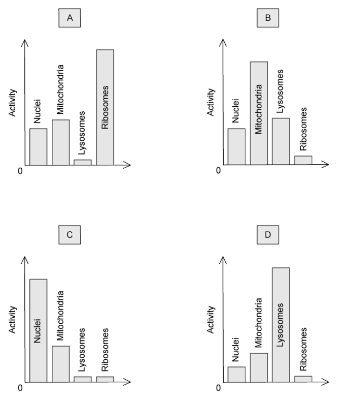

Which graph shows a tissue with a high synthesis of messenger RNA?

### Q9 — hard — 1 marks

**Q9** [1 mark]

The basic structure of a virus is made up of a protein coat and genetic material.

What is the name given to the protein coat?

### Q10 — hard — 1 marks

**Q10** [1 mark]

The image below is an electron micrograph of an animal cell.

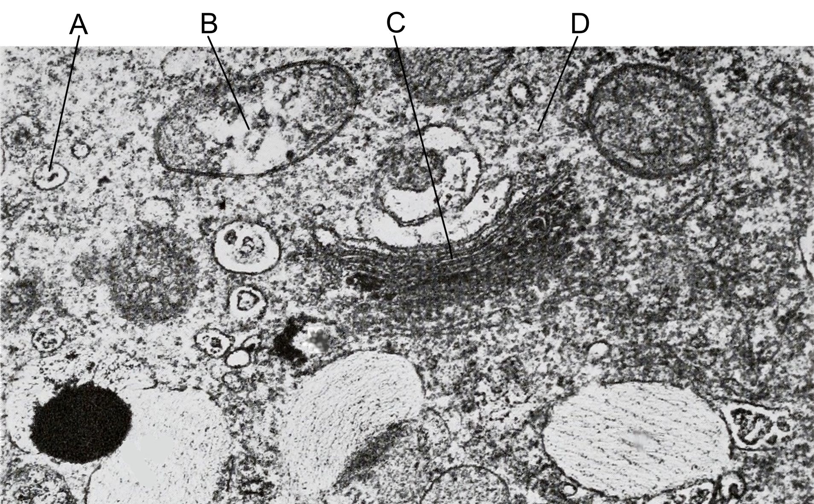

*Public domain, via **[Flickr](https://www.flickr.com/photos/internetarchivebookimages/19756543133)*

Which one of the options A to D, would be the site of protein modification and packaging?

### Q11 — medium — 1 marks

**Q11** [1 mark]

The diagram shows a typical plant cell.

Which of the cell components **A, B, C **or **D** would be present in prokaryotes?

### Q12 — medium — 1 marks

**Q12** [1 mark]

The sentence below describes a process and a cellular structure.

Cells which have a high rate of ….1…. will have many ….2….. .

Which row identifies a process and a structure that would fit correctly into the sentence?

|   | 1 | 2 |
|---|---|---|
| **A** | facilitated diffusion | mitochondria |
| **B** | DNA replication | lysosomes |
| **C** | exocytosis | vesicles |
| **D** | phospholipid production | ribosomes |

### Q13 — medium — 1 marks

**Q13** [1 mark]

Which features would indicate that a student is observing a eukaryotic cell?

|   | cytoplasm includes endoplasmic reticulum | protein molecules are associated with the DNA | ribosomes distributed through the cytoplasm |
|---|---|---|---|
| **A** | X | ✓ | X |
| **B** | X | X | X |
| **C** | ✓ | ✓ | ✓ |
| **D** | ✓ | X | ✓ |

Key: ✓ = found in eukaryotes, X = not found in eukaryotes

### Q14 — medium — 1 marks

**Q14** [1 mark]

Which of the following structures are found in photosynthetic prokaryotes?

| 1 | Cellulose wall |
|---|---|
| 2 | Circular chromosome |
| 3 | Ribosomes |
| 4 | Chloroplasts |
| 5 | Cell surface membrane |

### Q15 — medium — 1 marks

**Q15** [1 mark]

Membrane bound sacs containing the products of metabolism are produced by the endoplasmic reticulum.

Where are these products used?

### Q16 — medium — 1 marks

**Q16** [1 mark]

Mucus is produced in the trachea by goblet cells. The following statements describe steps in the process of mucus production.

| 1 | Fusion of the vesicle with the plasma membrane. |
|---|---|
| 2 | Secretion of a glycoprotein. |
| 3 | Separation of a vesicle from the Golgi apparatus. |
| 4 | Addition of carbohydrate to protein. |

What is the correct order of these steps?

### Q17 — medium — 1 marks

**Q17** [1 mark]

The list below contains structures that are found in eukaryotic cells.

| 1 | Nucleus |
|---|---|
| 2 | Endoplasmic reticulum |
| 3 | Lysosome |
| 4 | Chloroplast |
| 5 | Mitochondria |

Which of these structures has a double membrane?

### Q18 — medium — 1 marks

**Q18** [1 mark]

The diagram shows a cell that secretes glycoproteins; proteins with attached molecules of carbohydrate. The cell is supplied with radioactively labelled sugar, which is first detected in the cytoplasm.

In which organelle would the radioactively-labelled glucose be detected after that?

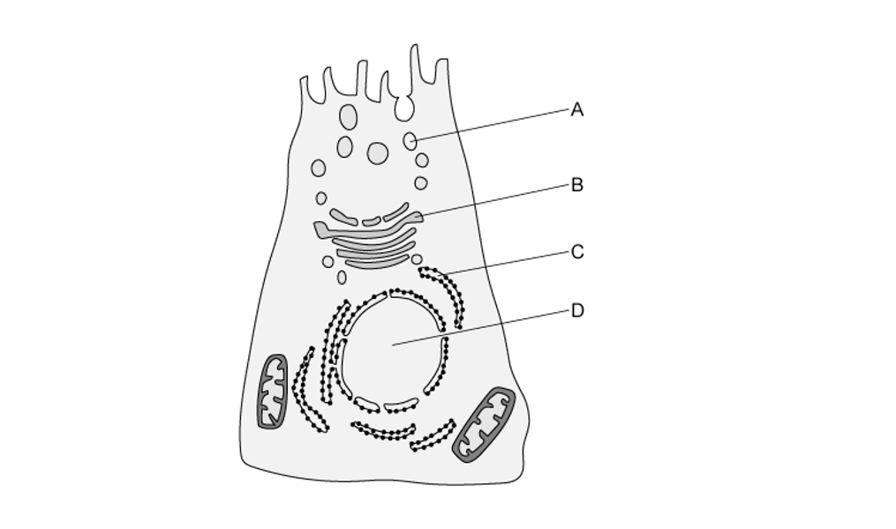

### Q19 — medium — 1 marks

**Q19** [1 mark]

The image below is a drawing of an electron micrograph.

Which structures are surrounded by a double membrane?

|   | lysosome | mitochondria | nucleus | Golgi apparatus | cytoplasm |
|---|---|---|---|---|---|
| **A** | ✓ | ✓ | ✓ | ✓ | ✓ |
| **B** | X | ✓ | ✓ | ✓ | ✓ |
| **C** | X | ✓ | ✓ | X | X |
| **D** | ✓ | X | X | X | ✓ |

Key: ✓ = surrounded by a double membrane, X = not surrounded by a double membrane

### Q20 — medium — 1 marks

**Q20** [1 mark]

The photomicrograph shows a plant cell. A student was asked to identify **three** observable features from the micrograph.

Which of the following would be correct labels for this image?

### Q21 — easy — 1 marks

**Q21** [1 mark]

Which row shows the structures found in a typical flowering plant cell?

|   | centrioles | cilia | mitochondria | vacuole |
|---|---|---|---|---|
| **A** | X | ✓ | ✓ | X |
| **B** | X | X | ✓ | ✓ |
| **C** | ✓ | ✓ | ✓ | ✓ |
| **D** | X | X | X | ✓ |

Key: ✓ = present, X = absent

### Q22 — easy — 1 marks

**Q22** [1 mark]

Which feature(s) would identify an organism as a prokaryote?

| 1 | cell wall |
|---|---|
| 2 | circular DNA |
| 3 | cell membrane |
| 4 | ribosomes |

### Q23 — easy — 1 marks

**Q23** [1 mark]

The diagram shows a drawing of an animal cell.

What is the function of the membrane system labelled Y?

### Q24 — easy — 1 marks

**Q24** [1 mark]

Which of the following structures are found in all prokaryotic cells?

### Q25 — easy — 1 marks

**Q25** [1 mark]

What is the role of the smooth endoplasmic reticulum?

### Q26 — easy — 1 marks

**Q26** [1 mark]

What is the role of the nucleolus?

### Q27 — easy — 1 marks

**Q27** [1 mark]

The diagram shows a cell that secretes enzymes.

Where are the enzymes made within the cell?

### Q28 — easy — 1 marks

**Q28** [1 mark]

Which structure is found in all eukaryotic cells, but is not found in prokaryotic cells?

### Q29 — easy — 1 marks

**Q29** [1 mark]

Which of the following structures are found in typical eukaryotic cells?

| 1 | circular DNA |
|---|---|
| 2 | linear DNA |
| 3 | 80S ribosomes |
| 4 | 70S ribosomes |

### Q30 — easy — 1 marks

**Q30** [1 mark]

The diagram shows a bacterium.

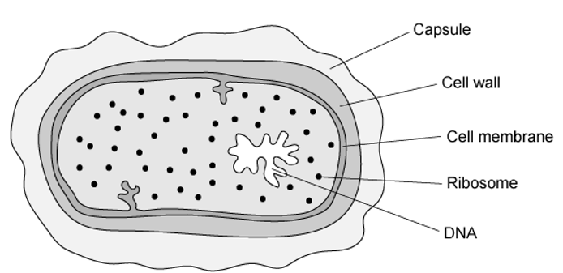

Which three structures are found in both an animal cell and this bacterial cell?

## Structured Questions (15 questions)

### Q1 — hard — 9 marks

**Q1** [3 marks]

Fig. 1 shows a micrograph of a cell.

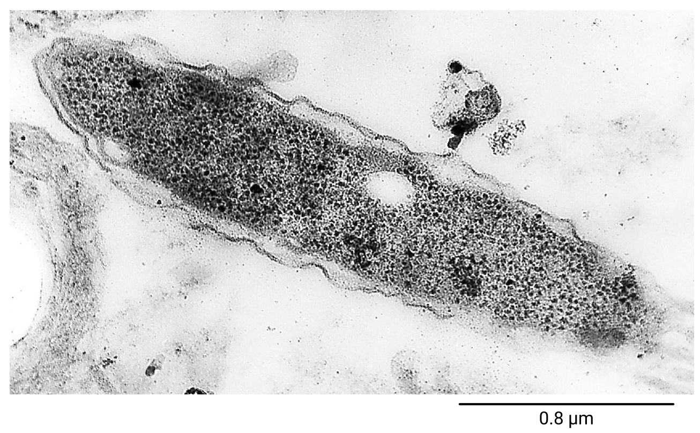

*CC0, via **[pixnio](https://pixnio.com/science/microscopy-images/gram-negative-legionella-pneumophila-bacterium)*

**Fig. 1**

(i) Identify the cell type shown in Fig. 1.

[1]

(ii) Explain how you reached your answer to part (i).

[2]

**Q1** [2 marks]

**Extract:**

Fig. 1 shows a micrograph of a cell.

The scale bar in Fig. 1 measures 5.8 cm with a ruler.

Calculate the magnification of the micrograph in Fig. 1.

**Q1** [3 marks]

**Extract:**

Fig. 1 shows a micrograph of a cell.

The cell type in Fig. 1 is prokaryotic (cell).

Fig. 2 shows a micrograph cross-section of a type of structure sometimes found on the surface of the cell type shown in Fig. 1. The structure is made up of multiple pairs of protein cylinders in a circular arrangement.

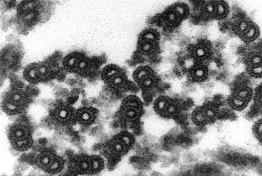

*Public domain, via **[Wikimedia Commons](https://commons.wikimedia.org/wiki/File:Chlamydomonas_TEM_17.jpg)*

**Fig. 2**

(i) Suggest the name of the structure in Fig. 2.

[1]

(ii) Describe the composition of the protein cylinders that make up the structure in Fig. 2.

[2]

**Q1** [1 mark]

**Extract:**

Fig. 1 shows a micrograph of a cell.

(i) Identify the cell type shown in Fig. 1.

The cell type in Fig. 1 is prokaryotic (cell).

Fig. 2 shows a micrograph cross-section of a type of structure sometimes found on the surface of the cell type shown in Fig. 1. The structure is made up of multiple pairs of protein cylinders in a circular arrangement.

(i) Suggest the name of the structure in Fig. 2.

The structure in Fig. 2 is flagellum/flagella / pilus/pili OR microtubule(s).

State the role of the structures in Fig. 2 in the cell type shown in Fig. 1.

### Q2 — hard — 11 marks

**Q2** [3 marks]

Table 1 contains information on the percentage of total cell membrane found in some different cell organelles in liver cells and in pancreas cells.

Note that not all organelles have been included, so the totals do not add up to 100 %.

**Table 1**

| Organelle in which membrane is found | Percentage of total cell membrane |   |
|---|---|---|
| Liver cell | Pancreas cell |   |
| Plasma membrane | 2 | 5 |
| Rough ER | 35 | 60 |
| Smooth ER | 16 | <1 |
| Golgi apparatus | 7 | 10 |
| Outer mitochondrial membrane | 7 | 4 |
| Inner mitochondrial membrane | 32 | 17 |
| Nuclear membrane | 0.2 | 0.7 |

Give **three** conclusions about the **comparative** **activities** of liver and pancreas cells that can be drawn from the data in Table 1.

**Q2** [3 marks]

**Extract:**

Table 1 contains information on the percentage of total cell membrane found in some different cell organelles in liver cells and in pancreas cells.

Note that not all organelles have been included, so the totals do not add up to 100 %.

**Table 1**

| Organelle in which membrane is found | Percentage of total cell membrane |
| Liver cell | Pancreas cell |
| Plasma membrane | 2 | 5 |
| Rough ER | 35 | 60 |
| Smooth ER | 16 | <1 |
| Golgi apparatus | 7 | 10 |
| Outer mitochondrial membrane | 7 | 4 |
| Inner mitochondrial membrane | 32 | 17 |
| Nuclear membrane | 0.2 | 0.7 |

Predict how the data in Table 1 would be different for:

(i) A prokaryotic cell.

[1]

(ii) A plant cell.

[2]

**Q2** [2 marks]

Table 2 contains information about the volume and surface area of liver and pancreas cells.

**Table 2**

| **Cell type** | **Cell volume / μm****3** | **Cell outer surface area / μm****2** |
|---|---|---|
| Liver cell | 5 000 | 110 000 |
| Pancreas cell | 1 200 | 13 000 |

Calculate the surface area to volume ratio for:

(i) Liver cells

[1]

(ii) Pancreas cells

[1]

**Q2** [3 marks]

**Extract:**

Table 1 contains information on the percentage of total cell membrane found in some different cell organelles in liver cells and in pancreas cells.

Note that not all organelles have been included, so the totals do not add up to 100 %.

**Table 1**

| Organelle in which membrane is found | Percentage of total cell membrane |
| Liver cell | Pancreas cell |
| Plasma membrane | 2 | 5 |
| Rough ER | 35 | 60 |
| Smooth ER | 16 | <1 |
| Golgi apparatus | 7 | 10 |
| Outer mitochondrial membrane | 7 | 4 |
| Inner mitochondrial membrane | 32 | 17 |
| Nuclear membrane | 0.2 | 0.7 |

The micrograph below shows a cell from the pancreas.

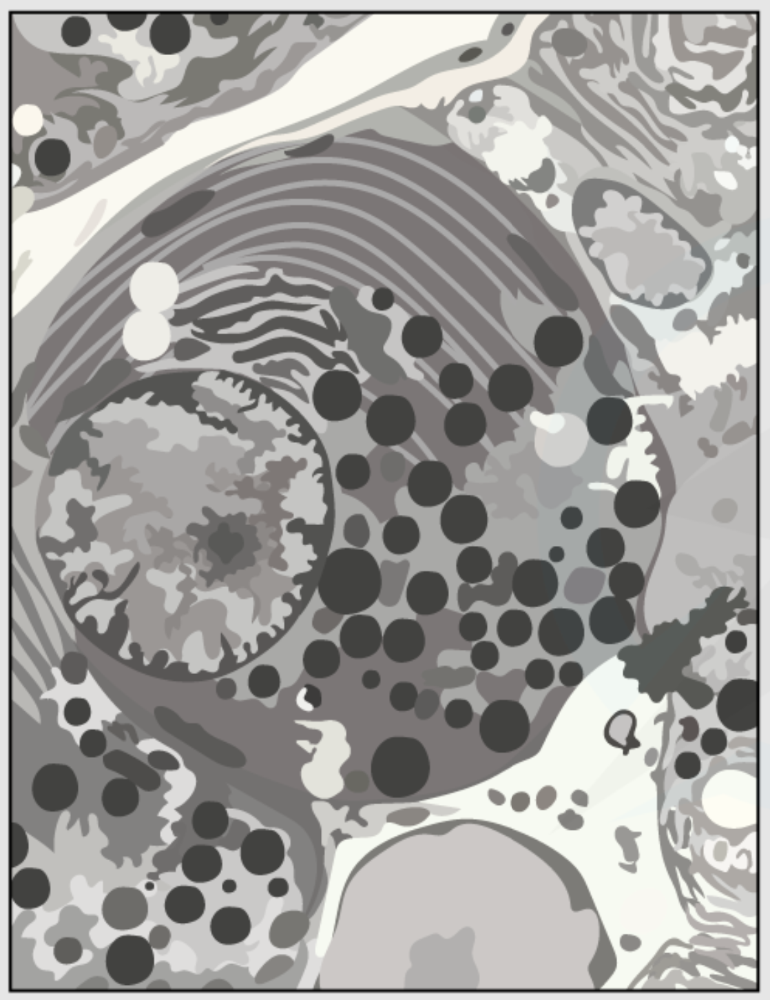

**Fig. 1**

(i) Identify **one** organelle visible in the micrograph that is not listed in Table 1.

[1]

(ii) Describe the role of the organelle identified in part (i).

[2]

### Q3 — hard — 10 marks

**Q3** [2 marks]

Bacteriophages are viruses that kill bacteria. Researchers investigated the use of bacteriophages to alleviate the symptoms of bacterial lung infections. They inoculated the lungs of rats with a pathogenic bacterium. The rats were then divided into two groups, **J** and **K**:

- The rats in group **J** were untreated.
- The rats in group **K** were given bacteriophage treatment by means of an aerosol spray that they inhaled.

After 5 days the researchers killed the rats and excised (dissected out) their lungs. The lungs were washed out with a set volume of fluid. The researchers used a technique to count the number of live bacteria in the fluid. Fig. 1 below shows the researchers’ results. The mean and the range of data are shown for each group.

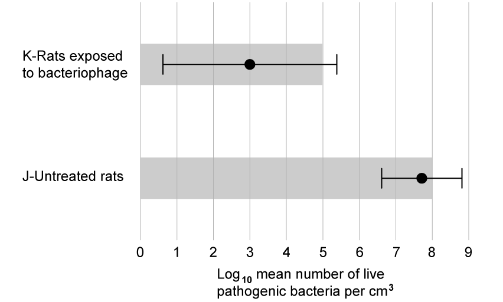

**Fig. 1**

Suggest the following for this investigation:

(i) The scientists’ **null** hypothesis.

[1]

(ii) The scientists' **experimental** hypothesis.

[1]

**Q3** [3 marks]

**Extract:**

Bacteriophages are viruses that kill bacteria. Researchers investigated the use of bacteriophages to alleviate the symptoms of bacterial lung infections. They inoculated the lungs of rats with a pathogenic bacterium. The rats were then divided into two groups, J and K:

- The rats in group J were untreated.
- The rats in group K were given bacteriophage treatment by means of an aerosol spray that they inhaled.

After 5 days the researchers killed the rats and excised (dissected out) their lungs. The lungs were washed out with a set volume of fluid. The researchers used a technique to count the number of live bacteria in the fluid. Fig. 1 below shows the researchers' results. The mean and the range of data are shown for each group.

Using only the graph in Fig. 1, assess the effectiveness of the bacteriophage in treating lung infection in rats.

Do **not** consider statistical analyses in your answer.

**Q3** [5 marks]

Compare and contrast the structures of prokaryotic and eukaryotic cells.

### Q4 — hard — 10 marks

**Q4** [3 marks]

Fig. 1 shows a series of electron micrographs.

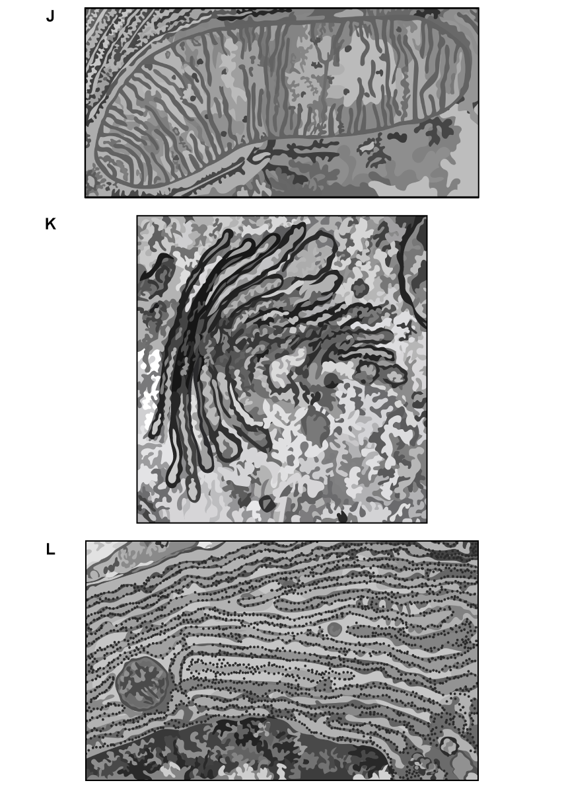

**Fig. 1**

Identify the main cellular structures visible in micrographs **J**, **K**, and **L**.

**Q4** [2 marks]

**Extract:**

Fig. 1 shows a series of electron micrographs.

J = mitochondrion/mitochondria

Explain how the cellular structure in micrograph **J** in Fig. 1 is adapted for its role.

**Q4** [3 marks]

**Extract:**

Fig. 1 shows a series of electron micrographs.

The main cellular structures visible in micrographs J, K, and L are:
- K = Golgi apparatus/body
- L = rough endoplasmic reticulum

Compare and contrast the cellular structures visible in micrographs **K** and **L** in Fig. 1.

**Q4** [2 marks]

The cellular structure visible in micrograph **J** in Fig. 1 measures 9.2 cm from end-to-end, and the micrograph image has a magnification of x110 000.

Calculate the actual length of the cellular structure in micrograph **J**. Give your answer in micrometers.

### Q5 — hard — 11 marks

**Q5** [3 marks]

Fig. 1 shows a micrograph of an influenza virus.

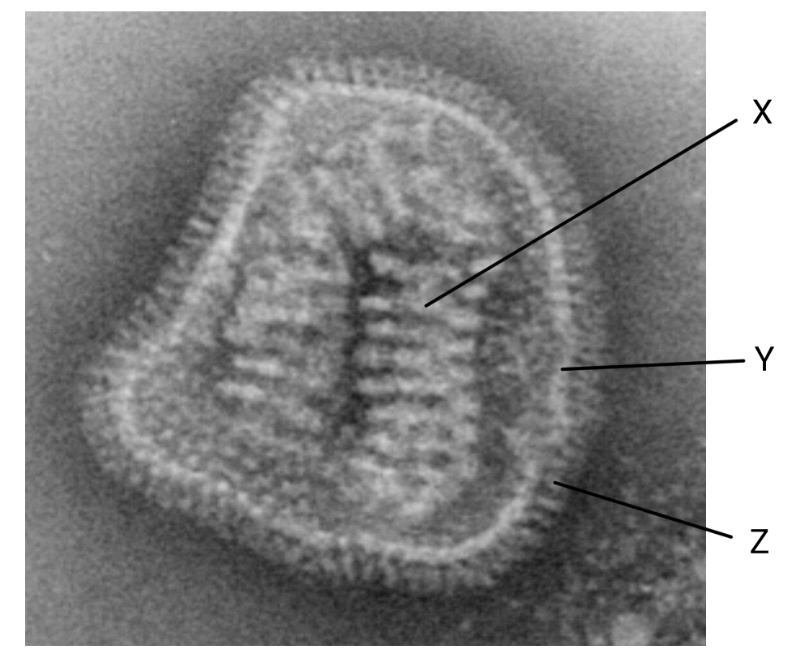

*CC0, via **[pixnio](https://pixnio.com/science/microscopy-images/influenza/member-of-the-taxonomic-family-orthomyxoviridae-the-influenza-virus-is-a-single-stranded-rna-organism)*

**Fig. 1**

Identify structures **X**, **Y** and **Z**.

**Q5** [3 marks]

**Extract:**

Fig. 1 shows a micrograph of an influenza virus.

The virus in Fig. 1 has a diameter of 70 nm.

(i) State the type of microscope used to capture the micrograph in Fig. 1.

[1]

(ii) Explain how you reached your answer to part (i).

[2]

**Q5** [2 marks]

Fig. 2 shows a cell that has been infected by a virus.

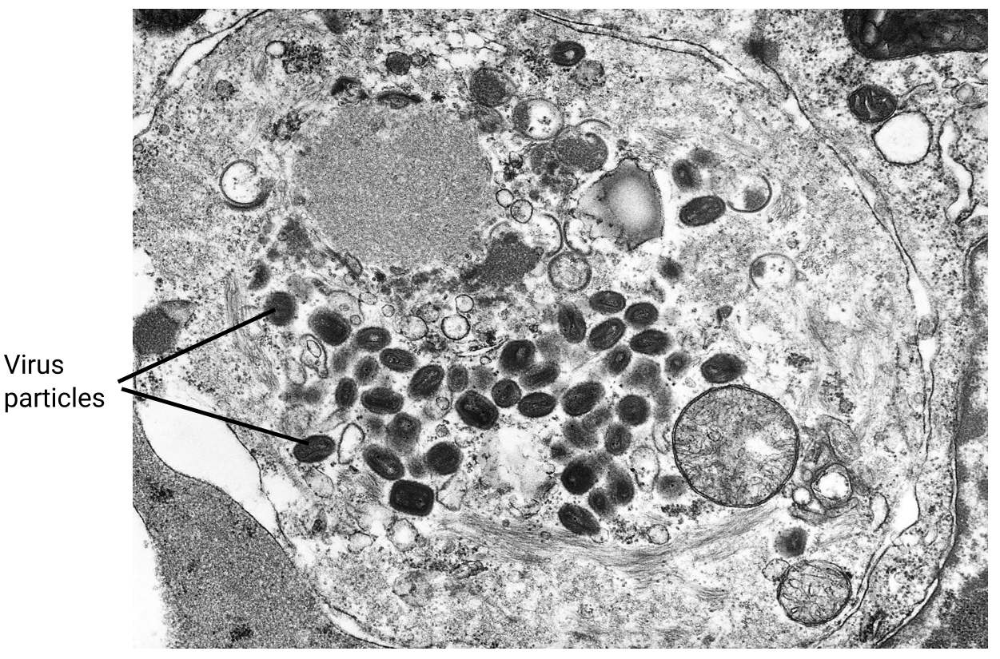

*CC0, via **[pixnio](https://pixnio.com/science/microscopy-images/smallpox-variola-major/transmission-electron-micrograph-of-a-tissue-section-containing-variola-viruses)*

**Fig. 2**

Suggest an explanation for the appearance of the cell in Fig. 2.

**Q5** [3 marks]

**Extract:**

Fig. 2 shows a cell that has been infected by a virus.

*CC0, via **[pixnio](https://pixnio.com/science/microscopy-images/smallpox-variola-major/transmission-electron-micrograph-of-a-tissue-section-containing-variola-viruses)*

**Fig. 2**

Other than virus particles, name **three other** cellular structures that are **visible** in Fig. 2.

### Q6 — medium — 7 marks

**Q6** [2 marks]

Fig. 1 shows a drawing of an animal cell as seen through an electron microscope.

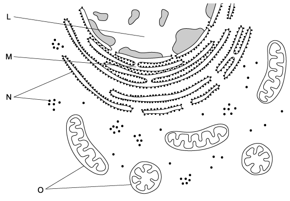

**Fig. 1 **

Identify the organelles labelled L and M.

**Q6** [2 marks]

**Extract:**

Fig. 1 shows a drawing of an animal cell as seen through an electron microscope.

Suggest why the shapes of the two organelles labelled O in Fig. 1 appear different.

**Q6** [1 mark]

**Extract:**

Fig. 1 shows a drawing of an animal cell as seen through an electron microscope.

Identify the organelles labelled L and M.

M = rough endoplasmic reticulum

Give the function of organelle M in Fig. 1

**Q6** [2 marks]

**Extract:**

Suggest why the shapes of the two organelles labelled O in Fig. 1 appear different.

The same organelle can appear differently within the same cell because...
- Cells are cut to prepare a slide/specimen / only a cross-section is seen AND mitochondria may be cut at a different angle (depending on their orientation); [1 mark]
- Mitochondria of different ages / levels of maturity may have different shapes OR mitochondria may be spherical immediately after they divide; [1 mark]

Large numbers of organelle **O** (in Fig. 1) are found in the cells that line the small intestine.

Suggest why these cells are adapted in this way.

### Q7 — medium — 10 marks

**Q7** [2 marks]

Fig. 1 shows a student's drawing of a transmission electron micrograph of part of a cell from the lining of the small intestine.

**Fig. 1**

Name the structures labelled **X **and suggest how these structures facilitate the absorption of food molecules from the small intestine.

**Q7** [2 marks]

Explain how the presence of mitochondria is beneficial to cells.

**Q7** [3 marks]

An example of a unicellular eukaryotic organism (an amoeba) is shown in Fig. 2.

**Fig. 2**

Identify organelle** A **and describe its function.

**Q7** [3 marks]

**Extract:**

An example of a unicellular eukaryotic organism (an amoeba) is shown in Fig. 2.

**Fig. 2**

Identify organelle** A **and describe its function.

Organelle **A** in Fig. 2 can be identified with an electron microscope but cannot be identified using a light microscope.

Give **three** other structures in a eukaryotic cell for which this is also true.

### Q8 — medium — 11 marks

**Q8** [3 marks]

Aphids are small insects which feed directly on phloem sap.

The salivary glands of aphids have secretory cells that make and release a variety of proteins that assist in feeding.

Fig. 1 is a transmission electron micrograph of a small area of a salivary gland cell of an aphid.

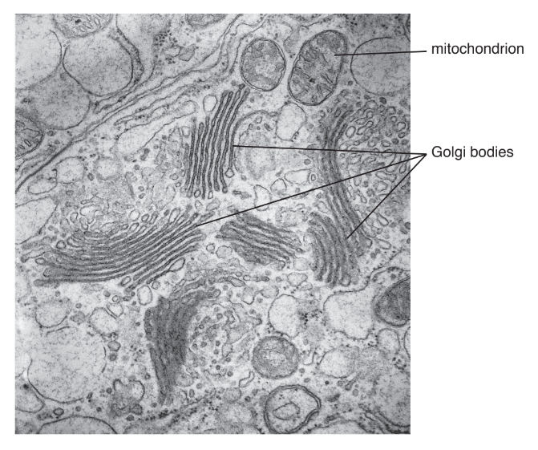

**Fig. 1**

Describe the role of Golgi bodies in secretory cells, such as the salivary gland cells of aphids.

*Source: Oct/Nov 18 Series 3 9700/23 Q1A*

**Q8** [4 marks]

**Extract:**

The salivary glands of aphids have secretory cells that make and release a variety of proteins that assist in feeding.

(i) Explain why secretory cells have large numbers of mitochondria.

[2]

(ii) Mitochondria are partly controlled by the nucleus, but can also function independently.

Suggest the features of mitochondria that allow them to function independently of the nucleus.

[2]

*Source: Oct/Nov 2018 Series 3 9700/23 Q1BI, BII*

**Q8** [4 marks]

Aphids are important vectors of plant viral diseases.

(i) Describe the structure of a typical virus.

[3]

(ii) Suggest how viruses are able to pass from one plant cell to the next without crossing membranes.

[1]

*Source: Oct/Nov 2018 Series 3 9700/23 Q1CI, CII*

### Q9 — medium — 12 marks

**Q9** [3 marks]

Contrast the structure of a prokaryotic cell, as found in a typical bacterium, with the structure of typical eukaryotic cells in plants and animals.

**Q9** [2 marks]

Plant and animal cells can also be contrasted.

Identify **two** structures present in plant cells that are **not** present in animal cells.

**Q9** [3 marks]

Fig. 1 shows an organelle found in both animal and plant cells.

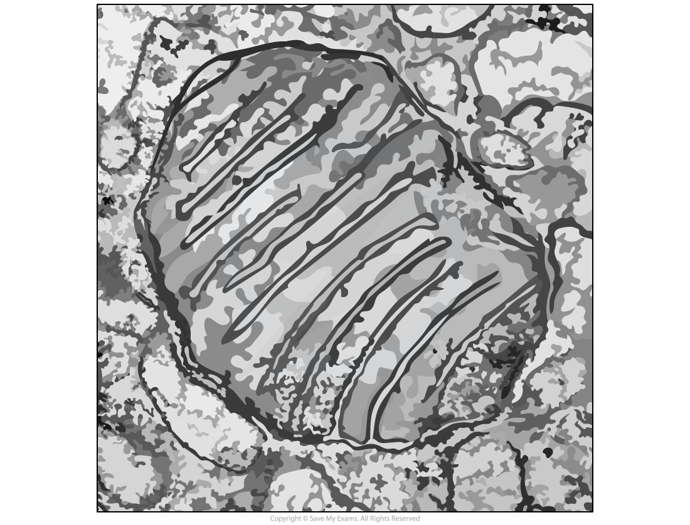

**Fig. 1**

(i) Identify the organelle.

[1]

(ii) Describe the feature(s) visible in Fig.1 that identify this organelle.

[1]

(iii) Label these features on Fig. 1.

[1]

**Q9** [4 marks]

Both animal and plant cells produce and release proteins.

Outline the role of **organelles** in the production, transport and release of proteins from eukaryotic cells.

Do **not** include details of transcription and translation in your answer.

### Q10 — medium — 7 marks

**Q10** [2 marks]

Fig. 1 shows the structure of the single-celled organism *Chlamydomonas*.

**Fig. 1**

State whether *Chlamydomonas *is a eukaryotic cell or a prokaryotic cell. Give a reason for your answer.

**Q10** [3 marks]

*Chlamydomonas* is a genus of green algae that contain chloroplasts.

Describe the function of chloroplasts and the structural features that enable them to carry out this function.

**Q10** [2 marks]

**Extract:**

Fig. 1 shows the structure of the single-celled organism *Chlamydomonas*.

*Chlamydomonas* is a genus of green algae that contain chloroplasts.

The function of chloroplasts is to absorb/capture/use light energy for photosynthesis to produce carbohydrates/sugars/lipids/proteins.

Suggest the role of the light-sensitive spot and flagella shown in Fig. 1.

### Q11 — easy — 9 marks

**Q11** [3 marks]

Structures **V** to **Z** are parts of a plant cell.

| **V** | cell wall |
|---|---|
| **W** | chloroplast |
| **X** | nucleus |
| **Y** | mitochondrion |
| **Z** | Golgi apparatus |

Complete Table 1 by putting the correct letter, **V**, **W**, **X**, **Y** or **Z** in the box next to each statement.

**Table 1**

| **Statement** | **Letter** |
|---|---|
| Has stacked membranes arranged in parallel and contains DNA |   |
| The process of transcription happens here |   |
| Is an organelle and is **not** surrounded by two membranes |   |

**Q11** [3 marks]

Fig.1 below shows the structure of a eukaryotic cell.

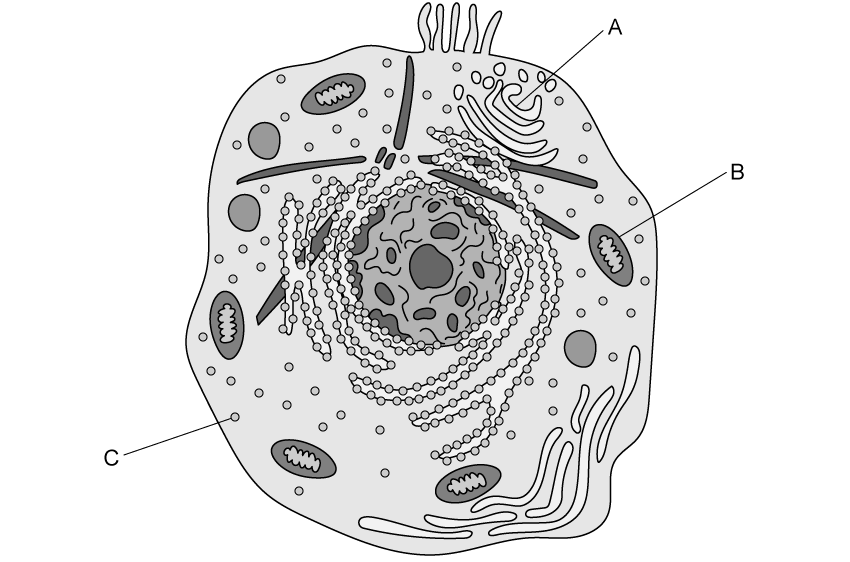

**Fig. 1**

State the name **and **function of organelles **A** to **C **in Fig. 1.

**Q11** [1 mark]

Describe the role of the cell surface membrane.

**Q11** [2 marks]

In addition to the cell surface membrane, eukaryotic cells have many internal membrane-bound structures, including structures called lysosomes.

Describe the structure of lysosomes and their role within cells.

### Q12 — easy — 9 marks

**Q12** [3 marks]

Fig. 1 shows part of a plant cell as seen with an electron microscope.

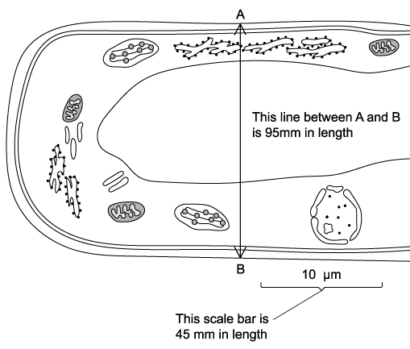

**Fig. 1**

Identify **three** features shown in Fig. 1 that show that this cell is eukaryotic.

**Q12** [2 marks]

**Extract:**

Fig. 1 shows part of a plant cell as seen with an electron microscope.

Features shown in Fig. 1 that show that this cell is eukaryotic include: Nucleus/nuclear envelope; Vacuole; Chloroplast; Rough endoplasmic reticulum; Mitochondrion; Large(r) size.

Give **two** ways in which a typical animal cell differs from the cell shown in Fig. 1

**Q12** [2 marks]

Fig. 2 below shows a cross-section of a leaf taken using a light microscope with a magnification of x250.

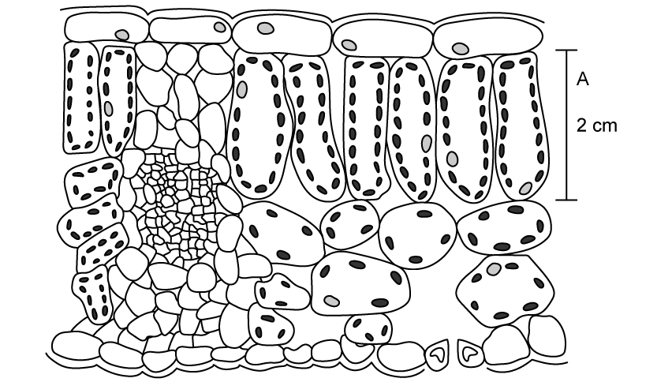

**Fig. 2**

State the function of a palisade cell (labelled **A**) and use detail shown in Fig. 2 to explain how it is specialised for this function.

**Q12** [2 marks]

Fig. 3 shows an electron micrograph of part of a plant cell.

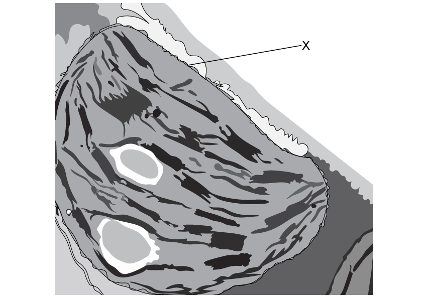

**Fig. 3**

Identify the organelle shown in the electron micrograph, as well as the part of the organelle labelled **X**.

### Q13 — easy — 7 marks

**Q13** [2 marks]

Cells use ATP for a number of processes.

(i) State the process from which cells obtain ATP.

[1]

(ii) Identify the organelle where this process takes place.

[1]

**Q13** [1 mark]

State **one **process inside cells that requires ATP.

**Q13** [1 mark]

Bacterial cells require ATP for many of their cellular processes.

State an organelle that is present inside **all** prokaryotic cells that is not present in eukaryotic cells.

**Q13** [3 marks]

**Extract:**

- Do not accept "membrane-bound organelles" alone, as no specific structure is named.

Some structures are always absent from prokaryotic cells.

Identify **three** structures that are always absent from prokaryotic cells.

### Q14 — easy — 7 marks

**Q14** [2 marks]

State **two** features that are present in all viruses.

**Q14** [1 mark]

State the name of the virus that causes the disease AIDS.

**Q14** [3 marks]

Identify the words missing from the sentences below.

Choose your words from the box; you may use the words once, more than once, or not at all.

| non-living | living | penicillin | MRSA | eukaryotic | prokaryotic | viruses | bacteria |
|---|---|---|---|---|---|---|---|

Animal and plant cells are _______________ while bacterial cells are _________________ .

_____________ are not classified with either of these cell types as they are generally considered to be ___________________.

Antibiotics, such as ___________, have no effect on _____________.

**Q14** [1 mark]

**Extract:**

- Accept "0.5 to 5 micrometres" (e.g. "0.5-5 µm") as equivalent to 1 to 5 micrometres.

Viruses are much smaller than both prokaryotic and eukaryotic cells.

State the typical size of prokaryotic cells.

### Q15 — easy — 9 marks

**Q15** [2 marks]

**Extract:**

- Accept "cell membrane" for "plasma membrane / cell surface membrane" only when the function given is controlling entry and exit of substances.
- Do not accept "protection", "gives shape", "holds the cell together" or "contains the cytoplasm" alone as the function of W.

Fig. 1 below shows a diagram of a cholera bacterium.

**                                                            Fig. 1**

Identify **W** and** X** and state the function of each.

**Q15** [3 marks]

Give **three** structures that are present in an animal cell but are not present in a cholera bacterium.

**Q15** [2 marks]

An outbreak of cholera occurred in London in 1849. Fig.2 below shows the relationship between the number of deaths from cholera and the height at which people lived above sea level.

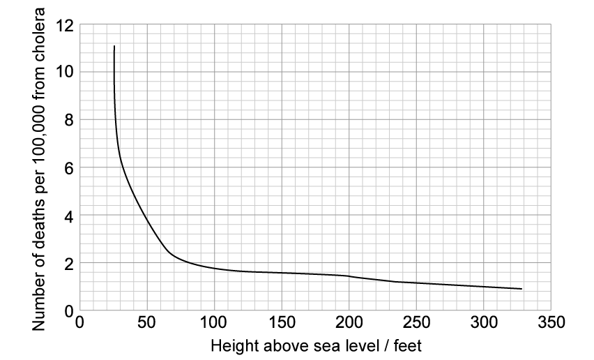

**                                                     Fig. 2**

Describe the results shown in Fig.2.

**Q15** [2 marks]

Cholera is a bacterial disease, but some infectious diseases are caused by viruses. Fig. 3 below shows an example of a virus particle.

**                                                             Fig. 3**

Identify the structures labelled **A** and **B** in Fig. 3
