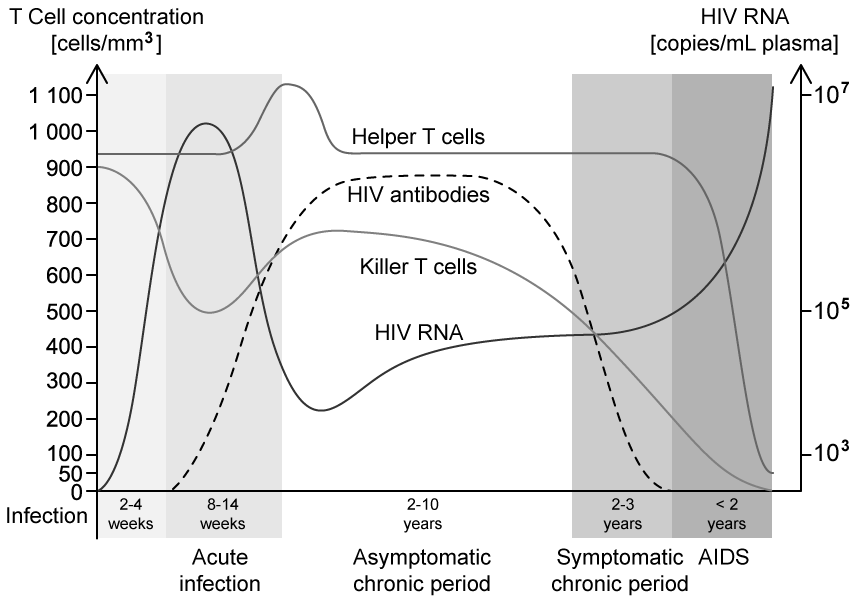
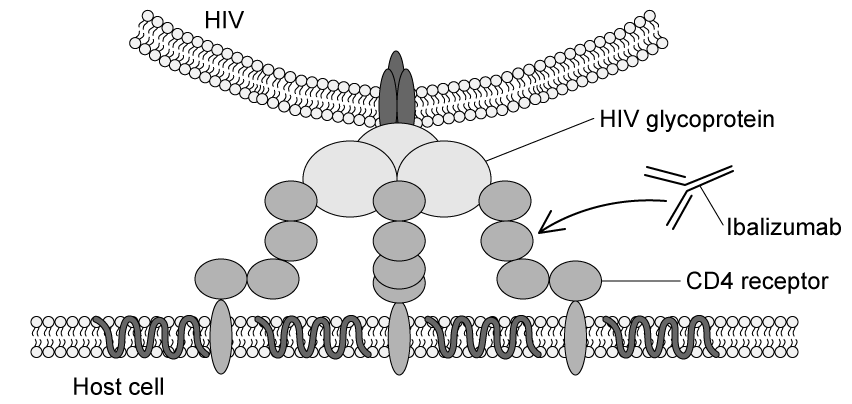
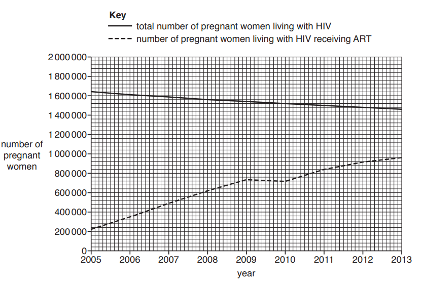
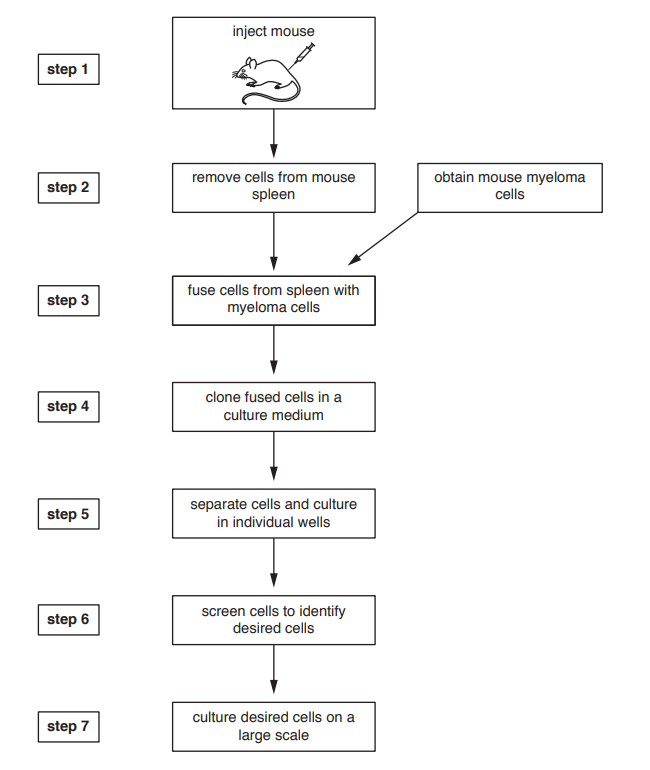
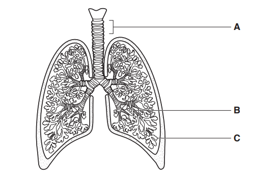
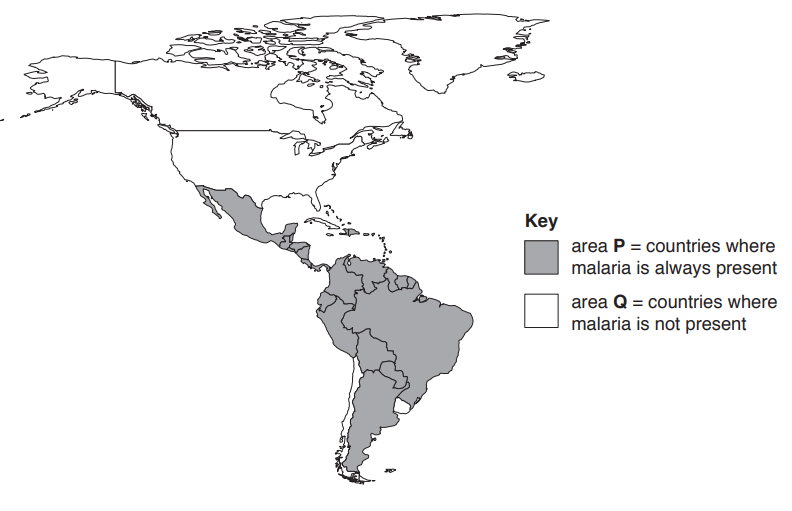
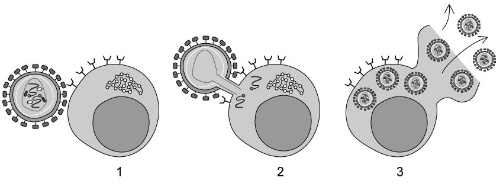

# Exam Questions — Infectious Diseases
**10. Infectious Diseases** · Cambridge (CIE) AS biology (9700)
> Source: [https://www.savemyexams.com/as/biology/cie/25/topic-questions/](https://www.savemyexams.com/as/biology/cie/25/topic-questions/) · 45 questions across 2 sets

## Multiple Choice Questions (30 questions)

### Q1 — hard — 1 marks

**Q1** [1 mark]

Malaria is caused by a parasite that enters the liver cells of the infected individual where it can lay dormant over long periods of time.

Which of the following statements is **not** likely to be true in patients suffering from malaria?

### Q2 — hard — 1 marks

**Q2** [1 mark]

Some statements about infectious diseases are given below:

| **1** | It can be transmitted by an insect vector. |
|---|---|
| **2** | It is endemic in sub-tropical regions. |
| **3** | It can be passed from mother to child. |

Which of the statements above apply to both malaria and HIV?

|   | **1** | **2** | **3** |
|---|---|---|---|
| **A** | X | ✓ | X |
| **B** | X | ✓ | ✓ |
| **C** | ✓ | X | X |
| **D** | X | X | ✓ |

### Q3 — hard — 1 marks

**Q3** [1 mark]

The diagram shows some human diseases and the methods of their transmission.

What is the correct pathogen and method of transmission for cholera?

### Q4 — hard — 1 marks

**Q4** [1 mark]

The table shows information about malaria, measles, HIV/AIDS and cholera.

Which is the correct row for each disease?

|   | **Measles** | **Malaria** | **HIV/AIDS** | **Cholera** |
|---|---|---|---|---|
| **A** | No effective vaccine available | Mainly kills children under 5 | Causes a reduction in the number of T-lymphocytes | Can be caught by swimming in contaminated water |
| **B** | Symptoms usually include a rash | Causative agent is a eukaryote | Caused by a retrovirus | Airborne infection |
| **C** | Can cause blindness | Carried by male *Anopheles* mosquitos | May be carried by a vector | Eating raw shellfish can be a source of infection |
| **D** | Caused by a virus | Eradication programme unsuccessful | Can be transmitted in breast milk and across the placenta | Caused by a bacterium |

### Q5 — hard — 1 marks

**Q5** [1 mark]

After visiting a foreign country, a traveller starts to have fevers at regular intervals. They have blood tests during these fevers, these show a decrease in erythrocytes (anaemia).

Which of the following pathogens may have possibly infected the traveller?

### Q6 — hard — 1 marks

**Q6** [1 mark]

The graph below shows the effect of HIV on the T cells in the blood of an individual.

Using the information in the graph and your own knowledge. Which of the following statements is true?

### Q7 — hard — 1 marks

**Q7** [1 mark]

Which of the following are the most effective control measures for malaria in developing countries?

### Q8 — hard — 1 marks

**Q8** [1 mark]

One of the pathogens listed below is transmitted by an insect vector.

Which disease has an insect vector?

### Q9 — hard — 1 marks

**Q9** [1 mark]

Tuberculosis (TB) has an annual incidence of 8.6 million people with a mortality rate of 1.3 million worldwide.

What is the main issue that faces the World Health Organisation (WHO) when trying to control the transmission of TB?

### Q10 — hard — 1 marks

**Q10** [1 mark]

The human immunodeficiency virus (HIV) reproduces inside cells in the body.

Which of the following explains why HIV patients may develop flu-like symptoms?

### Q11 — medium — 1 marks

**Q11** [1 mark]

After visiting a foreign country, a traveller starts to have fevers at regular intervals. They have blood tests during the fevers, these show a decrease in erythrocytes (anaemia).

Which disease does this person have?

### Q12 — medium — 1 marks

**Q12** [1 mark]

One of the most effective methods for preventing and controlling some diseases is tracking and tracing people who have been in contact with infected people.

Which of these diseases would this be the most effective method for?

### Q13 — medium — 1 marks

**Q13** [1 mark]

The table below shows some statements about diseases.

| **Statements** | **1** | **2** | **3** | **4** |
|---|---|---|---|---|
| formation of tumours | ✓ |   |   | ✓ |
| caused by virus |   | ✓ |   |   |
| can be treated with antibiotics |   |   | ✓ | ✓ |
| infectious disease |   | ✓ | ✓ | ✓ |

key: ✓ = true

Match the 4 names diseases below to the statements above.

Which row gives the correct name for each disease?

|   | **1** | **2** | **3** | **4** |
|---|---|---|---|---|
| **A**  **B**  **C**  **D** | bronchitis  sickle cell anaemia  lung cancer  lung cancer | measles  measles  HIV/AIDS  HIV/AIDS | TB  cholera  cholera  measles | smallpox  lung cancer  TB  lung cancer |

### Q14 — medium — 1 marks

**Q14** [1 mark]

Which of the statements below provides an explanation for an increase in the spread of malaria?

| 1 | increasing resistance to antibiotics and other drugs |
|---|---|
| 2 | continued migration of people due to war and civil unrest |
| 3 | increasing carbon dioxide levels causing global warming |

### Q15 — medium — 1 marks

**Q15** [1 mark]

Improvements in the supply of clean water, sewage treatment, insect control and a milk pasteurisation programme have all been undertaken in a village.

Which of these diseases that are present in the village will not be controlled by these actions?

### Q16 — medium — 1 marks

**Q16** [1 mark]

Avian bird flu is caused by the H5N1 virus. Between 2021 and 2023 there have been 11 confirmed cases of H5N1 in humans. Whilst these numbers are low, there are concerns about the possibility of H5N1 causing a global pandemic.

Which of these measures is a suitable method to help prevent the spread of disease between humans?

| 1 | reducing the number of flights |
|---|---|
| 2 | killing all birds |
| 3 | taking a course of antibiotics |
| 4 | putting infected individuals in quarantine |

Which ones are correct?

### Q17 — medium — 1 marks

**Q17** [1 mark]

Which row shows the causative agent, the transmission method and method of control of each disease?

|   | **Disease** | **Causative agent** | **Transmission method** | **Method of control** |
|---|---|---|---|---|
| **A** | TB | bacterium | air-borne | vaccination |
| **B** | malaria | bacterium | insect vector | antimalarial drugs |
| **C** | cholera | virus | waterborne | oral rehydration therapy (ORT) |
| **D** | HIV/AIDS | virus | intimate contact | antibiotics |

### Q18 — medium — 1 marks

**Q18** [1 mark]

Which of the following is the best definition for non-infectious disease?

### Q19 — medium — 1 marks

**Q19** [1 mark]

These are all methods of infectious disease transmission

| **1** | vector |
|---|---|
| **2** | contact |
| **3** | food |
| **4** | droplet |

Which row correctly matches the organism with the mode of transmission of each of the diseases?

|   | **Malaria** | **TB** | **HIV** |
|---|---|---|---|
| **A** | bacterium, 3 | protoctist, 1 | bacterium, 1 and 3 |
| **B** | protoctist, 3 | virus, 1 | bacterium, 3 |
| **C** | protoctist, 1 | bacterium, 3 and 4 | virus, 2 |
| **D** | bacterium, 1 | virus, 3 and 2 | virus, 2 and 4 |

### Q20 — medium — 1 marks

**Q20** [1 mark]

The following statements are about people infected with HIV/AIDS.

| **1** | They will have symptoms |
|---|---|
| **2** | They can be treated and completely cured |
| **3** | They may live for many years after infection |

Which ones are correct?

### Q21 — easy — 1 marks

**Q21** [1 mark]

Which row in the table shows the features of the organisms that cause HIV/AIDS, malaria and TB have in common?

|   | they have a cell surface membrane | they have ribosomes | they have genes | they respire |
|---|---|---|---|---|
| **A** | X | X | ✓ | X |
| **B** | X | X | ✓ | ✓ |
| **C** | ✓ | X | X | ✓ |
| **D** | ✓ | ✓ | ✓ | ✓ |

### Q22 — easy — 1 marks

**Q22** [1 mark]

Which disease is most likely to be transmitted during pregnancy or birth?

### Q23 — easy — 1 marks

**Q23** [1 mark]

Over 40% of the world’s population live in areas where they are at risk of malaria infection. The number of cases of malaria in Africa in particular has increased in recent years.

Which of these social factors is increasing the spread of malaria?

### Q24 — easy — 1 marks

**Q24** [1 mark]

Why are refugee camps likely to see outbreaks of cholera infections?

### Q25 — easy — 1 marks

**Q25** [1 mark]

Which row shows the causative agent and the transmission method of cholera?

|   | causative agent | transmission method |
|---|---|---|
| **A** | virus | air-borne |
| **B** | virus | water-borne |
| **C** | bacterium | air-borne |
| **D** | bacterium | water-borne |

### Q26 — easy — 1 marks

**Q26** [1 mark]

How are the following diseases transmitted?

|   | **Malaria** | **Cholera** | **HIV/AIDS** |
|---|---|---|---|
| **A** | body fluid | air | water |
| **B** | insect | water | body fluid |
| **C** | air | body fluid | insect |
| **D** | water | body fluid | air |

### Q27 — easy — 1 marks

**Q27** [1 mark]

The following lists some possible methods of transmission of HIV:

| **1** | blood transfusion |
|---|---|
| **2** | drinking water |
| **3** | vector |
| **4** | intravenous needles |
| **5** | across the placenta |
| **6** | undercooked meat |

Which statements are correct?

### Q28 — easy — 1 marks

**Q28** [1 mark]

The diagram shows different features of disease.

Which area refers to common properties of both tuberculosis and cholera?

### Q29 — easy — 1 marks

**Q29** [1 mark]

Which of the following statements describe why people in Europe can suffer from both malaria and tuberculosis, but only tuberculosis is transmitted there?

### Q30 — easy — 1 marks

**Q30** [1 mark]

Which of the diseases, in the list below, is transmitted by an insect vector?

## Structured Questions (15 questions)

### Q1 — hard — 10 marks

**Q1** [2 marks]

Pulmonary tuberculosis (TB) is a contagious bacterial infection that involves the lungs. In the UK, children are vaccinated against this disease.

Discuss the importance of a vaccine in disease prevention and control.

**Q1** [4 marks]

Describe how vaccination can lead to protection against pulmonary tuberculosis.

**Q1** [2 marks]

HIV infects human cells by binding to a cell surface receptor called CD4. This binding causes a shape change in the viral surface glycoproteins, enabling the virus to enter the host cell. A new treatment for HIV involves a monoclonal antibody called Ibalizumab, the action of which is shown in **Fig. 1** below.

**                                                               Fig. 1**

Suggest how Ibalizumab works as a treatment for HIV.

**Q1** [2 marks]

**Extract:**

HIV infects human cells by binding to a cell surface receptor called CD4. This binding causes a shape change in the viral surface glycoproteins, enabling the virus to enter the host cell. A new treatment for HIV involves a monoclonal antibody called Ibalizumab, the action of which is shown in Fig. 1 below.

Fig. 1

Suggest how Ibalizumab works as a treatment for HIV.

A trial looking at the efficacy of Ibalizumab investigated its impact on CD4 cell (also known as helper T cell) count after 25 weeks of treatment.

The results are shown in **Fig. 2 **for each group of patients.

**                                                      Fig. 2**

State **and** explain what can be concluded about the efficacy of Ibalizumab from the results shown in **Fig. 2.**

### Q2 — hard — 8 marks

**Q2** [2 marks]

Malaria is a disease that is caused by a parasite from the genus *Plasmodium*. The parasite has a complex life cycle that involves humans and the *Anopheles* mosquito. After transfer from mosquito to human, *Plasmodium* is transported to the liver where it infects liver cells, after which it leaves the liver cells and infects red blood cells.

Once inside the red blood cells the parasite digests haemoglobin internally into a toxic form known as ferriprotoporphyrin IX (FP). The parasite then converts this FP into a non-toxic molecule called haemozoin. This process is referred to as 'sequestration' and the reaction is catalysed by the enzyme haem polymerase.

Fig. 1 shows the breakdown of haemoglobin inside the malaria parasite.

$\mathrm{Haemoglobin}\overset{\mathrm{digestion}}{\rightarrow}\mathrm{FP}\overset{\mathrm{sequestration}}{\rightarrow}\mathrm{Haemozoin}$

**Fig. 1**

One of the symptoms during this stage of a malaria infection is fatigue.

Using the information provided, suggest a reason for this.

**Q2** [2 marks]

**Extract:**

Once inside the red blood cells the parasite digests haemoglobin internally into a toxic form known as ferriprotoporphyrin IX (FP). The parasite then converts this FP into a non-toxic molecule called haemozoin. This process is referred to as 'sequestration' and the reaction is catalysed by the enzyme haem polymerase.

Fig. 1 shows the breakdown of haemoglobin inside the malaria parasite.

Haemoglobin → (digestion) → FP → (sequestration) → Haemozoin

Chloroquine is currently one of the most popular forms of treatment for malaria. Chloroquine works by inhibiting the action of haem polymerase.

Suggest how chloroquine may act as a treatment for malaria.

**Q2** [2 marks]

**Extract:**

Malaria is a disease that is caused by a parasite from the genus *Plasmodium*. The parasite has a complex life cycle that involves humans and the *Anopheles* mosquito. After transfer from mosquito to human, *Plasmodium* is transported to the liver where it infects liver cells, after which it leaves the liver cells and infects red blood cells.

The genetic material of the *Plasmodium* parasite contains genes involved with the production of several thousand potential antigens on its cell surface.

Using the information provided, as well as your own knowledge, suggest **two** possible challenges that scientists face in the development of an effective malaria vaccine.

**Q2** [2 marks]

The *Anopheles* mosquito serves as a vector for the *Plasmodium* parasite. *Anopheles* is prevalent in the tropical and subtropical parts of sub-Saharan Africa. Some scientists believe that global warming may have an effect on the occurrence of malaria.

Predict **and** explain a possible effect that an increase in global temperatures may have on the occurrence of malaria.

### Q3 — hard — 9 marks

**Q3** [4 marks]

The bacteria that cause tuberculosis (TB) can be found in many parts of the body including the lungs.

(i) State the name of the bacterium that causes TB.

[1]

(ii) The presence of the pathogen in the lungs attracts phagocytes to the area of infection. The phagocytes release elastase, which digests elastin.

Many people with TB feel tired all the time.

Suggest **and** explain how the effect of phagocytes on tissues in the lungs leads to people feeling tired all the time.

[3]

*Source: Oct/Nov 2018 Series 3 9700/23 Q5A*

**Q3** [5 marks]

Discuss the **biological** factors and** social** factors that make TB a difficult disease to control.

*Source: Oct/Nov 2018 Series 3 9700/23 Q5B*

### Q4 — hard — 5 marks

**Q4** [2 marks]

The diagram in Fig. 1 shows a human immunodeficiency virus (HIV).

**                                                       Fig. 1**

Identify structure **B** and structure **C** in Fig. 1.

**Q4** [1 mark]

**Extract:**

The diagram in Fig. 1 shows a human immunodeficiency virus (HIV).

Identify structure B and structure C in Fig. 1.

C = RNA

Structure **C** plays a very important role in the virus represented by Fig. 1.

State the function of structure **C** in this virus.

**Q4** [2 marks]

When the new HIV viruses are released from the T-helper cell, the T-helper cell lyses (bursts) and is destroyed. This destruction of T-helper cells is very dangerous and could eventually cause the death of someone infected with HIV.

Explain why the destruction of T-helper cells could eventually cause the death of an HIV-positive person.

### Q5 — hard — 15 marks

**Q5** [3 marks]

Viruses share common structural features. Some viruses, such as human immunodeficiency virus (HIV), also have an outer envelope as part of their structure.

Outline the key structural features of viruses.

*Source: Oct/Nov 2018  9700/22 Q4A*

**Q5** [7 marks]

HIV can remain in a dormant state within infected immune system cells for many years. A person diagnosed as HIV‐positive (HIV+) has the virus but does not have symptoms of HIV/AIDS.

The chances of an HIV+ person developing HIV/AIDS can be greatly reduced with a drug treatment programme known as anti‐retroviral therapy (ART).

In 2010, the World Health Organization (WHO) published recommendations for the treatment of pregnant women living with HIV. This includes both HIV+ women and women who have developed HIV/AIDS.

The publication recommended that **all **pregnant and breastfeeding women living with HIV should be provided with ART.

Fig. 1 shows the number of pregnant women living with HIV, and the number of these receiving ART, between 2005 and 2013, in low and middle income countries.

**Fig. 1**

(i) From the data in Fig. 1, it can be calculated that 13% of pregnant women living with HIV received ART in 2005.

Calculate the percentage of pregnant women living with HIV that received ART in 2013.

[1]

(ii) Describe the trends shown in Fig. 1.

[3]

(iii) Suggest **and** explain the global importance of providing ART to all pregnant and breastfeeding women living with HIV.

[3]

*Source: Oct/Nov 2018  9700/22 Q4B*

**Q5** [5 marks]

In a person who has been infected with HIV‐1, the most common strain of HIV, a sample of blood can be tested for the presence of the virus. 
One test that can only be used in the early stages of infection involves a monoclonal antibody specific for p24, a structural protein present in the virus.

Fig. 2 is a flow chart outlining the steps in the production of anti‐HIV p24 monoclonal antibody.

**Fig. 2**

(i) State what is being injected into the mouse in** step 1**.

[1]

(ii) Explain why several weeks, rather than several days, separates **step 1** and **step 2**.

[1]

(iii) State **one** feature of the myeloma mouse cells, used in **step 3**, that is essential for this production process.

[1]

(iv) Name the fused cells formed in **step 4**.

[1]

(v) Suggest why **step 6** is necessary.

[1]

*Source: Oct/Nov 2018  9700/22 Q2C*

### Q6 — medium — 10 marks

**Q6** [4 marks]

Tuberculosis (TB) is an example of an infectious disease.

Explain why TB can be considered an infectious disease.

**Q6** [3 marks]

**Table 1 **below shows the number of TB cases reported during one year in three different countries.

**Table 1**

| **Country** | **Number of cases** | **Number of cases per**  **100 000 population** |
|---|---|---|
| Germany | 3000 | 4 |
| India | 2 100 000 | 182 |
| South Africa | 450 000 | 975 |

Use **Table 1** to explain why it is advantageous to provide data on the number of cases per 100 000 population rather than only stating the total number of cases.

**Q6** [3 marks]

Outline why TB has a greater chance of being fatal in people who already have HIV/AIDS compared to people who do not have HIV/AIDS.

### Q7 — medium — 9 marks

**Q7** [3 marks]

Describe the transmission of malaria from an infected person to an uninfected person.

**Q7** [2 marks]

Fig. 1 below is a drawing of an electron micrograph showing a red blood cell of someone infected with malaria.

**                                                              Fig. 1**

From Fig. 1, identify **two** features that show the malarial parasite is eukaryotic.

**Q7** [4 marks]

**Extract:**

Fig. 1 below is a drawing of an electron micrograph showing a red blood cell of someone infected with malaria.

The presence of malarial parasites in red blood cells can have various negative effects on the human body.

Use the **Fig. 1** and your own knowledge to outline some of these effects.

### Q8 — medium — 10 marks

**Q8** [3 marks]

Cholera is a transmissible disease.

Describe how cholera is transmitted between people.

**Q8** [3 marks]

Describe **three **methods which could be used in the prevention and control of cholera.

**Q8** [2 marks]

When food contaminated with *V.cholerae *reaches the digestive system, the bacteria attach to the wall of the small intestine. Toxins produced by the bacteria trigger the release of chloride ions into the lumen of the small intestine, this increases the solute concentration in the lumen.

One of the first symptoms that might be observed in an infected individual is diarrhoea.

Explain how infection with *V.cholerae* results in diarrhoea.

**Q8** [2 marks]

**Extract:**

When food contaminated with V.cholerae reaches the digestive system, the bacteria attach to the wall of the small intestine. Toxins produced by the bacteria trigger the release of chloride ions into the lumen of the small intestine, this increases the solute concentration in the lumen.

One of the first symptoms that might be observed in an infected individual is diarrhoea.

Infection with cholera leads to diarrhoea in the following way:
- A higher solute concentration in the lumen means lower water potential (in the lumen) / a water potential gradient is created between the lumen and surrounding cells;
- Water moves into the lumen by osmosis;

Suggest why untreated cholera may become life-threatening.

### Q9 — medium — 12 marks

**Q9** [3 marks]

**Fig. 1 **shows the human gas exchange system.

**Fig. 1**

Name the structures labelled **A, B,** and **C** in Fig. 1.

*Source: Oct/Nov 2018 9700/21 Q1A*

**Q9** [1 mark]

Tuberculosis (TB) is an infectious disease that attacks the lungs.

Suggest **one** symptom which may be experienced by an infected individual as a result of lung damage.

**Q9** [1 mark]

Malaria is an infectious disease.

Name the pathogen that causes malaria.

*Source: Oct/Nov 2018 9700/21 Q1C*

**Q9** [3 marks]

There are a number of vaccines being developed to help control the spread of malaria.

Explain why vaccination programmes have **not** been able to eradicate malaria.

*Source: Oct/Nov 2018 9700/21 Q1D*

**Q9** [4 marks]

Fig. 2 shows the distribution of malaria in the Americas in 2012.

**Fig. 2**

Suggest the factors, **other than** lack of vaccines, that could be restricting the distribution of malaria to area **P**.

*Source: Oct/Nov 2018 9700/21 Q1E*

### Q10 — medium — 10 marks

**Q10** [2 marks]

Fig.1 shows three stages of the process during which HIV infects Helper T-Cells.

**Fig. 1**

After stage 2, the single-stranded RNA from the virus must be converted into double-stranded DNA. The host cell uses this DNA to produce viral proteins which are assembled into new HIV particles, as shown in stage 3.

(i) Identify the enzyme that would be used to produce the double-stranded DNA after stage 2.

[1]

(ii) Name the **two** processes used by the host cell to produce viral proteins.

[1]

**Q10** [2 marks]

**Extract:**

Fig.1 shows three stages of the process during which HIV infects Helper T-Cells.

After stage 2, the single-stranded RNA from the virus must be converted into double-stranded DNA. The host cell uses this DNA to produce viral proteins which are assembled into new HIV particles, as shown in stage 3.

Using **Fig.1** and your own knowledge, explain why HIV only infects specific cells in the host.

**Q10** [3 marks]

Fig. 2 gives information about the number of people living with HIV and the number of deaths of individuals who are HIV positive, between 1981 and 2009

**Fig.2**

Describe what the data shows.

**Q10** [3 marks]

**Extract:**

Fig. 2 gives information about the number of people living with HIV and the number of deaths of individuals who are HIV positive, between 1981 and 2009

**Fig.2**

Suggest reasons for the trend in the deaths of people with HIV from 1995 as shown in the data in Fig. 2

### Q11 — easy — 7 marks

**Q11** [1 mark]

Infectious diseases are caused by pathogens and are transmissible.

State what is meant by the term *transmissible.*

**Q11** [2 marks]

Tuberculosis (TB) is an example of an infections disease.

Give **two** further examples of infectious diseases.

**Q11** [1 mark]

Give the name of the pathogen that cause TB in humans.

**Q11** [3 marks]

Describe the method of transmission of TB from an infected to an uninfected person.

### Q12 — easy — 8 marks

**Q12** [3 marks]

Malaria is an infectious disease that is spread by an insect vector.

(i) Define the term *vector*.

[2]

(ii) State the specific type of organism that acts as a vector for the spread of malaria.

[1]

**Q12** [2 marks]

**Extract:**

Malaria is an infectious disease that is spread by an insect vector.

(ii) State the specific type of organism that acts as a vector for the spread of malaria.

The organism that acts as a vector for the spread of malaria is (Female) *Anopheles* mosquito.

Other than the vector mentioned at part (a)(ii), identify **two** possible methods of transmission of malaria.

**Q12** [2 marks]

**Extract:**

(ii) State the specific type of organism that acts as a vector for the spread of malaria.

The organism that acts as a vector for the spread of malaria is (Female) Anopheles mosquito.

One of the ways to reduce the spread of malaria is to avoid being bitten by the insect vector mentioned at part (a)(ii).

State **two** ways in which this can be achieved.

**Q12** [1 mark]

Despite global efforts to eradicate malaria, there are still countries where the disease is prevalent.

Give **one** reason why malaria has not been eradicated globally.

### Q13 — easy — 5 marks

**Q13** [1 mark]

Cholera is caused by a bacterial pathogen that infects the small intestines causing excess water to move into the lumen of the intestines from the surrounding cells and bloodstream.

Name **one **symptom of cholera.

**Q13** [1 mark]

**Extract:**

Cholera is caused by a bacterial pathogen that infects the small intestines causing excess water to move into the lumen of the intestines from the surrounding cells and bloodstream.

Explain why boiling water will help to reduce the likelihood of cholera infection.

**Q13** [1 mark]

The last reported case of locally acquired cholera in the UK was in 1893.

Suggest why it would not be worthwhile vaccinating against cholera in the UK.

**Q13** [2 marks]

**Extract:**

Cholera is caused by a bacterial pathogen that infects the small intestines causing excess water to move into the lumen of the intestines from the surrounding cells and bloodstream.

Chlorinated water is available in mainline piped water in the UK.

Explain how this has contributed to the eradication of cholera in the UK.

### Q14 — easy — 6 marks

**Q14** [2 marks]

HIV is a disease caused by a viral pathogen.

Identify **two** diseases caused by bacterial pathogens.

**Q14** [2 marks]

Give **two **methods that may prevent the transmission of HIV.

**Q14** [2 marks]

**Extract:**

HIV is a disease caused by a viral pathogen.

Explain why antibiotics would not be given as a treatment for HIV

### Q15 — easy — 7 marks

**Q15** [1 mark]

Identify the pathogen which causes cholera.

**Q15** [2 marks]

There is a high risk of cholera outbreaks occurring after natural disasters such as earthquakes, hurricanes and floods.

Explain why this would be the case.

**Q15** [4 marks]

Cholera is an infectious disease. Table 1 shows some information about three other infectious diseases.

**Table 1**

| **Infectious disease** | **Name of causative organism(s)** | **Type of causative organism** | **Main mode of transmission** |
|---|---|---|---|
| HIV/AIDS | Human immunodeficiency virus (HIV) | Virus |   |
| Tuberculosis | *Mycobacterium tuberculosis* | Bacterium |   |
|   | *Plasmodium* |   | Feeding/sucking blood by *Anopheles* mosquito |

Complete the missing information in Table 1.
