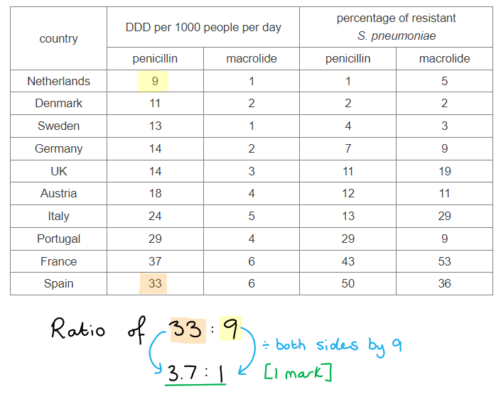
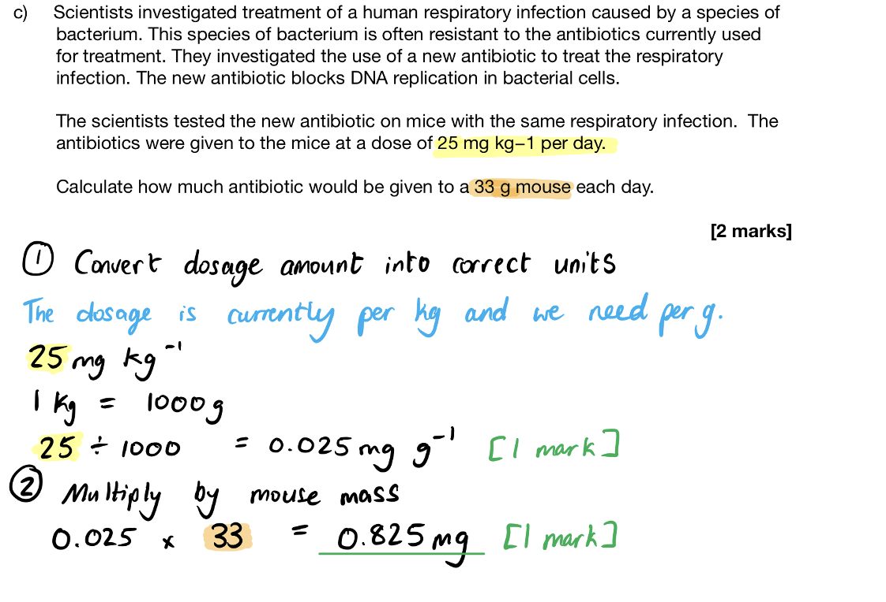
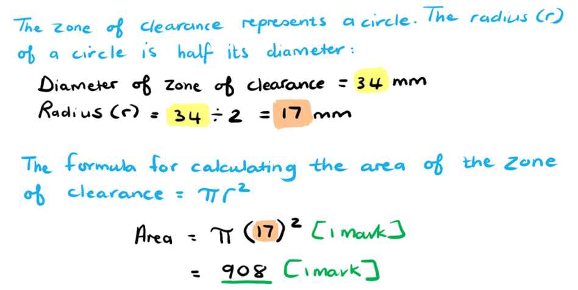
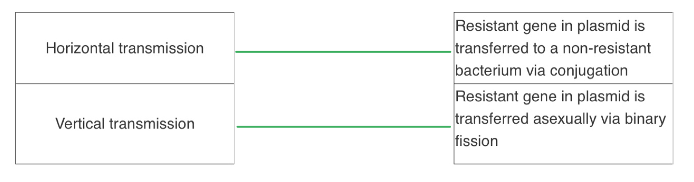

# Mark Schemes — Antibiotics
**10. Infectious Diseases** · Cambridge (CIE) AS biology (9700)

## Multiple Choice Questions (22 questions)

### Q1
**Final answer:** **The correct answer is ****B**** because:**

- **The zones of inhibition around the streptomycin is small but still present**
- **There is no zone of inhibition present around the penicillin disc which is highly suggestive that all of the bacteria growing now have resistance **

### Q2
**Final answer:** **The correct answer is ****C****.**

**Final answer:** **Penicillium ****mould grows on dead biomass including rotting food (as you'll know if you've left bread for too long) so it feeds naturally as a decomposer. Many other microorganisms feed in this way too, including some species of bacteria. ****Penicillium**** evolved to produce a bactericidal (bacteria-killing) compound that we know today as an antibiotic. **

> *A** is incorrect because bacteria do not feed on **Penicillium**. *

> *B** is incorrect because it implies that **Penicillium **requires a host organism, it does not. *

> *D** is clearly incorrect because antibiotics are not effective against viruses. *

### Q3
**Final answer:** **The correct answer is ****A**** because:**

- **The data in the table does not show the number of overall cases of ****S. aureus**** infections, only the number of deaths, so this statement cannot be supported by the data in the table.**

> *All the other statements are true about MRSA *

### Q4
**Final answer:** **The correct answer is ****D**** because:**

- **A reduction in the use of tetracycline would result in less of a selection pressure for resistance, hopefully reducing the levels of resistance to this antibiotic (as there likely no survival advantage to bacteria with resistance in comparison to those without (susceptible) otherwise**
- **A compound that has a different mode of action to antibiotics can be used to treat resistant strains**

> *A **& **B **are incorrect as this would not explain how they could help in the fight against antibiotic resistance. This explains why resistance is less likely to develop to cathelicidins*

> *C **is incorrect as bacteria can become resistant to synthetic molecules, many antibiotics are synthetic molecules based on natural ones.*

### Q5
**Final answer:** **The correct answer is ****C**** because:**

- **There are zones of inhibition around discs 2 and 3 on the plate grown with  bacteria A**
- **These zones are almost the same size of each other, with the zone around disc 2 slightly bigger (and therefore suggesting Penicillin V if slightly more effective than carboxypenicillin) **

> *A **is incorrect as these only show results for these two bacteria, it does not show other bacteria. Penicillin V is not showing efficacy against bacteria B.*

> *B **is incorrect as penicillin V is not effective against bacteria B, there is no zone of inhibition*

> *D **is incorrect as penicillin V is not showing any efficacy against bacteria B*

### Q6
**Final answer:** **The correct answer is ****C**** because:**

- **The zones of inhibition decrease significantly or to nothing in the case of bacteria 2 and 4.**
- **The reduction in the zone of inhibition shows that no susceptible (non-resistant) strains of bacteria remain (as is the case for types 2 and 4) or that the numbers of susceptible bacteria are decreasing as resistance in the population becomes more prevalent (as is the case for type 3) **

> *A **is incorrect as it is impossible to tell that the bacteria would never become resistant to the antibiotic.*

> *B **is incorrect as the data shows that it is not effective against all bacteria.*

> *D **is incorrect as while it is true that some bacteria become resistant over time, not all will develop resistance*

### Q7
**Final answer:** **The correct answer is ****A****.**

**Final answer:** **The clue is in the information provided, where a part of the ribosome is targeted by the new antibiotic. Ribosomes are the site of protein synthesis, so that is the most likely mode of action. **

> *B**, **C **and **D **all are plausible ways in which some antibiotics work, although not in this case. *

### Q8
**Final answer:** **The correct answer is ****B**** because the enzyme ****β lactamase**** (also known as penicillinase) breaks down penicillin. This prevents it from working on bacterial cells. **

**Final answer:** **Penicillin works by preventing the formation of cross-links between peptidoglycan polymers in the cell wall. This leads to weakening of the cell wall in a growing bacterial cell.**

> *None of the other methods would stop the action of penicillin*

### Q9
**Final answer:** **The correct answer is ****D**** because bacteria do not have cell walls made from cellulose, their cell walls are made of peptidoglycan (this is a polymer of sugars and amino acids)**

> *All the other options are correct modes of action of antibiotics on bacteria.*

### Q10
**Final answer:** **The correct answer is ****C**** because:**

- **One class of antibiotics (bacteriostatic antibiotics) are effective against bacterial because they disrupt the synthesis of the peptidoglycan cell wall**
- **Viruses do not have cell walls, this is why antibiotics do not affect viruses**

> *A is incorrect as viruses need to infect a host cell in order to carry out metabolic processes, but this do not explain why antibiotics are effective against bacteria but not viruses*

> *B & D are incorrect as while the statements are correct about viruses, they do not explain why antibiotics work on bacteria and not viruses*

### Q11
**Final answer:** **The correct answer is ****C**** (0.71) because:**

- **The overall decrease was from 13 to 8 deaths per 100 000 people, and this happened over a 7-year timescale (2005 to 2012)**
- **The question asks for an ****average**** annual rate of decrease, so we can assume that the graph fell in a straight line, even though it was a curved line. The gradient is therefore 5 ÷ 7 = ****0.71**** **

### Q12
**Final answer:** **The correct answer is ****D**** because:**

**Final answer:** **The bacterial population is increasing before the patient starts to take antibiotics. This can be seen in the graph.**

> *A** is incorrect because from the graph the bacteria population has decreased to 0 by 6.5 days after starting the treatment with antibiotics.*

> *B** is incorrect because you can’t see how the antibiotic works on the bacteria from the graph.*

> *C** is incorrect because antibiotics are not effective against viruses - the graph only shows the effect on bacterial populations.*

### Q13
**Final answer:** **The correct answer is ****D**** (1, 2 and 4) because:**

- **Statement 1**** is correct because farmers often protect their whole herd by using antibiotics, to prevent the spread of disease, even when none of the animals are sick. This practice is now not in use widely as it encourages antibiotic resistance**
- **Statement 2 ****is correct because if a person stops taking antibiotics before the end of the course, some pathogens may still be alive in their body, but not in sufficient numbers to cause symptoms. If antibiotics are stopped, these few bacteria can multiply freely, produce high levels of toxins and cause the disease to reappear in that individual**
- **Statement 4**** is correct because the definition of antibiotics is that they work ****against bacteria only**** (not other types of microorganisms)**

> *Statement 3** is incorrect because antibiotics are used routinely, with care, very effectively against bacterial infections.*

### Q14
**Final answer:** **The correct answer is ****C**** because TB and cholera are both caused by bacteria, and can be treated with antibiotics. **

> *The other options all include measles. Measles is a viral infection which is not treated with antibiotics, as viruses that cause disease in humans infect animal cells. Remember antibiotics target the growth and metabolic processes of bacterial cells that differ or are not present in animal cells (such as the 70S ribosome or a cell wall). *

### Q15
**Final answer:** **The correct answer is ****D**** because:**

- **This antibiotic has the largest zone of inhibition. This is an area where bacterial growth has not occurred, so the colour of the agar on the plate can still be visualised and should be clear. **
- **The larger the zone of inhibition, the greater the effectiveness of an antibiotic against that bacterial strain.**

> *A **is incorrect as this only has a very small zone of inhibition so this antibiotic has not been very effective*

> *B **is incorrect as while there is a reasonable zone of inhibition around **B**, **D** is more effective*

> *C **is incorrect as this disc is likely to be a control and did not contain any antibiotic, there should be no inhibition of growth around a control.*

### Q16
**Final answer:** **The correct answer is ****B**** because:**

- **The more an antibiotic is used, the greater the chance there is of a resistant population emerging**
- **If an antibiotic used to prevent bacterial infections in livestock is used in humans to treat infections, resistance may emerge and could spread via horizontal gene transfer to bacterial species that infect animals**
- **This would mean the antibiotic would not be effective in either setting**

> *A **is incorrect as this is an issue with all use of antibiotics but would not explain why antibiotics that are used for human infections should not be used*

> *C **is incorrect as it is not the human cells that respond to the antibiotics, as human cells are different from bacterial cells and therefore not affected by antibiotics.*

> *D **is incorrect as this would not explain why they shouldn’t be used in humans as not all humans would be allergic*

> *Remember resistance to antibiotics arises randomly as bacteria accumulate mutations quickly as a result of rapid replication and the presence of only one copy of every gene *

### Q17
**Final answer:** **The correct answer is ****A**** because the increase in the incidence of streptomycin resistance means that it will not always be effective when used in the treatment of TB. **

- **TB is an infectious disease caused by the bacterium ****Mycobacterium tuberculosis**
- **Antibiotics like streptomycin disrupt or kill bacterial cells (usually by affecting an aspect of bacterial metabolism or growth)**
- **Multiple-drug-resistant forms of TB exist, making treatment difficult**

> *B **is incorrect as the rates of HIV are not increasing **Mycobacterium** infections*

> *C **is incorrect as living nearby does increase infection rates but it is not related to the loss of effectiveness of streptomycin*

> *D **is incorrect as TB is not a viral infection, it is caused by bacteria.*

### Q18
**Final answer:** **The correct answer is ****C**** because cholera and TB are both bacterial infections, and antibiotics are effective against bacteria as they target growth or metabolic processes that do not occur in animal cells.**

> *Malaria is caused by the protoctists **Plasmodium falciparum, Plasmodium malariae, Plasmodium ovale **and** Plasmodium vivax** – protoctists are not bacterial cells. One type of antibiotic (doxycycline) can be taken prophylactically to prevent infection with malaria, but usually anti-malarial drugs such as quinine and hydroxychloroquine are used to treat infected individuals.  *

> *You may have seen hydroxychloroquine mentioned recently in the news due to unfounded claims that it can prevent or treat Covid-19 infections.  *

### Q19
**Final answer:** **The correct answer is ****C**

**Final answer:** **Genetic drift describes changes in allele frequencies in the gene pool of a population due to chance events and not selection pressures, such as the use of antibiotics.**

> *A** is incorrect because human use of antibiotics provides a selection pressure on bacteria*

> *This selection pressure then results in natural selection as bacteria that are resistant to the antibiotics survive and therefore pass on their advantageous alleles to the next generation. Therefore** B** is also incorrect*

> *D** is incorrect as natural selection will favour bacteria with resistance resulting in a shift of the entire population towards that phenotype*

### Q20
**Final answer:** **The correct answer is ****B**** because cholera and TB are both bacterial infections; cholera is caused by the bacterium ****Vibrio cholerae ****and TB by ****Mycobacterium tuberculosis. **

> *A **is incorrect as smallpox is caused by a virus.*

> *C **& **D **are incorrect as  measles is caused by virus.*

### Q21
**Final answer:** **The correct answer is ****C.**

**Final answer:** **A capsid is a component of a viral particle and not a bacterium, therefore it is not a process interrupted by antibiotic action.**

> *All other processes are impacted by the action of antibiotics on a bacterium.*

### Q22
**Final answer:** **The correct answer is ****C**** because it is important to keep the antibiotic levels at a lethal dose will kill the bacteria quickly. **

> *A **is incorrect as not keeping a lethal dose will increase the chance of resistance emerging as a result of random mutation. *

> *B **is incorrect as taking the full course will help prevent the emergence of resistant bacteria, as more bacteria are likely to be killed leaving fewer for the immune system to deal with. *

> *D **is incorrect as  if the lethal dose is increased slowly then less of the bacterial population will be dealt with, allowing more to multiply and potentially rapidly increase in population size.*

## Structured Questions (14 questions)

### Q1
(i) Two variables that need to be standardised when using the disc diffusion method in this study are...

**Final answer:** **Any ****two ****of the following:**

- Volume of urine; **[1 mark]**
- Volume/concentration/pH of agar; **[1 mark]**
- Concentration/volume of antibiotics; **[1 mark]**
- (Incubation) temperature; **[1 mark]**
- Incubation time; **[1 mark]**
- Size/spacing/type of discs; **[1 mark]**

(ii) You would determine the sensitivity of *E. coli *to each antibiotic by...

- Measure the diameter/area of clear zone around the antibiotic disc (with a ruler/grid); **[1 mark]**
- The larger/wider the clear zone, the more sensitive / less resistant the bacteria are to the given antibiotic **OR** no clear zone means bacteria are resistant to/not killed by antibiotic; **[1 mark]**

**[Total: 4 marks]**

> *Avoid using the term "amount" when you need to been more specific with using terms like volume, mass, or concentration. *
(i) The standard deviations can be described as follows...

**Final answer:** **Any ****two ****of the following:**

- It shows a large spread of data (around the mean) / deviation from the mean / variation with the mean; **[1 mark]**
- Data is not (very) reliable/consistent; **[1 mark]**
- Standard deviation increases as mean increases / positive correlation between standard deviation and mean; **[1 mark]**

> *You should make sure your answer is in the context of the data shown in the table, so you can't just give a definition of standard deviation. *

(ii) The number of prescriptions issued for antibiotics may **not** give an accurate measure of antibiotic use by patients because...

**Final answer:** **Any ****two ****of the following:**

- Patients may not take the antibiotics prescribed; **[1 mark]**
- Patients may not complete the course of antibiotics; **[1 mark]**
- Dose (per prescription) may differ; **[1 mark]**
- Antibiotics are also prescribed by dentists/hospitals/other practitioners; **[1 mark]**
- Patients may buy antibiotics (without a prescription); **[1 mark]**
- Data only taken from large clinics; **[1 mark]**
- Patients may be prescribed antibiotics other than those stated in table / more than one antibiotic; **[1 mark]**

**[Total: 4 marks]**
The trends shown in the data are as follows...

**Final answer:** **Up to ****two ****of the following:**

*Description*

- Percentage of patients with resistant bacteria is higher in males than females (of the same age / at all ages); **[1 mark]**
- Percentage of patients with resistant bacteria is initially high in (very) young / 3-year olds / up to 15; **[1 mark]**
- Percentage of patients with resistant bacteria decreases (steeply) in young / up to (around) 20; **[1 mark]**
- Percentage of patients with resistant bacteria more or less plateaus/fluctuates between ages 20/30 and 60/80; **[1 mark]**
- Percentage of patients with resistant bacteria increases steeply from (around) 80 or increases from around 60–80/old age; **[1 mark]**
- Percentage of patients with resistant bacteria is highest at 100 years (in both); **[1 mark]**

**Final answer:** **Up to ****two ****of the following:**

*Explanation, linked to antibiotic use*

- Antibiotic/ampicillin use is higher in the young/old; **[1 mark]**
- Idea of people between 20 and 60/80 are prescribed different antibiotics; **[1 mark] **
- Males may be less likely to complete the full course of antibiotics / may take more antibiotics; **[1 mark]**
- Idea of young/old have greater contact with hospitals and therefore greater exposure to ampicillin/antibiotic-resistant *E. coli*; **[1 mark]**

**[Total: 3 marks]**

> *Younger or older people may have weaker immune systems but this needs to be linked to increased ampicillin use, which creates a selection pressure on the **E. coli** populations in the body.*

### Q2
(i) Two conclusions that can be made about the quantity of these antibiotics used and the percentage of *S. pneumoniae *resistant to these two types of antibiotic are...

- The higher the DDD (of antibiotic/penicillin/macrolide) the higher the <u>percentage</u> of resistant bacteria; **[1 mark]**
- Lower DDD macrolide give greater percentage of resistant bacteria (than penicillin); **[1 mark]**

(ii) The ratio of penicillin use between Spain and the Netherlands is...

- 11:3 / 3.7:1 / 3.67:1; **[1 mark]**

**[Total: 3 marks]**

> *(i) You should make sure your answers aren't just about numbers of people taking the antibiotic and the number of resistant bacteria, instead they need to be about the DDD and the percentage of resistant bacteria. Your answer should also be about overall trends rather than specific countries. *

A serial dilution to produce a range of concentrations of the antibiotic could be made by...

- Put a standard volume of stock solution into a standard volume of water; **[1 mark]**
- Use new dilution for making the next dilution in the same way as above; **[1 mark]**

**[Total: 2 marks]**
Two criteria that environmental agencies could apply when assessing the new test to see whether it is suitable are...

**Final answer:** **Any ****two ****of the following:**

- Reliable/reproducible; **[1 mark]**
- Sensitive / able to detect low numbers (of resistant *E. coli*); **[1 mark]**
- Specific (to resistant *E. coli*) / able to detect resistant* E. coli*; **[1 mark]**
- Cost effectiveness; **[1 mark]**
- Results are similar to the disc diffusion results; **[1 mark]**

**[Total: 2 marks]**

### Q3
Penicillin kills non-resistant bacteria by:

**Final answer:** **Any**** four**** from the following:**

- Inhibiting (the enzyme) peptidase; **[1 mark]**
- It blocks / alters the shape of the enzyme's active site; **[1 mark]**
- (This means) that peptidoglycan molecules cannot link up / it stops cross-links forming; **[1 mark]**
- (So) the cell wall becomes weaker; **[1 mark]**
- (The cell wall can't withstand) high turgor pressure inside the cell / increased internal pressure; **[1 mark]**
- (So) the cell / bacterium bursts; **[1 mark]**

*Ignore: cell dies*

**[Total: 4 marks]**
A bacterium produces an efflux pump from a gene on a plasmid as follows:

**Final answer:** **Any**** three**** from the following:**

- mRNA is produced by transcription / produces a triplet code; **[1 mark]**
- (Which is) translated at a ribosome; **[1 mark]**
- tRNA plays a role e.g. using its anticodon / carries a specific amino acid; **[1 mark]**
- To form a (growing) polypeptide; **[1 mark]**

**[Total: 3 marks]**

> *This is a synoptic question that uses your knowledge of gene expression from Topic 6.2 Protein Synthesis.*
(i) The MICs for mutant strains 1 and 2 differ from that for strain R because:

**Final answer:** **Any**** two ****from the following:**

*Mutant strain 1:*

- Has very low resistance **OR** is affected by low concentrations of antibiotic **OR** is less resistant (than R); **[1 mark]**
- Its gene for the efflux pump is not properly expressed / is switched off; **[1 mark]**
- (SO) few pumps are produced / it pumps out less antibiotic **OR** the pumps are not working well; **[1 mark]**

**Plus up to ****two**** ****from:**

*Mutant strain 2*

- More resistant / more than 4× resistant **OR** tolerates a high concentration of antibiotic; **[1 mark]**
- Gene for the efflux pump is expressed /  is fully switched on; **[1 mark]**
- (So) many pumps are available **OR** it pumps out more antibiotic; **[1 mark]**

(ii) A population of strain **R **of *P. aeruginosa* could be replaced by mutant strain **2 **by:

**Final answer:** **Up to ****four**** from the following:**

- Natural selection; **[1 mark]**
- The presence of the antibiotic is a selection pressure; **[1 mark]**
- Mutant strain 2 has a selective advantage; **[1 mark]**
- In the presence of >6 and <256 µg cm-3 antibiotic; **[1 mark]**
- R dies and mutant strain 2 survives; **[1 mark]**
- Mutant 2 reproduces and increases in number; **[1 mark]**
- (So) passes resistance / mutation (to its offspring); **[1 mark]**

**[Total: 8 marks]**

### Q4
(i) Implications of widespread antibiotic resistance include:

**Final answer:** **Any ****three**** of the following:**

- Increased risk of untreatable bacterial infections; **[1 mark]**
- Prolonged illnesses; **[1 mark]**
- Extended hospital stays **OR** higher healthcare costs; **[1 mark]**
- Jeopardized medical procedures *(accept named procedures such as surgeries, organ transplants, and cancer treatments);* **[1 mark]**
- Increased deaths due to untreatable illnesses; **[1 mark]**
- Increased deaths due to pressure on healthcare systems; **[1 mark]**

(ii) Strategies to address global antibiotic resistance:

**Final answer:** **Any**** four**** from the following areas:**

**Education Programs:**

**Final answer:** **A maximum of ****two**** from the following:**

- Educate healthcare professionals, patients, and the public on responsible antibiotic use; **[1 mark]**
- (Emphasise the importance of) completing prescribed courses (of antibiotics); **[1 mark]**
- Discourage self-medication **OR **medicating illnesses not suited to antibiotic treatment / viral/fungal infection; **[1 mark]**
- Limit spread of resistant strains **OR **ensure hygienic practises are in place in clinical environments; **[1 mark]**

**Surveillance and Monitoring:**

**Final answer:** **A maximum of ****two**** from the following:**

- Track global antibiotic resistance patterns more effectively; **[1 mark]**
- Establish methods for quick identification of resistant strains; **[1 mark]**
- Introduce procedures/support for managing breakouts of resistant strains e.g. isolating infected patients; **[1 mark]**

**Research and Development:**

**Final answer:** **A maximum of ****two**** from the following:**

- Invest in the research / development of new antibiotics / alternative treatments; **[1 mark]**
- Provide incentives for pharmaceutical companies to contribute to antibiotic development; **[1 mark]**

**International Collaboration:**

**Final answer:** **A maximum of ****two**** from the following:**

- Establish/enforce regulations on antibiotic use in agriculture (globally); **[1 mark]**
- Develop research partnerships and information sharing on a global scale; **[1 mark]**

**[Total: 7 marks]**
Horizontal gene transfer, mutation, and selective pressure contribute to the evolution of antibiotic-resistant bacteria in the following ways:

**Final answer:** **Any ****six**** from the following:**

- Mutations are changes in nucleotide base sequence; **[1 mark]**
- Resulting in new alleles /** **alleles for antibiotic resistance; **[1 mark]**
- Horizontal gene transfer involves the transfer of genetic material/plasmids between different bacterial cells; **[1 mark]**
- Through conjugation / transformation / transduction; **[1 mark]**
- This enables the rapid spread of antibiotic resistance genes (across populations); **[1 mark]**
- Antibiotic resistance alleles provide a selective advantage; **[1 mark]**
- Antibiotic use creates a selection pressure; **[1 mark]**
- Resistant strains survive and reproduce **OR** non-resistant strains die and cannot reproduce; **[1 mark]**

**[Total: 6 marks]**

> *It is important you structure your answer clearly here to show you have discussed the three points asked for in the question. The use of bullet points is fine; you might also like to use headings in this instance to discuss each point. *
Clinical trials are required because...

**Final answer:** **Any ****two**** of the following:**

- Knowledge of how it interacts with the human body is needed; **[1 mark]**
- Efficacy/safety must be monitored; **[1 mark]**
- Correct dosage needs to be calculated; **[1 mark]**
- Mice are different to humans **OR** mice may show different side effects compared to humans; **[1 mark]**
- Data must be collected (over a long period of time); **[1 mark]**

**[Total: 2 marks]**

> *Drug testing and the procedures are not specifically named on the CIE IAL syllabus, however, this 'suggest' question requires you to apply your knowledge of scientific techniques to real-life scenarios. You are expected to be able to identify that the drug was initially tested on mice and that these organisms are different to humans and therefore may present different responses to the antibiotics.*
A reduction in bacteria does not imply a solution because...

- Surviving bacteria are likely to be those most resistant to the antibiotic; **[1 mark]**
- These (more resistant forms) will then reproduce; **[1 mark]**
- Passing on their alleles for stronger resistance to the next generation; **[1 mark]**
- (Potentially) leading to the evolution of a more resistant strain of bacteria; **[1 mark]**

**[Total: 3 marks]**

> *All bacteria must be killed during a course of treatment with antibiotics to prevent the development of more super-strains which exhibit stronger resistance. This is the same reasoning behind the requirement to complete an entire course of antibiotics rather than just stopping when the symptoms of infection are improved.*

### Q5
A hypothesis the farmers were testing could be:

**Final answer:** **Any ****one**** of the following:**

- The type of feed affects (antibiotic) <u>resistant</u> bacteria (in animals); **[1 mark]**
- (Antibiotic) <u>resistant</u> bacteria infect /are passed on to animals/farmer **[1 mark] ***Accept: There is a link between (antibiotic) resistance in animals and their keepers/farmers*
- (Antibiotic) <u>resistance/resistant </u>bacteria differs in chickens and turkeys; **[1 mark]**
- (Antibiotic) r<u>esistance/resistant </u>bacteria differs in chicken farmers and turkey farmers; **[1 mark]  **

**[Total: 1 mark]**

> *Antibiotic resistant bacteria have evolved due to chance mutations in their genes. This means that when treated with antibiotics the antibiotic resistant bacteria do not die. These bacteria then pass on their genes to the next generations, increasing the frequency of antibiotic resistance within the bacterial population. This is an example of evolution by natural selection.*

> * *
The results show:

- Larger percentage of resistant bacteria/*col*i in turkeys **OR** lower percentage of resistant bacteria/*E.coli* in chickens; **[1 mark]**
- Larger percentage of <u>resistant</u> bacteria/*col*i in turkey farmers **OR** lower percentage of <u>resistant</u> bacteria/*E.col*i in chicken farmers; **[1 mark]**

**[Total: 2 marks]**

> *Note the question uses the command word “**describe**” not explain so there is no need to explain why these results were obtained. If you were asked to explain you should use knowledge on **antibiotic resistant bacteria**. Antibiotic resistance in bacteria has evolved by natural selection, humans have helped to develop this through **incorrect use or overuse **of antibiotics. In this case, the turkey farmers have overused the antibiotic tetracycline in their food. This explains the higher percentage of samples from faeces containing **E**.**coli** resistant to tetracycline.*
The amount of antibiotic given to a 33 g mouse:

- 1 kg = 1000 g
- Dosage per <u>gram</u> per day

  - 25 ÷ 1000 = 0.025 mg g-1; **[1 mark]**
- Dosage for a 33 g mouse

  - 33 x 0.025 = 0.825 mg; **[1 mark]**

**OR**

- Final answer only: 0.825 mg;** [2 marks] ***Do not accept 0.83 mg*

**[Total: 2 marks]**

The processes are not inhibited in humans because…

**Final answer:** **Any ****one**** of the following:**

- Antibiotics block specific processes that occur within <u>prokaryotic</u> cells but not in <u>eukaryotic</u> cells;** [1 mark]**
- Antibiotics are targeted to interact with prokaryotic cells and bacteria are prokaryotic cells **/** humans have eukaryotic cells; **[1 mark]**

**[Total: 1 mark]**

### Q6
The effects that penicillin V had on bacterium Y is as follow:

**Final answer:** **Any ****three**** of the following:**

- Penicillin (V) <u>inhibits</u> enzymes (responsible for forming cross-links); **[1 mark]**
- (This) prevents cross-links from forming / peptidoglycan chains cannot link up; **[1 mark]**
- The cell wall weakens / becomes weaker; **[1 mark]**
- (Therefore) cannot resist turgor (pressure) of cell content; **[1 mark]**
- (The) cell / wall burst; **[1 mark]**

**[Total: 3 marks]**

> *When a new bacterial cell is growing, it secretes enzymes called autolysins that makes small holes in the cell wall. They allow the cell wall to stretch so that the peptidoglycan molecules can join up via cross-links. Since penicillin inhibits the enzymes responsible for the formation of these cross-links, it creates an environment where the autolysins continue to make holes in the cell walls, eventually weakening the structure of the wall to the point where the cell bursts.*
Bacterium **Y** would be of particular concern for the following reasons:

**Final answer:** **Any ****two**** of the following:**

- (Bacterium **Y**) is resistant to several antibiotics / Amoxicillin **and** Mezlocillin; **[1 mark]**
- (They) contain genes / mutations that caused the resistance; **[1 mark]**
- These genes can be passed on to the next generation / via vertical transmission; **[1 mark]**
- The mutant genes could (also) be passed on to other bacteria / different species of bacteria / via horizontal transmission; **[1 mark]**

**[Total: 2 marks]**

> *Bacteria that are resistant to multiple antibiotics are of particular concern to medical professionals as the genes causing the resistance can easily be transferred to other bacteria, creating many populations of multiple drug-resistant bacteria. This would require the development of new antibiotics, which often have severe side effects, to combat these resistant strains.*
The reason that penicillin is not effective against viral diseases is because:

- (Viruses) do not have cell walls; **[1 mark]**

**[Total: 1 mark]**

> *Viruses do not have a cellular structure like a bacterium. Penicillin affects the formation of the bacterial cell wall so it will not have any effect on viruses, who do not possess cell walls.*
The reason bacterium **X** would be more susceptible to penicillin than bacterium **Y** would be:

**Final answer:** **Any ****two**** of the following:**

- Penicillin can reach the cell wall / peptidoglycan more directly (for bacterium **X** compared to bacterium **Y**); **[1 mark]**
- (The) outer membrane (of bacterium** Y**) provides protection from penicillin; **[1 mark]**
- Bacterium **X** contains more / thicker layer of peptidoglycan (compared to bacterium **Y**); **[1 mark]**

**[Total: 2 marks]**

> *Bacterium **X** contains more peptidoglycan in its cell wall compared to bacterium **Y** and will therefore be more affected by the action of penicillin. The layer of peptidoglycan in bacterium **X** is not protected by an outer membrane, as is the case for bacterium** Y**, and therefore penicillin will have direct access to it.*

### Q7
The changes observed in the number of live bacterial colonies of normal and mutant bacteria is as follow:

- The number of normal bacterial colonies increased and then decreased (over time); **[1 mark]**
- (While) the mutant bacterial colonies showed a (steady) increase (over time) before reaching a plateau / stabilising / levelling off; **[1 mark**]
- Data points correctly quoted to support descriptions (e.g. normal bacteria decreased from 3200 live colonies to 150 **OR** mutant bacteria increased from 3200 live colonies to 3800/3850 **OR** mutant bacteria reached a plateau / stabilised / levelled off after 36 hours); **[1 mark]**

**[Total: 3 marks]**

> *Pay close attention to the information presented in graphs. When asked to describe data, look at the overall trend; is there an increase or decrease in the data, does it level off at some point etc. Correctly quoting data points to support your descriptions is always worth a mark, so make sure you work out the scale correctly for each axes.*
The role of natural selection in the development of antibiotic resistance can be explained as follow:

**Final answer:** **Any ****three**** of the following:**

- (The) antibiotic provides selective pressure / is the selective agent; **[1 mark]**
- Mutated / resistant bacteria will survive / reproduce / multiply; **[1 mark]**
- (The) resistant <u>allele / gene</u> is passed (on / down) to the offspring; **[1 mark]**
- Frequency of (resistant) <u>allele / gene</u> will increase in the population **OR** a greater number of bacteria in the population will have the (resistant) <u>allele / gene</u>; **[1 mark]**

**[Total: 3 marks]**

> *Bacteria provides a useful model for studying evolution by natural selection, as they are able to reproduce very quickly and the genes for antibiotic resistance will have an immediate effect on the bacteria since they only possess one copy of each gene. Antibiotics will create a selective pressure in favour of resistant bacteria, as it kills off non-resistant bacteria and therefore eliminates competition for resources. This allows resistant bacteria to multiply very quickly and pass the alleles for antibiotic resistance down to their offspring.*
Possible ways in which bacteria can resist the effects of an antibiotic include:

**Final answer:** **Any ****two**** of the following:**

- (They may) contain a thick cell wall that is impermeable to antibiotics / makes it difficult for antibiotics to enter (the bacterium); **[1 mark]**
- (Certain) membrane proteins may inactivate antibiotics; **[1 mark]**
- (Bacteria) may produce enzymes that breakdown antibiotics; **[1 mark]**
- (They may have) membrane proteins that pump / remove antibiotics from the cell / bacterium; **[1 mark]**

**[Total: 2 marks]**

> *Bacteria may have many different mechanisms by which it tries to protect itself against the effects of antibiotics. Some will prevent antibiotics from entering the bacterium due to the presence of a thick cell wall, some have membrane proteins that inactivate the antibiotic or protein pumps which removes the antibiotic from the bacterium. They may also have enzymes in their cytoplasm that can breakdown any antibiotic that enters the cell. All of these mechanisms are essential for the survival of bacteria in the presence of antibiotics. *
It is important to complete a course of antibiotics because...

**Final answer:** **Any ****two**** of the following:**

- To ensure that all the bacteria are killed / dead; **[1 mark]**
- (This means there are) no survivors that could mutate / develop resistance / become resistant strains; **[1 mark]**
- (For example in Fig. 3.1) there are still a (small) number of normal bacteria colonies present (even) after 60 hours (of exposure to antibiotic); **[1 mark]**

**[Total: 2 marks]**

> *Antibiotic resistance will often develop because patients do not complete a course of prescribed antibiotics, especially when they start to feel better after a few days. Some bacteria may have survived and could develop mutations that will make them resistant to the effects of antibiotics.*

### Q8
The results from Fig. 1 can be described as follow:

**Final answer:** **Any ****two ****of the following:**

- (There was an) increase in resistance (across the length of the entire study); **[1 mark]**
- Description of the rate of change (e.g. the rate increased slightly between 1990 and 2000 **AND** rate of increase slowed down between 2000 and 2010); **[1 mark]**
- Any data point(s) quoted correctly (e.g. resistance increased from 2% in 1985 to 17% in 2010); **[1 mark]**

**[Total: 2 marks]**

> *The graph shows a very clear upward trend in terms of antibiotic resistance in MRSA. When describing data, remember to look for anything that stands out, for example the lowest or highest values or any change in the gradient of the graph. Since the question is not asking for an explanation, you do not need to provide reasons for the trend(s) that you observe.*
The strains of MRSA could have developed resistance to vancomycin due to the following reasons:

**Final answer:** **Any ****three**** of the following:**

- (It could result from) the overuse / misuse / incorrect use of vancomycin; **[1 mark]**
- (Random) mutation(s) in MRSA (may lead to resistance); **[1 mark]**
- Some / resistant MRSA bacteria survive (after exposure to vancomycin); **[1 mark]**
- (The) resistant strains (of MRSA) multiply; **[1 mark]**
- The resistant gene(s) / allele(s) are passed down to offspring / through vertical transfer; **[1 mark]**
- Resistant gene(s) / allele(s) can be passed to other (species of) bacteria through plasmid / horizontal transfer; **[1 mark]**

**[Total: 3 marks]**

> *Overuse or misuse of antibiotics provides an opportunity for resistant strains within bacterial populations to survive and provides a selection pressure, as it eliminates the non-resistant strains that compete with the resistant strains for resources. This provides an ideal environment for resistant strains to multiply and pass the resistant gene or allele to their offspring, thus creating a larger population of resistant bacteria. Bacteria may also transfer plasmids, containing antibiotic resistant genes, to other species of bacteria. *
The risk of antibiotic resistance developing can be reduced by the following measures:

**Final answer:** **Any ****three**** of the following:**

- Avoid the overuse of antibiotics / prescribe only when needed; **[1 mark]**
- Do not use (antibiotics) for non-serious infections; **[1 mark]**
- Complete the full / entire course of antibiotics (to avoid bacteria surviving); **[1 mark]**
- Do not use (antibiotics) for viral infections; **[1 mark]**
- Doctors should test the bacteria (to ensure correct prescription) / prescribe narrow spectrum antibiotics (for that specific strain); **[1 mark]**
- Change the type of antibiotic prescribed (for the same infection); **[1 mark]**
- Limit the (routine / preventative) use of antibiotics in agriculture; **[1 mark]**

**[Total: 3 marks]**

> *It is important to de-escalate the evolutionary arms race that currently exist between bacteria and antibiotics. This can be done by only using antibiotics when it is absolutely necessary and only when the correct strain of bacteria has been identified to avoid the use of broad spectrum antibiotics. This will ensure that conditions are not as favourable for antibiotic resistance to develop or for resistant strains to survive and multiply.*

### Q9
Calculating the area of the zone of clearance can be done as follow:

- π(17)2; **[1 mark]**
- = <u>908</u>;** [1 mark]**

*Full marks awarded for the correct answer only.*

**[Total: 2 marks]**

The effects of penicillin on the different strains of bacteria is as follow:

**Final answer:** **Any ****four**** of the following:**

- Penicillin killed most of (strain) **D** / was most effective against (strain) **D** **OR** (strain) **D** was the most susceptible to penicillin; **[1 mark]**
- (Strain) **D** produces less enzymes that break down / inactivate penicillin than (strain) **A**/**B**/**C**; **[1 mark]**
- None of (strain) **B** was killed (by penicillin) / (strain) **B** is resistant towards penicillin; **[1 mark]**
- (Strain) **B** contains mutation / allele / gene for resistance; **[1 mark]**
- (Strain) **B** produces more enzymes that break down / inactivate penicillin than (strain) **A**/**C**/**D**; **[1 mark]**
- Penicillin killed less / was less effective against strain **A** / **C**; **[1 mark]**

**[Total: 4 marks]**

> *The area of the zone of clearance gives an indication of the effectiveness of an antibiotic against different strains of a bacterium. The larger this area is, the more effective the antibiotic is against the strain, which indicates that it does not have effective defence mechanisms against the action of that antibiotic. If no zone of clearance is observed it means that the antibiotic had no effect on that strain of bacteria and that it contains a mutation or allele that enables it to resist the effects of the antibiotic.*
The reasons resistant bacteria would be common amongst hospital patients and prisoners are....

**Final answer:** **Any ****two**** of the following:**

- (There is) widespread use of antibiotics in hospitals; **[1 mark]**
- This creates a selection pressure for (the development of) resistant strains / bacteria; **[1 mark]**
- People are (kept) in close contact / confines / proximity in prisons / hospitals; **[1 mark]**
- Bacteria / resistant strains are easily transmitted (between individuals); **[1 mark]**

**[Total: 2 marks]**

> *Hospitals often serve as a point of origin for the development of resistant strains of bacteria due to the extensive use of antibiotics in that environment, which provides a selection pressure in favour of these strains. The bacteria can easily spread amongst individuals in areas where many people are kept in close confinement, such as hospitals or prisons. Once a resistant strain emerges it can quickly spread through the entire population.*
The following measures would limit the spread of strain **B**:

**Final answer:** **Any ****one**** of the following:**

- (Ensure) good hygiene practices / (regular) handwashing / use hand sanitiser; **[1 mark]**
- Isolate infected patients / prisoners (to prevent the spread of the resistant strain); **[1 mark]**

**[Total: 1 mark]**

> *Once resistant strains are identified in places such as hospitals and prisons it is best to limit the spread as soon as possible. Washing hands regularly and using hand sanitiser will limit the spread through contact with others or even surfaces containing the bacteria. By quickly isolating infected patients or prisoners, the transmission cycle of the bacteria is broken and will prevent a full blown outbreak from occurring.*

### Q10
A gene is...

- A section of DNA / base sequence of DNA which codes for a particular polypeptide/protein; **[1 mark]**

**[Total: 1 mark]**

> *This is a basic definition and one you should be able to recall easily. *
Bacteria pass on genes through vertical transmission in the following way:

- From one generation to the next / from parent cell to offspring cell; **[1 mark]**
- Through binary fission; **[1 mark]**

**[Total: 2 marks]**
Antibiotic resistance is an issue because...

- Some bacterial diseases might be untreatable / unable to treat simple bacterial infections **OR **bacteria may develop which are resistant to many types of antibiotic / multi-drug resistant bacteria / superbugs (e.g. MRSA) may develop; **[1 mark]**
- Leading to an increase in deaths (from these diseases/infections); **[1 mark]**

**[Total: 2 marks]**

### Q11
The bacterial cell wall is made up of...

- Peptidoglycan/murein; **[1 mark]**

**[Total: 1 mark]**

> *This question assesses content from topic 1.2, it is not uncommon for examiners to bring content together from different topics to assess in one question. *
Penicillin prevents the formation of the cell wall in the following way:

- Preventing (peptidoglycan) cross-bridges from forming; **[1 mark]**
- Resulting in many holes in the cell wall **OR** holes in the cell wall cannot be closed; **[1 mark]**

**[Total: 2 marks]**

> *The creation of holes in the walls of bacterial cells is an important part of bacterial cell growth. Holes are created by bacterial enzymes but these holes must be closed through the formation of peptidoglycan cross bridges. If these do not form, then the holes remain and the cell wall is weakened which damages and kills the cell.*
It leads to the death of the bacteria because...

**Final answer:** **Any ****two**** of the following:**

- The cell wall is weakened (due to many holes); **[1 mark]**
- Water moves into the bacterial cell by osmosis; **[1 mark]**
- Pressure results in the cell bursting; **[1 mark]**

**[Total: 2 marks]**
This is an advantage to bacterial cells because...

**Final answer:** **Any ****three**** of the following:**

- The walls are strengthened **OR** the walls are less affected / not weakened due to holes; **[1 mark]**
- Osmotic/hydrostatic pressure does not burst the bacterial cells **OR** the bacterial cells can withstand a higher osmotic/hydrostatic pressure; **[1 mark]**
- These bacteria are <u>resistant</u> to the antibiotic/penicillin; **[1 mark]**
- Resistant bacteria survive and reproduce/divide; **[1 mark]**

**[Total: 3 marks]**

### Q12
The term antibiotic means...

- Drugs that kill or stop the growth of bacteria; **[1 mark]**

**[Total: 1 mark]**

> *It is important to remember that whilst antibiotics kill bacteria they are not effective against viruses, nor do they harm the cells of the infected organism. *
The completed table should be as follows:

**[1 mark] **for each correct row

| Organism | Antibiotics kills cell? |
|---|---|
| Bacteria | **Final answer:** **✓** |
| Virus | **Final answer:** **X** |
| Fungi | **Final answer:** **X** |
| Infected organism i.e. human | **Final answer:** **X** |

**[Total: 4 marks]**

> *Antibiotics only work and are effective on bacteria. *
One way antibiotics disrupt the cells they are effective against is...

**Final answer:** **Any ****one ****of the following:**

- Destroy (bacterial) cell walls; **[1 mark]**
- Activity of proteins in (bacterial) cell surface membranes; **[1 mark]**
- (Bacterial) enzyme action; **[1 mark]**
- (Bacterial) DNA synthesis; **[1 mark]**
- (Bacterial) protein synthesis; **[1 mark]**

**[Total: 1 mark]**
The action of penicillin on the cells it targets is...

- Inhibits enzymes that form (bacterial) cross links in cell walls; **[1 mark]**
- (Therefore) stops cross-links forming (within bacterial cell walls); **[1 mark]**

**[Total: 2 marks]**

> *Penicillin is a specific example of an antibiotic you need to know details of. *

### Q13
The process of antibiotic resistance in bacteria is...

**Final answer:** **Any ****four ****of the following:**

- There is <u>**variation**</u>** **in the population (of bacteria); **[1 mark]**
- This variation is caused by <u>**mutations**</u>; **[1 mark]**
- Antibiotics (that are applied/given) kill non-resistant bacteria; **[1 mark]**
- Resistant bacteria survive; **[1 mark]**
- (There is) less <u>**competition**</u> so resistant bacteria reproduce; **[1 mark]**
- Antibiotic resistant bacteria pass on their <u>resistant </u><u>**genes**</u> to offspring/next generation; **[1 mark]**

**[Total: 4 marks]**

> *This is an example of natural selection, just applied to bacteria. The principles are the same. It is an important to example to be able to explain so take some time learning the steps and the key terms required. *
The completed table is as follows:

**[1 mark] **for each correct row:

| Possible consequence of antibiotic resistance | True **✓** or False ***X*** |
|---|---|
| Antibiotics become more effective | **Final answer:** **X** |
| Development of 'superbugs' such as MRSA | **Final answer:** **✓** |
| Bacteria contain many resistance genes | **Final answer:** **✓** |
| Antibiotic resistance gene passed between species | **Final answer:** **✓** |

***Accept ****words 'true' or 'false' in place of the ****✓ ****or ****X***

**[Total: 4 marks]**
The correctly matched terms are...

**[1 mark] **for each correct matched description

**[Total: 2 marks]**
Three ways antibiotic resistance can be reduced are...

**Final answer:** **Any ****three ****of the following:**

- Antibiotic only sold/given with a prescription; **[1 mark]**
- Avoid overuse of antibiotics **OR **only use/prescribe antibiotics for serious infections; **[1 mark]**
- Patient must finish the entire course of antibiotics; **[1 mark]**
- Antibiotics not being used for viral infections **OR **antibiotics only used for bacterial infections; **[1 mark]**
- Reduce the use of 'wide spectrum' antibiotics **OR** increase use of 'narrow spectrum' / specific antibiotics; **[1 mark]**
- Use a variety of antibiotics **OR **do not use the same antibiotic (for each infection); **[1 mark]**
- More restrictions in agricultural/farming use of antibiotics; **[1 mark]**

***Accept ****any other correct response*

**[Total: 3 marks]**

> *If we are to continue to use antibiotics successfully it is important that these recommendations are followed. Antibiotic resistance is one of the biggest threats to global health, food security, and development today. A growing number of infections, such as pneumonia, tuberculosis, gonorrhoea, and salmonellosis, are becoming harder to treat as the antibiotics used to treat them become less effective.*

### Q14
The effect of the introduction of penicillin on the death rates from infectious disease is...

**Final answer:** **Any ****two**** of the following:**

- A decrease in the death rates from infectious disease; **[1 mark]**
- Largest of decreases were in 1953 and 1983; **[1 mark]**
- Fluctuation/variation (in death rates from infectious disease) from 1953; **[1 mark]**
- Death rates from infectious diseases seem to have levelled off since 1953 **OR **little increase/decrease in death rates from infectious disease since 1953; **[1 mark]**

**[Total: 2 marks]**

> *The command word here is described so you do not need to explain the trend or the effect of antibiotics on death rates, you simply need to "say what you see" in the graph. *
(i) The decade with the greatest number of antibiotic discoveries is...

- 1950s; **[1 mark]**

(ii) A description as to whether the data in Fig. 2 supports this claim is...

- Yes it does; **[1 mark]**
- Because no new antibiotics have been discovered since the decade 1990 **OR** antibiotic discoveries have decreased since the decade 1950; **[1 mark]**

**[Total: 3 marks]**
Antibiotic resistance means that...

- The bacteria is not affected by the antibiotic **OR **the antibiotic does not kill the bacteria **OR **the antibiotic is not effective against the bacteria; **[1 mark]**

**[Total: 1 mark]**
Descriptions for the images X and Y are...

- Image X: Antibiotics kill non-resistant bacteria **and **antibiotic resistant bacteria survive; **[1 mark]**
- Image Y: Antibiotic resistant bacteria reproduce; **[1 mark]**

**[Total: 2 marks]**
