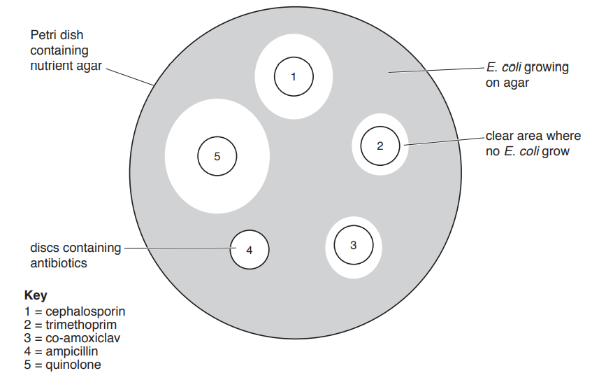
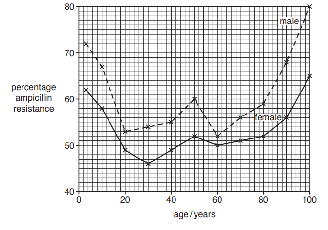
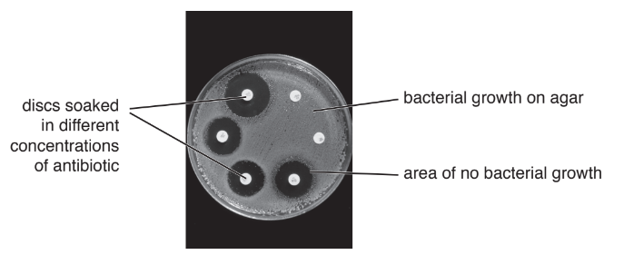
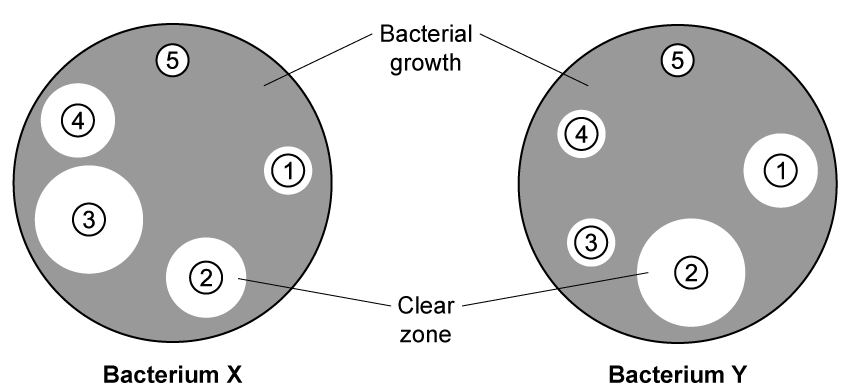
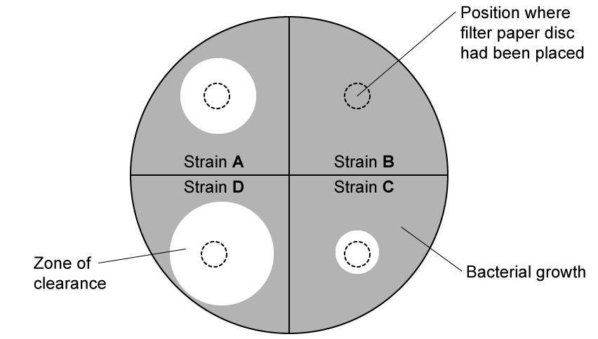
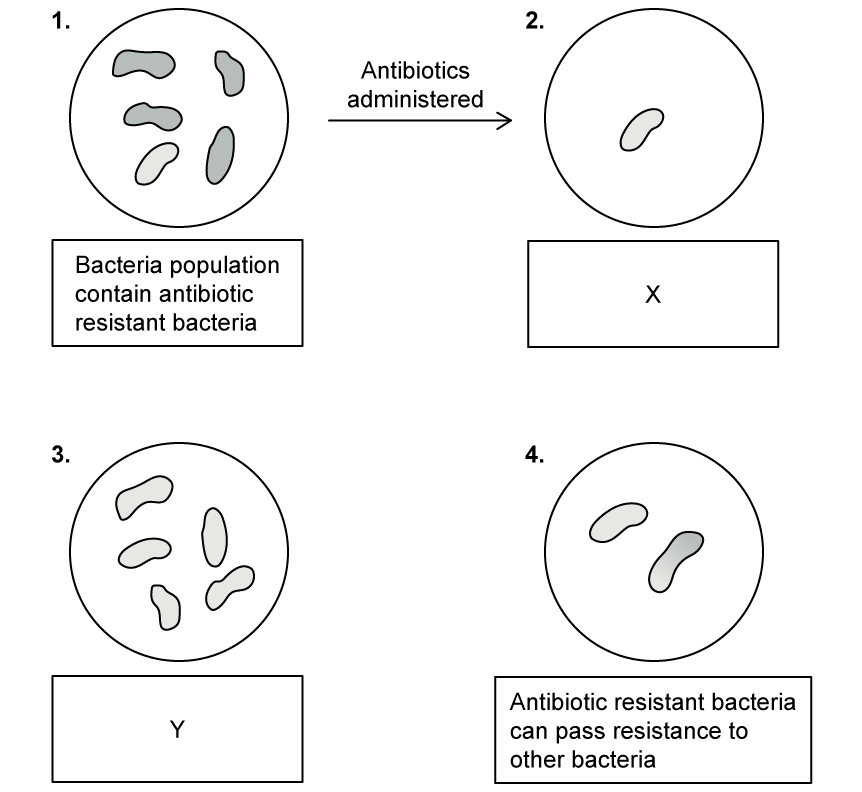

# Exam Questions — Antibiotics
**10. Infectious Diseases** · Cambridge (CIE) AS biology (9700)
> Source: [https://www.savemyexams.com/as/biology/cie/25/topic-questions/](https://www.savemyexams.com/as/biology/cie/25/topic-questions/) · 36 questions across 2 sets

## Multiple Choice Questions (22 questions)

### Q1 — hard — 1 marks

**Q1** [1 mark]

The diagram shows the effect of growing *Escherichia coli* in the presence of streptomycin and penicillin.

What can be concluded about the results?

|   | completely resistant | not completely resistant |
|---|---|---|
| **A** | S and P | - |
| **B** | P | S |
| **C** | S | P |
| **D** | - | S and P |

### Q2 — hard — 1 marks

**Q2** [1 mark]

Which is a reason why fungi such as *Penicillium* have evolved to produce antibiotics?

### Q3 — hard — 1 marks

**Q3** [1 mark]

The data below show the number of deaths due to *Staphylococcus aureus* from 1997 to 2005.

Methicillin is an antibiotic that is used to treat *S. aureus* infections. MRSA is methicillin-resistant *S. aureus.*

| Year | total number of death certificates with *S. aureus* | total number of death certificates with MRSA |
|---|---|---|
| 1997  1999  2001  2003  2005 | 369  452  456  420  428 | 355  431  681  890  1512 |

Which statement is not supported by this data?

### Q4 — hard — 1 marks

**Q4** [1 mark]

Some animals have evolved to produce small peptides called cathelicidins. These peptides have a bactericidal effect. They are able to attach to lipids in the bacterial membrane, thereby weakening them.

Synthetic versions of the cathelicidins have been produced. These can be used to treat infections that have become resistant to antibiotics like tetracycline.

Read the following statements:

| 1 | The only way a bacterium could develop resistance to it is by altering all the lipids in its membranes. |
|---|---|
| 2 | Cathelicidins could be used instead of tetracycline, allowing tetracycline resistance to be reduced. |
| 3 | Cathelicidins are synthetic so bacteria can never become resistant to them. |
| 4 | Cathelicidins could be used to kill multidrug-resistant strains of bacteria, for which there are no currently effective antibiotics. |

Which pair of statements explain how these peptides can help in the fight against antibiotic resistance?

### Q5 — hard — 1 marks

**Q5** [1 mark]

Two species of bacteria A and B were grown on an agar plate. Each plate had three filter paper discs with the following:

| 1 | no antibiotic (control) |
|---|---|
| 2 | penicillin V, a natural penicillin |
| 3 | carboxypenicillin, a synthetic penicillin |

The diagram below shows the results:

Which statement is a correct conclusion for this experiment?

### Q6 — hard — 1 marks

**Q6** [1 mark]

The diagram below shows how the effect of growing bacteria in the presence of an antibiotic can be investigated.

Five different types of bacteria were grown on their own petri dish, one example is shown below:

The table below shows the results from testing the antibiotic on the growth of these five types of bacteria. Zones of inhibition less than 13 mm show the presence of resistant bacteria.

| type of bacteria | diameter of zone / mm |   |   |   |   |
|---|---|---|---|---|---|
| Week 1 | Week 2 | Week 3 | Week 4 | Week 5 |   |
| 1  2  3  4  5 | 24.10  18.60  17.90  19.40  22.00 | 21.90  15.40  12.80  15.30  21.00 | 19.00  12.20  12.40  13.20  20.50 | 17.60  9.00  11.10  8.10  20.40 | 14.30  0.00  10.90  0.00  20.40 |

Which statement is supported by the data?

### Q7 — hard — 1 marks

**Q7** [1 mark]

Lefamulin™ is a newly-developed antibiotic that binds to the 50S bacterial ribosomal subunit.

It was approved by the US Food and Drug Administration (FDA) in August 2019 for the treatment of pneumonia.

Which is the mode of action of Lefamulin™?

### Q8 — medium — 1 marks

**Q8** [1 mark]

Some bacteria have developed a resistance to penicillin.

Which of the following would explain how bacteria can prevent the action of penicillin?

### Q9 — medium — 1 marks

**Q9** [1 mark]

Antibiotics can interfere with aspects of growth or metabolism in bacterial cells.

Which of the following is not a mode of action of antibiotics?

### Q10 — medium — 1 marks

**Q10** [1 mark]

Bacteria and viruses are the main pathogens in humans. Antibiotics can be used to treat bacterial infections but not viral infections.

Which of the following statements explains why?

### Q11 — medium — 1 marks

**Q11** [1 mark]

The graph below shows the number of deaths from MRSA per 100 000 people in a population of over-65’s from 2005 to 2012.

Which of the following is the correct value of the average annual rate of decrease in the number of deaths from MRSA infections in the over-65s per 100 000 people from 2005 to 2012?

### Q12 — medium — 1 marks

**Q12** [1 mark]

The data in the graph shows the effect of an antibiotic on the population of bacteria in the blood.

What can be concluded from the data in the graph?

### Q13 — medium — 1 marks

**Q13** [1 mark]

Which of the following practices have contributed to the fall in antibiotic effectiveness in the late 20th and early 21st centuries?

1. Large-scale use of preventative antibiotics in farm livestock
2. Failing to complete the full course of antibiotics prescribed by a doctor
3. Treatment of known bacterial infections with antibiotics
4. Treatment of viral infections with antibiotics

### Q14 — medium — 1 marks

**Q14** [1 mark]

Which of these diseases can be cured with antibiotics?

### Q15 — medium — 1 marks

**Q15** [1 mark]

An antibiotic sensitivity test was performed on bacteria isolated from a patient’s throat.

The diagram shows the results of the four antibiotics tested.

Which one should be used to treat the disease?

### Q16 — easy — 1 marks

**Q16** [1 mark]

Some antibiotics are used in animal feed to help prevent disease.

Which statement explains why they should not be used to treat bacterial infections in humans?

### Q17 — easy — 1 marks

**Q17** [1 mark]

Streptomycin, a type of antibiotic, is now less effective in treating TB worldwide.

Which of the following could be a reason for this?

### Q18 — easy — 1 marks

**Q18** [1 mark]

Which of these diseases are likely to be effectively treated with antibiotics?

|   | cholera | TB | malaria |
|---|---|---|---|
| **A**  **B**  **C**  **D** | ✓  ✓  ✓  ✓ | X  ✓  ✓  X | ✓  ✓  X  X |

### Q19 — easy — 1 marks

**Q19** [1 mark]

Which of the following statements about antibiotic resistance is incorrect?

### Q20 — easy — 1 marks

**Q20** [1 mark]

Which of these diseases can be treated with antibiotics?

### Q21 — easy — 1 marks

**Q21** [1 mark]

Antibiotics work by interfering with several different processes in the target bacteria.

Which of the following is not a process which is impacted by antibiotic action?

### Q22 — easy — 1 marks

**Q22** [1 mark]

When a patient is prescribed a course of antibiotics they must take them at evenly spaced intervals.

Why is this necessary?

## Structured Questions (14 questions)

### Q1 — hard — 11 marks

**Q1** [4 marks]

Resistance to antibiotics within a population of bacteria is due to selection pressure. This can be linked to the use of antibiotics by patients.

A study was carried out into the link between antibiotic use and the presence of resistant *Escherichia coli* (*E. coli*) populations in human communities.

- Over 30 000 patients were involved in the study.
- Only patients attending large medical clinics took part in the study.
- The number of prescriptions issued by each clinic was used as an estimate of antibiotic use.
- Urine from patients attending the clinics was used as a possible source of antibiotic resistant *E. coli*.
- Antibiotic resistance of *E. coli* in the urine samples was measured using the disc diffusion method.

The disc diffusion method measures sensitivity of bacteria to an antibiotic. A bacterial population with low sensitivity to an antibiotic is resistant to that antibiotic.

In the disc diffusion method a Petri dish is filled with nutrient agar and urine samples containing *E. coli* are spread evenly across the agar.

Discs containing different antibiotics are placed on top of the agar. A lid is put on the Petri dish and the plate is incubated overnight.

Fig. 1 shows an example of a Petri dish from the study after incubation.

**Fig. 1**

(i) Suggest two variables that need to be standardised when using the disc diffusion method in this study.

[2]

(ii) Describe how you would determine the sensitivity of *E. coli *to each antibiotic.

[2]

*Source: Oct/Nov 2018 9700/51 Q2A*

**Q1** [4 marks]

**Extract:**

A study was carried out into the link between antibiotic use and the presence of resistant *Escherichia coli* (*E. coli*) populations in human communities.

- Over 30 000 patients were involved in the study.
- Only patients attending large medical clinics took part in the study.
- The number of prescriptions issued by each clinic was used as an estimate of antibiotic use.
- Urine from patients attending the clinics was used as a possible source of antibiotic resistant *E. coli*.
- Antibiotic resistance of *E. coli* in the urine samples was measured using the disc diffusion method.

Table 1 shows the results of this investigation.

**Table 1**

| antibiotic | antibiotic use /prescriptions per thousand patients per year | percentage *E. coli *resistance |   |   |
|---|---|---|---|---|
| mean ($\overline{x}$) | standard deviation (s) | mean ($\overline{x}$) | standard deviation (s) |   |
| cephalosporin | 107.0 | 83.0 | 6.5 | 3.5 |
| trimethoprim | 62.6 | 25.6 | 26.3 | 5.8 |
| co-amoxiclav | 75.5 | 43.9 | 8.4 | 5.7 |
| ampicillin | 351.9 | 171.1 | 53.2 | 7.2 |
| quinolone | 33.6 | 18.3 | 2.2 | 1.9 |

(i) Comment on the standard deviations for **antibiotic use** as shown in Table 1.

[2]

(ii) Suggest two reasons why the number of prescriptions issued for antibiotics may **not** give an accurate measure of antibiotic use by patients.

[2]

*Source: Oct/Nov 2018 9700/51 Q2B*

**Q1** [3 marks]

The percentage of patients with ampicillin-resistant *E. coli* infections varies with age and gender, as shown in Fig. 2.

**Fig. 2**

Describe **and** explain the trends shown by these data.

*Source: Oct/Nov 2018 9700/51 Q2D*

### Q2 — hard — 7 marks

**Q2** [3 marks]

Antibiotic resistance of pathogenic bacteria is a worldwide cause for concern. Investigations into the use of antibiotics and their effects use an international unit of measurement, called the defined daily dose (DDD).

The DDD represents the assumed average dose for a drug per day being used to treat a specific disease in adults.

A study investigated the antibiotic resistance of* Streptococcus pneumoniae*. The study was carried out in some European countries and the percentage of *S. pneumoniae* resistant to the antibiotics penicillin and macrolide was determined. The results are shown in Table 1.

**Table 1**

| country | DDD per 1000 people per day | percentage of resistant *S. pneumoniae* |   |   |
|---|---|---|---|---|
| penicillin | macrolide | penicillin | macrolide |   |
| Netherlands | 9 | 1 | 1 | 5 |
| Denmark | 11 | 2 | 2 | 2 |
| Sweden | 13 | 1 | 4 | 3 |
| Germany | 14 | 2 | 7 | 9 |
| UK | 14 | 3 | 11 | 19 |
| Austria | 18 | 4 | 12 | 11 |
| Italy | 24 | 5 | 13 | 29 |
| Portugal | 29 | 4 | 29 | 9 |
| France | 37 | 6 | 43 | 53 |
| Spain | 33 | 6 | 50 | 36 |

(i)  State **two** conclusions that can be made about the quantity of these antibiotics used and the percentage of *S. pneumoniae *resistant to these two types of antibiotic.

[2]

(ii) Calculate the ratio of penicillin use between Spain and the Netherlands.

[1]

*Source: Oct/Nov 2018 Series 2 9700/52 Q2A (I,II)*

**Q2** [2 marks]

The disc diffusion method is used to test the effectiveness of different concentrations of antibiotics. Fig. 1 shows the results of a disc diffusion test.

**Fig. 1**

Starting with a stock solution of an antibiotic, outline how you would make a serial dilution to produce a range of concentrations of the antibiotic.

*Source: Oct/Nov 2018 Series 2 9700/52 Q2C*

**Q2** [2 marks]

The disc diffusion test is also used to test for antibiotic resistance. The test may take about five days to complete.

*Escherichia coli* is a common bacterium in the human intestines that can develop antibiotic resistance and transmit it to other bacteria. It is present in faeces and can also be present in waste water that is discharged into rivers.

Environmental agencies test samples of waste water for antibiotic resistant bacteria. This can be done with the disc diffusion method. A new test was developed to allow estimates of antibiotic-resistant *E. coli* to be obtained within 24 hours.

Suggest **two** criteria that environmental agencies could apply when assessing the new test to see whether it is suitable.

*Source: Oct/Nov 2018 Series 2 9700/52 Q2D*

### Q3 — hard — 15 marks

**Q3** [4 marks]

Penicillin belongs to a group of antibiotics known as β lactams, which all act in the same way on bacteria.

Describe how penicillin kills non-resistant bacteria.

**Q3** [3 marks]

One of the ways in which a bacterium may be resistant to an antibiotic, such as a β lactam, is by having protein pumps in its cell surface membrane which expel the antibiotic from the bacterium.

The gene coding for such an efflux pump is carried on a plasmid.

Outline how the bacterium produces an efflux pump from a gene on a plasmid.

**Q3** [8 marks]

**Extract:**

One of the ways in which a bacterium may be resistant to an antibiotic, such as a β lactam, is by having protein pumps in its cell surface membrane which expel the antibiotic from the bacterium.

The gene coding for such an efflux pump is carried on a plasmid.

A strain of the bacterium *Pseudomonas aeruginosa*, strain **R**, has a gene coding for an efflux pump and is resistant to a β lactam antibiotic.

The minimum inhibitory concentration (MIC) of the β lactam for strain **R** was determined. The MIC is the lowest concentration of antibiotic that prevents a colony of bacteria growing.

The MICs were also determined for two mutant strains derived from strain **R**, mutant strain **1** and mutant strain **2**. Each of these strains differs from strain **R** in the expression of the gene coding for the efflux pump.

The MICs for the three strains of *P. aeruginosa* are shown in **Table 1**.

**Table 1**

| strain of *P. aeruginosa* | MIC of β lactam / µg cm3 |
|---|---|
| Resistant strain **R** | 64 |
| Mutant strain **1** | 0.5 |
| Mutant strain **2** | 256 |

With reference to Table 1, suggest:

(i) Why the MICs for mutant strains **1** and **2** differ from that for strain **R**.

*Mutant strain 1 *

[2]

*Mutant strain 2 *

[2]

(ii) How a population of strain **R** of *P. aeruginosa* could be replaced by mutant strain **2**.

[4]

### Q4 — hard — 18 marks

**Q4** [7 marks]

Researchers have identified a new category of antibiotics capable of targeting bacteria that show widespread resistance to drugs.

The antibiotic Zosurabalpin has demonstrated efficacy against Carbapenem-resistant *Acinetobacter baumannii* (CRAB) in experiments involving mouse models. Human trials are now underway to assess its potential.

(i) Describe the implications of widespread antibiotic resistance on public health

[3]

(ii) Discuss **two** potential strategies to address this global challenge.

[4]

**Q4** [6 marks]

Explain how horizontal gene transfer, mutation, and selective pressure contribute to the evolution of antibiotic-resistant bacteria.

**Q4** [2 marks]

**Extract:**

The antibiotic Zosurabalpin has demonstrated efficacy against Carbapenem-resistant *Acinetobacter baumannii* (CRAB) in experiments involving mouse models. Human trials are now underway to assess its potential.

Zosurabalpin is currently going through clinical trials in which the antibiotics will be tested on healthy human volunteers. Following this, further tests will be carried out with a small group of patients.

Suggest why these trials are necessary before a new drug can be made available to human patients.

**Q4** [3 marks]

In a series of experiments, it was found that Zosurabalpin significantly reduced levels of bacteria in mice. However, further tests are required to establish the full extent of the antibiotic action.

Explain why a reduction in bacteria does not imply a complete solution to the issues encountered with antibiotic-resistance.

### Q5 — medium — 6 marks

**Q5** [1 mark]

Scientists investigated the presence of bacteria resistant to the antibiotic tetracycline in poultry and in the farmers who kept them. They looked for *Escherichia coli (E.coli) *resistant to tetracycline. The scientists took samples of faeces from the poultry birds and the farmers. Turkey farmers often used food containing tetracycline, whereas chicken farmers did not very often.

The bacteria were grown on nutrient agar containing tetracycline. Resistant bacteria grew and were visible as colonies on the agar plates.

The results are shown in the table below.

| **Sample taken from** | **Percentage of samples from faeces containing *****E*****.*****coli***** resistant to tetracycline** |
|---|---|
| Chickens | 26 |
| Chicken farmers | 9 |
| Turkeys | 83 |
| Turkey farmers | 56 |

Suggest a hypothesis the farmers were testing in this investigation.

**Q5** [2 marks]

**Extract:**

Scientists investigated the presence of bacteria resistant to the antibiotic tetracycline in poultry and in the farmers who kept them. They looked for Escherichia coli (E.coli) resistant to tetracycline. The scientists took samples of faeces from the poultry birds and the farmers. Turkey farmers often used food containing tetracycline, whereas chicken farmers did not very often.

The bacteria were grown on nutrient agar containing tetracycline. Resistant bacteria grew and were visible as colonies on the agar plates.

The results are shown in the table below.

| Sample taken from | Percentage of samples from faeces containing E.coli resistant to tetracycline |
| Chickens | 26 |
| Chicken farmers | 9 |
| Turkeys | 83 |
| Turkey farmers | 56 |

Describe the results of the scientists’ investigation described in part **(a)**.

**Q5** [2 marks]

Scientists investigated treatment of a human respiratory infection caused by a species of bacterium. This species of bacterium is often resistant to the antibiotics currently used for treatment. They investigated the use of a new antibiotic to treat the respiratory infection. The new antibiotic blocks DNA replication in bacterial cells.

The scientists tested the new antibiotic on mice with the same respiratory infection.  The antibiotics were given to the mice at a dose of 25 mg kg−1 per day.

Calculate how much antibiotic would be given to a 33 g mouse each day.

**Q5** [1 mark]

The antibiotic tetracycline is used to treat human bacterial infections such as pneumonia and other respiratory tract infections.  This antibiotic is safe to use in humans as it does not inhibit or block processes such as DNA replication, ribosome function, transcription or translation.

Suggest why these processes are not inhibited in humans but can be in bacteria.

### Q6 — medium — 8 marks

**Q6** [3 marks]

Scientists investigated the sensitivity of two different species of bacteria (**X** and **Y**) in the presence of different types of antibiotics. An inoculum of each species of bacteria was spread onto agar plates before filter paper discs soaked in different antibiotics were placed onto the surface of each plate.

The substances that the filter paper discs were soaked in were as follow:

1 - Penicillin G, a natural penicillin 
2 - Penicillin V, a natural penicillin 
3 - Amoxicillin, a synthetic penicillin 
4 - Mezlocillin, a synthetic penicillin 
5 - Distilled water

The plates were incubated at 30°C for 24 hours, after which they were removed and the clear zone, where no bacterial growth occurred, was measured around each filter paper disc.

Fig. 1 shows the appearance of the incubated plates at the end of the investigation.

**                                                           Fig. 1**

Explain the effects that penicillin V had on bacterium **Y**.

**Q6** [2 marks]

**Extract:**

Scientists investigated the sensitivity of two different species of bacteria (**X** and **Y**) in the presence of different types of antibiotics. An inoculum of each species of bacteria was spread onto agar plates before filter paper discs soaked in different antibiotics were placed onto the surface of each plate.

The substances that the filter paper discs were soaked in were as follow:

1 - Penicillin G, a natural penicillin 

2 - Penicillin V, a natural penicillin 

3 - Amoxicillin, a synthetic penicillin 

4 - Mezlocillin, a synthetic penicillin 

5 - Distilled water

The plates were incubated at 30°C for 24 hours, after which they were removed and the clear zone, where no bacterial growth occurred, was measured around each filter paper disc.

Fig. 1 shows the appearance of the incubated plates at the end of the investigation.

Discuss why bacterium **Y** would be of particular concern to the scientists.

**Q6** [1 mark]

**Extract:**

Scientists investigated the sensitivity of two different species of bacteria (X and Y) in the presence of different types of antibiotics. An inoculum of each species of bacteria was spread onto agar plates before filter paper discs soaked in different antibiotics were placed onto the surface of each plate.

The substances that the filter paper discs were soaked in were as follow:

1 - Penicillin G, a natural penicillin
2 - Penicillin V, a natural penicillin
3 - Amoxicillin, a synthetic penicillin
4 - Mezlocillin, a synthetic penicillin
5 - Distilled water

The plates were incubated at 30°C for 24 hours, after which they were removed and the clear zone, where no bacterial growth occurred, was measured around each filter paper disc.

Explain the effects that penicillin V had on bacterium Y.

Mark scheme: Penicillin (V) inhibits enzymes (responsible for forming cross-links); (This) prevents cross-links from forming / peptidoglycan chains cannot link up; The cell wall weakens / becomes weaker; (Therefore) cannot resist turgor (pressure) of cell content; (The) cell / wall burst. When a new bacterial cell is growing, it secretes enzymes called autolysins that makes small holes in the cell wall. They allow the cell wall to stretch so that the peptidoglycan molecules can join up via cross-links. Since penicillin inhibits the enzymes responsible for the formation of these cross-links, it creates an environment where the autolysins continue to make holes in the cell walls, eventually weakening the structure of the wall to the point where the cell bursts.

State the reason why penicillin is not effective in treating viral diseases.

**Q6** [2 marks]

Fig. 2 shows a diagram of part of the cell walls of both bacterium **X** and **Y**.

**                                                         Fig. 2**

Suggest why bacterium **X** would be more susceptible to the action of penicillin than bacterium **Y**.

### Q7 — medium — 10 marks

**Q7** [3 marks]

*Klebsiella pneumoniae* is a species of bacteria commonly found in the human digestive tract where they are harmless. They can however, cause serious infections in other parts of the body. *K. pneumoniae* can form a biofilm, consisting of a thin layer of bacteria that are attached to each other, on surfaces and enter the body through direct contact with them.

A mutant strain of *K. pneumoniae* was found to form biofilms similar to the normal strain of the bacteria. Scientists grew normal and mutant bacteria on agar plates and exposed them to colistin, an antibiotic used to treat serious infections of *K. pneumoniae.*

Fig. 1 shows the change in the number of live bacterial colonies over time.

**                                                    Fig. 1**

Describe the changes in the number of live bacterial colonies of normal and mutant bacteria, with reference to Fig.1.

**Q7** [3 marks]

At the end of the investigation, scientists concluded that the mutant strain of *K. pneumoniae* was resistant to colistin.

Explain the role of natural selection in the development of antibiotic resistant strains of *K. pneumoniae*.

**Q7** [2 marks]

**Extract:**

Klebsiella pneumoniae is a species of bacteria commonly found in the human digestive tract where they are harmless. They can however, cause serious infections in other parts of the body.

Suggest **two **possible ways in which *K. pneumoniae* can resist the effects of an antibiotic.

**Q7** [2 marks]

**Extract:**

*Klebsiella pneumoniae* is a species of bacteria commonly found in the human digestive tract where they are harmless. They can however, cause serious infections in other parts of the body. *K. pneumoniae* can form a biofilm, consisting of a thin layer of bacteria that are attached to each other, on surfaces and enter the body through direct contact with them.

A mutant strain of *K. pneumoniae* was found to form biofilms similar to the normal strain of the bacteria. Scientists grew normal and mutant bacteria on agar plates and exposed them to colistin, an antibiotic used to treat serious infections of *K. pneumoniae.*

Fig. 1 shows the change in the number of live bacterial colonies over time.

Explain the importance of completing a course of antibiotics, with reference to Fig.1.

### Q8 — medium — 8 marks

**Q8** [2 marks]

The bacterium *Staphylococcus aureus* lives in the nose and on the skin of humans where it may cause minor infections that can easily be treated with antibiotics. There are however strains of *S. aureus* that have developed resistance to several of these antibiotics and are known as methicillin-resistant *Staphylococcus aureus* or MRSA.

MRSA may lead to very serious infections in the human body and are commonly found in environments of high antibiotic use, such as hospitals. Vancomycin is a powerful antibiotic that is prescribed for serious bacterial infections, such as MRSA, but in recent years there has been an increase in the occurrence of vancomycin resistant strains of MRSA.

Fig. 1 shows the results of a study that investigated the increase in vancomycin resistance in MRSA.

**                                                   Fig. 1**

Describe the results shown in Fig. 1

**Q8** [3 marks]

**Extract:**

The bacterium *Staphylococcus aureus* lives in the nose and on the skin of humans where it may cause minor infections that can easily be treated with antibiotics. There are however strains of *S. aureus* that have developed resistance to several of these antibiotics and are known as methicillin-resistant *Staphylococcus aureus* or MRSA.

MRSA may lead to very serious infections in the human body and are commonly found in environments of high antibiotic use, such as hospitals. Vancomycin is a powerful antibiotic that is prescribed for serious bacterial infections, such as MRSA, but in recent years there has been an increase in the occurrence of vancomycin resistant strains of MRSA.

Explain how these strains of MRSA may have become resistant to vancomycin.

**Q8** [3 marks]

Antibiotic resistance has become an increasingly serious problem around the globe over the past few decades.

Suggest how the risk of bacteria developing antibiotic resistance can be reduced.

### Q9 — medium — 9 marks

**Q9** [2 marks]

Scientists investigated the effectiveness of a penicillin antibiotic against four different strains (**A**, **B**, **C** and **D**) of a species of bacterium. They were grown on a divided petri dish containing nutrient agar until they covered the entire surface.

Four filter paper discs were soaked in a penicillin antibiotic and placed in contact with each bacterial strain for 20 minutes. The petri dish was left for 24 hours and thereafter the diameter of the zone of clearance, where bacterial cells were killed, for each strain was measured. The area of the zone of clearance was calculated for strain **A**, **C** and **D**, using the formula **πr****2** .

Fig.1 shows the appearance of the petri dish after 24 hours, while Table 1 shows the results of their investigation.

**                                                            Fig. 1**

**Table 1**

| Bacterial strain | **A** | **C** | **D** |
|---|---|---|---|
| Diameter of the zone of clearance / mm | 34 | 11 | 47 |
| Area of the zone of clearance / mm2 |   | 95 | 1735 |

Calculate the area of the zone of clearance for strain **A**.

Show your working and round your answer to the nearest whole number.

**Q9** [4 marks]

**Extract:**

Scientists investigated the effectiveness of a penicillin antibiotic against four different strains (A, B, C and D) of a species of bacterium. They were grown on a divided petri dish containing nutrient agar until they covered the entire surface.

Four filter paper discs were soaked in a penicillin antibiotic and placed in contact with each bacterial strain for 20 minutes. The petri dish was left for 24 hours and thereafter the diameter of the zone of clearance, where bacterial cells were killed, for each strain was measured. The area of the zone of clearance was calculated for strain A, C and D, using the formula πr^2.

Fig.1 shows the appearance of the petri dish after 24 hours, while Table 1 shows the results of their investigation.

Table 1
Bacterial strain | A | C | D
Diameter of the zone of clearance / mm | 34 | 11 | 47
Area of the zone of clearance / mm^2 |   | 95 | 1735

Explain the effects of penicillin on the different bacterial strains, with reference to Fig.1.

**Q9** [2 marks]

**Extract:**

Scientists investigated the effectiveness of a penicillin antibiotic against four different strains (**A**, **B**, **C** and **D**) of a species of bacterium. They were grown on a divided petri dish containing nutrient agar until they covered the entire surface.

Four filter paper discs were soaked in a penicillin antibiotic and placed in contact with each bacterial strain for 20 minutes. The petri dish was left for 24 hours and thereafter the diameter of the zone of clearance, where bacterial cells were killed, for each strain was measured.

Fig.1 shows the appearance of the petri dish after 24 hours, while Table 1 shows the results of their investigation.

**Table 1**

| Bacterial strain | **A** | **C** | **D** |
| Diameter of the zone of clearance / mm | 34 | 11 | 47 |
| Area of the zone of clearance / mm^2^ |   | 95 | 1735 |

[Note: Strain B showed no zone of clearance in Fig.1, indicating resistance to penicillin]

Further investigation found that strain **B** was very common amongst individuals from the local hospital and prison.

Suggest possible reasons for this.

**Q9** [1 mark]

**Extract:**

Further investigation found that strain B was very common amongst individuals from the local hospital and prison.

State **one** measure that can be implemented at the local hospital and prison to limit the spread of strain **B**.

### Q10 — easy — 5 marks

**Q10** [1 mark]

Some antibiotics contain a gene that provides them with antibiotic resistance.

State what is meant by the term gene.

**Q10** [2 marks]

Describe how bacteria may pass on antibiotic-resistant genes to other bacteria through vertical transmission.

**Q10** [2 marks]

Explain why antibiotic resistance is causing medical issues globally.

### Q11 — easy — 8 marks

**Q11** [1 mark]

Antibiotics inhibit the formation of the cell wall of a bacterial cell.

State the name of the substance that bacterial cell walls are composed of.

**Q11** [2 marks]

**Extract:**

Antibiotics inhibit the formation of the cell wall of a bacterial cell.

State the name of the substance that bacterial cell walls are composed of.

Describe how penicillin prevents the formation of the cell wall.

**Q11** [2 marks]

**Extract:**

Describe how penicillin prevents the formation of the cell wall.

Penicillin prevents the formation of the cell wall in the following way:
- Preventing (peptidoglycan) cross-bridges from forming; [1 mark]
- Resulting in many holes in the cell wall OR holes in the cell wall cannot be closed; [1 mark]

Explain why the effect in part (c) leads to the death of the bacteria.

**Q11** [3 marks]

**Extract:**

Describe how penicillin prevents the formation of the cell wall.

Penicillin prevents the formation of the cell wall in the following way:
- Preventing (peptidoglycan) cross-bridges from forming
- Resulting in many holes in the cell wall OR holes in the cell wall cannot be closed

Explain why the effect in part (c) leads to the death of the bacteria.

It leads to the death of the bacteria because:
- The cell wall is weakened (due to many holes)
- Water moves into the bacterial cell by osmosis
- Pressure results in the cell bursting

Some bacteria have thickened cell walls which reduces the permeability of the cell to penicillin.

Explain why this is an advantage to bacterial cells.

### Q12 — easy — 8 marks

**Q12** [1 mark]

Define the term *antibiotic*.

**Q12** [4 marks]

**Extract:**

Define the term antibiotic.

The term antibiotic means:
- Drugs that kill or stop the growth of bacteria

It is important to remember that whilst antibiotics kill bacteria they are not effective against viruses, nor do they harm the cells of the infected organism.

Complete Table 1 to show the effectiveness of antibiotics on different organisms.

Use a tick (✓)** **to show that antibiotics kill the cells or a cross if they do not.

**Table 1**

| **Organism** | **Antibiotics kills cell?** |
|---|---|
| Bacteria |   |
| Virus |   |
| Fungi |   |
| Infected organism i.e. human |   |

**Q12** [1 mark]

**Extract:**

Drugs that kill or stop the growth of bacteria

State **one **way antibiotics disrupt the cells they are effective against.

**Q12** [2 marks]

Penicillin is a type of antibiotic.

Describe the action of penicillin on the cells it targets.

### Q13 — easy — 13 marks

**Q13** [4 marks]

Describe the process of antibiotic resistance in bacteria. Use the following terms as part of your answer:

- Variation
- Mutation
- Competition
- Genes

**Q13** [4 marks]

Complete Table 1 to show the consequences of antibiotic resistance.

**Table 1**

| Possible consequence of antibiotic resistance | True **✓** or False ***X*** |
|---|---|
| Antibiotics become more effective |   |
| Development of 'superbugs' such as MRSA |   |
| Bacteria contain many resistance genes |   |
| Antibiotic resistance gene passed between species |   |

**Q13** [2 marks]

The gene(s) for antibiotic resistance can be passed on via vertical or horizontal transmission.

Match up the terms with their correct description.

| Horizontal transmission |   | Resistance gene in plasmid is transferred to a non-resistant bacterium via conjugation |
|---|---|---|
| Vertical transmission |   | Resistance gene in plasmid is transferred asexually via binary fission |

**Q13** [3 marks]

State **three **ways antibiotic resistance can be reduced.

### Q14 — easy — 8 marks

**Q14** [2 marks]

Fig.1 shows the death rates from infectious disease from the year 1930 to 2000. The first use of penicillin has been identified on the graph.

**Fig. 1**

Describe the effect of the introduction of penicillin on the death rates from infectious disease.

**Q14** [3 marks]

Fig. 2 below shows the numbers of new antibiotics discovered since 1900.

**Fig. 2**

(i) State which decade the greatest number of antibiotics were discovered.

[1]

(ii) A scientist states "antibiotic discovery has been in decline for decade".

Explain whether the data in Fig. 2 supports this claim.

[2]

**Q14** [1 mark]

Some bacteria are resistant to antibiotics.

Define the term *antibiotic resistance.*

**Q14** [2 marks]

**Extract:**

Some bacteria are resistant to antibiotics.

Define the term antibiotic resistance.

Antibiotic resistance means that...

- The bacteria is not affected by the antibiotic OR the antibiotic does not kill the bacteria OR the antibiotic is not effective against the bacteria;

Fig.3 shows the process of antibiotic resistance.

**Fig. 3**

The descriptions for image **2** and **3** are missing as shown by boxes **X **and **Y**.

Give an appropriate description for images **X** and **Y**.
