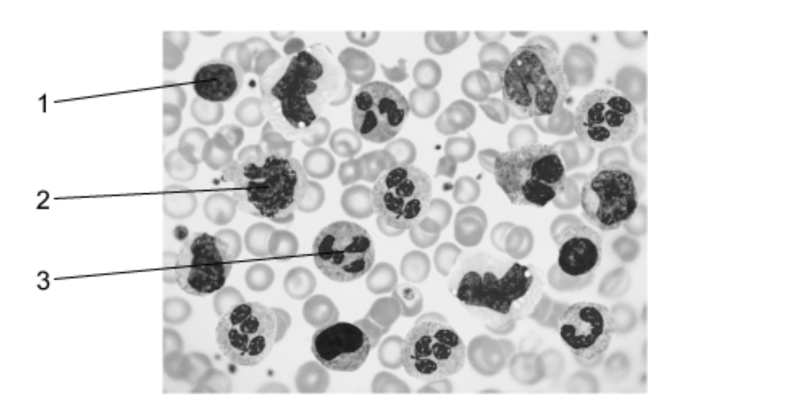
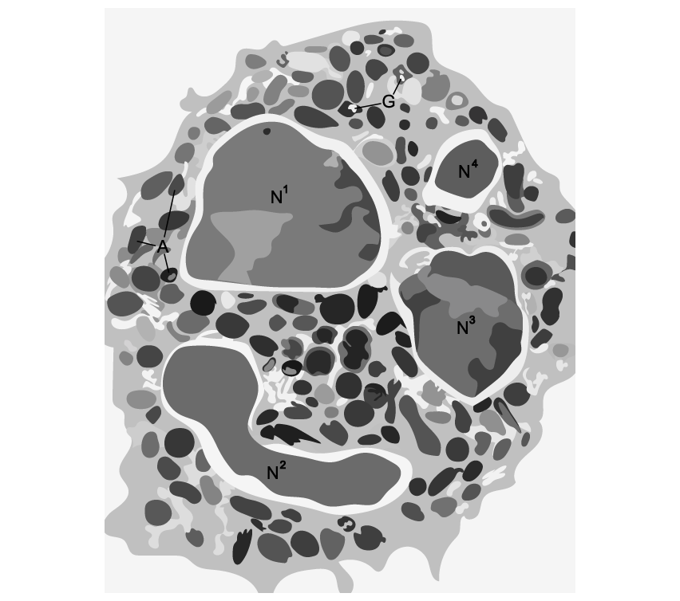
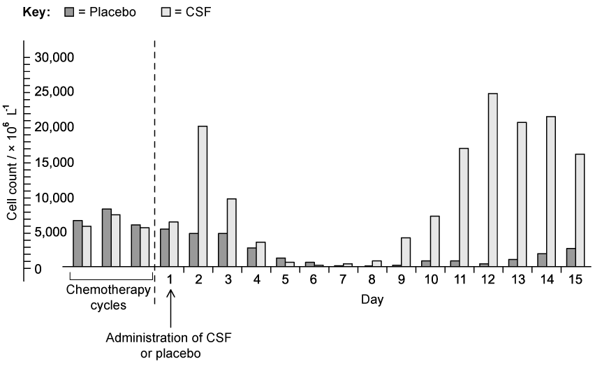
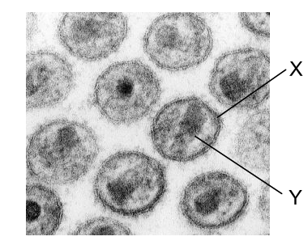
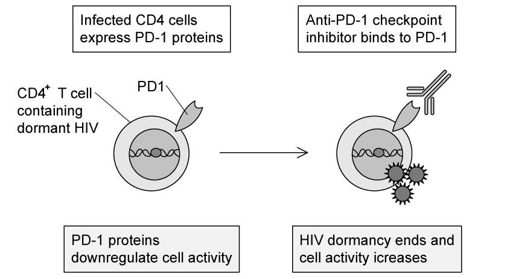
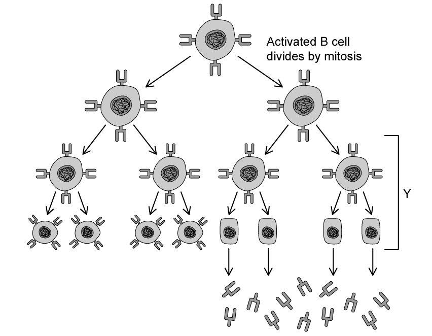
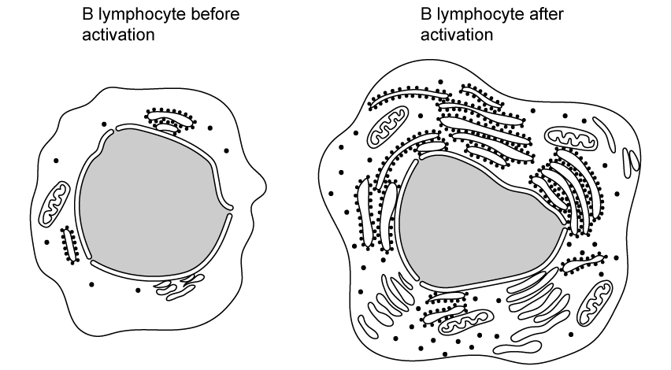
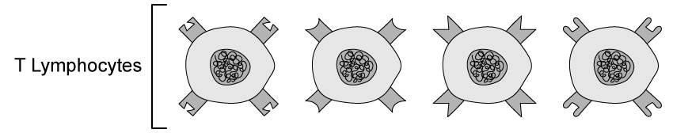
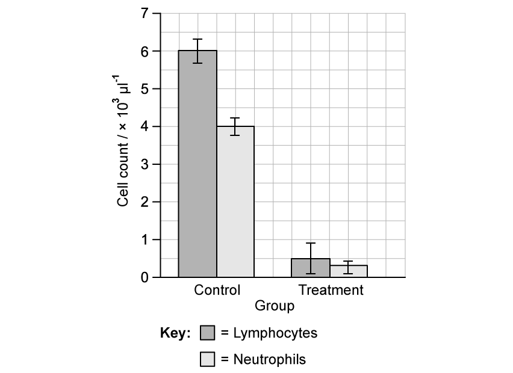
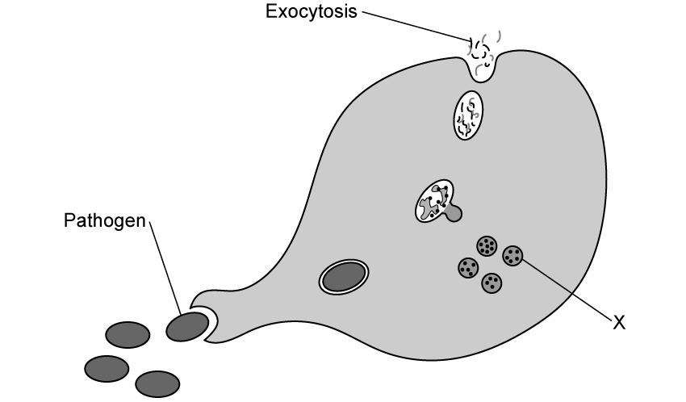

# Exam Questions — The Immune System
**11. Immunity** · Cambridge (CIE) AS biology (9700)
> Source: [https://www.savemyexams.com/as/biology/cie/25/topic-questions/](https://www.savemyexams.com/as/biology/cie/25/topic-questions/) · 39 questions across 2 sets

## Multiple Choice Questions (30 questions)

### Q1 — hard — 1 marks

**Q1** [1 mark]

Children can be born with a condition called Severe Combined Immune Deficiency (SCID). This is a disease characterized by a lack of T-lymphocytes; individuals with SCID therefore are highly at risk from infectious disease.

Which of the following would be a possible cure for SCID?

### Q2 — hard — 1 marks

**Q2** [1 mark]

Which of the following is a characteristic of a secondary humoral response?

### Q3 — hard — 1 marks

**Q3** [1 mark]

When a person receives a skin graft from another person there is a risk of rejection.

Which of the following is a correct statement about graft rejection?

### Q4 — hard — 1 marks

**Q4** [1 mark]

Which of the pathways below shows the correct activity of a helper T cell?

### Q5 — hard — 1 marks

**Q5** [1 mark]

The micrograph below shows human blood. There are three types of cells from the immune system labelled.

Which row in the table below correctly identifies the cells in the micrograph?

|   | **1** | **2** | **3** |
|---|---|---|---|
| **A** | lymphocyte | phagocyte | phagocyte |
| **B** | lymphocyte | lymphocyte | phagocyte |
| **C** | phagocyte | lymphocyte | phagocyte |
| **D** | lymphocyte | lymphocyte | phagocyte |

### Q6 — hard — 1 marks

**Q6** [1 mark]

Antigens on red blood cells determine a person's blood group. Most people will have antibodies even if they haven’t had a blood transfusion. Some blood transfusions can be unsafe due to the presence of these antibodies in the plasma.

The table shows the antibodies and antigens in the blood of people with different blood groups.

| **blood group** | **antigens on red blood cells** | **antibodies in plasma** |
|---|---|---|
| A | A | antibodies to B |
| B | B | antibodies to A |
| AB | A and B | no antibodies to A and B |
| O | neither A or B | antibodies to A and B |

Which group of people can safely receive blood from a person with blood group A?

### Q7 — hard — 1 marks

**Q7** [1 mark]

What is a phagosome?

### Q8 — hard — 1 marks

**Q8** [1 mark]

Which type of cell will destroy virally-infected cells?

### Q9 — hard — 1 marks

**Q9** [1 mark]

Monocytes move from the blood to the connective tissue.

Which phagocytic cell do they differentiate into?

### Q10 — hard — 1 marks

**Q10** [1 mark]

Which cell is essential for an adaptive immune response?

### Q11 — medium — 1 marks

**Q11** [1 mark]

Which of the following statements about the body's defence against infectious disease is not correct?

### Q12 — medium — 1 marks

**Q12** [1 mark]

Two different molecules, when chemically bonded together, can form one type of antigen.

Except for oxygen, which of the following elements would be found in this antigen?

### Q13 — medium — 1 marks

**Q13** [1 mark]

Which of the following rows correctly represents a description of B-lymphocytes?

|   | can act as antigen-presenting cells | act in the cell-mediated response | release antibodies immediately after formation | processed in the thymus |
|---|---|---|---|---|
| **A** | x | ✓ | ✓ | ✓ |
| **B** | x | ✓ | x | ✓ |
| **C** | ✓ | x | x | x |
| **D** | ✓ | x | ✓ | x |

Key: ✓ = correct, x = incorrect

### Q14 — medium — 1 marks

**Q14** [1 mark]

When a phagocyte responds to the presence of a pathogen the following events happen:

| 1 | enzymatic digestion |
|---|---|
| 2 | exocytosis |
| 3 | phagocytosis |
| 4 | vacuole formation |
| 5 | endocytosis |

Which of the following would be the correct order of events?

|   | **first** | $\rightarrow$ | $\rightarrow$ | **last** |
|---|---|---|---|---|
| **A** | 5 | 1 | 4 | 3 |
| **B** | 5 | 4 | 1 | 2 |
| **C** | 3 | 2 | 5 | 1 |
| **D** | 3 | 5 | 1 | 4 |

### Q15 — medium — 1 marks

**Q15** [1 mark]

Which of these statements about phagocytes is not correct?

### Q16 — medium — 1 marks

**Q16** [1 mark]

Which of the following would be a correct difference between B-lymphocytes and T-lymphocytes, both of which are involved in an immune response?

|   | **B-lymphocyte** | **T-lymphocyte** |
|---|---|---|
| **A** | stimulate macrophages to carry out phagocytosis | do not stimulate macrophages to carry out phagocytosis |
| **B** | form plasma cells which secrete antibodies into the bloodstream | do not form plasma cells |
| **C** | formed from bone marrow cells | formed from cells in the thymus |
| **D** | do not produce memory cells | produce memory cells |

### Q17 — medium — 1 marks

**Q17** [1 mark]

Which of these statements is correct about both B-lymphocytes and T-lymphocytes?

### Q18 — medium — 1 marks

**Q18** [1 mark]

The following events happen during a primary immune response.

| 1 | Specific antibodies are produced. |
|---|---|
| 2 | Some B-lymphocytes form plasma cells. |
| 3 | B-lymphocytes with the specific cell surface receptors divide repeatedly by mitosis. |
| 4 | Helper T cell identifies a specific antigen presented. |
| 5 | Helper T cells secrete cytokines. |

Which is the correct order of events?

|   | **first** | $\rightarrow$ | $\rightarrow$ | $\rightarrow$ | **last** |
|---|---|---|---|---|---|
| **A** | 4 | 5 | 3 | 2 | 1 |
| **B** | 5 | 4 | 3 | 2 | 1 |
| **C** | 4 | 5 | 2 | 3 | 1 |
| **D** | 4 | 5 | 2 | 1 | 3 |

### Q19 — medium — 1 marks

**Q19** [1 mark]

Macrophages have a cellular structure that enables them to destroy bacteria. Some bacteria can stop macrophages from working.

Which of the following would be a structure affected by bacteria?

### Q20 — medium — 1 marks

**Q20** [1 mark]

In an immune response, which of the following is a function of T-lymphocytes?

| 1 | secrete antibodies |
|---|---|
| 2 | differentiate into memory cells |
| 3 | destroy infected body cells |

### Q21 — easy — 1 marks

**Q21** [1 mark]

Monocytes are formed when stem cells divide and specialise in the bone marrow.

Where in the body do these cells form macrophages?

### Q22 — easy — 1 marks

**Q22** [1 mark]

Which of the following statements would be a correct definition of an antigen?

### Q23 — easy — 1 marks

**Q23** [1 mark]

Which of the following statements describes the function of a macrophage?

### Q24 — easy — 1 marks

**Q24** [1 mark]

In the immune response, which cells become memory cells?

| 1 | phagocytes |
|---|---|
| 2 | T-lymphocytes |
| 3 | B-lymphocytes |

### Q25 — easy — 1 marks

**Q25** [1 mark]

T-killer cells can target and destroy body cells.

What process do they use to do this?

### Q26 — easy — 1 marks

**Q26** [1 mark]

Which type of molecules are most important to identify a cell as non-self?

### Q27 — easy — 1 marks

**Q27** [1 mark]

When in a dusty environment a person inhales tiny minute particles.

What will be the correct effect on both B-lymphocytes and goblet cells?

|   | **B-lymphocytes** | **goblet cells** |
|---|---|---|
| **A** | less active | more active |
| **B** | more active | more active |
| **C** | less active | less active |
| **D** | more active | less active |

### Q28 — easy — 1 marks

**Q28** [1 mark]

Which of the following happens when people are injected with dead bacteria?

### Q29 — easy — 1 marks

**Q29** [1 mark]

What type of white blood cell is involved in the cell-mediated response?

### Q30 — easy — 1 marks

**Q30** [1 mark]

When a B-lymphocyte is activated by an antigen what action is taken?

## Structured Questions (9 questions)

### Q1 — hard — 16 marks

**Q1** [4 marks]

The main cause of tuberculosis (TB) in humans is the bacterium *Mycobacterium tuberculosis*. Most cases of the disease involve the lungs. The bacterium can enter cells and remain inactive in a dormant state. However, the bacterium can become active to produce symptoms of the disease.

In a person with active TB, the pathogen can be present in airborne droplets that are exhaled. Generally, a healthy person who inhales these droplets has effective defence mechanisms in the gas exchange system to prevent infection.

One example of a defence mechanism against pathogens in the gas exchange system involves the action of macrophages.

(i) Describe the mode of action of a macrophage against a bacterial cell.

[3]

(ii) Sometimes *M. tuberculosis* survives within a macrophage instead of being destroyed by the macrophage. Suggest one way in which* M. tuberculosis* may survive within a macrophage. [1]

*Source: Specimen 2022 9700/02 Q2AI & AII*

**Q1** [3 marks]

**Extract:**

The main cause of tuberculosis (TB) in humans is the bacterium *Mycobacterium tuberculosis*. Most cases of the disease involve the lungs. The bacterium can enter cells and remain inactive in a dormant state. However, the bacterium can become active to produce symptoms of the disease.

In a person with active TB, the pathogen can be present in airborne droplets that are exhaled. Generally, a healthy person who inhales these droplets has effective defence mechanisms in the gas exchange system to prevent infection.

One example of a defence mechanism against pathogens in the gas exchange system involves the action of macrophages.

A healthy person has other defence mechanisms in the gas exchange system to prevent bacteria entering cells.

Describe these defence mechanisms **and** explain how bacteria in inhaled air are prevented from entering cells of the gas exchange system.

*Source: Specimen 2022 9700/02 Q2B*

**Q1** [1 mark]

**Extract:**

The main cause of tuberculosis (TB) in humans is the bacterium *Mycobacterium tuberculosis*. Most cases of the disease involve the lungs. The bacterium can enter cells and remain inactive in a dormant state. However, the bacterium can become active to produce symptoms of the disease.

In a person with active TB, the pathogen can be present in airborne droplets that are exhaled. Generally, a healthy person who inhales these droplets has effective defence mechanisms in the gas exchange system to prevent infection.

One example of a defence mechanism against pathogens in the gas exchange system involves the action of macrophages.

In people with a weakened immune system, *M. tuberculosis* can infect other organs and tissues, such as the kidneys and joints.

Suggest how the bacteria may spread from the lungs to other organs and tissues.

*Source: Specimen 2022 9700/02 Q2C*

**Q1** [1 mark]

TB in humans can be caused by another species of bacterium,* M. bovis*.

State the mode of transmission of this pathogen to humans.

*Source: Specimen 2022 9700/02 Q2D*

**Q1** [2 marks]

Rifampicin is one antibiotic that can be used to kill mycobacterial cells. Although rifampicin is very effective at killing mycobacterial cells, it is often the first antibiotic to which resistance develops.

Rifampicin binds to a section of RNA polymerase that has attached to the DNA template strand.

Explain how binding to RNA polymerase allows rifampicin to kill mycobacterial cells.

*Source: Specimen 2022 9700/02 Q2E*

**Q1** [2 marks]

The standard treatment for TB continues for six months. Initially, four antibiotics are prescribed. This is then reduced to two of the four antibiotics, rifampicin and isoniazid, if the person responds to treatment.

A person with multidrug-resistant TB (MDR-TB) does not respond to treatment with rifampicin and isoniazid. The treatment for MDR-TB involves other antibiotics and can last for up to 30 months.

Table 1 shows the number of reported cases of TB and MDR-TB in the South-East Asia region between 2005 and 2014, as published by the World Health Organization (WHO).

**Table 1**

| **Year** | **Total number of reported** **cases of TB** | **Total number of reported** **cases of MDR-TB** |
|---|---|---|
| 2005 | 1 947 603 | 68 |
| 2006 | 2 104 673 | 779 |
| 2007 | 2 202 149 | 918 |
| 2008 | 2 287 803 | 1 717 |
| 2009 | 2 328 230 | 2 560 |
| 2010 | 2 332 779 | 4 263 |
| 2011 | 2 358 127 | 6 615 |
| 2012 | 2 331 455 | 14 957 |
| 2013 | 2 297 033 | 18 384 |
| 2014 | 2 580 605 | 17 386 |

Table 1 shows that between 2005 and 2014 there is an overall increase in the total number of reported cases for both TB and MDR-TB.

Describe the **differences** between the trend in the total number of reported cases for TB and the trend in the total number of reported cases of MDR-TB, as shown in Table 1.

*Source: Specimen 2022 9700/02 Q2E*

**Q1** [3 marks]

Many social and economic factors need to be considered in the prevention and control of MDR-TB.

Outline **three** of these factors.

*Source: Specimen 2022 9700/02 Q2G*

### Q2 — hard — 11 marks

**Q2** [3 marks]

Fig. 1 shows a cell of the immune system. N denotes a region of the nucleus, A denotes a lysosome, and G denotes a glycogen granule.

**Fig. 1**

(i) Identify the type of cell shown in Fig. 1.

[1]

(ii) Explain how the cell shown in Fig. 1 is adapted to its function.

[2]

**Q2** [3 marks]

**Extract:**

Fig. 1 shows a cell of the immune system. N denotes a region of the nucleus, A denotes a lysosome, and G denotes a glycogen granule.

The cell in Fig. 1 is a neutrophil.

During chemotherapy treatment for cancer the cell count for the cell type shown in Fig. 1 can drop significantly.

Explain why this can be dangerous for patients.

**Q2** [2 marks]

A type of drug known as a colony stimulating factor (CSF) can be used to minimise the risk of low cell counts of the cell type shown in Fig. 1 for chemotherapy patients.

A study was carried out into the effectiveness of a CSF drug. 225 patients took part in the trial, either receiving CSF or placebo treatment after undergoing chemotherapy. The cell count of the cell type shown in Fig. 1 was measured each day throughout the study.

Note that a placebo is a treatment that looks identical to the CSF treatment but that contains no active drug.

The results of the study are shown in Fig. 2.

**                                                         Fig. 2**

Suggest the purpose of a placebo in a drug trial of this kind.

**Q2** [3 marks]

**Extract:**

A type of drug known as a colony stimulating factor (CSF) can be used to minimise the risk of low cell counts of the cell type shown in Fig. 1 for chemotherapy patients. 

A study was carried out into the effectiveness of a CSF drug. 225 patients took part in the trial, either receiving CSF or placebo treatment after undergoing chemotherapy. The cell count of the cell type shown in Fig. 1 was measured each day throughout the study.

Note that a placebo is a treatment that looks identical to the CSF treatment but that contains no active drug.

The results of the study are shown in Fig. 2.

A student saw Fig. 2 and concluded that the CSF drug being tested was effective in reducing the risks of chemotherapy to patients.

Evaluate the student's conclusion.

### Q3 — hard — 12 marks

**Q3** [2 marks]

The microscope image in Fig. 1 shows a virus known as HIV. HIV can cause AIDS if left untreated.

CDC/Dr. Edwin P. Ewing, Jr., Public domain, via Wikimedia Commons

**Fig. 1**

Identify the structures labelled **X** and **Y** in Fig. 1.

**Q3** [4 marks]

Table 1 below contains information obtained from the analysis of blood samples. Group **A** consists of healthy individuals and group **B** has been diagnosed with HIV/AIDS, having not received treatment.

**Table 1**

|   | **CD4****+**** T cells / cells mm****3 -1** | **Haemoglobin / g dL****-1** | **Neutrophils / cells mm****3 -1**** ** | **Platelets /** ** cells mm****3 -1** |
|---|---|---|---|---|
| **A** | 1450 ± 460 | 15 ± 3 | 4 750 ± 250 | 300 000 ± 150 000 |
| **B** | 160 ± 105 | 11 ± 2.5 | 2 400 ± 1 200 | 250 000 ± 110 000 |

Suggest and explain the symptoms that might be experienced by individuals in group **B**.

**Q3** [4 marks]

While treatments known as antiretroviral therapy (ART) are available to prevent the replication of HIV particles in the blood, scientists have been unable to fully eradicate HIV in patients using ART alone. This is because HIV can become dormant inside CD4+ T cells.

Research into a drug known as an anti-PD-1 checkpoint inhibitor suggests that this drug may have a role to play in the eradication of HIV from an infected individual.

Fig. 2 below shows the mechanism of action of anti-PD-1 checkpoint inhibitors.

**                                                      Fig. 2**

(i) Suggest why the immune system is unable to eradicate HIV from the body prior to treatment with anti-PD-1 checkpoint inhibitors even when CD4+ T cell counts are high.

[2]

(ii) Suggest how treatment with anti-PD-1 checkpoint inhibitors may result in HIV eradication.

[2]

**Q3** [2 marks]

In another form of HIV treatment, patients may receive a stem cell transplant containing stem cells that produce daughter cells that are resistant to HIV. Note that this is not a commonly offered treatment due to the potential risks of stem cell transplants.

Suggest how a cell might be resistant to infection by HIV.

### Q4 — medium — 12 marks

**Q4** [3 marks]

Fig. 1 shows B-lymphocytes during several stages of the immune response.

**Fig. 1**

For the stage labelled **Y** in Fig. 1:

(i) Name the stage.

[1]

(ii) Describe the events that take place during the stage.

[2]

**Q4** [2 marks]

**Extract:**

Fig. 1 shows B-lymphocytes during several stages of the immune response.

**Fig. 1**

Prior to stage **Y** in Fig. 1 the B-lymphocytes are shown to be activated. This is sometimes referred to as being stimulated.

State how B-lymphocytes are activated.

**Q4** [3 marks]

Fig. 2 shows the difference between an inactived and an activated, or stimulated, B-lymphocyte.

**Fig. 2**

Explain how the structure of the activated B cell enables it to carry out its function.

**Q4** [4 marks]

Suggest how each of the following diseases or conditions reduce the function of the immune system:

(i) The parasite that causes malaria spends part of its life cycle inside red blood cells.

[1]

(ii) The bacterium that causes tuberculosis inhibits the formation of lysosomes.

[1]

(iii) *Staphylococcus aureus* bacteria release proteins that bind to antibodies.

[1]

(iv) Some forms of severe combined immunodeficiency (SCID) are caused by a mutation in the genes that code for T-lymphocyte receptors.

[1]

### Q5 — medium — 10 marks

**Q5** [3 marks]

Fig. 1 shows a series of T-lymphocytes, also known as T cells.

**Fig. 1**

Explain one feature of T-lymphocytes shown in Fig. 1 that allows them to carry out their role.

**Q5** [4 marks]

Fig. 2 shows changes in numbers of T-lymphocytes and pathogens during an infection.

**Fig. 2**

Explain the following in Fig. 2:

(i) The change in the number of T-lymphocytes during the early days of the infection.

[2]

(ii) The change in the number of pathogens that follows the change explained in part (i).

[2]

**Q5** [3 marks]

**Extract:**

Fig. 2 shows changes in numbers of T-lymphocytes and pathogens during an infection.

Explain how the secondary immune response to the pathogen would be different to the response shown in Fig. 2.

### Q6 — medium — 11 marks

**Q6** [4 marks]

Lymphocytes and phagocytes are two groups of white blood cells involved in the immune response.

Contrast lymphocytes and phagocytes.

**Q6** [2 marks]

A group of scientists investigated the immunosuppressant action of a drug called cyclophosphamide. They used two groups of mice, one of which was a control group and the other of which was the treatment group. The treatment group was given a dose of 60 mg kg-1 of cyclophosphamide. The scientists then carried out a cell count of two groups of cells. Their results are shown in Fig. 1.

**Fig. 1**

Calculate the percentage decrease in the number of lymphocytes between the control group of mice and the group treated with cyclophosphamide shown in Fig. 1.

**Q6** [3 marks]

**Extract:**

A group of scientists investigated the immunosuppressant action of a drug called cyclophosphamide. They used two groups of mice, one of which was a control group and the other of which was the treatment group. The treatment group was given a dose of 60 mg kg^-1^ of cyclophosphamide. The scientists then carried out a cell count of two groups of cells. Their results are shown in Fig. 1.

State the possible conclusions that can be drawn from Fig. 1.

**Q6** [2 marks]

Explain a possible medical application of a drug that is effective at suppressing the immune system.

### Q7 — easy — 8 marks

**Q7** [1 mark]

Fig. 1 shows one role of white blood cells during an immune response.

**Fig. 1**

Identify the process shown in Fig. 1.

**Q7** [3 marks]

**Extract:**

Fig. 1 shows one role of white blood cells during an immune response.

(i) State the name of organelle **X** in Fig. 1.

[1]

(ii) Describe the role of organelle **X** in the process shown in Fig. 1.

[2]

**Q7** [2 marks]

**Extract:**

Fig. 1 shows one role of white blood cells during an immune response.

Explain why the white blood cell shown in Fig. 1 carries out this process when it encounters pathogens but not when it encounters healthy body cells.

**Q7** [2 marks]

**Extract:**

Fig. 1 shows one role of white blood cells during an immune response.

The process shown in Fig. 1 is phagocytosis.

Give **two** examples of the type of white blood cell shown in Fig. 1.

### Q8 — easy — 6 marks

**Q8** [1 mark]

Fig. 1 shows a representation of a mature B lymphocyte.

**Fig. 1**

Identify structure **X** in Fig. 1.

**Q8** [2 marks]

Structure **X** enables the mature B lymphocyte shown in Fig. 1 to recognise foreign antigens.

Define the term **antigen**.

**Q8** [2 marks]

**Extract:**

Fig. 1 shows a representation of a mature B lymphocyte.

Structure X in Fig. 1 is an antibody / antibody receptor / glycoprotein receptor.

Describe the events that occur immediately after structure **X** in Fig. 1 comes into contact with a foreign antigen.

**Q8** [1 mark]

The B lymphocyte shown in Fig. 1 can develop into plasma cells or memory cells.

State **one** difference between plasma cells and memory cells.

### Q9 — easy — 6 marks

**Q9** [1 mark]

Fig. 1 below shows the primary and secondary immune response to a pathogen.

**Fig. 1**

One result of the immune response is antibody production, as shown in Fig. 1.

Identify the type of cell that is responsible for antibody production.

**Q9** [2 marks]

**Extract:**

Fig. 1 below shows the primary and secondary immune response to a pathogen.

One result of the immune response is antibody production, as shown in Fig. 1.

Contrast **the curves** for the primary and secondary immune responses shown in Fig. 1.

**Q9** [2 marks]

**Extract:**

Fig. 1 below shows the primary and secondary immune response to a pathogen.

Explain the difference in the primary and secondary immune responses shown in Fig. 1.

**Q9** [1 mark]

**Extract:**

At the end of the primary immune response memory cells are produced; Memory cells remain in the blood (in between first and second contact with the pathogen); The memory cells recognise the pathogen if it is encountered a second time; Clonal selection / clonal expansion occurs more quickly (in the secondary response);

The difference between the primary and secondary immune responses explains why it is unlikely that someone will become ill with some diseases, e.g. chicken pox, twice during their lifetime. There are some diseases however, e.g. COVID-19, that someone might become ill with many times.

Suggest why it is possible to become ill with some diseases many times.
