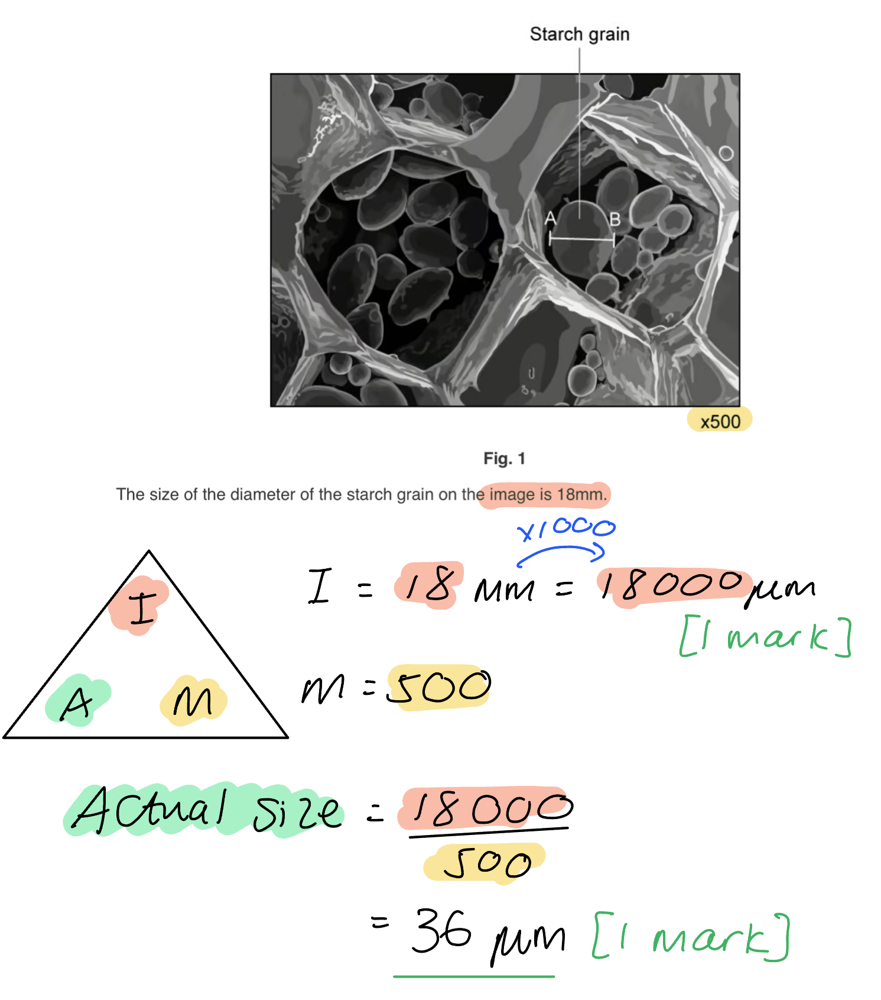
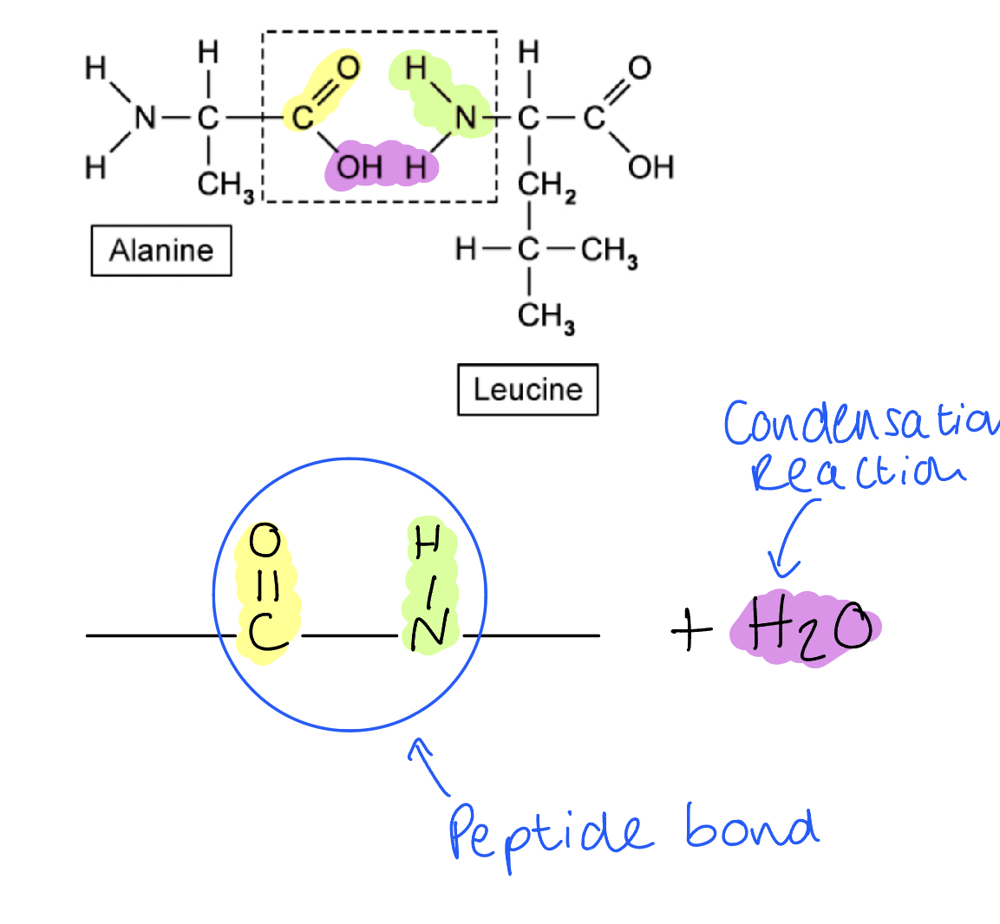
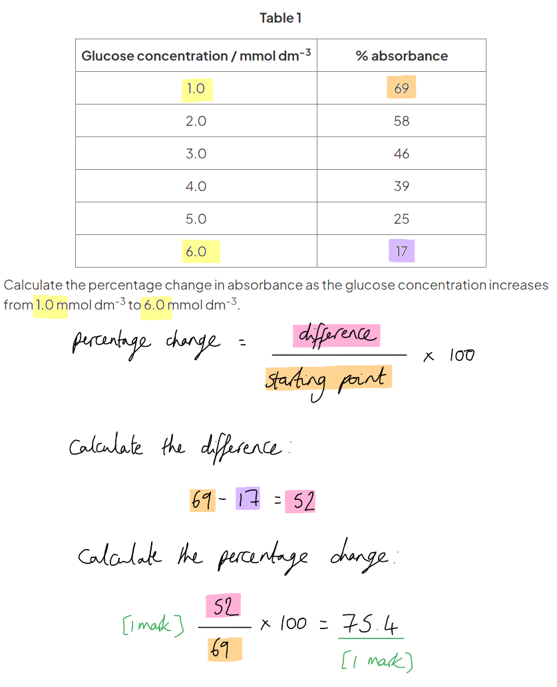
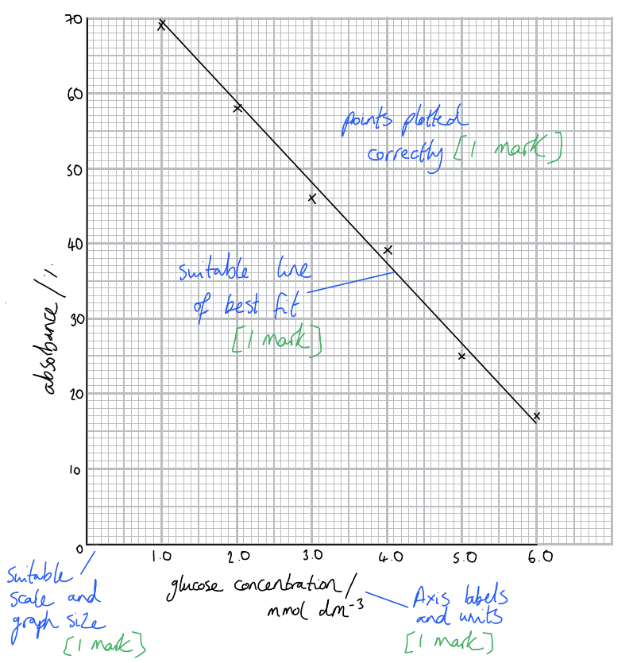
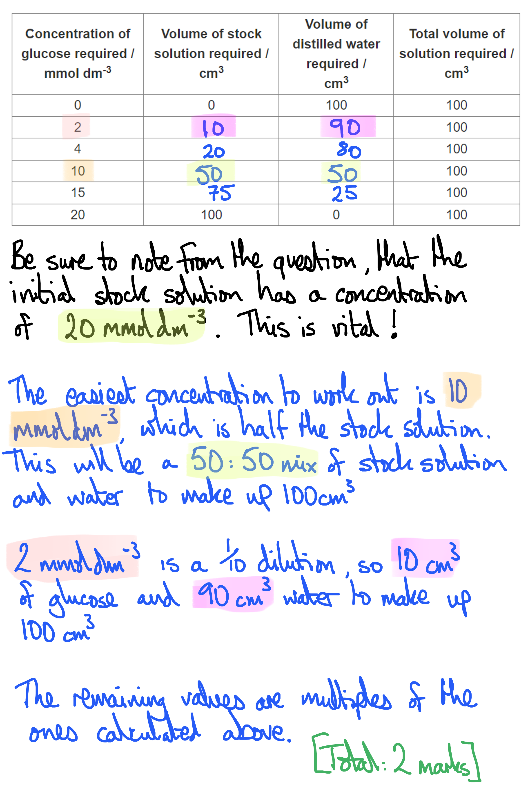

# Mark Schemes — Testing for Biological Molecules
**2. Biological Molecules** · Cambridge (CIE) AS biology (9700)

## Multiple Choice Questions (30 questions)

### Q1
**Final answer:** **The correct answer is ****C**** because there is:**

- **A positive protein test result (purple when Biuret reagent was added)**
- **A positive reducing sugar result (orange precipitate in the Benedict’s test)**
- **A positive result for the emulsion test for lipids (milky solution)**

### Q2
**Final answer:** **The correct answer is ****B**** because:**

**Final answer:** **The sample tested did not contain any protein (negative biuret test) or reducing sugar (negative Benedict's test), so molecules 2 (glucose) and 4 (a tripeptide) are not present in the sample.**

> *A positive ethanol test suggests that molecule 3 (a triglyceride) **is** present in the sample.*

> *Molecule 1 is a cellulose molecule; a positive test result with Benedict’s for reducing sugar **after acid hydrolysis** would be possible, but in the absence of any information about an acid hydrolysis test, we cannot say for sure that this molecule is absent from the solution.*

### Q3
**Final answer:** **The correct answer is ****C**** because:**

**Final answer:** **The test results suggest there are three biological molecules present in the sample; lipids, starch and traces of reducing sugar.**

**Final answer:** **Molecule 2 is α-glucose and 3 is a triglyceride, so both of these molecules are present in the solution.**

> *Although the presence of starch is indicated by the result of the iodine test, the structure of starch is not shown so only answer **C** can be correct. Note that molecule 1 may bear some resemblance to starch, but close examination shows that it is cellulose.*

> *Molecule 4 is a tripeptide, and a negative biuret test shows that it is not present.*

### Q4
**Final answer:** **The correct answer is ****D**** because:**

**Final answer:** **The solution extracted from sieve tube elements (part of the phloem) will contain ****sucrose**** (a ****non-reducing sugar****)**

**Final answer:** **Non-reducing sugars only produce positive results with Benedict’s ****after**** acid hydrolysis; and negative results before: options ****A**** and ****D**** could be correct.**

**Final answer:** **There would be no starch present in the sieve tube elements (starch being a large, insoluble molecule) so only answer ****D i****s correct as a brown colour is observed when the solution was tested with iodine.**

### Q5
**Final answer:** **The correct answer is ****B**** because:**

**Final answer:** **We need to consider the mass of precipitate produced with Benedict's solution ****before**** acid hydrolysis (this is the result of any ****reducing**** sugars present in the sample) and subtract this from the mass of precipitate produced ****after**** acid hydrolysis to find the mass attributed only to non-reducing sugars.**

**Final answer:** **Sample ****B**** has 20 mg of reducing sugar precipitate, and 25 mg (45-20) non-reducing sugar precipitate; this is the highest mass of all the samples**

> *Sample A = 10 mg non-reducing sugar  *

> *Sample C = 20 mg non-reducing sugar*

> *Sample D = 0 mg non-reducing sugar*

### Q6
**Final answer:** **The correct answer is ****D**** because:**

**Final answer:** **1 and 4 are both α-glucose, a ****reducing sugar ****that gives a positive Benedict’s test result (brick-red)**

**Final answer:** **3 is a tri****peptide****, so gives a positive biuret test result.**

*Molecule 2 is a triglyceride, and is not present in the sample due to the negative ethanol emulsion test.*** **

### Q7
**Final answer:** **The correct answer is ****C**** because:**

**Final answer:** **It shows that solution 1 contains starch and sucrose, and solution 2 as contains glucose and amylase:**

- **A solution containing glucose and amylase tests positive when boiled with Benedict’s and when Biuret’s reagent is added to it**
- **A solution containing starch and sucrose tests positive when iodine is added and when boiled with Benedict’s solution after acid hydrolysis, but tests negative for the Benedict's test prior to acid hydrolysis.**

**Final answer:** **This question is tricky, because we are not told which solution is which. The best starting point will be to look for the solution that contains sucrose, as this is indicated by a ****negative Benedict's test before acid hydrolysis**** and a ****positive Benedict's test after acid hydrolysis****; this narrows the options down to solution 1, option C ****or**** solution 2 option B.**

**Final answer:** **We can then check the other results for these options to eliminate the incorrect answer, e.g. solution 2, option B does not contain starch, and we know that the solution in question should contain sucrose and starch, so we are left with ****option ****C as the only correct answer.**

### Q8
**Final answer:** **The correct answer is ****B**** because:**

- **Sample 1 will test positive for lipids in the ethanol test (forming a cloudy emulsion) and positive for starch with the iodine test (blue-black)**

  - **Therefore sample 1 must be Food 4**
- **Sample 2 will test positive for lipids in the ethanol test (forming a cloudy emulsion), positive for protein in the biuret test (lilac/purple) and negative in the Benedict’s test for reducing sugars (blue)**

  - **Therefore sample 2 must be Food 2**
- ** This means option ****B**** is the correct answer. **

### Q9
**Final answer:** **The correct answer is ****A**** because:**

**Final answer:** **It’s easiest to look at the most strongly positive observation (solution 4) and the most strongly negative (solution 3) for reducing sugars:**

- **Answers ****A**** and ****B**** have suitable values for these solutions; solution 3 contains no reducing sugar, while solution 4 has a relatively high percentage concentration of reducing sugar**

**Final answer:** **We can therefore eliminate options C and D, and need to compare A and B to solutions 1 and 2 to reach a final answer**

**Final answer:** **Solution 1 tested more positive for reducing sugar (yellow colour) than solution 2 (green colour), so a higher value would be expected for solution 1 over 2**

- **In option ****B****, solution 2 has a higher reducing sugar percentage than solution 1**
- **Therefore only answer ****A**** can be correct**

### Q10
**Final answer:** **The correct answer is ****C**** because:**

**Final answer:** **The solution extracted from sieve tube elements (part of the phloem) will contain ****sucrose**** (a ****non-reducing sugar****)**

**Final answer:** **Non-reducing sugars only produce positive results with Benedict’s ****after**** acid hydrolysis; and negative results before: options ****A**** and ****C**** could be correct.**

**Final answer:** **There would be no starch present in the sieve tube elements (starch being a large, insoluble molecule) so only answer ****C i****s correct as a brown colour is observed when the solution was tested with iodine. **

### Q11
**Final answer:** **The correct answer is ****C**** because:**

**Final answer:** **A non-reducing sugar will not react with copper (II) sulfate ions in Benedict’s reagent when heating is the only procedure carried out; this would only occur in the presence of a ****reducing**** sugar.**

**Final answer:** **However, if the sample is heated with dilute hydrochloric acid, neutralised with sodium hydrogencarbonate and then heated with Benedict’s, a non-reducing sugar will produce a positive test result. **

### Q12
**Final answer:** **The correct answer is ****C ****because:**

**Final answer:** **The observations suggest that lipids and proteins are present in the sample, whereas starch and non-reducing sugars are not.**

### Q13
**Final answer:** **The correct answer is ****C ****because:**

**Final answer:** **The molecule is shown in a phospholipid; being a type of lipid, and nonpolar, it can dissolve in ethanol. Ethanol will mix with water, but any lipid present in the ethanol is not able to dissolve in the water and will, therefore, be dispersed throughout it, forming a milky emulsion.**

### Q14
**Final answer:** **The correct answer is ****D**** because:**

**Final answer:** **Observing a blue colour when a solution is heated with Benedict’s reagent ****without**** acid hydrolysis indicates that ****no**** ****reducing sugar**** is present in the sample.**

**Final answer:** **If the solution remains blue ****after**** acid hydrolysis, neutralisation, and then heating with Benedict’s reagent then ****no non-reducing sugar ****is present in the sample.**

### Q15
**Final answer:** **The correct answer is ****D**** because:**

**Final answer:** **An orange precipitate formed in a Benedict’s test suggests the presence of ****reducing sugars****.**

**Final answer:** **A lilac biuret test result suggests the presence of ****protein****.**

> *A** & **C** are incorrect because the ethanol test observation was negative (no cloudy emulsion).*

> *B **is incorrect - non-reducing sugars could be present but no information is given about mixing the solution with hydrochloric acid, neutralising it and then testing with Benedict’s solution. *

### Q16
**Final answer:** **The correct answer is ****A**** because:**

**Final answer:** **A lilac (purple) observation in the Biuret test indicates the presence of protein.**

**Final answer:** **The presence of a yellow precipitate in the Benedict’s test suggests that some reducing sugar is present in the sample**

> *B **is incorrect as the result of the ethanol emulsion test is negative, so no lipid can be present.*

> *C **is incorrect as unless you are explicitly told that the Benedict’s test used involved acid hydrolysis, you should assume that a positive result is indicative of a reducing sugar, not a non-reducing sugar.*

> *D **is incorrect as the test result for starch (iodine) is negative.*

### Q17
**Final answer:** **The correct answer is ****D ****because:**

**Final answer:** **Mixing starch and amylase would result in the production of maltose, a reducing sugar (starch would be broken down into maltose by the reaction with amylase). If maltose has been produced then heating the solution with Benedict's would result in the formation of a brick-red precipitate.**

> *A** describes a positive iodine test for starch; while starch might be present after the occurrence of a reaction (if the starch had been only partially broken down), this test result does not indicate that a reaction **has** taken place.*

> *B** describes a negative Benedict's test, which would only occur in the absence of any reaction.*

> *C** describes a positive protein test, which is not relevant to the reaction in which amylase breaks down starch into reducing sugar.*

### Q18
**Final answer:** **The correct answer is ****D ****because:**

**Final answer:** **The observations show positive results for reducing sugars (Benedict’s) and protein (biuret), but a negative test result for lipids (ethanol and water).**

### Q19
**Final answer:** **The correct answer is ****D ****because:**

**Final answer:** **The results of test 2 identify the solutions that contain non-reducing sugars, and solutions 2, 3 and 4 all show a positive result of some kind after test 2 has been carried out.**

**Final answer:** **Solution 2 definitely contains non-reducing sugars, as it tested negative for reducing sugars, and positive after acid hydrolysis and neutralisation.**

**Final answer:** **Solutions 3 and 4 ****might**** only contain reducing sugars and not non-reducing sugars, but there is no way to be sure from the data, so it is ****possible**** that non-reducing sugars might be present.**

### Q20
**Final answer:** **The correct answer is ****A**** because:**

**Final answer:** **Solutions ****1**** and ****3**** show a colour change along the spectrum of colours green to brick-red (or brown) which indicates reducing sugar present. **

> *Only solution **2** remains blue after mixing with Benedict’s solution, suggesting a negative result for reducing sugar. *

> *Test 2 relates to the presence of non-reducing sugar and is not relevant to the question asked. *

### Q21
**Final answer:** **The correct answer is ****A**** because:**

**Final answer:** **It is not sufficient to just mix copper (II) sulfate in Benedict’s solution with a sample to test for the presence of a reducing sugar; steps ****C**** and ****D**** are necessary to hydrolyse the glycosidic bond in a non-reducing disaccharide and then create the slightly alkaline solution needed for a reaction to occur with copper (II) sulfate.**

### Q22
**Final answer:** **The correct answer is ****D ****because:**

**Final answer:** **The molecule shown is a polysaccharide of glucose called amylose, a constituent of starch; the test for starch involves the addition of iodine.**

> *A **is incorrect as Benedict’s is used to test for the presence of reducing sugars.*

> *B **is incorrect as sodium hydroxide and copper (II) sulfate are the reagents in the biuret test to test for proteins.*

> *C **is incorrect as ethanol and water are used to test for the presence of lipids (this is the emulsion test).*

### Q23
**Final answer:** **The correct answer is ****D**** because:**

**Final answer:** **Reducing sugars (monosaccharides and some disaccharides) form coloured precipitates in the presence of Benedict’s solution; the higher the concentration of reducing sugars in a sample, the more concentrated the coloured precipitate produced (brick-red) **

**Final answer:** **Glucose is the only reducing sugar on the list given.**

> *A **is incorrect as sucrose is a non-reducing sugar (you need to know this one!).*

> *B **&** C **are incorrect as cellulose and starch, being polysaccharides, are not reducing sugars.*

### Q24
**Final answer:** **The correct answer is ****C**** because:**

**Final answer:** **The biological molecule shown is a triglyceride, the most common type of lipid. Lipids are nonpolar substances that are soluble in ethanol, but not water. This means that any lipids present dissolve in the ethanol, but do not remain dissolved when added to water, instead forming tiny droplets known as an emulsion.**

> *A **is incorrect as Biuret reagent is used to test for the presence of proteins.*

> *B **is incorrect as Benedict’s is used to test for the presence of reducing sugars.*

> *D **is incorrect as iodine in potassium iodide is used to test for the presence of starch.*

### Q25
**Final answer:** **The correct answer is ****B**** because:**

**Final answer:** **The test described is the ethanol emulsion test for lipids.**

### Q26
**Final answer:** **The correct answer is ****A ****because:**

**Final answer:** **A substance that tests negative for the Benedict’s test before acid hydrolysis, but positive after, must contain a non-reducing sugar; sucrose (a disaccharide of glucose and fructose) is the most common non-reducing sugar you need to know about for the exam**

> *B, C **and** D** are reducing sugars that would test positive for the Benedict’s test both before and after acid hydrolysis.*

### Q27
**Final answer:** **The correct answer is ****B**** because:**

**Final answer:** **Biurets turns purple in the presence of peptide bonds, found in proteins. Amylose is a polysaccharide of α-glucose, one of two polysaccharides found in starch; it is therefore a carbohydrate and would not give a positive purple biuret test result.**

> *A** & **D** are examples of enzymes which are proteins, and **C**, haemoglobin, is also a protein.  *

### Q28
**Final answer:** **The correct answer is ****B**** because:**

**Final answer:** **The biological molecule shown is a tripeptide, so it contains two peptide bonds, the type of bond present in a protein.**

**Final answer:** **When mixed with Biuret solution (which contains sodium hydroxide or potassium hydroxide to make the solution alkaline, and copper (II) sulfate ions to react with any protein present), protein molecules form a purple complex.**

**Final answer:** **Note that for a positive test result, there needs to be at least two**** peptide bonds**** present in the sample, so the biuret test would not give a positive result for amino acids or dipeptides**

> *A **is incorrect as Benedict’s is used to test for the presence of reducing sugars.*

> *C **is incorrect as ethanol and water are used to test for the presence of lipids (this is the emulsion test).*

> *D **is incorrect as iodine in potassium iodide is used to test for the presence of starch.*

### Q29
**Final answer:** **The correct answer is ****B**** because:**

**Final answer:** **Benedict’s solution contains copper sulfate ions, so its starting colour is blue. Insoluble copper (I) oxide is formed in the presence of reducing sugars, forming coloured precipitates; a positive test result is therefore any change away from the blue colour of Benedict’s solution, starting with green, then progressing to yellow, orange, and eventually brick red.**

### Q30
**Final answer:** **The correct answer is ****B**** because:**

**Final answer:** **A lilac observation for the biuret test is a positive result for a protein**

**Final answer:** **A blue-black observation when iodine in potassium iodide was added is a positive result for starch**

**Final answer:** **Answer ****B**** contains amylase enzyme, which is a protein, and starch.**

## Structured Questions (12 questions)

### Q1
(i) The test for reducing sugar involves the following steps...

- Add Benedict's solution/reagent; **[1 mark]**
- Boil / heat to 95 °C; **[1 mark]**
- For a positive result, a precipitate will form / colour change from blue to green/yellow/orange/red/brown; **[1 mark]**

> *It is important to state the specific colour change of the solution when referring to the positive test result obtained. Also, remember that Benedict's test will not work unless it is heated to high temperatures; 'heat gently' is not enough.*

(ii) To estimate the concentration of reducing sugar present the following can be done...

- Use colour standards to compare the unknown sample with **OR** use a colorimeter to measure small differences in colour; **[1 mark]**

**[Total: 4 marks]**
The results for each sample can be discussed as follows...

**Final answer:** **Any ****three ****of the following:**

*Sample A:*

- Does not contain any starch; **[1 mark]**
- **Reason**: Iodine solution did not change to a blue-black colour / remained orange-brown / no colour change observed; **[1 mark]**

*Sample B:*

- Contains protein; **[1 mark]**
- **Reason**: Biuret reagent changed (from a blue) to a purple colour / colour change was observed; **[1 mark]**

**[Total: 3 marks]**

> *Make sure that you have a good grasp of the different tests for biological molecules. You need to remember which reagent is used to test for each molecule and what constitutes a positive result for each reagent.*
The test for reducing sugar can be modified as follows to test for non-reducing sugar...

- Heat a sample of the unknown solution with <u>hydrochloric acid</u>; **[1 mark]**
- Neutralise the acid / add an alkali/sodium hydroxide; **[1 mark]**
- Repeat the Benedict's test / mix with Benedict's solution and heat to a high temperature; **[1 mark]**

**[Total: 3 marks]**

> *Sucrose is a disaccharide and is one of the few examples of a non-reducing sugar that you need to know of. In order to test for a non-reducing sugar, the disaccharide must be broken down into monosaccharides by adding hydrochloric acid. This breaks the glycosidic bond between the monosaccharides through a hydrolysis reaction. It is important to neutralise the acid before adding Benedict's reagent, as it needs alkaline conditions to work.*
The significance of these results would be as follows...

- The solution contained both <u>reducing and non-reducing sugar</u>; **[1 mark]**

**[Total: 1 mark]**

### Q2
Iodine solution can be used to monitor the breakdown of starch by amylase in the following ways:

**Final answer:** **Any ****three**** of the following:**

- Starch reacts with iodine solution to produce a blue-black colour; **[1 mark]**
- Samples can be taken at different time intervals and tested for the presence of starch; **[1 mark]**
- As starch is broken down into maltose, the colour of the iodine solution will change from blue-black to brown to pale-brown / the blue-black colour will become less intense; **[1 mark]**
- Once all the starch is broken down, the iodine solution will not change colour; **[1 mark]**

**[Total: 3 marks]**

> *This question ties in with the topic of enzymes. One of the ways in which the rate of an enzyme-controlled reaction can be monitored is to measure the rate at which a substrate is disappearing. Reagents, such as iodine solution, provide us with a visible way to measure the rate of substrate disappearance. This can be timed using a stopwatch and used to make comparisons of the effect of substrate or enzyme concentration on the rate of the reaction.*
The following chemical test can be done to show that maltose is a reducing sugar...

- <u>Heat</u> with Benedict's reagent; **[1 mark]**
- (Maltose is a reducing sugar so a) green/yellow/orange/red-brown precipitate will be observed; **[1 mark]**

**[Total: 2 marks]**

> *It is important to note that Benedict's reagent must be heated before a reaction will occur.*
The difference between the two samples would be...

- Sample 2 will contain <u>more precipitate</u> / have a greater mass of precipitate than sample 1; **[1 mark]**

The explanation for this is...

- Maltase <u>hydrolyses</u> maltose into glucose; **[1 mark]**
- Both glucose and maltose are reducing sugars **OR** give a positive test **OR** produce precipitate with Benedict's; **[1 mark]**

**[Total: 3 marks]**

> *Remember, if a word is underlined in the mark scheme it must be included in your answer to gain the mark.*
The reason iodine solution would not be a suitable reagent to use for animal cell extracts is...

- Animal cells do not contain starch / they store excess carbohydrates as glycogen; **[1 mark]**

**[Total: 1 mark]**

> *Plant cells use starch as their storage polysaccharide, while animal cells convert excess carbohydrates into glycogen instead. Glycogen is similar in structure to amylopectin (one of the components of starch), except it is more branched. It will also not react with iodine solution the same way that starch does and therefore not cause a colour change to occur.*

### Q3
The test reagents used for each biological molecule were as follows...

- (i) Benedict's **AND **(ii) hydrochloric acid with Benedict's; **[1 mark]**
- (iii) Biuret **AND **(iv) ethanol/alcohol;** [1 mark]**

**[Total: 2 marks]**

> *To get full marks for this question you must correctly identify **all** the reagents for four biological molecules tested. Take note that the test for non-reducing sugar requires the addition of hydrochloric acid first **before** Benedict's reagent is used. This is to hydrolyse the glycosidic bond between the two monosaccharides making up sucrose.*
To test for the presence of protein the following would be done...

- The <u>Biuret</u> test; **[1 mark]**
- Add copper sulfate/CuSO4 and sodium hydroxide/NaOH or potassium hydroxide/KOH (to the test sample);** [1 mark]**

The meaning of their results is that...

- There was <u>no protein</u> present in the test sample (since there was no colour change); **[1 mark]**

**[Total: 3 marks]**

> *In order to obtain all possible marks for this question, remember to describe the Biuret test **and **state what its results indicate. A positive result (protein present) would have caused the solution to change from blue to purple/violet. The fact that it remained blue, indicates the absence of protein.*
The results obtained indicate the following...

- <u>Glucose is present </u> **AND** <u>sucrose is absent;</u> **[1 mark]**

The reason for this is...

- Test for reducing sugar showed a positive result / brick-red precipitate **AND** the test for non-reducing showed a negative result / no colour change/precipitate; **[1 mark]**

**[Total: 2 marks]**

> *Glucose and sucrose are both carbohydrates so in order to obtain all the marks for this question you must mention both of them in your answer.*
Their results would have been affected in the following way...

**Final answer:** **Any ****two**** of the following:**

- Benedict's reagent needs an <u>alkaline</u> environment to work; **[1 mark]**
- The acidic conditions would have prevented the reagent from reacting (with the monosaccharides present in the solution); **[1 mark]**
- Which could have resulted in a false negative; **[1 mark]**

**[Total: 2 marks]**

> *It is vital to neutralise the hydrochloric acid during the test for non-reducing sugar. Without this important step, the results from the test will not be reliable.*

### Q4
The biochemical test for triglycerides is...

- The (ethanol) <u>emulsion</u> test; **[1 mark]**

Description of this test...

- Mix the food sample with <u>ethanol/alcohol</u>; **[1 mark]**
- Then add water / pour into water; **[1 mark]**
- (If lipids are present) a white/milky emulsion forms; **[1 mark]**

**[Total: 4 marks]**

> *In order to receive full marks for this question you must give the name of the test and **describe the steps in the correct order**. Remember that **e**thanol comes first, then the **w**ater (**e** before **w**). A positive result is that the clear solution will turn milky when the water is added.*

> *Note that the description '**milky**' or '**white**' is better than the term '**cloudy**' here, as a solution of any colour can be cloudy, while the emulsion that forms in this test is always white.*
The visual result of the test for lipids can be explained as follows...

**Final answer:** **Any ****three**** of the following:**

- Triglycerides are <u>non-polar</u> molecules; **[1 mark]**
- Triglycerides are <u>hydrophobic</u>; **[1 mark]**
- Triglycerides are soluble in ethanol **BUT** insoluble in water; **[1 mark]**
- They form tiny droplets once water is added (which reflect and scatter light); **[1 mark]**

**[Total: 3 marks]**

> *A hydrophobic substance, such as triglycerides, will not dissolve in water. Once the water is added, the triglycerides that were dissolved in ethanol will not be able to remain that way and they will congregate together into little droplets.*
The test for starch involves the following steps...

- Add a drop of <u>iodine solution</u> to the sample to be tested; **[1 mark]**

A positive result would be...

- Iodine solution will change to a <u>blue-black</u> colour (if starch is present); **[1 mark]**

**[Total: 2 marks]**

### Q5
A positive result using iodine is...

- (Iodine changes from) orange/brown to blue/black; **[1 mark]**

**[Total: 1 mark]**
The actual diameter of the starch grain between points **A** and **B **is**.**...

- 18 mm = 18000 µm **OR **18000 ÷ 500; **[1 mark]**
- 36 µm; **[1 mark]**

**[Total: 2 marks]**

> *In the exam you would be expected to measure the distance between points A and B, so be sure to have a ruler with you and always measure in mm. This requirement has been omitted for the purpose of online learning. *

The type of microscope that was used to obtain the image shown in Fig. 1 is...

- (Scanning) electron microscope; **[1 mark]**

*Evidence for this is:*

**Final answer:** **Any ****one ****of the following:**

- A light microscope would not show details of structures inside cells / does not have a high enough resolution; **[1 mark]**

***Accept**** answers relating to 3D images*

**[Total: 2 marks]**

> *This is also a synoptic question assessing knowledge from Topic 1.1. Although you do not need to know specific details about the differences between scanning and transmission electron microscopes, you do need to know the differences between light and electron microscopes.  *
The name of the reagent used to test for the presence of proteins is...

- Biuret (solution/reagent) **OR **sodium hydroxide and copper (II) sulphate (solution); **[1 mark]**

**[Total: 1 mark]**

### Q6
To test for non-reducing sugars...

- Heat/boil with hydrochloric acid; **[1 mark]**
- Neutralise the solution with an alkali / sodium hydrogen carbonate; **[1 mark]**
- Heat/boil with Benedict's solution; **[1 mark]**
- A positive result is an orange-red precipitate (from blue); **[1 mark]**

**[Total: 4 marks]**
A non-reducing sugar is...

- Sucrose; **[1 mark]**

***Accept ****other correct examples of non-reducing sugars eg trehalose*

**[Total: 1 mark]**

> *There are other non-reducing sugars but sucrose is the only one you would be expected to recall. *
The completed table is as follows:

| **reagent** | **biological molecule** |
|---|---|
| potassium iodide | starch; **[1 mark]** |
| Benedict's | reducing sugar; **[1 mark]** |
| biuret | protein; **[1 mark]** |
| ethanol | lipids; **[1 mark]** |

*Ignore references to non-reducing sugars*

**[Total: 4 marks]**

> *Non-reducing sugar would not be an acceptable answer here, as there is no reference to **acid hydrolysis** in the question. You should always assume that acid hydrolysis has not been carried out unless explicitly stated in the question stem.*
A polymer is...

- (A molecule) made up of many repeating (identical) subunits; **[1 mark]**

**[Total: 1 mark]**

### Q7
The qualitative test for reducing sugar is...

- Add Benedict's reagent to the sample (to be tested) in a test tube; **[1 mark]**
- Heat/boil the sample; **[1 mark]**
- A positive result will show an orange/brown/red coloured precipitate form; **[1 mark]**

**[Total: 3 marks]**
(i) A semi-quantitative Benedict's test means...

- The results do not give a precise value **BUT** they show a relative concentration / indicate low and high concentration / allow concentration to be estimated; **[1 mark]**

(ii) The colour change you can expect to see is...

- From blue to green to yellow to orange/brown to (brick) red; **[1 mark]**

**[Total: 2 marks]**
The concentration of the unknown sample is...

- A value in-between 1.5 and 2.0 (%); **[1 mark]**

*The value should be stated to 1 decimal place*

**[Total: 1 mark]**

> *You can see that the unknown sample is a colour in between test tubes four and five. So we can estimate that the concentration is between these known concentrations.  This is why it is semi-quantitative, rather than fully quantitative. A colorimeter can be used to gain a quantitative value and a calibration curve used to estimate the concentration of unknown samples.*

### Q8
The test for lipids is...

- Add <u>ethanol</u> to the sample; **[1 mark]**
- Shake to mix the sample and the ethanol; **[1 mark]**
- Add to a test tube of water; **[1 mark]**
- A positive result is a milky emulsion; **[1 mark]**

**[Total: 4 marks]**

> *When describing a food test, always include the positive result as part of your answer. *
The student could determine the concentration of the lipid in the sample by...

- Observing how milky the emulsion is **OR **the more lipid present the more obvious the milky colour of the solution; **[1 mark]**

*Accept references to specific methods, e.g. using a colorimeter, or timing how long it takes for the solution to no longer be transparent.*

**[Total: 1 mark]**
One health and safety precaution the student should take when using the reagent to test for lipid is...

- Do not carry out near naked flames (as ethanol/reagent is flammable); **[1 mark]**

***Accept ****any other correct health and safety precautions when using ethanol specifically*

**[Total: 1 mark]**
It cannot cross cell-surface membranes because...

**Final answer:** **Any ****one**** of the following:**

- It is too large / will not fit between the phospholipids; **[1 mark]**
- It needs to be broken down into fatty acids and glycerol (first); **[1 mark]**

**[Total: 1 mark]**

> *This is a synoptic question assessing knowledge from topic 2.2 (lipids) and from topic 4.2 (membrane transport). From these topics you should be aware that:*

- *Triglycerides are non-polar molecules, meaning that they are hydrophobic and do not interact with water*
- *Large, polar molecules are unable to cross cell membranes directly*

> *We might expect the non-polar nature of triglycerides to aid their ability to cross cell membranes, as they will interact with the non-polar fatty acid tails of phospholipids within the bilayer, but this doesn't fit with the information in the question, so another factor must be involved.*

> *It must be the large size of triglycerides that prevents them from crossing cell membranes directly.*

### Q9
The completed sentences are as follows:

- The presence of protein may be tested for using **biuret**** **reagent; **[1 mark]**
- In the presence of protein the reagent will turn from **blue**** **to **purple**/**lilac**; **[1 mark]**
- The reagent reacts with **peptide**** **bonds present in the protein; **[1 mark]**

**[Total: 3 marks]**
The joined amino acids should include...

- Carbon and nitrogen are linked; **[1 mark]**
- OH and H removed **and** =O and –H remaining; **[1 mark]**

**[Total: 2 marks]**

The chemical test for proteins is described as qualitative because...

- It is used to identify presence or absence (of protein/peptide bonds); **[1 mark]**
- There are no numerical values associated with these tests / the test does not show how much protein is present; **[1 mark]**

**[Total: 2 marks]**

> *All of the tests for biological molecules are qualitative although some can be adapted to be quantitative. *
The error in the student's method may cause an inaccurate result because...

- The peptide bonds may be broken / may be unable to interact with the test solution; **[1 mark]**

**[Total: 3 marks]**

> *Enzymes are proteins and so will interact with biuret solution/reagent the same way as any other protein*

> *Biuret reagent reacts with the peptide bonds present, so if the protein (enzyme) has been damaged and the internal bonds broken, then the protein test may not function as it should.*

### Q10
The students began their investigation by analysing samples of known glucose concentration because:

- (This allows them) to plot a calibration curve / perform an assay; **[1 mark]**
- The samples of unknown concentration can be estimated by comparing them to the known samples; **[1 mark]**

**[Total: 2 marks]**
The percentage change in absorbance is:

- (52 ÷ 69) x 100; **[1 mark]**
- 75.4 (%); **[1 mark]**

**[Total: 2 marks]**

The graph of glucose concentration against absorbance should be plotted as follows:

- Glucose concentration / mmol dm-3 on the x axis **AND** absorbance / % on the Y axis; **[1 mark]**
- Suitable scale is chosen **AND** scale is even **AND** graph takes up more than half of the available space; **[1 mark]**
- Points are plotted correctly to within half a square; **[1 mark]**
- Suitable line of best fit is drawn; **[1 mark]**

**[Total: 4 marks]**

> *You could be asked to plot a graph as part of a practical skills paper, so make sure that you are familiar with the criteria that will be used to mark your graph drawing skills.*

> *Remember that when drawing a line of best fit, you should take your cue from the shape formed by the points; if the points form a straight line then you should draw a straight line, and if the points form a curve then you should draw a curve. Aim to distribute the points evenly above and below the line. *

Measures that should be taken to ensure valid results include:

**Final answer:** **Any ****three**** of the following:**

- Use samples of the same volume; **[1 mark]**
- Carry out repeated measurements for each sample **AND** calculate a mean; **[1 mark]**
- Repeat / ignore any anomalous results before calculating the mean; **[1 mark]**
- Ensure that cuvettes/containers are clean before taking colorimeter measurements; **[1 mark]**
- Calibrate colorimeter using a blank/water before each set of measurements; **[1 mark]**
- Use the same colour filter in the colorimeter throughout; **[1 mark]**

**[Total: 3 marks]**

### Q11
The squash could have been tested for sugar as follows:

**Final answer:** **Any ****five**** of the following:**

- Tissue samples crushed and filtered to remove any solid pieces of tissue; **[1 mark]**
- Glucose/fructose could be tested for by heating Benedict's solution; **[1 mark]**
- Sucrose could be tested for by acid hydrolysis / description of acid hydrolysis **AND** heating with Benedict's solution; **[1 mark]**
- The presence of any of the sugars would be indicated by the presence of an orange precipitate; **[1 mark]**
- A quantitative result could be obtained by measuring absorbance / transmission of samples using a colorimeter; **[1 mark]**
- Results could be compared with the results from samples with known sugar concentration **[1 mark]**

**[Total: 5 marks]**

> *While it is likely that this study may have used different testing techniques, particularly to measure sugar content by mass, and to distinguish between glucose and fructose (both reducing sugars), you would not be expected to know details of any methods beyond those that are covered in the specification, so here you need to consider how the testing techniques that you do know about could be applied to this particular situation.*

> *Note the importance of removing any pieces of solid tissue from the samples, as these would interfere with the ability to observe and measure precipitate formation.*
The effect of storage time on mango sugar content shown in Fig. 1 can be described as follows:

- There is an overall decrease in sugar content as storage time increases; **[1 mark]**
- The mass of sucrose decreases significantly between day 25 and day 50 **AND **then increases (slightly) between day 50 and day 75; **[1 mark]**
- The change in sucrose levels is greater than the change in levels of glucose and fructose; **[1 mark]**
- There is significantly more sucrose present than glucose and fructose at all times during storage; **[1 mark]**
- There is significantly more glucose than fructose present at day 25 **AND** only slightly more glucose / similar levels of glucose and fructose present at day 50 and day 75; **[1 mark]**
- Any pair of comparative data points, e.g. at 25 days there is (roughly) 53 mg g-1 of sucrose and at 50 days this has decreased to (roughly) 26 mg g-1; **[1 mark]**

**[Total: 4 marks]**

> *Remember that when describing data it is a good idea to consider the following:*

- *Overall trends*
- *Any piece of data that doesn't fit with the trend*
- *Details of smaller changes within the pattern of the trend*
- *Comparative numbers to back up your statements*
- *Any information provided about statistical significance. Remember you can only say there is a significant difference in data where standard deviation or error bars do not overlap, or if a statistical test has been carried out.*
The results observed in (b) could be explained as follows:

**Final answer:** **Any ****two**** of the following:**

- Sugars are being used up in respiration (hence the overall decrease in sugar content over time); **[1 mark]**
- Sucrose is being broken down/hydrolysed into monosaccharides / glucose and fructose (hence sucrose levels are decreasing faster than glucose and fructose); **[1 mark]**
- Glucose is a preferred respiratory substrate over fructose (hence glucose levels are decreasing faster than fructose); **[1 mark]**

**[Total: 2 marks]**

> *The cells inside fresh produce, such as fruit, continue to respire even after removal from the plant, meaning that the resources inside cells continue to be used up; here we can see this in the overall decrease in sugar content over time. Sucrose decreases fastest; this could be due to the breakdown of disaccharides into monosaccharides, replenishing the supplies of glucose and fructose as sucrose content drops. Glucose levels decrease faster than fructose, and this could be due to glucose being a preferred respiratory substrate over fructose.*

> *Eventually the cells will run out of respiratory substrates and decomposition will begin.*
A discussion of the conclusion that winter squash would become more appealing to consumers over time could include:

*In support of the conclusion*

**Final answer:** **A maximum of ****one**** of the following:**

- The squash will taste sweeter if stored for longer **AS** after around 40 days there is a higher sugar content than acid content / the sugar to acid ratio increases above 1; **[1 mark]**
- The squash will taste sweeter if stored for longer **AS** the glucose content decreases to almost the same level as the fructose content (and fructose is sweeter than glucose);

*Against the conclusion*

**Final answer:** **A maximum of ****one**** of the following:**

- Other named factors may be more important to consumers than sweetness, e.g. freshness / firmness/softness **OR **consumers may prefer squashes to taste sharper / more acidic; **[1 mark]**
- The difference in sugar:acid / glucose:fructose content may not be significant / may not have an impact on flavour; **[1 mark]**

**[Total: 2 marks]**

> *Remember that the command word 'discuss' requires you to write about the issue presented in a structured way. A logical way of presenting a discussion about a conclusion as it relates to a piece of evidence is to consider how the evidence may support, or not support, the conclusion drawn.*

### Q12
Semi-quantitative, in the context of the Benedict's test for reducing sugars means...

- The test does not produce numerical results **BUT **can show whether a solution contains more or less sugar than another solution / results vary depending on the concentration of reducing sugar / the colour of the precipitate varies according to the concentration of reducing sugar is present (green < yellow < orange < red etc); **[1 mark]**

**[Total: 1 mark]**
A method for determining the concentration of glucose in a solution of unknown concentration is...

**Final answer:** **Any**** three**** of the following:  **

- Use a standard solution of known glucose concentration, e.g. 10 mmol dm-3; **[1 mark]**
- Perform a serial dilution to produce intermediate concentrations e.g. 0, 2, 4, 6, 8 and 10 mmol dm-3; **[1 mark]**
- Perform Benedict's test on all the solutions **AND** on the solution of unknown concentration; **[1 mark]**
- Measure absorbance (of all solutions) using a colorimeter; **[1 mark]**
- Plot a calibration curve **AND** measure the unknown solution's absorbance against that curve; **[1 mark]**

*Do not award marks for c*<u>*a*</u>*lorimeter*

*Named concentrations are not required in your answer*

**[Total: 4 marks]**

> *A calorimeter measures something entirely different (the energy value of food materials) so watch your spelling! *
The correctly-completed Table 1 is as follows...

| **Concentration of glucose required / mmol dm****-3** | **Volume of stock solution required /** **cm****3** | **Volume of distilled water required /** **cm****3** | **Total volume of solution required /** **cm****3** |
|---|---|---|---|
| 0 | 0 | 100 | 100 |
| 2 | **10** | **90** | 100 |
| 4 | **20** | **80** | 100 |
| 10 | **50** | **50** | 100 |
| 15 | **75** | **25** | 100 |
| 20 | 100 | 0 | 100 |

*Award one mark per 2 correct rows*.

**[Total: 2 marks]**

The better method to follow would be:

- Method B; **[1 mark]**

Because...

- The small volumes in A are difficult to measure accurately (using standard laboratory equipment) SO there** **would be a high chance of error **OR **the larger volumes in B can be measured more accurately SO there is a reduced chance of error; **[1 mark]**

**[Total: 2 marks]**

> *Whilst both methods would (in theory) give the correct 1 000-fold dilution required to go from 100 mmol dm**-3** to 0.1 mmol dm**-3**, method **B** allows for more accurate use of laboratory equipment. The percentage error of measuring out a very small volume of liquid like 0.1 cm**3** is very high, so method **A **is more likely to produce a solution of the wrong final concentration.*
