# Exam Questions — Proteins
**2. Biological Molecules** · Cambridge (CIE) AS biology (9700)
> Source: [https://www.savemyexams.com/as/biology/cie/25/topic-questions/](https://www.savemyexams.com/as/biology/cie/25/topic-questions/) · 44 questions across 2 sets

## Multiple Choice Questions (29 questions)

### Q1 — medium — 1 marks

**Q1** [1 mark]

Amino acids consist of oxygen, hydrogen, carbon and nitrogen atoms. The diameter of each atom when bonded to another atom is shown in the table below.

| atom | single bond / nm | double bond / nm |
|---|---|---|
| O  H  C  N | 0.13  0.06  0.154  0.14 | -  0.110  0.120  0.134 |

Using the figures in the table, the approximate length of one amino acid is 0.7nm.

What is the approximate length of a dipeptide of this amino acid?

### Q2 — medium — 1 marks

**Q2** [1 mark]

A protein entirely made from repeating residues of the same amino acid was produced.

The graph shows the structure of this protein molecule at different pH values.

Which statement is true?

### Q3 — medium — 1 marks

**Q3** [1 mark]

The structure of collagen is illustrated in the diagram below.

Which label correctly identifies a molecule of collagen?

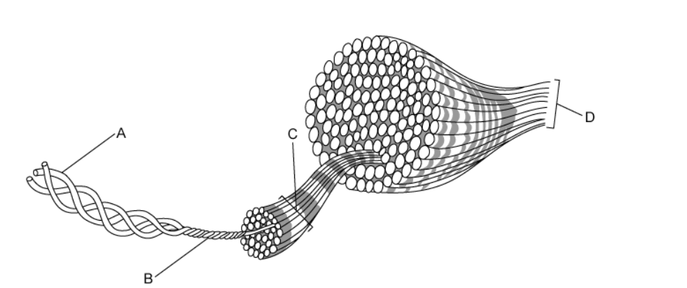

### Q4 — medium — 1 marks

**Q4** [1 mark]

Which row of statements describes haemoglobin correctly?

| **A** | polypeptide chains interact to produce an almost spherical molecule | an iron ion is present within each haem group | quaternary structure of two alpha chains and two beta chains | each molecule can transport a total of four oxygen atoms |
|---|---|---|---|---|
| **B** | four polypeptide chains, each containing a prosthetic group | iron ions can associate with oxygen forming oxyhaemoglobin | in each chain, hydrophobic R groups of amino acids point towards the centre of the molecule | at 50 % saturation, two oxygen molecules are transported by the molecule |
| **C** | polypeptide chains produce a loose helical shape, which curls to form a spherical molecule | iron ions in the molecule can bind reversibly with oxygen | in each chain, hydrophobic R groups of amino acids surround the iron ion | each molecule can transport a total of eight oxygen atoms |
| **D** | polypeptide chains interact to produce a globular chain | each chain contains a prosthetic group of amino acids surrounding an iron | two identical alpha chains and two identical beta chains | each chain can transport an oxygen molecule |

### Q5 — medium — 1 marks

**Q5** [1 mark]

Haemoglobin carries oxygen in the blood.

Which of the following best describes why this is possible?

| 1 | Oxygen binds to iron reversibly |
|---|---|
| 2 | Oxygen binding causes haemoglobin to change shape |
| 3 | Oxygen binds to the haem group |

### Q6 — medium — 1 marks

**Q6** [1 mark]

The diagram shows a polypeptide of the protein glutenin, which has an important role in maintaining the strength and elasticity of bread dough.

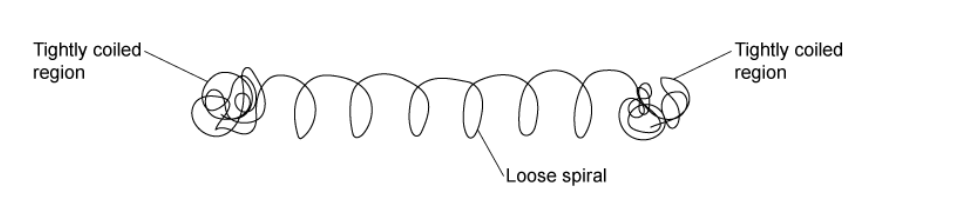

What is the structure of glutenin and why?

|   | Structure | Reason |
|---|---|---|
| **A** | Secondary | the loose spiral is an alpha helix |
| **B** | Tertiary | a 3D shape is formed from the different regions |
| **C** | Quaternary | there are globular and fibrous regions |
| **D** | Quaternary | the structure consists of spiral and coiled regions |

### Q7 — medium — 1 marks

**Q7** [1 mark]

Every amino acid has an R group which gives the molecule its properties. The diagram below shows the R groups for the amino acids Arg, Ser, Glu and Val.

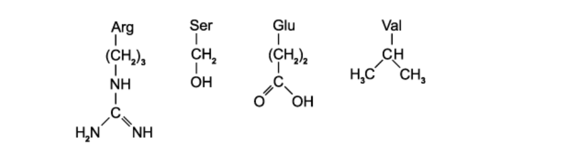

|   | Acidic | Basic | Hydrophilic | Hydrophobic |
|---|---|---|---|---|
| **A** | Glu | Arg | Ser | Val |
| **B** | Ser | Arg | Glu | Val |
| **C** | Glu | Val | Ser | Arg |
| **D** | Arg | Val | Glu | Ser |

### Q8 — medium — 1 marks

**Q8** [1 mark]

Which of the following causes fibrous proteins to be insoluble?

### Q9 — medium — 1 marks

**Q9** [1 mark]

Protein molecules contain multiple different types of bond, some of which are stronger than others.

Which is the correct order from weakest to strongest?

### Q10 — medium — 1 marks

**Q10** [1 mark]

Which of the following facts about collagen explain its role in muscles and tendons?

| 1 | Collagen is insoluble |
|---|---|
| 2 | Collagen chains form a helical structure |
| 3 | Different collagen molecules are bonded together by covalent bonds |
| 4 | Collagen is made of amino acids with small R groups |

### Q11 — hard — 1 marks

**Q11** [1 mark]

The graph shows the effect of pH on enzyme activity.

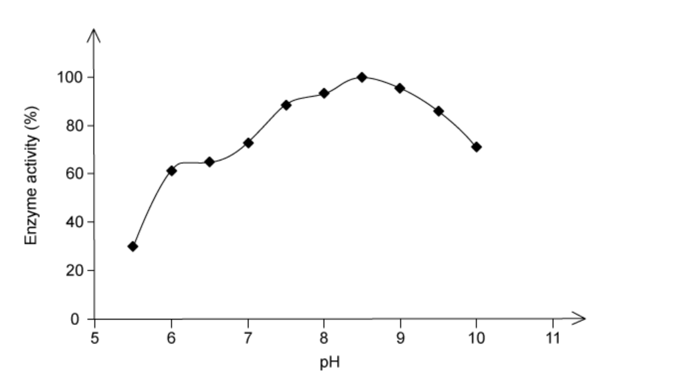

Which of the following R groups in the active site will be directly affected by pH?

### Q12 — hard — 1 marks

**Q12** [1 mark]

A total of four polypeptide chains, 2 alpha chains and 2 beta chains, make up a globular protein called Haemoglobin. In normal cases, the DNA code for each beta chain for glutamic acid in the sixth triplet.

However, Sickle cell anaemia in individuals causes the base triplet to change and code for valine instead.

This mutation changes one aspect of the haemoglobin molecule. Which is it?

### Q13 — hard — 1 marks

**Q13** [1 mark]

The diagram shows a fibrous and globular protein with three amino acids labelled 1, 2 and 3. Amino acids 1 and 2 are on the outer surface of the protein whereas amino acid 3 in internal.

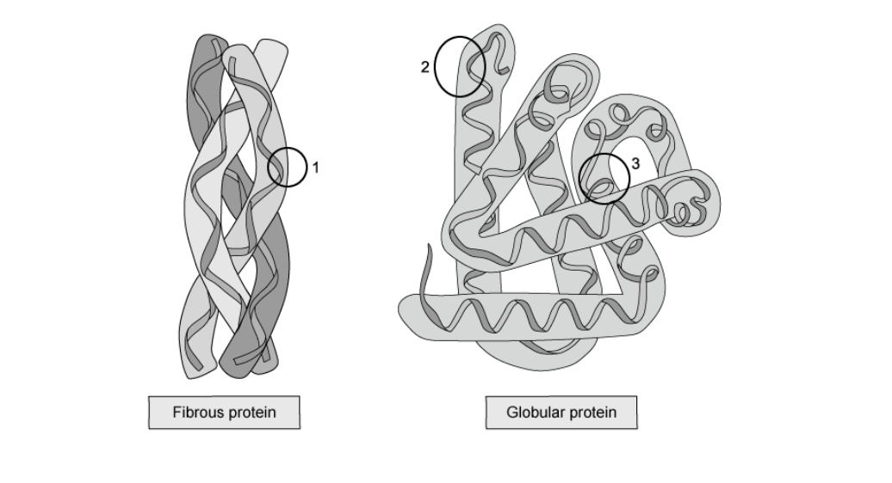

Which row identifies the most likely amino acid R group at each point?

|   | **R group** |   |   |
|---|---|---|---|
|   | **1** | **2** | **3** |
| **A** | H | CH(CH3)2 | CH(CH3)2 |
| **B** | H | (CH2)4NH2 | CH2OH |
| **C** | CH3 | CH(CH3)2 | (CH2)4NH2 |
| **D** | CH3 | CH2OH | CH(CH3)2 |

### Q14 — hard — 1 marks

**Q14** [1 mark]

What describes a globular protein that is not soluble in water?

### Q15 — hard — 1 marks

**Q15** [1 mark]

There is estimated to be 20,000 genes in the human body, but over 300,000 proteins.

If a chain consists of *y *amino acid residues and there are *no* different amino acids available, how many different polypeptides can be made?

### Q16 — hard — 1 marks

**Q16** [1 mark]

A protein found in the stomach is placed in water, this causes the protein to denature.

Which of the following bonds are affected?

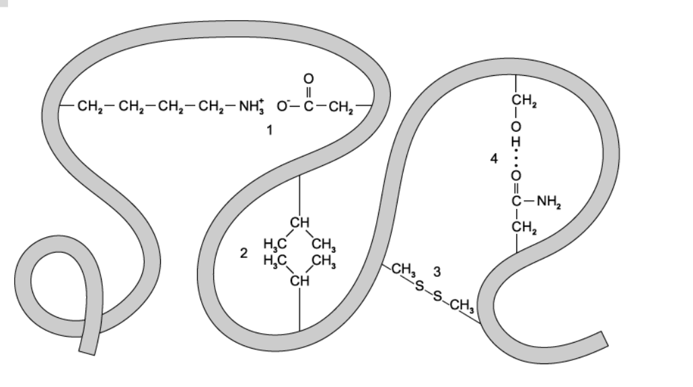

### Q17 — hard — 1 marks

**Q17** [1 mark]

Four proteins 1, 2, 3 and 4 are described below

| 1 | consists of four polypeptides each with a prosthetic group |
|---|---|
| 2 | consists of a globular tertiary structure with a binding site |
| 3 | consists of four polypeptides held together by disulfide bonds |
| 4 | consists of three polypeptides tightly coiled together |

Which description matches the proteins collagen, haemoglobin and the enzyme lipase?

|   | **Collagen** | **Haemoglobin** | **Lipase** |
|---|---|---|---|
| **A** | 1 | 3 | 4 |
| **B** | 3 | 2 | 1 |
| **C** | 4 | 3 | 2 |
| **D** | 4 | 1 | 2 |

### Q18 — hard — 1 marks

**Q18** [1 mark]

An experiment was undertaken to test the permeability of the plasma membrane and tonoplast of beetroot cells in various different chemicals. Vacuoles of beetroot cells carry a red pigment which cannot diffuse through their plasma membranes and tonoplasts to leave the cell.

The beetroot was cut into equal 1 cm3 cubes before being washed under a tap for 15 minutes to remove pigment released from outer damaged cells. The cubes were then placed in the various solutions, all of which turned red.

The table below shows four possible behaviors of phospholipids and proteins in different solutions, which is correct?

|   | **solution** | **protein denatures** | **solution** | **phospholipids dissolve** |
|---|---|---|---|---|
| **A** | ethanol | ✓ | dilute HCl | ✓ |
| **B** | dilute HCL | ✓ | ethanol | ✓ |
| **C** | ethanol | ✓ | 40°C water | ✓ |
| **D** | 40°C water | ✓ | dilute HCl | ✓ |

### Q19 — hard — 1 marks

**Q19** [1 mark]

When leaving the lungs, haemoglobin is 98 % saturated.

How many oxygen atoms will be carried by the majority of haemoglobin molecules?

### Q20 — easy — 1 marks

**Q20** [1 mark]

In protein molecules, which bonds are responsible for producing the primary, secondary and tertiary structure?

|   | level of structure |   |   |
|---|---|---|---|
| primary | secondary | tertiary |   |
| **A** | covalent | ionic | ionic |
| **B** | ionic | hydrogen | covalent |
| **C** | peptide | hydrogen | disulfide |
| **D** | covalent | ionic | hydrogen |

### Q21 — easy — 1 marks

**Q21** [1 mark]

Protein X is a transport protein found dissolved in blood plasma and is used to transport different things around the body. It contains six internal disulfide bridges and has a roughly spherical shape.

Protein Y is a structural protein found in the hair and nails of mammals. It is made of two alpha-helices twisted round each other to make a coiled coil.

Are these examples of globular or fibrous proteins?

### Q22 — easy — 1 marks

**Q22** [1 mark]

The protein myoglobin has a similar function to haemoglobin except myoglobin does not have a quaternary structure.

Why does myoglobin not have a quaternary structure?

### Q23 — easy — 1 marks

**Q23** [1 mark]

The diagram shows a biological molecule found in cells.

Which arrow labels a peptide bond?

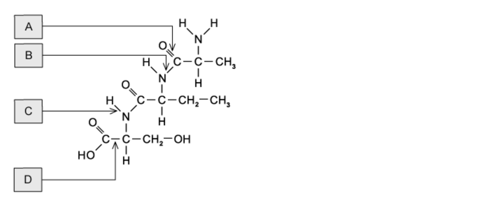

### Q24 — easy — 1 marks

**Q24** [1 mark]

How can the quaternary structure of haemoglobin be described?

1. a specific order of amino acids
2. a globular structure
3. an α-helix
4. a dipeptide
5. four polypeptide chains connected together

### Q25 — easy — 1 marks

**Q25** [1 mark]

The tertiary structure of a protein molecule is maintained by which bonds?

|   | peptide | hydrogen | disulfide | ionic |
|---|---|---|---|---|
| **A** | X | ✓ | X | ✓ |
| **B** | ✓ | ✓ | X | X |
| **C** | X | ✓ | ✓ | ✓ |
| **D** | ✓ | X | ✓ | X |

### Q26 — easy — 1 marks

**Q26** [1 mark]

Which of the following statements about fibrous proteins is incorrect?

### Q27 — easy — 1 marks

**Q27** [1 mark]

Two amino acids, both containing two carboxylic acid (-COOH) groups are illustrated below.

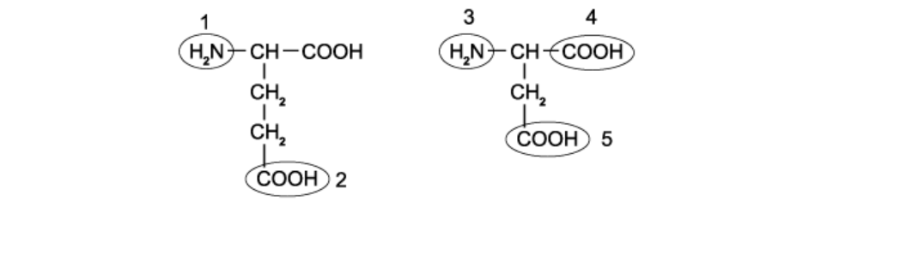

Which labelled groups take part in the formation of a dipeptide of these amino acids?

### Q28 — easy — 1 marks

**Q28** [1 mark]

The protein haemoglobin contains iron.

What is the role of iron within the molecule?

### Q29 — easy — 1 marks

**Q29** [1 mark]

Which description of collagen is correct?

## Structured Questions (15 questions)

### Q1 — hard — 11 marks

**Q1** [3 marks]

Haemoglobin is a protein whose function depends on a prosthetic group.

Define the term *prosthetic group* and describe the components that make up the prosthetic group of haemoglobin.

**Q1** [3 marks]

**Extract:**

Haemoglobin is a protein whose function depends on a prosthetic group.

Define the term prosthetic group and describe the components that make up the prosthetic group of haemoglobin.

A prosthetic group:
- Is a non-amino acid chemical group within / (permanently) bound to a protein;

Haemoglobin's prosthetic group:
- Consists of a central, iron/Fe atom / Fe^2+^ ion;
- Organic/carbon/porphyrin ring structure;

Outline the mode of operation of the prosthetic group within a haemoglobin molecule.

**Q1** [3 marks]

An individual red blood cell is thought to contain 280 million haemoglobin molecules.

Calculate how many oxygen molecules are bound within a single red blood cell when the cell is 7% saturated with oxygen.

State your answer to 2 significant figures.

**Q1** [2 marks]

Explain why a prosthetic group is needed in a haemoglobin molecule.

### Q2 — hard — 11 marks

**Q2** [4 marks]

Fig. 1 shows the structure of myoglobin, an oxygen transporting protein found in muscles. Myoglobin is responsible for receiving oxygen from the blood and transporting it to the mitochondria of muscle cells in order for cellular respiration to occur. Oxygen molecules will bind to group **X** indicated on the diagram.

**Fig. 1**

Compare the structure of myoglobin, shown in Fig. 1, with haemoglobin.

**Q2** [4 marks]

Fig. 2 shows the oxygen dissociation curves for myoglobin and haemoglobin.

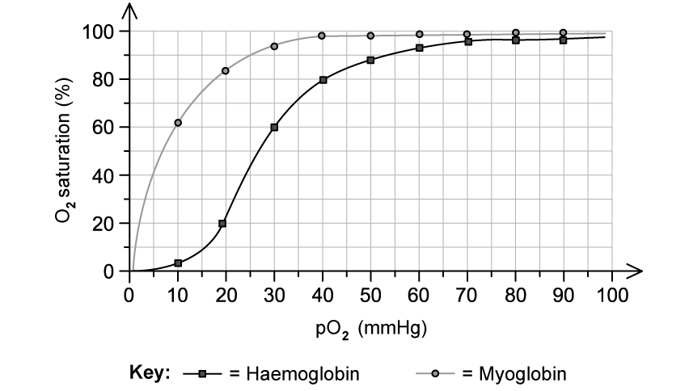

**                                                        Fig. 2**

(i) Explain the difference in the dissociation curves in Fig. 2.

[3]

(ii) Estimate the percentage saturation of myoglobin if the partial pressure of oxygen is 20 mmHg.

[1]

**Q2** [3 marks]

Explain how the tertiary and quaternary levels of protein structure enable haemoglobin to perform its role in the transport of oxygen.

### Q3 — hard — 12 marks

**Q3** [3 marks]

Albumin is a protein found in the plasma of the blood.

The gene that codes for human albumin is 16 961 DNA bases long. The protein is made up of 585 amino acids.

Calculate the ratio of non-coding to coding DNA in the albumin gene.

**Q3** [3 marks]

Fig. 1 shows the molecular structure of human albumin.

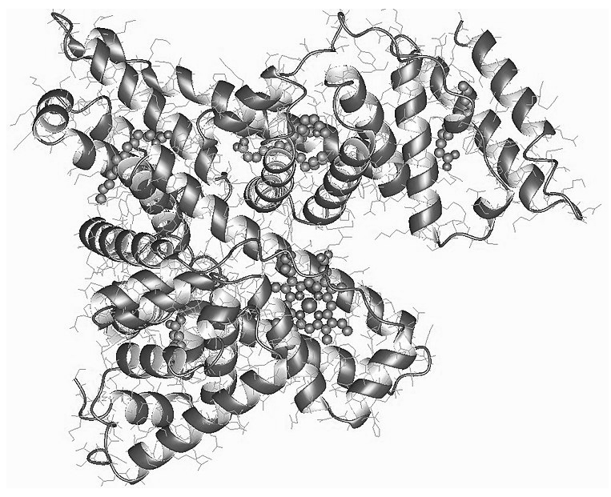

| Wardell, M., Wang, Z., Ho, J.X., Robert, J., Ruker, F., Ruble, J., Carter, D.C.;visualization author: User:Astrojan, CC BY-SA 4.0 <https://creativecommons.org/licenses/by-sa/4.0>, via Wikimedia Commons |
|---|

**Fig. 1**

(i) Identify **one** example of secondary structure visible in Fig. 1.

[1]

(ii) Describe the bond(s) found in the example identified in part (i).

[2]

**Q3** [4 marks]

Egg whites are mostly made of albumin.

When the albumin in egg white is denatured it changes the white of the egg from a colourless liquid to a white solid.

A student wanted to investigate how temperature affects the denaturing of albumin.

Outline a method that the student could use to carry out this investigation.

**Q3** [2 marks]

**Extract:**

When the albumin in egg white is denatured it changes the white of the egg from a colourless liquid to a white solid.

When the albumin in the egg white is not denatured it is soluble in water, however, when it denatures it becomes insoluble. This is due to the same mechanism that causes the colour change.

Explain how the albumin protein can have different properties before and after denaturing.

### Q4 — hard — 8 marks

**Q4** [2 marks]

A theoretical polypeptide chain is 26 amino acids long.

Calculate the number of different possible combinations of amino acids that could exist within this chain.

Give your answer in standard form.

**Q4** [1 mark]

In some rare circumstances some organisms have been found to contain unusual amino acids that are not shared with the majority of other organisms.

Selenocysteine is one of them, and is shown in Fig. 1 below.

**Fig. 1**

Using the information in Fig. 1, state what makes selenocysteine so unusual.

**Q4** [2 marks]

**Extract:**

In some rare circumstances some organisms have been found to contain unusual amino acids that are not shared with the majority of other organisms. 

Selenocysteine is one of them, and is shown in Fig. 1 below.

**Fig. 1**

Use the information in Fig. 1 to draw the formation of a dipeptide from two molecules of selenocysteine.

**Q4** [3 marks]

Some amino acids exist that have been artificially synthesises in a laboratory. These amino acids have never occurred in the proteins of living organisms.

Describe the features that must exist in these synthetic molecules in order for them to be classified as amino acids.

### Q5 — hard — 9 marks

**Q5** [2 marks]

Insulin is a protein that is produced naturally by most individuals. Patients with insulin-dependent diabetes, however, cannot produce insulin and rely on injecting insulin to replace the protein that they cannot produce for themselves.

Suggest why the insulin must be injected into the blood instead of being taken orally.

**Q5** [2 marks]

Many years ago insulin used to be taken from cows and pigs to treat people with diabetes.

Using your knowledge of protein structure, suggest why pig and cow insulin was less effective at regulating blood glucose levels than human insulin.

**Q5** [2 marks]

Another example of a protein found in humans is fetal haemoglobin, the structure of which is shown in Fig. 1 below. Fetal haemoglobin is the main type of haemoglobin found in a fetus up until birth. Fetal haemoglobin has a higher affinity for oxygen than adult haemoglobin.

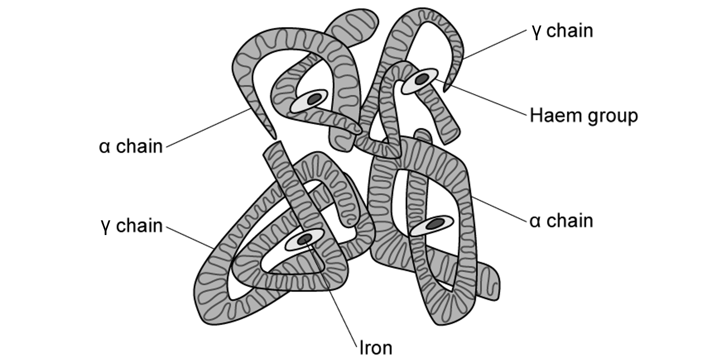

**Fig. 1**

(i) Using the information in Fig. 1 and your knowledge of the structure of haemoglobin, contrast the structure of fetal haemoglobin with that of adult haemoglobin.

[1]

(ii) Suggest the impact of the difference in structure identified in part (i).

[1]

**Q5** [3 marks]

Fig. 2 below shows part of a haemoglobin molecule.

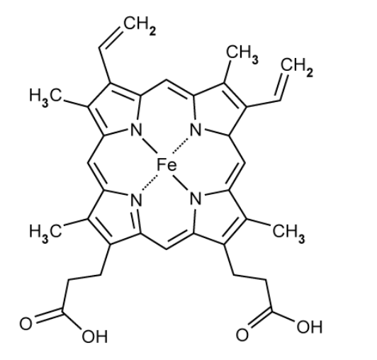

**Fig. 2**

(i) Identify the part of the haemoglobin molecule shown in Fig. 2.

[1]

(ii) Explain how the part identified at (i) facilitates the role of haemoglobin.

[2]

### Q6 — medium — 10 marks

**Q6** [5 marks]

Proteins are a vital class of macromolecule that are composed of amino acids. Two such amino acids are represented in the diagram in Fig. 1.

(i) Complete the diagram to show how the amino acids are linked together to form a dipeptide.

[3]

**                                                                  Fig. 1**

(ii) State what is represented by **R** in Fig. 1.

[2]

**Q6** [3 marks]

Proteins can have various different levels in terms of their structure.

Describe the secondary structure of a protein.

**Q6** [2 marks]

**Extract:**

Proteins can have various different levels in terms of their structure.

Describe the secondary structure of a protein.

The secondary structure of a protein refers to:
- Hydrogen bonding occurs; [1 mark]
- (This occurs) between CO- group of one amino acid and NH- group of another; [1 mark]
- (To form) alpha/α-helix and beta/β-pleated sheet; [1 mark]

Fig. 2 shows the structure of the enzyme lysozyme.

**                                                  Fig. 2**

With reference to Fig. 2, identify the levels of protein structure visible in the diagram.

### Q7 — medium — 8 marks

**Q7** [3 marks]

*Ustilago maydis* is a fungal pathogen affecting maize. They secrete toxins, known as killer toxins, with the best-characterised one being the KP6 toxin. This particular toxin consists of two small polypeptides that are not linked by covalent bonds. Fig. 1 shows the ribbon structure of one of these polypeptides of the KP6 toxin.

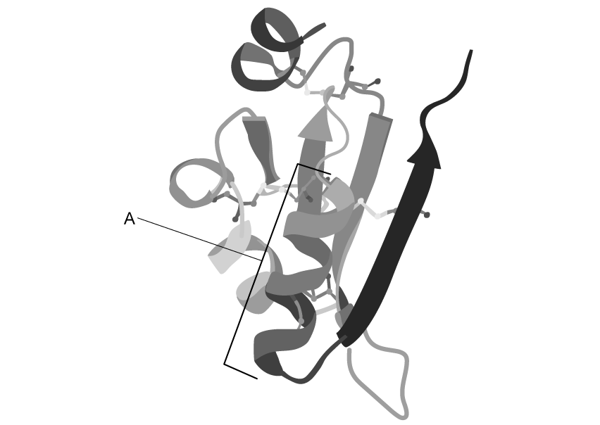

**                                                        Fig. 1**

Describe what is shown by the part of the polypeptide labelled **A**.

**Q7** [3 marks]

Certain enzymes, such as dipeptidase, are involved with protein digestion in the body. Fig. 2 shows a diagram of a dipeptide that can be broken down by dipeptidase.

**                                                              Fig. 2**

Describe how dipeptidase will break down this dipeptide by indicating the peptide bond on Fig. 2 and drawing the amino acid products that will form.

**Q7** [2 marks]

Proteins are very sensitive to changes in the pH of their surroundings as it may affect their tertiary and quaternary structure.

Explain why a decrease in pH could change the structure of a protein.

### Q8 — medium — 9 marks

**Q8** [2 marks]

State how a polypeptide is formed from amino acids.

**Q8** [4 marks]

DNA polymerases are a vital group of enzymes with different variations found in all living cells. These enzymes are involved in replicating DNA during semi-conservative replication.

Explain why most cellular enzymes, such as DNA polymerases, are made predominantly from protein.

**Q8** [2 marks]

Some washing powders contain molecules that break down and hydrolyse the peptide bonds between amino acids. The degree to which a protein is broken down can be called the degree of hydrolysis (DH).

The DH value is calculated using the following equation:

$\mathrm{DH}=\frac{100x\mathrm{Number} \mathrm{of} \mathrm{peptide} \mathrm{bonds} \mathrm{hydrolysed}}{\mathrm{Total} \mathrm{number} \mathrm{of} \mathrm{peptide} \mathrm{bonds} \mathrm{present}}$

Washing powder was applied to a molecule of protein. The DH value after exposure to the washing powder was 28 and a total of 140 peptide bonds were hydrolysed.

Calculate the number of amino acids in the protein.

**Q8** [1 mark]

**Extract:**

Some washing powders contain molecules that break down and hydrolyse the peptide bonds between amino acids.

Suggest a reason why it is beneficial for washing powder to contain molecules with the ability to break down proteins.

### Q9 — medium — 10 marks

**Q9** [3 marks]

People suffering from anaemia are generally lacking in dietary iron. It is recommended that they consume more red meat and green leafy vegetables to increase the iron levels in their blood.

Explain why one of the symptoms of anaemia would be fatigue.

**Q9** [3 marks]

At high altitudes, the partial pressure of oxygen in the air is substantially lower than at sea level. This means that the partial pressure of oxygen in the bloodstream is also much lower at high altitudes compared to at sea level. The partial pressure of oxygen at sea level is about 14.0 kPa, while at 10 000 metres above sea level it is about 4.0 kPa. Table 1 shows the percentage saturation of haemoglobin at different partial pressures of oxygen.

**Table 1**

| **Partial pressure of oxygen / kPa** | **Percentage saturation of haemoglobin** |
|---|---|
| 2 | 24.0 |
| 4 | 57.5 |
| 6 | 80.0 |
| 8 | 88.0 |
| 10 | 94.0 |
| 12 | 96.5 |
| 14 | 98.0 |

With reference to Table 1, calculate the percentage decrease in the percentage saturation of haemoglobin as you travel from sea level to 10 000 metres above sea level.

Show your working.

**Q9** [2 marks]

Compare the different chemical elements found in proteins and carbohydrates.

**Q9** [2 marks]

Enzymes called proteases are able to break proteins down and they are often added to biological washing powders to remove protein-based stains from clothes.

Explain how these enzymes are able to break proteins down.

### Q10 — medium — 10 marks

**Q10** [3 marks]

Collagen protein molecules have a quaternary structure and are vital in providing structural support in a wide variety of organisms. There are different types of collagen but all types share the same basic features.

One of the polypeptide chains that form a molecule of collagen contains 1034 peptide bonds.

Calculate the number of amino acids that would be found in a single molecule of collagen if all the chains are identical in length. Explain your answer.

**Q10** [2 marks]

**Extract:**

Collagen protein molecules have a quaternary structure and are vital in providing structural support in a wide variety of organisms. There are different types of collagen but all types share the same basic features. One of the polypeptide chains that form a molecule of collagen contains 1034 peptide bonds.

Explain why collagen is described as having a quaternary structure rather than a tertiary structure.

**Q10** [2 marks]

**Extract:**

Each collagen molecule is formed from three polypeptide chains.

Haemoglobin and collagen are both two important proteins found in the human body. Table 1 lists some of the properties of these proteins.

State the properties of each protein by completing Table 1.

**Table 1**

|   | **Haemoglobin** | **Collagen** |
|---|---|---|
| **Globular or fibrous** |   |   |
| **Solubility in water** |   |   |
| **Number of polypeptide chains** |   |   |
| **Prosthetic group present** |   |   |

**Q10** [3 marks]

Discuss how the structure of a collagen molecule relates to its function in living organisms.

### Q11 — easy — 8 marks

**Q11** [3 marks]

Table 1 shows selected aspects of protein structure and the level of protein structure to which each belongs.

**Table 1**

| **Aspect of protein structure** | **Level of structure / primary, secondary, tertiary, quaternary** |
|---|---|
| α-helix | secondary |
| Disulfide bridge |   |
| Sequence of amino acids |   |
| β-pleated sheet |   |
| Separate polypeptide chains interacting |   |
| Hydrogen bonds |   |
| Ionic bonds |   |

Complete Table 1 by using the terms **primary**, **secondary**, **tertiary** and/or **quaternary**.

The first row has been completed for you.

**Q11** [2 marks]

Two types of proteins are shown in Fig. 1. They are labelled Protein **A** and Protein **B**.

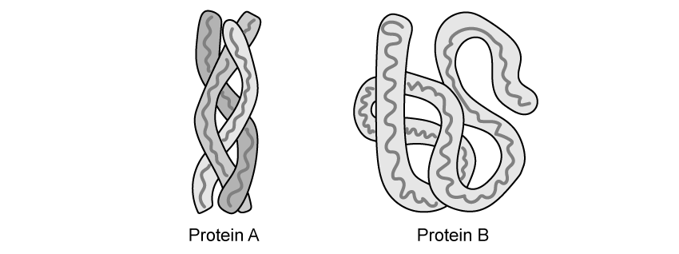

**Fig. 1**

Identify which of **A** or **B** is a globular protein **and** give a reason for your choice.

**Q11** [1 mark]

The Biuret test is a biochemical test for proteins.

State the colour change observed in a positive Biuret test.

**Q11** [2 marks]

The Biuret test is a qualitative test for proteins.

Explain why the Biuret test is referred to as 'qualitative'.

### Q12 — easy — 7 marks

**Q12** [2 marks]

Fig. 1 shows the triple helix structure of a collagen molecule.

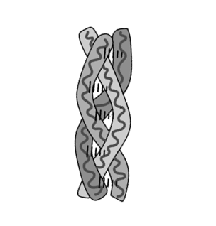

**Fig. 1**

Glycine makes up almost every third amino acid in the primary structure of collagen.

Explain the reason for this.

**Q12** [2 marks]

Collagen is a molecule with high tensile strength.

State what is meant by *high tensile strength*.

**Q12** [2 marks]

Explain the purpose of each of the following characteristics of collagen structure:

(i) Primary structure with a highly repetitive amino acid sequence.

[1]

(ii) Large number of amino acids with hydrophobic R groups are present.

[1]

**Q12** [1 mark]

Other than collagen, give **one** example of a fibrous protein in the body.

### Q13 — easy — 10 marks

**Q13** [2 marks]

Proteins are macromolecules that can be described as polymers.

Define the term *polymer*.

**Q13** [4 marks]

Proteins play a very important role in all living organisms.

Give **four** functions of proteins in living organisms.

**Q13** [2 marks]

All biological molecules, such as proteins, contain certain chemical elements.

State **two** chemical elements found in proteins.

**Q13** [2 marks]

Polypeptides are broken down during hydrolysis reactions.

Describe the hydrolysis of a polypeptide.

### Q14 — easy — 6 marks

**Q14** [1 mark]

Fig. 1 shows the structure of the amino acid serine.

**Fig. 1**

Identify the R-group of serine by drawing a circle around it on Fig. 1.

**Q14** [1 mark]

Serine is able to form hydrogen bonds with other amino acids.

Suggest what this indicates about the polarity of the R group of serine.

**Q14** [2 marks]

Fig. 2 shows the structure of a non-polar amino acid, phenylalanine.

**Fig. 2**

State whether this amino acid is more likely to be found at the centre of a globular protein or at its surface.

Give a reason for your answer.

**Q14** [2 marks]

Hydrogen bonds and hydrophobic interactions between non-polar R groups are two examples of bonds that are found in protein molecules.

State **two other** bonds that can be found in protein molecules.

### Q15 — easy — 8 marks

**Q15** [1 mark]

State the main role of the protein haemoglobin.

**Q15** [2 marks]

In the hereditary disease sickle cell anaemia, a mutation results in a polar amino acid (glutamic acid) being replaced by a non-polar amino acid (valine) at the surface of a haemoglobin molecule, making it less soluble in blood plasma.

Based on your knowledge of haemoglobin and globular protein structure, explain why the haemoglobin of a sickle cell patient would be less soluble than normal haemoglobin.

**Q15** [2 marks]

Each haemoglobin molecule can bind 4 oxygen molecules. There are 300 million haemoglobin molecules in each red blood cell. An adult human is estimated to have 3 x 1013 red blood cells in circulation at any one time.

Calculate the theoretical maximum number of oxygen molecules that could be carried in the red blood cells of an adult human.

**Q15** [3 marks]

Fig. 1 shows the structure of collagen protein at various levels of detail.

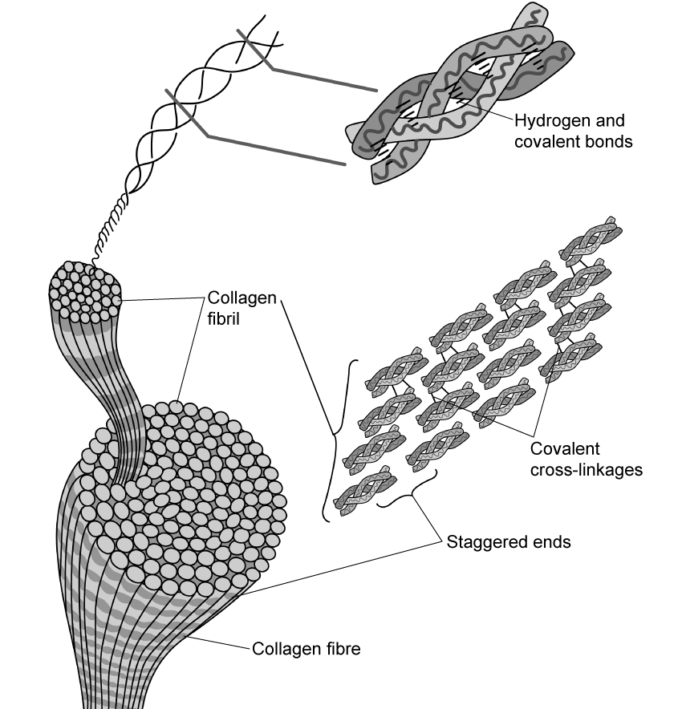

**Fig. 1**

Use Fig. 1 to identify **three** features of collagen that enable it to be a strong, structural protein.
