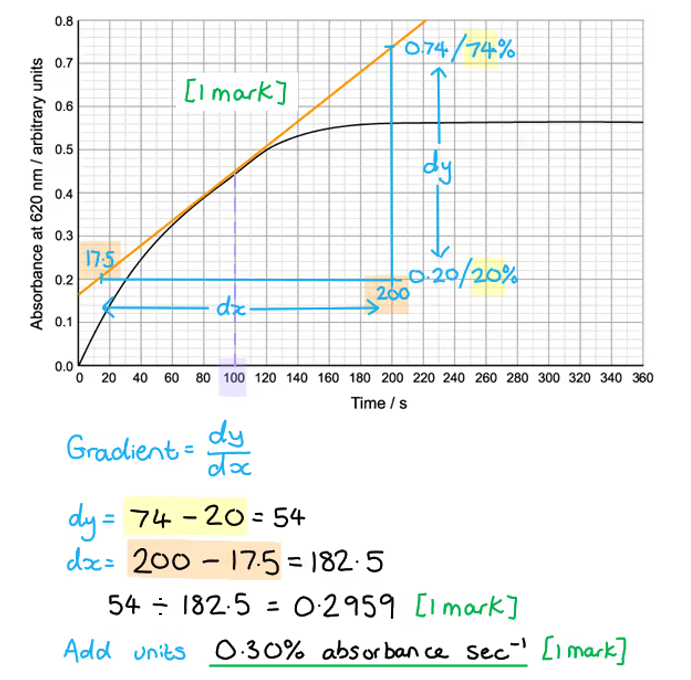
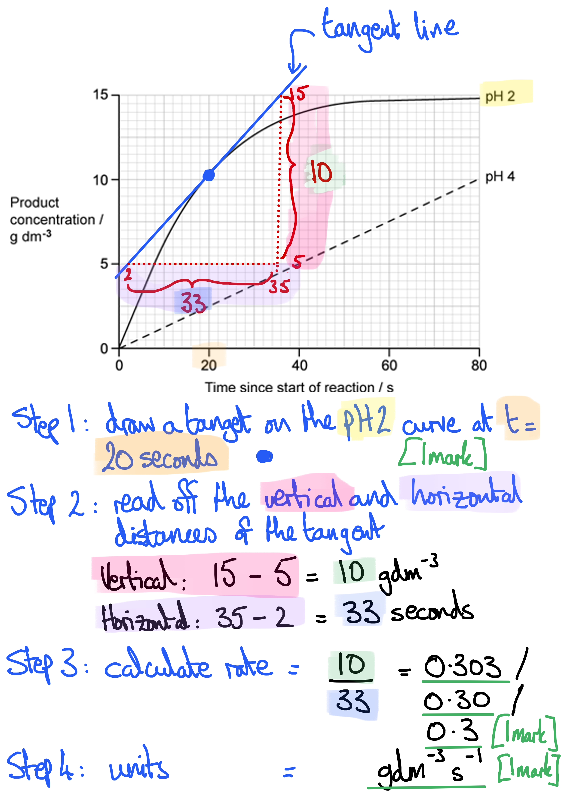
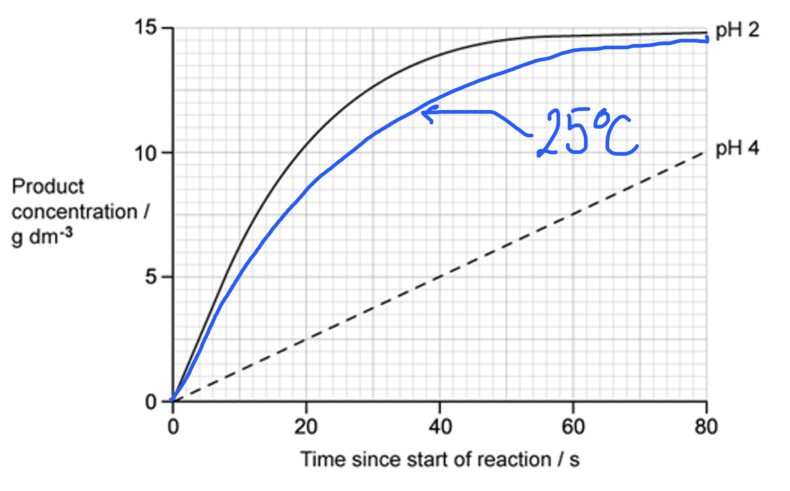
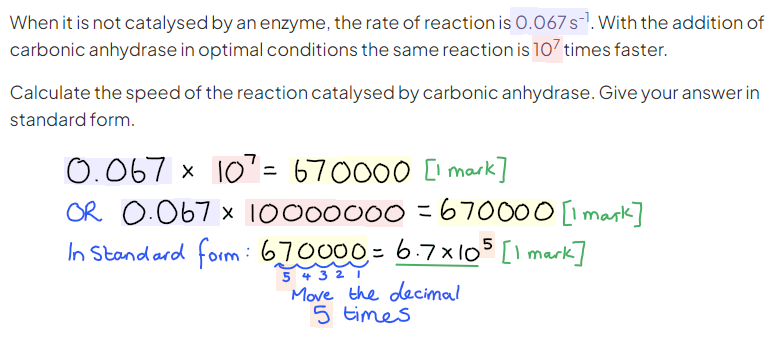
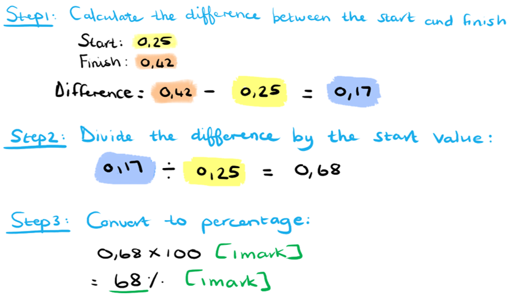
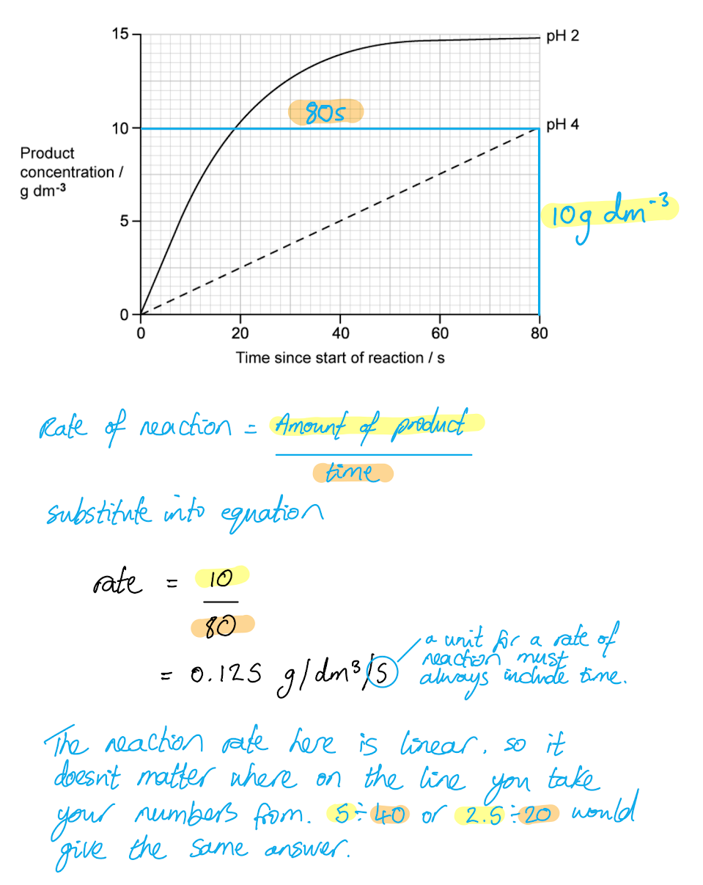
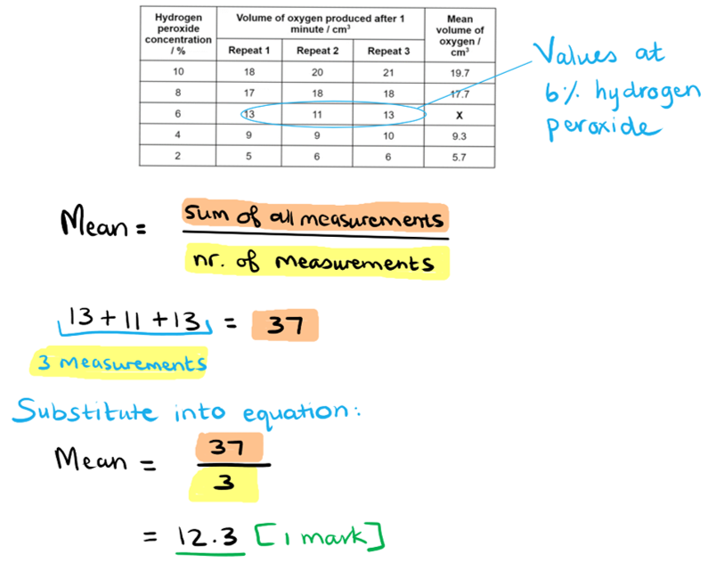
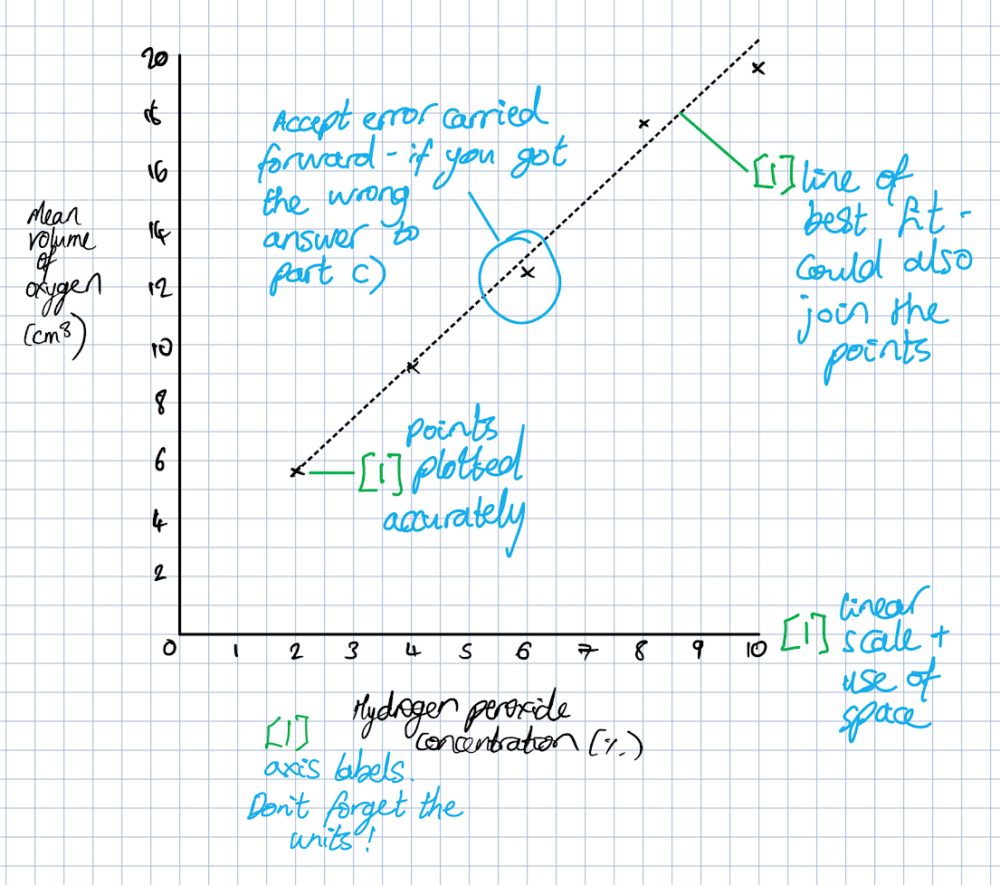

# Mark Schemes — Mode of Action of Enzymes
**3. Enzymes** · Cambridge (CIE) AS biology (9700)

## Multiple Choice Questions (30 questions)

### Q1
**Final answer:** **The correct answer is ****C ****as more starch will mean the solution turns a darker shade of blue/black (as this is a positive iodine test result for starch presence).  This will mean that there is a greater absorbance of dark blue light, which is the same as having a lower percentage transmission.  Therefore, the substance with the lowest percentage transmission on the graph will have the greatest amount of starch – in this case wheat.**

### Q2
**Final answer:** **The correct answer is ****C ****as it is important not to disrupt all proteases found in the hosts body.  Our own cells need to make many different types of protease as part of their normal functioning, so we need to make sure to only target this specific viral protease and not disrupt the normal cellular function (this therefore also rules out B and D).  A could potentially make good a broad-spectrum antibiotic (i.e. an antibiotic that can work on a range of different bacterial infections), however, it will have no effect on the HIV virus as viral and bacterial enzymes are different**

### Q3
**Final answer:** **The correct answer is ****A ****as, in this quite unusual case, a single amino acid is acting as an enzyme.  A single amino acid is not a protein and so doesn’t have a secondary, tertiary or quaternary structure.**

### Q4
**Final answer:** **The correct answer is ****D ****as this is the only absorbance value that is higher than the score for the non-diabetic person.  The person with type 2 diabetes will have a higher absorbance as they will have a higher blood glucose level after eating the meal (due to lack of insulin responsiveness).  This increase in the amount of blood glucose would, in turn, result in a darker red appearance as glucose is a reducing sugar and will reduce the benedict’s reagent to a brick red colour**

**Final answer:** **Greater red-light absorption = darker red colour = more reducing sugar = higher blood glucose level **

### Q5
**Final answer:** **The correct answer is ****D ****as to get a build-up of reactant, enzyme 1 must be inhibited.  This would also then explain the decrease in intermediate X and hormone.  The fact that intermediate Y slightly increases even though the amount of intermediate X has decreased shows us that enzyme 3 has also been inhibited (otherwise we would expect the amount of intermediate Y to decrease the same as X and the hormone).  Another proof of this is the fact that the hormone has undergone a ****large**** decrease, whereas X only decreased.  The production of the hormone is being inhibited twice, whereas the production of X is only inhibited once – therefore the amount of hormone is reduced by a greater extent**

### Q6
**Final answer:** **The correct answer is ****C**** as the rate of oxygen production is the dependent variable, therefore it cannot be a control variable.**

> *The **independent** variable is the factor being **changed** (in this case the independent variable would be pH).  The **dependent** variable is the factor being **measured** (in this case the dependant variable would be rate of reaction which is a calculation determined by the amount of oxygen produced in a certain time).  Control variables are the factors that need to be kept the same in order to ensure a fair test (often things like the temperature, volume and concentration of substrates), but crucially, control variables can’t be one of the other two variable types!*

### Q7
**Final answer:** **The correct answer is ****C ****as, reading off the figure (after plotting a line of best fit), it is possible to see that 25% of glucose absorbance is equal to around 200mg/l of glucose absorption.  As the mass of sucrose is only half comprised of glucose (the other half being made up of fructose), we double this number to get our original concentration of sucrose in mg/l (i.e. 400mg/l).**

### Q8
**Final answer:** **The correct answer is ****B ****as this statement should be the other way around - the activation energy of the uncatalysed reaction is double the catalysed reaction.  It is 10 for the uncatalysed reaction and only 5 with a catalyst.  The activation energy of the uncatalysed reaction will always be greater than the same reaction with a catalyst.**

### Q9
**Final answer:** **The correct answer is ****D ****as the information in the question states that several different polypeptide chains (subunits) come together to form the active site.  Each individual 4-Oxalocrotonate tautomerase is not able to act as an enzyme, therefore the correct answer cannot be tertiary structure (and therefore also no primary or secondary structure).**

### Q10
**Final answer:** **The correct answer is ****D ****as the**** ****active site is present on the enzyme (****lipase****) and not on glycerol (which is a substrate or product depending on which way the reaction is going).  In the direction of ****1**** the reaction is a ****hydrolysis**** reaction (water is used to break up a molecule) and the reverse (2) is a ****condensation**** reaction (water is produced in the formation of a larger molecule).  The pH will ****decrease**** in the direction of reaction 1 as the fatty acids being produced will lower pH.**

### Q11
**Final answer:** **The correct answer is ****D**

**Final answer:** **Although the tertiary and quaternary structures refer to the three-dimensional shape of an enzyme (and therefore describe the shape of the active site), all protein structures depend on the preceding structures (i.e. the tertiary structure is dependent on the secondary structure, which in turn is dependent on the primary structure). Therefore all four levels of protein structure are important in determining enzyme structure. Not all proteins possess quaternary structure being made of separate polypeptide chains), but when it is present, it contributes to the overall 3-D shape and hence the specificity. **

### Q12
**Final answer:** **The correct answer is ****B ****because the dotted line shows the energy for an enzyme catalysed reaction.  The activation energy is the energy needed for the reaction to occur and it is reduced by the presence of an enzyme.  The dotted line goes from 20 to 25 so this is the activation energy.  **

> *After the reaction, the products end up with an energy of 15, this is less than before the reaction so we can deduce that this was an exothermic reaction (i.e. it has given out energy/heat)*

### Q13
**Final answer:** **The correct answer is ****D ****as statement 3 is not affected by either pH or temperature.  Hydrophobic interactions are the tendency of hydrophobic amino acids to orientate themselves on the inside of the molecule to avoid interacting with water; this helps to stabilise the enzyme’s globular structure.  The bonding arises due to the presence of an aqueous environment surrounding the enzyme and therefore won’t be increased by increases in temperature of pH (and most likely will be decreased as the other bonds are broken).  Statements 1 and 4 are both responsible for the effect mentioned in statement 2. **

### Q14
**Final answer:** **The correct answer is ****B ****as any light passing though the solution is ****detected**** by a light measuring device.  It is produced by a light source (i.e. a lightbulb/LED) and not by the measuring device **

### Q15
**Final answer:** **The correct answer is ****D**** as**** ****silk is a protein and therefore will be broken down by protease.  This would damage the silk clothing so biological washing powder should not be used to wash silk.  A 90°C cycle would denature the enzymes and therefore render them ineffective, so again would not be recommended.  The washing powder could be used to remove blood stains as blood is comprised predominantly of proteins, carbohydrates and lipids (all things the washing powder can hydrolyse)**

### Q16
**Final answer:** **The correct answer is ****C ****as the dotted line is showing the energy for an enzyme catalysed reaction and the solid line is showing the same reaction without the enzyme (i.e. the solid line is the uncatalyzed reaction).  The activation energy is the energy needed for the reaction to occur - in this case is represented by the solid line going from 20 to 30.**

> *After the reaction, the products end up with an energy of 15, this is less than before the reaction (where it was 20) so we can deduce that this was an exothermic reaction (i.e. it has given out energy/heat).*

### Q17
**Final answer:** **The correct answer is ****B ****as the ****independent**** variable is the factor that is being ****changed**** in the experiment.  The experiment wants to determine how temperature affects the rate of reaction, so it will be the temperature that is being altered. **

> *The **dependant** variable is the factor being **measured** (in this case the dependant variable would be option **D **– the volume of oxygen produced).  **Control** variables are factors that need to be kept the **same** in order to ensure a fair test (option **C **– the mass of liver added at the start - is an example of a control variable.*

### Q18
**Final answer:** **The correct answer is ****C ****as there are no ester bonds present in any level of protein structure (and therefore also enzyme structure). Ester bonds are found in lipids (e.g triglycerides and phospholipids).**

> *The bonds in proteins are as follows:*

- *Primary** structure = peptide bonds *
- *Secondary** structure = hydrogen bonds *
- *Tertiary** structure = hydrogen bonds, disulphide bridges, ionic bonds, hydrophobic interactions *
- *Quaternary** structure = hydrogen bonds, disulphide bridges, ionic bonds, hydrophobic interactions*

### Q19
**Final answer:** **The correct answer is ****D ****as disulfide bridges are essentially covalent bonds (i.e. the same type of bond as the peptide bonds between the amino acids).  Covalent bonds involve the sharing of electrons and are substantially stronger than all the other types of bonding listed - they would therefore be the last to break.**

### Q20
**Final answer:** **The correct answer is ****A ****because breaking down triglycerides will produce glycerol and three fatty acids.  The fatty acids will lower the pH of the solution which would denature the lipase if measures weren’t taken to maintain a constant pH.**

### Q21
**Final answer:** **The correct answer is ****D ****because:**** **

- **Enzymes can either be ****catabolic**** (splitting large molecules into smaller ones) or ****anabolic**** (building larger molecules from smaller ones) –statement 1 describes the second of those processes **
- **Enzymes cause more frequent ****successful**** collisions by lowering the activation energy.  However, they don’t increase the number of collisions; the kinetic energy of the particles determines this (and therefore increases and decreases with increasing and decreasing temperature) **
- **Enzymes ****lower**** the ****activation**** ****energy**** required to start a reaction; this is how they speed up the rate of reaction **
- **As with all proteins, enzymes are translated from mRNA by a ribosome.  The mRNA was originally transcribed a gene made from DNA**

### Q22
**Final answer:** **The correct answer is ****D ****as the plant cell walls are made of cellulose.  Cellulose is made up of long chains of β-glucose (so this is what the cellulose is hydrolysed into)**

> *Humans do not have the digestive enzymes to break down cellulose into β glucose.  Herbivorous animals have bacteria in their digestive tract that can produce cellulases - that is why they can obtain significantly more nutrition by eating vegetation.  α glucose is the monomer for starch in a plant.  Humans can break down starch into α glucose, therefore we favour starchy plants as food sources*

### Q23
**Final answer:** **The correct answer is ****A**** because enzymes are globular proteins (spherical molecules generally with hydrophilic amino acids on the outside) and are therefore soluble in water**

- **Not all enzymes have a quaternary structure (although many do) so ****B**** is incorrect**
- **Enzymes can have more than one active site, so ****C**** is incorrect**
- **Enzymes can catalyse anabolic or catabolic reaction; therefore, ****D**** is not correct**

### Q24
**Final answer:** **The correct answer is ****C**** because:**

- **Breaking down food molecules in food stains is a ****catabolic reaction**** (breaking bigger molecules into smaller molecules) and requires water **
- **A catabolic reaction requiring water is a hydrolysis reaction **
- **Proteases**** break down ****proteins**** (proteins are held together by peptide bonds)**
- **Carbohydrases**** break down ****carbohydrates**** (carbohydrates are held together by glycosidic bonds) **
- **Lipases**** break down ****lipids**** (lipids are held together by ester bonds)**

> *Hydrolysing DNA or RNA molecules to nucleotides involves breaking phosphodiester bonds.  *

### Q25
**Final answer:** **The correct answer is ****C ****as enzymes work by decreasing activation energy (which rules out answers ****A**** and ****B****).  Although they lower the activation energy, they do not affect the energy yield.  A reaction will still be just as endothermic (or exothermic) as it would without an enzyme - it will just occur at a faster rate with the enzyme.**

### Q26
**Final answer:** **The correct answer is ****B ****because:**

- **To get from cm****3**** sec****-1**** to dm****3**** min****-1**** we need to divide by 1000, then times by 60.  If there is 250 cm****3 ****oxygen produced in five seconds, then this has an average rate of production of 50 cm****3**** sec****-1.**** **
- **50 / 1000 = 0.05 dm****3 ****sec****-1**
- **0.05 x 60 = 3 dm****3**** min****-1**

### Q27
**Final answer:** **The correct answer is ****C ****because: **

**Final answer:** **Primary, secondary and tertiary structures all apply to proteins made up of a single polypeptide chain.**

> *Only quaternary structure refers to the interaction between distinct polypeptide chains within that protein.*

### Q28
**Final answer:** **The correct answer is ****B ****because**** ****butter is predominantly comprised of triglycerides (a type of lipid) and, therefore, butter will be hydrolysed by lipase.**** **

### Q29
**Final answer:** **The correct answer is ****D**** because:**

- **Statement**** 1**** is incorrect as, although the majority of enzymes in humans function best at this temperature, those found in other organisms may have different optimum temperatures (this rules out ****A****)**
- **Statement ****3**** is incorrect as enzymes will still continue to function past their optimum temperature, just at a lower rate (this rules out ****B**** and ****C****)**

> *Increasing temperature past the optimum will break/alter bonds in the tertiary structure of the enzyme. This is why the rate of reaction starts to slow – the enzyme is becoming denatured   *

### Q30
**Final answer:** **The correct answer is ****B**

- Competitive inhibitors have a similar shape to the substrate of an enzyme and are therefore able to bind to the active site instead of the substrate; this reduces the rate of reaction
- Enzymes are proteins and, as with all proteins, their primary structure is coded for by mRNA, which has been transcribed from DNA

Statement 3 is incorrect because, while the rate of reactions that involve a colour change can be investigated in this way, this method cannot be used for all enzyme-controlled reactions

Statement 4 is incorrect because, while this may be true for the enzymes of the human body, it is not true for all enzymes

## Structured Questions (15 questions)

### Q1
(i)  The independent variable in this investigation is...

- The type of enzyme / whether the enzyme is an endoprotease or an exoprotease; **[1 mark]**

(ii) Variables, other than the chromatography solvent and the specific dye, that the student standardised in this investigation include ...

- Temperature **AND **pH **AND** time (intervals) between samples; **[1 mark]**

(iii) The student could have standardised two of the variables you described in (a)(ii) as follows...

**Final answer:** **Any ****two**** of the following:**

- Temperature = use a water bath / incubator; **[1 mark]**
- pH = use a (named) buffer; **[1 mark]**
- Time intervals = use a stopwatch/timer; **[1 mark]**

*The method of control must match the related variable for a mark to be awarded.*

(iv) The student could have determined when hydrolysis of the protein was complete by...

- Two successive chromatograms give the same results / show no more change in results; **[1 mark]**

**[Total: 5 marks]**

> *You are not expected to recognise the exact experiment being carried out here, but you should be familiar enough with the principles of designing investigations to answer the questions.*

> *Note that chromatography is a technique used to separate molecules in mixtures, and is covered in topic 13.1.6 in the context of photosynthetic pigments.*
Whether or not each of these conclusions is supported **or** not supported by all of the information provided about these two enzymes can be stated and explained as follows...

- Statement 1 = not supported **BECAUSE** different numbers of bonds are cut so we cannot (directly) compare the enzymes; **[1 mark]**
- Statement 2 = not supported **BECAUSE** some products will be dipeptides; **[1 mark]**
- Statement 3 = supported **BECAUSE** the endoproteases give the exoproteases more 'ends' to break down **OR** not supported **BECAUSE **there will be more <u>dipeptides</u> since endoproteases create new 'ends'; **[1 mark]**

***Allow ****yes/no ****OR**** true/false ****OR**** does/does not instead of supported/not supported.*

**[Total: 3 marks]**

> *Note that you must both **state** and **explain** to gain each mark here; link your statements clearly using words such as 'because' or 'as' to ensure that the examiner can see your reasoning.*

> *This is a tricky question that requires you to make use of all of the information provided in the question so far.*

> *Statement 1*

> *This can be rejected despite immediate appearances. Fig. 1.2 shows that complete endoprotease hydrolysis takes 15 minutes while complete exoprotease hydrolysis takes 60 minutes; this might suggest that statement 1 is correct, BUT you should also note the following:*

- *There are **fewer spots **from endoprotease enzymes, showing that fewer separate molecules have been produced (Fig. 1.2).*
- *Endoproteases only hydrolyse bonds in **specific places** within proteins (part a).*

> *These pieces of information indicate that endoproteases have hydrolysed fewer bonds than exoproteases, meaning that a direct comparison cannot be made.*

> *Statement 2*

> *This can also be rejected despite appearances. Fig. 1.2 shows that the products of exoprotease digestion are smaller than those of endoprotease digestion, and it might be tempting to think that the spots in Fig. 1.2 all represent single amino acids. While it is likely that **some** of the spots do (exoproteases break off amino acids one at a time - see part a), they **cannot all** be single amino acids. This is because part a) tells us that:*

- *For exoproteases to function there must be a **minimum of three** amino acids in the substrate.*

> *Once all the sets of three amino acids have been broken down there will still be many **dipeptides** remaining in the solution. The exoproteases will be unable to break down these remaining dipeptides as they only contain **two amino acids** and this is below the minimum number required for function.*

> *Statement 3*

> *This can either be accepted or rejected depending on the line of reasoning used.*

> *The endoproteases work by breaking bonds **within** the protein molecules (see part a), and this will provide** more ends** from which the exoproteases can break single amino acids; this could allow the two enzymes to work faster together.*

> *However, the endoproteases may create more **dipeptides** which are **too small** for the exoproteases to work on (see part a), preventing the reaction from occurring any faster.*

### Q2
Two ways that an enzyme might reduce activation energy are...

- By holding two substrates close together in the enzyme-substrate complex; **[1 mark]**
- By stressing/straining bonds within the substrates; **[1 mark]**
- Less energy input is needed to break the bonds (in the substrate); **[1 mark]**

**[Total: 3 marks]**

> *In an anabolic setting (building up larger molecules from smaller ones) it's important to remember that **bonds still need to be broken** before new ones are formed. For example, the peptide bond that forms between amino acids still requires an O-H bond to be broken on one amino acid, along with an N-H bond on the other amino acid. Only then can the peptide bond form to join the amino acids together. *
The induced fit hypothesis can be explained as follows:

- Active site structure is not rigid / can move/flex; **[1 mark]**
- The active site and substrate are not a perfect fit / not precisely complementary in shape; **[1 mark]**
- The active site changes shape to fit the substrate; **[1 mark]**

**[Total: 3 marks]**
The evidence in Fig. 1 of the induced fit hypothesis is…

- The shape of the active site changes when the E-S complex forms; **[1 mark]**

**[Total: 1 mark]**
An enzyme can become denatured as follows...

- High temperature/heat that is too far above optimum **AND **extremes of high or low pH; **[1 mark]**
- (Weak) hydrogen bonds in the tertiary/3D structure break;** [1 mark]**
- Which changes the shape / 3-D structure of the <u>active site</u>; **[1 mark]**

**[Total: 3 marks]**

> *The tertiary structure is affected in denaturation, not the primary or secondary structure, so avoid talking about hydrolysis or the breaking of peptide bonds.*

### Q3
The completed table is as follows:

| Concentration of trypsin test solution (%) | Volume of 1% trypsin stock solution (cm3) | Volume of distilled water (cm3) |
|---|---|---|
| 0.0 | **0** | **10** |
| 0.2 | **2** | **8** |
| 0.4 | **4** | **6** |
| 0.6 | **6** | **4** |
| 0.8 | **8** | **2** |
| 1.0 | **10** | **0** |

All numbers in the table correct; **[2 marks]**

If the total quantity is incorrect but the ratio of trypsin solution to water is correct; **[1 mark]**

**[Total: 2 marks]**

> *The question states that 10cm**3** of each solution was needed so you need to make sure both your numbers for each concentration add up to 10.*
A colorimeter would be suitable for this investigation because...

**Final answer:** **Any ****three ****of the following:**

- It measures the light absorbance/transmission through a solution; **[1 mark]**
- As the milk/casein is digested/broken down the absorbance will decrease (as the solution becomes colourless); **[1 mark]**
- Changes in absorbance can be recorded periodically / at time intervals; **[1 mark]**
- The rate of change from opaque white to colourless represents the rate of reaction; **[1 mark]**

**[Total: 3 marks]**

> *Make sure to apply your knowledge of colorimetry to the specific example given in the question here. *
The experimental method could be as follows...

**Final answer:** **Any ****six ****of the following:**

- Place distilled water into a cuvette and calibrate the colorimeter / set the colorimeter absorbance to zero; **[1 mark]**
- Measure (2 cm3* of) milk/casein solution into a cuvette; **[1 mark]**
- Add (2 cm3* of) 1%* trypsin solution to the milk in the cuvette; **[1 mark]**
- Place the solution into the colorimeter **AND** start the stop clock; **[1 mark]**
- Measure the initial absorbance using the colorimeter; **[1 mark]**
- Repeat the measurements at 10-30* second intervals for 5-10* minutes / until there is no change in absorbance; **[1 mark]**
- Repeat 2* more time using the 1%* trypsin concentration; **[1 mark]**
- Repeat for each concentration of trypsin; **[1 mark]**
- Described method for keeping a control variable constant, e.g. use a buffer to keep pH constant / use a water bath to maintain the temperature of the solutions; **[1 mark]**

**[Total: 6 marks]**

> **You can still get the mark if your numbers are slightly different here. The mark scheme just includes numbers as a general guidance for how it should be but you're not expected to include the exact same ones when designing your investigation. *

> *You don't need to include points like "draw a graph" when designing an experiment because that takes place after the practical aspect is finished. *
(i) A description of the relationship between trypsin concentration and rate of casein digestion is...

- As trypsin concentration increases the rate of casein digestion increases; **[1 mark]**
- Two data points correctly quoted to back up marking point 1, e.g. after 60 seconds the 0.2% trypsin solution was showing 0.82 au absorbance **AND** the 1.0% trypsin solution had 0.13 au absorbance; **[1 mark]**

> *If you're asked to **describe** data, make sure to quote specific numbers where possible.*

(ii) An explanation of the relationship between trypsin concentration and rate of casein digestion is...

- At a higher trypsin/enzyme concentration more active sites are available / more collisions occur between the active site/enzyme and the substrate/casein **SO** the substrate/casein binds more frequently to the active site / more enzyme-substrate complexes form; **[1 mark]**

**[Total: 3 marks]**

> * *

### Q4
A red filter was selected for this experiment because...

- The dye will absorb more red light as it changes colour to blue / the blue dye absorbs red light; **[1 mark]**

**[Total: 1 mark]**

> *You should read the information at the top of the question carefully in order to answer this question; we are told that the colorimeter was fitted with a red filter, meaning that it is sending a beam of red light into the sample. When the sample is colourless it will not absorb any of the light, so absorbance will measure as 0, but as the dye changes colour to blue it will absorb more light, and so the absorbance reading will increase.*

> *The blue solution appears blue because it reflects blue light and absorbs other light wavelengths; this means that red light is suitable to use here, as it will be absorbed by the blue solution. Blue light would be unsuitable as it would not provide a value for absorbance.*
Calculating the rate of reaction at 100 seconds...

- Suitable tangent drawn on the graph at t = 100s; **[1 mark]**
- Correct calculation of gradient 0.26-0.30 (% abs s-1) **OR** 15-19 (% abs min-1); **[1 mark]**
- Units selected / (change in) % absorbance s-1 **OR** (change in) % absorbance min-1; **[1 mark]**

**[Total: 3 marks]    **** **

> *Don’t be put off by the unfamiliar (and long!) enzyme name or the information in the question about self-incompatibility; this question’s main point is about the rate of enzyme reactions, so the precise enzyme and substrate are not all that important to gain full marks. You have to use a tangent to the curve at 100 seconds, rather than a straight line drawn up from the origin to the curve at 100s. The latter would be wrong (too steep) because it would give the average rate of reaction in the first 100 seconds, the question is asking for the (instantaneous) rate at 100 s.  *

(i) The rate of reaction would be...

- Lower;** [1 mark]**

(ii) Because...

- There will be a higher initial rate causing the curve to begin plateauing out by 100 s due to the substrate being used up / a lack of substrate;** [1 mark]**

**[Total: 2 marks]  ****   **

> *Take care to avoid the ‘stock’ answer, that increasing the enzyme concentration will increase the rate of reaction; that is certainly true for the initial period of the reaction (in this case, 0-40 s) but by 100 s, the rate will be slowing down as the substrate becomes the limiting factor. If you were to measure the gradient of the blue line at 100 s it will certainly be less steep which means a lower rate of reaction.  Increased numbers of enzyme molecules have increased the initial rate of E-S complexes, so by 100s, the substrate is beginning to run out.*
The rate of pyrophosphatase action increases with temperature because...

- There is more molecular (kinetic) energy **SO** there are more frequent (successful) collisions between enzyme and substrate; **[1 mark]**
- Resulting in a higher rate of enzyme-substrate complex formation **OR** faster regeneration of active enzyme to collide with another substrate; **[1 mark]**
- The rate of pyrophosphatase action decreases with extreme temperature because… the enzyme denatures / loses activity  / can’t form E-S complexes; **[1 mark]**

**[Total: 3 marks]**

### Q5
The rate of reaction at 20 seconds at pH 2 is calculated as...

- Correct tangent at 20s; **[1 mark]**
- 0.303 / 0.30 / 0.3; **[1 mark]**
- Units g / dm3 / s **OR ** g dm-3 s-1; **[1 mark]**

**[Total: 3 marks]**

The differences between the curves include…

**Final answer:** **Any ****two**** of the following:**

- Product is formed faster at pH 2 than at pH 4 throughout **BECAUSE** pH 2 is closer to the enzyme's optimum pH; **[1 mark]**
- The rate of product formation increases faster at pH 2 **BECAUSE** more enzyme-substrate complexes can form early at pH 2 than at pH 4; **[1 mark]**
- Product formation levels off at pH 2 after 60 s but continues increasing / increases at a linear rate at pH 4 **BECAUSE** substrate runs out faster at pH 2; **[1 mark]**

**[Total: 2 marks]****     **

> *You may notice the similarity between this question and Question 4 in the 'Easy' section; the question is made harder here by the choice of command word and the type of mathematical manipulation required in part (a).*

> *This question is asking you to explain differences, so be sure to give reasons for your comparative statements that relate to the ways enzymes become less or more suited to their catalytic role as conditions vary. *
Enzyme-substrate complexes only form for a short time because...

**Final answer:** **Any ****one**** of the following:**

- Enzyme-substrate complexes are (chemically) unstable; **[1 mark]**
- Changes in bonds / breaking and re-forming of bonds occurs quickly; **[1 mark]**

**[Total: 1 mark] ****    **
(i) The curve for 25°C would be...

- Under the pH 2 curve **AND** a similar shape i.e. not straight; **[1 mark]**

*Ignore whether/where the curve plateaus out / position relative to the pH 4 curve*

(ii) This is because…

- There is less kinetic energy at lower temperature / fewer collisions / slower rate of E-S formation; **[1 mark]**
- Similar shape as pH 2 is (close to) the optimum for that enzyme; **[1 mark]**

**[Total: 3 marks]**

### Q6
(i) The conclusion that can be drawn from these results is as follows:

- The higher the concentration of amylase, the faster starch is digested / the shorter the time taken to digest starch **OR** the lower the concentration of amylase, the slower starch is digested / the longer the time taken to digest starch; **[1 mark]**

(ii) (They serve as) repeats of the experiment **OR** it increases the reliability of your results **OR** (enables the student) to identify anomalous results ; **[1 mark]**

**[Total: 2 marks]**

> *In any scientific investigation it is very important to have multiple samples or do **repeats** of the experiment. This increases the **reliability** of your results and make it possible to identify any anomalous values that should be ignored when processing the data from the investigation.*
A more accurate method for measuring colour change would be:

**Final answer:** **Any ****two**** of the following:**

- Using a colorimeter; **[1 mark]**
- The colorimeter can be calibrated; **[1 mark]**
- Different starch concentrations can be used to plot a calibration graph; **[1 mark]**
- Compare your results (to calibration graph) to determine when all starch has been digested; **[1 mark]**

**[Total: 2 marks]**

> *Judging colour change by eye will always be **subjective**. For a **quantitative **method to determine colour change, we use a colorimeter. The first step is to **calibrate** the colorimeter using iodine solution, since this will be the end point of the investigation when all the starch have been digested by amylase. The next step is to make a range of dilutions from a starch stock solution in order to determine the absorbance or transmission values for each concentration. You can use these values to make a **comparison** with the data that was gathered during the investigation to determine when there is no more starch left in the solution.*
A possible outcome for the investigation done at 60°C would be:

- No starch would be digested / no colour change observed **OR** It would take a very long time for starch to be digested / for a colour change to be observed; **[1 mark]**

Explanation:

- Amylase / the enzyme would be denatured (by the high temperature); **[1 mark]**

**[Total: 2 marks]**

> *When an enzyme denatures, the shape of the **active site** changes and the substrate molecule cannot fit anymore. This means that the enzyme **cannot catalyse** that chemical reaction any longer. In this case, the amylase could not break down starch, as it had been denatured by the high temperature.*
Two controlled variables would include:

**Final answer:** **Any ****two**** of the following:**

- The volume of amylase **OR** starch solution added; **[1 mark]**
- The concentration of the starch solution; **[1 mark]**
- Temperature (at which investigation was conducted); **[1 mark]**
- pH (of the solutions); **[1 mark]**
- Time intervals between measurements; **[1 mark]**
- Amount of iodine solution added; **[1 mark]**

**[Total: 2 marks]**

> *Controlled variables are factors that should be kept **constant** between the different samples that are set up in the investigation. These are important in order to increase the validity of the investigation and ensures that the change in the dependent variable is only due to the independent variable changing. If the controlled variables are not kept constant then they could have an effect on the results.*

### Q7
The levels of protein structure enable enzyme specificity as follows:

**Final answer:** **Any ****three**** of the following:**

- The order/sequence of amino acids / the types of R groups (in the primary structure) determine the location / types of bonds in the protein; **[1 mark]**
- Hydrogen bonding in the secondary structure determines the formation of alpha helices and beta pleated sheets; **[1 mark]**
- Covalent bonding / disulfide bridges / ionic bonding / hydrophobic/hydrophilic interactions in the tertiary structure determine the folds of the tertiary structure / 3D shape; **[1 mark]**
- The 3D shape/tertiary structure of the protein determines the shape of the <u>active site</u>; **[1 mark]**

**[Total: 3 marks]**
The name given to this type of structure is:

- Prosthetic group; **[1 mark]**

The level of protein structure is:

- Quaternary; **[1 mark]**

**[Total: 2 marks]**

> *Prosthetic groups are non-protein structures that can associate with proteins as part of the quaternary structure. In the case of carbonic anhydrase it is an inorganic ion, Zn**2+**. *
One enzyme is able to catalyse two different reactions because:

**Final answer:** **Any ****one ****of the following: **

- The active site changes shape to fit the substrate (due to induced fit) **SO** different substrates can bind; **[1 mark]**
- The enzyme has more than one active site; **[1 mark]**

**[Total: 1 mark]**

> *This reaction can also be written as: CO**2** + H**2**O **⇌ **H**2**CO**3*

> *The different 'directions' of the reaction are favoured in different conditions in the body, such as near the respiring cells or near the lungs. *

> *Remember that suggest questions do not expect you to **know** the exact answer to the question; the properties of carbonic anhydrase enzymes are not covered in the enzymes topic! What you need to do when you come across the command word 'suggest' is consider how you can apply your knowledge of the topic to the question.*
The rate of reaction when catalysed by carbonic anhydrase is:

- 0.067 x 107 = 670 000; **[1 mark]**
- 6.7 x105 (reactions per second); **[1 mark]**

*Full marks awarded for the correct answer with no working shown.*

**[Total: 2 marks]**

> *Don't miss out on easy marks by not reading the question fully. If it asks you to use standard form make sure you do so! *

### Q8
(i) The enzyme catalysed reaction in Fig.1 is represented by:

- Q; **[1 mark]**

(ii) Explanation:

- The activation energy / energy needed for the reaction to occur is less (for Q than for P); **[1 mark]**

**[Total: 2 marks]**

> *Enzymes can catalyse reactions because they are able to **lower **the amount of** activation energy** that is needed for the reaction to occur. They do this by destabilising the bonds in the substrate molecule so that it becomes more reactive. Reactions that do not involve a catalyst requires more energy to occur.*
The activity of lactase can be described as catabolic because:

- (It involves) the breakdown of complex molecules / disaccharide / lactose into simpler products / monosaccharides / glucose and galactose;** [1 mark]**

**[Total: 1 mark]**
When the temperature was raised to boiling point the following would happen to lactase:

- (It would) denature / active site would change shape; **[1 mark]**

**[Total: 1 mark]**

> *Enzymes are **proteins** that are affected by changes in temperature and pH. High temperatures will break the bonds holding the shape of the **active site** together and once the shape change, the substrate doesn't fit into the active site anymore and the reaction cannot be catalysed.*
Description of the graph in Fig. 2:

**Final answer:** **Any ****two**** of the following:**

- The rate increases to a maximum and then plateau / remains constant; **[1 mark]**
- The rate of increase slows (over time); **[1 mark]**
- Data point quoted (e.g. 10 arbitrary units at 80 - 120 g dm-3); **[1 mark]**

Explanation for the graph:

**Final answer:** **Any ****three**** from the following:**

- Initially, substrate/Lactose concentration is the limiting factor; **[1 mark]**
- (At low concentrations) there are few collisions between enzyme and substrate; **[1 mark]**
- (Therefore) few enzyme-substrate complexes /ESC formed; **[1 mark]**
- Many <u>active sites</u> are unoccupied (at low concentrations); **[1 mark]**
- (At high concentrations) enzyme concentration is limiting (factor); **[1 mark]**
- Maximum number of enzyme-substrate complexes / ESC formed; **[1 mark]**
- All <u>active sites</u> are occupied; **[1 mark]**

**[Total: 5 marks]**

> *Make sure that you are able to interpret data from a graph and provide explanations for any trends observed. At low substrate concentrations many enzyme active sites are available, so as the amount of substrate increases the rate of the reaction also increases until all the active sites are occupied. After this point, any further increase in substrate concentration will not increase the rate of the reaction. *

### Q9
The term 'secondary structure' refers to the following:

**Final answer:** **Any ****three**** of the following:**

- **A** is an α-helix and **B** is a β-pleated sheet; **[1 mark]**
- It is determined by the coiling/folding of the polypeptide **OR** determined by the sequence of amino acids / primary structure; **[1 mark]**
- (The structure is) stabilised/held by hydrogen bonds; **[1 mark]**
- (Hydrogen bonds form) between C=O/carboxyl group and H-N/amine/amino group (of peptide bonds); **[1 mark]**

**[Total: 3 marks]**

> *This question requires some knowledge about protein structure. Remember that enzymes are **proteins**, so it is very likely that you will encounter questions like this in an exam.*
The term 'biological catalyst' means:

- They function in living systems/organisms; **[1 mark]**
- They speed up the rate of chemical reactions (without changing or being used up); **[1 mark]**

**[Total: 2 marks]**

> *Almost every metabolic pathway in the body is controlled by **enzymes**, making them essential for life. Without enzymes, chemical reactions in living organisms would occur too slowly to support life. A **catalyst** refers to a substance that increases the rate of a chemical reaction without participating in it. It is therefore not changed or used up, which means that the body requires a relatively small amount of enzymes to catalyse chemical reactions.*
Lysozyme can be classified as....

- (An) extracellular enzyme; **[1 mark]**

Reason:

- It catalyses reactions outside cells (since it is found in bodily secretions); **[1 mark]**

**[Total: 2 marks]**

> *All enzymes are produced inside cells during the process of protein synthesis. If an enzyme remains in the cell and catalyses reactions there, it is known as an **intracellular** enzyme. If, however, it is secreted out of the cell, then it is an **extracellular** enzyme. Since **lysozyme** is found in secretions of the body it means that it functions outside the cell and is therefore an extracellular enzyme.*
Enzymes are replaced by the cell in the following way:

**Final answer:** **Any ****three**** of the following:**

- Enzymes are proteins; **[1 mark]**
- Transcription (is the first step in protein synthesis); **[1 mark]**
- The genetic code / triplets of bases / genes on DNA are transcribed onto <u>mRNA/messenger RNA</u>; **[1 mark]**
- Codons on mRNA are translated by ribosomes **OR** translation occurs; **[1 mark]**
- Polypeptides (that form) are folded/modified in RER / Golgi body; **[1 mark]**

**[Total: 3 marks]**

> *All enzymes are **proteins**, therefore new enzymes are made during the process of **protein synthesis**. This involves two processes, namely **transcription** and **translation**. During transcription, DNA serves as a template for the production of messenger RNA (mRNA), which transports the genetic code to the cytoplasm. Ribosomes in the cytoplasm will bind to mRNA and ensure that the amino acids are linked in the correct sequence. The end result is a polypeptide which will then be further modified in the rough endoplasmic reticulum (RER) or Golgi body.*

### Q10
The ways in which enzyme **S** and **R** interact with their substrate is as follow:

- Enzyme **S** uses 'lock and key' (mechanism) **and** enzyme **R** uses 'induced fit' (mechanism); **[1 mark]**
- Enzyme **S** has an <u>active site</u> (shape) that is complementary to (the shape of) the substrate (molecule); **[1 mark]**
- Enzyme **R** has an <u>active site</u> that moulds around the substrate (molecule);** [1 mark]**

**[Total: 3 marks]**

> *It is important to be able to identify and describe the two main ways in which enzymes interact with their substrate. With the 'lock and key' model, the **active site** is much **more rigid** than with the 'induced fit' model. For the 'induced fit' model the active site is able to **mould around** the substrate molecule in order to ensure a better fit.*
The percentage increase in product during this investigation can be calculated as follow:

- 0.68 x 100; **[1 mark]**
- 68 (%); **[1 mark]**

*Full marks awarded for the correct answer only.*

**[Total: 2 marks]**

It was important for the temperature to be kept constant due to the following reasons:

**Final answer:** **Any ****two ****from the following:**

- Temperature can affect the rate of the reaction **OR** temperature is a controlled variable; **[1 mark]**
- To ensure any change observed is due to (a change in) substrate concentration / independent variable; **[1 mark]**
- To prevent the enzymes from denaturing / prevent the active site from losing its shape; **[1 mark]**

**[Total: 2 marks]**

> *It is important to keep the temperature constant so that it does not have an effect on your results. Low temperatures can slow down the rate of an enzyme catalysed reaction, as the molecules involved will have less kinetic energy and there is therefore a smaller chance that enzyme and substrate molecules will collide. On the other hand, high temperatures will **denature** the enzyme, which prevents the substrate molecule from binding to the active site. All of these factors will influence the outcome of the investigation.*
One other factor that could affect enzyme structure would be:

- pH; **[1 mark]**

**[Total: 1 mark]**

> *Enzymes are affected by the pH of their surroundings. A low pH can weaken or break the bonds that hold the tertiary structure of the enzyme together. If the bonds are broken, the active site will change shape and the enzyme will denature.*

### Q11
Features of globular proteins include:

**Final answer:** **Any**** three ****of the following:**

- (These proteins are) spherical / round(ed) / circular;** [1 mark]**
- They have a tertiary structure; **[1 mark]**
- (Amino acids with) hydrophilic/polar (R) group(s) are found on the outside / face watery exterior; **[1 mark]**
- (Amino acids with) hydrophobic/non-polar (R) group(s) in the centre / faces interior;** [1 mark]**
- (They are) <u>water</u> soluble; **[1 mark]**

**[Total: 3 marks]**

> *Since enzymes are globular proteins, you can expect questions on protein structure to appear in your exams. Remember that globular proteins have their amino acids arranged in such a way that they are **soluble** in the watery interior of the body. They can play a role in transport (such as haemoglobin) or form enzymes that catalyse reactions either inside or outside the cell. Since they are folded into complex three dimensional shapes, they represent the** tertiary structure** of proteins.*
Enzymes catalyse specific reactions due to the following reasons:

**Final answer:** **Any**** three**** of the following:**

- (Enzymes) contain an <u>active site</u>; **[1 mark]**
- (The active site) has a specific shape/configuration/conformation;** [1 mark]**
- (The shape of the active site) is complementary to the substrate (molecule); **[1 mark]**
- They combine to form an enzyme-substrate/ES complex; **[1 mark]**
- The bonds between them are temporary; **[1 mark]**

**[Total: 3 marks]**

> *Enzyme specificity is linked to the **shape of the active site**. Each enzyme active site is **complementary** to the shape of the substrate molecule that will bind to it. That means that the enzyme cannot bind to any other substrate with a different shape and can therefore not catalyse any other reaction that does not involve its specific substrate molecule.*
The type of reaction that is displayed in Fig.1 is:

- Anabolic reaction / Anabolism; **[1 mark]**
- Complex molecules / product is formed from simpler substrate molecules; **[1 mark]**

**[Total: 2 marks]**

### Q12
Enzymes are referred to as biological catalysts because...

- They increase the rate of / speed up chemical reactions in living cells/tissues/organisms/systems; **[1 mark]**

**[Total: 1 mark]**

> *A chemical catalyst is a molecule that controls (usually increases) the rate of a chemical reaction by lowering the activation energy required (e.g. the energy needed to destabilise and break the bonds in a substrate being digested). Enzymes function inside living organisms, so they are referred to as biological catalysts.*
The events taking place in Fig. 1 include...

- The substrate binds/attaches to the active site of the enzyme;** [1 mark]**
- The substrate and active site are complementary in shape; **[1 mark]**
- An enzyme-substrate complex is formed;** [1 mark]**

**[Total: 3 marks]  ****   **

> *There are a series of key terms that you must get into the habit of using when describing the activity of enzymes. The mark scheme above gives you a few essentials; you must refer to the **active site**, state that it is **complementary** to the substrate, and use the phrase **enzyme-substrate complex**. *
The term enzyme-specificity means:

- Each enzyme can only bind to one type of substrate; **[1 mark]**
- The active site of the enzyme is a <u>complementary</u> shape to the structure of a specific substrate type;** [1 mark]**

**[Total: 2 marks]**

### Q13
The terms intracellular and extracellular, when applied to enzymes, mean that:

- Intracellular enzymes function <u>inside</u> cells; **[1 mark]**
- Extracellular enzymes function <u>outside</u> cells (after being secreted); **[1 mark]**

**[Total: 2 marks]**
Protease enzymes only break down proteins because...

**Final answer:** **Any ****two**** of the following:**

- Enzymes are <u>specific</u> to one substrate / show enzyme <u>specificity</u>; **[1 mark]**
- The <u>active site</u> is <u>complementary</u> to proteins/substrate; **[1 mark]**
- The proteins/substrate form bonds with the enzyme/active site / an enzyme-substrate complex forms; **[1 mark]**

**[Total: 2 marks]**

> *Enzyme specificity is an important mechanism to ensure only the correct reactions take place in metabolism. Only the complementary substrate can fit into the active site of the enzyme for the reaction to be catalysed. *

> *Remember to use the term 'complementary' when referring to the relationship between substrate and active site; this means that their shapes are **opposite** to each other. Stating that the two are the **same** shape would be incorrect.*
The following statements are true for pepsin:

(i) It catalyses a catabolic reaction; **[1 mark]**

(ii) It catalyses a hydrolysis reaction; **[1 mark]**

**[Total: 2 marks]**

> *Catabolic and hydrolysis reactions both involve the breakdown of large molecules into smaller products.*

> *Hydrolysis **must** involve the addition of water during breakdown.*
A comparison of the lock and key model and the induced fit model could include...

*Comparative points between the two models include*

**Final answer:** **A maximum of ****one**** of the following:**

- For <u>both</u> models the substrate forms bonds with the active site of the enzyme; **[1 mark]**
- In <u>both</u> models an enzyme-substrate complex forms; **[1 mark]**

*Contrasting points between the two models include*

**Final answer:** **A maximum of ****one**** of the following:**

- In the lock and key model the active site is complementary to the substrate **WHILE** in the induced fit model it is not perfectly complementary; **[1 mark]**
- In the induced fit model the active site changes shape/undergoes conformational changes when it binds to the substrate **WHILE **in the lock and key model the active site does not change / is a rigid structure; **[1 mark]**

**[Total: 2 marks]**

> *The command word 'compare' means that you need to** give similarities and/or differences**. Because there are both similarities and differences between the lock and key model and the induced fit model, you should give a balance of both types of point here.*

> *When comparing you should always make sure to discuss **both** points at the same time using comparison words like "both" or "while". *

### Q14
The rate of reaction at pH 4 is...

- 0.125; **[1 mark]**
- g / dm3 / s **OR**  g dm-3 s-1; **[1 mark]**

**[Total: 2 marks]**

The differences between the curves can be described as follows…

**Final answer:** **Any ****two**** of the following:**

- Product is produced faster at pH 2 than at pH 4 throughout; **[1 mark]**
- Rate of product production increases faster at pH 2; **[1 mark]**
- Product production levels off at pH 2 after 60 s but continues increasing at pH 4; **[1 mark]**

**[Total: 2 marks] ****    **

> *This question is asking you to state differences, so be sure to give comparative statements. Comparative statements either include words such as **faster** or** higher**, or include both sides of the comparison e.g. line A does ___ while line B does___. *
Product production at pH 2 stops at around 14.75 g because...

- All the substrate has been used up / converted into product; **[1 mark]**

**[Total: 1 mark] ****    **
A colorimeter could be used in the following way...

**Final answer:** **Any ****two ****from the following:**

- Solutions of the enzyme-substrate mixture could be viewed in the colorimeter; **[1 mark]**
- The colorimeter would read the percentage transmission / absorption; **[1 mark]**
- A calibration curve could then be used to estimate the concentration of reactant / substrate in the mixture **OR** a calibration curve could be used to estimate the stage of the reaction based on the absorbance / transmission; **[1 mark]**

**[Total: 2 marks]**

> *A calibration curve is created using** known concentrations** of a solution and creating a graph of the percentage transmission against the concentration of the solution. The percentage transmission of the unknown solution (enzyme-substrate mixture) could then be **compared** to the calibration curve to find the approximate concentration.*

### Q15
Control variables include…

**Final answer:** **Any ****two**** of the following:**

- Size/number/total surface area of potato cubes (this will affect the amount of enzyme released from the potato cells and therefore the concentration of enzyme); **[1 mark]**
- Cubes all taken from the same potato / variety of potato; **[1 mark]**
- The temperature of the conical flask; **[1 mark]**
- Keeping the measuring cylinder and end of the oxygen tube under water / preventing oxygen from the air from getting into the measuring cylinder; **[1 mark]**
- The volume of hydrogen peroxide solution;** [1 mark]   **
- The pH of hydrogen peroxide solution;** [1 mark]**

**[Total: 2 marks]**

> *Remember that the control variable in an experiment is the thing that you keep the same in order to make it a fair test. You need to keep all other variables the same, other than the independent variable, so that you can be confident that it is the independent variable that is causing the results and not something else. *
The measurements needed to fill in gaps A-C are...

- A = 4 **AND** B = 8 **AND** C = 92; **[1 mark]**

**[Total: 1 mark]   ****  **

> *You should have learned about making **serial dilutions**, which involves diluting a solution by the same **factor** each time. The dilutions made here are more simple than a dilution series, and simply involve combining different volumes of **water and hydrogen peroxide** to make up 100 cm**3** of solution at each different concentration.*
The missing value for the square marked **X** in Table 2 is...

- 12.3 (cm3); **[1 mark]**

**[Total: 1 mark]     **

The purpose of the student repeating the experiment three times is:

- It allows the identification of anomalies/anomalous results; **[1 mark]**
- Increases the <u>reliability</u> of the data/results;** [1 mark]**

**[Total: 2 marks]**

> *An anomalous result is one that doesn't fit with the pattern shown in the rest of the data. It can be caused by human error when setting up the equipment, among other things. By identifying and removing these results when calculating the mean, it allows us to be sure the pattern in the data is due to the experimental conditions, and not due to a human mistake. *

> *It is important to use the correct key word of **reliability **here. *
Marks available for drawing a graph of hydrogen peroxide concentration against the mean volume of oxygen...

- Correctly labelled axes; **[1 mark]**
- Linear axis scales **AND** graph takes up more than half of available space; **[1 mark]**
- Points plotted accurately to within half a square (accept error carried forward from part c); **[1 mark]**
- Accurate line of best fit **OR** line that joins points; **[1 mark]**

**[Total: 4 marks] **** **

> *The marking points above are very common in questions that ask you to plot a graph, so be sure that any graph you draw meets these criteria. *

