# Mark Schemes — Factors that Affect Enzyme Action
**3. Enzymes** · Cambridge (CIE) AS biology (9700)

## Multiple Choice Questions (30 questions)

### Q1
**Final answer:** **The correct answer is ****C ****as the initial rate of reaction is slower than Z at all substrate concentrations and does not reach the same ****maximum rate**** (even with excess substrate abundance).  The initial rate of reaction is always ****slower**** with a ****non-competitive inhibitor**** as the inhibitor has reduced the number of available active sites (by binding to the allosteric site).  Even with more substrate available, the initial rate of reaction will never reach the same rate as the reaction without an enzyme as the there are ****fewer active sites**** available **

- *A** is not correct as the rate ends up higher than the non-inhibitor reaction *
- *B** + **D** are not correct as there would still be some reaction as the lower substrate concentrations *

### Q2
**Final answer:** **The correct answer is ****C ****as the ethanol is able to act as a ****competitive inhibitor**** to the ethylene glycol.  As it is a competitive inhibitor the larger the dose of ethanol, the greater its ****effectiveness**** at preventing the breakdown of ethylene glycol  **

- *A** is not true as the similar structure between ethanol and ethylene glycol infers that it is a competitive inhibitor and therefore binds to the **active site**.  *
- *For the same reason **B** is not true either, competitive inhibitors do not denature the enzyme. Instead they form short lived enzyme/inhibitor complexes that leave the enzyme fully functional after the inhibitor detaches *
- *D** is not true as, while a large dose of ethanol will have a pain-relieving effect, this is not why this treatment is effective.  The person would still be at risk of organ failure and death if the only benefit of the alcohol was pain relief. *

### Q3
**Final answer:** **The correct answer is ****A ****as, to get the rate of glucose production for method**** A****, the amount produced in mg cm****–3**** is divided by the amount of time:**

- **20/36 = 0.555` mg cm****–3**** sec****-1**
- **To convert this from mg cm****–3**** sec****-1 ****to mg cm****–3 ****min****-1****, multiply by 60 (and then round the result to two significant figures):**
- **0.5556 x 60 = 33.33 = ****33 mg cm****–3**** min****-1**

### Q4
**Final answer:** **The correct answer is ****C ****as between X and Y, increasing ****substrate**** resulted in an increase in ****reaction rate**** (therefore substrate availability was the ****limiting factor****).  Between Y and Z increasing substrate no longer resulted in an increase in reaction rate, which meant that ****enzyme availability**** was now the limiting factor**

### Q5
**Final answer:** **The correct answer is ****A ****as enzyme 1 reaches its ****half V****max**** much quicker than enzyme 2 (this is shown by the ****steeper**** increase in the rate of reaction).  ****K****m**** is the ****concentration of substrate**** which permits the enzyme to achieve half V****max****, therefore a ****low K****m**** indicates a ****high affinity for substrate**

### Q6
**Final answer:** **The correct answer is ****B ****because:**

- **0.05 mg of glucose is hydrolysed per second**
- **To get the amount per hour this figure should be multiplied by 60 (to get to minutes) and then by 60 again (to get to hours):**
- **0.05 mg sec****-1**** x 60 x 60 = ****180 mg hour****-1 **
- **Multiply this value by 2 as lactose has twice the starting mass of the glucose that is produced (lactose is a dissacharide composed of glucose and galactose)**
- **= 360 mg hour****-1**** **

### Q7
**Final answer:** **The correct answer is ****C**** because:**

- **Competitive inhibitors**** slow the ****rate of reaction**** and the rate can never be higher than the rate without an inhibitor (which rules out ****B**** and ****D****)**
- **Although competitive inhibitors slow the rate of reaction, the rate of reaction will continue to ****increase**** as the ****substrate concentration**** increases (which rules out ****A****)**
- **Competitive inhibition is usually ****temporary****, so the inhibitor eventually leaves the enzyme.  This means that the level of inhibition depends on the relative concentrations of substrate and inhibitor (as they are competing for places in enzyme active sites)**
- **Although the rate of reaction is slowed with a competitive inhibitor, the same amount of product is made in the end**

> *A** could be an example of a **non-competitive inhibitor** as it lowers the rate of reaction and never reaches the same rate even with increasing substrate concentration*

### Q8
**Final answer:** **The correct answer is ****A ****as, the enzyme 1 has the ****higher affinity****. At low substrate concentrations enzyme 1 has a higher ****rate of reaction****, which means the enzyme has bound to more substrate (hence has a higher affinity).**

- *B** is true because the rate of reaction has plateaued (indicating the enzyme has been saturated with available substrate)*
- *C** is true because a **low K**m** value indicates a **high affinity**.  Enzyme 2 has a lower affinity and therefore a **higher K**m** **value *
- *D** is true because the graph shows that Enzyme 2's plot would plateau at a **higher substrate concentration** than Enzyme 1's plot.*

### Q9
**Final answer:** **The correct answer is ****C ****as enzyme 1 activity would be unaffected, therefore ‘reactant’ would be converted into ‘intermediate X’ at the same rate and there would be no increase in the amount of reactant**

- *A** is true as there would be an increased amount of competitive inhibition for intermediate X, therefore less enzyme 2 activity*
- *B** is true as less intermediate X will be converted (due to the competitive inhibition)  *
- *D** is true as the inhibition of enzyme 2 would cause intermediate X to increase in abundance*

### Q10
**Final answer:** **The correct answer is ****A ****as, if both the ****temperature**** and ****amount of substrate**** have been increased, then there will be corresponding increases in both the ****rate of production**** and the ****total amount of product made****.  ****A**** is the only one that meets both of these criteria**

- *B** could represent a scenario where only extra substrate was added and there was no increase in temperature *
- *C **could represent a scenario where extra substrate was added and there was a decrease in temperature *
- *D** could represent a scenario where only temperature was increased and there was no significant change in substrate concentration*

### Q11
**Final answer:** **The correct answer is ****C ****as at point Z, both reactions have plateaued, therefore there is no remaining substrate to be converted into product and thus no ****enzyme/substrate complexes**** are being formed **

- *A** and **B** are true as at point X, the **enzyme availability** is the **limiting factor**, therefore the additional substrate does not result in more enzyme/substrate complexes being formed*
- *D** is true as at point Y the concentration of product plateaus, therefore indicating no more enzyme/substrate complexes being formed*

### Q12
**Final answer:** **The correct answer is ****D ****as insufficient substrate between Y and Z is what causes the rate of reaction to plateau (i.e. the substrate availability is now the limiting factor). If there was sufficient substrate the rate would continue to increase in a linear relationship**

- *A** can’t be correct as between Y and Z substrate is limiting *
- *B** can’t be correct as between Y and Z substrate is limiting *
- *C** can’t be correct as between X and Y enzyme is limiting (hence why increase in enzyme cause a corresponding increase in rate)*

### Q13
**Final answer:** **The correct answer is ****C ****as the type of enzyme immobilisation is the variable being changed in the experiment (therefore is the ****independent ****variable).**

- *B** is the dependent variable (as this is what is being measured) *
- *A** and **D** are both control variables (factors that need to be kept the same in order to ensure a fair test)*

### Q14
**Final answer:** **The correct answer is ****C ****as, while a competitive inhibitor will lower the ****rate of reaction**** (by occupying some of the available active sites), the ****amount of product**** will still end up being similar to without the inhibitor **

- *A** can’t be correct as the amount of product produced is greater than Z (and there was no additional substrate added)*
- *B** can’t be correct as the rate of reaction is faster than Z*
- *D** can’t be correct as there is no reaction occurring initially and there ends up being less overall product then Z (it should eventually reach the same level at Z)*

### Q15
**Final answer:** **The correct answer is ****D**** as ****glucose**** is the ****dependent variable**** and is being ****produced ****by the reaction, therefore it is not necessary to control its abundance. **

**Final answer:** **A****, ****B**** and ****C**** are all control variables.**

> *The relationship between enzyme availability and rate of reaction will only remain **linear** provided there is **sufficient substrate**.  If substrate was not in excess, then it will become the **limiting factor** and the graph will plateau (hence B was ensuring sufficient maltose availability) *

### Q16
**Final answer:** **The correct answer is ****C ****as the rate of reaction curve for X has the widest base (i.e. the widest range of pH’s where the enzyme is still functional).  The enzyme can function between pH 1 and ~pH 8.**

- *A** is false as, at its optimum pH, enzyme Y has the fastest rate*
- *B** is false as, from around pH 4 to pH 8, both enzyme X and Y are functional*
- *D** is false as enzyme Z has a functional active site across the narrowest range of pH’s*

### Q17
**Final answer:** **The correct answer is ****A ****as the competitive inhibitor would reduce the number of active sites available on enzyme Z. Therefore, the rate that intermediate 2 was turned into end product would reduce and there would be a built up of intermediate 2.**

- *B** is incorrect as competitive inhibitors do not denature enzymes*
- *C** is incorrect as there still would be end product formed - it would just be at a lower rate*
- *D** is incorrect as enzyme X functioning would be unaffected *

### Q18
**Final answer:** **The correct answer is ****A ****as the K****m**** is equal to ½ V****max****.  V****max**** in this situation was 60, so ½ V****max ****would be 30, which correlates to 50g of substrate**

> *V**max** **is the **rate of reaction** when the enzyme is **saturated** with substrate (i.e. it is the maximum rate of reaction). The relationship between rate of reaction and concentration of substrate depends on the **affinity** of the enzyme for its substrate. This is expressed as the **K**m** (Michaelis constant) of the enzyme, an inverse measure of affinity.  The K**m **is the **concentration of substrate** which permits the enzyme to reach half V**max**.  An enzyme with a **high K**m** has a **low affinity** for its substrate (therefore requires a **greater concentration** of substrate to achieve V**max**)*

### Q19
**Final answer:** **The correct answer is ****B ****as at point X there will be more enzyme/substrate complexes being formed.  At Y there is no more ****product**** being produced, so the substrate has already all been converted into product (so there will be no more ****enzyme/substrate complexes**** formed).**

- *A** is true as this is early on in the reaction, so most substrate has not yet been converted into product *
- *C** is true as at this point the rate of reaction has stopped, therefore no more substrate is available*
- *D** is true as at Y the concentration of product plateaus, therefore, there is no more reaction between Y and Z and no enzyme/substrate complexes at either point   *

### Q20
**Final answer:** **The correct answer is ****A ****as points E and R both have higher substrate kinetic energy than point W.  Kinetic energy always increases with increasing temperature, however, at high temperatures the rate of reaction will slow due to denaturing of the enzyme. **

### Q21
**Final answer:** **The correct answer is ****A ****as **

- **competitive inhibitors bind to the ****active site**** (hence the name competitive – they are competing with the substrate to bind).  **
- **increasing substrate concentration will ****reduce**** the effect of the inhibition **
- **this is because the amount of substrate will be greater than the amount of inhibitor and therefore more likely to bind to the enzyme’s ****active site**

> *D** would be the answer for a **non-competitive inhibitor** as these are inhibitors that bind to an allosteric site (i.e. an area of the enzyme that is not the active site) and, accordingly, are not impacted by changes in substrate concentration *

### Q22
**Final answer:** **The correct answer is ****D**** as the area under the rate of reaction curves for enzyme X and Y overlap.  This means there is a range of pH where both enzymes work and therefore both have functional active sites **

- *A** is true as the rate of reaction curve at its optimum is higher than the other two at their respective optimum temperature*
- *B** and **C** are true as the rate of reaction curves for enzyme Y and Z + X and Z have no overlap.  This means there is no pH where they both work and therefore no pH where they both have a functional active site *

### Q23
**Final answer:** **The correct answer is ****B**** as this is the typical shape of a ****rate of reaction**** graph in response to increasing ****temperature****.  **

- **There is a ****gradual ****increase in rate of reaction as temperature increases (as the particles will have more ****kinetic energy**** and therefore more successful ****collisions****).  **
- **This increase occurs up until the optimum temperature (in this case between 80 and 110°)**
- **Then the rate of reaction declines steeply (usually significantly steeper that the increase in rate prior to optimum temperature).  The reason for the steep decline is that the enzymes have been ****denatured**** by the ****high kinetic energy**** (i.e. the bonds have been broken in their structure) and the shape of the ****active site**** is no longer ****complementary**** to the substrate**

### Q24
**Final answer:** **The correct answer is ****C ****as enzymes would ****not**** be present in the milk because they are immobilised. This means they remain bound to the ****alginate beads**** and do not end up in the milk with the other products.**

- *A** is correct as glucose and galactose are the products arising from the hydrolysis of lactose*
- *B** is correct as monosaccharides are sweeter than disaccharides and easier to digest as they can be absorbed directly into the bloodstream*
- *D** is correct as both normal milk and lactose-free milk will look the same due to the disaccharides and monosaccharides being dissolved*

### Q25
**Final answer:** **The correct answer is ****B**** as **

- **competitive inhibitors**** bind to the ****active site**** of an enzyme and ****compete**** with the substrate for binding**
- **increasing ****substrate**** concentration decreases the chance that a ****competitive inhibitor**** will bind to an enzyme.  Essentially, the effectiveness of the competitive inhibitor will be decreased, and therefore the rate of reaction will be increased.**

> *Competitive inhibitors are influenced more by substrate concentration than non-competitive inhibitors as they bind to the same place on the enzyme (the active site).  Reactions with non-competitive inhibitors present will never be able to reach the same initial rate of reaction as without the inhibitor, whereas reactions with competitive inhibitors can (at high substrate concentrations).*

### Q26
**Final answer:** **The correct answer is ****C ****because: **

- **any type of inhibitor will reduce the initial rate of reaction (so 1 is correct).  **
- **the induced fit model explains how the active site undergoes a shape change on binding with the substrate - the same is true for when it binds with a competitive inhibitor to form an enzyme / inhibitor complex.  **
- **with a non-competitive inhibitor, the shape of the active site is also changed while the enzyme / inhibitor complex is formed – the inhibitor is bound to the allosteric site (a site separate from the active site) and which causes a shape change in the active site (so 2 is correct).  **
- **there are two types of inhibition competitive and non-competitive (so 3 is correct).  Inhibitors will never lead to an increase in the V****max****, although a competitive inhibitor in excess substrate may reach the same V****max**** (so 4 is incorrect)**

### Q27
**Final answer:** **The correct answer is ****D**** because:**

- **Raising the stomach pH above 2.5 would put the pepsin outside of its optimum pH range (1.5 - 2.5) and ionic bonds in the tertiary structure would start to break - so ****A**** is true**
- **Raising the stomach temperature above 42°C would put the pepsin outside of its optimum temperature range (37°C - 42°C) and bonds in**** ****the tertiary structure would start to break, especially hydrogen bonds - so ****B**** is true**
- **As with the first point, raising the stomach pH above 2.5 would put the pepsin outside of its optimum pH range (1.5 - 2.5) and ionic bonds in the tertiary structure would start to break - so ****C**** is true**
- **Temperatures below 37°C would result in less enzyme/substrate complexes being formed due to substrate and enzymes having less kinetic energy – so ****D**** is not true  **

### Q28
**Final answer:** **The correct answer is ****A ****as the**** V****max**** ****is 60 (this is where the line plateaus).  Therefore, the ½ V****max**** must be 30 and this corresponds to 50g of substrate (when read off the graph).**

### Q29
**Final answer:** **The correct answer is ****C ****as **

- **this graph shows the effect of increasing substrate concentration on the rate of enzyme reaction.  **
- **between point X and point Y, increasing the ****amount of substrate**** causes a corresponding increase in the ****rate of reaction****.  **
- **However, between point Y and point Z increasing substrate concentration no longer causes an increase in the reaction rate.  This is because all the ****active sites ****on the enzyme are occupied and therefore, increasing the amount of substrate has no effect - the ****enzyme concentration**** is now the ****limiting factor**
- *A** is incorrect as the graph shows no information about the effect of temperature*
- *B **is incorrect as, between point X and point Z increasing the amount of substrate causes a corresponding increase in the rate of reaction - this therefore means that the substrate concentration must be the limiting factor*
- *D **is incorrect as between point Y and point Z increasing the amount of substrate has no effect on the rate of reaction, therefore substrate can’t be the limiting factor*

### Q30
**Final answer:** **The correct answer is ****C**** because:**

- **Only ****competitive**** inhibitors bind to the ****active**** site (non-competitive inhibitors bind to the ****allosteric**** site) **

  - **an ****allosteric site**** is a site on the enzyme that is not its active site where inhibitors can bind and disruption the enzymatic reaction**
- **Both competitive and non-competitive ****inhibitors**** cause a change in the tertiary structure**
- **competitive inhibitors bind to the active site (through induced fit) **
- **non-competitive inhibitors bind to the allosteric site  and cause a conformational change in the tertiary structure**
- **Both competitive and non-competitive inhibitors will decrease the enzyme’s activity.**

## Structured Questions (15 questions)

### Q1
(i) The enzyme with the highest affinity for its substrate is...

- Penicillinase; **[1 mark]**

(ii) This is because...

- It has the lowest Km value / Michaelis-Menten constant;** [1 mark]**

**[Total: 2 marks]**

> *The Michaelis-Menten constant, or K**m**, value provides information about an enzyme's affinity for its substrate. There is an inverse relationship between the two factors; the lower the K**m** value, the higher the affinity of the enzyme for its substrate and vice versa.*
The effect of copper ions on catalase can be explained as follows...

**Final answer:** **Any ****four**** of the following:**

- (Copper ions) act as an inhibitor; **[1 mark]**
- (Copper ions are a) non-competitive (inhibitor); **[1 mark]**
- Copper ions / inhibitors bind to catalase / enzyme at a site other than the active site;** [1 mark]**
- (This) changes the shape/tertiary structure/3D shape of the active site;** [1 mark]**
- Substrate can no longer bind to active site / enzyme-substrate complexes cannot form;** [1 mark]**
- There is no competition for the active site between substrate and inhibitor (this means that increasing the amount of substrate makes no difference and that Vmax in the absence of copper will never be reached); **[1 mark]**

**[Total: 4 marks]**

> *The fact that the presence of copper ions decreases the maximum rate at which the enzyme can catalyse a reaction means that it is a non-competitive inhibitor. As long as the inhibitor is bound to the enzyme the substrate molecules will not fit in the active site.*

> *Note that this is an explain question and no marks will be awarded for describing or quoting the data; adding a description into your answer here will not lose any marks but will take up valuable time.*
The Km value for catalase is as follows:

- 1/2Vmax = 1.65 (cm3 s-1); **[1 mark]**
- Km = 7.6 a.u.; **[1 mark]**

*Full marks can be awarded for the correct answer in the absence of other calculations.*

**[Total: 2 marks]**

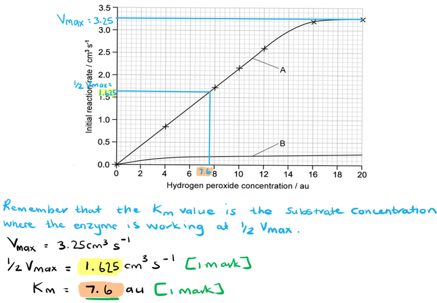
The effect of a competitive inhibitor on enzyme affinity would be...

- It would decrease the affinity of an enzyme for its substrate** OR** it would increase the Km value / Michaelis-Menten constant of that enzyme; **[1 mark]**

**[Total: 1 mark]**

> *Competitive inhibitors will have the greatest impact on the reaction rate at low substrate concentrations since both inhibitor and substrate are competing for the same active site. This means that it will take a greater concentration of substrate for the enzyme to function at a rate of **1**/**2** V**max**. Once the substrate concentration increases it will outcompete the inhibitor for the active sites and the reaction rate will increase.*

### Q2
The reaction that is catalysed by lactase is...

**Final answer:** **Any**** four ****of the following:**

- Disaccharide to monosaccharides; **[1 mark]**
- **Y** is water / water is required; **[1 mark]**
- Hydrolysis reaction; **[1 mark]**
- Glycosidic bond broken; **[1 mark]**
- **Z** is α-glucose; **[1 mark]**
- Detail of enzyme action e.g. induced-fit or lock-and-key hypothesis described; **[1 mark]**
- β-1,4-(glycosidic bond) broken; **[1 mark]**

**[Total: 4 marks]**

> *While you may not be familiar with the specifics of lactose breakdown, you should be aware of the general principles around the break down of carbohydrates so you can apply these principles to this unfamiliar situation.*
(i) Product inhibition is useful in *K. lactis* when lactase is acting as an intracellular enzyme, but can be a disadvantage when extracted lactase is used free in solution for the production of lactose-free milk because...

*Intracellular advantage:*

- Controlling/maintaining balanced/efficient metabolism **OR **if glucose/galactose/monosaccharides are present then there is no need for uptake/breakdown of lactose **SO** this avoids osmotic problems as there is no build-up of monosaccharides; **[1 mark]**

*Disadvantage when used in solution:*

- Loss of product / reduced productivity / product required continuously / slows rate of reaction / enzyme needs to remain active; **[1 mark]**

(ii) Using immobilised lactase for the production of lactose-free milk helps to reduce the problem of product inhibition because...

**Final answer:** **Any ****one ****of the following:**

- Products and enzymes are kept separate / are separated; **[1 mark]**
- The product can be removed immediately; **[1 mark]**

(iii) One feature of cellulose triacetate that makes it useful as an immobilising material is...

**Final answer:** **Any ****one ****of the following:**

- Inert/unreactive / cannot be digested by lactase; **[1 mark]**
- Non-toxic; **[1 mark]**
- Insoluble; **[1 mark]**
- Long shelf-life; **[1 mark]**
- Can create small/appropriate/useful mesh size **OR **enzymes can attach to fibres; **[1 mark]**

**[Total: 4 marks]**

> *This question provides a complicated context with several unfamiliar technical terms such as 'product inhibition' and 'cellulose triacetate'. Don't be thrown by complicated terminology like this; you are not expected to have heard of these terms before and the question provides you with all of the information that you need (along with your existing knowledge) to answer the questions. Take your time to read through the information provided and understand the details before constructing your answers.*
The progress of an enzyme-catalysed reaction can be investigated experimentally by...

**Final answer:** **Any ****three ****of the following:**

- Controlled variables, e.g. constant pH/temperature; **[1 mark]**
- Take samples at timed/regular intervals; **[1 mark]**
- Determine substrate/lactose concentration / product/glucose/galactose concentration; **[1 mark]**
- Plot graph of substrate/product concentration against time; **[1 mark]**
- Calculate the rate of disappearance of substrate / appearance of the product; **[1 mark]**
- Determine initial rate; **[1 mark]**

**[Total: 3 marks]**

### Q3
The initial rate of reaction is...

- 16 ÷ 2 = 8; **[1 mark]**
- cm3 min-1; **[1 mark]**

**[Total: 2 marks]**

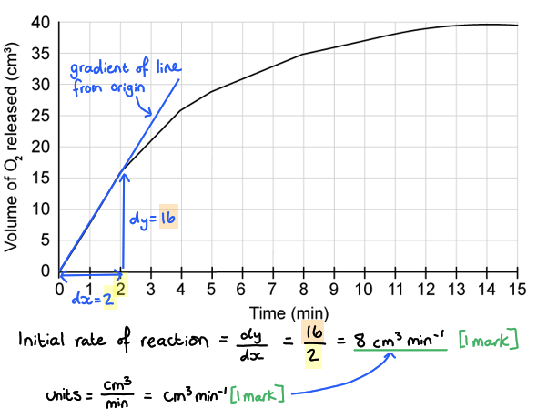
(i) The graph of the line at 60°C would appear as follows:

- Line is steeper at start / initial rate of reaction is faster; **[1 mark]**
- The maximum volume / plateau is lower; **[1 mark]**

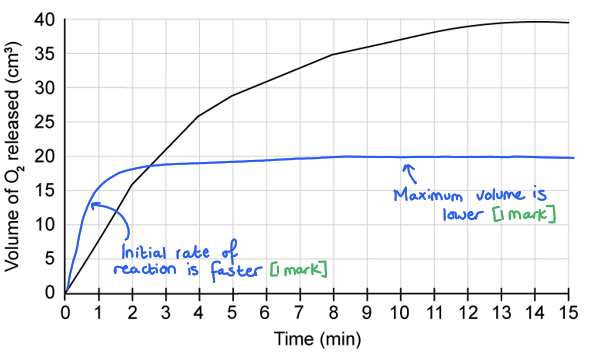

(ii) An explanation for the shape of the line in (i) is...

- Initial rate is higher **AS** the higher kinetic energy will mean more collisions/enzyme-substrate complexes; **[1 mark]**
- The plateau is lower **AS **the enzymes become <u>denatured</u> more quickly (at high temperature); **[1 mark]**

**[Total: 4 marks]**
Factors that the student would need to consider in the experimental design could include...

**Final answer:** **Any ****three ****of the following:**

*Keeping control variables constant*

- Keeping the same <u>concentration</u> of hydrogen peroxide/H2O2 / catalase solution; **[1 mark]**
- Keeping the same <u>volume</u> of hydrogen peroxide/H2O2 / catalase solution; **[1 mark]**
- Adding a buffer to / controlling the pH of the reaction solution; **[1 mark]**

*Ensuring reliability*

- Repeating the experiment several times at each temperature; **[1 mark]**
- Using repeat data to calculate a mean **AND** excluding any anomalies; **[1 mark]**

*Reducing error due to inaccuracy or uncertainty*

- Using a thermometer/thermometers to ensure that the water bath temperatures are accurate; **[1 mark]**
- Using a gas syringe with small divisions (to reduce error that occurs due to uncertainty in measurements); **[1 mark]**

**[Total: 3 marks]**

> *The mark scheme here has been divided into sections to help explain how each of the suggested considerations aids validity; note that this question does not require you to make this distinction in your answer.*

> *Validity is all about **whether or not an experiment measures what it set out to measure**, i.e. in this case whether it allows the students to measure the effect of temperature on catalase activity. Validity is reduced when:*

- *Variables other than the independent variable affect the dependent variable, e.g. if a different concentration of catalase solution is used at some temperatures then this will affect the outcome*
- *Results are not **reliable**, i.e. they are different each time the experiment is repeated*
- *Equipment is **inaccurate,** e.g. the water baths are not maintaining the temperature that they state*
- *Equipment is not **precise** so there is a high degree of error due to **uncertainty** in measurements, e.g. a gas syringe might only measure volume to the nearest 1 cm**3*
We would expect the student's results to show the following about the effect of temperature on catalase activity:

- Reaction rate will increase as temperature increases; **[1 mark]**
- The maximum rate of reaction will be at (around) 40 °C; **[1 mark]**
- Rate of reaction will decline steeply as temperature increases above 40 °C; **[1 mark]**

**[Total: 3 marks]**

> *The question stem tells us that catalase enzyme is active in human liver cells, indicating that the optimum temperature of catalase is likely to match the core temperature of the human body. The experiment doesn't test a range of temperatures between 30-40 °C, so with 40 °C being the closest of the tested temperatures to core body temperature (37 °C), we would expect 40 °C to show as the optimum in this experiment.  *

### Q4
(i) Measuring the absorbance of the reaction mixture over 100 s is a suitable method for determining the activity of Neutrase® because...

**Final answer:** **Any ****two**** of the following:**

- (Neutrase® breaks down/hydrolyses) protein to peptides/amino acids/smaller molecules **OR** there is an increase in solubility (of the molecules within the mixture); **[1 mark]**
- (Therefore) during the reaction more light passes/is transmitted through / less light is absorbed (by the mixture); **[1 mark]**
- 100 s is long enough to see the progress of the reactions; **[1 mark]**

***Ignore**** references to allowing the reaction time to be completed ****OR**** to allowing the rate of reaction to be calculated.*

(ii) With reference to the data in Fig. 1...

**Final answer:** **Any ****five**** of the following:**

The effects of copper sulfate solution and potassium sulfate solution on the activity of Neutrase® include...

- Copper sulfate decreases the activity of Neutrase (as shown in the results for A and B); **[1 mark]**
- 0.01 (mol dm-3)/low concentration of copper sulfate has less of an effect than 0.05 (mol dm-3)/high concentration (as shown in A and B); **[1 mark]**
- Potassium sulfate has little/no effect on the activity of Neutrase (as shown in the results for C); **[1 mark]**
- Comparative data quoted that gives **two** absorbance readings from two lines at the same time **AND** the unit for time is included e.g. after 60 s the absorbance for line A is 1.28 and for line B is 1.17; **[1 mark]**

The described effects can be explained as follows...

- Copper sulfate is an inhibitor of Neutrase; **[1 mark]**
- Potassium sulfate is not an inhibitor; **[1 mark]**
- Copper sulfate binds to neutrase (anywhere on the molecule); **[1 mark]**
- (When copper sulfate has bound to neutrase) the substrate cannot enter the active site / fewer ESCs form (so the proteins are not hydrolysed); **[1 mark]**

**[Total: 7 marks]**

> *(i) This is a tricky question where you need to apply your knowledge of protein hydrolysis and colorimetry to an unfamiliar situation.*

> *The solution appears to be cloudy due to the presence of insoluble proteins. When proteins are hydrolysed by Neutrase, amino acids are produced which dissolve in the solution. When the amino acids dissolve they no longer create a cloudy appearance, so as more protein is broken down into amino acids the solution becomes less cloudy.*

> *Colorimeters shine a beam of light through a solution, and the amount of light absorbed by the solution gives a measure of its cloudiness or depth of colour. The less cloudy/colourised a solution is, the more light will pass through it, so the lower the absorbance reading will be. This means that as Neutrase hydrolyses protein, the solution will become less cloudy and the absorbance reading will decrease.*

> *After 100 s the absorbance reading is close to 0, showing that this allotted time period is long enough to see the progress of the reaction.*

> *(ii) To gain marks in this question a correct understanding of what the graph is showing is essential. The downward trend shown by all of the lines indicates decreasing absorbance, and therefore the hydrolysis of proteins by Neutrase over time. The steeper the downward gradient, the greater the activity of Neutrase, so there is very little activity in A, a little more in B, and a high level of activity in C and D. This can be explained if copper sulfate acts to inhibit the action of Neutrase by binding to the enzyme and preventing the formation of ESCs.*
The advantages of using immobilised enzymes, such as Neutrase®, compared with using the same enzymes free in the solution include…

**Final answer:** **Any ****two ****of the following:**

- (Immobilised) enzymes can be reused; **[1 mark]**
- (Immobilised) enzymes can be easily recovered; **[1 mark]**
- Downstream processing is easier; **[1 mark]**
- The product is not / is less contaminated (with enzymes) / does not need to be purified; **[1 mark]**
- The enzymes have a longer shelf-life; **[1 mark]**
- There is less inhibition of the enzyme by the product; **[1 mark]**
- The enzyme is more stable/thermostable / can work/function at high temperatures / can work/function at a range of pHs / is less likely to denature; **[1 mark]**

***Ignore**** references to 'withstanding' changes in temperature for marking point 7; the statement must be clearly related to the enzyme's ability to function.*

**[Total: 2 marks]**

### Q5
The cleaning chemicals could carry out their function by...

**Final answer:** **Any ****two ****of the following:**

- The enzymes target the molecules in the organic waste/vomit/urine **AND **a named example, e.g. urea / proteins / carbohydrates / lipids; **[1 mark]**
- The enzymes <u>hydrolyse</u> the bonds in the organic material **AND** a named example of a bond, e.g. covalent bonds / peptide bonds / ester bonds / glycosidic bonds; **[1 mark]**
- The resulting small molecules / monomers / named monomers can be easily removed / washed/wiped away; **[1 mark]**

**[Total: 2 marks]**
(i) The efficiency of the cleaning products could be affected as follows:

*This could reduce the effectiveness of the cleaning chemicals because...*

- The acidity/low pH could <u>denature</u> the enzymes; **[1 mark]**
- The H+ ions (in the acid) interfere with the hydrogen bonds in the secondary structure / the hydrogen/ionic bonds in the tertiary structure of the enzyme; **[1 mark]**
- The <u>active site</u> will change shape **AND** can no longer bind to the substrates / fewer enzyme-substrate complexes can form; **[1 mark]**

(ii) The chemical companies could improve the efficiency by:

- Including enzymes that have a lower optimum pH / that are more stable across a range of pH levels / that are extracted from bacteria that live in acidic conditions; **[1 mark]**

**[Total: 4 marks]**
This would be important to the consumer because...

- The area where the chemical is applied is exposed to animals/young children **AND** the product could be (accidentally) ingested / could come into contact with skin; **[1 mark] **

The companies may be able to claim that the product is non-toxic because...

- Enzymes are highly specific / show specificity; **[1 mark] **
- They will only act on the molecules within the stain **AND** will not act on the cells/skin/digestive tracts of humans/animals; **[1 mark] **

**[Total: 3 marks]**
The benefits of dissolving the powder in warm water are as follows:

- High temperatures increase <u>kinetic energy</u> (of the enzyme and substrate molecules); **[1 mark]**
- Enzyme and substrate molecules collide more frequently / more enzyme-substrate complexes form **SO** there is a higher rate of reaction / the stain will be removed more quickly; **[1 mark]**

**[Total 2 marks]**

### Q6
The activity of enzymes X and Y differ in the following ways...

**Final answer:** **Any**** two**** of the following:**

- (Enzyme) X has an optimum pH of 3 WHILE (enzyme) Y has an optimum pH of 9 **OR** X has a low<u>er</u> optimum pH than Y **OR** Y has a high<u>er</u> optimum pH than X; **[1 mark]**
- X is active at low<u>er</u> pH values than Y **OR** Y is active at high<u>er</u> pH values than X** OR** X is active between pH values 1 and 5 WHILE** **Y is active between pH values 6 and 12; **[1 mark]**
- X is active over a small<u>er</u> range of pH values than Y **OR **Y is active over a larg<u>er</u> range of pH values than X; **[1 mark]**
- X has a low<u>er</u> maximum rate than Y **OR** Y has a high<u>er</u> maximum rate than X **OR** enzyme X has a maximum rate of 12.5 arbitrary units WHILE Y has a maximum rate of 18.5 arbitrary units; **[1 mark]**

**[Total: 2 marks]**

> *Remember to focus on the **differences** between the activity of these two enzymes when you answer this question; each statement should contain a comparison word such as high**er**, low**er**, or **WHILE**.  *
The role of a buffer solution is to...

- Maintain the pH of the solution/reaction (even if the reaction would otherwise change it); **[1 mark]**

**[Total: 1 mark]**

> *Certain reactions may produce products that can change the pH of the solution. This would affect the results gathered from the investigation. Buffer solutions will prevent this from happening as they will keep the pH at a specific value.*
The results above 40 °C can be explained as follows...

**Final answer:** **Any ****three**** from the following:**

- At high temperatures / above 40 °C the enzyme begins to denature; **[1 mark]**
- The bonds holding the enzyme (molecule) in its shape break (due to the vibration of the molecule); **[1 mark]**
- (This causes) the <u>tertiary structure</u> (to) change(s); **[1 mark]**
- The <u>active site</u> loses its shape/structure; **[1 mark]**
- The substrate will no longer fit into / have a complementary shape to, the active site **OR** an enzyme-substrate complex can no longer form; **[1 mark]**

**[Total: 3 marks]**

> *When an enzyme denatures the reaction rate will decrease dramatically, as more and more active sites lose their shape. This will continue until all the active sites are distorted and the reaction rate drops to zero. Denaturation is a permanent change and the enzymes will not be able to catalyse a reaction again.*
The percentage increase in the reaction rate is...

- (4$\div$0.5) x 100 **OR** 8 x 100; **[1 mark]**
- 800 (%); **[1 mark]**

*Full marks awarded for the correct answer* *in the absence of other calculations. *

**[Total: 2 marks]**

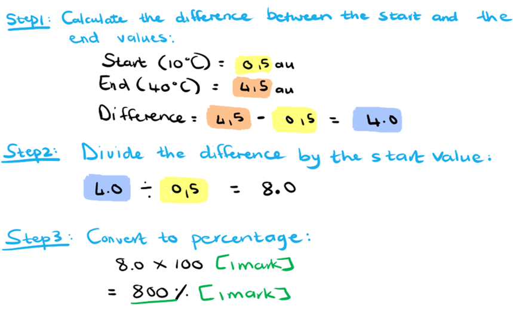

### Q7
The initial rate of the reaction is...

- Calculation that shows an initial increase in product concentration ÷ time; **[1 mark]**
- 0.6 - 0.8 <u>µmol dm</u><u>-3</u><u> min</u><u>-1</u> / <u>µmol per dm</u><u>3</u><u> per min</u>; **[1 mark]**

**[Total: 2 marks]**

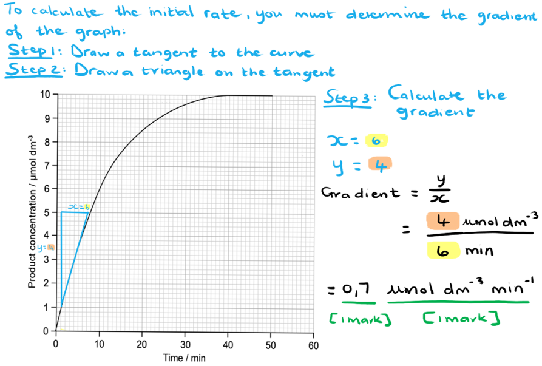
In the presence of a competitive inhibitor the following results would be expected...

- The initial rate will be lower/slower **OR **it will take longer (than 39 minutes) to reach the plateau / end concentration / 10 µmol dm-3;** [1 mark]**
- The final/end concentration (of product) will still be the same / 10 µmol dm-3; **[1 mark]**

**[Total: 2 marks]**

> *A competitive inhibitor competes with the substrate to bind to the active site of the enzyme so the initial rate of the reaction in the presence of the competitive inhibitor when the substrate concentration is low will be slower. Once the substrate concentration increases, however, it will outcompete the inhibitor and the same end concentration of product will be reached.*
For a non-competitive inhibitor the following results may be observed...

- The overall rate of the reaction would be lower/slower; **[1 mark]**
- The final/end concentration of the product will be less/lower; **[1 mark]**

**[Total: 2 marks]**

> *A non-competitive inhibitor does not compete with the substrate for the active site as it binds to other parts of the enzyme (known as allosteric sites). They distort the shape of the active site when they bind to the enzyme and therefore prevent the substrate molecules from binding. Because non-competitive inhibitors do not compete for the active site, increasing the substrate concentration will have no effect on the rate of the reaction and the enzyme will not be able to reach its maximal reaction rate.*
Advantages of calculating initial rates of reaction are...

**Final answer:** **Any ****two**** of the following:**

- A valid comparison can be made between different enzyme activities/reaction rates; **[1 mark]**
- The rate can vary if calculated over a longer period of time / over the curved part of the graph; **[1 mark]**
- (The initial rate is) not affected by substrate concentration / enough substrate is available; **[1 mark]**
- (The initial rate is) not affected by (increases in) product concentration (some products can act as inhibitors or alter pH);** [1 mark]**

**[Total: 2 marks]**

> *The rate of an enzyme-catalysed reaction is the fastest during the initial part of the reaction. At this point there are ample amounts of substrate available to bind to the enzyme active sites and the product concentration is too low to influence the reaction rate. As the reaction progresses these factors start affecting the rate, so we usually try to measure the reaction rate as close as possible to the start of a reaction.*

### Q8
The effect of increasing enzyme concentration on the rate of reaction would be...

- The higher the enzyme concentration, the higher the rate of reaction / as enzyme concentration increases so does the rate of reaction; **[1 mark]**
- More <u>active sites</u> would be available / more frequent collisions with substrate molecules would occur **SO **more enzyme-substrate complexes would form; **[1 mark]**

**[Total: 2 marks]**

> *The rate of the reaction would increase as more enzyme active sites are available. This would only occur in the presence of sufficient amounts of substrate.*
The graph of enzyme concentration against the rate of reaction when the substrate is limited will have the following features...

- A linear increase in reaction rate at first; **[1 mark]**
- Graph plateaus / levels off when substrate becomes limited; **[1 mark]**

**[Total: 2 marks]**

> *The graph would increase with an increase in enzyme concentration until the amount of substrate becomes the limiting factor. The line would level off at this point and any further increase in enzyme concentration would see no further increase in the reaction rate.*

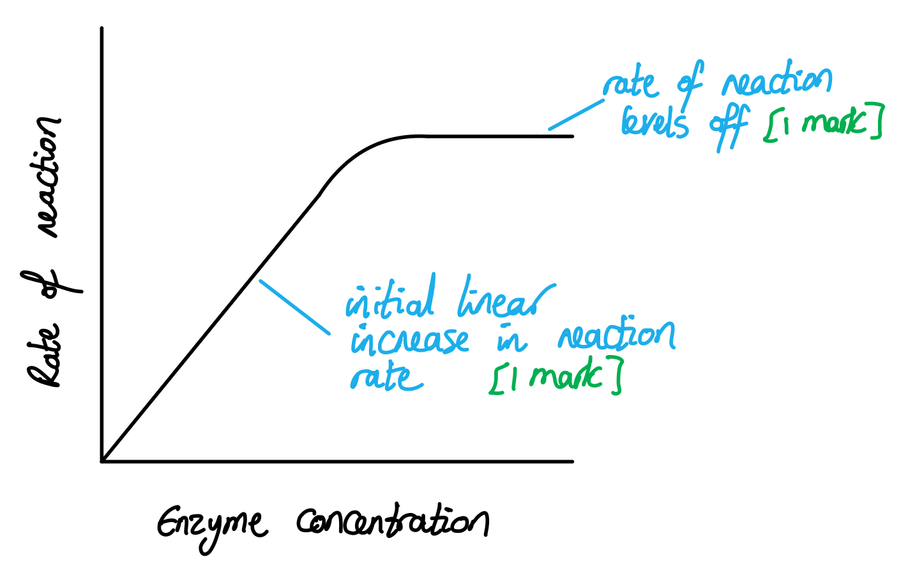
The reaction rate for 100% hydrogen peroxide is...

- 1 ÷ 9; **[1 mark]**
- 0.111; **[1 mark]**

**[Total: 2 marks]**

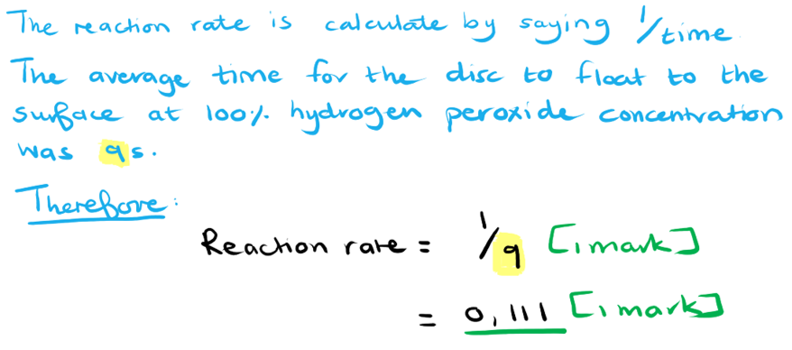
The results in Table 1 can be explained as follows...

- As the amount of substrate increases the chance of enzyme-substrate complex formation increases / enzymes and substrates collide more frequently/often **SO** reaction rate increases; **[1 mark]**
- Eventually, all of the <u>active sites</u> are occupied by substrate / Vmax is reached **SO** the rate of reaction levels off/plateaus; **[1 mark]**

**[Total: 2 marks]**

> *In order to explain the results here you first need to work out what they are actually showing. You should be able to observe that the time taken for the discs to float to the surface decreases as substrate concentration increases (quickly at first and then levelling off towards the maximum substrate concentration). The time taken for the discs to float can be used as a measure of reaction rate; the breakdown of hydrogen peroxide produces oxygen gas and the bubbles cause the paper to float; the faster the gas is produced, the less time will be taken for the discs to rise to the surface.*

> *The rate of reaction here increases until all the enzyme active sites are occupied by substrate molecules. Once this point is reached any further increase in substrate concentration will not increase the reaction rate; this is V**max**.*

### Q9
The activity of immobilised and free amylase at different temperatures can be compared as follows...

*Similarities*

- Both show an increase in activity as temperature increases up to 60 °C, after which activity decreases **OR** optimum temperature / maximum activity for both enzymes occurs at 60 °C; **[1 mark]**

*Differences*

- Activity of the free amylase/enzyme decreases <u>more</u> steeply after optimum/maximum/60 °C **OR** activity of the immobilised amylase/enzyme decreases <u>less</u> steeply after optimum/maximum/60 °C **OR **immobilised amylase/enzyme activity is high<u>er</u> (than free amylase/enzyme) at temperatures above 60 °C; **[1 mark]**
- The free amylase/enzyme is (completely) inactive at 80 °C **WHILE** the immobilised amylase/enzyme is still (27 %) active; **[1 mark]**

*Data points*

- Any pair of comparative activity percentage values given for both enzymes at any given temperature (other than those given in the mark scheme so far); **[1 mark]**

*At least one similarity and one difference must be included for full marks to be awarded, e.g. award a maximum of 2 marks for an answer that includes two differences and data points only.*

**[Total: 3 marks]**

> *When comparing the activity of the enzymes at different temperatures, it is important to take note of both similarities and differences between them in order to get full marks for this question.*
The size of the alginate beads would affect the enzyme activity because...

- Larger beads will have a larger surface area; **[1 mark]**
- (This) will expose more enzyme/amylase to the substrate / increase the number of collisions between amylase/enzyme and substrate (increasing enzyme activity); **[1 mark]**

**OR**

- Smaller beads will have a smaller surface area; **[1 mark]**
- (This) will expose fewer enzymes/amylase enzymes to the substrate / decrease the number of collisions between amylase/enzyme and substrate (decreasing enzyme activity); **[1 mark]**

**OR**

- The surface area of the beads affects the available space for enzyme binding; **[1 mark]**
- (This) will affect the number of enzymes exposed to the substrate / that can collide with the substrate (affecting enzyme activity); **[1 mark]**

**OR**

- The surface area to volume ratio/SA: V decreases with an increase in (bead) size; **[1 mark]**
- It will (therefore) take longer for the substrate to diffuse through/across/to the centre of the bead / there will (therefore) be decreased contact between substrate and enzyme/amylase (decreasing enzyme activity); **[1 mark]**

**OR**

- Surface area to volume ratio/SA: V increases with a decrease in bead size; **[1 mark]**
- The substrate will (therefore) diffuse through/across/to the centre of the bead more quickly / there will (therefore)be increased contact between substrate and enzyme/amylase (increasing enzyme activity); **[1 mark]**

**[Total: 2 marks]**

> *Beads used for the immobilisation of enzyme can either be porous/permeable to the substrate or non-porous/impermeable. If the beads are impermeable then it is simply the surface area of the beads that will affect the enzyme activity, e.g. a larger surface area exposes more enzyme to the substrate and increases enzyme activity. If the beads are permeable then it is the surface area to volume ratio that affects enzyme activity, e.g. smaller beads will have a larger surface area to volume ratio, increasing the rate at which substrate can diffuse through the bead and increasing contact between enzyme and substrate; this will increase enzyme activity. *
(i) One variable that should be controlled is...

**Final answer:** **Any ****one**** of the following:**

- Concentration of enzyme/substrate solution; **[1 mark]**
- Volume of enzyme/substrate solution; **[1 mark]**
- pH of the solution; **[1 mark]**

(ii) The reason for this is that...

**Final answer:** **Any ****relevant point**** from the following:**

- (The concentration/volume of the enzyme/substrate solution) will influence the number of collisions that can occur between the enzyme <u>active site</u> and substrate / number of <u>enzyme-substrate complexes</u> that can form; **[1 mark]**
- (The pH of the solution) can break the bonds in the tertiary structure of the enzyme / alter the shape of the active site / denature the enzyme (if the pH is not optimum / is too extreme); **[1 mark]**

**[Total: 2 marks]**

> *Keeping control variables constant is important for the validity of the investigation. This will ensure that any change in activity observed will be due to the independent variable (in this case temperature).*
Advantages of using immobilised enzymes in the industry include...

**Final answer:** **Any ****three**** of the following:**

- (Immobilised enzymes) are more active / more stable / less likely to denature at higher temperatures; **[1 mark]**
- (Immobilised enzymes) are active/stable over a greater pH range / at extreme pH levels; **[1 mark]**
- (Immobilised enzymes) can be reused/recovered more easily; **[1 mark]**
- Product will not be contaminated by (immobilised) enzymes / less purification/processing of the product is needed; **[1 mark]**

**[Total: 3 marks]**

> *Immobilising enzymes have revolutionised industrial processes that require them. The alginate beads make the enzyme more stable and tolerant to a wider range of temperatures and pH values that would denature free enzymes. Since the enzymes remain in the beads they do not end up in the product so industries save much time and effort in the purification process downstream.*

### Q10
The type of bond that joins the two monosaccharides in lactose is...

- Glycosidic (bond); **[1 mark]**

**[Total: 1 mark]**
(i) The type of reaction that breaks the bond between the two monosaccharides in lactose is...

- Hydrolysis; **[1 mark]**

(ii) The presence of lactose in the intestine reduces the volume of water absorbed because...

**Final answer:** **Any ****two ****of the following:**

- (Lactose) lowers the water potential (in the lumen of the intestine); **[1 mark]**
- (This) reduces the water potential gradient (between the intestine and the blood); **[1 mark]**
- (This) reduces the rate at which <u>osmosis</u> occurs (between the intestine and the blood); **[1 mark]**

**[Total: 3 marks]**

> *(i) Be careful not to confuse hydrolysis and condensation reactions; hydrolysis adds water and breaks a bond while condensation releases water and forms a bond.*

> *(ii) You may have come across the term 'water concentration' at GCSE as a way of describing the concentration of a solution in terms of the amount of water present, but this is no longer suitable language at A-level. You must refer to the number of water molecules free in a solution as **water potential **to gain credit here.*

> *The question outlines that diarrhoea results when lactose cannot be digested and so any reference to water being removed during hydrolysis is not correct (as this would reduce the volume of water in the intestine and so would not result in diarrhoea). *
(i) The advantages of using small beads rather than large beads are...

**Final answer:** **Any ****two ****of the following:**

- More beads can be packed into the column; **[1 mark]**
- (The beads) slow the passage of milk through the column; **[1 mark]**
- There is more time for enzyme to be exposed to substrate; **[1 mark]**
- (Small beads have a) larger surface area to volume ratio; **[1 mark]**
- Rate of reaction will be faster; **[1 mark]**
- It will take less time to collect results (at each temperature); **[1 mark]**
- There will be a fast(er) rate of diffusion of substrate/product; **[1 mark]**

(ii) A comparison of the effect of temperature on the activity of immobilised lactase, **I**, and lactase free in solution, **F **is...

**Final answer:** **Any ****three ****of the following:**

- Both have the same activity between 0 and 20 °C / increase from 10 % to 28 % activity between 0 and 20 °C; **[1 mark] **
- Between 20 °C and 40 °C the activity of F increases <u>more</u> steeply (than I); **[1 mark]**
- F has a low<u>er</u> optimum temperature / optimum temperature of F is 40 °C **WHILE** I is 50 °C; **[1 mark]**
- At 70 °C there is no/0 % activity for F / F is denatured **WHILE** there is activity / 4 % activity for I; **[1 mark]**
- Above the optimum temperature I has a steep<u>er</u> decrease of activity; **[1 mark]**
- I is active over a great<u>er</u> range of temperatures (than F); **[1 mark]**

**[Total: 5 marks]**** **

> *(i) This question asked about the advantages of smaller vs larger beads, not the advantages of using immobilised enzymes in general, so make sure to read the question carefully. *

> *(ii) Remember that this question is a **comparison** question so you are expected to refer to both types of enzymes in each point within your answer. Use words such as 'both', 'more than', 'greater', 'less than' and 'while' to make your comparisons obvious.*

> *Whenever you are given a graph to describe it is a good idea to **quote data** to support your points as much as you can. *

### Q11
The optimum temperature of an enzyme is...

- The temperature at which the rate of reaction is at its maximum; **[1 mark]**

**[Total: 1 mark]**
(i) The sketch graph of the relationship between rate of reaction and temperature would appear as follows...

- The curve should gradually increase up to a maximum point between 30-40 °C and then steeply decrease; **[1 mark]**

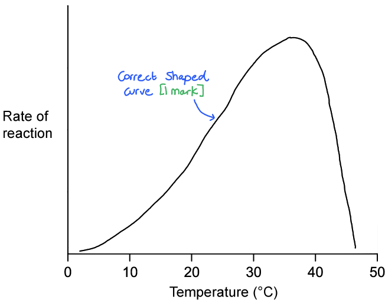

(ii) The optimum temperature of this enzyme should be indicated as...

- Any value between 35-40°C; **[1 mark]**

> *The question specifies that this is an enzyme from the human body and so the optimum temperature should lie within the realistic range of an enzyme from the human body, with some flexibility allowed for rough sketching. *

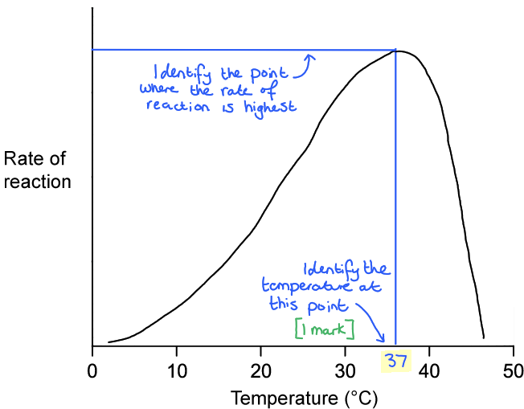

**[Total: 2 marks]**
The benefit of using *Taq* polymerase for PCR is...

- (The reaction/PCR can take place at a higher temperature so)** **PCR takes less time / can occur faster / has a faster rate of reaction; **[1 mark]**
- There is more kinetic energy at high temperatures **SO** there are more collisions (between the enzymes and substrates) / more enzyme-substrate complexes form; **[1 mark]**

**[Total: 2 marks]**

> *Note that this is an **explain** question, so you need to give the possible benefit **AND** say why this benefit occurs.*

> *You are not expected to know about the benefits of Taq polymerase, and you may not have come across PCR yet, depending on where you are in your biology studies, but the information provided in the question stem makes it clear that this is about **temperature**, so you need to consider why it is helpful to have an enzyme that allows a reaction to proceed at a higher temperature. You will be aware that **higher temperatures speed up enzyme-controlled reactions**, and should be able to explain that this is due to the increased **kinetic energy** available.*
A structural difference between the two types of polymerase could be...

- More hydrogen / disulfide / ionic / covalent bonds in Taq polymerase; **[1 mark]**
- An active site that is protected / located on the inside of the molecule; **[1 mark]**

**[Total: 1 mark]**

> *You're not expected to know the details of the structure of specific enzymes, however you can make a reasoned suggestion here based on your knowledge of protein structure. *

### Q12
Molecule **X** affects the rate of the reaction in the following ways...

**Final answer:** **Any ****two**** of the following:**

- The reaction rate is slower throughout; **[1 mark]**
- The increase in reaction rate is slower / more gradual; **[1 mark]**
- The reaction rate levels off/plateaus at a lower point; **[1 mark]**

**[Total: 2 marks]**

> *For questions asking you to describe data, you do not need to think of reasons or explanations for trends observed.*
The results in Fig. 1 can be explained as follows...

**Final answer:** **Any ****two**** of the following:**

- Molecule **X** binds to / is complementary to (an alternative) binding site on the enzyme; **[1 mark]**
- (The binding of molecule **X**) changes the shape/tertiary structure of the <u>active site</u>; **[1 mark]**
- So an <u>enzyme-substrate complex</u> cannot form; **[1 mark]**

**[Total: 2 marks]**

> *Molecule **X** functions as a non-competitive inhibitor. It binds to a site other than the active site on the enzyme, causing a change in the tertiary structure of the active site. This means that the substrate is no longer complementary to the active site and an **enzyme-substrate complex** can no longer form.*
Molecule **Y** might interact with the enzyme by...

**Final answer:** **Any ****two**** of the following:**

- Binding to the active site; **[1 mark]**
- Preventing the substrate from binding / formation of an enzyme-substrate complex; **[1 mark]**
- Therefore acting as a competitive inhibitor; **[1 mark]**

**[Total: 2 marks]**

> *Molecule **Y** is complementary in shape to the active site shown in Fig. 2, so could bind to it. This would block the active site meaning that **Y** has become a competitive inhibitor.*
The line drawn on Fig. 1 should be...

- In between the line for molecule **X** and the line for the normal enzyme; **[1 mark]**
- Almost reaching the reaction rate of the line for the normal enzyme at the highest substrate concentration; **[1 mark]**

**[Total: 2 marks]**

> *Molecule **Y** can bind to the active site of the enzyme and therefore blocks it, acting as a competitive inhibitor. Competitive inhibitors slow down the reaction rate, but because they compete with the substrate they do not slow down the reaction as much as non-competitive inhibitors (molecule **X**).*

> *As substrate concentration increases, the substrate competes more successfully with molecule Y for the active site and the reaction rate can return to normal.*

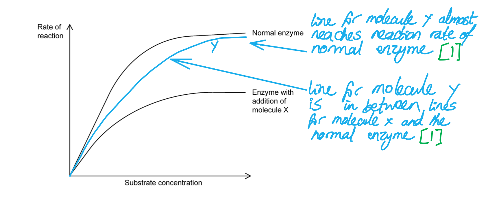

### Q13
The shape of the graph at point X can be explained as follows:

- The <u>active sites</u> of the enzymes are (becoming) saturated/full / there are few/no empty/vacant active sites available for substrate molecules to bind; **[1 mark]**

**[Total: 1 mark]**
The Vmax of the reaction in Fig. 1 is...

- A value between 21 and 24 au; **[1 mark]**

**[Total: 1 mark]**

> *The V**max** is the **maximum rate **of an enzyme-catalysed reaction. The graph here shows a rate of reaction that begins to level off, but that is still very slowly increasing. This means that while the maximum rate on the graph appears to be around 21 au, the true V**max** is very difficult to achieve experimentally, and will be higher than any value gained from an experiment like this one.*
The relationship between enzyme concentration and rate of reaction can be explained as follows...

- As enzyme concentration increases so does the rate of reaction **AS **there are more active sites available to collide with/bind to / more collisions occur between enzyme and substrate; **[1 mark]**
- The rate of reaction levels off **AS **substrate concentration becomes a limiting factor / there is not enough substrate to collide with/bind to the enzyme/active site; **[1 mark]**

**[Total: 2 marks]**
The rate might not reach its possible maximum because...

**Final answer:** **Any ****two ****of the following:**

- Temperature is too high / low; **[1 mark]**
- A (competitive/non-competitive) inhibitor is present; **[1 mark]**
- The pH is too high / low; **[1 mark]**

**[Total: 2 marks]**

### Q14
The effect of increasing the pH from 3 to 5 on the structure of enzyme **X** would include...

**Final answer:** **Any ****two**** of the following:**

- (It will) cause the <u>hydrogen</u> and <u>ionic</u> bonds to break; **[1 mark]**
- This alters/changes the tertiary structure / shape of the <u>active site</u> (of the enzyme); **[1 mark]**
- The enzyme is now denatured; **[1 mark]**

**[Total: 2 marks]**

> *Limit your answer to the structural changes of enzyme **X **only; you will not gain marks for describing the decrease in enzyme activity. Fig. 1 shows that the enzyme activity decreases to 0 as the pH increases from 3 to 5, which indicates that the enzyme has denatured, so your answer would need to focus on how this happened.*
The difference in the maximum enzyme activity of enzyme **X** and **Y** can be calculated as follows...

- Data points for **X** (12.5) and **Y** (18.5) correctly read from Fig. 1; **[1 mark]**
- (18.5 - 12.5) = 6 (a.u); **[1 mark]**

*Full marks awarded for the correct answer in the absence of other calculations*

**[Total: 2 marks]**

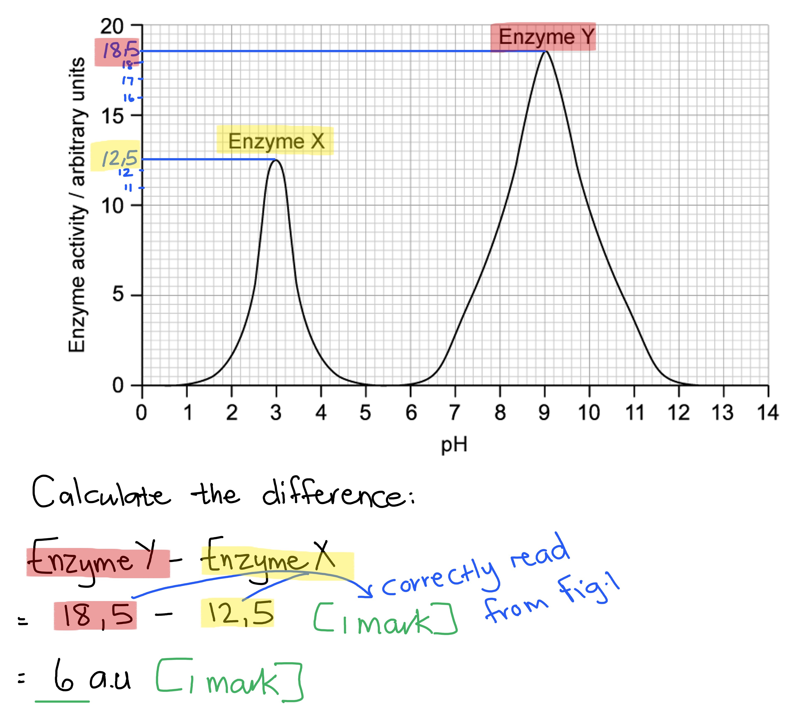
Enzyme **Y** could have been taken from the...

- Small intestine / duodenum; **[1 mark]**

**Reason:**

- It has an optimum pH of 9 **OR** its optimum pH is alkaline; **[1 mark]**

**[Total: 2 marks]**

> *This question requires you to apply your GCSE knowledge of the digestive system. The secretions of the liver and pancreas create an alkaline environment in the duodenum in order for digestive enzymes to complete the chemical digestion of food molecules.*
The mark allocation for the curve would be as follows...

- Curve is only drawn between pH 5 to 10; **[1 mark]**
- The curve peaks at a pH of 7; **[1 mark]**
- The maximum enzyme activity at pH 7 is 16 a.u; **[1 mark]**

**[Total: 3 marks]**

> *Your amylase curve could look something like this:*

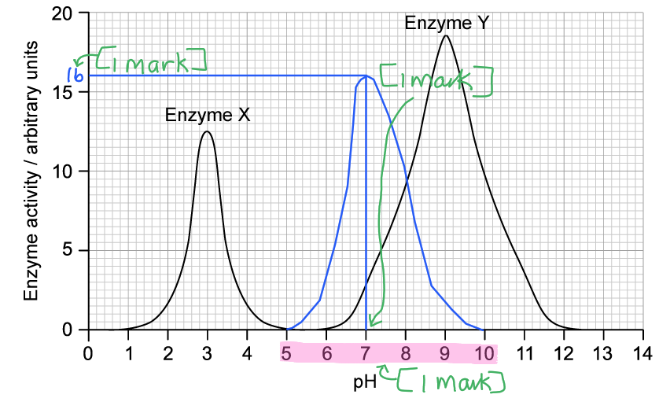

### Q15
The Michaelis-Menten constant...

- Is the substrate concentration; **[1 mark]**
- At which an enzyme works at half its maximum rate / ½Vmax; **[1 mark]**

**[Total: 2 marks]**

> *Knowing the definition of the Michaelis-Menten constant will help build an understanding of this often intimidating concept.*
The affinity of an enzyme for its substrate if it has a low Km value is...

- (The enzyme would have a) high (affinity); **[1 mark]**

**[Total: 1 mark]**

> *There is an inverse relationship between the K**m** value and the affinity of the enzyme for its substrate. This means that an enzyme with a low K**m** will have a high affinity for its substrate. The rate of reaction will therefore reach ½V**max** at a lower substrate concentration than an enzyme with a higher K**m**.*
The effect of lower temperatures on the rate of reaction can be explained as follows...

- The rate of reaction would decrease; **[1 mark]**

This is because...

**Final answer:** **Any ****two**** of the following:**

- (At lower temperatures) molecules move relatively slowly / have less kinetic energy; **[1 mark]**
- (This results in a) lower frequency of successful collisions between substrate molecules and active site (of enzyme); **[1 mark]**
- Fewer/less enzyme-substrate complexes form; **[1 mark]**
- Collisions (between substrate and active site) occur with less energy so bonds are less likely to form/break; **[1 mark]**

**[Total: 3 marks]**

> *The question asks for an explanation, so you would have to provide reasons why lower temperatures would lead to a decrease in the rate of reaction.*
The rate of reaction could be affected by...

**Final answer:** **Any ****two**** of the following:**

- pH; **[1 mark]**
- Enzyme concentration; **[1 mark]**
- Substrate concentration; **[1 mark]**
- Inhibitor concentration; **[1 mark]**

**[Total: 2 marks]**
