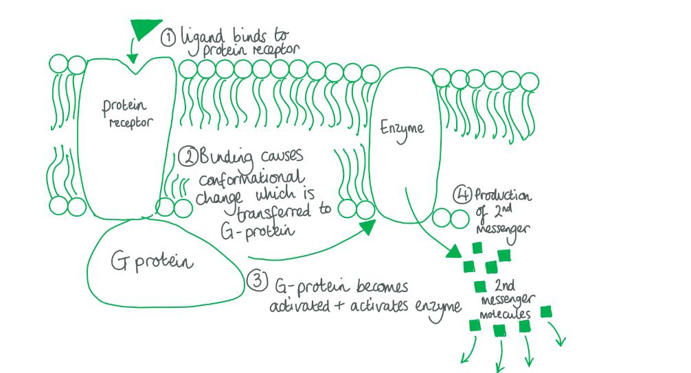
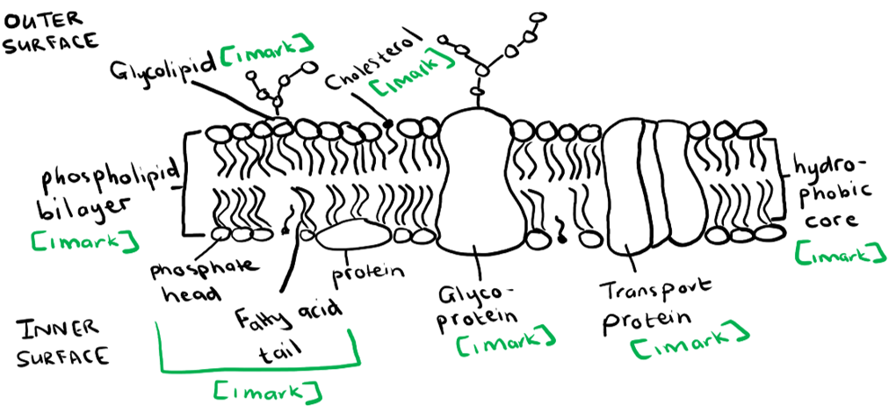
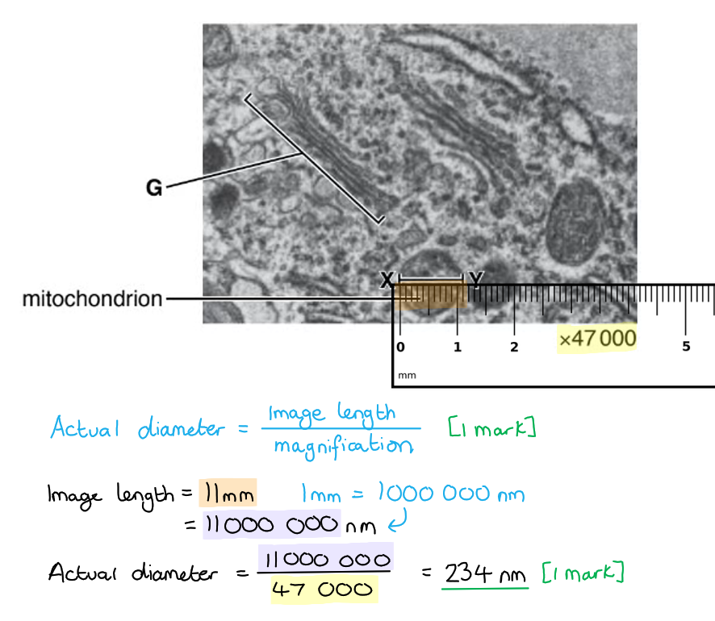

# Mark Schemes — Fluid Mosaic Membranes
**4. Cell Membranes & Transport** · Cambridge (CIE) AS biology (9700)

## Multiple Choice Questions (30 questions)

### Q1
**Final answer:** **The correct answer is ****B ****as:**

- **A ****single ****membrane is ****one**** phospholipid bilayer, a ****double ****membrane is ****two**** phospholipid bilayers usually each containing different internal conditions.**
- **In this question a pore is a hole in the membrane that allows a specific, large molecule through (it does not mean a carrier protein or channel protein).**
- **The ****nucleus**** contains the cell’s genetic material and is surrounded by a membrane which ****protects**** the DNA from ions, reactive molecules and digestive enzymes. Pores are embedded in the membrane to allow mRNA ****transcribed**** from DNA to exit the nucleus and bind to ribosomes.**
- **The ****rough endoplasmic reticulum**** (ER) is the site of ****membrane protein synthesis****. The rough ER has pores in its membrane to enable mRNA to be fed ****directly ****through ribosomes on the rough ER surface (which is what makes it ‘rough’) and ****inserted ****into membranes. **
- **Vesicles**** are organelles that contain proteins for ****secretion**** out of the cell and ****membrane proteins**** that are on the way to being added to the cell membrane. Transport enzymes appear in the membrane of vesicles in order to create an environment within the vesicle that is different from the cytoplasm.**
- **Lipids are made in the ****smooth ER****, which is an organelle made from a phospholipid bilayer. **
- **The ****mitochondria**** is the site of ****respiration**** and therefore oxygen must be able to cross the membrane. As it is a small non-polar molecule O2 is able to pass through the phospholipid bilayer. Mitochondria have a double membrane to enable a ****proton gradient**** to form. **
- **Chloroplasts**** are the site of ****photosynthesis ****in plant cells, they must allow carbon to enter as photosynthesis uses ****carbon dioxide**** and water to produce glucose (which is then used by the cell to produce cellular energy during respiration) and oxygen. Chloroplasts have a double membrane to enable a ****proton gradient**** to form.**

### Q2
**Final answer:** **The correct answer is ****D**** because: **

- **Proteins**** within the cell membrane form ****intermolecular forces ****with the phospholipids that surround them and make up the bilayer**
- **Proteins within the cell membrane are ****not ****bound to any particular phospholipids and are able to ****move freely**** through the phospholipids in the plane of the membrane, almost like a boat in water**
- **All the molecules of the cell membrane are constantly moving past one another due to random movement of molecules**
- **The more fluid the membrane is, the more movement there is**

> *You can think of the phospholipid bilayer as water in a pond and the proteins are boats or buoys that are not anchored.*

> *A **is incorrect as protein and phospholipids are **not** attached or bonded to each other in the cell membrane, they only share weak intermolecular attractions*

> *B **is incorrect as proteins on the outer layer, the inner layer and proteins that span the whole membrane are able to move **freely** between phospholipids*

> *C **is incorrect as proteins in the membrane are not **all** attached to structures in the cell and can move freely like phospholipids. The cell cytoskeleton does attach to the cell membrane but there are proteins in the cell membrane that have a function unrelated to cell structure and are therefore not bound to anything, for example, ion channels.*

### Q3
**Final answer:** **The correct answer is ****D ****as:**

- **Both cell surface membranes and membranes within cells have transmembrane proteins that can bind to enzymes or that act as enzymes**
- **For example:**

  - **Enzymes on the cell surface membrane produce second messengers in cell signalling pathways**
  - **ATPase proton pumps on the mitochondria’s membrane uses the energy of hydrogen ions passing through a protein channel to produce ATP **

> *A **is incorrect as glycoproteins are only found on the extracellular surface of the cell surface cell membrane as they require an oxidising environment*

> *B **is incorrect as only the cell surface membrane allows intracellular transport (transport between cells)*

> *C **is incorrect as only lysosome membranes within the cell contain the contents of lysosomes and protect the cell*

### Q4
**Final answer:** **The correct answer is ****B**** as:**

- **Potassium ions are charged and therefore cannot pass directly through the phospholipid bilayer**
- **A transmembrane transport protein is required to carry potassium ions across the membrane**
- **The potassium ions travel through a hydrophilic pore made by the protein, therefore the component affected in epilepsy will be the hydrophilic part of the transport protein**

### Q5
**Final answer:** **The correct answer is ****C**** as:**

- **Cholesterol has a ****hydrophobic tail**** region that forms ****intermolecular forces**** with the ****fatty acid tails**** of phospholipids:**
- **At ****high temperatures**** molecules have more energy and so the phospholipids ****move more freely**** and are less close to each other. Cholesterol forms intermolecular attractions with the fatty acid chains, bringing them closer together and creating a more stable structure.**
- **Therefore, cholesterol ****decreases**** membrane fluidity at ****high**** temperatures.**
- **At ****low temperatures**** the phospholipids ****move less**** and form more intermolecular forces between separate phospholipids. Cholesterol is smaller than phospholipids and therefore reduces the amount of intermolecular forces.**
- **Therefore, cholesterol ****increases**** the fluidity of the membrane at ****low ****temperatures.**

### Q6
**Final answer:** **The correct answer is ****C ****as:**

- **Water usually exists in a ****flexible network**** of ****hydrogen bonds**** that connect separate water molecules**
- **Hydrogen bonds are ****stronger**** than other intermolecular forces and therefore need ****more energy**** to be overcome or replaced**
- **When a hydrophobic lipid is placed in water the lipid is ****not**** able to replace any of the hydrogen bonds with water that are lost due to the lipids insertion **
- **Therefore, if the hydrogen bonds cannot be replaced or formed the water makes a cage-like structure around the lipid, which is ****unfavourable**** because it reduces the freedom of the water molecules and the number of hydrogen bonds**
- ** Shielding lipid tails within a bilayer reduces this effect because water molecules can interact with the ****hydrophilic phosphate heads**** and maintain their freedom**

> *A **is incorrect as phospholipids don’t have an affinity for each other that is stronger than any other molecule. The **intermolecular forces** between phospholipids are **relatively weak**, the reason why they assemble together is to reduce the effect on water’s hydrogen bond network.*

> *B **is incorrect as a system is more favourable when the **entropy** is higher, that is that the system is **more disordered** because the energy of the system is distributed equally. Phospholipids are forced into a bilayer because the **reduction in entropy** of forming a bilayer is **less** than to form a cage of water around each phospholipid.*

> *D **is incorrect as **van der Waals** (intermolecular) forces are the same strength in a bilayer or not, just the **amount** of van der Waals is greater in a bilayer.*

### Q7
**Final answer:** **The correct answer is ****A ****as**

**Final answer:** **Cholesterol**** is a relatively small molecule with ****both**** hydrophilic and hydrophobic regions.**

- **Cholesterol takes the place of a phospholipid and it used to stabilise the hydrophobic layer of the cell membrane (the middle section where the fatty acid tails are) by regulating the ****fluidity**** of the membrane**

> *At **high temperatures** cholesterol forms intermolecular attractions with the fatty acid chains, bringing them closer together and creating a more stable, **less fluid** structure.  At **low temperatures** cholesterol reduces the amount of intermolecular forces because it is smaller than phospholipids and therefore **increases** the fluidity of the membrane.*

**Final answer:** **Glycoprotein****s are proteins that have been modified to have a ****carbohydrate**** (glyco) chain attached on the ****exterior side**** of the cell membrane **

- **The carbohydrate chain acts as a tag which labels the cell and is used in cell recognition and adhesion **

**Final answer:** **Proteins**** in the cell membrane are embedded into the phospholipid bilayer and provide a ****hydrophilic pore**** for a specific ****charged**** and ****polar**** molecules to cross the membrane.**

> *They can either transport single ions one way (**uniport** e.g. a chlorine channel), two molecules the same way (**symport **e.g. glucose and Na**+**) or two molecules in opposite directions (**antiport** e.g. Na**+** and K**+**).*

**Final answer:** **Phospholipids**** are made of a ****hydrophilic phosphate head**** (which forms the surface of a bilayer) and ****hydrophobic fatty acid tail**** (which forms the middle of the bilayer). **

- **Phospholipids form the ****bilayer structure**** of the cell membrane and make up the highest proportion of all molecules in cell membranes.**
- **Due to the hydrophobic nature of the middle layer of the membrane, the formation of a bilayer acts as a barrier to ions, polar molecules and large molecules, so the cell can be selective about what enters it**

### Q8
**Final answer:** **The correct answer is ****B ****as:**

- **Proteins have an optimal temperature, beyond this the ****hydrogen bonds**** between amino acids break causing the secondary, tertiary and quaternary structure breaks down and the ****denaturing ****of proteins**
- **Ethanol is a molecule with a ****hydrophobic**** hydrocarbon chain and a ****hydrophilic**** polar alcohol (OH) group. Phospholipids also contain hydrophobic and hydrophilic sections and therefore ****will ****dissolve in ethanol. **

> *A **is incorrect as ethanol does **not** denature proteins and phospholipid **do not **dissolve in hydrochloric acid solution because it contains water and charged molecules. Phospholipids will form **micelles** in HCl to protect the lipid tails.*

> *C **is incorrect as ethanol does **not** denature proteins and phospholipids don’t dissolve in high temperatures they just move more **fluidly** within the same structure. In water phospholipids will form **micelles** in HCl to protect the lipid tails.*

> *D **is incorrect as HCl **will** denature proteins as it will change the pH of amino acids in salt bridges and therefore alter the **tertiary structure**. Phospholipids **don’t **dissolve in hydrochloric acid solution because they contain water and charge molecules. Phospholipids will form **micelles** in HCl to protect the lipid tails.*

### Q9
**Final answer:** **The correct answer is ****A ****as:**

- **Lipid-based hormones such as ****steroid hormones**** are able to cross the phospholipid bilayer as they have ****hydrophobic sections**
- **Steroid hormones are derived from cholesterol, which we know has hydrophobic and hydrophilic sections**
- **Because they can cross the cell membrane they are able to travel through the cell to the nucleus and act directly on molecules in the nucleus that regulate ****gene transcription**

> *B is incorrect as protein-based hormones are too large to cross the membrane and therefore cause a response in the cell by binding to protein receptors in the cell surface membrane*

> *C is incorrect as neurotransmitters are too large and sometimes too polar to cross the membrane and therefore cause a response in the cell by binding to protein receptors in the cell surface membrane*

> *D is incorrect as charged molecules (ions) are able to cross the cell surface membrane thanks to transmembrane transport proteins however ions do not act directly in the nucleus as they cannot pass through the nuclear envelope*

### Q10
**Final answer:** **The correct answer is ****C**** as**

**Final answer:** **X**** is a ****glycolipid:**

- **A ****phospholipid**** with a ****carbohydrate chain**** added to the phosphate head**
- **Only found on the ****extracellular ****side of the cell surface membrane**
- **Phospholipids act as ****antigens****, which can be thought of as cellular ****labels**** so the cell can be ****recognised**

**Final answer:** **Y**** is a ****glycoprotein:**

- **A ****protein**** with a ****carbohydrate chain**** attached**
- **Only found on the ****extracellular**** side of the cell surface membrane**
- **Glycoproteins bind molecules such as hormones and neurotransmitters which cause a**** response**** within the cell**
- **Glycoproteins are ****specific ****to a specific molecule or type of molecule**

**Final answer:** **Z**** is a ****phospholipid:**

- **A phospholipid is made of a ****hydrophilic phosphate head**** and ****hydrophobic fatty acid tails**
- **Phospholipids are responsible for the formation of the phospholipid ****bilayer**
- **If a molecule is ****lipid-soluble****, such as steroid hormones and respiratory gases, they can pass through the phospholipid bilayer directly **
- **The phospholipid bilayer forms a barrier to polar molecules**

> *The fluidity of the membrane is regulated by the saturation of the fatty acid tails and by cholesterol molecules.*

### Q11
**Final answer:** **The correct answer is ****B ****as**

- **Chloride ions**** are ****charged**** and therefore ****cannot**** pass through the ****hydrophobic ****middle section of the phospholipid bilayer**
- **Chloride ions require a ****hydrophilic pore**** created by protein to be able to cross the membrane**
- **Proteins are able to create pores because they can be folded so they have ****hydrophobic amino acids**** in contact with the phospholipid bilayer and ****hydrophilic amino acids**** in contact with the solution and ion within the pore**
- **If a chloride ion is moving ****down**** its concentration gradient (from high to low concentration) it will travel through a ****channel protein**
- **If a chloride ion is moving ****against**** its concentration gradient (from low to high concentration) it will travel through a ****carrier protein**** **

> *A **is incorrect as the role of **cholesterol **is to maintain the correct **fluidity** of the membrane and it does **not** transport ions.*

> *C **& **D **are incorrect as **glycolipids** and **glycoproteins** are used in cell recognition, signalling and adhesion but do **not** transport ions.*

### Q12
**Final answer:** **The correct answer is ****B**** as: **

- **A water-soluble signalling molecule, such as a ****hormone**** or ****neurotransmitter****, binds to a ****transmembrane protein receptor**** (a protein that spans the length of the membrane and binds to a specific molecule)**
- **Binding of the signalling molecule causes a ****conformational change**** (change of shape) in the protein receptor which is ****transferred**** to a G protein**
- **The ****G protein**** is associated with the intracellular side of the transmembrane protein and when ****activated**** by the conformational change ****produces GTP**
- **GTP production releases the activated G protein and allows it to move to and activate an ****enzymatic membrane protein**
- **The enzymatic membrane protein produces a ‘****2nd messenger****’ which works to cause a ****response**** within the cell by activating cellular enzymes**
- **For one molecule binding to the transmembrane protein, multiple 2nd messengers can be made – this ****amplifies**** the signal**

### Q13
**Final answer:** **The correct answer is ****D ****as:**

- **The ****fluidity**** of the membrane is ****increased**** by an increased proportion of ****unsaturated**** fatty acid tails**
- **Unsaturated fatty acids contain carbon ****carbon double bonds**** (C=C) which create a bend in the fatty acid chain**
- **Fatty acids are packed together in the middle of the bilayer ****and intermolecular forces**** form between separate molecules**
- **If the fatty acid tails are less tightly packed due to a ****bend**** in a chain there are ****less intermolecular forces**** and therefore the membrane is ****more fluid**** (there is more movement)**

### Q14
**Final answer:** **The correct answer is A as**

**Final answer:** **1 is cholesterol**

- **The role of cholesterol is to regulate membrane fluidity and stabilise the membrane **
- **Cholesterol has a hydrophilic head section that can form hydrogen bonds with water which stabilise the membrane by enabling it to sit within the hydrogen bonding network of water**
- **Cholesterol has a hydrophobic tail region that forms intermolecular forces with the fatty acid tails of phospholipids: At high temperatures molecules have more energy and so the phospholipids move more freely and are less close to each other.**
- **Cholesterol forms intermolecular attractions with the fatty acid chains, bringing them closer together and creating a more stable structure.**
- **Therefore, cholesterol decreases membrane fluidity at high temperatures.**
- **At low temperatures the phospholipids move less and form more intermolecular forces between separate phospholipids. Cholesterol is smaller than phospholipids and therefore reduces the amount of intermolecular forces. Therefore, cholesterol increases the fluidity of the membrane at low temperatures.**

> *2 is a protein channel Ions and polar molecules cannot pass directly through the phospholipid bilayer and therefore rely on proteins to form hydrophilic pores across the membrane*

> *3 is a glycoprotein  A glycoprotein is a membrane protein with a carbohydrate chain added to its extracellular side The function of a glycoprotein is to recognise and bind to molecules involved in cell signalling, recognition and adhesion*

### Q15
**Final answer:** **The correct answer is ****D ****as: **

- **The fluidity of the membrane is ****increased**** by an increased proportion of ****unsaturated fatty acid tails**
- **Unsaturated fatty acids contain ****carbon carbon double bonds**** (C=C) which create a ****bend**** in the fatty acid chain**
- **Fatty acids are packed together in the middle of the bilayer and ****intermolecular forces**** form between separate molecules**
- **If the fatty acid tails are less tightly packed due to a bend in a chain there are ****less intermolecular forces**** and therefore the membrane is ****more fluid**** (there is more movement)**

> *A **is incorrect as the amount of intrinsic proteins does not affect the fluidity of the membrane. Intrinsic proteins span the width of the phospholipid bilayer and move with the surrounding phospholipids.*

> *B **is incorrect as bacteria do not have cholesterol in their cell surface membranes. Decreasing the amount of cholesterol in animals would cause the membrane to be less fluid in cold temperatures and the cholesterol wouldn’t be there to decrease the number of intermolecular forces responsible for a stiff membrane.*

> *C **is incorrect as increasing the proportion of saturated phospholipids would increase the amount of intermolecular forces between fatty acid chains and decrease the fluidity.*

### Q16
**Final answer:** **The correct answer is ****D ****as:**

- **Hydrophilic**** means ‘****water-loving****’ and means that a structure forms favourable interactions with water, such as ****hydrogen bonds**
- **Hydrophobic ****means ‘****water-hating****’ and means that a structure is ****not**** able to form favourable interactions with water**
- **The ****interior**** of a ****transport protein**** is ****hydrophilic**** to enable ****ions**** and ****polar ****molecules to cross the membrane. They are not able to cross the phospholipid bilayer without a transport protein because they are not hydrophobic.**
- **The ****exterior**** of an ****intrinsic protein**** is in contact with the middle of the ****phospholipid bilayer**** and therefore must be ****hydrophobic**
- **The ****carbohydrate chain**** on a glycolipid is on the outside of the cell membrane and is in contact with ****extracellular solution**** (tissue fluid or blood) and is therefore ****hydrophilic**

### Q17
**Final answer:** **The correct answer is ****A ****as:**

- **A**** labels an unsaturated fatty acid chain**
- **The fluidity of the membrane is ****increased**** by an increased proportion of ****unsaturated fatty acid tails**
- **Unsaturated fatty acids contain ****carbon carbon double bonds**** (C=C) which create a ****bend**** in the fatty acid chain**
- **Fatty acids are packed together in the middle of the bilayer and ****intermolecular forces**** form between separate molecules**
- **If the fatty acid tails are less tightly packed due to a bend in a chain there are less intermolecular forces and therefore the membrane is more fluid (there is more movement)**

> *B is incorrect as B is the protein of a glycoprotein. Proteins do not affect the fluidity of a membrane.*

> *C is incorrect as C is a phosphate head, these form the surface of the phospholipid bilayer but do not affect membrane fluidity.*

> *D is incorrect as D is a carbohydrate chain of a glycolipid. Carbohydrate chains are found on the extracellular surface of the membrane and do not affect the fluidity of the membrane. *

### Q18
**Final answer:** **The correct answer is ****B**** as:**

- **B labels the carbohydrate chain of a glycolipid**
- **The ****carbohydrate chain**** of glycolipids are ****variable**** depending on the individual as they lead to cell recognition**
- **Blood groups describe different types of ****antibodies**** (proteins of the immune system) and**** antigens**** (glycoproteins and glycolipids) found on the surface of ****red blood cells**
- **Antibodies bind to certain carbohydrate chain structures on glycoproteins and glycolipids to determine whether a cell is ****self or non-self**
- **Blood groups are important because during ****blood transfusions****, if the wrong blood is given the red blood cells may have glycoproteins and glycolipids that are not recognised by the body, which will elicit an ****immune response**** and rejection of the blood**

> *A **is incorrect as this is a channel protein, the structure of which is specific to the molecule that they transport but do **not** vary within species.*

> *C **is incorrect as this is the protein section of a glycoprotein and is **not** responsible for the specificity of the glycoprotein.*

> *D **is incorrect a is a phospholipid, the structure of which is universal.*

### Q19
**Final answer:** **The correct answer is ****C.**

**Final answer:** **The following molecules can ****form hydrogen bonds with water**** because they are ****hydrophilic****: **

- **Phosphate heads of phospholipids**
- **The hydrophilic head of a cholesterol molecule**
- **Carbohydrate chains and some amino acids of glycoproteins**
- **Carbohydrate chains and phosphate head of glycolipids**

**Final answer:** **The ****carbohydrate chains**** of glycolipids and glycoproteins recognise and ****bind**** to ligands, such as ****hormones**** and ****antibodies****. **

- **Hormones**** are molecules that elicit a ****response**** from a cell and are a ****communication**** method within the body. **
- **Antibodies**** are proteins of the ****immune system**** produced by B-lymphocytes that detect self and non-self cells in the body. **
- **If an antibody binds to a glycolipid or glycoprotein of a pathogen they target it for death, in order to keep the body from being invaded and to prevent diseases. **

> *A, B **&** D **are incorrect as phospholipids and cholesterol have a structural function in the cell membrane and do not bind hormones or antibodies.*

### Q20
**Final answer:** **The correct answer is ****C****.**

**Final answer:** **There are two broad categories of membrane proteins - intrinsic (integral) and extrinsic (peripheral). It can sometimes be difficult to determine which protein is labelled on a diagram. Try to remember that intrinsic proteins are permanently part of the membrane structure, whilst extrinsic proteins tend to be temporarily attached.**

**Final answer:** **W**** is an ****intrinsic protein**

- **Intrinsic proteins are embedded into the membrane and can span the ****whole width**** of the bilayer**
- **Intrinsic proteins can be used as channels to ****transport ions**

**Final answer:** **X**** is an ****extrinsic protein **

- **Extrinsic proteins are attached to the membrane, sometimes transiently, and only span half the membrane or sit on the membrane surface**
- **Extrinsic proteins are usually associated with intrinsic proteins to perform a role in cell signalling **
- **For example: ****G proteins**** in the cell signalling pathway that produce GTP when the cell surface receptor binds its ligand and goes through a conformational change**
- **You would also be awarded a mark for describing this an a intrinsic protein as these can also be attached to only one side of the membrane and do not span the whole way across**

**Final answer:** **Y**** is a ****glycoprotein**

- **Made of an intrinsic protein embedded into the cell membrane and a carbohydrate branched chain on the extracellular side of the membrane**
- **The carbohydrate chain acts as a label for the cell so that the cell can be recognised by hormones, antibodies and other cells**

**Final answer:** **Z**** is a ****phospholipid**

- **Phospholipids consist of a hydrophilic phosphate head and hydrophobic fatty acid tails**
- **Phospholipids cause the formation of the bilayer and are the more abundant molecule in the membrane**
- **fat-soluble molecules such as respiratory gases (O2 and CO2) and steroid hormones can pass through the phospholipid bilayer unaided**

> *Cell shape is determined by the cytoskeleton acting like a scaffold, holding the cell membrane and cell organelles in place. The cytoskeleton is made from fibrous proteins.*

### Q21
**Final answer:** **The correct answer is ****A ****as **

**Final answer:** **Membranes become ****less fluid**** when there is: **

- **An increased proportion of ****saturated fatty acid chains**** as the chains pack together tightly and therefore there is a high number of ****intermolecular forces**** between the chains**
- **A ****lower temperature**** as the molecules have ****less energy**** and therefore are not moving as freely which causes the structure to be more closely packed**

**Final answer:** **Membranes become ****more fluid**** when there is: **

- **An increased proportion of ****unsaturated fatty acid chains**** as these chains are bended, which means the chains are less tightly packed together and there are ****less intermolecular forces**
- **A ****higher temperatures**** the molecules have more energy and therefore move more freely, which increasing membrane fluidity **

### Q22
**Final answer:** **The correct answer is ****B ****as**

- **Cholesterol**** is a relatively small molecule with a ****hydrophilic head**** and ****hydrophobic tail**** **
- **At ****low temperatures****, cholesterol ****increases**** the fluidity of the membrane, to stop it becoming too rigid, as it ****prevents**** close packing of the phospholipid tails **
- **The increased fluidity means cells can survive colder temperatures**
- **At ****high temperatures****, cholesterol ****decreases**** the fluidity of the membrane by interacting with the phospholipid tails which stabilises the membrane**
- **Cholesterol also plays a role in maintaining the mechanical stability of membranes, as without it membranes quickly break and cells burst open**

> *A **is incorrect as **channel proteins** provide **hydrophilic channels** for the transport of glucose and ions in and out of cells*

> *C **is incorrect as **channel proteins** carry out **active transport** up a solutes concentration gradient*

> *D **is incorrect as **channel proteins** carry out **facilitated diffusion** down a solutes concentration gradient*

### Q23
**Final answer:** **The correct answer is ****C**** because:**

- **The cell surface membrane is made of a ****phospholipid bilayer**
- **The bilayer consists of ****two rows of phospholipids**** which are molecules with a ****hydrophilic phosphate head**** and a ****hydrophobic fatty acid tail**
- **If fatty acids have ****longer chains**** there are more ****intermolecular forces**** between them and therefore the membrane is more structured and ****less fluid**
- **Cholesterol can either decrease or increase membrane fluidity depending on temperature and is useful for a cells survival in multiple environments**
- **At high temperatures phospholipids move more freely - ****cholesterol**** decreases membrane fluidity in high temperatures because is forms ****intermolecular forces**** with fatty acid tails, holding them closer together and creating a more solid structure**

> *A **is incorrect as unsaturated fatty acids have **double bonds** between carbon atoms. These double bonds create a bend in the **hydrocarbon chain** and disrupts the tight packing of fatty acid tails and the intermolecular forces between tails. Less intermolecular forces results in a more fluid membrane.*

> *B **is incorrect as this option does not include fatty acids having longer chains, which also decreases fluidity*

> *D **is incorrect as this option does not include cholesterol, which also decreases fluidity at high temperatures*

### Q24
**Final answer:** **The correct answer is ****C**** as:**

- **1**** is ****cholesterol****, which is a relatively small molecule with ****both**** hydrophilic and hydrophobic regions. It takes the place of a phospholipid and it is used to regulate the ****fluidity**** of the membrane.**
- **2**** is a ****glycolipid****, which is a phospholipid that has been modified to have a ****carbohydrate**** (glyco) chain attached. Glycolipids are only found on the ****exterior side**** of the cell membrane and are used in cell recognition and adhesion.**
- **3**** is a protein, specifically an intrinsic ****channel protein****. These proteins are embedded into the phospholipid bilayer and provide a ****hydrophilic pore**** for ****charged**** and ****polar**** molecules to cross the membrane. Each protein binds or transports a specific molecule or type of molecule. The section of the protein in contact with the middle of the bilayer is made from ****hydrophobic**** amino acids, and the part of the protein in contact with water and ions is ****hydrophilic****.**
- **4**** is a ****glycoprotein****, which is a protein that has been modified to have a ****carbohydrate**** (glyco) chain attached. Glycolipids are only found on the ****exterior side**** of the cell membrane and are used in cell recognition and adhesion.**
- **5**** is a ****phospholipid****, which is a molecule made of a ****hydrophilic phosphate head**** (which forms the surface of a bilayer) and ****hydrophobic fatty acid tail**** (which forms the middle of the bilayer). Phospholipids form the ****bilayer structure**** of the cell membrane and make up the highest proportion of all molecules in cell membranes.**

### Q25
**Final answer:** **The correct answer is ****C**** as**

- **Hydrophilic**** means ‘****water-loving****’ and describes a structure that is able to form ****hydrogen bonds**** with water.**
- **Phosphate heads**** are made of a central phosphorus atom bonded to four oxygen molecules, at least one of which is ****negatively charged****. Water stabilises the charge with hydrogen bonding. **
- **Hydrophobic**** means ‘****water-hating****’ and describes a structure that is non-polar and is therefore ****not**** able to form hydrogen bonds with water. Water is made of a large network of water molecules hydrogen bonded to each other. Exposing a hydrophobic structure to water disrupts the ****hydrogen bond network**** and is therefore not favourable. **
- **Fatty acid tails are made from hydrocarbon chains and are therefore non-polar and hydrophobic.**

### Q26
**Final answer:** **The correct answer is ****C ****as:**

- **Structure C is a ****glycoprotein****. Glycoproteins are membrane proteins that have been modified and have a ****carbohydrate chain**** attached to their ****extracellular ****side. The carbohydrate chain enables ****recognition of ligands**** such as hormones and therefore glycoproteins function as ****cell surface receptors****. **
- **Binding of a hormone to a glycoprotein causes a conformational change which is relayed through the membrane to the cytoplasm, where a ****signalling cascade**** (reactions that link the hormone binding to the overall resulting effect of the hormone).**
- **For example, insulin binds to its cell surface receptor in liver cells which activates a signalling pathway within the cell to increase the amount of glucose transporters on the cell membrane. The increase in glucose transporters allows the cell to take in more glucose from the blood, which lowers the blood glucose concentration.**

> *A **is incorrect as this is an **extrinsic protein** (a protein attached to the surface of the membrane instead of being submerged into the bilayer). This protein is also on the **intracellular side** of the membrane. Hormones must bind to the extracellular side of the cell surface membrane in contact with blood or tissue fluid to elicit a response.*

> *B **is incorrect as this is a **phospholipid** which, unless they are modified with a carbohydrate, do **not** bind molecules. Phospholipids have a **structural role** in the cell surface membrane and are responsible for the formation of the **bilayer**.*

> *D **is incorrect as this is a **channel protein** which provides a **hydrophilic pore** for small polar molecules and ions to diffuse through (into or out of the cell). Hormones **don’t** usually enter the cell unless they act directly on the nucleus (steroid hormones). Steroid hormones are hydrophobic and pass straight through the phospholipid bilayer.*

### Q27
**Final answer:** **The correct answer is ****C**** as**

- **Molecule X is a ****carbohydrate chain**** on attached to a cell membrane protein**
- **Carbohydrates are polymers made from ****monosaccharide**** building blocks (monomers) such as mannose **

> *A **is incorrect as amino acids are the monomers that form polypeptides (proteins)*

> *B **is incorrect as nucleotides are the monomers of nucleic acids such as DNA and RNA*

> *D **is incorrect as fatty acids are monomers of lipids (fats)*

### Q28
**Final answer:** **The correct answer is ****B ****as:**

- **Channel proteins**** span the width of the bilayer as their function is to provide a hydrophilic pore ****across**** the membrane for small polar molecules (such as glucose) and ions**
- **Channel proteins are ****permanently embedded**** into the membrane, they can be added or taken away to regulate transport across the membrane but when they are in place they do ****not**** detach from the bilayer **

> *A **is incorrect as peripheral intrinsic membrane proteins do **not** exist because if a protein extends across the whole membrane (is intrinsic) it is folded directly **into** a membrane from the ribosome and therefore will not detach. Intrinsic proteins have a **hydrophobic surface** to enable their placement into the hydrophobic middle section of the bilayer and would become **denatured** in water-based solution.*

> *C **is incorrect as a **channel protein**’s function is to provide a **hydrophilic pore** through the membrane and it would be **unable** to do this if it is **extrinsic** (doesn’t extend across the whole membrane) or **peripheral** (detaches from the membrane)*

> *D **is incorrect as a **channel protein**’s function is to provide a **hydrophilic pore** through the membrane and it would be **unable** to do this if it is **extrinsic** (doesn’t extend across the whole membrane)*

### Q29
**Final answer:** **The correct answer is ****A ****as: **

- **Cell recognition is one of the ways cells ****communicate**** with one another**
- **Cells in a particular organ will have particular molecules in their ****cell surface membrane**** that help:**

  - **Signalling molecules in the blood illicit certain responses from specific organs e.g. there are**** ****glucagon**** receptors**** (****glycoproteins – ****proteins with a ****carbohydrate chain**** on the extracellular side of the membrane) on liver cells (hepatocytes)** **so that the liver can produce glucose from glycogen stores, however other organs will not have glucagon receptors as they do not store glycogen**
  - **Adhesion of cells within organs in order for them to work together relies on ****intrinsic proteins**** (proteins that span the length of the cell membrane)**
  - **Recognition of self and non-self cells by the body’s immune system depends on antigens. Antigens are ****glycolipids**** (phospholipids that have a ****carbohydrate chain**** on the extracellular side of the membrane).**
- **The carbohydrate chain on glycolipids and glycoproteins aids recognition by enabling certain ligands to bind.**

> *Phospholipids form the bilayer, which is the basic structure of the membrane but do not contribute to cell recognition.*

> *Cholesterol is a small molecule with a hydrophilic head and hydrophobic tail which alters the fluidity of the membrane but does not contribute to cell recognition.*

### Q30
**Final answer:** **The correct answer is ****D**** as**

- **The basic structure of a cell surface membrane is ****two continuous rows****, or layers, of phospholipids on top of each other**
- **The phospholipid bilayer is formed to ****isolate non-polar, hydrophobic fatty acid**** (lipid) chains from water, this part of the phospholipids form the middle of the bilayer**
- **Hydrophilic phosphate heads**** are faced out towards the water and can make hydrogen bonds with the water molecules in the extracellular and intracellular space, this part of the phospholipids form the outer of the bilayer surface of the bilayer**
- **Fatty acid chains can be either ****saturated**** (has no C=C double bonds and a straight chain structure) or ****unsaturated**** (contains C=C double bonds and a bended chain structure)**
- **The higher proportion of ****unsaturated**** fatty acid chains results in a ****more fluid**** membrane**
- **The phosphate head and fatty acid tails are connected by a ****glycerol molecule**

## Structured Questions (9 questions)

### Q1
Glucagon is an example of a ligand because...

**Final answer:** **Any**** two ****of the following:**

- It is secreted by a cell in response to a stimulus / drop in blood sugar;** [1 mark]**
- It is transported (by the bloodstream) to a target cell (in the liver); **[1 mark]**
- It binds to a (specific) surface receptor on a target cell; **[1 mark]**

**[Total: 2 marks]**

> *Ligands are signalling molecules that will trigger a response within a target cell once it binds to the relevant receptor. Hormones, such as glucagon, often act as ligands when they cause a reaction within the target cell, in this case, increasing blood glucose levels.*
(i) A contrasting feature between the action of glucagon and oestrogen could be...

**Final answer:** **Any ****one ****of the following:**

- Oestrogen can diffuse/pass/travel (directly) across the cell membrane / between the phospholipids **WHILE** glucagon cannot; **[1 mark]**
- Oestrogen can bind to receptors inside the cell / in the cytoplasm/nucleus **WHILE** glucagon binds to receptors on the outside surface of the cell / receptors located in the cell surface membrane; **[1 mark]**

(ii) The reason for this difference is that...

**Final answer:** **Any ****one ****of the following:**

- Glucagon is hydrophilic so cannot pass between the hydrophobic (fatty acid) tails of the phospholipids / through the hydrophobic core (of the membrane) **WHILE** oestrogen is hydrophobic so it can; **[1 mark]**
- Oestrogen is a steroid hormone so can pass between the phospholipids in the same way as cholesterol **WHILE** glucagon is a peptide hormone so cannot; **[1 mark]**

*Accept reverse answers.*

**[Total: 2 marks]**

> *Since oestrogen is hydrophobic it is able to interact with the hydrophobic fatty acid tails and cross the hydrophobic core of the cell surface membrane, something that glucagon cannot do. Oestrogen can therefore cross the cell surface membrane and bind to receptors on the inside of the cell while glucagon must relay the message across the cell surface membrane by binding to a receptor molecule on the outside surface of the cell.*

> *Steroid hormones resemble cholesterol in their structure so can interact with the phospholipids of the membrane in a similar way to cholesterol; not that this mark point is not something that most students would be expected to know.*
The role of glycoproteins in initiating a response inside a cell includes...

**Final answer:** **Any ****four**** of the following:**

- Glycoproteins act as cell surface receptors; **[1 mark]**
- The carbohydrate chain has a specific/complementary shape to a signalling molecule/hormone/ligand; **[1 mark]**
- The signalling molecule/hormone/ligand binds to the glycoprotein/receptor; **[1 mark]**
- (The glycoprotein/receptor) changes shape/structure; **[1 mark]**
- (The glycoprotein/receptor) spans the membrane **SO** (the shape change) passes the signal to the inside of the cell; **[1 mark]**
- (Glycoproteins) allow for signal transduction / allow a stimulus to be converted into a signal (that can be transmitted to the cell); **[1 mark]**
- (The glycoprotein shape change) activates a G-protein / leads to the release of a second messenger molecule (inside the cell); **[1 mark]**
- (The glycoprotein shape change) leads to a series of chemical reactions / activates a series of enzymes / initiates a signalling cascade (that brings about a response inside the cell); **[1 mark]**

**[Total: 4 marks]**

> *Remember that in order for two molecules to bind together they must have a complementary shape to each other. Glycoprotein receptors are specific to one type of signalling molecule, ensuring that the cell only responds to signals that are specific to it. Binding of the signalling molecule to the receptor molecule is the first step in the cell signalling pathway which includes a change in shape of the receptor molecule, the activation of a G-protein, and the release of another chemical signal known as a second messenger which sets off a cascade of reactions leading to a cellular response. In the case of the ligand glucagon this cellular response would be the breakdown of glycogen into glucose.*

### Q2
The increase in the proportion of phospholipids with unsaturated fatty acids helps plants, such as chickpea, survive decreases in temperature because...

**Final answer:** **Any ****two**** of the following:**

- ('Kinks' in the chain that result from the presence of double bonds) prevent close packing of phospholipids/membrane components (at low temperatures); **[1 mark]**
- (This) maintains membrane fluidity / prevents the membrane from becoming too rigid; **[1 mark]**
- The membrane does not become damaged **AS** freezing is prevented; **[1 mark]**
- (This) maintains movement of (named) substances *across* membranes; **[1 mark]**
- (This) maintains the movement of proteins/membrane components *within* the membrane; **[1 mark]**

***Reject*** *any references to increasing the movement of substances across / within membranes for marking points 4 and 5.*

**[Total: 2 marks]**
(i) Triglycerides and phospholipids cannot** **be described as polymers because...

- (They) are not composed of monomers/repeating units; **[1 mark]**

(ii) Differences in the structure** **of triglycerides and phospholipids include...

**Final answer:** **Any ****two**** of the following:**

- Phospholipids have two fatty acids (tails/residues)/hydrocarbon chains **WHILE** triglycerides have three **OR** phospholipids have one few<u>er</u> fatty acid (tail/residue than triglycerides); **[1 mark]**
- Phospholipids have two ester bonds **WHILE** triglycerides have three; **[1 mark]**
- Phospholipids have a phosphate (group/head) **WHILE** triglycerides do not; **[1 mark]**

**[Total: 3 marks]**

> *When describing differences it is always a good idea to make statements that are clearly **comparative**, e.g. "X has ... while Y has ..." or "X has more of ... than Y" rather than just stating a feature, e.g. X has ... (which does not describe a difference).*

> *Make sure that you are familiar with the structure of these molecules, and be specific with your language; for example, you must say "**fatty** **acid **tails" and not just "tails".*

> *The question asks for **structural** differences so any statements relating to chemical properties or the roles of these molecules will not be credited.*
The constriction of arteries following blood loss is an example of cell signalling because…

**Final answer:** **Any ****four ****of the following:**

- Thromboxane is a (cell) signalling molecule / acts as a signal; **[1 mark]**
- (It is) released into / circulates in the blood/plasma; **[1 mark]**
- (Smooth) muscle cells/tissue are/is the <u>target</u>;** ****[1 mark]**
- Thromboxane binds to <u>receptors</u>; **[1 mark]**
- (It is) complementary to receptors; **[1 mark]**
- The response is smooth muscle (cell) contraction; **[1 mark]**
- Thromboxane activates G proteins / secondary messengers / an enzyme cascade / a chain of reactions; **[1 mark]**

***Ignore**** descriptions of thromboxane that refer to it as a messenger / hormone in marking point 1.*

***Reject**** references to smooth muscle constricting in marking point 6.*

**[Total: 4 marks]**

> *You are not expected to know anything about the action of thromboxane but you should be able to apply your knowledge of cell signalling to this unfamiliar situation.*

### Q3
Fig. 1 represents:

- <u>Cholesterol;</u>** [1 mark]**

**[Total: 1 mark]**

> *You are not expected to be familiar with the molecular structure of cholesterol, but you should be familiar with the different components that are found in the membrane. Since no amino groups (-NH**2**) or carboxylic acid groups (-COOH) are present it cannot be a glycoprotein. There are no phosphate groups (PO**4**3-**) present either which eliminates the possibility of this molecule being a phospholipid. This leaves us with cholesterol or glycolipids as a possible answer. Since the question stem mentions that the molecule plays a role in mechanical stability, it eliminates glycolipids and therefore leads us to cholesterol as the correct answer.*
The presence of unsaturated phospholipids would be advantageous because:

**Final answer:** **Any ****three ****of the following:**

- (Unsaturated phospholipids) tails have more kinks / bends; **[1 mark]**
- (They) prevent close packing; **[1 mark]**
- (This) allows for transport of materials / substances / molecules across membrane; **[1 mark]**
- To allow year-round growth / winter growth; **[1 mark]**

**[Total: 3 marks]**

> *This is a synoptic question which links to Topic 2.2.8 Phospholipids.*
The cell types of samples **X** and **Y** are:

- Sample **X** is the exocrine pancreatic cell **AND** Sample **Y** is the skin cell; **[1 mark]**

**Final answer:** **Any ****one ****of the following**

- (Because) there is a lower density of phospholipids in **X** meaning **X** contains more membrane proteins; **[1 mark]**
- (Due to) more transport of digestive enzymes required (in Sample **X**); **[1 mark]**

*Accept converse argument / skin cells (are relatively) metabolically inactive so fewer membrane proteins are required.*

**[Total: 2 marks] **

> *This is a tricky question as it expects you to make the connection between the density of phospholipids and the potential number of membrane proteins present. The transport of digestive enzymes out of pancreatic cells will require membrane proteins, therefore leaving less membrane space to be filled with phospholipids.*
This difference in molecular behaviour exists because:

- (The) exchange within a monolayer is easy / swapping polar heads with other polar heads / nonpolar tails with other nonpolar tails** / **ease of mixing; **[1 mark]**
- (The) ‘flip-flop’ requires polar heads to cross the nonpolar centre of the membrane / molecular repulsion makes this difficult/less likely/less frequent; **[1 mark] **

**[Total: 2 marks]**

### Q4
Marks can be awarded for the following structures in the diagram of the cell surface membrane...

**Final answer:** **Any ****five**** of the following:**

- Bilayer of phospholipids is shown and phospholipids have a head and two tails; **[1 mark]**
- Phospholipid labelled with phosphate/hydrophilic head and fatty acid/hydrocarbon/hydrophobic tail; **[1 mark]**
- Glycoprotein correctly drawn and labelled and the carbohydrate chain extends above the outer surface of the cell; **[1 mark]**
- Glycolipid correctly drawn and labelled and the carbohydrate chain extends above the outer surface of the cell;** [1 mark]**
- At least one other type of protein drawn and correctly labelled, e.g. channel protein, carrier protein, extrinsic protein; **[1 mark]**
- Cholesterol correctly drawn and labelled; **[1 mark]**
- Hydrophobic core labelled (label must include both fatty acid layers);** [1 mark]**

***Reject**** cholesterol that is not clearly distinguishable from phospholipids and that does not extend into the core of the membrane.*

**[Total: 5 marks]**

> *Make sure that you know how to draw a section of the cell surface membrane. Take note of the arrangement of each type of molecule within the membrane and the relative size and structure of each part.*

The structure of a phospholipid prevents some substances from diffusing directly between the phospholipids because...

- The (fatty acid) tails of the phospholipid are non-polar/hydrophobic and form the <u>hydrophobic</u> core/central region (of the membrane); **[1 mark]**
- (This means that) only non-polar/hydrophobic/non-charged substances can pass through OR (this) prevents polar/hydrophilic/charged substances from passing through; **[1 mark]**

**[Total: 2 marks]**

> *The hydrophobic core of the cell surface membrane that is formed by the fatty acid tails of the phospholipids will prevent any substance that is hydrophilic or charged from directly crossing this core, only allowing hydrophobic, or non-polar, substances to pass between the phospholipids. Note that it is possible for small, polar molecules such as water to pass through due to their small size.*
Denatured membrane proteins would have the following effect on a cell surface membrane...

**Final answer:** **Any ****three**** from the following:**

- The (membrane) proteins would lose their function;** [1 mark]**
- Detail of function given, e.g. proteins can no longer transport polar substances or ions / cell-to-cell adhesion will not be possible / unable to receive cell signals / (membrane-bound) enzymes cannot bind to the substrate; **[1 mark]**
- The membrane cannot control the entry and exit (of substances) / lose its partial permeability / become leaky;** [1 mark]**
- The membrane would break apart / break down;** [1 mark]**
- The membrane would no longer assist in maintaining cell structure/shape (due to the denaturing of proteins that attach the membrane to the cell cytoskeleton); **[1 mark]**

**[Total: 3 marks]**

> *When a protein denatures it loses its structure and function. In the cell surface membrane, this means that the proteins that serve as transport channels or carriers for polar substances or ions cannot perform their function anymore, while glycoproteins will not be able to act as receptor molecules any longer due to the change in their shape. The proteins may not be able to stay in position within the phospholipid bilayer and the membrane would begin to break apart. All of this will compromise the structure of the membrane and prevent it from being a partially permeable barrier for the cell.*
One role of phospholipid bilayers within the cell is...

**Final answer:** **Any ****one ****of the following:**

- Form membrane-bound compartments / organelles;** [1 mark]**
- Allow for organelle specialisation / compartmentalisation of processes / the separation of different environments / keeps reactants/molecules/enzymes required for particular processes close to each other / the creation of concentration gradients (within the cell);** [1 mark]**
- Provide a large surface area across which certain reactions/processes can take place (within the cell); **[1 mark]**

**[Total: 1 mark]**

> *Compartmentalisation within a cell is what sets eukaryotic cells apart from prokaryotic cells. The presence of organelles allows the cell to perform various different functions without these functions interfering with each other. Within these compartments the environment may differ from that of the rest of the cell; reactants and enzymes can be held in close proximity, concentration gradients can be created, and important proteins can be held in place within the membrane itself, creating a large surface across which reactions can occur. The reactions of respiration and photosynthesis, covered in year 2, are good examples of the important roles of membranes within cells.*

### Q5
It is possible to deduce that Fig 1 is a transmission electron micrograph and not a scanning electron micrograph because...

**Final answer:** **Any ****one ****of the following:**

- It is possible to see the internal structures / named cell structure, e.g. mitochondria / Golgi; **[1 mark]**
- Cannot see surface contours / 3-D appearance; **[1 mark]**
- Small(er) depth of field; **[1 mark]**

**[Total: 1 mark]**
Structural features shown in Fig. 1 that identify **G** as the Golgi body and **not **the rough endoplasmic reticulum are...

**Final answer:** **Any ****two ****of the following:**

- (Flattened) sacs have layered appearance / no connection between membranes;** [1 mark]**
- Not connected to / continuous with (the outer membrane of) nuclear envelope; **[1 mark]**
- Swellings at end of sacs (for vesicle formation) / vesicles at ends of sacs; **[1 mark]**
- No ribosomes; **[1 mark]**

**[Total: 2 marks]**
The actual diameter of the mitochondrion is...

- (Correctly stated formula) actual diameter = image length ÷ magnification;** [1 mark]**
- (Correct actual diameter of X–Y calculated from measurement of actual X-Y length =) 234 nm; **[1 mark]**

***Accept ****223 nm (for an actual measurement of 10.5 mm) OR 245 nm (for an actual measurement of 11.5 mm).*

**[Total: 2 marks]**

> *Don't forget that you need to convert between millimetres and **nanometres** to get the mark here. There are 1 000 000 nanometres in a millimetre. *

> *Note that in the actual exam, you would be expected to measure the distance between X-Y yourself using a ruler. The image of the ruler has been added here to make it easier for people with different screen sizes to view online. *

(i) The fluid mosaic model of membrane structure is as follows...

**Final answer:** **Any ****three**** of the following:**

- Phospholipid <u>bilayer</u>; **[1 mark]**
- Fatty acid core/tails are orientated inwards; **[1 mark]**
- Protein; **[1 mark]**
- Integral and peripheral proteins (are present) / proteins are scattered (in phospholipid bilayer) / proteins/phospholipids can move around (in phospholipid bilayer); **[1 mark]**
- Hydrophobic/hydrophilic regions on phospholipid/protein; **[1 mark]**

***Ignore**** references to cholesterol / glycocalyx / glyco/carbohydrate chains / glycolipids / glycoproteins / ref to width of bilayer.*

(ii) One way in which the structure of the inner membrane of the mitochondrion may differ from that of the outer membrane to produce a less permeable inner membrane is...

**Final answer:** **Any ****one**** of the following:**

- There are reduced gaps between membrane molecules; **[1 mark]**
- There is a higher proportion of phospholipids with saturated fatty acids (which means closer packing of phospholipids); **[1 mark]**
- There are fewer unsaturated fatty acids **SO** fewer ‘kinks’ in tails / there is closer packing (of phospholipids); **[1 mark]**
- Difference in channel / carrier / transport proteins, e.g. lower number of transport proteins / smaller diameter of channels in non-specific channel proteins; **[1 mark]**
- There are fewer types of (specific) transport/carrier proteins; **[1 mark]**
- There is a higher proportion of cholesterol molecules; **[1 mark]**
- There are fewer aquaporins / channels for water; **[1 mark]**

**[Total: 4 marks]**

> *Remember that whenever you see the word **suggest **as a command word it means that you need to apply your own knowledge to a potentially new context. It is important not to be put off by strange new examples and focus on how the new situation fits in with what you've been taught. *

### Q6
The term 'fluid mosaic' refers to...

- (Fluid =) the molecules in the membrane move around / diffuse within (a single layer of) the membrane; **[1 mark]**
- (Mosaic =) the proteins are scattered / arranged randomly throughout** OR **many different proteins are present (in the membrane); **[1 mark]**

**[Total: 2 marks]**

> *The phospholipids and protein molecules of the cell surface membrane are not static structures, but move around within their layers by diffusion. The scattered pattern of protein molecules throughout the membrane creates a 'mosaic' appearance when viewed from above.*
Comparisons between the Davson-Danielli model and fluid mosaic model include...

Similarities

- Both contain phospholipids in a bilayer OR phospholipids arranged with their hydrophilic/phosphate heads pointing towards the outside (of the membrane) and their hydrophobic/fatty acid tails pointing inwards;** [1 mark]**
- Both contain proteins; **[1 mark]**

Differences

**Final answer:** **A maximum of ****three**** of the following:**

- The Davson-Danielli model has layers of protein surrounding the bilayer **WHILE** the fluid mosaic model has proteins within/extending through the phospholipid bilayer; **[1 mark]**
- The Davson-Danielli model gives a membrane that is identical on the inward and outward-facing surfaces **WHILE** the fluid mosaic model will have different proteins on the inner and outer surfaces; **[1 mark]**
- The Davson-Danielli model always has an identical ratio of lipids to proteins **WHILE** the amount of protein in relation to lipid can vary in the fluid mosaic model; **[1 mark]**
- The Davson and Danielli model does not include cholesterol **WHILE** the fluid mosaic model describes the presence of cholesterol;** [1 mark]**
- The Davson-Danielli model would be impermeable to large/polar molecules **WHILE** the fluid mosaic model is permeable to large/polar molecules;** [1 mark]**

**[Total: 4 marks]**

> *When making comparisons between two different structures, take note of both similarities and differences between them and include these in your answer. Statements of difference should be comparative rather than just making a statement about one membrane model or the other.*
The features of a phospholipid contribute to cell membrane structure because...

- (A phospholipid) contains a polar/hydrophilic head and (two) non-polar/hydrophobic fatty acid/hydrocarbon tails;** [1 mark]**
- The heads are attracted to water / an aqueous environment / are water-loving** SO** (the phospholipids) arrange themselves with the heads facing outwards;** [1 mark]**
- The tails are repelled by / move away from water / an aqueous environment **SO** (the phospholipids) arrange themselves with the tails facing inwards; **[1 mark]**

**[Total: 3 marks]**

> *The hydrophilic head and hydrophobic tails of a phospholipid contributes to its arrangement within the watery environment of the cell. The hydrophilic heads will be attracted to the watery outside, while the hydrophobic tails will arrange themselves towards each other to form the hydrophobic core of the membrane.*
The fluid mosaic model also helps to explain...

**Final answer:** **Any ****two ****of the following:**

- Movement of substances between cells and their surroundings; **[1 mark]**
- Cell-to-cell recognition / cell signalling/communication/messaging; **[1 mark]**
- The fluidity of cell membranes can be regulated / varies (between cell types);** [1 mark]**

**[Total: 2 marks]**

> *The fluid mosaic model does not just provide an explanation for the structure of cell membranes, but also explains their ability to function, e.g.*

> *Substances can be transported across membranes via tranpsort proteins or endo- and exocytosis.*

> *Glycoproteins within the membrane form receptor molecules that can relay a message into the cell during cell signalling or form antigens that serve as 'nametags' by which cells can recognise each other.*

> *Cholesterol regulates membrane fluidity, e.g. red blood cell membranes are relatively fluid, enabling them to flex as they pass through capillaries.*

### Q7
(i) The two types of molecules that most often act as receptors on the surfaces of cell membranes are:

- <u>Glyco</u>proteins; **[1 mark]**
- <u>Glyco</u>lipids; **[1 mark]**

(ii) The generic name of the signalling molecules that are secreted from certain cells is:

- Ligand(s); **[1 mark]**

**[Total: 3 marks]**
The signalling compound stated in part (a)(ii):

- Travels through the extracellular space / between cells / from one cell to another / from source cell to target cell; **[1 mark]**
- (And) binds to the receptor on the target cell; **[1 mark]**

**[Total: 2 marks]**
The correctly-linked boxes are as follows:

**[1 mark]** for each correct line.

**[Total: 4 marks]**

> *This question forms a synoptic link to A-Level Topics 14.1 (Homeostasis in mammals) and 15.1 (Control and coordination in mammals).*

> *You may also remember the blood glucose control mechanism from IGCSE Topic 14.1 (Coordination & Response).*
The group of chemical messengers that play a role in the transmission of nervous impulses is called:

- Neurotransmitters; **[1 mark]**

**[Total: 1 mark]**

> *This question forms a synoptic link to A-Level Topic 15.1.9 Cholinergic Synapses, which is where neurotransmitters transmit nervous impulses across synapses (nerve junctions).*

> *You may also remember this from IGCSE Topic 14.1.4 where you studied the structure of a synapse and how nerve impulses are transmitted across them.*

### Q8
Molecules **A** and **B** are...

- **A** = phospholipid; **[1 mark]**
- **B** = (extrinsic/peripheral) protein; **[1 mark]**

**[Total: 2 marks]**
The role of molecule **C** in Fig. 1 is...

**Final answer:** **Any**** two ****of the following:**

- (Molecule** C**) is a transport/channel protein; **[1 mark]**
- Allows ions / polar molecules / large molecules to pass through/across the membrane; **[1 mark]**
- Is specific/complementary to a particular ion/molecule;** [1 mark]**

***Reject**** references to carrier proteins.*

**[Total: 2 marks]**

> *Transport proteins provide a way for ions, polar molecules, and large molecules to enter or leave the cell, as they are not able to cross the cell surface membrane. These proteins are embedded in the membrane due to having amino acids with hydrophobic R-groups on their outside surface, which allow them to stay within the hydrophobic core of the membrane.*
The functions of molecule **D** include...

**Final answer:** **Any ****two ****of the following:**

- Receptor molecules / provide a binding site for molecules (e.g. hormones and neurotransmitters) / cell signalling; **[1 mark]**
- Cell recognition / antigens; **[1 mark]**
- Cell adhesion;** [1 mark]**
- Form hydrogen bonds with water to stabilise the membrane;** [1 mark]**

**[Total: 2 marks]**

> *Glycoproteins and glycolipids contain carbohydrate chains which perform a variety of functions in the cell surface membrane. These carbohydrate chains allow glycolipids and glycoproteins to bind with certain substances and act as receptor molecules. The chains may also act as cell markers or antigens in order for cells to recognise each other.*
The importance of molecule **E** when the cell is exposed to high temperatures is...

**Final answer:** **Any ****two ****of the following:**

- (Cholesterol/molecule E) binds to the hydrophobic tails (of phospholipids) / fits in between the phospholipid (tails); **[1 mark]**
- (This) allows phospholipids to pack more closely/tightly together / holds the phospholipid (tails) together; **[1 mark]**
- It stabilises the membrane / prevents the membrane from becoming too fluid (at high temperatures); **[1 mark]**

**[Total: 2 marks]**

> *Cholesterol can be a bit confusing as it maintains cell membrane stability at both high and low temperatures; it can be said to **regulate** membrane fluidity.*

> *At high temperatures the presence of cholesterol between the phospholipid tails holds the tails together, allowing the phospholipids to pack together more tightly and reducing fluidity.*

> *At low temperatures the cholesterol limits how tightly the phospholipids can pack together, maintaining some fluidity and preventing the membrane from freezing solid.*

### Q9
Substance **X** will...

- Move from the outside of the cell to the inside; **[1 mark]**
- Directly through the cell (surface) membrane / in between the phospholipids / by simple diffusion; **[1 mark]**

Because...

- There is a higher concentration of substance **X** outside the cell than inside / diffusion takes place down a concentration gradient; **[1 mark]**
- The molecules are small and nonpolar so can move between the (tails of the) phospholipids; **[1 mark]**

**[Total: 4 marks]**
Substance **X** could be…

**Final answer:** **Any ****one**** of the following:**

- Oxygen; **[1 mark]**
- Carbon dioxide: **[1 mark]**
- (Other named small, nonpolar substance);** [1 mark]**

*Allow symbol formulae e.g. O**2*

**[Total: 1 mark]**
Substance **Y **would move across a cell membrane from high to low concentration by...

- <u>Facilitated</u> diffusion; **[1 mark]**
- Via a specific channel protein / carrier protein; **[1 mark]**

**[Total: 2 marks]**
An increase in temperature would have the following effect on the rate of movement of substance **Y**...

- Increased rate of movement/diffusion; **[1 mark]**

Because...

- Increasing temperature increases the <u>kinetic energy </u>of molecules **SO** causing them to move at a faster rate; **[1 mark]**

**[Total: 2 marks]**

> *Any underlined words must be contained within your answer to gain full marks.*
