# Mark Schemes — Movement into & out of Cells
**4. Cell Membranes & Transport** · Cambridge (CIE) AS biology (9700)

## Multiple Choice Questions (30 questions)

### Q1
**Final answer:** **The correct answer is ****C ****because:**

- **If the potato has the same water potential as the sucrose concentration then the ****net ****movement of water molecules will be zero, that is there will not be a change in weight**
- **If the initial weight of the potato cubes was 2.5g then the sucrose concentration where there has been no change in mass is at 0.31M**

> *A **is incorrect as 0 M of sucrose (water) would cause the potato cubes to **increase** in weight as the water molecules moved from higher water potential (in the test tube) to lower water potential (inside the potato)*

> *B **is incorrect as 0.12 M would cause the potato cubes to **increase** in weight, as shown on the graph, as the water moved by osmosis from the higher water potential (in the test test tube) to the lower water potential (inside the potato)*

> *D **is incorrect as 0.66 M would cause the potato cubes to **decrease** in weight, as shown on the graph, as the water moved by osmosis from the higher water potential (inside the potato) to the lower water potential (in the test tube)*

### Q2
**Final answer:** **The correct answer is ****C**

- In solutions with a water potential below this value the droplets moved down; this is because they have been extracted from bathing solutions that had a higher water potential than that of the beetroot cells

  - Water molecules moved out of the beetroot discs, resulting in a **more dense** solution
  - The droplet has a higher density than its surroundings after transfer and so it **sinks**
- In solutions with water potential above this value the droplets moved up; this is because they have been extracted from bathing solutions that had a lower water potential than that of the beetroot cells

  - Water molecules moved into the beetroot discs, resulting in a **less dense** solution
  - The droplet has a lower density than its surroundings after transfer and so it **rises**
- Where there was an equal concentration on both sides of a membrane there was no net movement of water molecules

  - The density of the sucrose solution extracted from the bathing solution  is **equal to** the density of the solution into which it is transferred
  - There is **no vertical movement** of the droplet

**Determining the most likely concentration of the solution:**

**Step 1**: note the concentration at which there is no vertical movement of the droplet

- **0.4 mol dm****-3**

**Step 2**: consider which of the given water potential values is most likely to correspond to this concentration

- We know that:

0.1 dm-3 = -251 kPa

0.7 dm-3 = -1876 kPa

- We would expect a value corresponding to 0.4 dm-3 to be approximately half way between this two values, meaning that **-1083 kPa** is a more likely value than -593

  - The value that falls half way between these values is -1063; this can be calculated by working out the mean value

### Q3
**Final answer:** **The correct answer is ****D ****because:**

- **As the percentage of oxygen ****increases****, so does the ****rate**** of sodium uptake, which means that sodium uptake is ****dependent**** on oxygen**
- **Oxygen is used in ****respiration**** to produce ****ATP**** (cellular energy), at low oxygen percentages there is not enough ATP produced to transport the sodium ions**
- **Therefore, sodium ions are moving by ****active**** transport (energy requiring) ****up**** their concentration gradient**
- **The other options are all examples of ****passive**** transport, which don’t require energy. However, ****only**** water can move via osmosis - not sodium ions.**

### Q4
**Final answer:** **The correct answer is ****D ****because:**

- **If the volume of the cytoplasm increases the surface area (SA) to volume (V) ratio decreases thus the rate of ****diffusion**** slows as does the rate of metabolism **
- **This is because diffusion is only effective over ****short**** distances, and if the oxygen needs to travel a long distance to the mitochondria for use in respiration the rate of energy (****ATP****) production will ****decrease**** **
- **If oxygen cannot diffuse into the cell quickly enough aerobic respiration cannot occur and therefore ****active transport**** and ****exocytosis**** will not occur as these processes require cellular energy**

> *A **& **C **are incorrect as the growth of the cell affects diffusion, active** **transport** and** exocytosis.*

> *B **is incorrect as the rate of osmosis is not dependent on the mass of the cell. It is **dependent** on the water potential.*

### Q5
**Final answer:** **The correct answer is ****D ****because:**

- **Active transport is dependent on the presence of ****carrier**** ****proteins**** that undergo conformational change (due to the presence of ATP) to move substances from a lower concentration to a higher concentration ****not**** on the fluidity of the cell surface membrane**

> *A **is incorrect as endocytosis involves the cell surface membrane needing to move to engulf large molecules or large quantities of molecules.*

> *B **& **C **are incorrect as osmosis and diffusion involve molecules moving through the cell surface membrane.*

### Q6
**Final answer:** **The correct answer is ****C ****because:**

**Final answer:** **Susbtance Y is moving into the cell by facilitated diffusion, meaning that it is ****dependent on transport proteins**** to move across the membrane. Once the concentration of susbtance Y is high enough for all of the transport proteins to be in use at the same time, it is ****not possible for transport to occur any faster****, and the rate of movement into the cell levels off; it can be said that the ****transport proteins are saturated****. The proteins are only saturated briefly as they transport a molecule before they are available for use again, meaning that transport continues to occur at this constant rate.**

> *A** is incorrect because **ATP is only required during the active transport** of molecules; facilitated diffusion occurs down a concentration gradient and no ATP is required.*

> *B **is incorrect because equilibrium will not be reached in this situation. The **X axis shows an increasing concentration of the substance outside the cell**, so there is no opportunity for equilibrium to occur. We can also note here that if equilibrium were the reason, then there would be no reason for substance X to not show the same pattern as substance Y. Furthermore, equilibrium would lead to a reduction in the rate of entry to the cell, not a levelling off.*

> *D** is incorrect because the higher concentration does not alter the number of carrier proteins present or their effectiveness in transporting molecules, so they will continue to move substances into and out of the cell depending on the concentration gradient.*

### Q7
**Final answer:** **The correct answer is ****C**** because:**

- **Water potential is dependent on the ****concentration**** of a ****solute**
- **Glucose is the smallest molecule out of the options and therefore more molecules of glucose is needed to make up the same weight, resulting in a higher concentration of glucose**
- **A higher concentration of solute results in a lower (less pure) water potential**

### Q8
**Final answer:** **The correct answer is ****D ****because:**

- **Initially the concentration in compartment G is twice that of compartment H (C****G**** = 2C****H****) and the volumes of the compartments are equal (V****G**** = V****H****)**
- **Therefore to reach osmotic equilibrium the volume in H must be doubled to increase the concentration to reach the same concentration as compartment G**

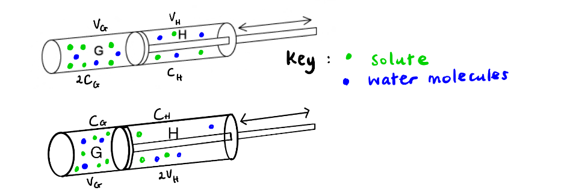

> *A **is incorrect as doubling the concentration **and** volume of compartment H would result in a higher concentration in compartment H.*

> *B is incorrect as as the initial concentration in G was double H then having the same volume in both compartments would not allow the osmotic equilibrium to be reached*

> *C **is incorrect as  this would result in compartment H having double the concentration of G*

### Q9
**Final answer:** **The correct answer is ****D ****because:**

- **The closer the water potential is to 0 the less solutes are present and therefore the more pure the water is**
- **Cell Y ****(-300 kPa) has the ****highest**** water potential and therefore water will move by osmosis from this cell to the other two**
- **Cell Z ****(-600 kPa) has a ****higher**** water potential than ****cell X**** (-900 kPa) therefore water will move by osmosis from Z to X**

> *A **is incorrect as water will move from an area of high (less negative) water potential to an area of low (more negative) water potential, therefore water would not travel from X (-900 kPa) to Y (-300 kPa)*

> *B **is incorrect as the water would not move from cell Z to Y as there is a **lower** water potential in Z (-600 kPa) than Y (-300 kPa)*

> *C **is incorrect as the water would not move from cell X to Z as there is a **lower** water potential in X (-900 kPa) than Z (-600 kPa)*

### Q10
**Final answer:** **The correct answer is ****B ****because:**

**Final answer:** **Cuboid (1):**

- **The surface area of the cuboid (1) is 32 cm****2 **

  - **(4 x 2 x 4) + (4 x 1 x 2) = 32**
- **The volume is 8 cm****3**** **

  - **4 x 2 x 1 = 8**
- **Therefore the ratio is ****4:1**

  - **32:8 = 4:1 (divide both by 8)**

**Final answer:** **Cube (2):**

- **The surface area of the cube (2) is 24cm****2**** **

  - **(2 x 2) x 6 = 24**
- **The volume is 8 cm****3**

  - **2 x 2 x 2 = 8**
- **Therefore the ratio is ****3:1**

  - **24:8 = 3:1 (divide both by 8)**
- **The ****greater**** the surface area to volume ratio the ****faster**** the rate of diffusion (Fick’s Law states that the rate of diffusion is directly proportional to the surface area)**

> *A **is incorrect as the SA:V ratio is bigger in 1 than 2 **not **smaller*

> *C **is incorrect as the SA:V is smaller in 2 than 1*

> *D **is incorrect as the SA:V are **not** equal*

### Q11
**Final answer:** **The correct answer is ****C**** because:**

- **Viruses enter the cell by ****endocytosis**** (specifically phagocytosis)**
- **A virus will bind to a ****protein receptor**** (probably a glycoprotein) on the ****extracellular**** side of the cell surface membrane **
- **This protein will then signal for the cell membrane to wrap around the virus and ****engulf**** it **
- **The cell membrane completely surrounds the virus and pinches off to form a ****vesicle**** within the cell**

> *The virus would bind to a protein receptor, not a phosphate head. Bulk transport **into** the cell is called **endocytosis** (**en** sounds like **in**), bulk transport **out** of the cell is called **exocytosis** (**ex**it).*

### Q12
**Final answer:** **The correct answer is ****D ****because: **

- **All of these structures are very large, much larger than 2.4nm**
- **For example, haemoglobin is the ****smallest**** of the options and it is a protein that spans ****6.9nm****.**
- **Glycogen is a ****polymer**** made of glucose molecules, therefore if one glucose molecule is just about to fit through a pore, glycogen will not be able to. **

> *Visking tubing** mimics the membrane of cells and these structures would require bulk transport (endocytosis and exocytosis) to cross a cell membrane.*

### Q13
**Final answer:** **The correct answer is ****B**** because:**

- **Water moves from a ****high water potential**** to a ****low water potential**** via ****osmosis.**
- **Diagram 1 ****shows ****normal**** red blood cells with water constantly moving in both directions across the cell membrane via osmosis, this means that the water potential outside the cell is the ****same**** as the water potential inside the cell. The solution is therefore ****isotonic****.  **
- **Diagram 2 ****shows red blood cells swelling and ****bursting**** because more water is moving ****into**** the cell than out of the cell, this means that the water potential outside the cell is ****higher**** than the water potential inside the cell. The solution is ****hypotonic****.  **
- **Diagram 3**** shows red blood cells ****shrivelling**** because more water is leaving the cell than entering the cell because the water potential outside the cell is ****lower**** than the water potential inside the cell. The solution is ****hypertonic****.  **
- **Therefore, cells in diagram 3 are in the solution with the lowest water potential, followed by cells in diagram 1. The cells in diagram 2 are in solution with the highest water potential (the closest to pure water). **

### Q14
**Final answer:** **The correct answer is ****C ****because:**

- **Water will move by osmosis ****into**** Z down a water potential gradient due to the solution at Z being more concentrated **
- **This causes a corresponding increase in the pressure at Z (referred to as hydrostatic pressure) and therefore a pressure gradient between Z and Y, causing a mass flow of sucrose solution from Z to Y (moving fluid from a source to a sink)**
- **This would make X the phloem and W the xylem. Water will initially be drawn along tube W from the beaker with Y to the beaker with Z (as water gradient established by water being drawn into Z)**
- **Z therefore represents leaves and Y represents roots**

> *A **& **B **are incorrect as this option involves the solution moving against the direction of flow created by hydrostatic pressure increasing at Z as a result of the movement of water by osmosis.*

> *D **is incorrect as this option lists the source as the roots and the sink as the leaves which would be incorrect.*

### Q15
**Final answer:** **The correct answer is ****D**** because:**

- **A ****steeper**** ****concentration gradient**** (a large difference between the concentration of two areas) ****increases**** the speed of diffusion**
- **Higher**** ****temperatures**** give molecules more ****kinetic energy**** which causes them to diffuse ****faster****. **
- **A ****higher surface area to volume ratio**** means that for a specific volume, there is ****more**** surface area (more cell membrane) for the molecules to diffuse across hence ****increasing**** the rate of diffusion**
- **Smaller****, ****non-polar**** and ****non-charged**** molecules diffuse ****faster**** across the membrane because they can travel directly past the phospholipids and do ****not**** rely on ****channel/carrier proteins**** which slow down the speed of transport**
- **Option ****D**** gives is the best ****overall**** speed due to the values of each of the factors being ****favourable**** to diffusion speed**

### Q16
**Final answer:** **The correct answer is ****C**** because:**

- **-2500 kPa is a ****very low water potential****, lower than most cells, and this will cause water to move ****out**** of cells via ****osmosis**** down its water potential gradient into the seawater**
- **The movement of water out of the cells will cause them to ****shrivel**** and ****die**
- **The root hair cells need to ****lower**** their own water potential by ****increasing**** the concentration of ****solutes****, such as salts, in order to create a concentration ****equilibrium**** with the seawater and stop the movement of water by osmosis**

> *If root hair cells had a very high water potential then this would **increase** the rate of osmosis out of the cell and cause the root hair cell to shrivel and die.*

> *Having leaves with a large surface area will **increase** the rate of osmosis out of the cell as there will be a larger surface area for osmosis to take place.*

> *Having a high density of **stomata** (pores in the underside of leaves which allow gas exchange and **transpiration**) will increase the amount of water loss which will **not** be favourable for the plant. *

### Q17
**Final answer:** **The correct answer is ****B ****because:**

- **Sucrose is actively transported from companion cells into the sieve tubes resulting in a higher solute concentration (lower water potential or a more negative water potential)**
- **This allows for the translocation of sucrose and amino acids**

> *A **is incorrect as the increased number of sucrose molecules **increases** the **solute** concentration thus decreasing the water potential or making it more negative.*

> *C **& **D **are incorrect as sucrose is **actively** **transported** into sieve tubes.*

### Q18
**Final answer:** **The correct answer is**** A ****because:**

- **The pores in the membrane separating the two solutions is ****too small**** for glucose to pass through, so the amount of glucose in each solution remains ****constant**
- **Therefore, water moves by ****osmosis**** down its ****water potential gradient ****to create an ****equilibrium**** between the two solutions**
- **Water moves from solution ****1**** to solution ****2**** so that there is an equal ratio of water to glucose which cause the volume of water in solution 1 to decrease and the volume of solution 2 to increase by the same amount**
- **The concentration of solution 1 from the start to the end increases as there is less water per glucose molecule, the opposite is true for solution 2.**

### Q19
**Final answer:** **The correct answer is ****C**** because:**

- **In distilled water the water will move from the pure water (high water potential) ****into**** the cell (lower water potential) via osmosis, causing ****animal cells**** to swell and ****burst**** **
- **The ****cell wall**** of plant cells is ****strong**** and withstands the pressure of increased water in the cell cytoplasm, therefore plant cells swell and become ****turgid**

> *Both** plant and animal cell surface membranes are **partially permeable**, which means that they let **some** molecules across, but **not** all. This is thanks to the phospholipids creating a **hydrophobic barrier** and channel/carrier proteins enabling the transport of **specific** molecules.*

> *The presence of a vacuole does **not** affect the movement of water into the cell causing cell bursting.*

> *Plant cell walls are made of cellulose and are freely permeable, however, this does not explain why animal cells burst but plant cells do not.*

### Q20
**Final answer:** **The correct answer is ****D**** because:**

- **There are two types of transporter proteins in cell membranes: ****channel proteins ****and ****carrier proteins**
- **Channel proteins allow a specific molecule to travel down its concentration gradient and does ****not**** undergo ****conformational change**** (it is basically a tunnel through the membrane that fits one specific molecule) **
- **Therefore, a non-gated channel protein does not undergo conformational change**
- **Carrier proteins**** require a ****conformational change**** to enable the transport of molecules across the membrane, this may be because:**

  - ** The channel is ****gated**** and only opens in particular situations (e.g. when a neurotransmitter binds)**
  - **The carrier protein is a ****symporter**** or ****antiporter**** which transport two different molecules at the same time**
  - **The carrier protein requires ATP hydrolysis (energy) to ****actively**** transport the molecules up their concentration gradient**

### Q21
**Final answer:** **The correct answer is ****B**** because glucose is polar and amino acids are charged, therefore neither can pass through the hydrophobic middle section of the phospholipid bilayer. Therefore, hydrophilic protein pores must be used to enable the transport of glucose and amino acids across the cell membrane.**

> *Water and oxygen can pass through the phospholipid bilayer because they are small molecules and can pass between phospholipids in the cell membrane. Although water is polar, because it is so small, one molecule of water can pass through the bilayer without distrusting its structure.*

### Q22
**Final answer:** **The correct answer is ****A ****because being energy ****independent**** means that the transport does ****not**** require energy. ****Diffusion**** does not require energy because molecules will travel from an area of high concentration to an area of low concentration in order to achieve ****equilibrium**** (equal concentrations on either side of the membrane). **

> *Active transport, endocytosis and exocytosis all require energy.*

### Q23
**Final answer:** **The correct answer is ****D**** because:**

- **The dark grey circle represents a large ****solid particle**** which ****cannot**** cross the membrane**
- **The particle is then ****engulfed**** by the cell which forms a ****vesicle**** from the cell surface membrane which contains the particle within the cell**
- **The light grey circle represents a ****lysosome**** which is a vesicle within a cell that contains ****digestive enzymes**** and usually has an ****acidic**** internal environment**
- **The lysosome ****fuses**** with the vesicle in order to ****degrade**** the engulfed particle**
- **This is an example of ****endocytosis**** (bulk transport into a cell) and specifically ****phagocytosis**** (bulk transport of solid matter into a cell). **

> *Exocytosis** is bulk transport **out** of a cell, for example, secretion of an enzyme or hormone produced by the cell.*

> *Facilitated diffusion** and **protein pumps** both use **transmembrane proteins** in the cell surface membrane that transport small molecules (such as glucose) and ions into and out of cells.*

### Q24
**Final answer:** **The correct answer is ****D**** because:**

- **The question states that substance X travels through a protein ****channel****, which is a hydrophilic pore in the membrane created by a protein**
- **Protein channels do not undergo conformational changes when they transport molecules, therefore the chloride ion uses the protein channel to ****diffuse**** down its concentration gradient into a cell**

> *Osmosis** is the movement of **water** down its concentration gradient and this process does not require proteins.*

> *Glucose** can only move across a membrane if it is facilitated by a protein because it is polar and therefore this statement would have to say “**facilitated diffusion**” to be correct.*

> *Active** transport requires **carrier proteins **(transmembrane transport proteins that undergo conformational change) **not** channel proteins. *

### Q25
**Final answer:** **The correct answer is ****D ****because:**

- **The movement of molecules from low concentration to high concentration (against their concentration gradient) requires ****energy**** and therefore is ****active transport **
- **The movement of molecules from high concentration to low concentration is ****diffusion****, if this movement requires the aid of a ****protein**** (for example because the molecule is ****charged**** and cannot pass directly through the phospholipid bilayer) this is ****facilitated diffusion**

### Q26
**Final answer:** **The correct answer is ****D ****because:**

- **Bulk transport is the movement of large structures or large amounts of structures and/or liquid across the cell membrane using ****vesicular transport**
- **Bacterium is engulfed by phagocytes during the process of ****phagocytosis**** (cell eating) which a specific type of ****endocytosis**** for solid particles and a form of bulk transport**
- **Enzymes and neurotransmitters are ****secreted**** by cells into the extracellular fluid during ****exocytosis****, which is bulk transport ****out**** of the cell**
- **The uptake of liquid into a cell is known as ****pinocytosis**** (cell drinking) which is a specific type of ****endocytosis**** and a form of bulk transport**

### Q27
**Final answer:** **The correct answer is ****C**** because:**

- **The solute potential is the extent to which the solute molecules decrease the water potential of the solution**
- **The ****more**** solute there is, the lower the tendency for water to move out of the solution and therefore the ****lower**** the water potential**
- **Pressure potential is the ****amount**** of pressure the solution is under, for example, there is a high pressure on the blood in arteries or there is a high pressure if a plunger is being forced down onto a solution**
- **Increasing**** the pressure on a solution increases the tendency of water to move out of it – that is, it ****increases**** its water potential**
- **Therefore, water potential (Ψ) from solute potential (Ψs)and pressure potential (Ψp)**

> *The exam board specification states that you are not expected to know the details about the solute potential and pressure potential but it is useful to understand. *

### Q28
**Final answer:** **The correct answer is ****C**** because:**

- **All molecules have ****kinetic energy ****which causes them to move ****randomly**** and collide**
- **Diffusion occurs because molecules will move randomly ****down**** a concentration gradient in order to create an ****even**** distribution of the molecule (concentration ****equilibrium****)**

> *Diffusion does not use cellular energy (ATP) to move molecules as this would be **active** transport.*

> *The attraction between molecules (intermolecular force) is **not** strong enough to work over distance and only has an effect if the molecules are very close or touching. *

### Q29
**Final answer:** **The correct answer is ****D**** because:**

- **Molecules are only actively transported (require energy) if they are being pumped against their concentration gradient**
- **If glucose is moving from an area of high concentration to an area of low concentration then it diffuses (does not require energy)**
- **As glucose is a polar molecule, it requires a protein carrier to create a hydrophilic pore in the cell membrane for it to pass through to cross the membrane**

> *Protein channels are specific to one type of molecule, for example, sodium ion channels and chloride ion channels have different sized pores because the ions are different sizes, therefore they are selective.*

> *Proteins can be transported across the membrane by bulk transport (endocytosis and exocytosis). In endocytosis, the protein will be surrounded by the cell membrane and engulfed into a vesicle within the cell. In exocytosis secretory proteins leave the Golgi apparatus in a vesicle which then fuses with the cell surface membrane to release the proteins.*

> *Polar and charged solutes can cross the cell membrane, they just require a channel protein or carrier protein to facilitate their crossing. Polar and charged solutes are unable to pass through the phospholipid bilayer directly as this would disrupt the membrane structure due to the clash of hydrophobic and hydrophilic molecules.*

### Q30
**Final answer:** **The correct answer is ****D**** because:**

- **Plasmolysis**** is the shrinking of the plant cell membrane and protoplasm ****away**** from the cell wall due to a reduction in the volume of the cell’s cytoplasm**
- **The reduction of the cytoplasm volume is due to water leaving the cell by ****osmosis**** when the cell is in a solution with a ****lower water potential ****than it**
- **Water potential is a measure of the purity of water and the strong saline solution contains more solutes than the cell cytoplasm and therefore will have a lower water potential**
- **Water moves via osmosis (a special type of diffusion) from a high water potential to a lower water potential to achieve ****equilibrium**** across a membrane **

> *Animal cells do **not** plasmolyse because they do **not** have a **cell wall**. In saline solution, animal cells will **shrink**.*

> *In pure water, the water will move from the pure water (high water potential) **into** the cell (lower water potential). This will cause **animal cells** to swell and **burst** and **plant cells** to become **turgid**. Plant cells do not burst because the cell wall is strong and holds the cell together. *

## Structured Questions (15 questions)

### Q1
The surface area to volume ratio is:

- Surface area = 432 µm2; **[1 mark]**
- Volume = 400 µm3; **[1 mark]**
- SA: VOL ratio = 1.08:1 / 1.08 / 1.1:1 / 1.1; **[1 mark]**

**[Total: 3 marks]**

> *A **maximum** of **1 mark** is available for showing working along the lines of 432 ÷ 400. A correct answer **on its own** gains** 3 marks**. The ratio must be given in its simplest form to gain full marks.*

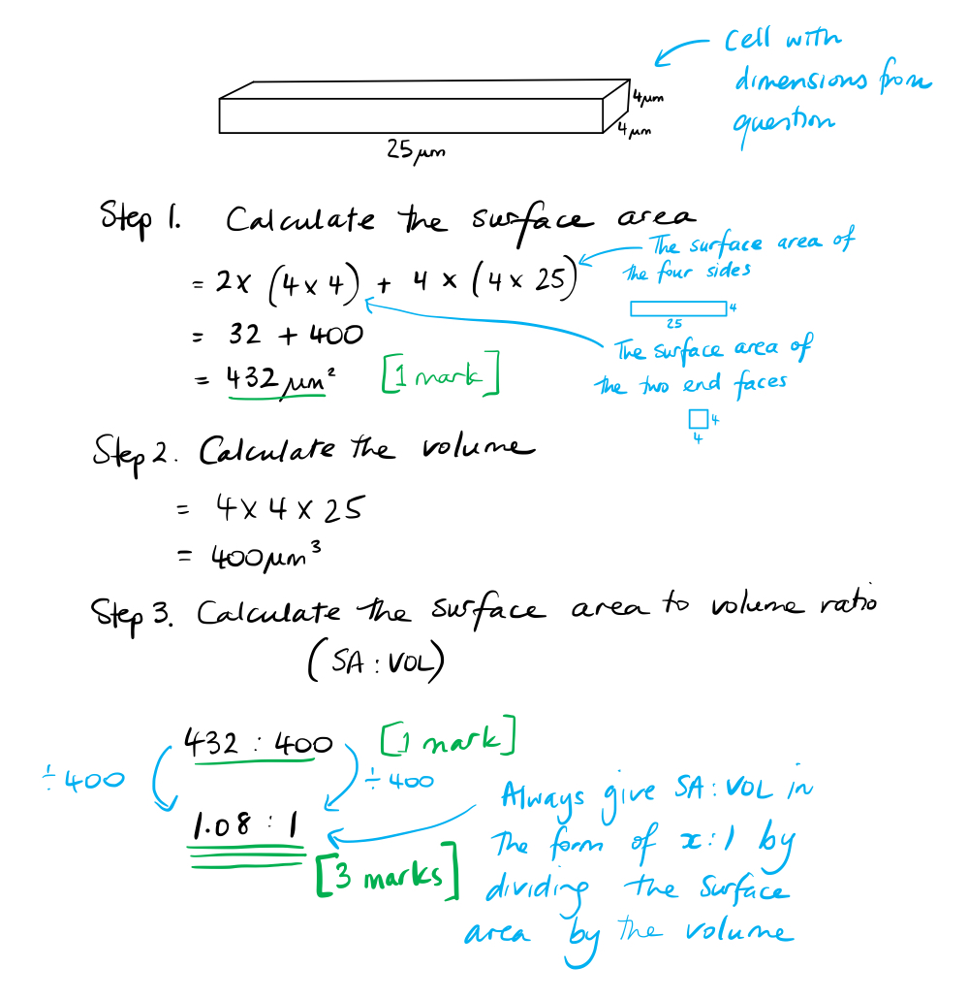
The surface area to cytoplasmic volume is:

- Volume of cytoplasm: 184 µm3; **[1 mark]**
- Surface area: 432 µm2; **[1 mark]**
- Surface area to volume ratio 2.35: 1; **[1 mark]**

**[Total: 3 marks]**

> *Make a sketch of the description to help you determine how to solve this question.*

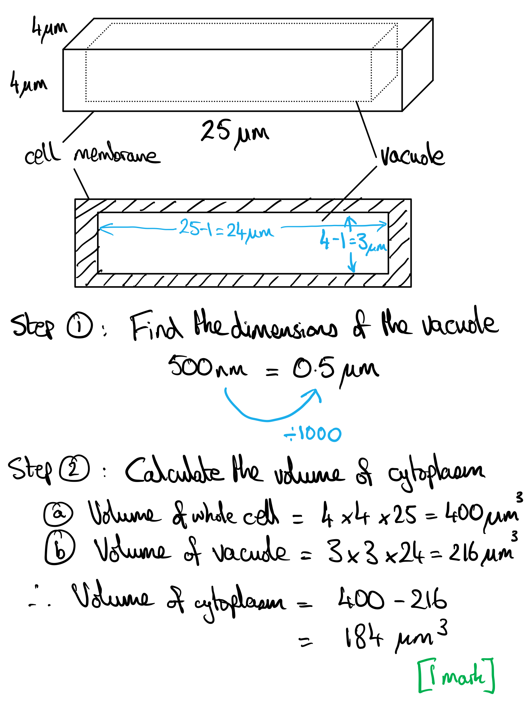

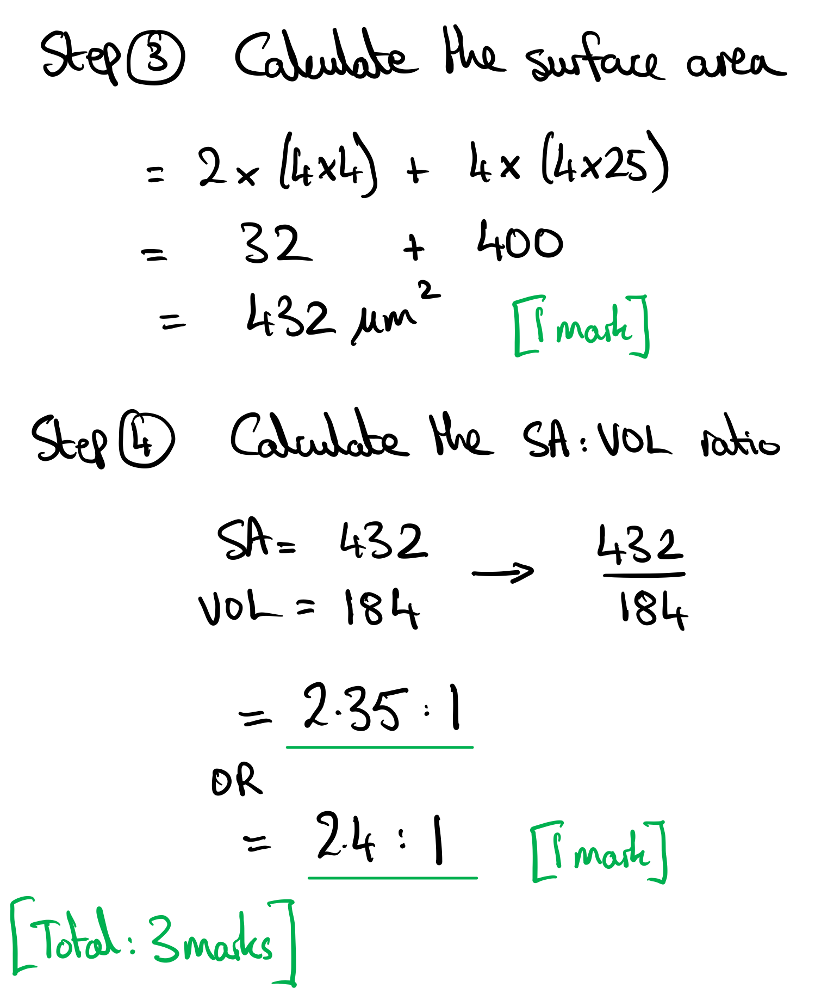
The importance of the surface area to volume ratio for a growing bacterial cell is:

**Final answer:** **Three ****from:**

- The surface area to volume ratio becomes too small; **[1 mark]**
- Surface area affects the rate substances move in and out of cell / rate of material exchange;** [1 mark]**
- Volume affects the rate substances are used or produced / metabolic rate; **[1 mark]**
- Hence cell division must occur; **[1 mark]**

**[Total: 3 marks]**
The benefit of this shape is...

- High surface area to volume ratio; **[1 mark]**
- More efficient uptake of substances needed for cell metabolism e.g. nutrients, glucose, oxygen, carbon dioxide etc; **[1 mark]**
- More efficient elimination of waste substances e.g. urea, carbon dioxide etc; **[1 mark]**

**[Total: 3 marks]**

### Q2
*Selectively permeable* is the preferred term to describe biological membranes because:

**Final answer:** **Any**** one ****from the following:**

- Many (but not all) kinds of molecule can pass through the membrane / not just water and small solutes; **[1 mark]**
- Criteria for being able to pass through the membrane is not just the size of the particles; **[1 mark]**

*Allow named examples; amino acids, sugars, small proteins, hormones etc are able to pass through membranes*

*Do not allow: 'the membrane selects what can pass through' or similar answers*

**[Total: 1 mark]**

> *Sometimes it's tempting to use these two terms interchangeably, however, there is a subtle difference that this question aims to get you to express. You would say that the visking tubing used in the experiment later in this question is almost semi-permeable, because only water and a few small solute molecules can pass through its pores, based on their molecular size. However, most biological membranes have to be considerably more sophisticated than that, by allowing a wide range of molecules through (whether by diffusion, osmosis, facilitated diffusion or active transport), and blocking the transport of a wide range of other substances.*
The rates of increase in mass and volume in the tubing containing glucose in the first 30 minutes is:

- Mass: 0.073 (± 0.01) g min-1 **OR** 4.4 (± 0.6) g hour-1;** [1 mark]**
- Volume: 0.08 (± 0.01) cm3 min-1 **OR** 4.8 (± 0.6) cm3 hour-1;** [1 mark]**

*Maximum ****one**** mark awarded without units. *

*Award ****one**** mark for *2.2 g in 30 min and 2.5 cm3 in 30 min *(units are required)*

**[Total: 2 marks]**

> *Rate **calculations always require a time frame, in this case, 30 minutes, although you may have to determine the time frame (e.g. when calculating the initial rate of reaction in enzymatic reactions).*

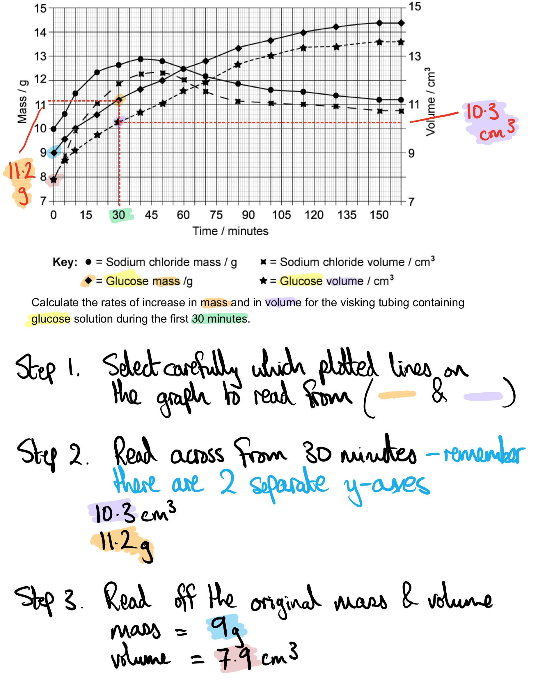

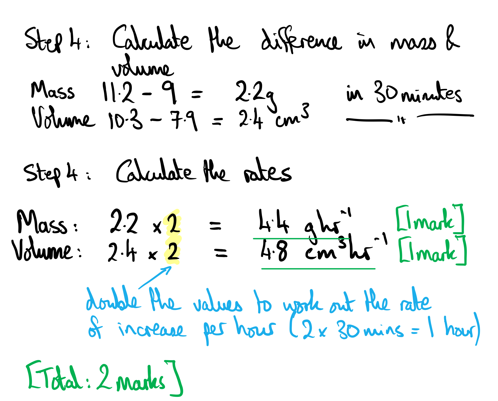
The rates of change in mass between the two visking tubings:

**Final answer:** **Any**** three**** of the following:**

- (Is slightly) faster with sodium chloride than glucose initially / in the first hour; **[1 mark]**
- Decreases in both systems as time passes / concentration gradients decrease in both systems over time; **[1 mark]**
- Increases for first 40 minutes in the NaCl (system) but continues to increase in glucose (system) for 160 minutes; **[1 mark]**
- (Is due to) the rate of osmosis in the glucose (system) being slower than the rate of osmosis in the sodium chloride (system); **[1 mark]**

**[Total: 3 marks]*** *

> *As the question asks for a comparison and contrast, do not forget to include similarities **AND** differences.*
The volumes of both visking tubings increases because:

**Final answer:** **Any**** two**** from the following:**

- <u>Osmosis</u> / <u>diffusion of water</u> occurs; **[1 mark] **
- Movement of water from low to high <u>solute</u> concentration / movement of water from high to low concentration of water molecules; **[1 mark]**
- Movement of water from high to low water potential; **[1 mark]**
- Movement of water down its concentration gradient; **[1 mark]**

**[Total: 2 marks] **

### Q3
An experiment to estimate the glucose concentration of the cell contents of sweet potato tuber would include...

- Serial <u>dilution </u>/ dilution series of various concentrations of glucose between 0 and 1 mol dm-3 ; **[1 mark]**
- Cut near-identical tubes of sweet potato, pat dry, weigh; **[1 mark]**
- Totally immerse tubes in glucose solutions; **[1 mark]**
- Leave for a set time, between 20-30 minutes, remove, pat dry, re-weigh;** [1 mark]**
- Calculate <u>percentage</u> / <u>%</u> change in mass;** [1 mark]**
- Plot % change in mass vs glucose concentration; where the curve crosses the x-axis is the concentration of glucose in the cells / isotonic; **[1 mark] **

**[Total: 6 marks]**
A graph of the expected results would include...

- *y* axis shows positive and negative regions; **[1 mark]**
- Curve / straight line slopes downward **AND **crosses *x* axis; **[1 mark]**
- Axes labelled correctly; **[1 mark]**

*Ignore scales on axes / data points if included / units on axis labels / exact location where curve crosses x axis*

**[Total: 3 marks] **

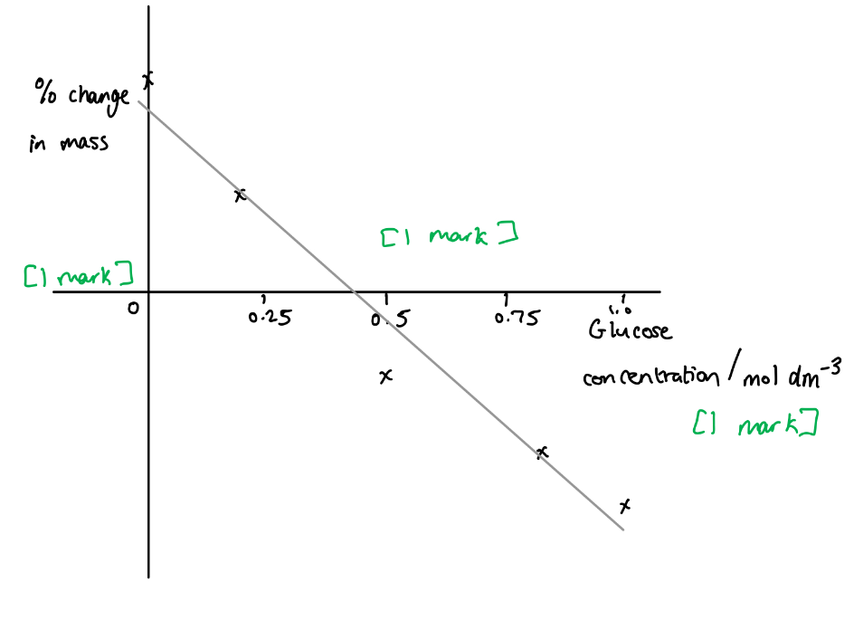
Water potential is...

- The tendency of water to diffuse across a partially permeable membrane;** [1 mark]**
- kPa is a unit of pressure, because moving water creates <u>pressure</u> changes;** [1 mark]**

**[Total: 2 marks] **

> *A discussion of why water potential (ψ) is a negative scale is not required for this question. Water has the highest water potential, at zero kPa, whereas aqueous solutions all have negative water potential values. This is because pure water will always be drawn towards a solution, creating a negative pressure on the water side of the membrane. *
An aqueous solution has a lower water potential than pure water because...

- Solute molecules in the solution occupy / immobilise water molecules; **[1 mark]**
- ...therefore fewer water molecules are free to diffuse freely across a membrane;** [1 mark]**

**OR**

- Pure water has no solute molecules; **[1 mark]**
- ...therefore, all water molecules are free to diffuse freely across a membrane; **[1 mark]**

**[Total: 2 marks] **

> *The key point for this question is relating solute particles to the ‘bodyguard’ of water molecules that surround each solute molecule. The ‘bodyguard’ water molecules are stuck in that role, surrounding each solute molecule and keeping it separate from the other solute molecules. This means that those water molecules are occupied and therefore not free to move independently, so they cannot cross the partially permeable membrane. Only the free water molecules can diffuse, and by definition, there are fewer of those in a solution than in pure water. *

### Q4
At 25 minutes, the water potential of the solution can be described as...

**Final answer:** **One ****from:**

- Higher than the water potential inside the potato cells; **[1 mark]**
- <u>Isotonic</u> **OR** the same as the water potential inside the potato cells; **[1 mark]**

**[Total: 1 mark]**

> *There are two possible reasons why the mass of the potato chip could have stopped rising:*

> *1. That the potato cells had become fully turgid and could not have taken in any more water*

> *2. That the water potentials inside and outside the potato cells had evened out due to osmosis*
The trend in Fig.1 can be explained as follows...

- The mass of the potato chip increases over time; ** [1 mark]**
- Because the solution is hypotonic; ** [1 mark]**
- Therefore the water potential is higher on the outside of the potato chip/cells compared to inside; ** [1 mark]**
- So water moves into the cells by <u>osmosis</u>;** [1 mark]**

**[Total: 3 marks]**
Osmosis and exocytosis can be contrasted as follows...

- Osmosis moves water particles only **whereas** exocytosis transports many different substances; **[1 mark]**
- Osmosis can be used to refer to the movement of individual molecules **whereas** exocytosis is used in bulk transport; **[1 mark]**
- Osmosis is passive/doesn't require ATP and exocytosis is active/requires ATP; **[1 mark]**
- Osmosis transports molecules in **and **out of cells **whereas** exocytosis transports molecules out of cells **only; ****[1 mark]**
- Exocytosis requires vesicles** whereas **osmosis does not; **[1 mark]**

***Allow ****named substance for MP1 e.g. hormones, enzymes*

**[Total: 4 marks]**

> *In a contrast question you are required to only discuss the **differences** between the two subjects.*
Exocytosis is responsible for the digestion of starch in the small intestine because...

- (Pancreatic)<u> amylase </u>synthesized within cells of the pancreas **OR **(pancreatic)** **<u>amylase</u> is synthesized by ribosomes in the cytoplasm of pancreatic cells; **[1 mark]**
- These enzymes are then packaged into vesicles **OR** secretory vesicles (containing enzyme) form from the Golgi body; **[1 mark]**
- (Secretory vesicles) fuse with the <u>cell membrane</u>; **[1 mark]**
- (Pancreatic amylase is) released/secreted into the small intestine; **[1 mark]**
- Amylase catalyses the break down of starch into maltose (in the small intestine); **[1 mark]**

**[Total: 4 marks]**

> *Whilst being directly linked with the transport of molecules across the cell membrane, this question also has links to several other parts of the specification, including cell structure, biological molecules and enzymes as well. In order to explain the link between exocytosis and the digestion of starch, you are expected to identify the enzyme involved and how the enzyme (amylase) moves from the pancreatic cells into the small intestine. To fully answer the question, you then need to state how that enzyme then assists with digestion.*

### Q5
Calculating the surface area to volume ratio would be as follows...

- (13.5 ÷ 3.38):(3.38 ÷ 3.38);** [1 mark]**
- 4:1; **[1 mark]**

**[Total: 2 marks]**

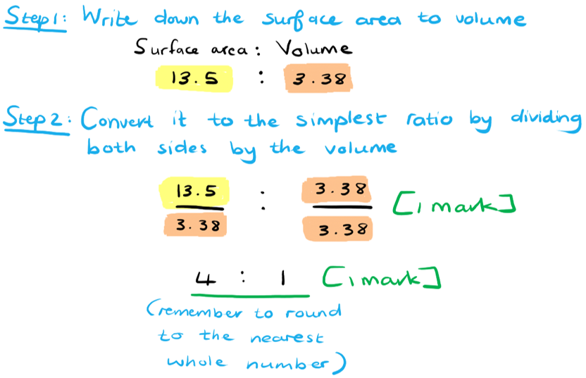
The results are as follows...

- As the size of the cube increases the surface area to volume ratio / SA: V decreases **OR** as the size of the cube decreases the surface area to volume ratio / SA: V increases; **[1 mark]**
- The larger the cube / smaller the surface area to volume ratio / SA:V, the longer it takes for the cube to become colourless OR the smaller the cube / larger the surface area to volume ratio / SA:V, the less time it takes for the cube to become colourless;** [1 mark]**

**[Total:2 marks]**
The significance of these results for living organisms includes...

**Final answer:** **Any ****three ****of the following:**

- Oxygen/glucose/correctly named nutrient enters/is transferred across (respiring) cells by diffusion; **[1 mark]**
- Diffusion is only fast enough over short distances / is too slow over long distances; **[1 mark]**
- (Therefore) the size of single-celled organisms/cells is limited; **[1 mark]**
- (Therefore) multicellular organisms require a transport system (to move substances around the body); **[1 mark]**

**[Total: 3 marks]**

> *All living cells need a ready supply of the substrates for respiration in order to survive; they receive these by diffusion at their cell surface and through their cytoplasm. The rate of diffusion is fast across short distances but slow across longer distances; this means that cells cannot be so large that required substances such as oxygen and glucose cannot diffuse across them in a reasonable amount of time, and organisms made up of many layers of cells need a transport system to get around the problem of slow diffusion.*
A possible outcome of the investigation if the cubes were placed in a more concentrated solution of hydrochloric acid would be...

- The time taken for the cube to turn colourless would decrease / cube would turn colourless faster; **[1 mark]**
- (Due to the) steeper concentration gradient between the hydrochloric acid and the cube; **[1 mark]**

**[Total: 2 marks]**

> *Increasing the concentration gradient of the hydrochloric acid would increase the rate of diffusion through the agar cubes. This would reduce the amount of time it would take for each cube to turn colourless. The larger cubes would still take a longer period of time to change to colourless compared to the smaller cubes due to the decrease in surface area to volume ratio as the cubes increase in size.*

### Q6
The events that led to the appearance of the cells in Fig.1 are as follows...

Any **four** of the following:

- The water potential is higher in the surrounding water than inside the (onion) cell / the (onion) cell has a higher solute concentration than the surrounding water; **[1 mark]**
- Water enters the cell / protoplast / cytoplasm / vacuole by osmosis; **[1 mark]**
- The volume of the cell / protoplast / cytoplasm / vacuole increases; **[1 mark]**
- Pressure builds inside the cell / the protoplast / cytoplasm pushes against the cell wall; **[1 mark]**
- The plant cell becomes turgid; **[1 mark]**
- Water moves into the cell until equilibrium is reached / the water potential is equal inside and outside the cell **OR ** water moves into the cell (by osmosis) until the inward pressure exerted by the cell wall is equal to the outward pressure exerted by the protoplast; **[1 mark]**

**[Total: 4 marks]**

> *Water moves into the onion cells down a water potential gradient. As water enters the plant cell by osmosis there is an increase in the volume of the protoplast, which then exerts more pressure on the cell wall. Since the cell wall is a rigid structure it will also exert a pressure back onto the protoplast. Collectively this leads to a build up of pressure inside the cell, which will ultimately lead to no more water entering the cell. At this point, the cell is fully turgid and the protoplast is at its maximum volume.*
The cells in Fig. 2 differ in appearance from those in Fig.1 because...

**Final answer:** **Any ****two ****of the following:**

- (The cells) were placed in a more concentrated solution / solution with a lower water potential (than the cells); **[1 mark]**
- Water has left the cells by osmosis **and **the protoplast/cytoplasm has shrunk / pulled away from the cell walls; **[1 mark]**
- The cells are plasmolysed; **[1 mark]**

**[Total: 2 marks]**

> *When a plant cell is placed in a more concentrated solution (with a lower water potential) compared to the protoplast, there will be a net movement of water molecules out of the cell. This is like deflating a balloon, where the pressure that was exerted on the cell wall decreases as the protoplast shrinks. Eventually no more pressure will be exerted on the cell wall and the protoplast will start pulling away from it. At this point the cell is plasmolysed.*
More dilute blood plasma would have the following effect on red blood cells...

- The water potential of the blood plasma would increase / it would become hypotonic (compared to red blood cells); **[1 mark]**
- Water would enter the red blood cells by osmosis / water would move into the red blood cell down a water potential gradient / from a region of higher water potential to a region of lower water potential (across the cell surface membrane); **[1 mark]**
- The red blood cells would (eventually) burst / lyse; **[1 mark]**

**[Total: 3 marks]**

> *An animal cell cannot withstand the same pressure as a plant cell, due to the absence of a cell wall. It is therefore very important that the amount of water in the body is carefully controlled so that the osmotic properties of the cells and body fluids are not dramatically affected.*
Animal cells are more severely affected by changes in cell volume because....

- They lack a (supporting) cell wall; **[1 mark]**
- (Therefore) they are less able to withstand/cope with pressure change/increases/decreases (as a result of changing cell volume); **[1 mark]**

**[Total: 2 marks]**

> *Animal cells will shrink and shrivel up very easily when placed in a solution with low water potential, and will burst when placed in a solution with high water potential. A plant cell can withstand these changes as the cell wall provides structure and support to the cell contents.*

### Q7
The percentage change in mass for the potato cylinders in the 0.75 mol dm-3 solution can be calculated as follows...

- (-0.21 ÷ 4.51) x 100; **[1 mark]**
- = -4.7 (%); **[1 mark]**

**[Total: 2 marks]**

> *Note that you have been asked to show your working here, so you must do this for full marks.*

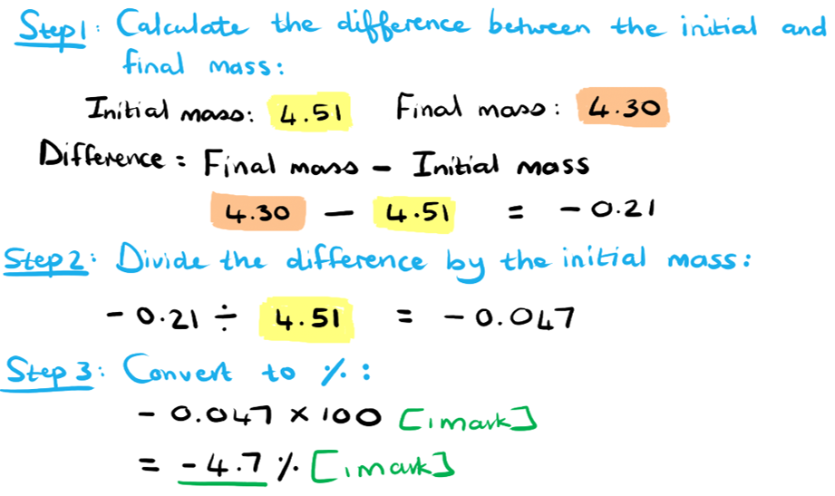
The potato cylinders in the 0.5 mol dm-3 solution did not change mass because...

- The water potential inside the (potato) <u>cells</u> was the same as the (surrounding) solution **OR** the solutions inside and outside the (potato) <u>cells</u> had the same concentration **OR** there was no concentration gradient between the inside and outside of the (potato) <u>cells</u>; **[1 mark]**
- (Therefore) no <u>net</u> movement of water molecules occurred / the same number of water molecules moved into and left the cells; **[1 mark]**

**[Total: 2 marks]**

> *Remember that osmosis is the diffusion of water molecules across a partially permeable membrane and therefore requires a concentration gradient in order to occur. Since the potato cylinders in the 0.5 mol dm**-3** solution did not gain or lose mass, it indicates that there was no net movement of water molecules into or out of the potato cells. This would only happen if the water potential on both sides of the cell surface membrane was the same. Take note that water molecules are always moving, there is simply no **net** movement in a certain direction taking place.*
The change in mass that occurred in the potato cylinder placed in the boiling tube containing distilled water is due to...

- Water molecules moved by osmosis / diffused from the (distilled) water into the <u>cells</u>; **[1 mark]**
- The (distilled) water had a higher water potential / lower solute concentration than the potato <u>cells</u> **OR** the potato <u>cells</u> had a lower water potential / higher solute concentration than the (distilled) water; **[1 mark]**

**[Total: 2 marks]**

> *Osmosis is the diffusion of water molecules from a dilute solution (high water potential) to a more concentrated solution (low water potential). In this case, the contents of the potato cells had a higher solute concentration than the surrounding water, so water molecules moved into the cells. This is the reason why the cells, and therefore the cylinders, gained mass during the investigation.*
Marks would be allocated as follow for the sketch of a cell placed in the 1.00 mol dm-3 sodium chloride solution...

- The cell is clearly plasmolysed; **[1 mark]**
- The cell membrane is surrounding the cytoplasm; **[1 mark]**
- The cell wall is drawn as a double line; **[1 mark]**

**[Total: 3 marks]**

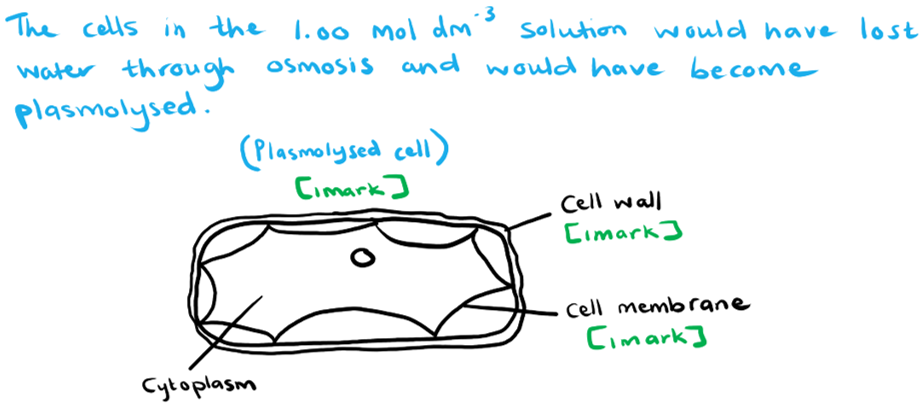

### Q8
The ratio of the mean rate of uptake of magnesium of the first 20 minutes:second 20 minutes for group **Z** plants was:

- 3.3:1; **[2 marks]**

**[Total: 2 marks]**

*You first need to calculate the mean rate of uptake of magnesium ions in the first 20 minutes. Then you need to calculate the mean rate of uptake of magnesium ions in the second 20 minutes. Then you have to divide the mean rate of uptake of magnesium ions in the second 20 minutes by the mean rate of uptake of magnesium ions in the first 20 minutes to get a ratio. Then you need to simplify this ratio. If your final answer was incorrect, showing (47 – 36) ÷ 20 in your working (for calculating the mean rate in the second hour) would gain ***[1 mark].**

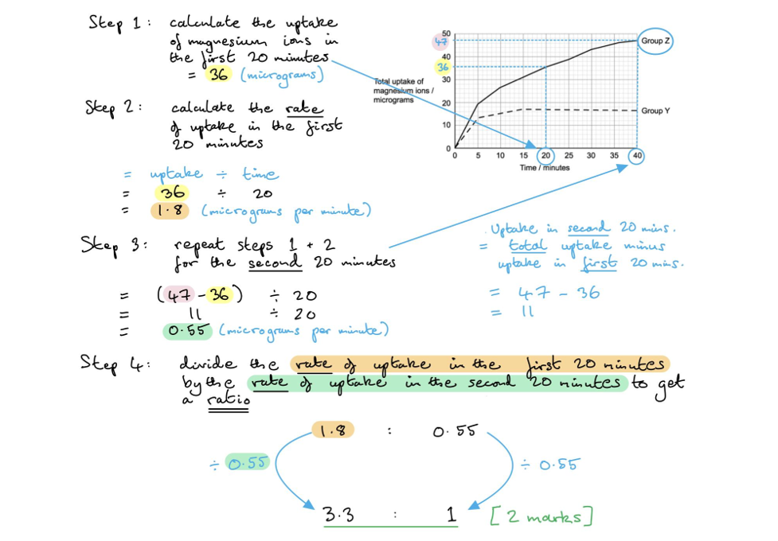
The results of the students’ investigation are explained by...

**Final answer:** **Any ****four**** of the following:**

- Group **Y** - initial uptake (of magnesium ions) slower because by <u>diffusion</u> (only); **[1 mark]**
- Group **Y** - (uptake of magnesium ions) levels off because the same concentrations inside cells and outside cells / reached equilibrium;** [1 mark]**
- Group **Z** - uptake (of magnesium ions) faster because of diffusion <u>and</u> active transport;** [1 mark]**
- Group **Z** - (uptake of magnesium ions) fails to level off because uptake against gradient / no equilibrium to be reached;** [1 mark]**
- Group **Z** - rate (of uptake of magnesium ions) slows because few/fewer magnesium ions in the external solution used up **OR** rate (of uptake of magnesium ions) slows because few/fewer magnesium ions in the respiratory substrate used up;** [1 mark]**

**[Total: 4 marks]**
The rate of uptake of magnesium ions for group **Y **plants during the investigation is...

- 0.4 micrograms/µg per minute/min-1;** [2 marks]**

**[Total: 2 marks]    **

*You need to divide the value for the total uptake of magnesium ions for group Y plants (16 micrograms) by the duration of the investigation (40 minutes). A correct answer of 0.4, without units or with incorrect units, would gain ***[1 mark]***. For the units, ‘micrograms/minute’ or ‘μg per minute’ would be accepted. Units that refer to ‘grams’ or ‘seconds’ would not be accepted as these would not be considered appropriate for the data provided in **Figure 1** - the data values you would get if you converted the units to ‘grams per minute’ or ‘micrograms per second’ would be too small to be useful/scientifically appropriate.*

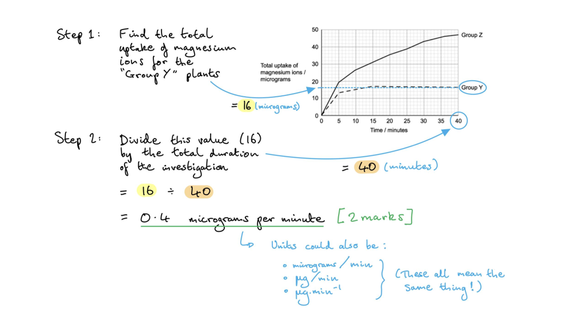
Three other substances that would not be absorbed into the group Y plants are...

- Nitrates; **[1 mark]**
- Phosphates; **[1 mark]**
- Potassium; **[1 mark]**

**[Total: 3 marks]**

> *All of these are mineral ions that are actively transported into the roots of plants at the root hair cells. Without respiration occuring (due to the respiratory inhibitor) there would be limited ATP available for active transport of these ions. *

### Q9
The results of this investigation can be **described** as follows...

- The rate of diffusion increases as the glucose concentration (in the Visking tubing) increases; **[1 mark]**

The results of this investigation can be **explained** as follows...

- A greater difference in (glucose) concentration / steeper (glucose) concentration gradient means more molecules (randomly) move across the membrane / Visking tubing (at any one time, from high to low solute concentration); **[1 mark]**

***Accept ****reverse argument.*

**[Total: 2 marks]**

> *The concentration gradient refers to the difference in concentration of a substance on each side of a membrane. An increase in the steepness of this gradient will increase the diffusion rate as more molecules of the substance will move across the membrane at any one moment.*
If the experiment were carried out at a lower temperature it would have the following effect...

- The rate of diffusion would decrease / be slower; **[1 mark]**
- (As the) molecules would have less kinetic energy **and** would (therefore) move more slowly; **[1 mark]**

**[Total: 2 marks]**

> *When the temperature decreases molecules will lose kinetic energy and move more slowly. This will slow down the rate of diffusion as it will take longer for the molecules to move from one area to another.*
(i) The specific type of membrane transport by which glucose enters the cells...

- <u>Facilitated</u> diffusion;** [1 mark]**

(ii) The reason for this is that...

- The rate of uptake/diffusion increases as the glucose concentration increases and then plateaus / levels off / remains constant; **[1 mark]**
- (This is because) no more channel/transport proteins are available / all channel/transport proteins are in use; **[1 mark]**

**[Total: 3 marks]**

> *The graph in Fig 2 illustrates facilitated diffusion; we know this because the rate of diffusion is limited by the number of transport proteins available for the substance. Once all the proteins are in use the rate of diffusion will level off. If the mode of transportation was simple diffusion the rate would continue to increase as the glucose concentration increases, since it would not be dependent on the availability of transport proteins; this can be seen above in Fig. 1*
The outcome of the investigation at 60 °C would be...

- The diffusion rate would decrease / be lower / decrease to zero; **[1 mark]**

The reason for this is that...

**Final answer:** **Any ****two**** of the following:**

- The bonds holding the (tertiary) protein structure together would break / the transport/channel proteins would denature; **[1 mark]**
- (They) would not be complementary/specific to glucose **and** would lose their function / no longer transport glucose; **[1 mark]**
- (They) would not stay (anchored) in the cell surface membrane / the structure of the cell surface membrane would be disrupted **and** the cell surface membrane would rupture / the cell would burst; **[1 mark]**

**[Total: 3 marks]**

> *High temperatures denature proteins, meaning that they lose their shape and function. Since facilitated diffusion relies on these proteins, it would not be able to occur if the proteins have been denatured. This would decrease the amount of glucose that the cell is able to take up, and could eventually lead to cell membrane damage and cell death.*

### Q10
Comparisons between active transport and facilitated diffusion would include the following **similarities**...

- They both require <u>carrier</u> proteins; **[1 mark]**

Comparisons between active transport and facilitated diffusion would include the following **differences**...

**Final answer:** **Any ****two**** of the following:**

- Active transport requires energy / ATP / is an active process **WHILE** facilitated diffusion does not require energy / ATP / is a passive process; **[1 mark]**
- Active transport occurs against the concentration gradient / from a region of lower concentration to a region of higher concentration **WHILE** facilitated diffusion is down the concentration gradient /  from a region of higher concentration to a region of lower concentration; **[1 mark]**
- Active transport does not make use of <u>channel</u> proteins **WHILE** facilitated diffusion does **OR** active transport uses only carrier proteins **WHILE** facilitated diffusion uses both carrier and <u>channel</u> proteins; **[1 mark]**

**[Total: 3 marks]**

> *With questions that require you to compare processes or structures it is important to think about both similarities and differences between them. When stating differences between two things you must ensure that each statement is comparative. *
i) The type of transport that is represented by Fig.1 is...

- Endocytosis / phagocytosis / pinocytosis; **[1 mark]**

(ii) This process involves the following...

**Final answer:** **Any ****two**** of the following:**

- Cell surface membrane engulfs/extends around material/molecules/substance/liquid/cell/solid; **[1 mark]**
- Vesicle/vacuole forms; **[1 mark]**
- (This process) requires energy / ATP / it is an active process; **[1 mark]**

*References to liquids should only be accepted if the answer to part i) is pinocytosis and references to cells or solids should only be accepted if the answer to part i) is phagocytosis.*

**[Total: 3 marks]**

> *Endocytosis is an active process as it requires energy to occur. This is a type of bulk transport as many molecules are moved into the cell at a time. The intake of solid material is known as phagocytosis, while the bulk intake of liquids is called pinocytosis. A vacuole or vesicle, consisting of the phospholipids from the cell surface membrane, forms around the substances.*
Gastric chief cells contain a large number of structure **X** because....

- (Structure **X** / Mitochondria) releases energy / ATP; **[1 mark]**
- (This) enables <u>exocytosis</u> of (gastric) enzymes; **[1 mark]**

**[Total: 2 marks]**

> *Cells that are metabolically active, such as gastric chief cells, will contain many mitochondria to release the energy needed for these processes to occur. The release of substances from the cell through exocytosis requires energy as it is an active process.*
The process by which gastric chief cells will release their digestive enzymes into the stomach can be described as follows...

**Final answer:** **Any ****two**** of the following:**

- (The enzymes) are packaged into secretory vesicles by the Golgi; **[1 mark]**
- The vesicles travel / move towards and fuse with the cell surface membrane; **[1 mark]**
- (The process) requires ATP / energy / it is an active process; **[1 mark]**

**[Total: 2 marks]**

> *Exocytosis is the bulk transport of substances out of the cell. In the case of the gastric chief cells, the digestive enzymes they produce are packaged into vesicles by the Golgi body before being transported to the cell surface membrane. The fluidity of the phospholipids enables the vesicles to fuse with the membrane and release the enzymes outside the cell to perform their function.*

### Q11
The definition of active transport is:

- (The) movement of substances from lower to higher concentration / against a (concentration) gradient / up a (concentration) gradient; **[1 mark]**
- (That) ATP is required as a source of energy;** [1 mark]**
- (That) protein / pumps (in membrane) are required; **[1 mark]**

***Reject**** energy alone for MP2*

***Reject ****channels for MP3*

**[Total: 3 marks]**
Three factors that affect the rate of diffusion across a membrane are:

**Final answer:** **Any**** three**** of the following:**

- Concentration gradient; **[1 mark]**
- Temperature; **[1 mark]**
- Surface area; **[1 mark]**
- Length/distance of the diffusion pathway;** [1 mark]**
- Properties of the molecules (eg. hydrophobic / hydrophilic / amphipathic); **[1 mark]**

**[Total: 3 marks]**
The materials are transported by:

- Exocytosis;**[1 mark]**

**[Total: 1 mark]**
One material that could be transported from structure **S** to **R** is;

**Final answer:** **Any ****one**** of the following:**

- Proteins **OR **named example (e.g. enzymes, hormones, antibodies);** [1 mark]**
- Lipids;** [1 mark] **

**[Total: 1 mark]  **

> *Cell wall building materials can also be transported out of a cell, however in this case the cell is clearly not a plant or fungal cell so this answer would not be accepted.*

### Q12
Substance **X** will...

- Move from the outside of the cell to the inside; **[1 mark]**
- Directly through the cell (surface) membrane / in between the phospholipids / by simple diffusion;** [1 mark]**

Because...

- There is a higher concentration of substance X outside the cell than inside / diffusion takes place down a concentration gradient; **[1 mark]**
- The molecules are small and nonpolar so can move between the (tails of the) phospholipids; **[1 mark]   **

**[Total: 4 marks]**
Substance **X** could be…

**Final answer:** **Any ****one**** of the following:**

- Oxygen; **[1 mark]**
- Carbon dioxide: **[1 mark]**
- (Other named small, nonpolar substance); **[1 mark]**

**[Total: 1 mark]    **
Substance **Y** would move across a cell membrane from high to low concentration by...

- <u>Facilitated</u> diffusion;** [1 mark]**
- Via a <u>specific </u>channel protein / carrier protein; **[1 mark]**

**[Total: 2 marks] **
The following events would transport molecule X into the cell cytoplasm...

- Molecule **X** binds to a specific binding site on the <u>carrier</u> protein; **[1 mark]**
- ATP is hydrolysed / broken down to release energy; **[1 mark]**
- The protein changes shape **AND** releases/transfers/transports/moves molecule **X** into the cytoplasm; **[1 mark]**

**[Total: 3 marks]     **

> *You should have noticed here that the molecule is travelling against its concentration gradient, and so this is showing the process of active transport, and you need to mention the involvement of ATP to gain full marks. Be careful to refer to the transport protein as a **carrier** protein and not a channel protein as it is clear that it has to change shape to transport the molecule across.*

### Q13
The processes of diffusion and facilitated diffusion can be compared and contrasted as follows:

**Comparisons**

**Final answer:** **A maximum of ****three ****from the following:**

- Both are passive / require no energy input; **[1 mark]**
- Both run down/along a concentration gradient; **[1 mark]**
- From an area of high concentration to an area of low concentration; **[1 mark]**

**Contrasts**

**Final answer:** **A maximum of ****three ****from the following:**

- Facilitated diffusion takes place via a channel/carrier protein **whereas** diffusion occurs through the (phospholipid) bilayer; **[1 mark]**
- Facilitated diffusion is required for large/charged/polar/hydrophilic/water-soluble molecules **whereas** diffusion is for small/non-polar/lipid-soluble molecules; **[1 mark]**
- Facilitated diffusion used specific channels/carriers **whereas** diffusion can take place anywhere in the bilayer; **[1 mark]**

**[Total: 4 marks]**

> *Remember – the movement of molecules from high concentration to low concentration is diffusion. If this movement requires the aid of a protein (for example because the molecule is charged and cannot pass directly through the phospholipid bilayer) this is facilitated diffusion.*

> *A 'compare and contrast' question requires your answer to contain similarities and differences; only focusing on one of the other will limit your access to marks. *
The correctly-drawn lines are:

**[1 mark]** for each correct line
The correctly-completed missing words are as follows:

| Plant roots absorb **water** by osmosis from the surrounding soil. It moves by a process of **diffusion** from an area of **high** concentration to an area of **low **concentration across a **partially permeable** membrane. |
|---|

***Do not allow**** 'osmosis', 'semi permeable'*

**[1 mark]** for each correct word.

**[Total: 5 marks]**

> *It's important to remember that osmosis is a form of **diffusion, **that relates to water only. *

> *Also, the term **'partially permeable**' membrane is preferred because 'semi permeable' refers to membranes that only allow the passage of solvent i.e. water but no solutes. Very few, if any, biological membranes act in this way. *
(i) As solute concentration increases, water potential...

- decreases / reduces / gets lower / falls; **[1 mark]**

(ii) Explanation:

**Final answer:** **Two**** from the following:**

- Solute molecules take up space / push water molecules out; **[1 mark]**
- Solute molecules tie up / occupy water molecules;** [1 mark]**
- That can no longer diffuse freely across a membrane; **[1 mark]**
- Fewer water molecules are free to diffuse, (so water potential falls); **[1 mark]**

**[Total: 3 marks]**

### Q14
**[1 mark] **for **two** correct rows as below:

|   | **Simple diffusion** | **Osmosis** | **Facilitated diffusion** | **Active Transport** |
|---|---|---|---|---|
| Movement of glucose from high to low concentration |   |   | **✓** | **[1 mark]** |
| Movement down a concentration gradient | **✓** | **✓** | **✓** |   |
| Movement of water from high water potential to low water potential. |   | **✓** |   | **[1 mark]** |
| Movement of oxygen from the plasma into a red blood cell | **✓** |   |   |   |

**[Total: 2 marks]**
The shape of the cytoplasm in **Figure 1** is due to...

- The onion cells have been placed in a solution with lower water potential; **[1 mark]**
- Water has moved out of the cells by <u>osmosis</u>; **[1 mark]**
- Causing the cytoplasm / vacuole / protoplast to shrink / decrease in volume; **[1 mark]**

**[Total: 3 marks]**
The cheek cells in the test tube of pure water would...

- Take on water / water would move into the cheek cells by osmosis;** [1 mark]**
- The cells would swell **AND** eventually burst; **[1 mark]**

**[Total: 2 marks]  ****   **

> *This is another example of osmosis in action. The cheek cell cytoplasm will have a lower water potential than pure water (which has the highest possible water potential of 0 Kpa) and so water will move into the cells. The cells will swell as they take on water and will eventually burst due to the increased pressure. *
The difference in effect would be...

- The onion cells would not burst; **[1 mark]**

It would be different because…

- The <u>cell wall</u> provides additional strength / can withstand the increased pressure; **[1 mark]**

**[Total: 2 marks]    **** **

### Q15
The correct missing word is:

- Inversely/oppositely; **[1 mark]**

**[Total: 1 mark]**

> *Inversely proportional means that as one variable increases, the other decreases. the smallest organisms have the largest SA: VOL ratios.*
A suitable solution to immerse these blocks in to examine diffusion is...

- A (dilute) hydrochloric/sulfuric/nitric/mineral acid; **[1 mark]**

**[Total: 1 mark]**

> *The acid will diffuse into the agar and, as long as the concentration of the acid is greater than the concentration of sodium hydroxide within the agar blocks, there will be a colour change as the universal indicator shows an alkali-to-acid pH change.*
(c) The completed Table 1 is as follows:

|   | **organism A** | **organism B** |
|---|---|---|
| surface area / cm2 | 18 970 | 79.8 |
| volume / dm3 | 70 | 0.019 |
| SA:VOL ratio | 271 **OR** 271:1; **[1 mark]** | 4 200 **OR** 4200:1; **[1 mark]** |

**[Total: 2 marks]**

> *A ratio is simply one number divided by another. In this case, it's the surface area value divided by the volume. *

$\mathrm{Surface} \mathrm{area} \mathrm{to} \mathrm{volume} \mathrm{ratio}=\frac{\mathrm{surface} \mathrm{area}}{\mathrm{volume}}$
The animal that is represented by **A **is...

- Human; **[1 mark]**
- **Because** it has a lower SA: VOL ratio / larger volume / larger area (than **B**); **[1 mark]**

**[Total: 2 marks] **
