# Exam Questions — Movement into & out of Cells
**4. Cell Membranes & Transport** · Cambridge (CIE) AS biology (9700)
> Source: [https://www.savemyexams.com/as/biology/cie/25/topic-questions/](https://www.savemyexams.com/as/biology/cie/25/topic-questions/) · 45 questions across 2 sets

## Multiple Choice Questions (30 questions)

### Q1 — hard — 1 marks

**Q1** [1 mark]

An experiment to calculate the water potential of potato was performed using the following protocol:

1. Dice potato into 1cm3 cubes.
2. Add potato cubes to 6 test tubes, each containing solution with a different sucrose concentration.
3. Wait 12 hours.
4. Weigh the cubes from each test tube and plot a graph.

The mean weight of the potato cubes was 2.5g before being added to solution and the graph shows the weights of potato cubes after the experiment.

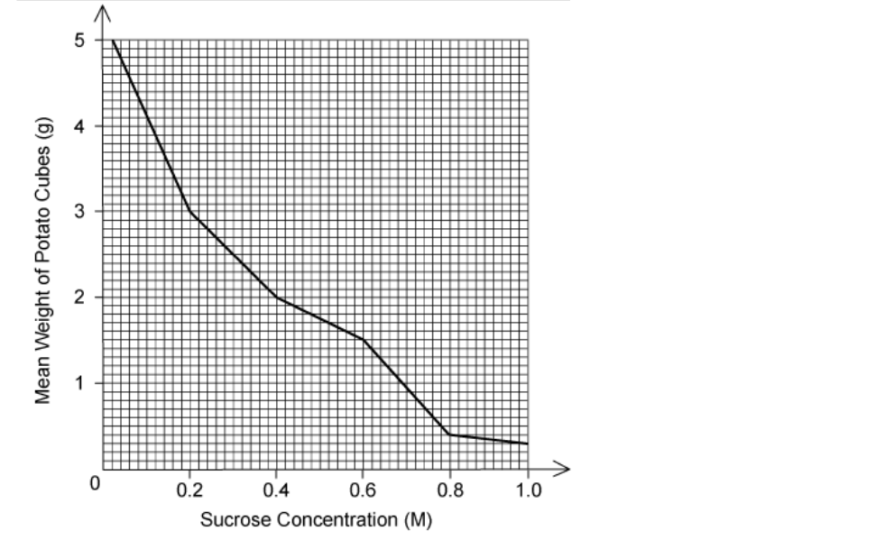

What concentration of sucrose has the same water potential as the potato?

### Q2 — hard — 1 marks

**Q2** [1 mark]

The diagram shows an experiment constructed by a student to measure the water potential of beetroot cells. The results are shown in the table below.

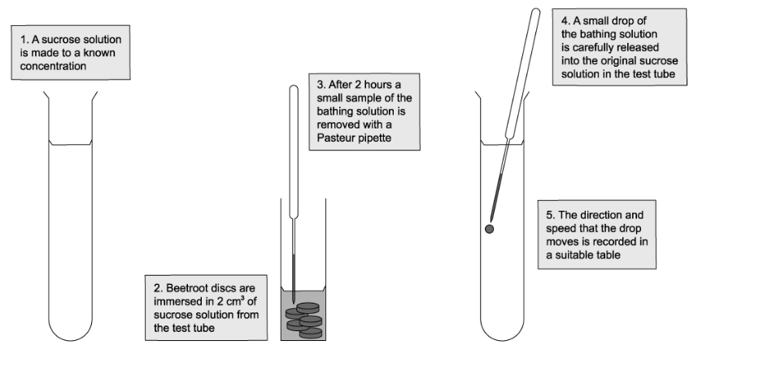

| Concentration of sucrose solution (mol dm-3) | Water potential of sucrose solution (kPa) | Direction and speed of droplet movement |
|---|---|---|
| 0.1 | -251 | down, very quickly |
| 0.2 |   | down, quickly |
| 0.3 |   | down, slowly |
| 0.4 |   | no movement |
| 0.5 |   | up, slowly |
| 0.6 |   | up, quickly |
| 0.7 | -1876 | up, very quickly |

What is the most likely water potential of the beetroot cells?

### Q3 — hard — 1 marks

**Q3** [1 mark]

Radish discs were placed in a solution containing Na+ ions.

The concentration of O2 in the air bubbled through the solution was changed and the rate of Na+ uptake measured. The results are shown.

| Concentration of oxygen / % | Rate of Na+ uptake / arbitrary units |
|---|---|
| 3.10 | 31 |
| 12.6 | 64 |
| 19.8 | 83 |

Which process is responsible for the uptake of Na+ in this experiment?

### Q4 — hard — 1 marks

**Q4** [1 mark]

An aerobic cell stops responding to growth regulation signals, causing the volume of the cytoplasm to increase and the cell to grow. Eventually the cell dies.

Which of the following cell transport methods affects cell growth?

| **1** | diffusion |
|---|---|
| **2** | active transport |
| **3** | exocytosis |
| **4** | osmosis |

### Q5 — hard — 1 marks

**Q5** [1 mark]

The fluidity of the cell surface membrane can be altered by a variety of factors.

Which process would be **least** changed if the fluidity of cell surface membranes is decreased?

### Q6 — hard — 1 marks

**Q6** [1 mark]

The graph shows how the concentration of a substance affects its rate of absorption into a cell.

Substance **X** enters by simple diffusion, substance **Y** by facilitated diffusion.

Why does the curve for substance **Y** plateau above a certain concentration?

### Q7 — hard — 1 marks

**Q7** [1 mark]

Four solutions are made, each containing 15 g l-1 of a molecule. Which molecule would produce the solution with the lowest water potential?

### Q8 — hard — 1 marks

**Q8** [1 mark]

The diagram shows a glass cylinder within which a partially permeable membrane separates two compartments, **G** and **H**, of the same volume (V).

Each compartment contains saline solution, the concentration (C) in **G** is double the concentration in **H. **

The membrane is attached to a sliding piston.

Which equations correctly describe the concentration and volume of compartments when osmotic equilibrium is reached?

### Q9 — hard — 1 marks

**Q9** [1 mark]

The cell walls of three plant cells, **X**, **Y** and **Z**, are in contact with each other. The water potentials inside each cell are shown in the table

| Cell | Water potential (kPa) |
|---|---|
| X  Y  Z | -900  -300  -600 |

How will water move by osmosis between the cells?

### Q10 — hard — 1 marks

**Q10** [1 mark]

Two agar blocks of different sizes are produced and universal indicator is added, making the agar turn purple.

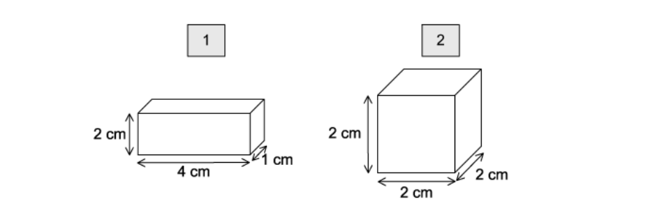

The cubes are then placed in hydrochloric acid solution. Universal indicator turns red in acid. After 10 minutes, the amount of agar that has turned red is measured.

In which agar block will the rate of diffusion be fastest and why?

### Q11 — medium — 1 marks

**Q11** [1 mark]

Some viruses bind to the cell surface membrane before entering the host cell.

Which sequence of events results in a viral invasion of a cell?

### Q12 — medium — 1 marks

**Q12** [1 mark]

An artificial partially permeable membrane called visking tubing can be used to demonstrate diffusion. The pores in the membrane are approximately 2.4 nm in diameter which allows glucose molecules to pass through.

Which of the following could pass through the pores?

| 1 | haemoglobin |
|---|---|
| 2 | bacteria |
| 3 | glycogen |
| 4 | ribosomes |

### Q13 — medium — 1 marks

**Q13** [1 mark]

Diagrams 1, 2 and 3 show red blood cells in different states after each being submerged in a different solution.

What is the correct order of the water potential of each solution from lowest to highest?

### Q14 — medium — 1 marks

**Q14** [1 mark]

A model to demonstrate the mass flow hypothesis of translocation is illustrated in the diagram.

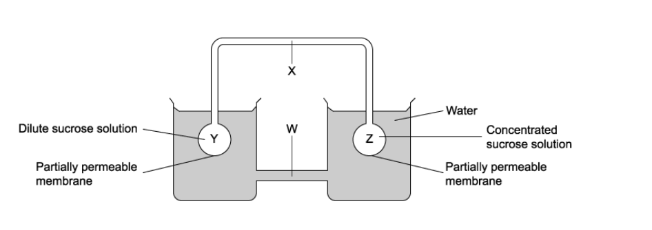

In a plant, what are the structures W, X, Y and Z and what is the direction of flow of solution along X?

|   | phloem | xylem | roots | leaves | direction of flow along X |
|---|---|---|---|---|---|
| **A** | W | X | Y | Z | from Y to Z |
| **B** | W | X | Z | Y | from Y to Z |
| **C** | X | W | Y | Z | from Z to Y |
| **D** | X | W | Z | Y | from Z to Y |

### Q15 — medium — 1 marks

**Q15** [1 mark]

Various factors affect the rate of diffusion of molecules.

Which conditions would result in the fastest rate of diffusion?

|   | difference in concentration (mmol dm–3) | temperature (°C) | surface area : volume ratio | molecule |
|---|---|---|---|---|
| **A** | 1 | 25 | 4 | sodium |
| **B** | 5 | 15 | 2 | glucose |
| **C** | 10 | 35 | 0.5 | water |
| **D** | 20 | 20 | 3 | oxygen |

### Q16 — medium — 1 marks

**Q16** [1 mark]

The water potential of sea water is approximately –2500 kPa. Halophytes are plants that are able to survive in regions where they are regularly exposed to sea water.

Which adaptation would you expect halophytes to have to enable them to live in this environment?

### Q17 — medium — 1 marks

**Q17** [1 mark]

The diagram represents the phloem pathway and adjacent cells from leaf to root in a plant.

What process is occurring between 1 to 2 and what is the effect on the water potential at 2?

|   | **process from 1 to 2** | **water potential at 2** |
|---|---|---|
| **A** | active transport of sucrose | becomes less negative |
| **B** | active transport of sucrose | becomes more negative |
| **C** | diffusion of sucrose | becomes less negative |
| **D** | diffusion of sucrose | becomes more negative |

### Q18 — medium — 1 marks

**Q18** [1 mark]

Two solutions are separated by a partially permeable membrane. The two solutions have a different concentration of glucose (black dots).

Which of the following best describes what will happen to the amount of glucose, volume of water and concentration of solution?

|   | Solution | Amount of glucose | Volume of Water | Concentration |
|---|---|---|---|---|
| **A** | 1  2 | remains constant  remains constant | decreases  increases | increases  decreases |
| **B** | 1  2 | increases  decreases | remains constant  remains constant | increases  decreases |
| **C** | 1  2 | remains constant  remains constant | increases  decreases | decreases  increases |
| **D** | 1  2 | decreases  increases | increases  decreases | remains constant  remains constant |

### Q19 — medium — 1 marks

**Q19** [1 mark]

A student places an animal cell and a plant cell into distilled water and notes down the following observations.

Animal cell: swells then bursts Plant cell: swells

What is the reason for this difference?

### Q20 — medium — 1 marks

**Q20** [1 mark]

Which of the following membrane proteins does not undergo a conformational change to perform its function?

### Q21 — easy — 1 marks

**Q21** [1 mark]

Cells require the following molecules for normal functioning:

| 1 | glucose |
|---|---|
| 2 | water |
| 3 | amino acids |
| 4 | oxygen |

Which molecules require a protein for transport across the cell surface membrane?

### Q22 — easy — 1 marks

**Q22** [1 mark]

Which mode of transport is energy independent?

### Q23 — easy — 1 marks

**Q23** [1 mark]

What form of cellular transport is shown in the diagram above?

### Q24 — easy — 1 marks

**Q24** [1 mark]

Substance X moves through a protein channel into a cell.

Which statement best describes substance X and it’s movement?

### Q25 — easy — 1 marks

**Q25** [1 mark]

The diagram represents three possible pathways through a cell surface membrane.

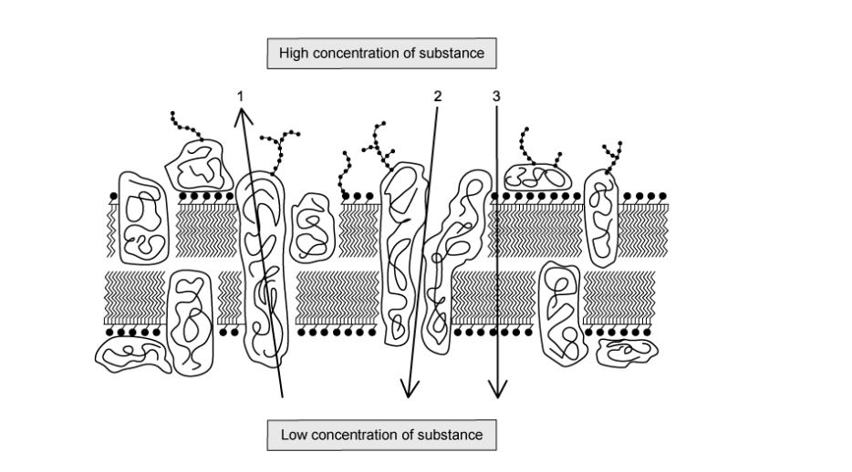

Which process is represented by each arrow?

|   | 1 | 2 | 3 |
|---|---|---|---|
| **A** | facilitated diffusion | diffusion | active transport |
| **B** | active transport | diffusion | facilitated diffusion |
| **C** | facilitated diffusion | active transport | diffusion |
| **D** | active transport | facilitated diffusion | diffusion |

### Q26 — easy — 1 marks

**Q26** [1 mark]

The following are all examples of cellular transport:

| 1 | bacterium engulfed by phagocytes |
|---|---|
| 2 | digestive enzymes being secreted from the pancreas |
| 3 | an egg cell taking up liquid nutrients from follicle cells |
| 4 | the release of neurotransmitters from the presynaptic neuron |

Which examples require bulk transport?

### Q27 — easy — 1 marks

**Q27** [1 mark]

The movement of water is dependent on the water potential either side of a partially permeable membrane.

What is the correct equation for calculating the total water potential (Ψ) from solute potential (Ψs)and pressure potential (Ψp)?

### Q28 — easy — 1 marks

**Q28** [1 mark]

“Diffusion is a result of…”

Which option correctly completes the sentence?

### Q29 — easy — 1 marks

**Q29** [1 mark]

Which of the following statements regarding membrane transport is false?

### Q30 — easy — 1 marks

**Q30** [1 mark]

Complete the sentence:

“Plasmolysis occurs when a(n)  ____X____     cell is immersed in a   _____Y_____       solution.”

|   | X | Y |
|---|---|---|
| **A** | animal cell | pure water |
| **B** | animal cell | strong saline |
| **C** | plant cell | pure water |
| **D** | plant cell | strong saline |

## Structured Questions (15 questions)

### Q1 — hard — 12 marks

**Q1** [3 marks]

A plant palisade mesophyll cell is 4 μm in width and depth, and 25 μm in length.

Its shape is approximately cuboid.

Calculate the surface area to volume ratio of this cell. Show your working.

**Q1** [3 marks]

**Extract:**

A plant palisade mesophyll cell is 4 μm in width and depth, and 25 μm in length.

Its shape is approximately cuboid.

If the palisade cell in part (a) has a large central vacuole, so that the cytoplasm (not including the vacuole) extends inward 500 nm from the plasma membrane of the cell.

Calculate the surface area to cytoplasmic volume ratio. Show your working.

**Q1** [3 marks]

Explain the importance of the surface area to volume ratio to a growing bacterial cell.

**Q1** [3 marks]

Palisade mesophyll cells and bacterial cells are both approximately cuboid in shape.

Explain the benefit of this shape for the functioning of the cell.

### Q2 — hard — 8 marks

**Q2** [1 mark]

Some membranes are described as *semi-permeable*; this means that only water and a few small solutes can pass through the membrane.

However, the preferred term to describe most biological membranes is *selectively permeable*.

Explain why *selectively permeable *is the preferred term for biological membranes.

**Q2** [2 marks]

Diffusion can be studied using visking tubing. Visking tubing (or dialysis tubing) is a plastic-like material that water and small solute molecules can pass through.

Students set up an investigation in which equal volumes of each of the following solutions were placed into separate visking tubings:

0.7 mol dm-3 sodium chloride

0.7 mol dm-3 glucose

The visking tubings, each of the same size, were placed in distilled water and maintained at a constant temperature of 23°C. The volume and mass of the bags were measured at 5 minute intervals for 160 minutes.

The data recorded is shown below.

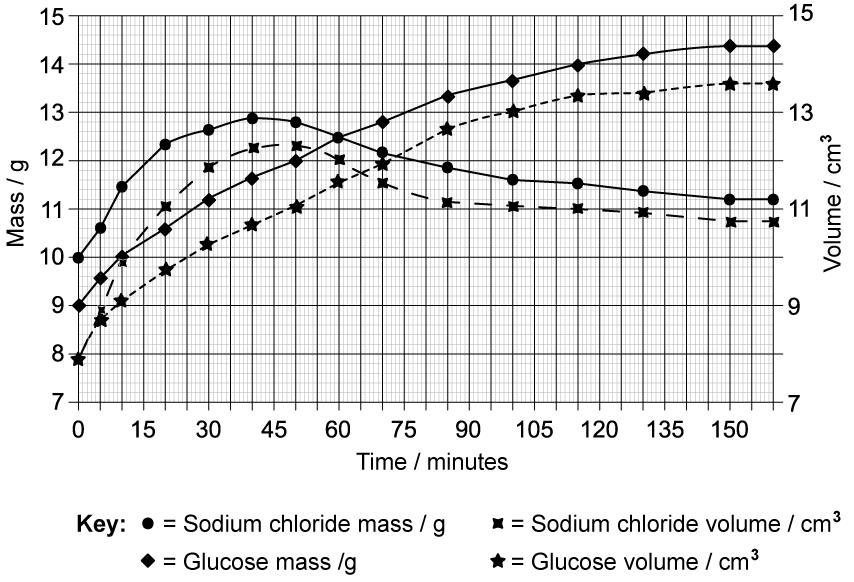

Calculate the rates of increase in mass and in volume for the visking tubing containing glucose solution during the first 30 minutes.

**Q2** [3 marks]

**Extract:**

Diffusion can be studied using visking tubing. Visking tubing (or dialysis tubing) is a plastic-like material that water and small solute molecules can pass through.

Students set up an investigation in which equal volumes of each of the following solutions were placed into separate visking tubings:

0.7 mol dm^-3 sodium chloride

0.7 mol dm^-3 glucose

The visking tubings, each of the same size, were placed in distilled water and maintained at a constant temperature of 23°C. The volume and mass of the bags were measured at 5 minute intervals for 160 minutes.

The data recorded is shown below.

Compare and contrast the rates of change in mass for the two visking tubings.

**Q2** [2 marks]

**Extract:**

Diffusion can be studied using visking tubing. Visking tubing (or dialysis tubing) is a plastic-like material that water and small solute molecules can pass through.

Students set up an investigation in which equal volumes of each of the following solutions were placed into separate visking tubings:

0.7 mol dm^-3 sodium chloride

0.7 mol dm^-3 glucose

The visking tubings, each of the same size, were placed in distilled water and maintained at a constant temperature of 23°C. The volume and mass of the bags were measured at 5 minute intervals for 160 minutes.

Explain why the volumes of both visking tubings increases over time.

### Q3 — hard — 13 marks

**Q3** [6 marks]

Design an experiment to estimate the glucose concentration of the cell contents of sweet potato tuber. The following equipment has been provided.

- Sweet potato
- 1 mol dm3 glucose solution
- Cork borers
- Other common laboratory supplies and reagents.

Outline the steps you would take and the way that you would process the data that you would generate.

**Q3** [3 marks]

**Extract:**

Design an experiment to estimate the glucose concentration of the cell contents of sweet potato tuber. The following equipment has been provided.

- Sweet potato
- 1 mol dm^3 ^glucose solution
- Cork borers
- Other common laboratory supplies and reagents.

Outline the steps you would take and the way that you would process the data that you would generate.

An experiment to estimate the glucose concentration of the cell contents of sweet potato tuber would include...

- Serial dilution / dilution series of various concentrations of glucose between 0 and 1 mol dm^-3^ ;
- Cut near-identical tubes of sweet potato, pat dry, weigh;
- Totally immerse tubes in glucose solutions;
- Leave for a set time, between 20-30 minutes, remove, pat dry, re-weigh;
- Calculate percentage / % change in mass;
- Plot % change in mass vs glucose concentration; where the curve crosses the x-axis is the concentration of glucose in the cells / isotonic;

Sketch a graph of the expected results from the experiment in question 3a).

**Q3** [2 marks]

Define the term, ‘water potential’ and explain why values of water potential are expressed in kilopascals (kPa).

**Q3** [2 marks]

Explain why an aqueous solution has a lower water potential than pure water.

### Q4 — hard — 12 marks

**Q4** [1 mark]

The graph in Fig.1 shows the increase in mass of a potato chip when placed into a solution.

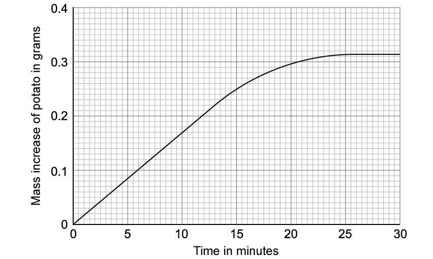

**Fig.1**

Describe the water potential of the solution at 25 minutes.

**Q4** [3 marks]

**Extract:**

The graph in Fig.1 shows the increase in mass of a potato chip when placed into a solution.

Explain the trend shown in Fig.1 from 0-24 minutes.

**Q4** [4 marks]

Contrast the processes of osmosis and exocytosis.

**Q4** [4 marks]

Explain the role of exocytosis in the digestion of starch in the small intestines.

### Q5 — hard — 9 marks

**Q5** [2 marks]

A student investigated the effect of changing the size of a cube on the rate of diffusion.

Coloured agar was created using a dilute sodium hydroxide solution and universal indicator. The agar was cut into cubes of different sizes (**A **to** E**) and their surface area and volume were calculated in order to determine the surface area to volume ratio.

The cubes were placed into boiling tubes containing 10 cm3 of dilute hydrochloric acid and the time taken for the agar cubes to become colourless was measured and recorded.

The results of the investigation is represented in Table 1.

**Table 1**

| **Cube** | **Surface area / cm****2** | **Volume / cm****3** | **Surface area: Volume** | **Time taken for the cube to turn colourless / s** |
|---|---|---|---|---|
| **A** | 1.5 | 0.13 | 11.5 : 1 | 175 |
| **B** | 6.0 | 1.00 | 6 : 1 | 256 |
| **C** | 13.5 | 3.38 |   | 312 |
| **D** | 24.0 | 8.00 | 3 : 1 | 384 |
| **E** | 37.5 | 15.63 | 2.4 : 1 | 428 |

Calculate the surface area to volume ratio for cube** C**.

Show your work and round your answer to the nearest whole number.

**Q5** [2 marks]

**Extract:**

A student investigated the effect of changing the size of a cube on the rate of diffusion.

Coloured agar was created using a dilute sodium hydroxide solution and universal indicator. The agar was cut into cubes of different sizes (A to E) and their surface area and volume were calculated in order to determine the surface area to volume ratio.

The cubes were placed into boiling tubes containing 10 cm³ of dilute hydrochloric acid and the time taken for the agar cubes to become colourless was measured and recorded.

The results of the investigation is represented in Table 1.

Table 1

| Cube | Surface area / cm² | Volume / cm³ | Surface area: Volume | Time taken for the cube to turn colourless / s |
| A | 1.5 | 0.13 | 11.5 : 1 | 175 |
| B | 6.0 | 1.00 | 6 : 1 | 256 |
| C | 13.5 | 3.38 | 4 : 1 | 312 |
| D | 24.0 | 8.00 | 3 : 1 | 384 |
| E | 37.5 | 15.63 | 2.4 : 1 | 428 |

Describe the results shown in Table 1.

**Q5** [3 marks]

**Extract:**

A student investigated the effect of changing the size of a cube on the rate of diffusion.

Coloured agar was created using a dilute sodium hydroxide solution and universal indicator. The agar was cut into cubes of different sizes (A to E) and their surface area and volume were calculated in order to determine the surface area to volume ratio.

The cubes were placed into boiling tubes containing 10 cm³ of dilute hydrochloric acid and the time taken for the agar cubes to become colourless was measured and recorded.

The results of the investigation is represented in Table 1.

Table 1

| Cube | Surface area / cm² | Volume / cm³ | Surface area: Volume | Time taken for the cube to turn colourless / s |
| A | 1.5 | 0.13 | 11.5 : 1 | 175 |
| B | 6.0 | 1.00 | 6 : 1 | 256 |
| C | 13.5 | 3.38 | 4 : 1 | 312 |
| D | 24.0 | 8.00 | 3 : 1 | 384 |
| E | 37.5 | 15.63 | 2.4 : 1 | 428 |

Description of results: As the size of the cube increases the surface area to volume ratio / SA: V decreases OR as the size of the cube decreases the surface area to volume ratio / SA: V increases. The larger the cube / smaller the surface area to volume ratio / SA:V, the longer it takes for the cube to become colourless OR the smaller the cube / larger the surface area to volume ratio / SA:V, the less time it takes for the cube to become colourless.

Explain the significance of the results shown in Table 1 for living organisms.

**Q5** [2 marks]

**Extract:**

A student investigated the effect of changing the size of a cube on the rate of diffusion.

Coloured agar was created using a dilute sodium hydroxide solution and universal indicator. The agar was cut into cubes of different sizes (A to E) and their surface area and volume were calculated in order to determine the surface area to volume ratio.

The cubes were placed into boiling tubes containing 10 cm³ of dilute hydrochloric acid and the time taken for the agar cubes to become colourless was measured and recorded.

The results of the investigation is represented in Table 1.

Table 1

| Cube | Surface area / cm² | Volume / cm³ | Surface area: Volume | Time taken for the cube to turn colourless / s |
| A | 1.5 | 0.13 | 11.5 : 1 | 175 |
| B | 6.0 | 1.00 | 6 : 1 | 256 |
| C | 13.5 | 3.38 |   | 312 |
| D | 24.0 | 8.00 | 3 : 1 | 384 |
| E | 37.5 | 15.63 | 2.4 : 1 | 428 |

Suggest a possible outcome for the investigation described in part** (a)** if the agar cubes were placed in a more concentrated solution of hydrochloric acid.

### Q6 — medium — 11 marks

**Q6** [4 marks]

Fig.1 shows a light micrograph of a series of onion cells that have been placed in distilled water for several hours.

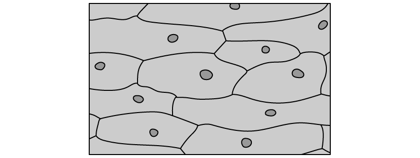

**                                                            Fig. 1**

Explain the events that led to the appearance of the cells in Fig. 1

**Q6** [2 marks]

**Extract:**

Fig.1 shows a light micrograph of a series of onion cells that have been placed in distilled water for several hours.

Fig.2 shows another set of onion cells.

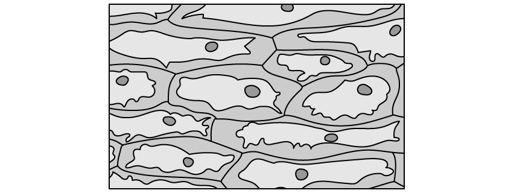

**                                                             Fig. 2**

Explain why the cells in Fig.2 differ in appearance from the cells shown in Fig. 1.

**Q6** [3 marks]

Emphysematous pyelonephritis (EPN) is a very rare complication that can develop as a result of an untreated kidney infection. It is a severe infection during which bacteria destroy kidney tissue, eventually leading to kidney failure. If kidney failure is left untreated the kidneys are unable to regulate the amount of water in the body and the blood plasma becomes more dilute than normal.

Describe the effect that this would have on red blood cells.

**Q6** [2 marks]

Explain why changes in cell volume affect animal cells more severely than plant cells.

### Q7 — medium — 9 marks

**Q7** [2 marks]

An investigation was conducted to estimate water potential in plant tissue. The following method was used:

- The investigators made a range of dilutions of a 1 mol dm-3 solution of sodium chloride.
- A cork borer was used to cut three potato cylinders for each sodium chloride concentration.
- The initial mass of each potato cylinder was recorded.
- The potato cylinders were placed in boiling tubes, each containing 10 cm3 of sodium chloride solution of a different concentration. One of the boiling tubes contained only distilled water.
- The boiling tubes were placed in a water bath at 25 °C and left for a period of 5 hours.
- The final mass of each potato cylinder was measured and recorded for each sodium chloride solution.
- The mean initial and final mass was calculated for each sodium chloride solution.

The results for this investigation is shown in Table 1

**Table 1**

| **Concentration of sodium chloride solution / mol dm****-3** | **Mean initial mass / g** | **Mean final mass / g** | **Mean % change in mass / %** |
|---|---|---|---|
| 0.00 | 4.50 | 4.95 | 10 |
| 0.25 | 4.52 | 4.60 | 1.8 |
| 0.50 | 4.51 | 4.51 | 0 |
| 0.75 | 4.51 | 4.30 |   |
| 1.00 | 4.50 | 4.27 | -5.1 |

Calculate the mean percentage change in mass of the potato cylinders in the 0.75 mol dm-3 sodium chloride solution. Show your working.

**Q7** [2 marks]

**Extract:**

An investigation was conducted to estimate water potential in plant tissue. The following method was used:

- The investigators made a range of dilutions of a 1 mol dm^-3^ solution of sodium chloride.
- A cork borer was used to cut three potato cylinders for each sodium chloride concentration.
- The initial mass of each potato cylinder was recorded.
- The potato cylinders were placed in boiling tubes, each containing 10 cm^3^ of sodium chloride solution of a different concentration. One of the boiling tubes contained only distilled water.
- The boiling tubes were placed in a water bath at 25 °C and left for a period of 5 hours.
- The final mass of each potato cylinder was measured and recorded for each sodium chloride solution.
- The mean initial and final mass was calculated for each sodium chloride solution.

The results for this investigation is shown in Table 1

**Table 1**

| **Concentration of sodium chloride solution / mol dm**^**-3**^ | **Mean initial mass / g** | **Mean final mass / g** | **Mean % change in mass / %** |
| 0.00 | 4.50 | 4.95 | 10 |
| 0.25 | 4.52 | 4.60 | 1.8 |
| 0.50 | 4.51 | 4.51 | 0 |
| 0.75 | 4.51 | 4.30 |   |
| 1.00 | 4.50 | 4.27 | -5.1 |

Explain why there was no change in mass for the potato cylinders in the 0.5 mol dm-3 sodium chloride solution.

**Q7** [2 marks]

**Extract:**

An investigation was conducted to estimate water potential in plant tissue. The following method was used:

- The investigators made a range of dilutions of a 1 mol dm^-3^ solution of sodium chloride.
- A cork borer was used to cut three potato cylinders for each sodium chloride concentration.
- The initial mass of each potato cylinder was recorded.
- The potato cylinders were placed in boiling tubes, each containing 10 cm^3^ of sodium chloride solution of a different concentration. One of the boiling tubes contained only distilled water.
- The boiling tubes were placed in a water bath at 25 °C and left for a period of 5 hours.
- The final mass of each potato cylinder was measured and recorded for each sodium chloride solution.
- The mean initial and final mass was calculated for each sodium chloride solution.

The results for this investigation is shown in Table 1

**Table 1**

| **Concentration of sodium chloride solution / mol dm**^**-3**^ | **Mean initial mass / g** | **Mean final mass / g** | **Mean % change in mass / %** |
| 0.00 | 4.50 | 4.95 | 10 |
| 0.25 | 4.52 | 4.60 | 1.8 |
| 0.50 | 4.51 | 4.51 | 0 |
| 0.75 | 4.51 | 4.30 |   |
| 1.00 | 4.50 | 4.27 | -5.1 |

Explain the change in mass that occurred in the potato cylinder placed in the boiling tube containing distilled water.

**Q7** [3 marks]

**Extract:**

An investigation was conducted to estimate water potential in plant tissue. The following method was used:

- The investigators made a range of dilutions of a 1 mol dm^-3^ solution of sodium chloride.
- A cork borer was used to cut three potato cylinders for each sodium chloride concentration.
- The initial mass of each potato cylinder was recorded.
- The potato cylinders were placed in boiling tubes, each containing 10 cm^3^ of sodium chloride solution of a different concentration. One of the boiling tubes contained only distilled water.
- The boiling tubes were placed in a water bath at 25 °C and left for a period of 5 hours.
- The final mass of each potato cylinder was measured and recorded for each sodium chloride solution.
- The mean initial and final mass was calculated for each sodium chloride solution.

The results for this investigation is shown in Table 1

**Table 1**

| **Concentration of sodium chloride solution / mol dm**^**-3**^ | **Mean initial mass / g** | **Mean final mass / g** | **Mean % change in mass / %** |
| 0.00 | 4.50 | 4.95 | 10 |
| 0.25 | 4.52 | 4.60 | 1.8 |
| 0.50 | 4.51 | 4.51 | 0 |
| 0.75 | 4.51 | 4.30 |   |
| 1.00 | 4.50 | 4.27 | -5.1 |

Sketch one of the potato cells that was kept in the 1.00 mol dm-3 sodium chloride solution. Label the cell wall, cell membrane and cytoplasm in your diagram.

### Q8 — medium — 11 marks

**Q8** [2 marks]

Some scientists investigated the uptake of magnesium ions in rice plants. They divided the plants into two groups and placed their roots in solutions containing radioactive magnesium ions.

**   Group Y:** plants had a substance that inhibited respiration added to the solution **   Group Z:** plants did **not **have the respiratory inhibitor added to the solution

The scientists calculated the total amount of magnesium ions absorbed by the plants every 5 minutes. Their results are shown in the graph in **Figure 1** below:

**Figure 1**

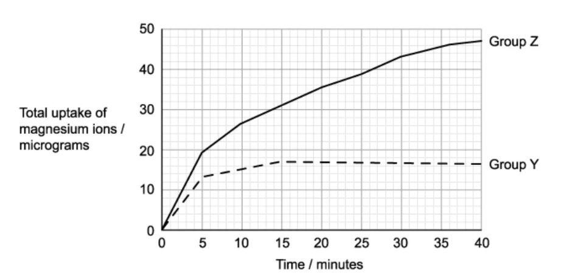

Calculate the ratio of the mean rate of uptake of magnesium ions in the first 20 minutes to the mean rate of uptake of magnesium ions in the second 20 minutes for group **Z** plants. Show your working.

**Q8** [4 marks]

**Extract:**

Some scientists investigated the uptake of magnesium ions in rice plants. They divided the plants into two groups and placed their roots in solutions containing radioactive magnesium ions.

**   Group Y:** plants had a substance that inhibited respiration added to the solution
**   Group Z:** plants did **not **have the respiratory inhibitor added to the solution

The scientists calculated the total amount of magnesium ions absorbed by the plants every 5 minutes. Their results are shown in the graph in **Figure 1** below:

**Figure 1**

Consider the graph in **Figure 1**. Explain the results of the students’ investigation.

**Q8** [2 marks]

**Extract:**

Some scientists investigated the uptake of magnesium ions in rice plants. They divided the plants into two groups and placed their roots in solutions containing radioactive magnesium ions.

**   Group Y:** plants had a substance that inhibited respiration added to the solution
**   Group Z:** plants did **not **have the respiratory inhibitor added to the solution

The scientists calculated the total amount of magnesium ions absorbed by the plants every 5 minutes. Their results are shown in the graph in **Figure 1** below:

**Figure 1** 

Using the graph in **Figure 1**, calculate the rate of uptake of magnesium ions for group **Y **plants during the investigation. Give suitable units.

**Q8** [3 marks]

**Extract:**

Some scientists investigated the uptake of magnesium ions in rice plants. They divided the plants into two groups and placed their roots in solutions containing radioactive magnesium ions.

**   Group Y:** plants had a substance that inhibited respiration added to the solution
**   Group Z:** plants did **not** have the respiratory inhibitor added to the solution

State the names of three other substances that would **not** be absorbed into the group Y plants.

### Q9 — medium — 10 marks

**Q9** [2 marks]

A group of students investigated the effect of concentration gradient on the rate of diffusion. They filled a length of Visking tubing with a glucose solution of known concentration and suspended the tubing in a boiling tube filled with distilled water. Samples from the water surrounding the Visking tubing were removed at regular time intervals and tested for levels of glucose using Benedict's test. The experiment was repeated several times with different concentrations of glucose placed in the Visking tubing.

The students plotted a graph of glucose concentration against diffusion rate. Fig. 1 shows a representation of the results.

**Fig. 1**

Describe and explain the results shown in Fig. 1

**Q9** [2 marks]

**Extract:**

A group of students investigated the effect of concentration gradient on the rate of diffusion. They filled a length of Visking tubing with a glucose solution of known concentration and suspended the tubing in a boiling tube filled with distilled water. Samples from the water surrounding the Visking tubing were removed at regular time intervals and tested for levels of glucose using Benedict's test. The experiment was repeated several times with different concentrations of glucose placed in the Visking tubing.

The students repeated the experiment from part a) at a temperature that was 10 °C lower.

Suggest how this would affect the results of the investigation.

**Q9** [3 marks]

**Extract:**

A group of students investigated the effect of concentration gradient on the rate of diffusion. They filled a length of Visking tubing with a glucose solution of known concentration and suspended the tubing in a boiling tube filled with distilled water. Samples from the water surrounding the Visking tubing were removed at regular time intervals and tested for levels of glucose using Benedict's test. The experiment was repeated several times with different concentrations of glucose placed in the Visking tubing. 

The students plotted a graph of glucose concentration against diffusion rate. Fig. 1 shows a representation of the results.

Fig. 1

The students conducted a similar investigation by using animal cells placed in glucose solutions of different concentrations. The rate at which glucose entered the cells was determined for each glucose concentration.

The results of this investigation are shown in Fig. 2.

**                                                                   Fig. 2**

(i)Identify the specific type of membrane transport by which glucose enters the cells in Fig. 2

**[1]**

(ii) Suggest an explanation for your answer to part i).

**[2]**

**Q9** [3 marks]

**Extract:**

The students conducted a similar investigation by using animal cells placed in glucose solutions of different concentrations. The rate at which glucose entered the cells was determined for each glucose concentration.

The results of this investigation are shown in Fig. 2.

(i) Identify the specific type of membrane transport by which glucose enters the cells in Fig. 2

The specific type of membrane transport by which glucose enters the cells is facilitated diffusion.

(ii) Suggest an explanation for your answer to part i).

The rate of uptake/diffusion increases as the glucose concentration increases and then plateaus / levels off / remains constant. This is because no more channel/transport proteins are available / all channel/transport proteins are in use.

The investigation in part c) was carried out at room temperature.

Predict the possible outcome if the investigation in part c) were conducted at 60 °C **and** state a reason for your answer.

### Q10 — medium — 10 marks

**Q10** [3 marks]

Active transport plays an important role in the absorption of the products of digestion in the small intestine.

Compare the process of active transport with the process of facilitated diffusion.

**Q10** [3 marks]

Fig.1 illustrates another type of membrane transport.

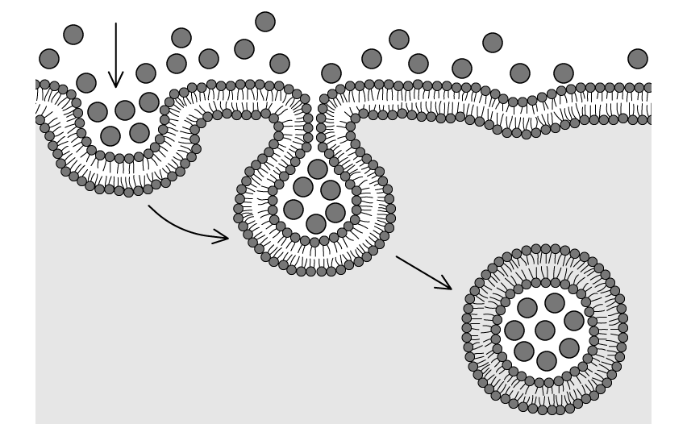

**                                                                Fig. 1**

(i)Identify the type of transport that is illustrated in Fig. 1

[1]

(ii) Describe the process identified in part i)

[2]

**Q10** [2 marks]

A gastric chief cell is a type of gland cell that secretes pepsinogen and other digestive enzymes in the stomach.

Fig. 2 shows a diagram of a gastric chief cell.

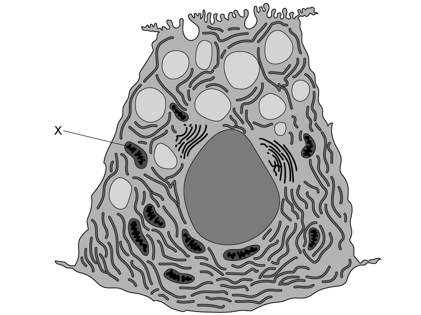

**                                                           Fig. 2**

Gastric chief cells contain a large number of structure **X**.

Explain the reason for this.

**Q10** [2 marks]

**Extract:**

A gastric chief cell is a type of gland cell that secretes pepsinogen and other digestive enzymes in the stomach.

Describe the process by which gastric chief cells will release these digestive enzymes into the stomach.

### Q11 — easy — 8 marks

**Q11** [3 marks]

Define the term **active transport**.

**Q11** [3 marks]

List **three** factors that affect the rate of diffusion of substances across a membrane.

**Q11** [1 mark]

State the name of the process by which materials are transported from structures **S** to **R** in Fig. 1 below

**Fig. 1**

**Q11** [1 mark]

**Extract:**

State the name of the process by which materials are transported from structures **S** to **R** in Fig. 1 below

**Fig. 1**

Name **one** material that could be transported from structure **S** to **R**.

### Q12 — easy — 10 marks

**Q12** [4 marks]

**Figure 1** below shows a cell surface membrane and some molecules of a small, nonpolar substance known as substance **X**.

**Figure 1**

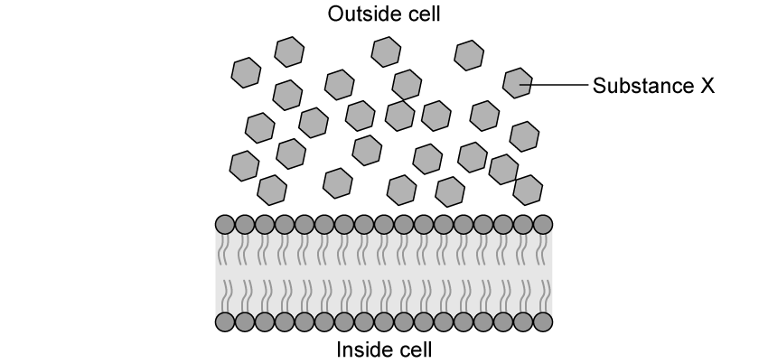

Predict and explain what will happen to substance **X** in **Figure 1**.

**Q12** [1 mark]

**Extract:**

**Figure 1** below shows a cell surface membrane and some molecules of a small, nonpolar substance known as substance **X**.

Give a possible name for substance **X**.

**Q12** [2 marks]

Substance **Y** is a large molecule and is not lipid-soluble. Describe how substance **Y**  would travel across a cell membrane from an area of high to low concentration.

**Q12** [3 marks]

**Figure 2** shows a molecule (X) that is about to be transported across a cell membrane.

**Figure 2**

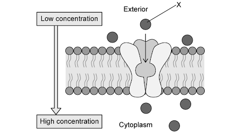

Describe the events that would take place in order for molecule **X** in **Figure 2 **to move from the exterior of the cell into the cytoplasm.

### Q13 — easy — 15 marks

**Q13** [4 marks]

Fig. 1 shows a section of membrane from a cell.

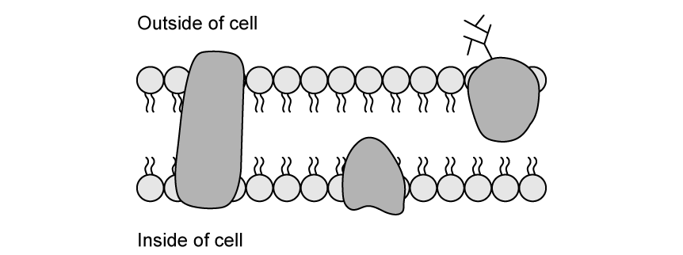

**Fig. 1**

Substances can pass across this membrane by diffusion or by facilitated diffusion.

With reference to transport across a membrane such as that in Fig.1, compare and contrast diffusion with facilitated diffusion.

**Q13** [3 marks]

Fig. 2 shows three different membrane proteins.

The boxes on the right show their various descriptions.

**Fig. 2**

Join the boxes on the left with the appropriate box on the right with three straight lines.

**Q13** [5 marks]

Compete the following passage about osmosis using appropriate words, some of which should be topic-specific keywords.

Do not use the word 'osmosis' as one of your answers.

| Plant roots absorb _______ by osmosis from the surrounding soil. It moves by a process of _______ from an area of _______ concentration to an area of _______ concentration across a _______ membrane. |
|---|

**Q13** [3 marks]

(i) Complete the following statement:

As solute concentration increases, water potential ___________.

[1]

(ii) Explain your choice of word in part (d) (i).

[2]

### Q14 — easy — 9 marks

**Q14** [2 marks]

Complete **Table 1** by placing a tick (✓) in the appropriate boxes.

**Table 1**

|   | **Simple diffusion** | **Osmosis** | **Facilitated diffusion** | **Active Transport** |
|---|---|---|---|---|
| Movement of glucose from high to low concentration |   |   |   |   |
| Movement down a concentration gradient |   |   |   |   |
| Movement of water from high water potential to low water potential. |   |   |   |   |
| Movement of oxygen from the plasma into a red blood cell |   |   |   |   |

**Q14** [3 marks]

**Figure 1** below shows a group of onion cells viewed under an optical microscope.

**Figure 1**

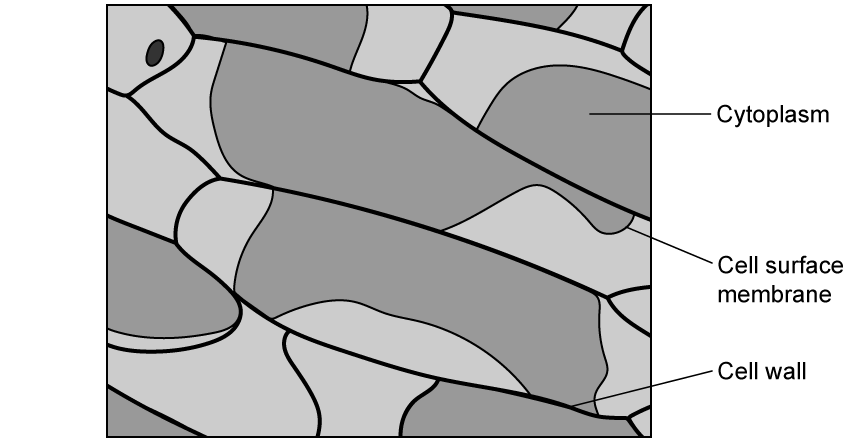

Explain the appearance of the cytoplasm that can be seen in **Figure 1**.

**Q14** [2 marks]

A student took a cheek cell sample using a cotton swab and placed the cells into a test tube containing pure water. Predict what would happen to the cheek cells in the test tube.

**Q14** [2 marks]

**Extract:**

Figure 1 below shows a group of onion cells viewed under an optical microscope.

The shape of the cytoplasm in Figure 1 is due to the onion cells having been placed in a solution with lower water potential. Water has moved out of the cells by osmosis, causing the cytoplasm / vacuole / protoplast to shrink / decrease in volume.

A student took a cheek cell sample using a cotton swab and placed the cells into a test tube containing pure water. The cheek cells in the test tube of pure water would take on water / water would move into the cheek cells by osmosis. The cells would swell AND eventually burst.

The onion cells from part b) were also placed into pure water, but the effect on these cells were slightly different. State how the effect would be different and explain why.

### Q15 — easy — 6 marks

**Q15** [1 mark]

Complete the following sentence.

The size of an organism is _____________ proportional to its surface area to volume ratio.

**Q15** [1 mark]

In an experiment using agar blocks immersed in a diffusion solution, the blocks are made up containing sodium hydroxide and a universal indicator solution.

Suggest a suitable solution to immerse these blocks to examine diffusion.

**Q15** [2 marks]

Two organisms are described in **Table 1**.

**Table 1**

|   | **organism A** | **organism B** |
|---|---|---|
| surface area / cm2 | 18 970 | 79.8 |
| volume / dm3 | 70 | 0.019 |
| SA: VOL ratio |   |   |

Complete **Table 1** by calculating the missing surface area to volume ratios.

Do not include units.

**Q15** [2 marks]

**Extract:**

Two organisms are described in **Table 1**.

**Table 1**

|   | **organism A** | **organism B** |
| surface area / cm^2^ | 18 970 | 79.8 |
| volume / dm^3^ | 70 | 0.019 |
| SA: VOL ratio | 271 | 4 200 |

**Table 1** from part (c) shows two organisms, **A **and **B**.

One of these is a mouse, the other is a human. Identify which animal is represented by **A**.

Give a reason for your answer.
