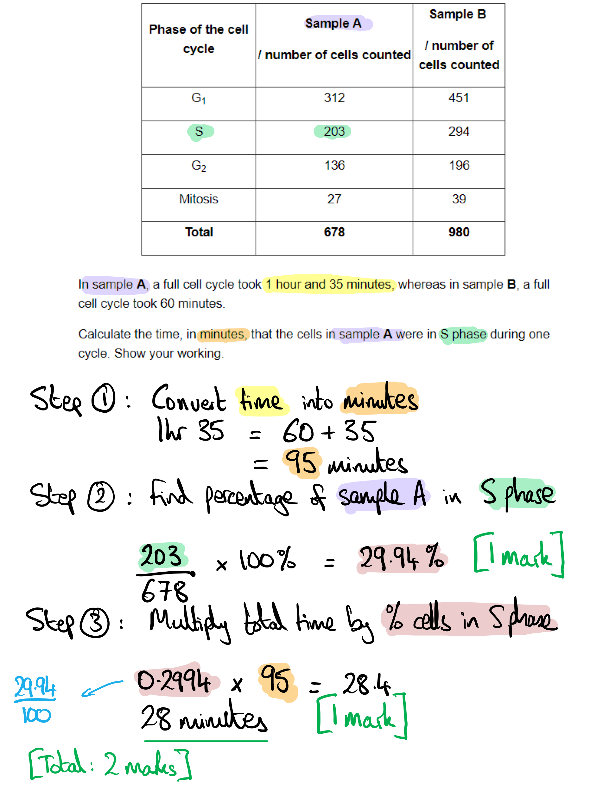
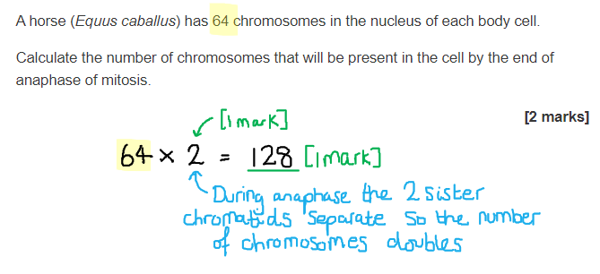
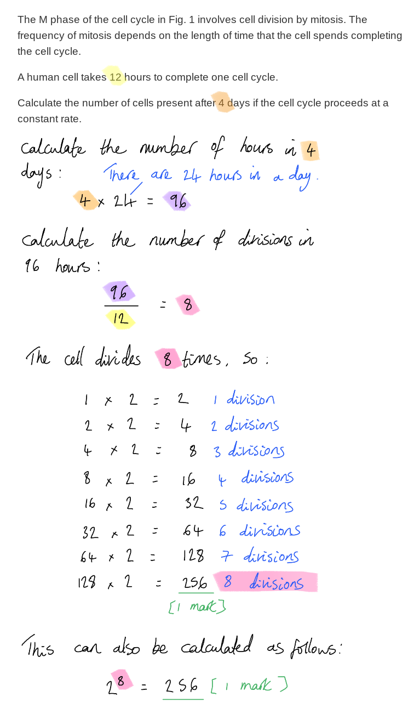
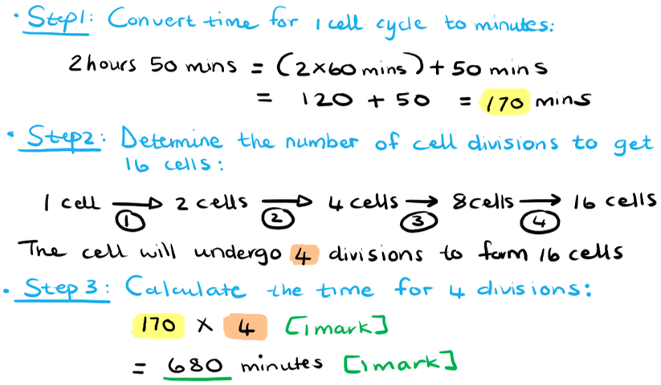

# Mark Schemes — Replication & Division of Nuclei & Cells
**5. The Mitotic Cell Cycle** · Cambridge (CIE) AS biology (9700)

## Multiple Choice Questions (29 questions)

### Q1
**Final answer:** **The correct answer is ****C ****because**** **

- **72 base pairs x 0.52nm (the length of ****each**** base pair) = 37.44nm (the length of the DNA or ‘long piece of string’)**
- **Area that this ‘string’ must be packed into is 10nm, therefore 37.44 divided by 10 = ****3.7**

> *A is incorrect as it is only one base pair being included in the ratio calculation.*

> *B is incorrect as this is the length of the DNA linker.*

> *D is incorrect as each base pair is 0.52nm long and if there are 72 of them then it is a multiplication not division.*

### Q2
**Final answer:** **The correct answer is ****B**** because aquaporin channel proteins have no role in controlling the division of cells.**

> *A **is incorrect as mutated **DNA repair proteins** would **reduce** the chance of corrections being made to genes that control cell division and therefore increase the chances of uncontrolled division occurring *

> *C **is incorrect as mutated **cell death proteins** would result in cells **continuing **to multiply*

> *D **is incorrect as mutated **cell adhesion proteins** could lead to alterations in the signalling between cells and could lead to metastasis (when cancerous cells travel to different parts of the body)*

### Q3
**Final answer:** **The correct answer is ****B ****because:**

- **The diagram is showing a cell in ****interphase**** where the chromosomes have uncoiled **
- **There are ****20**** chromosomes in this cell**
- **The diploid number is the full set of chromosomes an organism has in each cell, therefore the ****diploid**** number is 20**

> *A** is incorrect as this is the haploid number*

> *C** is incorrect as this is the number of chromatids that would occur **after replication*

> *D** is incorrect as this is the diploid number of a human cell. The question has not said that the organism is a human therefore the assumption should not be made.*

### Q4
**Final answer:** **The correct answer is ****D:**

- **As the condensing (supercoiling) of the chromosomes allows alignment during metaphase to occur more easily**
- **Separation of the chromosomes (sister chromatids) during anaphase is easier**
- **Chromosomes are most condensed during metaphase**

> *A **is incorrect as condensing prevents proteins (e.g. transcription factors or enzymes) from attaching to the genes*

> *B **is incorrect as chromatin is the term used to refer to DNA and histones (proteins) that make up eukaryotic chromosomes*

> *C **is incorrect as the volume of the cell does not change whether the cell is in interphase (when the chromosome is uncoiled) or when it is undergoing mitosis*

### Q5
**Final answer:** **The correct answer is ****D ****as the telomeres are short repeated sequences of DNA bases (in humans this is TTAGGG). They are found at the end of chromosomes and form loops to protect DNA from deterioration or fusing with other chromosomes. Telomeres are like coding regions because they are made of the same nucleotides however they do not code for a protein and do not have DNA polymerase initiation sites.**

> *A **is incorrect as telomeres are composed of **DNA**.*

> *B **is incorrect as telomeres are at the end of the chromosomes and therefore composed of DNA nucleotides.*

> *C **is incorrect as telomeres are **not only **C/G nucleotides, although these are found in higher concentrations and therefore there would be more hydrogen bonds.*

### Q6
**Final answer:** **The correct answer is ****C ****because**

- **Embryonic cells**** are ****stem cells**** and therefore are ****continually ****dividing and differentiating into new cells to form the organism**
- **B-lymphocytes**** are being ****cloned ****to form plasma and memory cells that can produce antibodies**
- **Both cells are frequently dividing and therefore will contain the enzyme ****telomerase**** (at low levels) to combat telomere shortening each time the cell divides**

> *A **is incorrect as B-lymphocytes are needing to be continually replicated during an immune response.*

> *B **& **D **are** **incorrect as heart cells do not have to be continually replicated and therefore do not contain telomerase.*

### Q7
**Final answer:** **The correct answer is ****D**** because before a cell can divide by mitosis it needs to replicate its DNA (this occurs during the S phase, with S standing for ‘synthesis’). Once the cell starts progressing through S phase, it is committed to dividing by mitosis. The growth factor needs to signal to initiate this process. **

> *A **is incorrect as G**1** is the phase of the cycle between the last cell division and the S phase (where DNA is replicated). During this phase the cell may carry out its normal function, or it may start making the substances it needs to divide. Growth factors that bind straight after cytokinesis won’t have time to grow or synthesise proteins. *

> *B **is incorrect as this stage is at the start of mitosis where nuclear division starts to take place, therefore the growth factor signal will have already will have already been received.*

> *C **is incorrect as this is leading into the **G**2 **phase** where the replicated DNA is checked and repaired and preparation for division occurs, therefore the growth factor signal will have already been received.*

### Q8
**Final answer:** **The correct answer is ****D**** because adult stem cells have already partially differentiated and therefore ****limited ****specialised cells can be formed from them. For example, stem cells in bone marrow can produce cells that differentiate into all the different types of blood cell.**

> *A **is incorrect as **pluripotent** stem cells (embryonic stem cells) are cells that are mostly undifferentiated and could form most specialised cells (some cells have differentiated into cells to form the embryo and foetus e.g. placental cells)*

> *B **is incorrect as totipotent cells can differentiate into **any** type of cell, they are the cells that form from fertilisation (zygote) to the 16-cell stage embryo (morula) as well as forming extra-embryonic cells that form the placenta*

> *C **is incorrect as omnipotent stem cells can only produce one cell type, they arise from multipotent stem cells*

### Q9
**Final answer:** **The correct answer is ****B**** because cancerous tissues are formed as a result of uncontrolled mitotic cell division; usually as a result of loss of control of the cell cycle due to ****mutations**** in key genes that control when a cell divides and stops dividing. **

> *A** is incorrect as root hairs are extensions of the epidermal cells located in roots; they are **not** cells.*

> *C** is incorrect as gametes are **haploid** cells, formed by **meiosis**.*

> *D** is incorrect as antibodies are **proteins** formed by plasma cells (which themselves are produced by mitotic divisions of activated B-lymphocytes).*

### Q10
**Final answer:** **The correct answer is ****D ****because D is located towards the end of Interphase which suggests the cell is in ****G****2**** phase**** and thus has gone through S phase (or ****S****ynthesis of DNA where nucleotides would be incorporated).**

> *A** & **B **are incorrect as both are located where the cell will be undergoing mitosis, which is when the replicated chromosomes (sister chromatids) are being separated.*

> *C **is incorrect as immediately after mitosis and cytokinesis the cell enters the **G**1** phase** where the cell grows, and organelles are synthesised.*

### Q11
**Final answer:** **The correct answer is ****D ****if both genes are mutated (inactive) then the cancer cells are able to ****continually divide**** which is more likely to result in breast cancer. This is because if there are no brac1 or p53 proteins then there is nothing to stop the growth of breast cancer cells (brac1) or to suppress the tumour (p53). **

> *All other options would not result in cancer cells being able to continually divide as they would be stops by the proteins produced by the normal genes.*

### Q12
**Final answer:** **The correct answer is ****C**** because cancer cells result from uncontrolled cell division and thus have a shorter interphase (when the cell carries out protein synthesis and grows). Mitosis takes a specific length of time whereas the length of interphase varies depending on when the cell receives a signal to divide.**

> *A** is incorrect as although mutations are rare, they can occur in any cell*

> *B** is incorrect as new cells, including cancer cells, are created when the cytoplasm divides during cytokinesis*

> *D **is incorrect as cancer cells undergo the mitosis phases to produce new cancer cells*

### Q13
**Final answer:** **The correct answer is ****B**

- **As ****prophase**** is the first stage of mitosis and so the ****nuclear envelope**** is still present**
- **During the ****S phase**** of interphase DNA is ****replicated ****producing a copy of the 46 chromosomes**

> *A** is incorrect as during prophase the **nuclear envelope** gets broken down and the **spindle fibres** form and when the nucleus divides there would only be **23 **chromosomes in the daughter cells*

> *C** is incorrect as there are **no** spindle fibres before prophase and when the **46** chromatids were separated during **anaphase** this would result in only **23** chromosomes in the daughter cells*

> *D** is incorrect as there are too few molecules of DNA to produce two **diploid** cells that were genetically identical to the parent cell*

### Q14
**Final answer:** **The correct answer is ****A ****as ultraviolet light, viruses and x-rays are examples of ****carcinogens**** (agents that cause cancer)**

> *All other options include carbon monoxide which is **not** a carcinogen but does displace oxygen from **haemoglobin**.*

### Q15
**Final answer:** **The correct answer is ****C**** as the purpose of ****mitosis**** is to:**

- **repair damaged tissue**** **
- **produce ****cloned immune cells**
- **increasing the number of cells (****growth****) **
- **asexual reproduction.**

> *A & B are incorrect as mitosis is required for producing cloned plasma cells AND replacing damaged cells.*

> *D is incorrect asgametes are produced during meiosis.*

### Q16
**Final answer:** **The correct answer is ****A ****because**** ****the positioning of the chromosomes on the equator of the spindle could occur in homologous pairs which occurs during meiosis and results in haploid cells. Hence, the genetic constitution will not be maintained. **

> *B, C** &** D** are incorrect as they all include the option 4 where the homologous chromosomes could orientate themselves randomly at the equator.*

### Q17
**Final answer:** **The correct answer is ****B ****because ****telomeres**** are short repeated sequences of DNA and proteins, which ****reduce**** in length each time DNA replicates because ****DNA polymerase**** cannot function all the way to the end of the DNA molecule. The shortening of telomeres is thought to contribute to ****aging**** (as cell division slows then stops) **

**Final answer:** **With substance ****X**** replacing the telomeres, the cell ****won’t**** age and die and instead will continually divide. **

### Q18
**Final answer:** **The correct answer is ****A**** **

- **When the ****p53**** gene is expressed (switched on) the tumour cells no longer divided whereas when the gene was not being expressed (switched off) the tumour cells were dividing.**
- **Therefore, p53 acts to suppress the formation and growth of tumours. **

> *B** is incorrect as when the **p53** gene was switched on only the tumour cells died whereas the healthy cells were unaffected*

> *C** & **D** are incorrect as when the **p53** gene was switched on the tumour cells died*

### Q19
**Final answer:** **The correct answer is ****A**** as ****S phase**** of ****interphase**** is when DNA is replicated via ****semi-conservative replication**** and hence is when thymine (a nucleotide) will be incorporated into new strands of DNA.**

> *All other options mention phases that occur during mitosis which is the process of the nucleus dividing and occurs **after** DNA replication.*

### Q20
**Final answer:** **The correct answer is ****A**** as ****semi-conservative**** DNA replication (one strand is used as a template along which new bases pair to form two molecules of DNA), occurs during ****interphase**** of the cell cycle (before mitosis). – DNA is replicated before mitosis which is the process of nuclear division where replicated chromosomes are separated into what will form two nuclei and eventually two new daughter cells.**

> *B **is incorrect as mitosis results in two genetically identical daughter cells; thus, the DNA **will** normally be unchanged (apart from the rare mutation)*

> *C** is incorrect as mitosis **does** produce genetically identical daughter cells*

> *D** is incorrect as the nucleus divides during mitosis by replication division, the chromosomes lined up at the equator during metaphase*

### Q21
**Final answer:** **The correct answer is ****B**** because the ****G****1**** phase**** is when protein synthesis is occurring and the production of mRNA occurs during ****transcription ****(the first part of protein synthesis). **

> *A** is incorrect as mitosis is the stage where the nucleus **divides** into two*

> *C** is incorrect as S (synthesis) phase this is the stage where DNA is **replicated*

> *D** is incorrect as during G**2** phase the replicated **DNA is checked** and errors repaired and the cell is prepared for nuclear division*

### Q22
**Final answer:** **The correct answer is ****A ****as mitosis is required for growth, tissue repair, asexual reproduction and cloning of immune cells.**

> *B** & **C** are incorrect as genetic variation is a result of meiosis.*

> *D **is incorrect as mitosis **is** required for growth (increase in cell number).*

### Q23
**Final answer:** **The correct answer is ****C ****because:**

- **The ****centromere**** is the narrow region where two ****chromatids**** are held together**
- **The chromatid forms when a chromosome replicates in the S phase (interphase)**

  - **At the beginning of cell division there are 2 identical sister chromatids  attached by a centromere within each chromosome molecule**
  - **Each chromatid is ****one**** DNA molecule**

> *A **is incorrect as the **centromere** is the location that joins the two chromatids.*

> *B & D **are incorrect as **centrioles** are microtubules that are part of the cytoskeleton.*

### Q24
**Final answer:** **The correct answer is ****B**** because:**

- **During mitosis chromosomes (each containing sister chromatids) line up at the equator and are then separated to form the two genetically identical daughter cells.**
- **Mitosis is required for the growth of new cells, asexual reproduction, tissue repair and cloned immune cells.**

> *A **is incorrect as mitosis is used to increase the number of cells, one parent cell splits to form a total of 2 daughter cells.*

> *C** is incorrect as cells with half the amount of DNA are a result of meiosis and occurs during the formation of gametes (egg and sperm cells).*

> *D **is incorrect as the parent cell nucleus divides into two resulting in the 2 daughter cells.*

### Q25
**Final answer:** **The correct answer is ****A**** as ****centrosomes**** are formed from ****2 centrioles**** located near the nucleus (this organelle is absent from plant cells). Centrosomes are the base from which the mitotic spindle is formed.**

> *B **is incorrect as the function of the nucleolus is to produce ribosomes.*

> *C** is incorrect as centrioles are the generalised term for **any** microtubules that is part of the cytoskeleton.*

> *D** is incorrect as a **centromere** is the narrow region where two chromatids are held together*

### Q26
**Final answer:** **The correct answer is ****B**

- **Root hair is a ****diploid**** cell (somatic cell) and therefore contains ****2**** sets of chromosomes (one from each parent)**
- **Haploid ****cells (gametes/sex cells) have only ****1**** set of chromosomes as when they join in fertilisation the result cell is diploid**

> *A** is incorrect as haploid cells only contain one set of chromosomes therefore should be half of the diploid number*

> *C** is incorrect as the haploid number is double the diploid number NOT half*

> *D **is incorrect as a root cell is not a gamete and therefore the haploid number is not 24*

### Q27
**Final answer:** **The correct answer is ****B**** because there are different types of stem cells: embryonic stem cells and adult stem cells in animals, and cells of the meristems in plants. **

> *A** is incorrect as white blood cells (cells required in the immune system) **are** produced by stem cells in the **bone marrow*

> *C **is incorrect as stem cells produce cells that are capable of** differentiating** (they can turn into different cell types). Embryonic stem cells can differentiate into any type of cell whereas adult stem cells only produce a cell of a certain lineage, for example, blood cells.*

> *D** is incorrect as stem cells are capable of dividing continually.*

### Q28
**Final answer:** **The correct answer is ****B ****as mitosis is the division of the nucleus from which two genetically identical daughter cells are produced. This occurs for growth of an organism (e.g. from a fertilised egg to form an embryo, to repair cells that are damaged or lost as in the skin or as a form of asexual reproduction).**

> *A **is incorrect as as semi-conservative replication is associated with the replication of DNA not the division of the nucleus*

> *C** & **D** are incorrect as as they include **reduction division** which occurs in **meiosis I** to halve the number of chromosomes to create haploid nuclei*

### Q29
**Final answer:** **The correct answer is ****C**

- **Telomeres are short repeated sequences of DNA and proteins**
- **Telomeres are located at both ends of chromosomes and function to ensure all coding DNA is replicated as DNA polymerase cannot perform all the way to the end of a DNA molecule**

> *Telomeres are short sections of repeating sequences that do not code for polypeptides. As a differentiated cell replicates the telomeres shorten and this is thought to contribute to aging (senescence).  *

## Structured Questions (12 questions)

### Q1
The cells in sample **A** were in S phase for...

- (1 hour 35 minutes = 1.58 hours / 95 minutes)
- % of cells in sample **A** in S phase = (203 ÷ 678) x 100 % = 29.94%; **[1 mark]**
- (29.94% x 1.58 hours = 0.47 hours **OR** 29.94% × 95 minutes = 28.4 minutes)
- 0.47 x 60 minutes = 28.38 / 28.4 / 28 minutes **OR **29.94% x 95 minutes = 28.4 / 28 minutes; **[1 mark]**

**[Total: 2 marks]**

The sample that came from the nutrient-rich environment was...

- Sample **B**; **[1 mark]**

**The reason is:**

- The cells had a faster growth rate /  only took 60 minutes to complete a full cell cycle; **[1 mark]**

*Ignore 'there were more cells in sample B / sample B is larger'*

**[Total: 2 marks]**** **

> *Just because there were more cells in sample B does not mean that the growth conditions were favourable there; it is just a function of the sample size chosen by the biologists, from (likely) many millions of yeast cells growing in a culture. Also, the question is about growth RATES (how fast a cell cycle is), rather than just about the number of different cells.*
The point at which a nutrient-poor environment would stop the cell cycle...

- (Is) between G2 and mitosis / just before mitosis; **[1 mark]**
- (Because) there is no cell counted in the mitosis phase / no cells were undergoing mitosis; **[1 mark]**

**[Total: 2 marks]**
** **The DNA molecules can be packed into the nuclei because...

**Final answer:** **Any ****two**** of the following:**

- (Of) <u>condensation</u>; **[1 mark]**
- The DNA molecules are repeatedly coiled / <u>supercoiling</u> occurs; **[1 mark]**
- Formation of <u>chromatin</u>; **[1 mark]**
- <u>Histones</u> and enzymes help with the supercoiling of the DNA; **[1 mark]**

**[Total: 2 marks]**

### Q2
In the cell cycle of the cancer cells the...

**Final answer:** **Any ****two**** of the following:**

- Cyclins fail to function **OR **checkpoints are not controlled; **[1 mark]**
- Cell cycle is shorter **OR **division occurs more frequently **OR **interphase shorter; **[1 mark]**
- Growth / division is uncontrolled / runaway cell division; **[1 mark]**
- No cell death; **[1 mark]**

**[Total: 2 marks]**
The process of cytokinesis in plants and animals is…

**Final answer:** **Any ****three ****of the following:**

Similar because:

- The <u>cytoplasm</u> is being divided in both; **[1 mark]**
- When a parent cell physically divides into two daughter cells it takes place directly after telophase / after mitosis; **[1 mark]**

Different because:

- In animal cells, a <u>cleavage furrow</u> forms and separates the daughter cells / contractile ring pinches the parent cell into an hourglass shape, then separates two cells; **[1 mark]**
- In plant cells, a <u>cell plate</u> (the start of a new piece of cell wall) forms at the site of the metaphase plate / plate touches cell walls of the parent cell, new cell walls are produced **OR** <u>vesicles</u> merge together to lengthen cell membranes across the cytoplasm;  **[1 mark]**

**[Total: 3 marks]**
One reason why a cell might not pass through the checkpoint is...

**Final answer:** **Any ****two ****of the following:**

- Cell has not grown big enough; **[1 mark]**
- Cell has not produced enough proteins / mRNA / organelles; **[1 mark]**
- DNA has been damaged; **[1 mark]**
- Environment does not contain enough nutrients / oxygen / is too cold; **[1 mark]**

**[Total: 2 marks]**

> *There are several of these ‘checkpoints’ throughout the cell cycle, the job of which is to ensure that the cell cycle does not continue if cellular conditions are not perfect. For example, a cell dividing with damaged DNA could lead to cancer.*
The amount of DNA per cell is between 2*n* and 4*n* during the S phase because:

- DNA replication/synthesis is occurring; **[1 mark]**
- Therefore, some cells will have sister chromatids **OR** some cells will have duplicated DNA; **[1 mark]**

**[Total: 2 marks]**

### Q3
(i) The names of the parts of the RNA monomer are...

- **D **= nucleotide / organic nitrogenous base; **[1 mark]**
- **E** = ribose; **[1 mark]**
- **F** = phosphate (group); **[1 mark]**

(ii) One way in which the structure of DNA differs from the structure of messenger RNA is...

**Final answer:** **Any ****one**** of the following:**

- DNA consists of <u>two</u> strands/polynucleotides whereas RNA consists of one; **[1 mark]**
- DNA contains deoxyribose whereas RNA contains ribose; **[1 mark]**
- There are base pairs in DNA molecules; **[1 mark]**
- <u>Thymine</u> base in DNA (instead of uracil in RNA); **[1 mark]**
- DNA has a (double) helix / helical structure whereas RNA has a straight chain structure; **[1 mark]**
- DNA is longer; **[1 mark]**

**[Total: 4 marks]**

> *For (a)(i) you need to be more specific than stating a pentose sugar, you must say **ribose**. Some students confuse D (base) and E (ribose), learning to draw out the basic structure of a nucleotide can help you learn the difference!*
An explanation of how a molecule of telomerase synthesises additional lengths of DNA is...

**Final answer:** **Any ****four**** of the following:**

- Template RNA binds to region **X**; **[1 mark]**
- In the <u>active site</u> of telomerase; **[1 mark]**
- Free nucleotides bind to RNA; **[1 mark]**
- Via complementary base pair rules; **[1 mark]**
- A–T and C–G and U–A; **[1 mark]**
- Phosphodiester bonds form between DNA nucleotides; **[1 mark]**
- Telomerase moves in the direction of the arrow / to the right; **[1 mark]**
- Hydrogen bonds form between bases; **[1 mark]**

**[Total: 4 marks]**

> *If you are given a diagram in question then it usually benefits you to refer to it in your answer rather than just recalling knowledge. Ideally, you should refer to the **active site** of telomerase that was shown in Fig. 2.*
Prokaryotes do not have telomerase because prokaryotes...

**Final answer:** **Any ****one**** of the following:**

- Have circular DNA; **[1 mark]**
- Do not have telomeres; **[1 mark]**
- Do not have chromosomes; **[1 mark]**

**[Total: 1 mark]**

> *Circular prokaryotic DNA has no ends that can be ‘lost’ during the replication of DNA.*
Determining the activity of telomerase may be useful in the diagnosis of lung cancer because...

**Final answer:** **Any ****two**** of the following:**

- Cancer cells divide uncontrollably; **[1 mark]**
- Telomerase is required to ensure <u>chromosomes</u> do not shorten; **[1 mark]**
- Telomerase is synthesised/found in cancer cells; **[1 mark]**
- High levels of telomerase indicate cells that are cancerous; **[1 mark]**

**[Total: 2 marks]**

> *The link between telomerase activity and a diagnosis of cancer is vital for you to score marks here. It isn't enough just to say that cancer cells are dividing uncontrollably, you must acknowledge that there would be increased telomerase activity in these cells as a result.*

### Q4
- The chicken has shorter chromosomes / fewer base pairs per chromosome; **[1 mark]**

**[Total: 1 mark]**
The factors that influence the duration of the cell cycle in multicellular organisms are…

**Final answer:** **Any ****two**** of the following with the factor and the explanation:**

- The cell type; **[1 mark]**
- A rapidly-dividing cell (e.g. hair follicle, bone marrow) versus a slow-growing one (nerve cells, striated muscle cell); **[1 mark]**

**OR**

- The organism; **[1 mark]**
- Fast-growing e.g bamboo, giant kelp vs slow-growing e.g sea urchin;** [1 mark]**

**OR**

- The conditions; **[1 mark]**
- e.g. a growth phase in a fetus vs an adult / a tropic response in a root tip vs a fully grown leaf;** [1 mark]**

*Suitable examples of differences in all three factors are acceptable. *

**[Total: 4 marks] **

> *This is a difficult question to score full marks on, as it is quite open ended. One pair of marks will be awarded for a description of the different cell / tissue types within an organism, and how those cells may have to vary their growth rate (and hence, their cell cycle duration) as conditions dictate. Certain organisms have extreme longevity and are almost immortal; they achieve this by slowing their cell cycles right down to a level that just sustains their existence. *
The number of DNA polymerase molecules in operation during S phase:

- Time taken for a single DNA polymerase to replicate the genome

  - 2.9 x 109 ÷ 40 = 72,500,000 seconds; **[1 mark]**
- The number of seconds in 8 hours

  - 60 x 60 x 8 = 28,800 seconds in 8 hours; **[1 mark]**
- Divide the time taken for a single DNA polymerase to replicate the genome by the time actually taken:

  - 72,500,000 ÷ 28,800 = 2,517 DNA polymerase molecules
- Round to 1 or 2 significant figures

  - 2,500 (2 sf) **OR** 3,000 (1sf); **[1 mark]**

**[Total: 3 marks] **

### Q5
The general structure of a chromosome includes the following...

**Final answer:** **Any ****three ****of the following:**

- DNA wrapped/wound around <u>histone</u> proteins; **[1 mark]**
- (DNA combined with histones makes up) chromatin; **[1 mark]**
- The chromosome (in Fig. 1) consists of two identical (sister) chromatids;** [1 mark]**
- (Sister) chromatids are identical / contain the same DNA; **[1 mark]**
- (They are) joined by the centromere; **[1 mark]**
- Telomeres are located at the ends of chromosomes; **[1 mark]**

**[Total: 3 marks]**

> *Since the DNA molecule that makes up each chromatid is such a long structure, it must be condensed substantially in order to fit into the nucleus. Histones provide the scaffolding for the DNA molecule to wrap around and coil to form condensed chromosomes. Each chromosome can be either a single length of DNA, or two chromatids depending on the stage of the cell cycle that it is in. DNA replication occurs during the S-phase of interphase, which is when the chromosome will have two identical chromatids that are joined by the centromere. Telomeres are like protective seals at the end of chromatids and prevent important genetic information from being lost during DNA replication.*
The chromosome would consist of two chromatids during the following phases of the cell cycle...

- S phase (of interphase) **OR** G2 phase (of interphase) **OR** prophase (of mitosis) **OR** metaphase (of mitosis); **[1 mark]**

**[Total: 1 mark]**

> *DNA replication occurs during S-phase of interphase, resulting in each chromosome consisting of two identical chromatids joined by a centromere. This arrangement will hold through the G**2** phase of interphase, as well as prophase and metaphase of mitosis. The centromere will split and the sister chromatids will be pulled apart during anaphase of mitosis.*
The number of chromosomes in the cell at the end of anaphase will be...

- 64 x 2; **[1 mark]**
- 128; **[1 mark]**

*Full marks can be awarded for the correct answer in the absence of other calculations.*

**[Total: 2 marks]**

> *After S-phase of interphase each of the horse's 64 chromosomes consists of two sister chromatids joined at the centromere. During anaphase the two chromatids separate from one another within the cell. Each chromatid is now referred to as a chromosome, so the number of chromosomes in the cell briefly doubles (64 x 2 = 128). When the cell later divides during cytokinesis the original chromosome number of 64 is restored.*

The importance of mitosis to living organisms includes the following...

- It enables growth of multicellular organisms / zygotes to grow into multicellular organisms; **[1 mark]**
- It replaces dead cells **and **repairs damaged tissues; **[1 mark]**
- Allows asexual reproduction to occur; **[1 mark]**

***Reject**** references to repairing damaged cells.*

**[Total: 3 marks]**

> *The cells produced during mitosis are genetically identical (clones) to the parent cell. This is useful for replacing worn out cells and producing more cells for organisms to grow. In some organisms, these clones are the offspring of the parent organism during asexual reproduction.*

### Q6
(i) The phase of the cell cycle during which DNA replication occurs is...

- S (phase); **[1 mark]**

> *You can remember that the "**S**" stands for "**s**ynthesis" of DNA.*

(ii) The events that take place during G1 include...

**Final answer:** **Any ****one**** of the following:**

- RNA/enzymes/proteins are produced; **[1 mark]**
- Cell growth; **[1 mark]**
- Replication of organelles; **[1 mark]**
- Signals/cyclins instruct the cell to divide/not to divide **OR** the cell commits to dividing/not dividing; **[1 mark]**

**[Total: 2 marks]**
The number of cells present after 4 days would be...

- 256; **[1 mark]**

**[Total: 1 mark]**

(i) The phase of the cell cycle that follows the M phase is...

- Cytokinesis; **[1 mark]**

> *Remember that cytokinesis is not part of mitosis, as 'mitosis' refers only to the process of nuclear division. Cytokinesis is a **separate stage** during which the **cytoplasm of the cell is split** into two new daughter cells.*

(ii) Cytokinesis will take place as follows in a plant cell...

- A new cell wall/cell plate will form (down the middle of the cell); **[1 mark]**
- The cytoplasm is divided into two daughter cells; **[1 mark]**

> *Remember that in a plant cell there is no constriction of the cytoplasm as there is in animal cells; this is prevented by the rigid structure of the plant cell wall.*

**[Total: 3 marks]**
The name of these cancer causing genes is...

- Oncogenes; **[1 mark]**

**[Total: 1 mark]**

### Q7
The term *totipotent* can be defined as follows...

- Cells that can differentiate into any embryonic cell type / cell type found in an embryo; **[1 mark]**
- As well as any extra-embryonic cells / cells of the placenta; **[1 mark]**

**[Total: 2 marks]**

> *Make sure that you are familiar with the levels of potency that stem cells may have as well as the range of different cell types that these stem cells can differentiate into.*
(i) Places in the adult human body where stem cells can be found include...

**Final answer:** **Any ****two**** of the following:**

- Bone marrow; **[1 mark]**
- Skin (tissue); **[1 mark]**
- Digestive system / tissue of the digestive system; **[1 mark]**
- Heart/cardiac tissue; **[1 mark]**
- Brain/nervous tissue; **[1 mark]**

(ii) The purpose of these stem cells is...

- They produce (more) new (specialised) cells; **[1 mark]**
- For growth / cell replacement / tissue repair; **[1 mark]**

**[Total: 4 marks]**

> *Stem cells can be seen as cell factories; they divide in order to provide a steady supply of new cells that will become specialised to replace damaged or dead cells in tissues. These new cells are also very important during periods of growth in organisms.*
(i) The enzyme responsible for maintaining the length of the telomeres is...

- Telomerase; **[1 mark]**

(ii) Specialised cells lose their ability to divide because...

**Final answer:** **Any ****two**** of the following:**

- No (active) telomerase is present to maintain the length of the telomeres; **[1 mark]**
- (Therefore) the telomeres shorten with each division; **[1 mark]**
- The cell dies / stops dividing once the telomeres are too short/gone; **[1 mark]**

**[Total: 3 marks]**

> *The telomeres act as a non-coding buffer against the loss of genes during DNA replication. Once this buffer region is gone, important genetic information is lost and the cell is unable to function without it.*
An advantage of using iPSCs in stem cell therapy could be...

**Final answer:** **Any ****one**** of the following:**

- Pluripotent/embryonic stem cells can differentiate into any type of (adult) cell (so can be used to treat many different conditions); **[1 mark]**
- It eliminates the need to harvest stem cells from embryos / the moral/ethical issues around the use of embryonic stem cells; **[1 mark]**
- iPSCs taken directly from a patient will be a perfect (tissue) match to that patient / will not be rejected (by a patient's immune system) **OR** a patient treated with their own iPSCs will not have to take immunosuppressants; **[1 mark]**

**[Total: 1 mark]**

> *This is a **suggest** question; you are not expected to **know** anything about iPSCs, but you are expected to use your knowledge of the potential of different types of stem cell, and about stem cell therapy, to answer this question.*

> *Being able to induce body cells to act like **pluripotent **stem cells was a significant breakthrough for scientists, allowing **any adult cell type to be generated** from an adult cell. This **eliminates the** **ethical and moral objections** of harvesting stem cells from embryos, while also providing potential treatments for a variety of different diseases and conditions. iPSCs also mean that patients could potentially be treated with stem cells harvested from their own bodies, **avoiding issues with immune rejection** that can result from treating someone with cells that do not match their tissue type.*

### Q8
The importance of mitosis in the repair of damaged tissue is...

**Final answer:** **Any ****two**** of the following:**

- Mitosis (is a type of cell division that) produces new/daughter cells **OR** produces more cells **OR** replaces damaged/lost/dead cells; **[1 mark]**
- All the new/daughter cells are genetically identical **OR** clones of each other **OR** genetic information is not lost in the process; **[1 mark]**
- All the new cells can retain their original function/specialisation; **[1 mark]**

**[Total: 2 marks]**

> *Be careful not to think of mitosis as the repair of faulty cells; mitosis will repair tissue by creating new cells that can replace the faulty/damaged cells. Also, it is better to specify that cells after mitosis are **genetically **identical (as opposed to just 'identical') because of the uneven way that cell organelles can get distributed during cytokinesis. *
Stem cells are important in tissue repair because...

**Final answer:** **Any ****two**** of the following:**

- The cell cycle is continuous **OR** cells divide continually; **[1 mark]**
- (The cell cycle produces cells that) can differentiate / specialise / have described features **OR** are multipotent / pluripotent **NOT** totipotent; **[1 mark]**
- Stem cells can produce cells/tissue that can still function (as before); **[1 mark]**

**[Total: 2 marks]**

> *It is important to make clear that stem cells do not themselves differentiate; if they did, there would be a diminishing stock of stem cells which would eventually run out. Instead, the examiners are looking for a clear description that stem cells produce daughter cells that differentiate, thereby maintaining a stock of stem cells for future generations of cell differentiation. *
This is an example of cell signalling because...

**Final answer:** **Any ****three**** of the following:**

- The chemicals (released) are cell signalling molecules/compounds; **[1 mark]**
- Liver cells are target cells; **[1 mark]**
- There is a chemical binding of cell signalling molecules to receptors (of liver cells); **[1 mark]**
- There is a specificity of the signalling chemicals to receptors / chemicals are complementary to receptors; **[1 mark]**
- The specific response is that the cell enters the cell cycle/mitosis/DNA replication; **[1 mark]**
- There is an element of communication between cells following binding, e.g. a second messenger is activated / an enzyme cascade occurs / signal transduction / phosphorylation events / enzyme activation; **[1 mark]**

**[Total: 3 marks]**

> *Avoid vague phrases like 'the cell signalling helped with tissue repair', which won't earn a mark. Instead, lay out the answer in a logical series that demonstrates specificity and that the signal causes an exact effect in the target cells. *

### Q9
(i) The term stem cell can be defined as...

- An (unspecialised) cell that can divide an unlimited number of times / continue dividing indefinitely; **[1 mark]**

(ii) Stem cells are important in the body because...

**Final answer:** **Any ****one**** of the following:**

- (They provide cells that) may develop into specialised cells / named example(s) of specialised cells; **[1 mark]**
- Some remain as stem cells to produce cells for growth / cell replacement / tissue repair; **[1 mark]**

**[Total: 2 marks]**
Contrasting features of the stem cells of the zygote and those of the foetus/adult include...

- Zygote stem cells are <u>totipotent</u> **WHILE** foetus/adult stem cells are <u>multipotent</u>; **[1 mark]**
- Zygote stem cells can differentiate into any cell type found in the embryo or placenta / can form any type of embryonic and extra-embryonic cells **WHILE** foetus/adult stem cells can differentiate into a limited range of cell types; **[1 mark]**

**[Total: 2 marks]**

> *The ability of a stem cell to differentiate into specialised cells is known as potency. Stem cells will gradually lose their potency as an organism (such as a human) develops, meaning they are able to form a smaller range of cell types.*
Embryonic stem cells from blastocysts are useful in stem cell therapy because...

**Final answer:** **Any ****three**** of the following:**

- These stem cells are pluripotent / can differentiate into any type of embryonic tissue / any tissue type apart from the placenta; **[1 mark]**
- (Blastocyst) stem cells could be introduced into the body of a patient to treat diseases/disorders/injuries; **[1 mark]**
- Named example of diseases (e.g. leukemia/diabetes) / disorders (e.g. Parkinson's/Huntington's) / injuries (e.g. skin burns); **[1 mark]**
- (They could be used to) grow whole organs for organ transplant; **[1 mark]**

**[Total: 3 marks]**

> *The use of embryonic stem cells is highly controversial; many people believe that embryos should be given the same rights as a fully formed human due to the potential that they have to develop into a baby. The fact that they are able to form more types of cells than adult stem cells have made them popular in stem cell research.*
(i) The difference in telomerase activity between stem cells and specialised cells is...

- Telomerase would be <u>more</u> active / add <u>more</u> DNA bases to telomeres in stem cells (than in specialised cells) **OR** telomerase would be <u>less</u> active / add few<u>er</u> DNA bases to telomeres in specialised cells (compared to stem cells); **[1 mark]**

(ii) The answer to part (i) can be arrived at because...

**   ****Any ****two**** of the following:**

- The role of telomerase is to add bases to the ends of telomeres / lengthen/extend telomeres; **[1 mark]**
- Telomeres (in stem cells) prevent genetic information from being lost during DNA replication / loss of telomeres (in specialised cells) means that genetic information is lost during DNA replication; **[1 mark]**
- Maintained telomeres allow stem cells to continue dividing (therefore stem cells must have active telomerase) / loss of telomeres would mean that specialised cells can no longer divide (therefore specialised cells must have less active telomerase); **[1 mark]**

**[Total: 3 marks]**

> *The length of the telomeres determine the number of times a cell can divide before it dies. Stem cells have the ability to continue dividing indefinitely suggesting that they must have active telomerase, the role of which is to maintain the length of telomeres by adding new bases to the DNA strand. Telomeres ensure that no genetic information is lost during DNA replication and allow stem cell division to continue. Specialised cells are no longer able to divide suggesting that they have inactive telomerase. The telomeres of specialised cells are lost, meaning that they lose genetic information during DNA replication and cell division stops.*

### Q10
The results in Fig. 1 show...

- As women get older / age increases the risk of developing breast cancer increases; **[1 mark]**
- Two sets of correctly quoted numbers from Fig. 5.1 to support the above statement e.g. at age 30-39 the percentage risk is around 0.4, increasing to a percentage risk of around 3.8 at age 70-79;** [1 mark]**

**[Total: 2 marks]**

> *When describing any relationship, make sure you state how the independent variable affects the dependent variable (in this case, how age affects the risk of developing breast cancer). It is always a good idea to use numbers from the data to support any statement that you make.*

> *Be careful to avoid any statements relating to one factor** causing** the other when interpreting data like this; the data here show a correlation, or relationship, but we cannot conclude from this data alone that increased age **causes** the increased risk; there may be other factors involved. *
Possible reasons for the results shown in Fig. 1 include...

**Final answer:** **Any ****two**** of the following:**

- Cancer/malignant tumours take time to develop (and so are more likely to be found in older women); **[1 mark]**
- (DNA) mutations accumulate over time (leading to the development of tumours); **[1 mark]**
- Older women have had longer exposure to carcinogens/mutagens/mutagenic agents; **[1 mark]**
- Older women may have less effective immune systems (to kill cancer cells); **[1 mark]**
- Cell cycle check points/regulation may be less effective in older women; **[1 mark]**

**[Total: 2 marks]**

> *The risk for developing cancer tends to increase with age as our DNA copying mechanisms run a greater risk of including errors that may not be repaired. These mutations lead to a change in the DNA sequence that could result in cells that divide uncontrollably. *
The differences between benign and malignant tumours include...

**Final answer:** **Any ****three**** of the following:**

- Benign tumours do not spread/metastasise (from their original site) **WHILE** malignant tumours do spread/metastasise; **[1 mark]**
- Benign tumours (therefore) do not form secondary growths (in other parts of the body) **WHILE** malignant tumours do; **[1 mark]**
- Benign tumours are less likely to / do not interfere with the normal functioning of organs or tissues **WHILE** malignant tumours are more likely to / do interfere with normal body function; **[1 mark]**
- Benign tumours do not cause cancer **WHILE** malignant tumours do; **[1 mark]**

**[Total: 3 marks]**

> *Malignant tumours can be very difficult to treat effectively as the secondary growths can form anywhere in the body, sometimes in hard to reach places such as the brain. These tumours invade the tissues/organs where they grow and can disrupt the normal functioning of these structures. It is worth noting here that benign tumours can cause pressure on neighbouring organs, so can impact function in this way, but this is far less likely to be the case than with malignant tumours.*
The stages in the development of cancer include...

**Final answer:** **Any ****five**** of the following:**

- Mutations occur / oncogenes arise due to <u>carcinogens</u>; **[1 mark]**
- A named example of a carcinogen e.g. UV light, <u>tar</u> in tobacco smoke, asbestos, X-rays; **[1 mark]**
- Cell (with mutation) does not respond to checks/checkpoints/signals **and** continues to divide (through mitosis); **[1 mark]**
- The immune system does not remove/destroy these cells; **[1 mark]**
- The tumour grows **and** is supplied with blood (and lymph) vessels; **[1 mark]**
- Tumour cells may (break away and) spread in blood/lymph (to other parts of the body); **[1 mark]**
- (The spread of tumour cells is known as) <u>metastasis</u>; **[1 mark]**
- Tumour cells invade / tumours develop in other tissues to form secondary cancers; **[1 mark]**

**[Total: 5 marks]**

> *Ensure that you understand the process of how cancer develops and are able to describe the stages involved. Remember that cancer always starts with a mutation that results in uncontrolled cell division. A group of cells that act like this is known as a tumour and if it is malignant it will soon spread to other parts of the body.*

### Q11
The role of telomeres in chromosomes is...

- They ensure that the ends of the DNA molecules are replicated (during DNA replication); **[1 mark]**
- (This means that) no gene / coding DNA / genetic information is lost during cell division/mitosis; **[1 mark]**
- (Which enables) cells to continue normal function / synthesising normal/functional proteins / normal cell division; **[1 mark]**

**[Total: 3 marks]**

> *DNA polymerase cannot completely copy an entire DNA molecule as it is unable to run to the end of a DNA strand. This means that a tiny part of the DNA molecule is not copied every time the cell prepares to undergo mitosis. Telomeres 'seal' the ends of chromosomes as they consist of non-essential regions of DNA. This ensures that all the important genes are copied during DNA replication, but it also means that the telomeres shorten every time the cell divides. Once the telomeres are gone the cell is unable to divide further due to the loss of important genetic information.*
β-Rubromycin could be used as a cancer treatment drug because...

- Telomeres of cancer cells will shorten / will not be lengthened after each round of mitosis/cell division (due to inhibition of telomerase enzyme);** [1 mark]**
- (Eventually) uncontrollable cell division of cancer cells will stop once telomeres are gone/lost/removed; **[1 mark]**

**[Total: 2 marks]**

> *Without the action of telomerase cancer cells will lose their ability to divide indefinitely as their telomeres will shorten with every round of cell division. As cancer cells divide frequently this will happen relatively quickly, leading to the eventual production of cells that are unable to divide successfully; this will stop further uncontrolled cell division.*
The advantage of skin cells completing the cell cycle in a short time is that...

- New cells will form quickly **OR** cells will divide/multiple/replicate quickly/rapidly **OR** many new skin cells will be produced in a short time; **[1 mark]**
- Damaged/dead skin cells will be replaced often/frequently; **[1 mark]**

**[Total: 2 marks]**

> *Your answer must refer to or convey the idea of speed in order to gain the marks for this question. Simply stating that cells are replaced is not sufficient to gain the marks.*
The time required for one skin cell to multiply to produce 16 cells is...

- 170 (minutes) x 4 (cell divisions); **[1 mark]**
- 680 (minutes); **[1 mark]**

*Full marks can be awarded for the correct answer in the absence of other calculations*

**[Total: 2 marks]**

### Q12
'Resting phase' is not a suitable description of interphase because...

**Final answer:** **Any ****two**** of the following:**

- The cells are metabolically active / respiring / carrying out respiration; **[1 mark]**
- Protein synthesis occurs **OR** transcription and translation occur; **[1 mark]**
- DNA replication is taking place; **[1 mark]**
- Synthesis of (named) organelle(s) **OR** synthesis of (named) macromolecules; **[1 mark]**

**[Total: 2 marks]**

> *Interphase is a busy time for a cell! It is preparing for the possibility of dividing and therefore must replicate its DNA and synthesise important organelles and macromolecules that will be needed for the next stage of the cell cycle. Also remember that genes are also being expressed, which means proteins are being made as a result. All of these processes require energy in the form of ATP, which is produced during cellular respiration.*
Suggested reasons for the importance of controlling cell cycle length include...

**Final answer:** **Any ****two**** of the following:**

- It enables some parts (of the mammal) to grow faster/slower than other parts; **[1 mark]**
- Limits occurrence of mutations in the parts (of the mammal) where the cell cycle is slower; **[1 mark]**
- Prevent cancer/tumour formation; **[1 mark]**
- Allows regulation of the impact that different cell types have on the organism (cells that divide rapidly are likely to increase in number so will affect the organism more) / example of the impact that regulation of a named cell type will have on the organism (e.g. rapid division of lymphocytes will increase immune function); **[1 mark]**

**[Total: 2 marks]**

> *Being able to control the cell cycle is important for the normal functioning of an organism, e.g. increased cell division at the site of an injury can speed healing, some organs or tissues may increase in size at different rates in young animals, and an increase in the number of red blood cells will increase an organism's ability to transport oxygen. Tumour cells lose the ability to control the cell cycle and just divide constantly; this can lead to cancer.*
The cell in Fig. 1 represents an animal cell and not a plant cell because...

- The cytoplasm is constricting / a cleavage furrow is visible; **[1 mark]**
- No cell wall is forming between the new (daughter) cells;** [1 mark]**

**[Total: 2 marks]**

> *The main difference during cytokinesis in plant and animal cells, is that in animals the cell divides by the constriction of the cytoplasm. In plant cells this cannot happen due to the rigid cell wall so no constriction of the cytoplasm occurs; instead a new cell wall forms between the two cells.*
Organisms that reproduce asexually would be more susceptible to extinction because...

**Final answer:** **Any ****three**** of the following:**

- (Asexual reproduction) produces genetically identical offspring / clones; **[1 mark]**
- There will not be genetic variation/differences between individuals in the population; **[1 mark]**
- A change in their environment would affect all organisms equally / could wipe out all the organisms (at the same time); **[1 mark]**
- The population will not be able to adapt by natural selection; **[1 mark]**

**[Total: 3 marks]**

> *Even though this question touches on ideas around genetic variation and natural selection that are not covered until year 2, the main focus is on the fact that organisms that reproduce asexually will be genetically identical. This will make them less resilient to change as they will all be equally affected by changes in their environment. If these changes led to death it would wipe out the entire population as they are all clones of each other.*
