# Exam Questions — Chromosome Behaviour in Mitosis
**5. The Mitotic Cell Cycle** · Cambridge (CIE) AS biology (9700)
> Source: [https://www.savemyexams.com/as/biology/cie/25/topic-questions/](https://www.savemyexams.com/as/biology/cie/25/topic-questions/) · 42 questions across 2 sets

## Multiple Choice Questions (30 questions)

### Q1 — hard — 1 marks

**Q1** [1 mark]

Cells of a root tip meristem were studied and the number of cells in each phase of the cell cycle are noted in the table below.

| **Stage** | **Number of Cells** |
|---|---|
| Interphase | 206 |
| Prophase | 57 |
| Metaphase | 18 |
| Anaphase | 10 |
| Telophase | 44 |
|   | Total = 335 |

A complete cell cycle of a root tip meristem cell is 24 hours.

How long do these cells take to line chromosomes up on the cell equator?

### Q2 — hard — 1 marks

**Q2** [1 mark]

Nocodazole is a chemical used in the study of mitosis. It causes all mitotic cells to stop dividing at metaphase.

Which statements correctly identify how this chemical might work?

| **1** | prevents replication of the centrioles |
|---|---|
| **2** | stops sister chromatids migrating to opposite poles |
| **3** | inhibits chromatin condensing in the nucleus |

### Q3 — hard — 1 marks

**Q3** [1 mark]

The graph shows three measurements obtained following metaphase of mitosis.

What measurements do the curves represent?

|   | distance between centromeres and poles of spindle | distance between centromeres of sister chromatids | distance between poles of spindle |
|---|---|---|---|
| **A** | 1 | 2 | 3 |
| **B** | 3 | 2 | 1 |
| **C** | 3 | 1 | 2 |
| **D** | 1 | 3 | 2 |

### Q4 — hard — 1 marks

**Q4** [1 mark]

The graph shows the changes in the quantity of DNA present in the nucleus of one cell at different stages of a mammal’s life cycle.

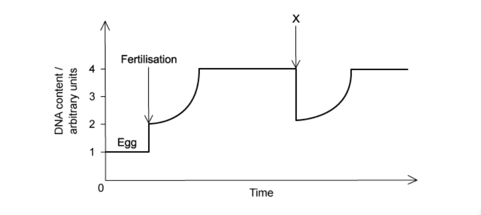

Which stage takes place at **X**?

### Q5 — hard — 1 marks

**Q5** [1 mark]

The protein called mitosis-promoting factor (MPF) has been discovered in cells and is known to cause prophase to start. Usually MPF breaks down and stops functioning during anaphase.

What is a possible consequence of MPF not breaking down?

### Q6 — hard — 1 marks

**Q6** [1 mark]

Some chemotherapy treatments used to stop tumour growth work by preventing the DNA double helix from uncoiling and separating.

During which stage of the cell cycle would they act?

### Q7 — hard — 1 marks

**Q7** [1 mark]

Cancer cells have distinctive differences from normal cell, for example they are sometimes much bigger and sometime smaller and they don’t produce proteins required on the cell surface for cell adhesion and signalling.

Which stage of the cell cycle is most affected in cancer cells?

### Q8 — hard — 1 marks

**Q8** [1 mark]

A student studied a garlic root tip under a microscope and records the following data.

| **Stage** | **Number of Cells** |
|---|---|
| Interphase | 793 |
| Prophase | 64 |
| Metaphase | 21 |
| Anaphase | 8 |
| Telophase | 6 |
|   | Total = 892 |

What percentage of studied cells have chromosomes visible and have pairs of chromatids joined together?

### Q9 — hard — 1 marks

**Q9** [1 mark]

What features would be observed in a human cell immediately before the onset of mitosis?

|   | number of molecules of DNA in nucleus | nuclear envelope present | number of chromatids | spindle present |
|---|---|---|---|---|
| **A** | 46 | no | 46 | yes |
| **B** | 46 | yes | 92 | no |
| **C** | 92 | yes | 46 | yes |
| **D** | 92 | yes | 92 | no |

### Q10 — hard — 1 marks

**Q10** [1 mark]

The graphs show measurements taken from metaphase of mitosis onwards.

The graphs are to scale when compared to one another.

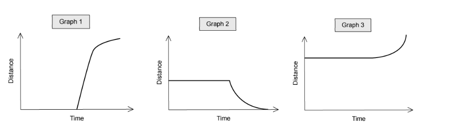

Which row correctly identifies each graph?

|   | 1 | 2 | 3 |
|---|---|---|---|
| **A** | distance of centromere from pole of spindle | distance between poles of spindle | distance between sister chromatids |
| **B** | distance between sister chromatids | distance between poles of spindle | distance of centromere from pole of spindle |
| **C** | distance between sister chromatids | distance of centromere from pole of spindle | distance between poles of spindle |
| **D** | distance between poles of spindle | distance of centromere from pole of spindle | distance between sister chromatids |

### Q11 — medium — 1 marks

**Q11** [1 mark]

Which statement about stages in mitosis is correct?

### Q12 — medium — 1 marks

**Q12** [1 mark]

Each of the following events takes place during mitosis.

| 1 | Chromosomes uncoil |
|---|---|
| 2 | Chromatids move to opposite poles of the cell |
| 3 | Centromeres divide |
| 4 | Chromosomes line up along the equator of the spindle |
| 5 | Two chromatids are joined by a centromere |

In which order do the events take place?

|   | First**        ⎯⎯⎯⎯⎯⎯⎯⎯⎯⎯⎯⎯⎯⎯→        **Last |   |   |   |   |
|---|---|---|---|---|---|
| **A**  **B**  **C**  **D** | 1  3  4  5 | 2  1  5  4 | 4  2  3  3 | 5  4  1  2 | 3  5  2  1 |

### Q13 — medium — 1 marks

**Q13** [1 mark]

The diagram shows the chromosomes of a squashed cell during mitosis.

Which stage of mitosis is the cell in and what is the haploid chromosome number in this species?

|   | haploid chromosome number | stage of mitosis |
|---|---|---|
| **A**  **B**  **C**  **D** | 5  5  10  10 | anaphase  metaphase  anaphase  metaphase |

### Q14 — medium — 1 marks

**Q14** [1 mark]

Which is the correct statement concerning cell and nuclear division?

### Q15 — medium — 1 marks

**Q15** [1 mark]

Colchicine is a drug that is used to treat imflammaton and pain. Its action within cells is to stop chromatids from separating during mitosis.

Which phase will the cell reach and then stop dividing?

### Q16 — medium — 1 marks

**Q16** [1 mark]

What of the following does not happen in an animal cell cycle?

| **1** | DNA is expressed |
|---|---|
| **2** | spindle is formed from microtubules |
| **3** | cell plate forms to divide daughter cells |

### Q17 — medium — 1 marks

**Q17** [1 mark]

What row correctly describes an animal cell’s nuclear envelope, centrioles and spindle during mitosis?

|   | **phase** | **nuclear envelope** | **centrioles** | **spindle** |
|---|---|---|---|---|
| **A**  **B**  **C**  **D** | anaphase  metaphase  prophase  telophase | absent  reforms  breaks up  breaks up | replicate  present  move apart  replicate | present  present  forms  breaks up |

### Q18 — medium — 1 marks

**Q18** [1 mark]

The diagram shows a plant cell’s chromosomes during metaphase.

Which row correctly describes this plant cell during metaphase?

|   | diploid number (2n) for the plant | structures present at metaphase |   |   |
|---|---|---|---|---|
| cell wall | centriole | spindle |   |   |
| **A**  **B**  **C**  **D** | 4  8  8  16 | ✔  **✕**  ✔  ✔ | **✕**  ✔  **✕**  ✔ | ✔  ✔  ✔  **✕** |

### Q19 — medium — 1 marks

**Q19** [1 mark]

The mitotic spindle has a key role in mitosis.

What macromolecule is the spindle made from?

### Q20 — medium — 1 marks

**Q20** [1 mark]

The photomicrograph shows cells in different stages of mitosis.

In which order do these stages occur?

### Q21 — easy — 1 marks

**Q21** [1 mark]

Which is always true of cytokinesis?

| **1** | cell structures are divided between two cells. |
|---|---|
| **2** | nuclear envelope reforms |
| **3** | cell structures replicate |

### Q22 — easy — 1 marks

**Q22** [1 mark]

The diagram shows a cell nucleus in prophase of mitosis.

What is the correct description of the chromosomes found in each daughter nucleus immediately after division of this cell by mitosis?

### Q23 — easy — 1 marks

**Q23** [1 mark]

Which row is correct?

|   | Diagram | Stage |
|---|---|---|
| **A** | 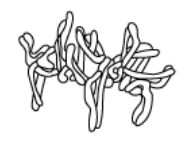 | Interphase |
| **B** | 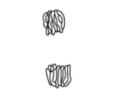 | Metaphase |
| **C** |  | Anaphase |
| **D** |  | Telophase |

### Q24 — easy — 1 marks

**Q24** [1 mark]

The diagrams show chromosomes at different stages of mitosis.

Which shows the correct order of the cell cycle?

### Q25 — easy — 1 marks

**Q25** [1 mark]

The diagram shows a human cell (2n = 46) at different stages of mitosis. Cell 1 is at the end of prophase and the cells 2 and 3 are daughter cells just after telophase.

How many DNA molecules are there in the nucleus of cell 1 and cell 2?

|   | cell 1 | cell 2 |
|---|---|---|
| **A** | 46 | 46 |
| **B** | 46 | 23 |
| **C** | 92 | 46 |
| **D** | 92 | 23 |

### Q26 — easy — 1 marks

**Q26** [1 mark]

During which stage of the mitotic cell cycle is DNA replicated?

### Q27 — easy — 1 marks

**Q27** [1 mark]

At which stages of mitosis do centromeres separate and the DNA condenses?

|   | centromeres separate | condensation of DNA |
|---|---|---|
| **A** | metaphase | interphase |
| **B** | anaphase | prophase |
| **C** | metaphase | telophase |
| **D** | anaphase | interphase |

### Q28 — easy — 1 marks

**Q28** [1 mark]

A scientist adds a fluorescent dye to dividing cells which stains the nuclear envelope.

At which stages of the cell cycle would the nucleus be visible?

| **1** | Interphase |
|---|---|
| **2** | Prophase |
| **3** | Telophase |
| **4** | Anaphase |

### Q29 — easy — 1 marks

**Q29** [1 mark]

Which statement describes interphase of mitosis?

### Q30 — easy — 1 marks

**Q30** [1 mark]

What happens to a cell’s DNA during metaphase of mitosis?

## Structured Questions (12 questions)

### Q1 — hard — 12 marks

**Q1** [2 marks]

Hepatic stem cells divide by mitosis to form new liver cells. Each time a stem cell divides it forms a replacement stem cell and a cell that will specialise to become a liver cell.

Fig. 1 shows changes in the mass of DNA in a human hepatic stem cell during four cell cycles..

**                                                        Fig. 1**

Identify the processes taking place at the points marked **A** and **B** in Fig. 1 that bring about changes in the mass of DNA per cell.

**Q1** [2 marks]

**Extract:**

Hepatic stem cells divide by mitosis to form new liver cells. Each time a stem cell divides it forms a replacement stem cell and a cell that will specialise to become a liver cell.

Fig. 1 shows changes in the mass of DNA in a human hepatic stem cell during four cell cycles.

Describe what happens to the number of chromosomes in the hepatic stem cells of Fig. 1.

**Q1** [3 marks]

Colchicine is an alkaloid drug extracted from the corm of the autumn crocus (*Colchicum autumnale*). It is often used as a treatment for gout and other inflammatory diseases. Colchicine binds to a protein called tubilin and prevents the elongation of microtubules in a cell.

Explain why anaphase would **not** be able to occur in the presence of colchicine.

**Q1** [5 marks]

Outline what happens to **a chromosome** between the beginning of telophase and the start of the next round of mitosis.

### Q2 — hard — 7 marks

**Q2** [1 mark]

Fig. 1 below shows a drawing of an electron micrograph of a cell undergoing mitosis.

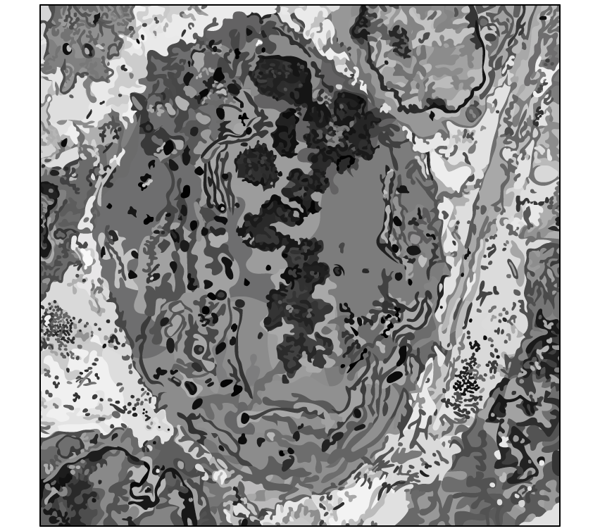

**Fig. 1**

Deduce which phase of mitosis this cell is in.

**Q2** [2 marks]

Fig. 2 below shows a sample of root tissue collected by a researcher.

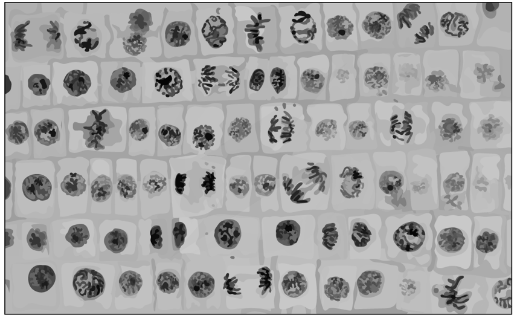

**Fig. 2**

The mitotic index is the proportion of cells in a tissue sample that are undergoing mitosis and can be calculated as follows:

$\mathrm{Mitotic} \mathrm{index}=\frac{\mathrm{Number} \mathrm{of} \mathrm{cells} \mathrm{undergoing} \mathrm{mitosis}}{\mathrm{Total} \mathrm{number} \mathrm{of} \mathrm{cells}}$

Calculate the mitotic index of the tissue sample in Fig. 2.

**Q2** [2 marks]

**Extract:**

The mitotic index is the proportion of cells in a tissue sample that are undergoing mitosis and can be calculated as follows:

Mitotic space index space equals space fraction numerator Number space of space cells space undergoing space mitosis over denominator Total space number space of space cells end fraction

From the mark scheme: 19 cells undergoing mitosis AND 74 cells in total; mitotic index = 0.26 / 26%

A student’s research determined that the cell cycle of the growing tissue in a similar root as part (b) was 1,560 minutes in length, and that on average, cells spent 5 hours in the visible stages of mitosis.

Calculate the percentage difference between the data gathered by the student and the mean length of the mitotic stages found by the researcher in part (b).

**Q2** [2 marks]

**Extract:**

Fig. 2 below shows a sample of root tissue collected by a researcher.

The mitotic index is the proportion of cells in a tissue sample that are undergoing mitosis and can be calculated as follows:

Mitotic space index space equals space fraction numerator Number space of space cells space undergoing space mitosis over denominator Total space number space of space cells end fraction

Calculate the mitotic index of the tissue sample in Fig. 2.

A student's research determined that the cell cycle of the growing tissue in a similar root as part (b) was 1,560 minutes in length, and that on average, cells spent 5 hours in the visible stages of mitosis.

Suggest **two **possible reasons why there may have been differences in the mitotic index the researcher determined and the student’s value.

### Q3 — hard — 11 marks

**Q3** [3 marks]

Fig. 1 shows a cell undergoing the prophase stage of mitosis.

**Fig. 1**

Identify structures **A** to **C** and describe how they behave during prophase. Use Table 1 to construct your answer.

**Table 1**

| **Label** | **Name of structure** | **Behaviour during prophase** |
|---|---|---|
| **A** |   |   |
| **B** |   |   |
| **C** |   |   |

**Q3** [4 marks]

Some cell biologists believe that use of the term 'cell division' should be discontinued and replaced with 'cell multiplication'.

Discuss the reasons in favour of this claim by using your knowledge of the cell cycle.

**Q3** [2 marks]

A team of researchers estimated the numbers of cells in different stages of the cell cycle in healthy, growing onion plants. They took two tissue samples, **A** and **B**, from different parts of a plant.

One tissue sample came from a root tip, the other from a large leaf near the bottom of the plant's stem.

Their results are shown in Table 2.

**Table 2**

| **Stage of the cell cycle** | **Tissue A / number of cells counted** | **Tissue B / number of cells counted** |
|---|---|---|
| Interphase | 779 | 559 |
| Metaphase | 36 | 165 |
| Prophase | 57 | 178 |
| Anaphase | 44 | 115 |
| Telophase | 42 | 88 |
| ** Total** | **958** | **1 105** |

In tissue sample **B**, a full cell cycle took 20 hours and 45 minutes.

Calculate the time, in minutes, that these cells were in telophase during one cell cycle.

Show your working.

**Q3** [2 marks]

**Extract:**

A team of researchers estimated the numbers of cells in different stages of the cell cycle in healthy, growing onion plants. They took two tissue samples, A and B, from different parts of a plant.

One tissue sample came from a root tip, the other from a large leaf near the bottom of the plant's stem.

Their results are shown in Table 2.

Table 2

| Stage of the cell cycle | Tissue A / number of cells counted | Tissue B / number of cells counted |
| Interphase | 779 | 559 |
| Metaphase | 36 | 165 |
| Prophase | 57 | 178 |
| Anaphase | 44 | 115 |
| Telophase | 42 | 88 |
| Total | 958 | 1 105 |

Identify which tissue sample, **A** or **B**, was taken from the root tip.

Explain your answer using the information in Table 2.

### Q4 — medium — 15 marks

**Q4** [4 marks]

**Figure 1** shows a micrograph of cells in actively dividing tissue from the tip of a plant root.

**Figure 1**

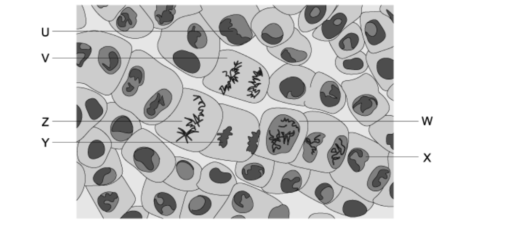

(i) Name the process by which many of the cells in **Figure 1** are dividing.

[1]

(ii) Using **Figure 1**, complete **Table 1**.

[3]

**Table 1**

| **Cell** | **Name of the stage of cell division** |
|---|---|
| W |   |
| V |   |
| Z |   |

**Q4** [3 marks]

**Extract:**

Figure 1 shows a micrograph of cells in actively dividing tissue from the tip of a plant root.

Regarding **Figure 1**:

(i)In which of the cells (**U**, **V**, **W**, **X**, **Y** or **Z**) can vesicles now fuse to form new cell membranes across the cytoplasm in order to separate the cell into two daughter cells.

[2]

(ii) What stage of cell division are these cells in?

[1]

**Q4** [1 mark]

**Extract:**

Figure 1 shows a micrograph of cells in actively dividing tissue from the tip of a plant root.

When the student prepared the root tip squash, the root tip was placed on a microscope slide with a stain.

Explain why a stain was used.

**Q4** [7 marks]

Describe the events that take place during mitosis, including the name of the stage of mitosis during which each event occurs.

### Q5 — medium — 8 marks

**Q5** [3 marks]

Fig. 1 is a light microscope image of a section of onion (*Allium cepa*) root tip showing cells in various stages of mitosis.

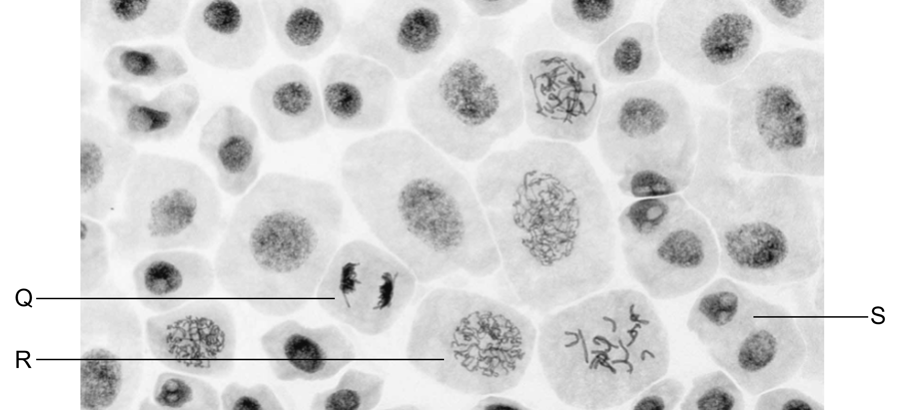

Image courtesy of Doc. RNDr. Josef Reischig CSc. Licenced under **Creative Commons Attribution-Share Alike 3.0** Unported License. Reused and distributed under conditions found at: **https://creativecommons.org/licenses/by-sa/3.0/**

**Fig. 1**

Identify the stages of mitosis taking place in cells **Q**, **R** and **S**.

**Q5** [3 marks]

**Extract:**

Fig. 1 is a light microscope image of a section of onion (Allium cepa) root tip showing cells in various stages of mitosis.

Identify the stages of mitosis taking place in cells Q, R and S.

The stages of mitosis represented by the cells in Fig. 1 are:
- S - telophase

Cell S represents telophase as there are two clearly formed nuclei present in one cell.

Assuming that the cells in Fig. 1 have a chromosome number of 6, sketch and label **one** of the nuclei from cell **S** to show the appearance of the chromosomes.

**Q5** [2 marks]

The daughter cells that are produced during mitosis are genetically identical to each other and to the parent cell.

Explain the importance of this.

### Q6 — medium — 10 marks

**Q6** [5 marks]

Cells divide by mitosis to form new cells.

Describe the changes that occur within the cell between the beginning of prophase and the end of metaphase.

**Q6** [2 marks]

Fig. 1 shows a diagram of a chromosome in a cell undergoing mitosis.

**                                                           Fig. 1**

(i) Identify structure **P**.

[1]

(ii) Describe the role of structure **P** during mitosis.

[1]

**Q6** [2 marks]

**Extract:**

Fig. 1 shows a diagram of a chromosome in a cell undergoing mitosis.

                                                           Fig. 1

From the image in Fig. 1

(i) Identify the stage of mitosis that the chromosome could be in.

[1]

(ii) State a reason for your answer to part i).

[1]

**Q6** [1 mark]

Explain why it is important for DNA replication to take place before mitosis can occur.

### Q7 — medium — 12 marks

**Q7** [6 marks]

In a dividing cell, DNA replication occurs before mitosis.

Steps in DNA replication are outlined in Fig.1

Complete Fig.1 by filling in the gaps using the most appropriate terms.

**  1    **Helicase enzyme allows the DNA double helix to unwind and the hydrogen bonds between the two strands to break, exposing the four bases, A, T, C and G.

The names of these bases are:        
A = ..............................................................       
 T = ...............................................................        
C = ...............................................................        
G = ............................................................... **   **

**2   **An enzyme molecule attaches to each of the two separated parental strands. The two enzyme molecules move in opposite directions, each catalysing the formation of a new strand of DNA. This enzyme is known as ............................... **  **

** 3**   DNA ................................................., the monomers of DNA, are free in the nucleus for the synthesis of the new strands. **   **

**4**   The bases of the DNA monomers form hydrogen bonds with the bases on each separated parental strand of DNA, according to the rules of  ........................................ . **   **

**5   **One DNA strand is synthesised continuously and the other is synthesised in sections known as Okazaki fragments. The fragments are joined by an enzyme called ......................................... , which catalyses the formation of phosphodiester bonds. **  **

**6**   The result of replication is two DNA molecules, each one containing an original parental strand and a newly synthesised strand. This type of replication is described as ......................................... .

**Fig. 1**

*Source: Specimen 2022 9700/02 Q6A*

**Q7** [6 marks]

Fig. 2 is a photomicrograph of root tip cells at different stages in the cell cycle.

A cell in interphase is labelled.

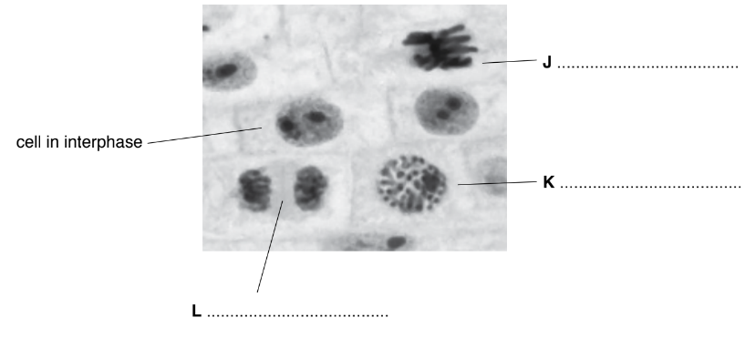

**Fig. 2**

(i) Complete Fig. 2 by naming the stage of mitosis shown in each of cells **J**, **K **and **L** in Fig. 2.

[3]

(ii) State one feature of the cell in interphase, **visible** in Fig. 2, that shows this cell is **not** in early interphase.

[1]

(iii) Describe the stage of mitosis shown in cell** J**.

[2]

*Source: Specimen 2022 9700/02 Q6B(I,II,III)*

### Q8 — easy — 7 marks

**Q8** [3 marks]

Identify the different stages of mitosis by completing Table 1.

**Table 1**

| **Description of stage** | **Name of stage** |
|---|---|
| Two nuclear envelopes form within the cell |   |
| After this stage is complete the chromatids are referred to as chromosomes |   |
| The nuclear envelope disappears |   |

**Q8** [1 mark]

Fig. 1 shows a cell undergoing mitosis.

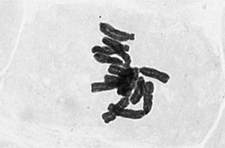

Image courtesy of Doc. RNDr. Josef Reischig, CSc. Licensed under** Creative Commons Attribution-Share Alike 3.0** Unported License. Reused and distributed under conditions found at: **https://creativecommons.org/licenses/by-sa/3.0/**

**Fig. 1**

Identify the stage of mitosis that is visible in Fig. 1.

**Q8** [3 marks]

**Extract:**

Fig. 1 shows a cell undergoing mitosis.

The stage of mitosis that is visible in Fig. 1 is metaphase. The chromosomes are lined up at the equator of the spindle, which is the main indicator that this cell is in metaphase.

Describe the main events that occur during the stage of mitosis shown in Fig. 1.

### Q9 — easy — 7 marks

**Q9** [1 mark]

Fig. 1 below shows the stages of mitosis in the incorrect order.

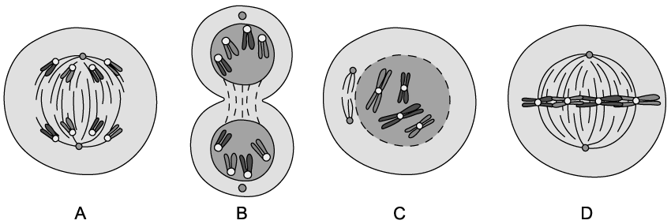

**Fig. 1**

Place the letters (**A** to **D**) in the correct order in which they would occur during mitosis.

**Q9** [3 marks]

(i) Identify stage **C** shown in Fig. 1 .

[1]

(ii) State **two** events that occur during stage **C**.

[2]

**Q9** [2 marks]

A student wanted to observe cells during mitosis and decided to follow the method described below:

1. Cut 1 cm from the tip of a growing root.
2. Place the cut root tip in a test tube containing 1 M hydrochloric acid and place in a water bath at 60°C for 5 minutes.
3. Remove the root tip from the test tube and rinse with distilled water. Dry carefully with a paper towel.
4. Remove 2 mm from the very tip of the root sample and place on a microscope slide.
5. Break the 2 mm root tip apart and spread the cells out using a mounted needle.
6. Add a few drops of toluidine blue stain.
7. Lower a cover slip over the root tip sample. Place a paper towel over the cover slip and press down gently, being careful not to break the cover slip or move it sideways.
8. Observe the slide using an optical microscope.

Explain the reason for steps **1** and **6**.

**Q9** [1 mark]

One of the root tip samples observed by the student is shown in Fig. 2 below.

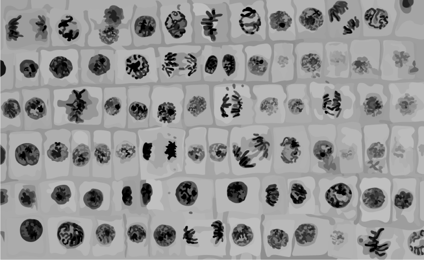

**Fig. 2**

State the number of cells in the sample shown in Fig. 2 that are undergoing metaphase.

### Q10 — easy — 7 marks

**Q10** [2 marks]

The diagram below shows some grasshopper cells.

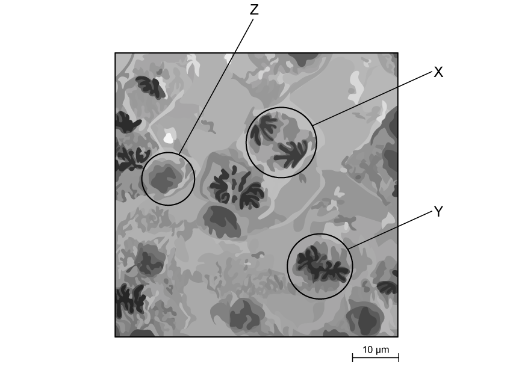

State the stages of the cell cycle shown by **X **and **Y**.

**Q10** [3 marks]

**Extract:**

The diagram below shows some grasshopper cells.

State the stages of the cell cycle shown by **X **and **Y**.

Outline the events occurring during the stage shown as **Z **in part (a).

**Q10** [1 mark]

Cell Z has not yet undergone DNA replication and contains 24 chromosomes. It divides by mitosis.

State how many chromosomes the daughter cells will contain.

**Q10** [1 mark]

State the stage of the cell cycle that nuclear envelope formation takes place in.

### Q11 — easy — 9 marks

**Q11** [3 marks]

Figure 1 below shows two different stages of mitosis.

**Image A                                                     Image B**

**Fig 1**

Identify structures **M**, **N **and **O**.

**Q11** [2 marks]

**Extract:**

Figure 1 below shows two different stages of mitosis.

**Image A                                                     Image B**

State the names of the two stages of mitosis shown in image **A** and image **B** of Figure 1.

**Q11** [3 marks]

List three reasons why cells will undergo mitosis.

**Q11** [1 mark]

State the process that occurs during prophase that enables chromosomes to condense.

### Q12 — easy — 10 marks

**Q12** [2 marks]

Mitosis plays an important role in living organisms.

Define the term *mitosis*.

**Q12** [3 marks]

The nucleus of a cell contains 27 chromosomes as it enters prophase. Each chromatid contains one DNA molecule.

State the number of **DNA molecules** found in the cell at the end of each of the following:

(i) Metaphase.

[1]

(ii) Anaphase.

[1]

(iii) Cytokinesis.

[1]

**Q12** [4 marks]

Identify the missing words from the following paragraph describing anaphase by choosing from the words below:

**centromere             centrosome                 shorten                chromosomes**

**opposite                 microtubules                     extend**

Each word may be used only once or not at all.

The sister chromatids separate at the ........................................ Spindle fibres

begin to ............................ and the ......................................... are pulled to

................................ poles.

**Q12** [1 mark]

State the stage of mitosis where the chromosomes decondense into chromatin.
