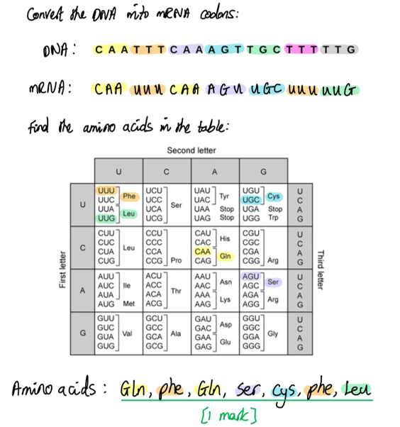
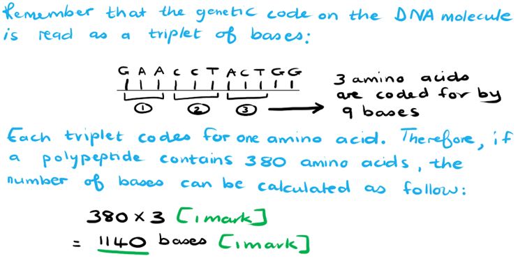
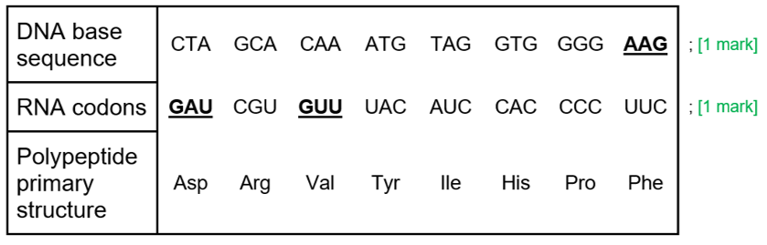
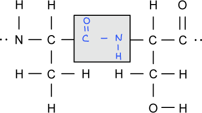
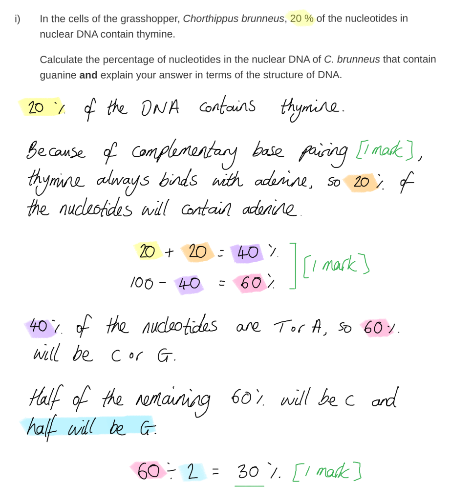
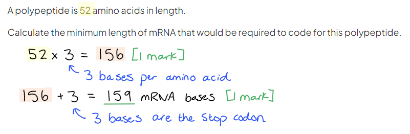
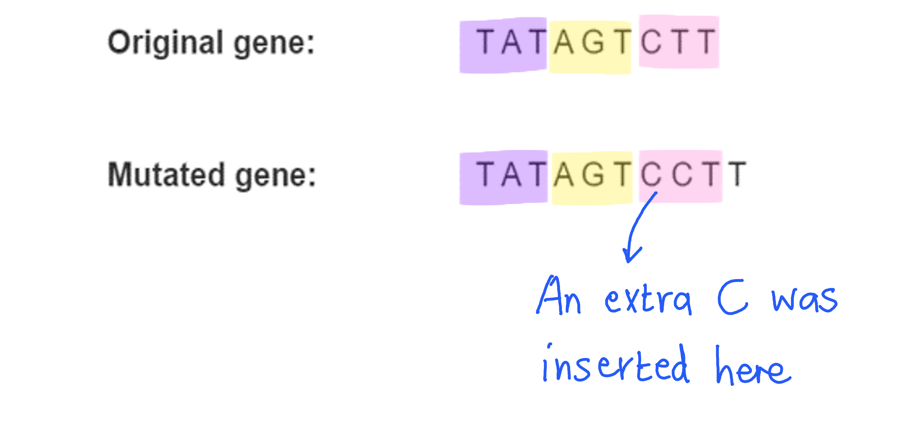
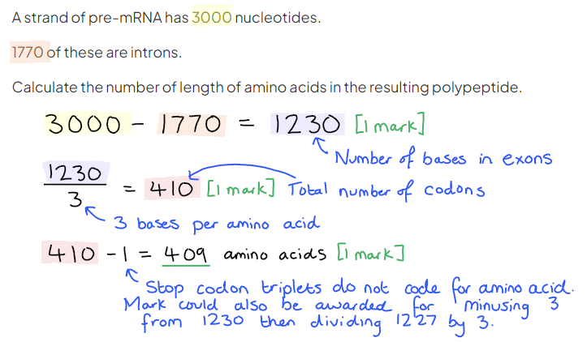
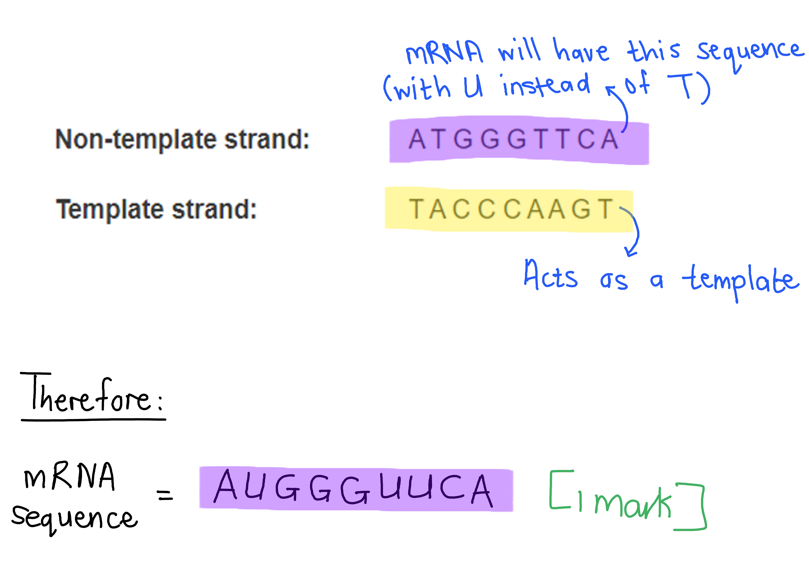

# Mark Schemes — Protein Synthesis
**6. Nucleic Acids & Protein Synthesis** · Cambridge (CIE) AS biology (9700)

## Multiple Choice Questions (30 questions)

### Q1
**Final answer:** **The correct answer is ****C**** because:  **

- **The tRNA ****anticodons**** have the same sequence as the ****template DNA**** strand because both are ****complementary**** to mRNA. However, DNA contains thymine (T) not uracil (U).  **
- **Each amino acid is coded for by ****3 bases****.**
- **Therefore, if the 18****th**** base is deleted this will affect the ****6th amino acid****  (18 ÷ 3 = 6) which is histidine.**
- **Specifically, if the 18****th**** base is deleted it will delete the 3****rd**** base in the histidine codon (T in DNA) and cause a** **frameshift**.

**Final answer:** **Originally: **

**Final answer:** **Amino acid code: histidine – glutamine – lysine – alanine – valine – histidine – valine**

**Final answer:** **            DNA code:    CAT          CAG         AAA        GCT      GTA        CA****T****        GTA   **

**Final answer:** **After deletion:**

**Final answer:** **Amino acid code****:  histidine - glutamine - lysine - alanine - valine - ****glutamine****         **

**Final answer:** **  DNA code:              CAT          CAG          AAA      GCT       GTA        CA****G****          TA**

### Q2
**Final answer:** **The correct answer is ****A**** because:  **

- **All DNA is a ****double stranded molecule**** with a sequence of ****complementary nucleotides**** held together by ****hydrogen bonding****.**
- **The DNA complementary nucleotide pairs are: Adenine with thymine, attached by two hydrogen bonds, and guanine with cytosine attached by three hydrogen bonds. **
- **Not all of the DNA contains genes, there are long sections of ****non-coding DNA**** which is not transcribed to produce proteins. These long sections are referred to as ‘junk DNA’ however they may have some roles in signalling, control and increased risk of certain diseases.**

> *B **is incorrect as a gene **is** a sequence of nucleotides that can be **transcribed **using **RNA polymerase **enzyme and free activated RNA nucleotides, which results in the formation of **mRNA**.*

> *C **is incorrect as a gene **is** a length of DNA which carries **coded information** as a sequence of nucleotides that can result in the formation of a **polypeptide chain**. Each amino acid in a polypeptide chain is coded for by a triplet of nucleotides.*

> *D **is incorrect as a gene **is** a sequence of nucleotides which can be copied by complementary base pairing into an **mRNA molecule and then be translated at a ribosome into a polypeptide.*

### Q3
**Final answer:** **The correct answer is ****D**** because:  **

- **Only ****DNA**** is involved in ****replication**** as this is the process of creating two DNA molecules from one original DNA molecule during cell division. **
- **Both ****DNA ****and ****RNA**** are involved in**** transcription**** because the DNA acts as a template and ****RNA polymerase**** synthesises a complementary RNA molecule (messenger RNA) of the specific gene. RNA polymerase uses ****free RNA nucleotides**** to produce ****mRNA****.**
- **Translation**** only requires ****RNA,**** and three different types at that! ****mRNA**** binds to ribosomal RNA (****rRNA****) and amino acids coded for by the mRNA are brought to the ribosome by transport RNA (****tRNA****) molecules. The ribosome catalyses the formation of ****peptide bonds**** between amino**** ****acids to produce a protein.**
- **Protein synthesis**** is the complete process of creating a protein from DNA and includes ****transcription****, ****post-transcriptional modification**** and ****translation****. Therefore, both DNA and RNA are involved. **

### Q4
**Final answer:** **The correct answer is ****A**** because:  **

- **Ribosomes are ****ribonucleoprotein complexes****, which mean they consist of ribosomal RNA (****rRNA****) and ****protein**** together in the same structure.**
- **The proteins aid in maintaining ribosome structure and can have functional roles and are found in both ribosome subunits.**
- **Ribosomes are made of a ****small (30S)**** subunit and a ****larger (50S)**** subunit. **
- **The interface between the subunits is where mRNA binds, and the ****aminoacylated ****(amino acid bound) ****tRNAs ****bind to and are stabilised by the 50S subunit.**
- **The 50S subunit also catalyses the formation of ****peptide bonds**** between amino acids and therefore makes the structure a ****ribozyme**** (RNA is used in the catalysis, rather than protein in enzymes). **

> *B **is incorrect as there are no **lipids **involved in protein synthesis. *

> *C **is incorrect as **mRNA **is not part of the ribosome structure, it binds to the ribosome subunits to undergo translation. *

> *D **is incorrect as **tRNAs** are not part of the ribosome structure, their **anti-codons** associate with the mRNA codons in order to add the correct amino acid to the growing polypeptide chain. tRNAs are held in place and stabilised by the ribosome but are **not** part of the **ribosome** structure.*

### Q5
**Final answer:** **The correct answer is ****A**** because:  **

- **The ****ribosomes**** of humans are ****slightly bigger**** (80S) in size than the ribosomes of bacteria (70S).**
- **Both have ****two subunits**** however the structure is slightly different.**
- **Antibiotics are the correct ****shape**** that when they bind to the bacteria ribosome the antibiotic jams the movement along the ****mRNA****. **
- **Stopping protein synthesis will kill bacteria cells as they cannot produce any enzymes, structural proteins or transport proteins needed to survive.**
- **If antibiotics bind to human ribosomes there are no areas that the antibiotic can bind to and therefore protein synthesis is not disrupted.**

> *B **is incorrect as **antibiotics** do **not **recognise antigens, they enter all cells and will try to bind to what they can. This is why it is important research is done into their shape and binding so no human processes are affected.*

> *C **is incorrect as **DNA** is **not **involved in translation, which occurs at ribosomes, and therefore its position in the cell will not affect the antibiotics function.*

> *D **is incorrect as all DNA nucleotides are the same: adenine, thymine, guanine and cytosine. *

### Q6
**Final answer:** **The correct answer is ****B**** because:  **

- **During post-transcriptional modification, the pre RNA has its ****introns spliced**** out (cut out) by a ****spliceosome****.**
- **Therefore the mature mRNA will only contain bases in the ****exons****: 250 + 50 + 750 = ****1050 bases**

### Q7
**Final answer:** **The correct answer is ****B**** because:  **

- **When mRNA is first made, there are sections between the start and stop codons that do code for proteins (****exons****) and don’t code for proteins (****introns****).**
- **After transcription, the mRNA must undergo ****post-transcriptional ****modification where the introns are ****spliced**** (cut) out of the mRNA by ****spliceosomes ****and exons are joined together to produce ****mature RNA****. **
- **If introns are not removed, they will code for amino acids which will produce a different ****primary protein structure****.**
- **If the primary structure changes, the protein likely won’t be able to fold into the correct shape (secondary and tertiary structure) and therefore will be faulty.**

> *A **is incorrect as **mature mRNA** only contains **exons**. *

> *C **is incorrect as **introns** are removed by **spliceosomes**, exons are bonded together and kept in the mRNA. *

> *D **is incorrect as **tRNAs** are not part of the ribosome structure, their **anti-codons** associate with the mRNA codons in order to add the correct amino acid to the growing polypeptide chain. tRNAs are held in place and stabilised by the ribosome but are **not** part of the **ribosome** structure.*

### Q8
**Final answer:** **The correct answer is ****B**** because:  **

- **Process ****X**** is ****splicing**** - the removal of non-coding ****introns ****(dark grey) by a ****spliceosome ****and the joining of exons to create a continuous coding sequence.**
- **If introns are not removed the protein will be faulty as the primary structure will be different and longer, which in turn will affect the secondary and tertiary structures. Protein function is very dependent on its specific structure.**
- **Strand 1**** is ****pre-mRNA**** which is directly transcribed from the DNA and contains introns (dark grey) and exons (light grey).**
- **Strand 2**** is ****mature RNA**** that only contains exons (coding segments). **

### Q9
**Final answer:** **The correct answer is ****C**** because:  **

- **Each amino acid is coded for by ****3 bases****.**
- **Therefore, if there is a substitution mutation on the 10****th**** base this will affect the ****4****th**** amino acid**** (10 ÷ 3 = 3.3) which is lysine. **
- **Specifically, if the 10****th**** base is changed, the mutation will be of the 1****st ****base in the lysine. **

**Final answer:** **Originally: **

**Final answer:** **Amino acid code: alanine – alanine – valine – lysine – valine – serine**

**Final answer:** **          DNA code:   GCT        GCT       GTA      ****A****AA      GTA      TCG**

**Final answer:** **After substitution:**

**    ****        DNA code:    GCT        GCT       GTA      ****T****AA      GTA      TCG**

**Final answer:** **Amino acid code****:  alanine – alanine – valine – STOP **

### Q10
**Final answer:** **The correct answer is ****D**** because:**

- **The anticodon of tRNA is the same as the template strand of DNA.**
- **This is because both the anticodon and the DNA template strand are complementary to mRNA. **
- **Triplets or ‘codons’ are groups of 3 nucleotides in sequence which code for an amino acid. **
- **In this example, AAC is the first triplet, AGC is the second and GAT is the third on the DNA template strand.**
- **Thymine (T) in DNA is replaced by uracil (U) in RNA and therefore the ****tRNA**** ****anticodon ****for the third triplet is**** GAU.**

### Q11
**Final answer:** **The correct answer is ****D**** because:**

- **The number of ****thymine**** (T) bases on one strand ****equals**** the number of ****adenine**** (A) bases on the other strand as these bases are ****complementary****.**
- **The number of ****guanine**** (G) bases on one strand ****equals ****the number of ****cytosine**** (C) bases on the other strand as these bases are complementary.**
- **Therefore, on one strand of DNA the number of nucleotides on strand 1 of the DNA is: 30 A + 30 T + 22 G + 38 C = ****120 total**
- **RNA polymerase will produce an mRNA molecule complementary to the template strand of DNA so the ****mRNA**** will also have 120 nucleotides. **
- **3 nucleotide bases form a ****codon**** which codes for one ****amino acid****, therefore the number of amino acids coded for by 120 nucleotide is 120 ÷ 3 = ****40 amino acids**

### Q12
**Final answer:** **The correct answer is ****A**** because:  **

- **DNA**** comprises of ****introns ****(non-coding regions within a gene) and ****exons ****(coding regions within a gene). **
- **During ****post-transcriptional modification****, the introns are ****spliced ****out of the mRNA sequence producing mature mRNA. **
- **Introns were initially thought to be ‘junk’ DNA but are now believed to have regulatory roles.**
- **Mature mRNA**** contains a ****start ****and ****stop codon****, so ribosomes know where the coding sequence begins and ends, and coding exons.**

### Q13
**Final answer:** **The correct answer is ****C**** because  **

**Final answer:** **DNA replication: **

- **Occurs in the ****nucleus.**
- **Two double stranded DNA**** molecules are produced from one double stranded DNA molecule.**
- **DNA polymerase**** assembles free DNA nucleotides into two new chains each of which is ****complementary**** to an original DNA strand.**
- **The two newly produced DNA strands are ****hybrids:**** one chain of each is from the original DNA molecule and the other is newly synthesized. This is called ****semi-conservative**** replication.**

**Final answer:** **Transcription: **

- **Occurs in the**** nucleus.**
- **Is the production of a ****messenger RNA**** chain, which is complementary to the template strand of DNA, by ****RNA polymerase****.**

**Final answer:** **Translation:**

- **mRNA ****binds to the ribosome in the ****cytoplasm****.**
- **The ****ribosome**** holds the mRNA so that ****tRNA**** molecules can bind and their amino acids can be linked by peptide bonds into a polypeptide.**

> *A **is incorrect as **transcription** occurs in the nucleus, not the cytoplasm.  *

> *B **is incorrect as **translation** produces a polypeptide not mRNA. mRNA is produced in transcription. *

> *D **is incorrect as **RNA polymerase** is only used in the **transcription** stage of protein synthesis, not translation.*

### Q14
**Final answer:** **The correct answer is ****B**** because protein synthesis occurs in the following steps:**

**Final answer:** **1. Transcription**

- **DNA helicase unwinds the DNA double helix.**
- **RNA polymerase binds to the start of the gene then moves along the template strand assembling free RNA nucleotides that are complementary to bases in the DNA. **
- **RNA nucleotides are joined by phosphodiester bonds to produce a messenger RNA – a complementary copy of the template strand. **

**Final answer:** **2. Translation**

- **mRNA leaves the nucleus and binds to a ribosome.**
- **The ribosome moves along the mRNA displaying codons to tRNA.**
- **Each tRNA molecule has a 3 base anti-codon which is complementary to an mRNA codon. They carry an amino acid specific to the codon and therefore act as adapters between nucleic acid and protein.**

**Final answer:** **3. Peptide bonding**

- **When the correct amino acid is brought to the ribosome, the ribosome catalyses the formation of a peptide bond between amino acids **
- **This forms a chain – the ****primary structure**** of a protein (polypeptide). **

**Final answer:** **4. Hydrogen bonding**

- **Hydrogen bonds form between the main chain amino acids in the polypeptide which forms a secondary structure.**
- **The secondary structure is usually either an alpha-helix or a beta-sheet**

### Q15
**Final answer:** **The correct answer is ****D**** because:  **

- **The tRNA ****anticodon**** is the same ****triplet**** seen in DNA (both are ****complementary**** to the**** mRNA**** strand).**
- **However, remember that RNA molecules contain ****uracil**** (U) and DNA molecules contain ****thymine**** (T).**

**Final answer:** **The DNA codes for the amino acids are: **

- **Alanine**** is GCT or GCG, therefore only ****B**** or ****D**** can be correct.**
- **Valine**** is GTA or GTC, therefore either ****B**** or ****D**** could be correct.**
- **Lysine**** is AAA or AAG, therefore either ****B**** or ****D**** could be correct.**
- **Serine**** is TCG or TCA, therefore only ****D is correct****.**

### Q16
**Final answer:** **The correct answer is ****C**** as DNA ****transcription ****is the process of making a copy of the DNA code in RNA for protein synthesis - it does not involve the enzymes DNA ligase or DNA polymerase**

- **RNA polymerase**** is used to produce ****messenger RNA**** which then moves out of the nucleus to a ribosome for protein synthesis so it is needed for transcription**
- **Helicase**** unwinds the DNA double helix and breaks the hydrogen bonds between complementary base pairs for transcription or replication so it is required**

> *DNA ligase** catalyses the formation of **phosphodiester bonds** between separate DNA nucleotides during DNA **replication**.*

> *DNA polymerase** is required for DNA **replication** as it assembles free nucleotides to form new complementary strands of DNA.*

### Q17
**Final answer:** **The correct answer is ****B**** because:**

- **Genes**** are sequences in DNA that code for a ****protein**** (polypeptide).**
- **Within DNA they include a transcription initiation site, a translation initiation site, the coding exon sequences, the non-coding intron sequences, and a termination section. **

> *A **is incorrect as there is no protein section of **DNA.*

> *C** is incorrect as **exons** is a part of a gene that codes for the polypeptide. However, it **cannot** enable protein synthesis on its own as it requires other areas of the gene for this.*

> *D **is incorrect as a triplet or ‘codon’ codes for **one **amino acid within a polypeptide, not a whole **polypeptide**.*

### Q18
**Final answer:** **The correct answer is ****C**** because:**

- **mRNA ****contains a ****start**** and ****stop codon**** to signal to the ribosome the beginning and end of the ****coding sequence****.**
- **There is a small section before and after the coding sequence to protect it from degradation.**
- **No tRNAs have an ****anti-codon**** complementary to a stop codon and this therefore signals the end of the protein coding sequence.**

> *A **is incorrect as the mRNA molecule has a small section of **non-coding nucleotides** before and after the coding sequence to protect the coding sequence from degradation. Therefore, the protein would be too long if the ribosome reached the end before it stopped translating. *

> *B **is incorrect as **tRNA **are in large supply in the cytoplasm, where translation takes place, and the cell is synthesising many different proteins on different ribosomes at the same time. Therefore, tRNA supply will **not** stop translation.*

> *D **is incorrect as **RNA polymerase** is only found in the **nucleus**, and **ribosomes** are only found in the **cytoplasm**. RNA polymerase never makes contact with the peptide chain and is only used in the **transcription** stage of protein synthesis, not translation.*

### Q19
**Final answer:** **The correct answer is ****D**** because:  **

- **RNA polymerase assembles free RNA nucleotides complementary to the template strand of DNA into a chain, forming mRNA.**
- **RNA molecules contain uracil (U) instead of thymine (T).**
- **Therefore, the mRNA strand is the same as the non-transcribed strand with U instead of T. **

### Q20
**Final answer:** **The correct answer is ****D**** because:**

- **A ****silent**** mutation is a change in the nucleotide sequence which results in the ****same amino acid sequence****.**
- **This is possible because some amino acids can be coded for by up to four different triplet codon sequences.**
- **Silent mutations are often a change in the 2****nd**** or 3****rd**** base in the codon, rather than the first.**
- **For example, valine is coded for by GUU, GUC, GUA, GUG – therefore as long as the first two nucleotides in the codon are guanine and uracil valine will be inserted into the polypeptide.**

> *A **is incorrect as silent mutations do not always create recessive genotypes.*

> *B **is incorrect as **substitution** mutations also do not result in a **frame shift** however some substitution mutations can cause the amino acid sequence to change.*

> *C **is incorrect as if the exact amino acid changes it is not classed as a silent mutation, however it is possible that the function of the protein will not be greatly affected. For example, aspartic acid instead of glutamic acid – the functional groups are the same but they are slightly different sizes which may impact structure and function. *

### Q21
**Final answer:** **The correct answer is ****D**** because:  **

- **Translation is the construction of a polypeptide from a mRNA transcript.**
- **Translation requires mRNA, ribosomes, tRNA, amino acids.**

  - **mRNA ****to carry the specific genetic sequence that codes for the sequence of amino acids out of the nucleus to a ribosome.**
  - **Ribosomes**** move along the mRNA allowing ****tRNA anti-codons**** to form hydrogen bonds with mRNA ****codons****.**
  - **Ribosomes also catalyse the formation of ****peptide bonds**** between the ****amino acids**** carried by tRNA molecules.**
  - **A chain of bonded amino acids are connected in a specific sequence to produce a ****polypeptide****.  **

> *A **is incorrect as during protein synthesis, **DNA **is only required in **transcription** and not translation. *

> *B **is incorrect as protein synthase is not a real enzyme.*

> *C **is incorrect as during protein synthesis, **RNA polymerase **is only required in **transcription** and not translation.*

### Q22
**Final answer:** **The correct answer is ****D**** because:  **

- **If the ****DNA**** code is TGT then the ****complementary mRNA**** sequence produced is ****ACA****.**** **
- **An ****anti-codon**** on a tRNA molecule is complementary to a ****codon ****on an mRNA molecule therefore, the anticodon will be ****UGU****.**

> *Remember: *

> *Adenine** (A) is complementary to **thymine** (T) in DNA and **uracil **(U) in RNA.*

> *Cytosine** (C) is always complementary to **guanine** (G).*

### Q23
**Final answer:** **The correct answer is ****B**** because:  **

- **RNA polymerase moves along the template DNA strand and transcribes it into RNA. **
- **RNA polymerase assembles free RNA nucleotides that are complementary to the bases on the DNA strand and joins them together with covalent phosphodiester bonds. **
- **Phosphodiester bonds form between the ribose sugar of one nucleotide and the phosphate group of another and this forms the phosphate-sugar backbone of the mRNA molecule.**

> *A **is incorrect as **translation** is the synthesis of a polypeptide from amino acids coded for by mRNA. Translation occurs on ribosomes. Transcription is the synthesis of an mRNA molecule by base pairing of nucleotides with DNA.*

> *C **is incorrect as the linking together of amino acids coded by mRNA occurs during **translation**.*

> *D **is incorrect as in transcription free **RNA** nucleotides are linked together to form a molecule of mRNA that is **complementary** to the template DNA strand. The linking together of free **DNA** nucleotides occurs in DNA **replication**.*

### Q24
**Final answer:** **The correct answer is ****C**** because:**

- **Translation**** is the process of turning the genetic sequence into protein**
- **Ribosomes**** move along messenger RNA (****mRNA****) and ****tRNA ****bring the correct ****amino acids**** to the ribosome according to ****coding triplets**** (3 bases of genetic code)**
- **The ribosome joins the amino acids together with peptide bonds in the correct sequence to create a ****polypeptide**

### Q25
**Final answer:** **The correct answer is ****A**** because:  **

- **If the DNA is ****double stranded**** and there are 180 nucleotides in total, the ****mRNA**** strand produced in transcription would contain half as many nucleotides.**
- **180 ÷ 2 = ****90 nucleotides in the mRNA ****molecule **
- **A ****triplet codon****, the specific sequence of three nucleotides on an mRNA molecule, codes for an amino acid.**
- **Therefore if there are 90 nucleotides coding for a polypeptide, there would be 90 ÷ 3 = ****30 amino acids**** in the polypeptide.**

### Q26
**Final answer:** **The correct answer is ****A**** because:  **

- **Amino acids**** are coded for by a ****codon**** on the mRNA which is ****three bases**** long (a triplet). **
- **Only one of these bases need to be different for a different amino acid to be coded for.**
- **In the example of glutamic acid to valine:**

  - **Glutamic acid is coded for by the triplets GAA and GAG**
  - **Changing the middle ‘A’ to a ‘U’ changes the triplets into valine codons GUA and GUG **

### Q27
**Final answer:** **The correct answer is ****D**** because:  **

- **Strand one shows an mRNA molecule that has just been transcribed from the DNA. It includes ****introns ****(dark grey), which are non-coding sections of mRNA.**
- **The process ****x**** is RNA ****splicing**** and this cuts the introns out of the mRNA and connects the coding ****exons**** together to produce ****mature mRNA**** (strand 2).**
- **Splicing is an example of ****post-transcriptional modification****.**

> *A **is incorrect as **tRNA** is folded into a 3 leafed clover shape.*

> *B **is incorrect as **ribosomal RNA** is folded into a globular shape.*

> *C **is incorrect as **DNA **is **never **spliced or cut apart. This is because it is always used as a **template** so the genetic material is **protected** for future DNA replication. *

### Q28
**Final answer:** **The correct answer is ****B**** because:**

- **DNA ****transcription ****is the process of making a copy of the DNA code to use in protein synthesis.**
- **RNA polymerase**** is used to produce ****messenger RNA**** which then moves out of the nucleus to a ribosome for protein synthesis.**

> *A **is incorrect as **helicase** unwinds the DNA double helix and breaks the hydrogen bonds between complementary base pairs.*

> *C **is incorrect as **DNA ligase** catalyses the formation of **phosphodiester bonds** between separate DNA nucleotides during DNA **replication**.*

> *D **is incorrect as **DNA polymerase** is required for DNA **replication** as it assembles free nucleotides to form new complementary strands of DNA. *

### Q29
**Final answer:** **The correct answer is ****A****, because DNA can be damaged by:**

- **X-rays. **
- **Sunbeds, which are sources of UV light.**
- **Smoking tobacco, which consists of over 70 different carcinogens (cancer causing chemicals).**

**Final answer:** **X rays**** and ****UV light**** are examples of high energy radiation which breaks ****covalent bonds**** in DNA and leads to mutations. ****Carcinogens ****bind to DNA and cause the DNA to mutate or become damaged.  ****Mutations**** can be either an ****insertion****, ****deletion**** or ****substitution**** of nucleotides in the DNA and hence changes the ****genetic code****. These changes are then perpetuated through cycles of DNA replication. **

### Q30
**Final answer:** **The correct answer is ****A**** because:  **

- **If the DNA is ****double stranded**** and there are 18000 nucleotides in total, the ****mRNA**** strand produced in transcription would contain half as many nucleotides.**
- **18000 ÷ 2 = ****9000 nucleotides in the mRNA ****molecule **
- **One ****triplet codon****, the specific sequence of three nucleotides on an mRNA molecule, codes for one amino acid.**
- **Therefore if there is 9000 nucleotides coding for a polypeptide, there are 9000 ÷ 3 = ****3000 amino acids**** in the polypeptide.**

## Structured Questions (15 questions)

### Q1
The type of mutation that has occurred is:

- Insertion/addition mutation; **[1 mark]**
- ATAG bases; **[1 mark]**
- (Mutation has caused) <u>frameshift</u>; **[1 mark]**

**[Total: 3 marks]**

> *In the Tay-Sachs sufferer the 3rd-6th bases in the sequence are an insertion mutation. This shifts the reading frame of triplets after this point, which is known as frameshift. *
The protein would be changed by:

**Final answer:** **Any ****three ****of the following:**

- The original protein contains the amino acids: Ser - Tyr - Gly - Pro - Asp...; **[1 mark]**
- The protein from the mutated gene codes for the amino acids: Ser - Ile - Leu - Arg - Pro (STOP); **[1 mark]**
- STOP codon coded for too early / nonsense mutation; **[1 mark]**
- (Because this is in the 11th exon out of 14) the polypeptide would be shorter; **[1 mark]**
- (The shortened polypeptide) prevents protein folding into the correct tertiary/3D structure / the enzyme would not have a functional active site; **[1 mark]**

**[Total: 3 marks]**
It is possible for over 100 different changes in the DNA to result in the same disease because...

- The different mutations all affect the same gene / the *HEXA *gene; **[1 mark]**
- The mutations all result in a non-functional protein/enzyme / stop the protein/enzyme from having the correct 3D/tertiary structure/active site (which causes the disease); **[1 mark]**

**[Total: 2 marks]**
The inheritance would be...

**Final answer:** **Any ****two ****of the following:**

- Two different mutations (could cause Tay-Sachs disease); **[1 mark]**
- If both mutations lead to a non-functional protein/enzyme; **[1 mark]**
- There would be no non-mutated *HEXA* gene / dominant allele to code for the functioning protein/enzyme; **[1 mark]**

**[Total: 2 marks]**

> *If the condition is autosomal recessive it means that two copies of the mutated allele need to be inherited in order for the person to suffer from the condition. There are over 100 different types of mutations that can lead to Tay-Sachs disease and different combinations of the mutation can cause the disease. It is a very rare disease within the average population. *

### Q2
Processes **R** and **S **represent the following:

- **R:** transcription <u>and</u> **S:** translation; **[1 mark]**

**[Total: 1 mark]**

> *Transcription occurs when the genetic code on a DNA molecule is copied during the formation of mRNA (messenger RNA). This code is then carried from the nucleus to the cytoplasm, where the ribosomes will translate this code into a polypeptide during translation.*
The start and stop signals in a DNA molecule are important because:

**Final answer:** **Any ****two ****of the following:**

- They indicate where individual genes start and stop; **[1 mark]**
- They ensure that the DNA is read correctly / the code is non-overlapping; **[1 mark]**
- (In order) to produce the correct sequence of amino acids / protein molecules (for the cell to function); **[1 mark]**

**[Total: 2 marks]**

> *The start and stop signals act as punctuation in the genetic message on the DNA. It ensures that the ribosome starts reading the genetic code at the correct place. This is very important to ensure that the correct sequence of amino acids are linked together to form a polypeptide that will be able to perform the function that it was designed for.*
The significance of mRNA being easily broken down includes:

**Final answer:** **Any ****three**** of the following:**

- It will stop (the process of) translation / protein synthesis (when mRNA breaks down); **[1 mark]**
- Nucleotides can be re-used (for other mRNA molecules); **[1 mark]**
- Allows for control of gene expression / prevents too much product forming; **[1 mark]**
- Enables a fast response to changing requirements (in the cell) / control of cell activity; **[1 mark]**

**[Total: 3 marks] **

> *mRNA must be able to break down easily in order to control the amount of protein that forms. If mRNA was a more stable molecule, it would be continuously translated by ribosomes and therefore produce more polypeptides than the cell may require. It also allows for a fast response when the needs of the cell change, breaking down so that translation stops. The nucleotides that are released when mRNA breaks down can be incorporated into other mRNA molecules.*
The differences between DNA replication and DNA transcription are as follows:

**Final answer:** **Any ****six**** differences from the following:**

- DNA forms during replication **whereas** mRNA/pre-mRNA forms during transcription; **[1 mark]**
- <u>Two</u> DNA <u>molecules</u> form during replication **whereas** <u>one</u> mRNA <u>molecule</u> forms during transcription; **[1 mark]**
- Product of replication is double-stranded (DNA) **whereas** product of transcription is single-stranded (mRNA); **[1 mark]**
- The entire DNA molecule unwinds / is replicated/involved during replication **whereas** only part of the DNA molecule unwinds / is involved during transcription; **[1 mark]**
- Both (DNA) strands are involved during replication **whereas** only one strand is involved during transcription;** [1 mark]**
- DNA polymerase is involved in replication **whereas** RNA polymerase is involved in transcription; **[1 mark]**
- (Free) DNA nucleotides are required / used during replication **whereas** RNA nucleotides are required / used during transcription; **[1 mark]**
- (Replication involves complementary) base pairing between adenine/A and thymine/T **whereas** base pairing will be between adenine/A and uracil/U in transcription; **[1 mark]**
- Replication occurs during late interphase/S-phase **whereas** transcription takes place throughout interphase; **[1 mark]**
- Replication is important in cell division/mitosis/meiosis **whereas** transcription is important for the synthesis of polypeptides/proteins; **[1 mark]**

**[Total: 6 marks]**

> *Ensure that you know the differences between DNA replication and transcription well. You must mention both replication and transcription in each comparison in order to gain the mark.*

### Q3
The sequence of amino acids would be...

- Gln, Phe, Gln, Ser, Cys, Phe, Leu; **[1 mark]**

**[Total: 1 mark]  ****   **

> *The information given in the sequence of the** non-template** strand and Fig. 1 allows the triplets for each amino acid to be determined. Remember that it is the coding/template strand that is complementary to the mRNA sequence, while the non-template strand is almost identical to the mRNA. When reading the non-template strand all that is required to convert it into mRNA codons is for the T bases to be replaced with U (as RNA does not have thymine bases). *

(i) The DNA non-template strand sequence for leucine is…

- TTA; **[1 mark]**

(ii) The amino acid carried by the tRNA with the anticodon CAU is...

- Valine; **[1 mark]**

**[Total: 2 marks]**

> *Read questions carefully. Question (i) asks for the **non-template strand**; remember that the non-template strand is identical to the mRNA apart from the fact that it contains uracil (U) instead of thymine (T). The table states that the amino acid leucine is coded for by the mRNA codon UUA, so the identical DNA sequence for this (with U replaced by T) would be TTA. Note that it is the template/coding strand that is complementary to the mRNA codons. Generally, you can make the assumption the examiners are asking for the template strand unless, like here, they state otherwise. *

> *tRNA anticodons are complementary to mRNA codons, so the mRNA codon complementary to CAU would be GUA. According to the table provided, GUA anticodons carry the amino acid valine.*
Ricin causes the death of cells by...

**Final answer:** **Any ****three**** of the following:**

- Preventing mRNA binding to ribosomes **OR** tRNA binding to mRNA; **[1 mark]**
- Preventing the formation of peptide bonds (between amino acids); **[1 mark]**
- Stopping translation **OR **the formation/synthesis of proteins/polypeptides; **[1 mark]**
- (Without its proteins) the cell no longer has the functions provided by proteins / named protein function, e.g. has no membrane transport proteins / has no enzymes; **[1 mark]**

**[Total: 3 marks]**

> *Remember that the **suggest **command word indicates that the question may be an unfamiliar context to you so you must read the question carefully and consider what you do know. In this case, you should know that ribosomes are involved with protein synthesis.*
Cycloheximide stops protein synthesis by...

**Final answer:** **Any ****two**** of the following:**

- Binding to the ribosome so tRNA cannot form complementary base pairs with mRNA **OR** blocking the mRNA codon from forming a base-pair with a tRNA anticodon; **[1 mark]**
- As a result, the amino acids are not delivered / do not join; **[1 mark]**
- So <u>translation</u> will not occur; **[1 mark]**

**[Total: 2 marks]**

> *It is important to be able to apply your knowledge of the role of the ribosome in translation to this unfamiliar scenario.*

### Q4
This would be an effective way to regulate gene expression because..

- The mRNA would not be able to go through the process of translation **OR** mRNA is broken down before translation; **[1 mark]**
- No protein/polypeptide would be synthesised (from that gene); **[1 mark]**
- That gene would not be expressed in that cell; **[1 mark]**

**[Total: 3 marks]**

> *Gene expression is the idea that certain genes are 'switched on' and 'switched off' in different types of specialised cells. Gene expression can occur in many different ways in the cell, this is just one example.  *
(i) RNase enzymes must be targeted to a specific mRNA sequence because...

- Breaking down any mRNA would lead to fewer proteins being synthesised **OR **only the required mRNA would be broken down; **[1 mark]**
- This would reduce the ability of the cell to carry out chemical reactions/metabolism / could kill the cell **OR** only the targeted metabolic pathway would be inhibited; **[1 mark]**

(ii) Binding to single-stranded RNA would allow the RNase to target the correct mRNA because...

**Final answer:** **Any ****two ****from the following:**

- mRNA is single stranded; **[1 mark]**
- mRNA would be able to bind to the single stranded RNA by <u>complementary</u> base pairing; **[1 mark]**
- The base pairing would ensure the correct sequence of bases in the mRNA is targeted (by the RNase); **[1 mark]**

**[Total: 4 marks]**
After it takes in the mRNA, the target cell...

**Final answer:** **Any ****four**** of the following:**

- Moves to the ribosome...; **[1 mark]**
- ... for translation; **[1 mark]**
- The mRNA <u>codons</u> bind to tRNA <u>anticodons</u>; **[1 mark]**
- The amino acids are bound together by peptide bonds; **[1 mark]**
- The polypeptide is synthesised; **[1 mark]**
- The polypeptide folds into the viral protein; **[1 mark]**
- The viral protein is presented for detection by the immune system, which triggers an immune response; **[1 mark]**

**[Total: 4 marks]**

> *You're not expected to go into a lot of detail about a process you've not specifically covered in this topic, however you can apply your knowledge of protein synthesis and the immune system to make implications about how the vaccine works. *
mRNA vaccines are very low risk because...

**Final answer:** **Any ****one ****of the following:**

- They are broken down after translation; **[1 mark]**
- They do not enter the nucleus / only exist in the cytoplasm of the cells; **[1 mark]**
- They do not interact with the DNA of the cells at all; **[1 mark]**

**[Total: 1 mark]**

### Q5
The role of hydrogen bonds in transcription would be...

- Part of the DNA molecule unwinds when hydrogen bonds (between complementary base pairs) break to expose the genes to be transcribed; **[1 mark]**
- Free activated RNA nucleotides pair up via hydrogen bonds with complementary DNA bases; **[1 mark]**
- (Once transcription is complete) hydrogen bonds break between mRNA and DNA in order to release the mRNA molecule; **[1 mark]**

**[Total: 3 marks]**

> *Make sure that you have a thorough understanding of the process of transcription and the role of the different structures involved with the process.*
The importance of mRNA being a single-stranded molecule is...

**Final answer:** **Any ****two**** of the following:**

- (It) enables mRNA to leave the nucleus / fit through the pores in the nuclear envelope; **[1 mark]**
- (In order to) reach the ribosomes located in the cytoplasm (of the cell); **[1 mark]**
- Enables ribosomes/tRNA to bind to it during translation; **[1 mark]**

**[Total: 2 marks]**

> *DNA cannot leave the nucleus since the molecule is too large to fit through the pores in the nuclear membrane. This is why the genetic code is transcribed onto mRNA in order to carry it to the ribosomes in the cytoplasm so that the code can be translated.*
The reason why the proteome of different cells may vary despite having the same genome is...

- (The) expression of genes varies/differs between different cell types / tissues **OR** some genes are switched on/off in different cell types / tissues; **[1 mark]**
- Splicing / post-transcriptional modification of the primary transcript may differ between cell types / tissues (to produce different proteins); **[1 mark]**

**[Total: 2 marks]**

> *Alternative splicing may lead to different proteins being produced from the same gene, so the proteome of an organism is usually much larger than its genome.*
Drugs binding to mRNA could be used as a treatment because...

- (Binding to mRNA) prevents mRNA binding to a ribosome; **[1 mark]**
- (It) prevents mRNA binding to the tRNA anticodons; **[1 mark]**
- As a result, <u>translation</u> cannot occur; **[1 mark]**
- So the polypeptide/protein/transthyretin is not produced; **[1 mark]**

**[Total: 4 marks]**

> *When the 'suggest' command word is used you may not have heard about the molecule/disease/substance but it is expected that you can apply your knowledge to determine an answer.*

### Q6
(i) The stage of protein synthesis illustrated in Fig.1 is:

- Translation; **[1 mark]**

(ii) Identifying **A**, **B** and **C** in Fig.1:

- **A**: mRNA; **[1 mark]**
- **B**: tRNA; **[1 mark]**
- **C**: (growing) polypeptide (chain); **[1 mark]**

**[Total: 4 marks]**

> *Ribosomes will bind to the mRNA molecule and allow tRNA molecules to bring the relevant amino acids to the growing polypeptide chain. This process is known as translation.*
The importance of **B** in the stage of protein synthesis illustrated in Fig. 1 is:

**Final answer:** **Any ****three**** of the following:**

- (The tRNA molecules) have a triplet of (unpaired) bases / anticodon at one end <u>and</u> a region where a specific amino acid can attach (at the other end); **[1 mark]**
- They bind with their specific amino acid <u>and</u> bring them to the mRNA; **[1 mark]**
- The triplet of bases / anticodon (on each tRNA) pairs with a complementary triplet / codon on the mRNA; **[1 mark]**
- (Two) tRNA molecules fit onto ribosome and bring their amino acids close enough / side by side; **[1 mark]**
- (For) a <u>peptide</u> bond to form; **[1 mark]**

**[Total: 3 marks]**

> *tRNA molecules act as a transport mechanism bringing amino acids to the mRNA molecule in order to incorporate them into the polypeptide chain. The ribosome will determine which tRNA can fit next, by exposing the codons on the mRNA. The tRNA with the anticodon that is complementary to the exposed codon will be able to attach to the mRNA and the amino acid it is carrying can form a peptide bond with the amino acid located next to it.*
The number of base sequences on a DNA molecule that would code for 380 amino acids can be calculated as follow:

- 380 x 3; **[1 mark]**
- <u>1140</u> (bases); **[1 mark]**

***Accept**** 1143 or 1146, allowing for start and/or stop codons.*

*Full marks awarded for the correct answer in the absence of other calculations.*

**[Total: 2 marks]**

The complementary base sequence on molecule **A** would be:

- GUA; **[1 mark]**

**[Total: 1 mark]**

> *Remember that with complementary base pairing in RNA, adenine(A) will always pair up with uracil(U) and guanine(G) will always pair up with cytosine(C).*

### Q7
The amino acid sequence for this section of the mRNA molecule would be:

- Proline/Pro - Threonine/Thr - Aspartic acid/Asp - Leucine/Leu - (STOP);** [1 mark]**

**[Total: 1 mark]**

> *You are not expected to know which DNA triplets code for which amino acid but you do need to know how to use the information when presented to you. Make sure whether you are looking at mRNA codons or DNA base triplets. The section of mRNA shows codons which was derived from the DNA triplets. You will first need to determine the sequence of the DNA triplets from which the codons were transcribed before you can use the information in Table 1. For example: codon 1 is **CCG**, which means the DNA triplet from which is was transcribed, had a sequence of **GGC**, which codes for the amino acid **proline**.*
The consequences of deleting one base from codon 3 will be as follow:

**Final answer:** **Any ****three**** from the following:**

- (The) amino acid coded by codon 3 will change; **[1 mark]**
- Every amino acid after the deletion will change / be different **OR** amino acid sequence after deletion will be different; **[1 mark]**
- Translation may stop prematurely due to the formation of a stop codon (due to deletion); **[1 mark]**
- (This may lead to) the formation of an incomplete polypeptide; **[1 mark]**
- (The deletion) may change the <u>primary</u> /  <u>secondary</u> / <u>tertiary</u> structure of the protein; **[1 mark]**
- The protein may be non-functional; **[1 mark]**
- (This type of mutation is called a) frameshift mutation; **[1 mark]**

**[Total: 3 marks]**

> *Frameshift mutations can have a dramatic impact on the polypeptide as it will change every codon, and therefore amino acid sequence, after the deletion. This may result in a polypeptide which is not able to function effectively due to the change in primary structure, which will affect the other levels of protein structure.*
The effect this change in base sequence would have on the amino acid sequence would be:

**Final answer:** **Any ****two**** of the following:**

- No change to / effect on amino acid sequence; **[1 mark]**
- This is known as a silent mutation; **[1 mark]**
- Many different triplets / codons code for leucine; **[1 mark]**

**[Total: 2 marks]**

> *The redundancy of the genetic code means that some mutations are silent, as more than one triplet or codon will code for the same amino acid. This helps to reduce the chance of potentially harmful mutations from happening.*
The effect of substitution mutations are generally less dramatic than frameshift mutations because:

**Final answer:** **Any ****two**** of the following:**

- Frameshift mutations will have a knock-on effect / change every amino acid after the insertion/deletion; **[1 mark]**
- This could change many amino acids (if it happens close to the start of a gene); **[1 mark]**
- Substitution mutations will usually affect/change one amino acid; **[1 mark]**
- Silent mutations will not have any effect on the amino acid sequence; **[1 mark]**
- Substitution mutations are less likely to lead to the creation of a stop codon in the mRNA; **[1 mark]**

**[Total: 2 marks]**

> *Substitution mutations can sometimes have a dramatic impact on a polypeptide (such as in the disease cystic fibrosis or sickle cell anaemia), but it is less likely to have such a large effect compared to a frameshift mutation, which will affect a much larger part of the polypeptide.*

### Q8
The role of the ribosome in translation includes the following:

**Final answer:** **Any ****four**** of the following:**

- (They) attach to mRNA (molecules); **[1 mark]**
- (There are) two codon attachment sites / spaces; **[1 mark]**
- mRNA contains code for amino acid sequence (in a polypeptide); **[1 mark]**
- (Ribosome) provides attachment sites for two tRNA (molecules); **[1 mark]**
- Each tRNA carries a specific amino acid; **[1 mark]**
- (tRNA) anticodon binds to (complementary) codon (on mRNA); **[1 mark]**
- Formation of peptide bonds (between amino acids) can occur; **[1 mark]**
- Ribosome moves along mRNA one codon at a time; **[1 mark]**

**[Total: 4 marks]**

> *Ensure that you are able to describe the process of both transcription and translation. Take note of the role that the most important components of each process plays. Ribosomes are a crucial part of protein synthesis as they translate the genetic code that is on the mRNA molecules into a sequence of amino acids that will form a polypeptide/protein. It is important for the amino acids to be linked in the correct order so that the resulting polypeptide will be able to perform its function correctly.*
(i) The missing DNA triplet and RNA codons in Fig.1 would be as follow:

**Final answer:** **One**** mark per correct row:**

(ii) The full name of the type of RNA shown in Fig.1 is:

- <u>messenger</u> RNA; **[1 mark]**

**[Total: 3 marks]**

> *You will not receive marks for part ii) if you write mRNA, as the question is asking for the full name of the type of RNA. Remember to always read the question carefully to make sure you understand what is required.*
The role of DNA in the process of protein synthesis is as follow:

- DNA contains the genetic code / genes / triplets of bases for proteins; **[1 mark]**
- It provides a template / transcribed strand for the formation of messenger RNA / mRNA; **[1 mark]**

**[Total: 2 marks]**

> *Even though DNA contains the genes that will code for proteins, the molecule itself is too large to fit through the nuclear pores and therefore cannot reach the ribosomes located in the cytoplasm. The genetic code must therefore be copied onto a smaller molecule, mRNA, for it to reach the ribosomes. When the DNA molecule unwinds and unzips, one of the strands serves as a template for the formation of mRNA. This ensures that the genetic information on the DNA is precisely copied over onto the mRNA.*
The main differences between **R** and **S** in Fig.2 include:

**Final answer:** **Any ****two**** of the following:**

- **R** contains both introns / non-coding sequences <u>and</u> exons / coding sequences while **S** only contains exons / coding sequences; **[1 mark]**
- **R** is known as the primary transcript while **S** is known as mature mRNA; **[1 mark]**
- **R** must undergo splicing / post-transcriptional modification (before translation can occur) whereas **S** is ready to be translated / underwent splicing / post-transcriptional modification; **[1 mark]**

**[Total: 2 marks]**

> *Splicing is an important step to remove unnecessary sequences that are not coding for amino acids. This ensures that only the amino acids that are needed in the final polypeptide will be translated. Post-transcriptional modification will turn the primary transcript into mature mRNA that will be ready for translation. You can compare this to editing a piece of writing, removing all the unnecessary parts in order to make a sensible sentence.*

### Q9
The number of types of amino acid carrying tRNA is...

- 64 - 3 = 61; **[1 mark]**

**[Total: 1 mark]**

> *There are 64 different combinations of four bases into triplets, however three of these combinations code for stop codons, so only 61 code for amino acids. *
The completed diagram is as follows:

**[Total: 1 mark]**

> *The missing section of the diagram is a peptide bond. These are synthesised during translation in a condensation reaction catalysed by an enzyme called peptidyl transferase. *

> *The =O can either be above or below the carbon and the -H can either be above or below the nitrogen. *
The sequence of events is as follows:

**Final answer:** **Any ****six ****of the following:**

- The DNA bases exist in the correct order / triplets are in the correct sequence to code for the polypeptide; **[1 mark]**
- Complementary base pairing between the (exposed) DNA bases and the mRNA bases...; **[1 mark]**
- ... during transcription; **[1 mark]**
- The sequence of mRNA bases is conserved during post-transcriptional modification/splicing; **[1 mark]**
- During translation...; **[1 mark]**
- ... the mRNA codons bind to the tRNA anticodons; **[1 mark]**
- Each tRNA has a specific amino acid that corresponds to the correct anticodon; **[1 mark]**
- The tRNA positions the correct amino acids to be joined together into the polypeptide...; **[1 mark]**
- ... at the ribosome; **[1 mark]**

**[Total: 6 marks]**
mRNA has a 5' and 3' end because...

**Final answer:** **Any ****two ****of the following:**

- The RNA nucleotides each have 5 carbons, which are numbered 1-5; **[1 mark]**
- At the 5' end the carbon 5/5th carbon is exposed at the end of the strand; **[1 mark]**
- At the 3' end the carbon 3/3rd carbon is exposed at the end of the strand; **[1 mark]**

**[Total: 2 marks]**

> *You will have learnt this for DNA but may not have applied your knowledge to the mRNA strand. *

### Q10
The percentage of nucleotides in the nuclear DNA of *C. brunneus* that contain guanine are...

- A+T = 40 % **AND** C+G = 60 %; **[1 mark]**
- 30 (%); **[1 mark]**

The reason for this is that...

- Bases are paired / are complementary / description of base pairing; **[1 mark]**

*2 marks can be awarded for 30 % in the absence of other calculations.*

**[Total: 3 marks]**

> *You must refer to base pairing when explaining how it is possible to calculate nucleotide percentages.*

A location other than** **the nucleus where DNA occurs in cells of* C. brunneus is*...

- Mitochondria/mitochondrion; **[1 mark]**

***Reject ****if more than one answer is given, e.g. "mitochondria and cytoplasm"*

**[Total: 1 mark]**
(i) The sequence of bases in the region labelled R is...

- (From top to bottom) GGUC; **[1 mark]**

(ii) The name of region** **Q is...

- Anticodon; **[1 mark]**

Its role in translation is...

- To bind to a <u>codon on mRNA</u>; **[1 mark]**
- Its specific sequence/specificity ensures the correct primary structure / amino acid sequence (of polypeptide/protein); **[1 mark]**

(iii) The function of region P is...

- To be the site of attachment for (specific) amino acids (to tRNA) / the amino acid binding site; **[1 mark]**

**[Total: 5 marks]**

> *(i) Don't forget that in RNA (in this case tRNA) uracil replaces thymine, so the complementary base opposite A will be U and **not **T.*

> *(ii) tRNA anticodons bind to complementary **mRNA codons**, sequences of three bases that each code for an amino acid. The specific sequence of three bases on the complementary tRNA anticodon corresponds to a **specific amino acid**, so will function to ensure the **correct amino acid sequence** and therefore primary structure of the protein being synthesised.*

### Q11
The structure of a tRNA molecule is...

**Final answer:** **Any ****three ****of the following:**

- tRNA is clover-shaped / folded; **[1 mark]**
- tRNA has double stranded sections / held together by hydrogen bonding / complementary base pairing; **[1 mark]**
- tRNA has three exposed bases called an anticodon; **[1 mark]**
- tRNA has an amino acid binding site; **[1 mark]**

**[Total: 3 marks]**
tRNA binds to mRNA by...

**Final answer:** **Any ****two ****of the following:**

- Complementary base pairing; **[1 mark]**
- (tRNA) anticodon binds to (mRNA) codon; **[1 mark]**
- Hydrogen bonds; **[1 mark]**

**[Total: 2 marks]**
The roles of the codons are...

- AUG/methionine = start codon / amino acid that starts each polypeptide chain; **[1 mark]**
- UAA/UAG/UGA = stop codons / terminate the synthesis of the polypeptide strand; **[1 mark]**

**[Total: 2 marks]**
The minimum length mRNA strand would be...

- 52 x 3 = 156; **[1 mark]**
- 156 + 3 = 159 (nucleotides); **[1 mark]**

*Full marks awarded for the correct answer with no working shown.*

**[Total: 2 marks]**

> *We multiply the number of amino acids by three because three mRNA bases code for each amino acid. To complete the calculate add three to account for the stop codon, which does not code for an amino acid. *

### Q12
Molecule **X** from Fig. 1 represents:

- **X:** RNA polymerase; **[1 mark]**

Its role during transcription:

**Final answer:** **Any ****two**** of the following:**

- (It starts to) unwind the DNA molecule (at the beginning of a gene); **[1 mark]**
- (RNA polymerase) joins (free) nucleotides to (growing) mRNA molecule; **[1 mark]**
- Releases the (completed) mRNA once a stop signal/triplet is reached; **[1 mark]**

**[Total: 3 marks]**

> *RNA polymerase is necessary to start the process of transcription. Once it unwinds the DNA molecule at the start of a gene, another enzyme breaks the hydrogen bonds between the nitrogenous bases to unzip the molecule. As RNA polymerase moves along the DNA molecule, it adds complementary nucleotides to the growing mRNA molecule until it reaches a stop signal. It will then release the mRNA molecule and detach itself from the DNA molecule.*
(i) Strand **Y** in Fig. 1 represents:

- **Y:** template / transcribed (strand); **[1 mark]**

(ii) The significance of strand **Y **in transcription is:

- It is transcribed to form mRNA / acts as a template (for mRNA to form); **[1 mark]**

**[Total: 2 marks]**
The following changes will be made to molecule **Z** before it can leave the nucleus:

**Final answer:** **Any ****two**** of the following:**

- The introns / non-coding sequences must be removed; **[1 mark]**
- The exons / coding sequences are fused together (to form mature mRNA / molecule **Z**); **[1 mark]**
- This process is called splicing / forms part of post-transcriptional modification; **[1 mark]**

**[Total: 2 marks]**

> *It is important for the non-coding sequences or introns to be removed so that they do not get translated unnecessarily. Post-transcriptional modification ensures that the mature mRNA molecule that results from this, contains only the sequences that must be translated for that specific purpose. Splicing can occur in different ways that can result in different polypeptides translated from the same gene.*
The importance of the genetic code being universal would be:

- The same triplets of bases / codons code for the same amino acids (in all living organisms); **[1 mark]**
- (This means that) genetic information is transferable between (different) species; **[1 mark]**

**[Total: 2 marks]**

> *The fact that the genetic code is the same in almost all living organisms, suggests that all forms of life share a common ancestor from which this code was inherited. This feature of the genetic code is very useful in genetic engineering, since genes from eukaryotes can be inserted into the plasmids of prokaryotes in order to produce useful substances, such as insulin.*

### Q13
The term *gene mutation* can be defined as follows...

- A change in the sequence of base pairs in a DNA molecule; **[1 mark]**

**[Total: 1 mark]**

> *Ensure that you know your definitions well as this forms the foundation of building a good understanding of the subject.*
(i) The type of mutation that occurred in Fig. 1 is...

- (An/A) insertion/frameshift (mutation); **[1 mark]**

> *A comparison between the base sequence of the original and mutated gene shows that an extra cytosine (C) was inserted in triplet 3.*

(ii) The possible effect this may have on the polypeptide includes...

**Final answer:** **Any ****two**** of the following:**

- It changes the (DNA) triplets further on / after the insertion; **[1 mark]**
- This changes the amino acid sequence produced / primary structure of the polypeptide; **[1 mark]**
- Which changes the secondary/tertiary/quaternary structure of the polypeptide; **[1 mark]**
- This may change/affect the ability of the polypeptide to function; **[1 mark]**

> *Frameshift mutations usually have a significant impact on the structure of the polypeptide, especially if the mutation occurs at the beginning of the gene. This is because every single triplet and therefore amino acid after the mutation will be different.*
Other types of mutations include...

- Deletions; **[1 mark]**
- Substitution; **[1 mark]**

*Accept 'frameshift mutation' as an answer for marking point 1 only if it wasn't given at part (b)(i)*

**[Total: 2 marks]**

> *You are expected to be familiar with the different types of mutations, as well as the possible effect these may have on the polypeptide that is coded for by the affected gene.*
A characteristic of the genetic code that may result in a mutation having no effect on a polypeptide is...

- The code is degenerate; **[1 mark]**
- (This is because) multiple/many codons code for the same amino acid (in a polypeptide); **[1 mark]**

**[Total: 2 marks]**

> *The degenerate nature of the genetic code will limit the effect that mutations (such as substitution mutations) may have on a polypeptide.*

### Q14
The correct order is as follows:

| **Stage of protein synthesis** | **Order** |
|---|---|
| Removal of introns | 2 |
| Synthesis of pre-mRNA | 1 |
| Movement of mRNA to the ribosome | 3 |
| Synthesis of peptide bonds | 5 |
| Formation of hydrogen bonds between the codons and anticodons | 4 |

1-2 in the correct order;** [1 mark]**

3-4 in the correct order; **[2 marks]**

All 5 in the correct order; **[3 marks]**

**[Total: 3 marks]**

> *The synthesis of pre-mRNA occurs during transcription, followed by the removal of introns, which occurs during post-transcriptional modification. Translation occurs following the movement of mRNA to the ribosomes. During translation the mRNA codons bind to the tRNA anticodons at the ribosome, and the amino acids are bound together into the polypeptide through the formation of peptide bonds. *
The length of the resulting polypeptide is:

- 3000 - 1770 = 1230; **[1 mark]**
- 1230 ÷ 3 = 410; **[1 mark]**
- 410 - 1 = 409; **[1 mark]**

*Full marks awarded for the correct answer with no working shown.*

**[Total: 3 marks]**

> *Introns are removed from the mRNA strand, leaving the exons. The first stage of the calculation calculates the number of bases in the exons. This number is divided by three because each amino acid is coded for by three mRNA bases. The final triplet of RNA bases codes for a stop codon, which is not an amino acid, so we subtract one from the calculation to account for this. *

The protein would be affected by the error by...

**Final answer:** **Any ****three ****of the following: **

- The polypeptide would be too long / more amino acids than there should be **OR **the sequence of amino acids would be incorrect; **[1 mark]**
- Incorrect bonds forming in the secondary / tertiary structure of the protein; **[1 mark] **
- Incorrect protein folding **OR** the 3D/tertiary structure of the protein would be incorrect; **[1 mark]**
- The protein would (likely) be non-functional / not be able to carry out its role in the cell; **[1 mark]**

**[Total: 3 marks]**
Examples of gene mutations are...

**Final answer:** **Any ****three ****of the following:**

- Insertion/addition (mutations); **[1 mark]**
- Deletion (mutations); **[1 mark]**
- Substitution (mutations); **[1 mark]**
- Frameshift (mutations); **[1 mark]**
- Silent (mutations); **[1 mark]**
- Missense (mutations); **[1 mark]**
- Nonsense (mutations); **[1 mark]**

**[Total: 3 marks]**

> *Silent, missense and nonsense mutations are all types of substitution mutations, whereas frameshift can result from insertion or deletion mutations. *

### Q15
The mRNA sequence that is coded for by the strand of DNA is...

- A U G G G U U C A; **[1 mark]**

**[Total: 1 mark]**

> *During transcription, an mRNA molecule is produced by the aligning of complementary bases pairing with the DNA bases on the **template** strand.*

> *Therefore the mRNA strand will have the same code as the **non-template** strand (which is complementary to the **template** strand), except **uracil** (**U**) will replace **thymine** (**T**).*

The mark allocation for the completed table would be as follows...

- Each correct row; **[1 mark]**

| Feature | Replication | Transcription |
|---|---|---|
| A double-stranded molecule is produced | ✓ | X |
| Hydrogen bonds are broken | **Final answer:** **✓** | **Final answer:** **✓** |
| Only one strand of DNA acts as a template | **Final answer:** **X** | **Final answer:** **✓** |
| Phosphodiester bonds are formed | **Final answer:** **✓** | **Final answer:** **✓** |
| RNA polymerase is used | **Final answer:** **X** | **Final answer:** **✓** |

**[Total: 4 marks]**

> *DNA replication involves producing a double-stranded DNA molecule that conserves the genetic code whereas transcription is the first step in protein synthesis and thus a single-stranded molecule (mRNA) is produced. As the DNA strands contain the template, during replication and transcription the hydrogen bonds between the bases need to be broken to allow the enzymes (DNA polymerase in replication and RNA polymerase in transcription) to build the new strands.*
The codon sequence of bases would be...

- A C G; **[1 mark]**
- U U G; **[1 mark]**

| U G C |   | A A C |
|---|---|---|
| **Final answer:** **A C G** |   | **Final answer:** **U U G** |

**[Total: 2 marks]**

> *Codons are the sequence of three bases on mRNA strands. The complementary bases are A and U (as uracil replaces thymine on RNA molecules) and C and G. Make sure to read the question carefully to determine whether the question is asking about DNA, mRNA or tRNA.*
Differences between mRNA and tRNA would include...

**Final answer:** **Any ****two**** of the following:**

- mRNA does not contain hydrogen bonds while tRNA does; **[1 mark]**
- mRNA contains codons / does not contain anticodons **OR** tRNA contains anticodons / does not contain codons; **[1 mark]**
- mRNA is a straight molecule / not folded / not clover-leaf shaped **OR** tRNA is not a straight molecule / is folded / clover-leaf shaped; **[1 mark]**
- mRNA does not have an amino acid binding site while tRNA does; **[1 mark]**
- mRNA is a longer molecule than tRNA; **[1 mark]**

**[Total: 2 marks]**

> *Remember that RNA strands are single-stranded molecules. tRNA may appear to be double-stranded **but** it is a single-stranded molecule that is folded **not **straight as the mRNA molecule is.*
