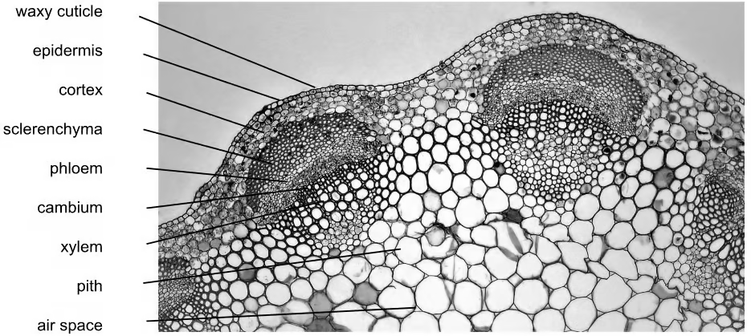
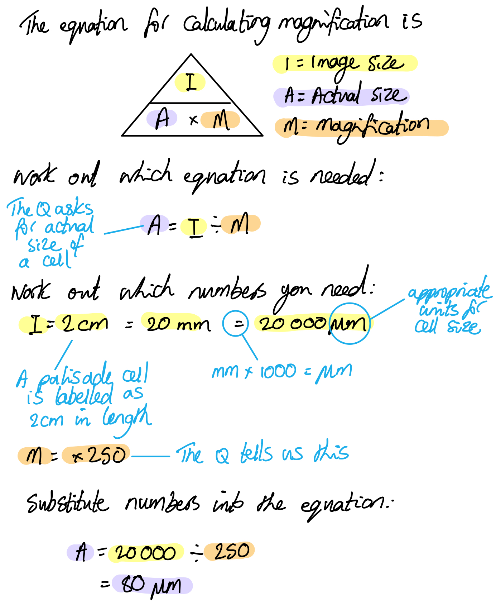
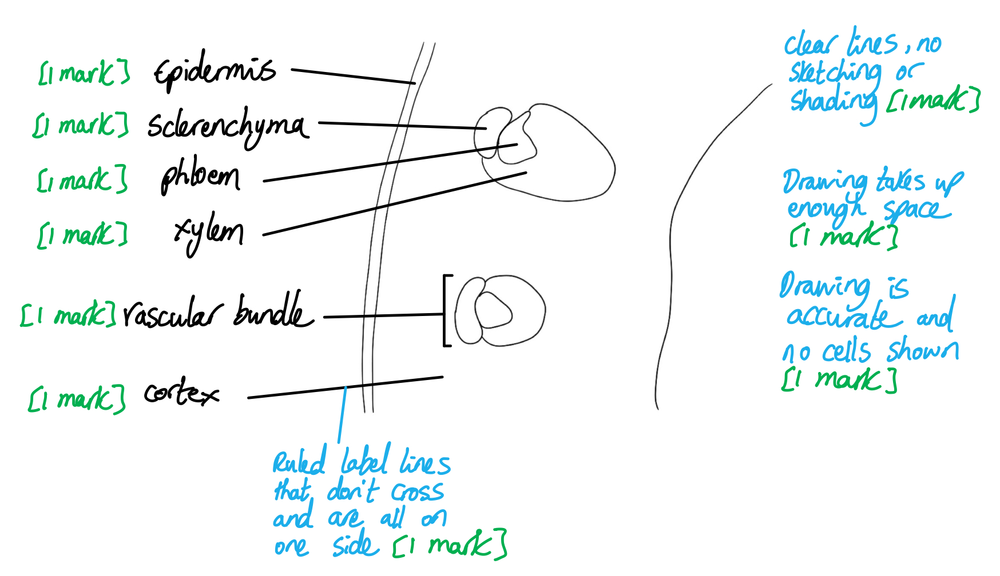
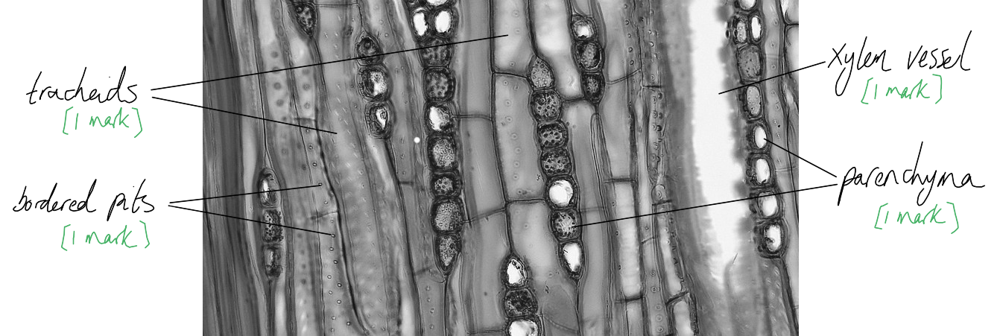
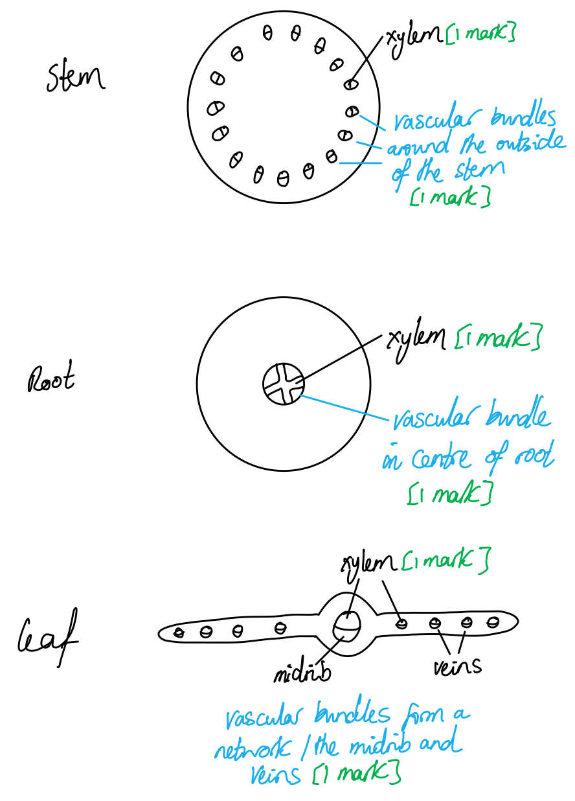

# Mark Schemes — Structure of Transport Tissues
**7. Transport in Plants** · Cambridge (CIE) AS biology (9700)

## Multiple Choice Questions (29 questions)

### Q1
**Final answer:** **The correct answer is ****A**** because:**

**Final answer:** **X**** is the cortex; ****Y**** is the endodermis and ****Z ****is the epidermis **

**Final answer:** **Any option would be correct for ****X**** as storage of carbohydrates and the movement of water from the root hairs to the vascular system both occur in the ****cortex**** **

**Final answer:** **The ****endodermis**** contains the ****Casparian strip****, therefore it plays a role in regulating the ****movement of water ****into and out of the vascular system.**

**Final answer:** **As the outermost layer, the ****epidermis**** is the first line of ****defence**** against infection, providing a physical barrier to pathogens. **

**Final answer:** **Plant roots have root hairs, the main role of which is to ****absorb water ****and nutrients. Consequently there is ****no**** waxy cuticle on the root because if there were, it would be impossible for roots to absorb water and nutrients from the soil.**

### Q2
**Final answer:** **The correct answer is ****C **** because:**

**Final answer:** **2 is correct; the end walls of the sieve tubes, known as sieve plates, contain pores to allow easy movement of assimilates.**

**3 is correct; the vascular bundles in the leaves have the**** xylem on the top**** and the ****phloem at the bottom****.**

**Final answer:** **4 is correct as the central bundle of vascular tissue in the roots is surrounded by a layer called the endodermis.**

> *1 is incorrect as the lignin present in cell walls is arranged in a spiral or circles, providing strength while also being flexible to reduce breakages.*

> *5 is incorrect as **pits allow the lateral movement of water **between xylem vessels; remember that xylem vessels do not contain cytoplasm. The description here could be applied to plasmodesmata in other types of plant tissue, e.g. in the phloem.*

### Q3
**Final answer:** **The correct answer is ****C**** because:**

**Final answer:** **In a ****dicotyledonous plant**** (which is the only plant type you will be asked about) the xylem and phloem locations in the ****root****, ****stem**** and ****leaf**** always follow the same pattern:**

- **In the ****leaf ****there is a main vascular bundle in the centre with the ****phloem located on the bottom ****and ****xylem on the top**** (there may also be smaller vascular bundles shown on the leaf and they follow the same phloem on the bottom and xylem on the top pattern).**
- **In the ****stem**** there are multiple vascular bundles around the outer circumference of the stem – each vascular bundle comprises xylem and phloem tissue with the ****xylem tissue on the inside**** and the ****phloem tissue on the outside****.**
- **In the ****root ****the xylem is in the centre in an ****X**** (or sometimes star) ****shape**** with the phloem located around the outside (in the gaps between the points).**

### Q4
**Final answer:** **The correct answer is ****B**** because:**

**Final answer:** **Plasmodesmata**** are narrow threads of cytoplasm that pass through the cell walls of ****adjacent**** plant cells.**

**Final answer:** **Plasmodesmata allow:**

- **Communication**** between cells**
- **Cytoplasmic ****movement of nutrients ****between cells**
- **Symplastic**** movement of ****water**

**Final answer:** **The ****communication**** between neighbouring cells via the plasmodesmata is achieved by the ****cytoplasmic movement ****of substances between cells  **

### Q5
**Final answer:** **The correct answer is ****C**** because:**

**Final answer:** **In a ****dicotyledonous plant**** (which is the only plant type you will be asked about) the xylem and phloem locations in the ****root****, ****stem**** and ****leaf**** always follow the same pattern:**

- **In the ****stem**** there are multiple ****vascular bundles ****around the outer circumference of the stem; each vascular bundle comprises xylem and phloem tissue with the ****xylem tissue on the inside**** and the ****phloem tissue on the outside**** **
- **The next layer outside of the phloem is the ****sclerenchyma cells**** (i.e. the dark cells represented by ****B****) – these are heavily ****lignified****, ****dead**** cells that provide structural support to the plant  **
- **Between the xylem and phloem is the ****cambium**** (an area of ****undifferentiated**** ****cells**** used for growth of new tissue)**

### Q6
**Final answer:** **The correct answer is ****D ****because:**

**Final answer:** **The purpose of a plan diagram is to show the distribution of the ****main tissues ****within an organ and to show the boundary lines between each tissue type; ****crucially, no individual cells should be drawn!**

**Final answer:** **1, 2, 3, and 5 are correct as they are the names of ****tissue types ****present in a leaf.**

> *4 **is incorrect as it refers to individual cells.*

> *Note that 'xylem' would be allowed, as this is a type of tissue, but 'xylem vessel element' is not, as this is a specific cell type.  Likewise, 'phloem' is allowed, but 'sieve tube element' is not.*

### Q7
**Final answer:** **The correct answer is ****C ****because:**

**Final answer:** **Plasmodesmata provide a cytoplasmic link between companion cells and sieve tubes.**

**Final answer:** **Without this cytoplasmic contact, the loading of sucrose into the sieve tube would be much slower, the water potential of the sieve tube would be higher, and the movement of water into the sieve tube by osmosis would be reduced. This would reduce the pressure gradient and slow the rate of translocation.**

> *A** is incorrect as the companion cell does not provide much structural support.*

> *B** is incorrect as the source of sugars is the cells of the **leaves** or a **starch storage area**.*

> *D **is incorrect as this statement refers to sieve tube elements and not companion cells.*

### Q8
**Final answer:** **The correct answer is ****C**** because:**

**Final answer:** **Xylem vessel elements have ****neither**** cytoplasm nor nuclei.**

**Final answer:** **Sieve tube elements have cytoplasm but ****no**** nuclei.**

**Final answer:** **Companion cells have ****both**** cytoplasm and nuclei.**

### Q9
**Final answer:** **The correct answer is ****D**** because:**

**Final answer:** **Both companion cells and sieve tube elements have ****endoplasmic reticulum ****(ER is one of the few organelles that sieve tube elements have) while neither sieve tube elements nor xylem vessel elements have ****nuclei****. **

> *A** and **B** are incorrect as companion cells do not have lignified tissue.*

> *C** is incorrect as xylem vessel elements do not have nuclei.*

### Q10
**Final answer:** **The correct answer is ****D ****because:**

**Final answer:** **W indicates a column-shaped cell near the top of the leaf; this is a palisade mesophyll cell.**

**Final answer:** **X indicates a gap between cells, known as an air space.**

**Final answer:** **Y indicates a cell in the spongy mesophyll layer.**

**Final answer:** **Z indicates the lower half of a vascular bundle; in leaves this is the phloem, while the xylem vessels are on the top. The xylem cells can also be identified here by their thickened cell walls, meaning that Z must indicate the phloem.**

### Q11
**Final answer:** **The correct answer is ****D**** because:**

- **1**** is the epidermis**
- **2**** is the phloem and ****3**** is the xylem as, in a ****root****,**** ****the xylem is in the centre in an X shape and the phloem is located around the outside of the xylem**
- **4 ****is the cortex**

> *Pith and cortex are commonly mixed up as they are similar tissues (composed mainly of soft, spongy parenchyma cells) with similar functions (storage and transport of water and nutrients throughout the plant). The cortex is located to the outside and/or around the vascular bundles (c**o**rtex = **o**utside), while the pith is located in the centre of the stem (p**i**th = **i**nside).*

### Q12
**Final answer:** **The correct answer is ****C**** because: **

**Final answer:** **2**** and ****4 ****are**** xylem ****which transports water and dissolved mineral ions in one direction.**

**Final answer:** **1**** and ****3**** are the ****phloem ****which transports sugars produced during photosynthesis in two directions.**

### Q13
**Final answer:** **The correct answer is ****B**** because:**

- **X**** is in the ****xylem****; we can be sure of this because of its location towards the inside of the stem, and because of its thickened cell wall.**
- **Y**** indicates a region towards the outside of the vascular bundle, so must be the ****phloem****; this therefore must be a sieve tube element.**
- **Z**** is located in the ****pith****, but is specifically pointing at a gap between cells, therefore it must be an ****airspace**** **

** **

### Q14
**Final answer:** **The correct answer is ****C ****because:**

**Final answer:** **In a ****dicotyledonous plant**** (which is the only plant type you will be asked about) the xylem and phloem locations in the ****root****, ****stem**** and ****leaf**** always follow the same pattern: **

- **In the ****leaf ****there is a main vascular bundle in the centre with the ****phloem located on the bottom ****and ****xylem on the top****. Note that there may also be smaller vascular bundles in the leaf and they follow the same pattern with phloem on the bottom and xylem on the top.**
- **In the ****stem**** there are multiple vascular bundles around the outer circumference of the stem; each vascular bundle comprises xylem and phloem tissue with the ****xylem tissue on the inside**** and the ****phloem tissue on the outside****.**
- **In the ****root ****the xylem is in the centre in an ****X**** (or sometimes star) ****shape**** with the phloem located around the outside.**

### Q15
**Final answer:** **The correct answer is ****A**** because:**

**Final answer:** **Xylem vessel elements (xylem cells) have no ****nucleus****, ****cytoplasm**** or ****end**** walls. **

**Final answer:** **Sieve tube elements (phloem cells) have ****no**** nucleus, but ****do**** have cytoplasm and end walls.**

### Q16
**Final answer:** **The correct answer is ****A**** because:**

**Final answer:** **Plasmodesmata**** are narrow threads of cytoplasm that pass through the cell walls of ****adjacent**** plant cells, allowing ****communication**** between the cells by the ****symplastic**** movement of substances.**

### Q17
**Final answer:** **The correct answer is ****B**** because:**

**Final answer:** **X**** is the cortex – the cortex is the area in the root found between the epidermis (****Z****) and the endodermis (****Y****) and is made up of parenchyma cells which play a role in storage of nutrients.**

**Final answer:** **Y ****is the endodermis**** ****- the endodermis is located between the cortex and the vascular bundle in roots and contains the ****Casparian strip**** (which forces water from the ****apoplast**** into the ****symplast**** pathway).**

**Final answer:** **Z ****is the epidermis – the epidermis is the outermost layer in the root****.**

### Q18
**Final answer:** **The correct answer is ****D**** because:**

**Final answer:** **The xylem contains ****elongated**** cells with ****no**** end walls. Xylem vessels are located in ****vascular bundles ****on the outside of the stem and in the middle of the roots.**

> *A** is incorrect as xylem vessels no **not** contain peripheral cytoplasm and are located towards the **inside** of phloem in vascular bundles.*

> *B** is incorrect as xylem vessels do not have sieve plates.*

> *C **is incorrect as xylem vessels are never associated with companion cells.*

### Q19
**Final answer:** **The correct answer is**** A**** because:**

**Final answer:** **Xylem vessel elements have heavily ****lignified**** ****walls****; this adds structural strength and helps to prevent the xylem from collapsing under negative pressure**** ****from transpiration pull.**

**Final answer:** **Companion cells contain ****many mitochondria****, which produce the ATP needed for actively loading sucrose into the sieve tube elements.**

> *B** is incorrect as xylem vessel elements do** **not** have nuclei as they are dead cells. Companion cells do have cellulose cell walls, but this is a general feature of plant cells and does not aid specific function.*

> *C** is incorrect as it is not correct to say that a cell does not contain 'living tissue'; xylem cells themselves are dead, but the cells make up xylem tissue, and not the other way around. Companion cells **do** contain a small amount of cytoplasm.*

> *D **is incorrect as xylem vessel elements do **not** have mitochondria and companion cells do **not** have lignified walls.*

### Q20
**Final answer:** **The correct answer is ****C**** because:**

**Final answer:** **In a ****dicotyledonous plant**** (which is the only plant type you will be asked about) the xylem and phloem locations in the ****root****, ****stem**** and ****leaf**** always follow the same pattern: **

- **In the ****root ****the xylem is in the centre in an ****X**** (or sometimes star) ****shape**** with the phloem located around the ****outside**** (in the gaps between the points) **
- **In the ****stem**** there are multiple vascular bundles around the outer circumference of the stem; each vascular bundle comprises xylem and phloem tissue with the ****xylem tissue on the inside**** and the ****phloem tissue on the outside**** **
- **In the ****leaf ****there is a main vascular bundle in the centre with the ****phloem located on the bottom ****and ****xylem on the top**** (there may also be smaller vascular bundles shown on the leaf and they follow the same phloem on the bottom and xylem on the top pattern)**

### Q21
**Final answer:** **The correct answer is ****C**** because:**

**Final answer:** **The purpose of a plan diagram is to show the ****distribution of the main tissues ****and the boundaries between the different tissue types; ****no individual cells should be drawn****.**

**Final answer:** **Companion cells ****should not be included in a plan diagram as they are individual cells.**

> *Note that xylem cells together make up xylem tissue, so 'xylem' can be shown on a plan diagram. Individual xylem vessels could not be shown in this way.*

> *Likewise, the term 'phloem' refers collectively to sieve tube elements and companion cells, so this is also an example of a tissue.*

### Q22
**Final answer:** **The correct answer is ****B**** because:**

**Final answer:** **The ****cortex**** is the tissue of a stem or root that lies within the ****epidermis ****and outside the ****vascular tissue****.**

> *Z** is the epidermis and **Y** is the endodermis *

> *The root of a **dicotyledonous plant** has no pith (pith is only found in the stem of a dicotyledonous plant) so A is incorrect.*

> *Pith and cortex are commonly mixed up as they are similar tissues (composed mainly of soft, spongy parenchyma cells) with similar functions (storage and transport of water and nutrients throughout the plant). The cortex is located to the outside and/or around the vascular bundles (c**o**rtex = **o**utside), while the pith is located in the centre of the stem (p**i**th = **i**nside).*

### Q23
**Final answer:** **The correct answer is ****B**** because:**

**Final answer:** **Sieve tube elements have vastly reduced cell contents to ****maximise space**** for the movement of sap; organelles that are missing include the cytoskeleton, ribosomes, tonoplast and the ****nucleus****. Due to their vastly reduced cell contents, sieve tube elements rely on companion cells for many metabolic processes.**

> *Mature sieve elements still contain structural phloem-specific **proteins**, **mitochondria**, ER and strands of **cytoplasm**. *

### Q24
**Final answer:** **The correct answer is ****B**** because:**

**Final answer:** **Y**** = ****xylem**** and ****X**** = ****phloem****; we know this because phloem is distributed around the outside of plant stems, with xylem located towards the inside.**

**Final answer:** **2 is correct because the xylem transport water and dissolved minerals**** from the roots to the leaves****, while phloem transport assimilates**** from sources to sinks****. The**** locations of sources and sinks can vary****, so phloem transport can be either upwards or downwards.**

**Final answer:** **3 is correct because the xylem and phloem (plus the cambium located between them) comprise a ****vascular bundle****.**

**Final answer:** **4 is correct because the phloem transports products of photosynthesis.**

> *1 is incorrect because the** xylem transports water** **and minerals **while the **phloem transports assimilates **such as sucrose and amino acids.*

### Q25
**Final answer:** **The correct answer is ****D**** because:**

**Final answer:** **The diagram shows the cross-section of a dicotyledonous root, recognisable by the characteristic ‘X’ shape of the xylem tissue. Cell W is within this X shape, therefore must be a xylem vessel element.**

> *Note that xylem cells are also distinctive due to their thick cell walls.*

### Q26
**Final answer:** **The correct answer is ****C**** because:**

**Final answer:** **1 is correct because mitochondria allow the active transport of minerals from the soil into root hair cells, lowering their water potential and resulting in water moving into the cells by osmosis.**

**Final answer:** **2 is correct because root hairs have a ****large surface area**** to speed up the intake of water by osmosis.**

**Final answer:** **3 is correct because root hairs have ****thin walls**** to reduce the diffusion distance moved by water during osmosis. Note that osmosis is a type of diffusion.**

**Final answer:** **4 is correct because root hair cells maintain a ****low water potential**** by ****actively**** taking up minerals and ions from the soil against their concentration gradients. These minerals are stored in the large vacuoles in the root hair cells and ****speed up ****the absorption of water via osmosis.**

### Q27
**Final answer:** **The correct answer is ****B**** because:**

**Final answer:** **The ****xylem**** is made of ****dead tissue**** and the ****phloem**** is made of ****living tissue****. This means that xylem function will be ****unaffected**** by the addition of the poison.**

**Final answer:** **Transport in the ****phloem**** is dependent on the ****active loading of sucrose**** into the sieve tube elements; this process will no longer occur after the cells in the vascular bundle have been poisoned, so transport in the phloem will stop.**

### Q28
**Final answer:** **The correct answer is ****D**** because:**

**Final answer:** **Neither sieve tube elements nor xylem vessel elements have nuclei.**

> *1 is incorrect because sieve tube elements have perforated end walls.*

> *3 is incorrect because although xylem vessel elements do not have cytoplasm, sieve tube elements do contain some cytoplasm.*

> *4 is incorrect because only the sieve tube elements are dependent on companion cells.*

### Q29
**Final answer:** **The correct answer is ****A**** because:**

**Final answer:** **Companion cells carry out ****active loading**** of sucrose into the ****phloem****; this requires energy, so companion cells need to synthesise ****ATP****. To make all this ATP the companion cells have large numbers of ****mitochondria****  **

> *Starch grains** are found in all living plant cells (to provide a source of glucose) but are not found in an unusually high numbers in companion cells.*

> *Chloroplasts** are found in highest concentrations in the palisade mesophyll cells (and to a lesser extent in the spongy mesophyll cells) which is where photosynthesis takes place.*

> *Lysosomes** are found in all living plant cells (they are used to break down organelles, pathogens and biomolecules), but they are not found in an unusually high numbers in companion cells .*

## Structured Questions (12 questions)

### Q1
The actual size of a palisade mesophyll cell shown in Fig. 1 is...

- 20 000 $\div$ 250; **[1 mark]**
- 80 µm; **[1 mark]**

*Full marks can be awarded for the correct answer of 80 µm in the absence of other calculations. *

**[Total: 2 marks]**

> *Remember to convert the measurements into appropriate units; this can be done before the calculation or after, but it is good practice to get into the habit of doing it beforehand to avoid forgetting afterwards!*

> *Once you have done a calculation of this nature it is always worth asking yourself whether the answer you have come out with sounds right; given that we know that plant cells can range in size from around 10 - 100 µm, a size of 80 µm sounds about right, but if you had come out with 8 or 800 then you could assume that you had gone wrong somewhere and go back to check your numbers.*

Contrasting features of the tissues labelled P and Q in Fig. 1 are:

**Final answer:** **Any ****four**** of the following:**

- P (xylem) contains hollow cells/tubes **WHILE **Q (phloem) contains cells with cell contents/cytoplasm/mitochondria/endoplasmic reticulum; **[1 mark]**
- P cells are strengthened with lignin / have cell walls that contain lignin **WHILE** Q cells are/do not; **[1 mark]**
- P cells have no end walls / form a continuous tube **WHILE **Q cells have end walls / form tubes that are divided by cell walls/sieve plates; **[1 mark]**
- P cells are impermeable / waterproof **WHILE **Q cells are permeable / have transport proteins / have plasmodesmata; **[1 mark]**
- P cells have pits in their walls **WHILE** Q cells do not; **[1 mark]**
- P tissue contains xylem cells/vessel elements/tracheids **WHILE** Q tissue contains both sieve tube elements **and** companion cells; **[1 mark]**

*Accept xylem for P and phloem for Q throughout.*

**[Total: 4 marks]**

> *Note that the question specifically asks about contrasting features of the **structures** of the two tissue types, so any features that do not relate to structure, e.g. whether or not the cells are alive, or whether they transport water or sugars, will not be credited.*
The low power plan diagram should include:

*Biological drawing*

**Final answer:** **A ****maximum of**** ****three**** of the following:**

- A sharp pencil has been used **and **lines are clear and continuous / there is no sketching **and** no shading is present; **[1 mark]**
- Drawing occupies more than half of the available space; **[1 mark]**
- Drawing is an accurate representation of Fig. 2; **[1 mark]**
- Label lines are drawn with a ruler **and **label lines do not cross **and** label lines are all on one side of the drawing; **[1 mark]**
- Individual cells are not shown; **[1 mark]**

*Labels*

**Final answer:** **A ****maximum of**** ****three**** of the following:**

- Epidermis; **[1 mark]**
- Cortex; **[1 mark]**
- Vascular bundle/tissue; **[1 mark]**
- Sclerenchyma/fibrous tissue/fibres; **[1 mark]**
- Phloem; **[1 mark]**
- Xylem; **[1 mark]**

*Accept drawings that accurately represent a small section of Fig. 2.*

**[Total: 6 marks]**

### Q2
Advantages of the different lignin arrangements found in plants could include:

*Advantages of annular/helical lignin*

- Annular/helical lignin allows flexibility / prevents the stem from being rigid **SO** allows the stem to bend/flex (without breaking the xylem); **[1 mark]**
- Annular/helical lignin is less rigid **SO** allows xylem vessels to grow / become wider (allowing them to carry a larger volume of water); **[1 mark]**

*Advantages of scalariform/pitted lignin*

**Final answer:** **A maximum of ****three**** of the following:**

- Scalariform/pitted lignin is stronger / increases rigidity **SO** the stem is less likely to break / can support itself / provides structural support to the stem; **[1 mark]**
- Scalariform/pitted lignin is stronger / increases rigidity **SO** the vessels are less likely to collapse under negative pressure; **[1 mark]**
- Scalariform/pitted is less permeable to water **SO** less water is lost from the xylem OR the xylem cell contents die off and leave a hollow tube; **[1 mark]**
- Pitted lignin contains pits **SO** water can move sideways/laterally between xylem vessels; **[1 mark]**

**[Total: 4 marks]**

> *Lignin in the walls of xylem vessels provides structural strength as well as waterproofing. Lignin in circular and spiral structures provides some strength while also allowing bending without breaking, so is important when flexibility is required, while scalariform and pitted lignin provides more coverage, resulting in more strength and greater waterproofing. This means that vessels can be wider without collapsing, increasing the volume of water that can be carried, while also being less permeable to water loss.*

> *Note that while some plants adaptations may involve certain lignin arrangements, e.g. aquatic plants that need to bend and flex with wave action may only have annular lignin, most plants have a combination of different types of lignin arrangement, with younger xylem vessels containing more flexible annular and helical lignin, and more mature xylem vessels containing stronger pitted lignin.*
The labels should be added as follows:

- At least one tracheid labelled correctly; **[1 mark]**
- Xylem vessel labelled correctly; **[1 mark]**
- At least one bordered pit labelled correctly; **[1 mark]**
- At least one parenchyma cell labelled correctly; **[1 mark]**

**[Total: 4 marks]**
Marks can be awarded for drawing as follows:

- At least three different structures clearly identifiable **AND** labelled; **[1 mark]**
- A small sample area has been drawn; **[1 mark]**
- Criteria for biological drawing have been met, i.e. sharp pencil lines **AND** no shading **AND** any label lines do not cross **AND** any label lines do not have arrows **AND** at least half of the available space has been used; **[1 mark]**

**[Total: 3 marks]**** **

> *The drawing can show a section from any part of the image; an example drawing from the top right-hand corner might look like this:*

### Q3
Plant cells have plasmodesmata while animal cells do not because:

**Final answer:** **Any ****two**** of the following:**

- Plant cells have cell walls and animal cells do not; **[1 mark]**
- Plant cell walls prevent contact between the membranes of adjacent/neighbouring cells; **[1 mark]**
- Animal cells can exchange substances at the points of contact between their cell surface membranes (while plant cells cannot, so need plasmodesmata); **[1 mark]**

**[Total: 2 marks]**
(i) The location of plasmodesmata in the vascular tissue of plants is:

- Between the sieve tube elements and the companion cells of the phloem; **[1 mark]**

(ii) Its role there is to...

- Allow the passage of <u>sucrose</u> / <u>amino acids</u> / <u>assimilates</u>; **[1 mark]**

**[Total: 2 marks]**
Three substances that might be transported from cell to cell via plasmodesmata include:

**Final answer:** **Any ****three**** of the following:**

- Water; **[1 mark]**
- Ions/mineral ions/named mineral ion; **[1 mark]**
- Nucleotides (DNA or RNA); **[1 mark]**
- Named protein, e.g. plant hormones/chemical messengers/growth factors, enzymes, transcription factors; **[1 mark]**
- mRNA; **[1 mark]**

***Reject**** references to sugars/sucrose or amino acids, as these are covered in part c) above*

**[Total: 3 marks]**

### Q4
A discussion of the idea that plant vascular systems and the human circulatory system are comparable is as follows:

*Points in support of the statement*

- Both carry out mass transport; **[1 mark]**
- Both transport nutrients / minerals; **[1 mark]**
- Both can carry waste products for excretion; **[1 mark]**

*Points against the statement*

**Final answer:** **A ****maximum of three**** of the following:**

- Plant vascular systems are not a closed loop **WHILE** animal circulatory systems are a closed loop; **[1 mark]**
- Plant vascular systems have different vessels for carrying different substances **WHILE **animal blood vessels transport all substances; **[1 mark]**
- Phloem can transport can occur in either direction **WHILE** animal circulation is all in one direction; **[1 mark]**
- Plant transport systems do not have a pump **WHILE** animal circulation does; **[1 mark]**
- Xylem cells are dead **WHILE** animal circulatory systems contain no dead tissue;
- Xylem cells are strengthened with lignin **WHILE** animal blood vessels are strengthened with muscle and elastic tissue; **[1 mark]**

**[Total: 6 marks]**

> *Remember that the command word 'discuss' requires you to write about an idea in a structured way; here this means considering the arguments for and against the idea provided.*
(i) The compound that ranks number 2 in the list of abundant organic polymers is:

- <u>Lignin</u>; **[1 mark]**

(ii) This is because:

- It is present in xylem tissue / forms wood in woody plants;** [1 mark]**

**[Total: 2 marks]**

> *Lignin makes up between a quarter and a third of the dry mass of woody plants, and given the abundance of such plants on Earth, this makes it the second most abundant organic polymer after cellulose.*
Being hydrophobic helps in the function of lignin as follows:

- Prevents the movement of water through xylem cell walls / waterproofs the walls of xylem vessels; **[1 mark]**
- This maximises the flow of water in the xylem / ensures that water reaches the leaves; **[1 mark]**

*Ignore references to lignin's structural role*

*Allow ecf (error carried forward) from part (b) if the correct reasoning is given, i.e. an explanation relating to the role of a different polymer*

**[Total: 2 marks]**

### Q5
** **We know that the leaf is upside-down because:

- P/the lower epidermis / Q/the air spaces are at the top of the image; **[1 mark]**
- S/the xylem is shown below R/the phloem; **[1 mark]**

**[Total: 2 marks]**

> *Most images used in exam questions will show plant tissues in the correct orientation, but here we are told the leaf is upside down, and we need to look carefully for the clues in the image that show this:*

- *The spongy mesophyll, which should be in the lower part of a leaf, is at the top of the image*
- *The xylem vessels, which should be at the top, are shown in the lower part of the vascular bundle*
The distribution of vascular bundles in a leaf can be described as follows:

**Final answer:** **Any ****two**** of the following:**

- In the midrib / veins; **[1 mark]**
- Branching/spreading out from the centre (of the leaf) / forming a network; **[1 mark]**
- Multiple / many bundles throughout the (leaf) mesophyll; **[1 mark]**

**[Total: 2 marks]**

> *Note that no marks are awarded here for describing the specific locations of xylem and phloem; this is because:*

- *This idea has been covered in part (a) and you would never be awarded marks more than once for the same idea within a single question in an exam*
- *The question asks about vascular **bundles** as a whole, rather than about specific types of vascular tissue*
R and S are present in leaves because:

*R/phloem*

- Transport the products of photosynthesis/organic compounds from the source/the site of production to a sink/a part of the plant where they will be used / stored; **[1 mark]**

*S/xylem*

**Final answer:** **Any ****one**** of the following:**

- Transport water to the cells of the leaf where it is used in photosynthesis **OR **transport minerals to the cells of the leaf where they are used to build plant tissues / make amino acids/proteins / make chlorophyll; **[1 mark]**
- Provide structural support to the leaf (due to the presence of lignin / by ensuring that leaf cells are turgid); **[1 mark]**

**[Total: 2 marks]**
Features that would be present on the low-power plan diagram include:

**Final answer:** **Any ****four**** of the following:**

- (Lower) epidermis; **[1 mark]**
- Spongy mesophyll layer/tissue; **[1 mark]**
- Vascular bundle; **[1 mark]**
- Phloem (tissue); **[1 mark]**
- Xylem (tissue); **[1 mark]**
- Parenchyma/fibrous tissue; **[1 mark]**

*Reject any reference to cells or vessels for any of the above marking points.*

**[Total: 4 marks]**

> *Remember that low-power plan diagrams show **regions of different tissue types**, and the boundaries between the tissues, but **never** show individual cells. This means that you would be credited here for naming any of the tissue types visible in Fig. 1, but not for references to cell types, so 'spongy mesophyll layer' would be credited, but 'spongy mesophyll cell' or 'air space' (these are gaps between cells so would only be visible if cells were also shown) would not be accepted.*

> *Remember the distinction between xylem tissue (a group of xylem cells) and individual xylem vessels, in addition to that between phloem tissue and the individual sieve tubes / companion cells.*

### Q6
(i) An adaptation of xylem vessels shown in Fig. 4.1 is:

- Lignin/lignification/lignified cell walls; **[1 mark]**

(ii) This adaptation aids function as follows:

**Final answer:** **Any ****two**** of the following:**

- It strengthens the xylem / prevents xylem from collapsing (due to tension); **[1 mark]**
- It waterproofs the xylem / prevents water from leaking out of the xylem; **[1 mark]**
- The spiral/ring structure of lignin allows stretching (during growth) / flexing (when the plant bends); **[1 mark]**

**[Total: 3 marks]**

> *Note that the question asks for a structure that is **visible in Fig. 1**. Answers relating to other xylem adaptations will not be credited here.*
Light microscopes have a lower maximum magnification than electron microscopes because:

- They have a lower resolution/resolving power; **[1 mark]**
- They cannot distinguish between/resolve separate points that are very close together; **[1 mark]**
- The wavelength of (visible) light is longer than that of electrons; **[1 mark]**

**[Total: 3 marks]**
Xylem vessels are distributed as follows in the stems, roots, and leaves of dicotyledonous plants:

**Final answer:** **Any ****five**** of the following:**

*Stem*

- Xylem vessels are in vascular bundles located around the outside of the stem; **[1 mark]**
- Further towards the centre of the stem than the phloem tissue; **[1 mark]**

*Roots*

- In the centre of the root; **[1 mark]**
- Surrounded by phloem tissue; **[1 mark]**

*Leaves*

- In vascular bundles that form a network / midrib and veins through the leaf; **[1 mark]**
- The xylem tissue is located towards the upper side of the leaf / above the phloem tissue; **[1 mark]**

**[Total: 5 marks]**

> *An annotated diagram would be an acceptable way of answering this question, provided that it contained five of the points listed in the mark scheme above.*

### Q7
Structures X, Y, and Z are:

- X = xylem (vessels); **[1 mark]**
- Y = phloem (sieve tubes); **[1 mark]**
- Z = endodermis; **[1 mark]**

***Accept**** pericycle instead of endodermis for ****Z****.*

**[Total: 3 marks]**

> *In roots the xylem vessels are found in the centre, sometimes forming an x-shape, though that is not the case in this example. The phloem vessels are distributed around the outside of the xylem.*

> *The endodermis is the layer of cells that surrounds the vascular tissue in plants, and can be clearly seen in roots. Just within the endodermis in roots is another layer of cells known as the pericycle; this answer is also accepted here.*
The structure of tissue **X** is related to its function as follows:

**Final answer:** **Any ****four**** of the following:**

- (Xylem vessel) walls are lignified / contain lignin **SO **walls do not collapse inwards / can withstand tension/negative pressure; **[1 mark]**
- Lignin in (xylem) walls **SO** xylem are waterproof / water is not lost / water does not leak out; **[1 mark]**
- Lignin/cellulose is present in walls (of xylem) **SO** allowing adhesion with water molecules; **[1 mark]**
- (Xylem) cells are hollow / have no cell contents **SO** there is plenty of space for water transport/mass flow; **[1 mark]**
- There are pits between (neighbouring xylem) vessels **SO** allowing sideways/lateral movement of water (from one xylem vessel to the next); **[1 mark]**
- Cells have no end walls **SO** form a continuous tube; **[1 mark]**

***Accept**** the terms cell or vessel when describing xylem*

***Reject**** the term pore instead of pit*

**[Total: 4 marks]**

> *Cellulose and lignin in xylem vessel walls are hydrophilic, so there are forces of attraction between the walls of xylem vessels and water molecules; these forces of attraction between different types of molecules are known as adhesion, not to be confused with cohesion; forces of attraction between the same type of molecules, e.g. two water molecules.*

> *In questions like this it is essential that you link structure to function for each mark; describing structures alone will not be credited.*
The structure of water molecules enables the formation of a continuous water column because:

- Water molecules have a (slightly) negatively charged region and a (slightly) positively charged region / water is a dipole / water is a polar molecule (due to the uneven sharing of electrons between oxygen and hydrogen); **[1 mark]**
- Hydrogen bonds form between water molecules (between the negatively charged region of one water molecule and the positively charged region of another); **[1 mark]**

**[Total: 2 marks]**

### Q8
It is important that one of the daughter cells (cell **E**) is a meristematic cell because:

**Final answer:** **Any ****one**** of the following:**

- To provide cells that can divide/differentiate; **[1 mark]**
- To enable continued growth of the shoot tip / (named) tissues; **[1 mark]**

***Ignore**** answers stating the need to produce more meristematic cells, as this just repeats the words used in the question.*

**[Total: 1 mark]**

> *Meristematic cells have the ability to differentiate into **any cell type**. When a meristematic cell divides by mitosis, one of the two new daughter cells will go on to develop into a new tissue type needed by the plant (such as phloem tissue shown here), while the other daughter cell will remain in the plant meristem and retain its ability to divide and differentiate. If both of the daughter cells differentiated into other cells types then the plant would soon run out of meristem tissue and would lose the ability to grow and produce new tissue types.*

> *Note that while the example of differentiation given above is that of meristematic cell to phloem tissue, the question asked in part a) is more general and answers should not be limited to the development of phloem tissue only.*
The changes that are shown in Fig. 1 between the stages can be described as follows:

| **stages** | **description** |
|---|---|
| **F** and **G** | The cell elongates/enlarges/grows **AND** a vacuole/tonoplast forms; **[1 mark]** |
| **G **and **H** | The cell divides **AND** one of the cells has a vacuole; **[1 mark]** |
| **H **and **J** | The sieve tube cell elongates/enlarges/grows **AND** loses its nucleus; **[1 mark]**  **OR**  One (companion) cell divides to form two companion cells  / companion cell divides; **[1 mark]** |

**[Total: 3 marks]**

> *This question simply asks you to describe what you can see in the stated parts of Fig. 1. You do not need to go into detail about the stages of the cell cycle or mitosis, but you do need to describe **what you can see** in detail.*
The structure of a mature sieve tube element is related to its function as follows:

**Final answer:** **Any ****four**** of the following:**

- Elongated cells **SO** a long tube is formed; **[1 mark]**
- There is little (peripheral) cytoplasm / cell contents **SO** there is less resistance to flow / more space for maximum transport of assimilates; **[1 mark]**
- Sieve plates have pores **SO** there is little barrier to flow from cell to cell / it is easy (for sap) to pass from cell to cell / mass flow can occur; **[1 mark]**
- Sieve plates are present **SO** support / stop collapse/bulging / maintain hydrostatic pressure of sieve tubes; **[1 mark]**
- Plasmodesmata are present between sieve tubes and companion cells **SO** loading/unloading (of sap) is easier; **[1 mark]**
- There is a membrane around the sieve tube **SO** osmosis can occur / assimilates are not lost; **[1 mark]**

***Reject**** references to no organelles / no cell content for marking point 2.*

***Accept**** references to sieve plates becoming plugged with P-protein/callose in case of damage to prevent loss of sap in marking point 4.*

**[Total: 4 marks]**

> *When answering questions about structure and function be sure to clearly link each structure with its function. This particular question is about the sieve tube element, so don't spend time writing about the companion cells.*

> *Remember that phloem cells are not dead like xylem; they do have some cell contents in order to remain alive, e.g. mitochondria and some cytoplasm.*

> *Be careful not to mix up xylem and phloem here; xylem cells have a different structure in order to allow them to carry out their own specific function.*
The functions of companion cells in transport in the phloem include...

**Final answer:** **Any ****two**** of the following:**

- Movement of sucrose from source/mesophyll cells / to (named) sink cells; **[1 mark]**
- Move sucrose into/out of sieve tubes; **[1 mark]**
- Pump protons/hydrogen ions/H+ out of cell / into cell wall/ **OR** carrying out secondary active transport; **[1 mark]**
- Provide ATP / proteins for sieve tubes **OR** assist the metabolism of sieve tubes; **[1 mark]**

**[Total: 2 marks]**

> *When describing the events that take place in phloem transport, it is essential to be specific; state the direction of movement (into or out), the cells that are involved (e.g. sieve tube or companion), and use terms like **source** and **sink** whenever possible.*

> *Note that the phloem tissue includes both the companion cells and sieve tubes, so saying that the companion cells load sucrose into the phloem is too vague; you need to state that it moves sucrose into the **sieve tube**.*

### Q9
(i) Structure A is a:

- Xylem vessel (element) / xylem cell; **[1 mark]**

(ii) Structure A can be identified as a xylem vessel because:

- It contains no end walls; **[1 mark]**
- Flow occurs in only one direction / only occurs upwards; **[1 mark]**

**[Total: 3 marks]**
Two other features of structure A that are not visible in the diagram are:

- Lignin; **[1 mark]**
- Pits;**[1 mark]**

**[Total: 2 marks]**

> *Note that you are being asked here for structures that are** **not** **visible in the diagram in part (a), so any reference to features such as a lack of cell contents, or the absence of end walls, will not be accepted here.*
Structure B does not accurately reflect the tissue type that it represents because:

**Final answer:** **Any ****two**** of the following:**

- It does not include companion cells; **[1 mark]**
- It does not show the pores in the sieve plates/end walls; **[1 mark]**
- It does not show the presence of cell contents / cytoplasm / other cellular structure found in sieve tubes; **[1 mark]**

**[Total: 2 marks]**
One way in which the structure of B aids its function is:

**Any ****two**** of the following****:**

- It has no end walls **SO **allows for continuous flow of assimilates / sucrose / sap; **[1 mark]**
- It has reduced cell contents / no nucleus / a low volume of cytoplasm **SO** allows for continuous flow of assimilates / sucrose / sap; **[1 mark]**
- Cellulose cell wall **SO **allows cells to withstand high hydrostatic pressure; **[1 mark]**
- Companion cells contain many mitochondria **SO** can actively transport sucrose (into sieve tube); **[1 mark]**
- Plasmodesmata are present **SO** allow sucrose/assimilates to move between cells / speed up the movement of assimilates between cells; **[1 mark]**
- Transport proteins are present **SO** sucrose / amino acids / assimilates can be transported across the cell membrane; **[1 mark]**

**[Total: 2 marks]**

> *Note that when a question asks you to explain how structures aid function, you need to make a clear link between the structure, and the way in which it assists with function in order to gain each mark.*

### Q10
The tissues present are...

- 1 = phloem **AND** 2 = xylem; **[1 mark]**
- 3 = xylem **AND** 4 = phloem; **[1 mark]**

**[Total: 2 marks]**

> *The question tells us that the regions shown represent areas of** vascular tissue**, so this tells us that we are dealing with **xylem** and **phloem** tissue. You need to be able to identify the locations of xylem and phloem tissue in different parts of a plant.*
(i) The part of a plant in which the distribution of vascular tissue is correctly represented by regions 1 and 2 is...

- Stem; **[1 mark]**

(ii) The part of a plant in which the distribution of vascular tissue is correctly represented by regions 3 and 4 is...

- Root; **[1 mark]**

**[Total: 2 marks]**
Errors in the student's low-power drawing include...

**Final answer:** **Any ****four**** of the following:**

*Features that apply to all biological drawings*

- Blunt pencil / pencil is not sharp; **[1 mark]**
- Shading has been used; **[1 mark]**
- Lines are not continuous / some lines are sketched; **[1 mark]**
- Not all (relevant) structures are labelled; **[1 mark]**
- No scale is given; **[1 mark]**
- An arrow has been used; **[1 mark]**

*Features that apply to low-power drawings*

- Individual cells are drawn; **[1 mark]**

**[Total: 4 marks]**

> *Make sure that you know the conventions for different types of biological drawing. Some rules, such as the use of a sharp pencil, continuous lines, and no shading, apply to all biological drawings, while some are specific to either low- or high-power drawings.*

> *Note that no credit is available for commenting on whether the drawing is an accurate representation of reality, as we cannot see the specimen from which the drawing was made.*
The term stem cell can be defined as follows...

**Final answer:** **Any ****two**** of the following:**

- A cell that can divide an unlimited number of times; **[1 mark]**
- An undifferentiated cell; **[1 mark]**
- A cell that can differentiate/specialise into other cell types / another cell type; **[1 mark]**

**[Total: 2 marks]**

### Q11
(i) The drawing is taken from a...

- Leaf (cross-section); **[1 mark]**

(ii) Structures P, Q and R are...

- P = palisade mesophyll/cell; **[1 mark]**
- Q = vascular bundle/tissue / xylem and phloem; **[1 mark]**
- R = nucleus; **[1 mark]**

**[Total: 4 marks]**
(i) One feature that is visible in Fig. 1 that indicates that this is a high-power drawing is...

**Final answer:** **Any ****one**** of the following:**

- Individual cells / cell walls of cells are shown; **[1 mark]**
- A small/representative number of cells (in a leaf) are shown; **[1 mark]**
- Nuclei are not shaded / shown as dark blobs; **[1 mark]**

(ii) One feature that is absent from Fig. 1 that we might expect to see in a high-power drawing is...

- A scale (bar) / the magnification; **[1 mark]**

**[Total: 2 marks]**
Chloroplasts are not visible because...

- They are too small / they are smaller than the nucleus; **[1 mark]**
- The resolution/resolving power of the microscope is too low; **[1 mark]**

*Ignore references to magnification.*

*Ignore references to the wrong stain being used.*

**[Total: 2 marks]**

> *Nuclei are visible in Fig. 1, but chloroplasts are not (despite the fact that we know they will be present inside palisade cells), so they must be smaller than nuclei, and** too small** to observe at the **resolution** of the microscope being used.*

> *Be careful not to confuse magnification and resolution here; it is low resolution that prevents us from being able to **distinguish between two points** that are close together, meaning that we are unable to view objects that **should otherwise be visible** at the magnification used.*

> *Note that references to stain use will not be credited here. Chloroplasts contain natural green pigment (chlorophyll) so we would expect them to be visible even without the use of a stain.*
Plants need transport tissue because...

**Final answer:** **Any ****two**** of the following:**

- They have several/many cell layers **SO** diffusion (alone) is too slow; **[1 mark]**
- To transport the products of photosynthesis/glucose/sucrose from the leaves/photosynthesising tissue to non-photosynthesising parts of the plant/the roots; **[1 mark]**
- To transport water/minerals from the roots to the leaves/the site of photosynthesis; **[1 mark]**
- To transport stored carbohydrates from the storage organs/roots/tubers to growing parts of a plant; **[1 mark]**

**[Total: 2 marks]**

> *Plants contain many layers of cells, so it would take far too long for the molecules that they need to just diffuse from one cell to another across a plant. They therefore rely on specialised transport tissue to move substances around from where they are made/gained/stored to where they are needed. For example, glucose is made in the leaves during photosynthesis and is then transported (in the form of sucrose) to the roots which cannot produce their own glucose.*

### Q12
Structures X, Y and Z are...

- X = xylem; **[1 mark]**
- Y = phloem; **[1 mark]**
- Z = vascular bundle/tissue; **[1 mark]**

**[Total: 3 marks]**

> *You need to know that vascular tissue is arranged in bundles throughout the cross section of a leaf. The xylem tissue is located on the top of each bundle and the phloem tissue is towards the bottom of the leaf.*
The roles of structures X and Y are...

- X/xylem = transport of water **AND** (dissolved) minerals; **[1 mark]**
- Y/phloem = transport of sugars/sucrose/assimilates; **[1 mark]**

**[Total: 2 marks]**
Structure X is adapted to its function as follows...

**Final answer:** **Any ****two pairs ****of points from the following:**

- Lignified cell walls / cell walls contain lignin; **[1 mark]**
- Strengthen cells to withstand high pressure / prevent cells from collapsing **OR** makes the cells impermeable to water / provides waterproofing; **[1 mark]**

**AND/OR**

- No end plates/walls; **[1 mark]**
- Allows water to form a continuous column / allows the cohesive forces (between water molecules) to remain intact / hydrogen bonds between water molecules are not broken; **[1 mark]**

**AND/OR**

- No cytoplasm / cell contents **OR** cells are hollow; **[1 mark]**
- Allows continuous flow of water / does not impede/prevent flow of water; **[1 mark]**

**AND/OR**

- Cells have pits; **[1 mark]**
- Allows water to flow sideways between cells / lateral movement of water in case of blockage/breakage; **[1 mark]**

**AND/OR**

- Narrow/small diameter; **[1 mark]**
- Enable capillary action **OR** ensures that water forms a continuous column; **[1 mark]**

**[Total: 4 marks]**

> *This is an **explain** question, so for full marks you need to identify the feature and **link structure to function** by stating how it helps the xylem vessels to function.*
A high power plan would differ from Fig. 1 as follows...

**Final answer:** **Any ****one**** of the following:**

- Individual cells would be visible / cell walls would be drawn; **[1 mark]**
- Only a small/representative section of the leaf would be drawn; **[1 mark]**
- The magnification of the image / a scale would be included; **[1 mark]**

**[Total: 1 mark]**

> *Note that the magnification/scale of an image is often also included on a low power drawing, but has not be shown in Fig. 1 so would be an acceptable answer here*
