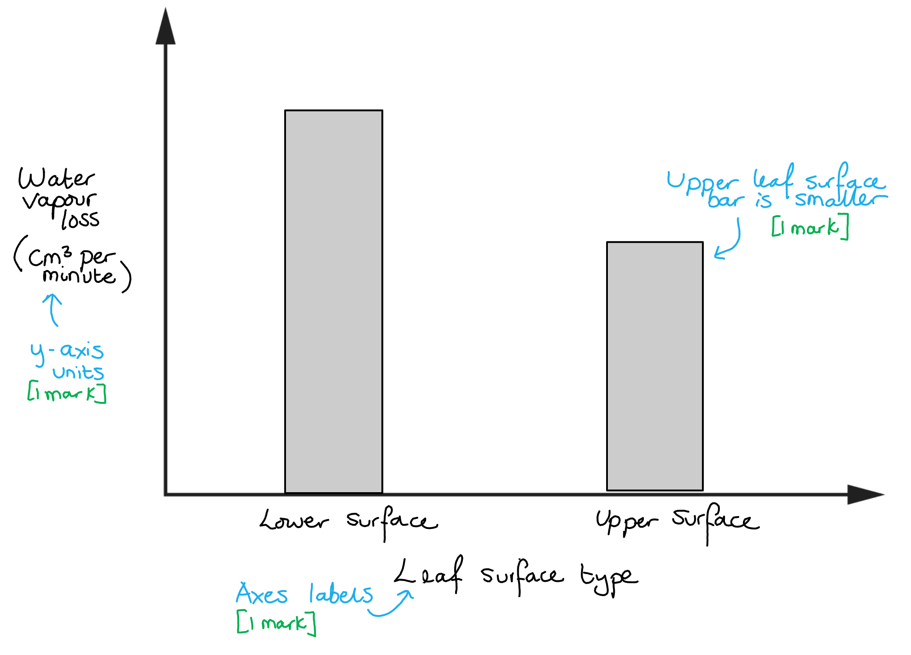
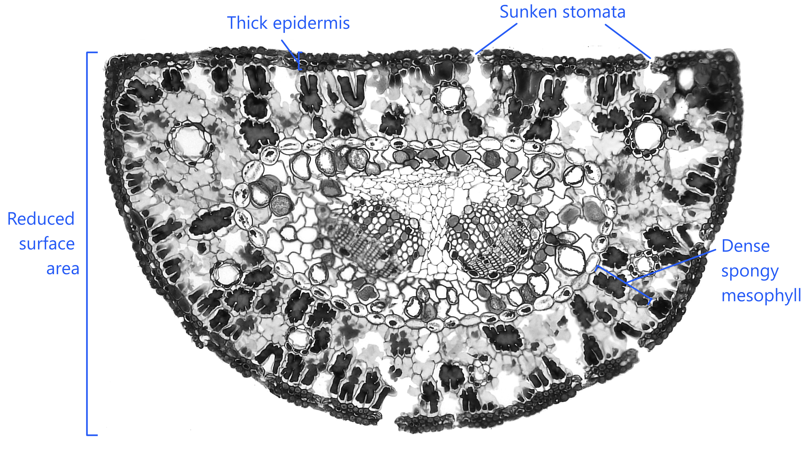
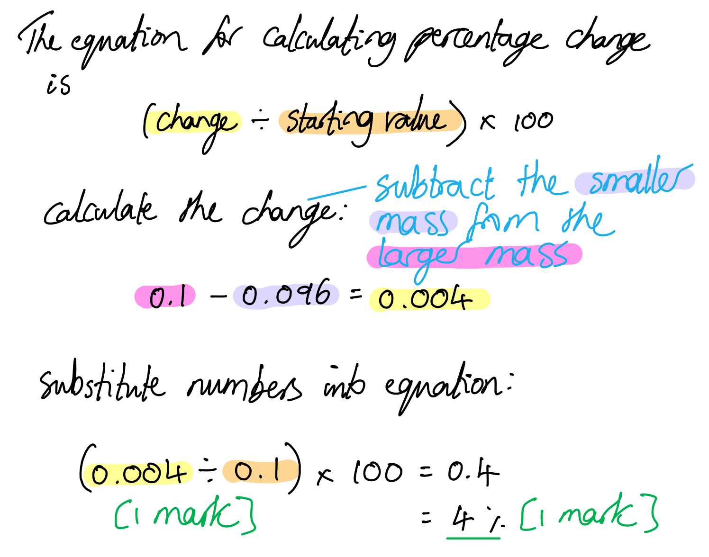
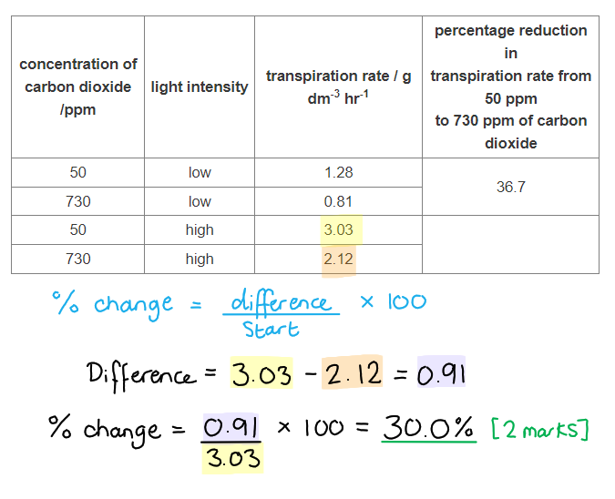
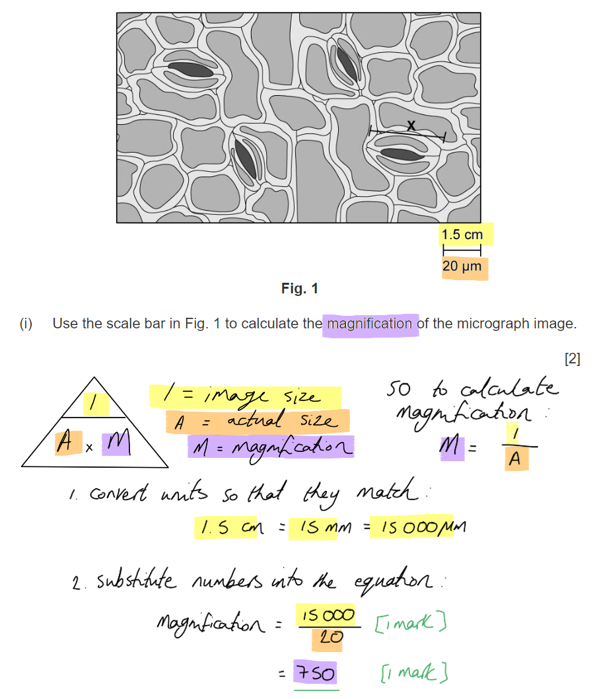
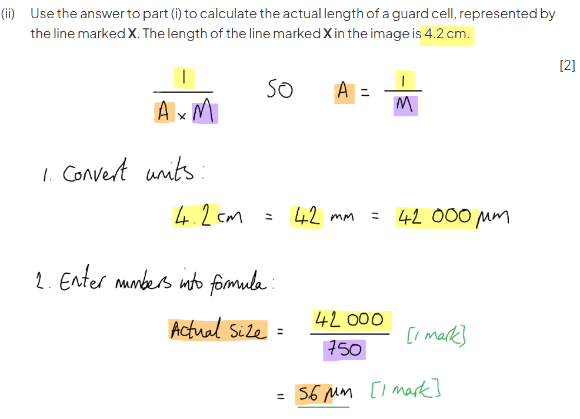

# Mark Schemes — Transport Mechanisms
**7. Transport in Plants** · Cambridge (CIE) AS biology (9700)

## Multiple Choice Questions (30 questions)

### Q1
**Final answer:** **The correct answer is ****B**** because:**

**Final answer:** **Movement against a concentration gradient requires ****energy****, therefore the loading of sucrose into the phloem against its concentration must be an active process.**

> *A** is incorrect as just because something is moving against gravity doesn’t mean that it is an active process, e.g. water in the xylem moves against gravity, yet is a passive process.*

> *C** is incorrect; sucrose in the phloem moves down its concentration gradient, although this isn't the main driving force of phloem transport, which is the hydrostatic pressure gradient.*

> *D** is incorrect as the movement of water due to osmosis occurs down a water concentration gradient and so is a passive process.*

### Q2
**Final answer:** **The correct answer is ****C**** because:**

**Final answer:** **As the transpiration rate increases, so does the transpiration pull; this creates ****negative pressure**** in the xylem vessels which risks collapsing the xylem vessel elements. ****Lignin**** ****in the xylem vessel walls**** provides strength that prevents the cells from collapsing under negative pressure.**

> *A** is incorrect; the narrow lumen of the xylem vessels increases capillary action and so aids the upward movement of water, but does not provide structural aid that prevents vessel collapse.*

> *B** is incorrect; the lack of cross walls in the xylem is an important feature that aids the upward flow of water, but it does not provide structural support, if anything it will have the opposite effect.*

> *D** is incorrect; cohesion aids the upward movement of water but does not assist the xylem in maintaining structure. Cohesion, in fact, contributes to cohesion tension, generating the negative pressure that puts strain on the cell walls.*

### Q3
**Final answer:** **The correct answer is ****C**** because: **

**Final answer:** **Plasmodesmata**** are narrow threads of cytoplasm that pass through the cell walls of adjacent plant cells, therefore when water moves via the plasmodesmata it is passing through the ****symplast**** pathway **

**Final answer:** **In the ****endodermis**** in the root is the ****Casparian**** ****strip**** which blocks the apoplast pathway, so all water crossing the endodermis must travel via the ****symplast**** pathway**

**Final answer:** **When water passes through cell membrane into cytoplasm it is in the ****symplast**** pathway **

**When water enters a plant cell wall but does not enter the cytoplasm it is in the ****apoplast**** pathway **

### Q4
**Final answer:** **The correct answer is ****D**** because:**

**Final answer:** **Root pressure is a ****hydrostatic**** force that pushes water up the xylem; it depends on the ****active transport**** ****of mineral ions from the soil**** into the xylem vessel elements, which ****lowers the water potential**** and causes water to enter the xylem by ****osmosis****.**

**Final answer:** **If the soil has little oxygen, ****aerobic respiration cannot occur**** so there will be ****less ATP for active transport****; fewer ions will enter the xylem, less osmosis will occur, and less hydrostatic pressure will be generated in the root xylem.**

### Q5
**Final answer:** **The correct answer is ****C**** because:**

**Final answer:** **Diffusion, mass flow and osmosis all occur in both the xylem and the phloem:**

- **Water enters and leaves the xylem vessels and sieve tube elements by ****osmosis****, which is a form of ****diffusion**
- **Mass flow**** is the transport of substances in bulk; this applies to both water and solutes in both the xylem and phloem**

### Q6
**Final answer:** **The correct answer is ****C****:**

**Final answer:** **1 is correct as the standard deviations for 20 mg and 40 mg overlap in both apoplast and symplast pathways, showing that there is ****no significant difference in the Cd content of the pathways**** at the two different doses.**

**Final answer:** **3 is correct as the Cd in the apoplast pathway after a 40 mg dose is around 0.2 mg kg-1 and the Cd in the symplast pathway at this dose is around 0.5 mg kg-1.**

**Final answer:** **0.2 x 2.5 = 0.5**

**Final answer:** **4 is correct as both apoplast and symplast pathways contain a very small measure of Cd even when the plants had not received a dose.**

> *2 is incorrect as there is not enough information in the graph to reach this conclusion; the symplast pathway involves the passage of substances through cell membranes, but membranes do not stop the passage of all substances; we would need to know the size and polarity of Cd.*

### Q7
**Final answer:** **The correct answer is ****A**** because: **

- **Sucrose is transported from ****X**** (photosynthetic cells in the leaf) to ****Y ****(companion cell) ****against its concentration gradient****, therefore the transport must be active**
- **Water enters ****Z**** (the sieve tube element) from the source cells in the leaf; this ****reduces**** ****the water potential ****in the sieve tube element**
- **T ****(the sieve tube element) is near the sink, so sucrose is actively transported out into the surrounding cells; this removal of solutes causes an increase in water potential and water leaves T down a water potential gradient, ****reducing the hydrostatic pressure**

### Q8
**Final answer:** **The correct answer is ****B**** because:**

**Final answer:** **Sucrose is a ****non-reducing**** ****sugar**** which means it is ****less**** ****reactive than glucose ****and is therefore a better transport molecule. Sucrose is more likely to complete the journey in the phloem without reacting with other molecules along the way.**

**Final answer:** **Why does the plant not use maltose for transport instead of sucrose?  **

**Final answer:** **Although this might seem to make more sense, as maltose would be easier to convert to starch on arrival, remember that maltose (like glucose) is also a reducing sugar, therefore would be more likely than sucrose to react.**

> *A** is incorrect as sucrose is **not** easier than glucose to convert into starch as the **fructose** molecule in sucrose must first be changed back into a glucose before starch can be made*

> *C** is incorrect as neither glucose nor sucrose can pass directly through a cell membrane as they are both **polar molecules*

> *D **is incorrect as sucrose is** soluble*

### Q9
**Final answer:** **The correct answer is ****C**** because: **

**Final answer:** **Water moves up the xylem once the water that was in the leaf cells has ****evaporated from the surface of spongy mesophyll cells**** in the leaf; this loss of water from leaf cells lowers the water potential in the leaves and**** draws more water upwards**** into the leaf cells to replace the water that has been lost; the faster water evaporates, the faster more water will be pulled upwards in the xylem.**

> *A** affects root pressure, so has a small effect on the rate of water movement in the xylem, but this is insignificant in comparison to the influence of C.*

> *B** and **D** are relevant to the rate of water movement in the xylem, as they affect the rate at which water evaporates from the spongy mesophyll cells, but these factors can be said to affect water movement **indirectly**.*

### Q10
**Final answer:** **The correct answer is ****C**** because:**

**Final answer:** **The outward movement of phloem sap into aphids in the absence of suction indicates that the liquid in the phloem is ****under high hydrostatic pressure****. The increased speed at which this occurs nearer to the source shows that ****hydrostatic pressure is greater at the source than at the sink****, so there is a pressure gradient driving the flow direction.**

> *A** describes the result of **cohesion tension in the xylem** and is not evidence of any events occurring in the phloem.*

> *B** is evidence that shows that **active transport** occurs in translocation, but is not relevant to pressure and pressure gradients.*

> *D** is evidence for the** role of sieve tubes** in phloem transport but again does not provide any evidence that is relevant to pressure.*

### Q11
**Final answer:** **The correct answer is ****D**** because:**

**Final answer:** **Increasing atmospheric humidity**** ****would decrease the water lost via ****transpiration**** as it would ****reduce the water vapour potential gradient**** between the inside of the leaf and the outside. The reduction in transpiration would mean a ****weaker transpiration pull**** and the flow of water through the xylem would be slower.**

> *Increasing** **air temperature, light intensity or wind speed would increase the rate of transpiration, therefore would increase the flow through the xylem.*

### Q12
**Final answer:** **The correct answer is ****C**** because:**

**Final answer:** **Water can ****cross the root cortex via either the symplast or the apoplast pathway****, so it is correct to say that water sometimes crosses the root via the apoplast pathway.**

**Final answer:** **All water ****must pass through the symplast pathway**** to cross the endodermis into the xylem due to the presence of the ****Casparian strip ****which blocks the movement of water through the apoplast pathway; all water that crosses the root is therefore diverted into the symplast pathway.**

### Q13
**Final answer:** **The correct answer is ****C**** because:**

**Final answer:** **Statements 1, 2 and 4 are correct because the**** trapping of water vapour**** due to leaf hairs, stomata in sunken pits, and the rolled leaf, ****reduces the water vapour concentration gradient ****between the inside of the leaf and the outside air; this reduced gradient slows down loss of water in transpiration.**

> *Statement 3 does describe a xerophytic strategy, but this feature is not visible in the image; the cells of the mesophyll layer here are not distinct enough to observe clearly.*

### Q14
**Final answer:** **The correct answer is ****C:**

**Final answer:** **Water's ability to act as a solvent is essential in plant transport, as it allows the transport of mineral ions and organic compounds in solution, but this property does not contribute ****directly**** to the movement of water in the xylem vessels.**

**Final answer:** **Note that it could be argued that being a solvent contributes ****indirectly**** to water movement in the xylem, as changes in water potential create gradients that allow water to move from cell to cell as it enters and exits the xylem vessels.**

> *Water is a polar molecule, meaning that it forms hydrogen bonds with other water molecules (cohesion) and with the walls of xylem vessels (adhesion); these forces allow water to move up the xylem in a continuous column.*

### Q15
**Final answer:** **The correct answer is ****A**** because:**

**Final answer:** **During the summer the cells of the leaf carry out photosynthesis, so they are a ****source**** of sucrose, while during the spring the cells of a new leaf may not yet have started to photosynthesise, so they may act as a ****sink****, receiving sucrose from stores in the roots.**

> *Statement **B** is incorrect because sucrose may be transported from X to W, but it may also be transported from W to X; the **direction of movement depends on the locations of sources and sinks**, which vary depending on the time of year and the processes taking place inside the plant.*

> *Statement **C** is incorrect because Y is a companion cell, so **actively loads sucrose** into the phloem.*

> *Statement **D** is incorrect because active transport does not occur between the cells of the sieve tube element; mass flow occurs due to a **hydrostatic pressure gradient**.*

### Q16
**Final answer:** **The correct answer is ****B**** because:**

**Final answer:** **Statement ****1**** is correct; the movement of minerals into root hair cells (either by diffusion or active transport)**** lowers the water potential**** of root hair cells; this causes water to move into the root hair cells**** down a water potential gradient****, by osmosis.**

**Final answer:** **Statement ****2**** is correct; there is often a lower concentration of mineral ions in the soil than inside plant roots, meaning that root hair cells often rely on ****active transport ****to take up mineral ions and generate the water potential gradient needed for water uptake. In the absence of respiration, e.g. during flooding where oxygen availability is limited,**** ATP production will stop**** and the active uptake of minerals cannot occur, reducing the uptake of water by osmosis.**

> *Statement **3** is incorrect; **root pressure **generated by the uptake of water in the roots does make a small contribution to the upward movement of water in the transpiration stream, but the main driving force is **loss of water at the leaves by transpiration**.*

### Q17
**Final answer:** **The correct answer is ****C**** because:**

**Final answer:** **2 is correct as water transported by the symplast pathway crosses the cell membranes of plant cells. Water cross cell membranes from a high to a low water potential.**

**Final answer:** **3 is correct as the Casparian strip blocks the apoplast pathway in the endodermis, therefore all water must travel via the symplast pathway to cross from the root cortex into the xylem.**

> *1 is incorrect as there is no cytoplasm in the xylem vessel elements so movement via the symplast pathway would not be possible. Water in the xylem moves due to transpiration pull and root pressure rather than a water potential gradient.*

> *4 is incorrect as plasmodesmata are narrow threads of cytoplasm that pass through the cell walls of adjacent plant cells, therefore all water that passes through plasmodesmata is moving via the symplast pathway and not the apoplast pathway. In addition to this, water that travels via the apoplast pathway does not cross cell surface membranes.*

### Q18
**Final answer:** **The correct answer is ****D**** because:**

**Final answer:** **The transpiration stream ensures that water reaches the cells in the stem and leaves of plants, maintaining ****cell turgor****. In non-woody plants and in the leaves of all plants, it is this ****outward pressure**** of the cytoplasm on the cell walls that ****maintains tissue structure****. If the water supply is interrupted then cells may become plasmolysed, causing the plant stem and leaves to ****wilt****.**

> *A** is incorrect because water exits mature xylem vessels via **pits**; lignification means that the cell walls are otherwise impermeable to water.*

> *B** is incorrect because **transpiration pull is generated by transpiration**, **not** by the transpiration stream; be careful not to mix up these two terms.*

- *Transpiration** is the loss of water at the leaves by evaporation; this generates transpiration pull*
- *The **transpiration stream** is the upward movement of water in the xylem*

> *C** is incorrect because transpiration occurs due to evaporation of water from the surface of **spongy mesophyll cells**. There are no air spaces around palisade mesophyll cells, so water cannot evaporate from their surface in this way.*

### Q19
**Final answer:** **The correct answer is ****C**** because:**

**Final answer:** **The evaporation of water from the leaf (transpiration) is the driving force of water movement in the xylem; ****transpiration rate is high during the day**** (due to higher air temperatures and the stomata being open), therefore there is a greater ****transpiration pull****.**

**Final answer:** **This transpiration pull is able to draw water up the xylem thanks to the ****cohesive**** and ****adhesive**** properties of water; this creates ****tension**** inside the xylem, drawing the walls of the xylem vessels inwards. While the effect per individual xylem vessel is tiny, collectively the effect is large enough to ****reduce the overall circumference of a tree trunk****.**

**Final answer:** **At night the transpiration pull is reduced, therefore the water is under less tension and this lack of tension causes a slight widening of the xylem vessels**

### Q20
**Final answer:** **The correct answer is ****B**** because:**

**Final answer:** **Mass flow can occur in either direction, depending on which part of the plant is acting as a source and which is acting as a sink. The movement is driven by hydrostatic pressure, meaning that ****the flow in any one sieve tube can only occur in one direction at a specific time****, so flow in opposite directions at the same time must occur in ****different sieve tubes****.**

> *Active transport is involved with the loading and unloading of sucrose in the phloem, and so serves a different purpose to mass transport within the sieve tubes. Active transport is involved in both upward and downward phloem transport. *

### Q21
**Final answer:** **The correct answer is ****C**** because:**

- **Sucrose is soluble and therefore it ****lowers**** ****water potential ****in the phloem **
- **The decrease in water potential results in an ****increase in**** ****hydrostatic pressure ****as water moves into the phloem by osmosis**

### Q22
**Final answer:** **The correct answer is ****B**** because:**

- **The uptake of minerals and ions from the soil and into the**** ****root hair cells takes place ****against**** ****a concentration gradient**
- **Energy must be used to bring the minerals from an area of ****low**** concentration (in the soil) to an area of ****high**** concentration (inside the root hair cell) **
- **The process is known as ****active transport**** and involves carrier proteins in the outer membrane of the root hair cell**
- **ATP**** is needed to drive the carrier proteins **

### Q23
**Final answer:** **The correct answer is ****D**** because:**

**Final answer:** **This describes an aspect of the mechanism of**** mass transport in the phloem****, not the movement of water in the xylem.**

> *A**-**C** all correctly explain factors that contribute to the transpiration stream in the xylem.*

### Q24
**Final answer:** **The correct answer is ****B**** because: **

**Final answer:** **Cell ****B**** has a thin cylindrical structure and is linked, via ****plasmodesmata****, to a ****sieve tube element ****(cell ****C****) **

> *Cell **C** is identifiable as a **sieve tube element **due to its lack of nucleus and sieve plates.*

> *Cells **A** and **D** are part of the surrounding structural tissue, so are likely to be **parenchyma** cells.*

### Q25
**Final answer:** **The correct answer is ****C**** because:**

**Final answer:** **The Casparian strip ****blocks the movement of water through the**** ****apoplast**** ****pathway****, diverting it into the symplast pathway; this forces water to cross cell surface membranes, allowing**** increased control**** over the substances that reach the xylem (the cell walls of the apoplast pathway are fully permeable).**

> *Statement 1 is incorrect because, while the Casparian strip is a waxy material, it is found in the **endodermis **and not in the cortex of the root.*

### Q26
**Final answer:** **The correct answer is ****D**** because the ****salt**** that was in the sea water will be left in the soil after the water has evaporated. This salt will ****lower the water potential**** of the soil and will reduce the volume of water that the plant roots can absorb; plants may even lose water to the surrounding soil in this scenario.**

### Q27
**Final answer:** **The correct answer is ****C ****because:**

**Final answer:** **Fleshy leaves, also known as ****succulent leaves****, allow plants to ****store water in their tissues****. While this is a feature of xerophytic plants, it does not reduce water loss but rather allows the plants to survive without a water supply for an extended time period.**

> *A **lower stomatal abundance** leads to a reduction in water loss as there will be less opportunity for evaporation of water from the mesophyll tissue.*

> *Both **epidermal hairs** and **sunken stomata **lead to a reduction in the transpiration rate by ensuing a **boundary layer **of humid air around the stomata. This boundary layer reduces the water vapour potential gradient, therefore reducing the water lost during transpiration. *

### Q28
**Final answer:** **The correct answer is ****C**** because the cells in the ****spongy mesophyll**** layer are in direct contact with air in the air spaces. Water diffuses out of the cells in the spongy mesophyll, due to the air having a lower water potential than the cells, before evaporating and exiting the leaf via the stomata.**

> *The cells on the outer surface of the epidermal cell layer are also in contact with the air, however, not much water is lost here due to the presence of a waterproof waxy cuticle.*

### Q29
**Final answer:** **The correct answer is ****A**** because:**

**Final answer:** **Statement 1 is correct; carbohydrates are transported in the phloem in the form of**** sucrose****; this sugar is less reactive than glucose, and is an efficient way of transporting energy-releasing molecules around the plant.**

**Final answer:** **Statement 2 is correct, e.g. during the summer the photosynthesising leaves are a source while the roots are a sink, but in the spring the storage organs in the roots become a source while the new leaf buds are a sink.**

> *Statement 3 is incorrect; phloem loading is an **active process** that requires ATP.*

> *Statement 4 is incorrect as **nitrates from the soil enter the plant in the xylem.** While it is possible for the phloem to contain nitrates, e.g. if nitrates are being recycled from one part of a plant to another, they do not appear to move from the soil into the phloem.*

### Q30
**Final answer:** **The correct answer is ****A**** because the apoplast pathway is the movement of water via the cell walls.**

> *B** shows movement of water through the cytoplasm and vacuoles of cells; this is the symplast pathway.*

> *Pathways **C** and **D** do not occur in plants, as **C** shows movement that involves the cytoplasm, vacuoles, and cell walls, while **D** involves no cells at all.*

## Structured Questions (13 questions)

### Q1
The tissues marked W, X, and Y are:

- W = vascular tissue/bundle; **[1 mark]**
- X = phloem; **[1 mark]**
- Y = xylem; **[1 mark]**

**[Total: 3 marks]**
Increasing callose deposition might influence the permeability of plasmodesmata as follows:

**Final answer:** **Any ****two**** of the following:**

- Callose accumulates/gathers in the corners/neck/ends of the cell wall surrounding the plasmodesmata; **[1 mark]**
- Callose causes the corners/neck of the plasmodesmata to meet in the middle / extend further into the cytoplasm; **[1 mark]**
- Callose deposition reduces the diameter of the plasmodesmata (reducing permeability to larger molecules);** [1 mark]**

**[Total: 2 marks]**
The presence of lead in the soil might reduce plant water uptake at the roots via plasmodesmata because:

- Lead could increase the activity of callose synthase (enzymes); **[1 mark]**
- Increased activity of callose synthase (enzymes) leads to increased callose deposition **and** reduced plasmodesmata permeability; **[1 mark]**
- Less water is able to move across the cortex via plasmodesmata / the rate at which water can move across the cortex via the plasmodesmata is reduced; **[1 mark]**

**[Total: 3 marks]**

> *As ever with **suggest** questions you are not expected to have come across this idea before. The question tells you that heavy metals such as lead are thought to influence callose synthase activity, and that some plants have reduced water uptake from the soil as a result. For water uptake via the plasmodesmata to be reduced, the permeability of the plasmodesmata must be reduced. We know from part (b) that this can be achieved by an increase in callose deposition, so the lead in the soil must somehow work to increase the activity of the enzymes that produce callose; you are not expected to give details of how this might work.*
Another pathway by which water can move across the root cortex is:

**Final answer:** **Any ****three**** of the following:**

- The apoplast pathway; **[1 mark]**
- Water moves through the cell walls / through the spaces between the cells/intercellular spaces; **[1 mark]**
- Water moved by diffusion / due to forces of cohesion between water molecules; **[1 mark]**
- When water reaches the endodermis it is forced inside the cells (into the symplast pathway) by the Casparian strip; **[1 mark]**

**[Total: 3 marks]**

> *Parts (b) and (c) describe the movement of water through plasmodesmata; this is the symplast pathway so part (d) here must be asking for a description of the apoplast pathway. *

### Q2
(i) The independent and dependent variables in this investigation are:

- *Independent variable:* the side/surface of the leaf; **[1 mark]**
- *Dependent variable:* distance / how far the water moves (down) / the decrease (in volume) of the water in the graduated tube; **[1 mark]**

(ii) A method by which students could use the apparatus to measure the loss of water vapour in order to test the hypothesis is:

- Cut plant underwater / airtight seal on cup; **[1 mark]**
- Use upper and lower surfaces of leaves; **[1 mark]**
- Suck water into graduated tube and then close/attach clip; **[1 mark]**
- Record the distance moved / volume change at start and end of a time; **[1 mark]**

**AND**

*Control variables / safety*

**Final answer:** **A ****maximum of two**** of the following:**

- Described method of keeping the same light intensity, e.g. close curtains and use fixed lightbulb wattage / keep light source at the same distance from plant; **[1 mark]**
- Described method of keeping same temperature, e.g. temperature-controlled room; **[1 mark]**
- Same humidity; **[1 mark]**
- Described method of keeping the same air flow, e.g. close all windows and doors; **[1 mark]**
- Same leaf / species of leaf / use the same plant; **[1 mark]**
- Re-set the water level between repeats; **[1 mark]**
- Collect at least 3 results for each leaf surface **AND **calculate a mean / identify anomalies; **[1 mark]**
- A stated risk **AND** a precaution, e.g. cutting plant sample with knife **AND** make sure to cut away from body onto board; **[1 mark]**

**[Total: 8 marks]**
(i) The students obtained the measurement needed to work out the results as per unit area of leaf by:

- Measure radius of the area of leaf under the cup; **[1 mark]**
- Use πr2 (to work out the area); **[1 mark]**

**OR**

- Use a (transparent) grid on the area under the cup; **[1 mark]**
- Count the squares (in the grid); **[1 mark]**

(ii) The students could use this measurement and their results for the loss of water vapour to find out if their results support the hypothesis by...

**Final answer:** **Any ****three ****of the following:**

- Divide water loss by area or by time; **[1 mark]**
- Divide result (from mp 1) by the variable not used in mp 1; **[1 mark]**
- Calculate the volume of water loss; **[1 mark]**
- Compare (measurements) from both sides; **[1 mark]**
- Carry out statistical test / t-test (to see if difference is significant); **[1 mark]**

(iii) A bar chart to show the results if the hypothesis was supported should have the following features...

- *x-axis:* leaf surface, *y-axis:* water (vapour) loss / movement; **[1 mark]**
- *y-axis: *correct volume or distance unit and time unit or area unit on y-axis; **[1 mark]**
- Bar(s) are identified and upper leaf surface bar is smaller; **[1 mark]**

**[Total: 8 marks]**
(i) The anomalous values are:

**Final answer:** **Any ****two ****of the following:**

| **experimental condition** | **distance moved by water column** **/ cm per unit time** |   |   |   |   |
|---|---|---|---|---|---|
| **trial 1** | **trial 2** | **trial 3** | **trial 4** | **trial 5** |   |
| high light intensity | 7.3 | 7.5 | 7.8 | 6.2 | 7.0 |
| no light | 0.0 | 0.0 | 1.5 | 0.2 | 0.0 |
| high temperature | 4.4 | 2.8 | 3.2 | 4.8 | 3.1 |
| strong air current | 1.5 | 2.4 | 1.1 | 0.9 | 1.0 |

(ii) One conclusion is:

**Final answer:** **Any ****one ****of the following:**

- High light intensity causes aperture to be wider; **[1 mark]**
- High temperature causes aperture to be wider than strong air currents / no light; **[1 mark]**

**[Total: 3 marks]**

> *You need to make sure your answer addresses the question specifically and avoids being too vague, for example statements like ‘the environment affects the stomata’ or ‘the aperture varies with the environment’ would not be enough to gain marks here. *

### Q3
(i) The leaf functions as sink during days:

- 10-13; **[1 mark]**

***Accept**** answers that include day 9 and/or 14*

(ii) The leaf functions as source during days:

- 13-33; **[1 mark]**

***Accept**** answers that begin with day 14*

**[Total: 2 marks]**

> *Up until around day 13 the leaf has a negative sucrose content, meaning that it is using sucrose that it does not contain; at this point sucrose is being imported mean that the leaf is acting as a sink. Once the leaf sucrose content increases above 0 the leaf can begin to export sucrose and will therefore act as a source.*
Mitochondria aid the loading of sucrose into the sieve tube as follows:

**Final answer:** **Any ****five**** of the following:**

- (Mitochondria are) the site of ATP production (during aerobic respiration); **[1 mark]**
- ATP powers H+/proton pumps in the walls of the sieve tube; **[1 mark]**
- H+ ions are pumped from the companion cell/**B** into the cell walls (creating a H+ ion diffusion gradient); **[1 mark]**
- The H+ ions diffuse back into the companion cell via cotransporter proteins; **[1 mark]**
- Cotransporter proteins transport sucrose molecules into the companion cell against the (sucrose) concentration gradient; **[1 mark]**
- Sucrose moves into the sieve tube by diffusion / down the (sucrose) concentration gradient; **[1 mark]**

**[Total: 5 marks]**

> *The question links mitochondria with the loading of sucrose into the sieve tube, so this needs to be the end point of your explanation. Note that the question is worth 5 marks; this should be a clue that the whole process is expected.*
The loading of sucrose into the sieve tube enables mass flow as follows:

**Final answer:** **Any ****three**** of the following:**

- The sucrose lowers the water potential of the sieve tube; **[1 mark]**
- Water moves into the sieve tube by osmosis; **[1 mark]**
- (The influx of water causes) an increase in hydrostatic pressure; **[1 mark]**
- (Phloem) sap moves through the sieve tube/phloem down a (hydrostatic) pressure gradient / from high (hydrostatic) pressure to low (hydrostatic) pressure; **[1 mark]**

**[Total: 3 marks]**

> *The question asks you to link **sucrose loading **with mass flow and makes no reference to the role of sucrose unloading in maintaining the hydrostatic pressure gradient. You should therefore limit your answer to points that relate to the loading of sucrose into the phloem as no credit will be available for the latter.*

### Q4
Features that indicate the pine trees are xerophytes can be explained as follows:

**Final answer:** **Any ****two pairs of points**** from the following:**

- Sunken stomata / stomata are in pits; **[1 mark]**
- This traps water vapour in the pit **SO** reducing the water vapour potential gradient; **[1 mark]**

**AND/OR**

- The leaf has a reduced surface area; **[1 mark]**
- This reduces exposed surface area / the number of stomata **SO** less water loss occurs by diffusion; **[1 mark]**

**AND/OR**

- Densely packed mesophyll / small air spaces; **[1 mark]**
- Reduced surface area from which water vapour can evaporate; **[1 mark]**

**AND/OR**

- Thick (upper/outer) epidermis; **[1 mark]**
- Reduced water loss by evaporation; **[1 mark]**

**[Total: 4 marks]**

> *You could be presented with images of unfamiliar structures in an exam, so be prepared to apply your knowledge to new scenarios.*

The biological drawing should have the following features:

- A group of cells are drawn that closely resemble the visible structures; **[1 mark]**
- Takes up most of the space provided **AND** clear pencil lines **AND** no shading; **[1 mark]**
- At least **five** of the following structures are labelled; **[1 mark]**

  - Epidermis
  - Stoma/stomata
  - Vascular bundle
  - Xylem
  - Phloem
  - Palisade mesophyll cell
  - Spongy mesophyll cell
  - Air space
  - Endodermis
- At least **two** annotations are made, e.g. relating to xerophytic structures / explaining how a structure differs from a regular leaf structure; **[1 mark]**

**[Total: 4 marks]**
The statement that 'translocation in the phloem can be regarded as the plant equivalent of mammalian circulation' can be evaluated as follows...

*Points in agreement with the statement:*

**Final answer:** **A ****maximum of**** ****four**** of the following:**

- Both involve transport inside tubes/vessels; **[1 mark]**
- Both involve transport of essential nutrients / named nutrients; **[1 mark]**
- Both rely on hydrostatic pressure; **[1 mark]**
- Both use water as a solvent / major constituent; **[1 mark]**
- Both can transport waste products; **[1 mark]**
- Both can transport 'hormones';
- Both exchange substances with neighbouring cells; **[1 mark]**

*Points against the statement:*

**Final answer:** **A ****maximum of**** ****four**** of the following:**

- Oxygen / CO2 do not travel to plant cells via the vascular system **WHILE** mammalian circulation transports these gases; **[1 mark]**
- There is no physical pump in the phloem **WHILE** there is a mammalian heart; **[1 mark]**
- There are no valves in the phloem **WHILE** veins in mammals have valves; **[1 mark]**
- Phloem contents do not circulate / are not within a loop **WHILE **mammalian circulation is a closed loop; **[1 mark]**
- Phloem sap contains only dissolved substances **WHILE **mammalian circulation involves solid components such as platelets and blood cells; **[1 mark]**
- Phloem contain sieve plates **WHILE **blood vessels contain no cross walls; **[1 mark]**
- Phloem sieve tubes are single cells **WHILE** blood vessels are multicellular structures; **[1 mark]**

**[Total: 6 marks]**

> *It is vital that you give a balanced account for an 'evaluate' question, stating reasons to agree with, and to disagree with the central statement.*

> *Remember that contrasting features must clearly state how plant and mammalian transport are **different**, so each statement must refer to both plants and mammals.*

### Q5
The percentage change in mass for the leaves in set **X** over the first 90 minutes is:

- 0.004 ÷ 0.1; **[1 mark]**
- 4 %; **[1 mark]**

***Accept**** the correct answer of 4 % for full marks in the absence of other calculations*

**[Total: 2 marks]**

The change in mass of the leaves in set **X** can be explained as follows:

- Water vapour moves out of the leaves through the stomata; **[1 mark]**
- Water vapour moves by diffusion / down a water (vapour) potential gradient / water vapour is present at a higher concentration inside the leaves than outside; **[1 mark]**
- The leaves have been removed from the plant so the lost water is not replaced; **[1 mark]**

**[Total: 3 marks]**
(i) The leaf that comes from set **Y** is:

- (Leaf) 1; **[1 mark]**

(ii) The reason for this is that:

- (Leaf 1 has) sunken stomata / hairs (around stomata) / curled leaf shape; **[1 mark]**
- Water vapour is trapped in the pit / area around stomata / within the leaf **SO **reducing the concentration gradient / water vapour gradient / rate of diffusion of water vapour; **[1 mark]**

**[Total: 3 marks]**

> *The graph in Fig. 1 shows that leaf set **Y** loses water more slowly than leaf set **X**; this suggests that leaves from set **Y** are likely to have xerophytic adaptations. The xerophytic adaptations visible in Fig. 2 are found in marram grass and are all related to reducing the water vapour gradient between the inside of the leaf and the outside. These features include the curled leaf shape, sunken stomata, and hairs within the curled leaf.*
Xerophytic adaptations other than those relevant to part c) include:

**Final answer:** **Any ****two ****pairs of points from the following:**

- Small/reduced leaves / spines/needles; **[1 mark]**
- Reduced surface area for water loss / transpiration; **[1 mark]**

**OR**

- Thick waxy cuticle; **[1 mark]**
- Provides a barrier / is less permeable to water loss; **[1 mark]**

**OR**

- Thick/succulent leaves; **[1 mark]**
- Reduced surface area to volume ratio (so less water lost); **[1 mark]**

**OR**

- Dense spongy mesophyll; **[1 mark]**
- Reduced surface area for evaporation of water (into the air spaces); **[1 mark]**

**OR**

- Reduced number of stomata / reduced stomatal density; **[1 mark]**
- Reduced diffusion of water vapour (from stomata); **[1 mark]**

**[Total: 4 marks]**

> *Note that references to succulent stems/leaves, deep roots, or alternative forms of photosynthesis will not be credited here as these are not structural leaf adaptations for the reduction of water loss.*

### Q6
The processes labelled **X** and **Y** are:

- X = osmosis; **[1 mark]**
- Y = evaporation; **[1 mark]**

**[Total: 2 marks]**

> *Process X shows water moving from the vascular bundle into a cell of the spongy mesophyll; when water moves across cell membranes it moves by the process of osmosis.*

> *Process Y shows water moving from the cell of the spongy mesophyll into the air space in the leaf; to do this it must change from a liquid to a gaseous state, a process known as evaporation.*
Transpiration enables water to be drawn up the stem from the roots as follows:

**Final answer:** **Any ****four**** of the following:**

- When water exits / diffuses out of the leaf through the stomata/stoma the water (vapour) potential of the air spaces is reduced; **[1 mark]**
- The lowered water (vapour) potential of the air spaces causes more water to move to the surface of the spongy mesophyll cells; **[1 mark]**
- The loss of water lowers the water potential of the spongy mesophyll cell **AND** water moves into the spongy mesophyll cell (from the xylem / a neighbouring cell) by osmosis; **[1 mark]**
- Water molecules in the xylem are pulled upwards (to replace the water that leaves the xylem by osmosis) due to forces of cohesion between water molecules; **[1 mark]**
- The cohesive forces between water molecules generates transpiration pull; **[1 mark]**
- The movement of water from the roots to the leaves is the transpiration stream; **[1 mark]**

**[Total: 4 marks]**
(i) The structure that is involved with transpiration is:

- (Structure) **G**; **[1 mark]**

(ii) A feature that aids transpiration, and its explanation, includes:

- The cell walls contain cellulose/lignin; **[1 mark]**
- This allows forces of adhesion to form between the walls and water molecules; **[1 mark]**

**OR**

- The cell walls contain lignin; **[1 mark]**
- The vessels are prevented from collapsing inwards **OR** the structure of the lignin allows the cells to flex/bend/stretch; **[1 mark]**

**OR**

- The cells are hollow; **[1 mark]**
- A continuous column of water can form/flow; **[1 mark]**

**OR**

- The cell walls are waterproofed (by lignin); **[1 mark]**
- This prevents the loss of water (by osmosis); **[1 mark]**

**OR**

- The cell walls contain pits; **[1 mark]**
- Water can move from one cell to the next to maintain an unbroken water column; **[1 mark]**

**[Total: 3 marks]**

> *Note that the question asks for a **structural** feature so statements relating to dead cells will not be credited.*
The process of transpiration is unavoidable in plants because:

- The stomata need to be open to allow the uptake of carbon dioxide for photosynthesis; **[1 mark]**
- Water vapour diffuses out of open stomata / moves out of stomata down its concentration gradient; **[1 mark]**

**[Total: 2 marks]**

> *Some plants may have mechanisms to reduce water loss, but none can avoid it altogether; they must have open stomata for the process of gas exchange, and when the stomata are open then water vapour will diffuse out.*

### Q7
(i) The dependent and independent variables are:

- Independent variable = light intensity; **[1 mark]**
- Dependent variable = distance moved by bubble (in a set time) **OR** time taken for the bubble to move (a set distance); **[1 mark]**

(ii) The control variables for this experiment are:

**[1 mark] ****for any ****three**** of the following:**

- Temperature
- Background light intensity
- Light wavelength
- Air movement / wind
- Type/species / age / number/area of leaves of plant shoot
- Humidity
- CO2 concentration
- Time period

**AND**

**[1 mark]**** for any ****relevent**** ****two ****of the following: **

- (Temperature) temperature-controlled room / heat shield / environmental chamber / incubator / cold light source / LED light
- (Background light intensity) dark room (with fixed light) / closed blinds
- (Light wavelength) use the same bulb/lamp
- (Air movement) windows closed / doors closed / fans off or on throughout / limit movement
- (Type / age / area of plant) use same type / species / plant / shoot / age / number of leaves / area of leaves
- (Humidity) any valid way it might be controlled
- (CO2 concentration) any valid way it might be controlled
- (Time period) measure for same time / time over same distance

*Explanation must match two of the three control variables identified above*

**[Total: 5 marks]**

> *You need to make sure you explanations for part (ii) are specific enough, for example stating "use a timer" for the final marking point would not be correct because you need to be specific about what you are using a timer for. *
The potometer shown in Fig. 1.1 could be set up and used as follows:

**Final answer:** **Any ****six ****of the following:**

- Cutting/inserting stem under water; **[1 mark]**
- Use petroleum jelly / silicone gel / silicone tape (to make joints air tight); **[1 mark]**
- Remove tube from water to introduce an air bubble; **[1 mark]**
- Description of method of obtaining a minimum of 5 different light intensities e.g. move light source to be 5 distances from the potometer / changing the wattage of the light bulb; **[1 mark]**
- Description of a method of controlling one variable e.g. same species of plant / same leaf surface area; **[1 mark]**
- Allow (apparatus/plant) to equilibrate before starting measurements; **[1 mark]**
- Setting/resetting/returning air bubble (to start position / between measurements); **[1 mark]**
- Measure distance moved by bubble over a set time **OR** measure time for bubble to move a set distance; **[1 mark]**
- Take a minimum of 2 repeats at each light intensity **AND** take a mean / identify anomalies; **[1 mark]**
- Low/medium risk investigation **OR** cutting stem **AND** cut away from your hand (with scalpel) / cut with secateurs or scissors; **[1 mark]**

**[Total: 6 marks]**

> *For the final marking point above, cutting with a sharp blade away from hands/fingers is advised. If you prefer to use a double blade, e.g. scissors, make sure they are sharp, because a blunt blade can squash the stem and cause xylem vessels to be squeezed shut due to the pressure being exerted. This would mean that the stem is unable to take up water.*
(i) The percentage reduction in transpiration rate from 50 ppm to 730 ppm of carbon dioxide at the high light intensity is:

- 0.91 ÷ 3.03) x 100; **[1 mark]**
- 30.0 (%); **[1 mark]**

(ii) This conclusion may not be valid because:

**Final answer:** **Any ****two ****of the following:**

- Only two concentrations of CO2/light intensities measured; **[1 mark]**
- Only one type/species of plant tested; **[1 mark]**
- The investigation was not replicated/repeated; **[1 mark]**
- Laboratory conditions may not be replicated in the field; **[1 mark]**
- No statistical analysis has been carried out; **[1 mark]**
- Other (stated) variable(s) were not controlled / these can affect transpiration; **[1 mark]**

**[Total: 4 marks]**

### Q8
(i) The magnification of the micrograph image is:

- 15 000 ÷ 20; **[1 mark]**
- x750; **[1 mark]**

(ii) The actual length of the guard cell marked **X** is:

- 42 000 ÷ 750; **[1 mark]**
- 56 μm; **[1 mark]**

**[Total: 4 marks]**
The process of water loss that occurs at the stomata is:

**Final answer:** **Any ****two**** of the following:**

- The movement / loss of water vapour from the inside to the outside of the leaf; **[1 mark]**
- Water vapour moves by diffusion / from a high to low concentration / down its concentration gradient / down a water (vapour) potential gradient; **[1 mark]**
- Known as transpiration; **[1 mark]**

**[Total: 2 marks]**
The changes in tree trunk diameter over the 24 hour period occur because:

**Final answer:** **Any ****four**** of the following:**

- The highest temperature **and** the highest light intensity occur at midday / 12:00; **[1 mark]**
- Stomata are open when light intensity is high / when it is light; **[1 mark]**
- High temperatures increase the rate at which water vapour diffuses from leaves / the rate at which water vapour evaporates from the inner surfaces of leaves; **[1 mark]**
- Hydrogen bonds / forces of cohesion exist between water molecules; **[1 mark]**
- Hydrogen bonds / forces of adhesion exist between water molecules and the walls of the xylem vessels; **[1 mark]**
- At midday / 12:00 / around the middle of the day the walls of the xylem vessels are pulled inwards by the hydrogen bonds / cohesion-tension / negative pressure (reducing the overall diameter of the tree trunk); **[1 mark]**

**[Total: 4 marks]**

> *The cohesive forces between water molecules and adhesive forces between the water molecules and the walls of the xylem are essential in creating a continuous column of water that moves upwards in the xylem vessels as a result of transpiration from the leaves. The attractive forces create a negative pressure inside the xylem which pulls the walls of each xylem vessel inwards slightly; the cumulative effect of the narrowing of every xylem vessel is that the whole tree trunk shrinks in diameter when the rate of transpiration is at its maximum.*
Increased humidity would have the following effect on transpiration:

- (The rate would) decrease; **[1 mark]**

This is because:

- There will be a decreased water vapour / water potential gradient between the inside and the outside of the leaf (and the rate of diffusion of water vapour out of the leaf (transpiration) will slow down); **[1 mark]**

**[Total: 2 marks]**

> *When humidity levels are high there is an increased concentration of water vapour in the air surrounding the leaf. This will decrease the concentration gradient of water vapour between the inside of the leaf and the outside and will lead to a reduced rate of diffusion of water vapour out of the leaf; the rate of transpiration decreases.*

### Q9
The pathways by which water passes from the soil to the cells of the cortex are:

**Final answer:** **Any ****four ****of the following:**

- Apoplast(ic) (pathway) **AND** symplast(ic) (pathway); **[1 mark]**
- Apoplast = cell wall route; **[1 mark]**
- Apoplast pathway involves transport between cellulose fibres / spaces between cells / intercellular spaces / (water) does not cross (cell) membranes; **[1 mark]**
- Symplast pathway involves entry into root hair cell/cell **X** by crossing (partially permeable) cell surface membrane / osmosis; **[1 mark]**
- Symplast pathway continues via cytoplasmic route / within cytoplasm; **[1 mark]**
- Water moves from cell to cell via plasmodesmata; **[1 mark]**
- Some symplast movement can involve the vacuolar route / (water) crosses tonoplast/vacuolar membrane; **[1 mark]**

**[Total: 4 marks]**
There is a greater density of mitochondria in cell **X** than in a cell of the root cortex because:

**Final answer:** **Any ****two ****of the following:**

- (Root hair cell) mitochondria are needed to produce ATP / release energy for active transport (of mineral ions); **[1 mark]**
- (Some) mineral ions enter the root hair cell/cell **X** against the concentration gradient; **[1 mark]**
- (All) mineral ions are transported through the cortex cell passively / dissolved in water; **[1 mark]**

***Reject ****produce energy*

**[Total: 2 marks]**

> *Remember that it is **NEVER** correct to say that energy is produced; here the energy is **released** from the reactants of respiration and used to produce ATP.*

### Q10
The sentences should be completed as follows:

- **Sucrose **is actively transported into the phloem by a group of specialised cells; **[1 mark]**
- The increased solute concentration causes the water potential of the phloem to **decrease**, causing water to enter by **osmosis**; **[1 mark]**
- The movement of water into the phloem increases the **turgor/hydrostatic** pressure at the source, resulting in a **pressure** gradient in the phloem between the source and the sink; **[1 mark]**
- Sugars move by mass flow towards the sink, where they are **unloaded** / **stored **/ **used in respiration**; **[1 mark]**

*Accept amino acids instead of sucrose for marking point 1.*

**[Total: 4 marks]**

> *The question stem presents the sentences in the context of sugar transport, so you are expected to come up with 'sucrose' as an example of an assimilate transported in the phloem. Amino acids are another assimilate transported in this way, however, so this answer is also permitted here.*
Structure B is a:

- Companion cell; **[1 mark]**

**[Total: 1 mark]**
(i) The role of proton pumps in the loading of sugars into the sieve tubes is:

- Transport hydrogen ions into the (companion) cell wall; **[1 mark]**
- By active transport / using ATP; **[1 mark]**

(ii) The role of cotransporter proteins in the loading of sugars into the sieve tubes is...

**Final answer:** **Any ****two**** of the following:**

- Transporting hydrogen ions down their diffusion gradient / back into the cytoplasm; **[1 mark]**
- Transporting hydrogen ions and sugar/sucrose at the same time; **[1 mark]**
- Transporting sugar/sucrose against its concentration gradient; **[1 mark]**

**[Total: 4 marks]**

> *This is a tricky section of the course, but this question has broken down some of the different stages for you to allow you to assess your knowledge of this process. Make sure that you can describe the process of phloem loading step-by-step.*
(i) A possible location of a source during early spring is:

- Roots/tuber/tap root/storage organ; **[1 mark]**

> *At this stage of the year the plant does not yet have fully developed leaves so will not be carrying out photosynthesis. The plant will therefore be reliant on carbohydrate stores in the roots, such as tubers.*

(ii) A possible location of a sink during early spring is:

**Final answer:** **Any ****one**** of the following:**

- Leaf buds/leaves; **[1 mark]**
- Flower buds/flowers; **[1 mark]**
- Growing parts of the plant / meristems / dividing cells; **[1 mark]**
- Parts of roots that are carrying out active transport / absorbing mineral ions; **[1 mark]**

> *During early spring many parts of the plant will be putting on new growth, so there are several options for where the sugars may be offloaded and used. The leaf buds mentioned in the question will need sugars to fuel their growth, as will any new spring flowers.*

> *The growing parts of a plant are called meristems; these regions contain dividing cells that need energy to fuel cell division.*

> *The parts of a root that are absorbing minerals will need energy whenever active plant growth is occurring to fuel the active transport of minerals into root cells.*

**[Total: 2 marks]**

### Q11
(i) Marram grass leaves roll up when water supply is limited because:

- This traps water vapour **SO** lowers the water vapour potential gradient (between the inside and outside of the leaf); **[1 mark]**

(ii) Sedum plants close their stomata during the day but open them at night because:

- This reduces water loss by evaporation (during the heat of the day) **BUT** still allows gas exchange to occur (at night); **[1 mark]**

(iii) Holly leaves have thick waxy cuticles because:

- This reduces water loss by evaporation from leaf surface; **[1 mark]**

**[Total: 3 marks]**
(i) The stomata in leaf A differ from those in leaf B as follows:

**Final answer:** **Any ****one**** of the following:**

- They are sunken / in pits **WHILE** those in B are not; **[1 mark]**
- They are surrounded by hairs **WHILE** those in B are not; **[1 mark]**
- There are fewer stomata in leaf A / there is a lower stomatal density in leaf A / only one stoma is visible in A **WHILE** several can be seen in B; **[1 mark]**

> *Remember that questions asking for differences usually require comparative statements, so be sure to include both leaves in your answer.*

(ii) The differences function as a xerophytic adaptation as follows:

*Stomata in pits or surrounded by hairs*

- Water vapour is trapped **SO** reducing the water vapour potential gradient (between the inside and outside of the leaf); **[1 mark]**

**OR**

*Fewer stomata*

- Less water vapour can diffuse out of the leaf; **[1 mark]**

(iii) Two other structural differences between leaf A and B could be:

**Final answer:** **Any ****two**** of the following:**

- A has a thicker upper epidermis / the upper epidermis of A is three cells thick **WHILE** the upper epidermis of B is one cell thick; **[1 mark]**
- Leaf A has hairs/a hair on its surface **WHILE** leaf B does not; **[1 mark]**
- Leaf A has larger air spaces / a less dense spongy mesophyll; **[1 mark]**
- Leaf A has a thinner palisade mesophyll layer than leaf B **OR** leaf A has a wider spongy mesophyll layer than leaf B; **[1 mark]**

> *Note that points about vascular tissue are not credited here; this is because the difference in vascular tissue here is likely to be due to the angle of the cross-section rather than any significant structural difference between the two leaves.*

> *You may have come across densely packed / narrow spongy mesophyll as an example of a xerophytic feature, which doesn't seem to fit with the observations here. It is worth being aware that different types of xerophyte exhibit different xerophytic features, rather than every single feature being present in every xerophyte; this particular xerophyte species does not exhibit densely packed spongy mesophyll as an adaptive feature, but other xerophytes do have this feature.*

**[Total: 4 marks]**
A visible feature that allows xylem to be identified in Fig.1 is:

- (Spiral/helical) lignin; **[1 mark]**

**[Total: 1 mark]**
The features that would be visible on a tissue plan diagram of Fig. 2 include:

**Final answer:** **Any ****three**** of the following:**

- Upper epidermis; **[1 mark]**
- Palisade mesophyll (layer); **[1 mark]**
- Spongy mesophyll (layer); **[1 mark]**
- Lower epidermis; **[1 mark]**
- Waxy cuticle (upper and/or lower); **[1 mark]**

*Reject any references to cells.*

**[Total: 3 marks]**

> *Remember that tissue plan diagrams show the boundaries between each tissue type and **not** individual cells, so you would be credited for 'palisade mesophyll' here, but not for 'palisade mesophyll cells'.*

### Q12
The substance represented by the arrows in Fig. 1 is:

- Water / H2O; **[1 mark]**

**[Total: 1 mark]**

> *The image here shows the movement of water from the xylem and through the mesophyll cells in the leaf. The water evaporates from the surface of the mesophyll cells and diffuses out of the leaf through the stomata.*

> *The arrows couldn't represent the movement of oxygen or carbon dioxide out of the stomata because they originate from the xylem.*

> *While both water and mineral ions travel in the xylem, mineral ions would not move through the cells and leave the leaf via the stomata as shown in Fig. 1.*
The correct transport processes are as follows:

- X = osmosis; **[1 mark]**
- Y = evaporation; **[1 mark]**
- Z = diffusion; **[1 mark]**

**[Total: 3 marks]**

> *When water moves from cell to cell via the symplast pathway, it does this by osmosis from an area of high water potential to an area of low water potential. When it reaches the spongy mesophyll cells, water evaporates into the air spaces between cells and diffuses out through the stomata down the water vapour concentration gradient.*
(i) The xylem is represented by:

- G; **[1 mark]**

> *The xylem can be distinguished by the thickened, angular walls which occur as a result of the lignification of the cell walls. You should also be aware that xylem vessels are located at the top of vascular bundles within leaves.*

(ii) Structural adaptations of the xylem include:

**Final answer:** **Any ****two ****of the following:**

- Lignified cell walls / cell walls contain lignin; **[1 mark]**
- Dead/hollow tubes **OR **no end walls/plates;
- No cell contents; **[1 mark]**
- Cells have a narrow diamater; **[1 mark]**
- Cell walls contain pits; **[1 mark]**

> *Often questions like this require explanation of how the structural features aid the cells in their role, but this question has just asked you to **state** two features, so no credit is available for additional explanation.*

**[Total: 3 marks]**
(i) The term xerophyte can be defined as follows:

- Plants that are adapted to dry conditions / have adaptations to reduce water loss; **[1 mark]**

(ii) A xerophyte feature visible in the diagram is:

- Spines instead of (broad) leaves / narrow leaves; **[1 mark]**
- Reduced surface area / fewer stomata for water loss/transpiration; **[1 mark]**

**OR**

- Succulent stem; **[1 mark]**
- Water can be stored; **[1 mark]**

**OR**

- Folded/ridged stem; **[1 mark]**
- Allows expansion to contain/store water; **[1 mark]**

> *The question asks for features that are **visible in Fig. 2**, so references to the structure of stomata, or to whether or not the stomata are open, will not be credited here.*

> *Note that the question asks you to **explain** a xerophyte feature, so for full marks you need to say **how** the feature that you have identified allows the plant to **conserve water**.*

**[Total: 3 marks]**

### Q13
The structures can be identified as:

- X = apoplast pathway; **[1 mark]**
- Y = symplast pathway; **[1 mark]**
- Z = Casparian strip; **[1 mark]**

**[Total: 3 marks]**
Z affects water movement through the root as follows:

**Final answer:** **Any ****two**** of the following:**

- Waterproofing / water cannot pass through; **[1 mark]**
- Water moves from the apoplast to the symplast pathway **OR** water can no longer travel through the cell wall and moves into the cytoplasm; **[1 mark]**
- Water must pass across cell membranes **SO** there is increased contol over which molecules/minerals enter the xylem; **[1 mark]**

**[Total: 2 marks]**
Plant roots ensure there is water potential gradient between the soil and the root cells by...

- Active transport of mineral ions from the soil into the root cells; **[1 mark]**

**[Total: 1 mark]**

> *Remember that active transport within root cells is fundamental for plant growth and is also the reason that root cells have many mitochondria in order to obtain the required ATP to drive active transport.*
The transpiration stream of a plant is maintained as follows...

**Final answer:** **Any ****two**** of the following:**

- Water is lost from the leaves/stomata by transpiration / evaporates into leaf air spaces / evaporates from the surface of spongy mesophyll cells; **[1 mark]**
- Water is drawn up the xylem to replace water lost at the leaves **OR** water loss at the leaves generates transpiration pull; **[1 mark]**
- Cohesion/hydrogen bonds cause water molecules to be attracted to each other / ensures that there is an unbroken column of water; **[1 mark]**

**[Total: 2 marks]**

> *Note that the question specifically asks about explanations **other than root pressure**, so descriptions of water entering the xylem via the roots will not be credited here.*
